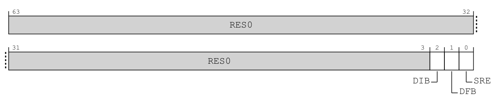
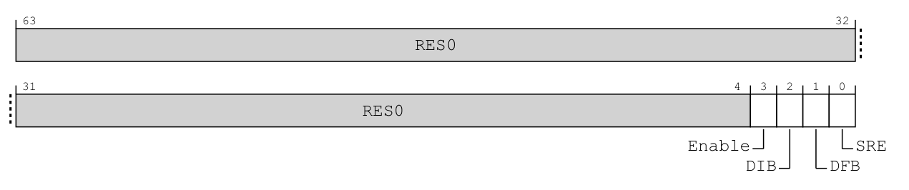
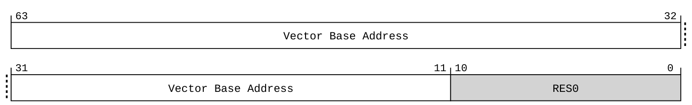
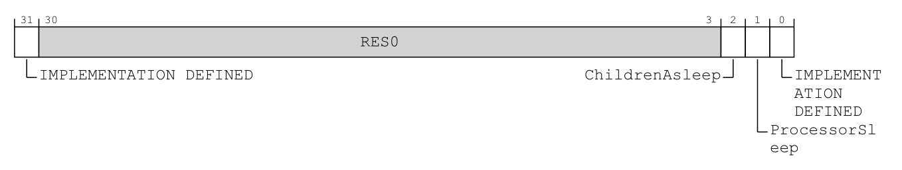
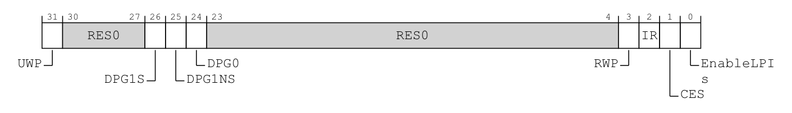

# 第10章\_初始化顺序与硬件完成握手

## 10.1\_全局\_每核与每个来源分别准备什么

**讲解层次：概念层——初始化的所有权与依赖。** 依据 IHI0069 H.b 的模式及访问规则，处理器向量另依据 DDI0487 M.c。

上一章已经确定来源的安全归属、组使能的作用范围，以及请求怎样进入目标异常级。但“某项配置应当成立”还没有回答谁先配置、怎样确认完成。本章只落实这段启动过程：按全局、每 PE、每来源分配准备责任，再检查接口唤醒、写入完成和失败退出。

沿上一章的串口周期倒推启动工作：如果 PE1 刚开始运行，PE0 上的串口处理已经正常，PE1 不能为了准备自己的入口而重置全局来源；设备驱动稍后加入一个来源时，也不应重建每颗 PE 的接收接口。因此，准备工作要按状态所有权分工：全局软件先建立共享基础，每个 PE 建立自己的接收路径，设备路径最后补齐来源与处理数据。

**处理单元（Processing Element，PE）** 是接收并执行处理代码的实体。**再分发器（Redistributor）** 承担每个 PE 的接收侧配置；**处理器接口（CPU Interface；CPU 即 Central Processing Unit，中央处理器）** 承担确认与优先级交接。下表把这三种准备范围与遗漏后的结果对齐：

| 作用域 | 状态由谁准备 | 接收路径需要的条件 | 遗漏后的典型结果 |
| --- | --- | --- | --- |
| 全局 | 拥有控制器全局配置的软件 | 分发器的路由模式、组递送和共享来源基础设置 | 多个 PE 同时受到影响，或某类请求无法分发 |
| 每 PE | 固件与该 PE 的内核启动路径按职责交接 | 对应再分发器可用、CPU Interface 可访问、优先级与组接收设置、异常入口 | 其他 PE 正常，某个 PE 收不到 |
| 每来源 | 控制器驱动与设备驱动各管所属部分 | 类型、优先级、路由、使能；设备处理函数与设备条件准备 | 只有某个来源失败或持续重触发 |

**分发器控制寄存器（Distributor Control Register）** `GICD_CTLR` 包含组使能与路由相关字段。**亲和性路由使能（Affinity Routing Enable，ARE）** 表达按处理器硬件坐标路由的模式；架构字段存在，不代表所有产品都允许切换这个模式。

这里还有一项先后依赖：全局软件必须先确认固件留下的安全状态和路由模式，后续代码才能正确解释前面的分组位、组使能位与目标配置。随手修改模式会改变这些接口的解释环境，所以能够改写的实现也规定了关闭相关组、排空活动来源等前置条件；固定模式的实现则根本没有这一步切换。

`GICD_CTLR` 的地址仍是 `GICD_base + 0x0000`、宽度为 32 位。以下两行沿用两安全状态安全视图，读写须由有权软件执行；组使能字段已经在[第 9.3.2 节](P09_权限_安全分组与异常路由.md#9.3.2_硬件结构与配置归属先对齐)解释。

| 字段 | 位号与属性 | 当前机制中的效果与前提 |
| --- | --- | --- |
| `ARE_S` / `ARE_NS` | 分别为 bit 4 / 5；是否可编程取决于实现 | 选择安全／非安全亲和性路由。若可编程，ARE_S 从 0 到 1 前三组都须关闭，ARE_NS 从 0 到 1 前非安全 Group 1 须关闭；不能从 1 改回 0 |
| `DS` | bit 6；可编程与否由实现决定 | 0 保留两安全状态。可编程实现要改为 1，须先关闭三组且不存在 Active 或 Active and Pending 来源；一旦置 1，只能由硬件复位清回 0 |

这些模式字段的定义与变更前提依据 IHI0069 H.b 的 12.9.4（12-544～12-549）；不是普通设备驱动每次启动时都应改写的参数。

**实现层对照——GIC-600 r1p6：** 产品 3.9（3-63）明确不支持旧式兼容操作，ARE 固定为开启。因此，“先切到旧模式再初始化”不是该产品的准备步骤，也不能从上面的可编程分支推导出来。

**回到概念层——每 PE 的架构访问许可。** 以下 SRE 规则不因为上述产品路由模式固定，就自动全部成立。

再检查每个 PE 的访问准备。即使来源已经分配给当前内核、全局组也已开放，入口中的读取 IAR 指令仍可能在到达确认动作前就被上层截获，或因所需接口未启用而无法按预期访问。来源配置不会替软件打开这条访问路径，必须先完成固件与各异常级之间的许可交接。

CPU Interface 的系统寄存器访问由 `ICC_SRE_ELn` 中的 **系统寄存器使能（System Register Enable，SRE）** 等控制决定，n 表示对应异常级。

* 上层允许访问与当前层选择接口需要共同成立；
* 某些核将有关位固定为开启，也必须依据该实现确认，不能默认一次低权限写入就打开所有访问。



> 原图来源：[IHI0069 H.b](https://developer.arm.com/documentation/ihi0069/hb)，12.2.23，印刷页 12-279；字段与访问规则续至 12-282。



> 原图来源：同规范 12.2.24，印刷页 12-283；字段与访问规则续至 12-285。


> 原图来源：同规范 12.2.25，印刷页 12-286；字段与访问规则续至 12-288。三者均为 64 位系统寄存器，以相应权限 `MRS/MSR`；以下按同一位号作中文对照。

| 位段／原文字段 | EL1 视图 | EL2 视图 | EL3 视图 |
| --- | --- | --- | --- |
| 高位 `RES0` | `[63:3]` 保留零 | `[63:4]` 保留零 | `[63:4]` 保留零 |
| `[3] Enable` | 不存在此字段，属于保留位 | 0 使适用 EL1 对 SRE_EL1 的访问陷入 EL2；1 不因这一控制陷入 | 0 使适用低层对 SRE 的访问陷入 EL3，除非先由 EL2 接管；1 不因这一控制陷入 |
| `[2] DIB` | IRQ 旁路禁止（Disable IRQ bypass）字段；本章两安全状态、EL3 存在时是 EL3 字段的只读别名 | 同一条件下是 EL3 字段的只读别名 | 0 允许 IRQ 旁路，1 禁止；不支持旁路时读一写忽略 |
| `[1] DFB` | FIQ 旁路禁止（Disable FIQ bypass）字段，别名权限同上 | 同一条件下是 EL3 字段的只读别名 | 0 允许 FIQ 旁路，1 禁止；不支持旁路时读一写忽略 |
| `[0] SRE` | 1 启用当前安全状态 EL1 系统寄存器接口；上层 SRE 为 0 时相应副本可能读零写忽略 | 1 启用 EL2 对相应虚拟化控制寄存器及 CPU Interface 寄存器的系统寄存器访问；当前安全状态须启用 EL2 | 1 启用 EL3 对相应虚拟化控制寄存器及 CPU Interface 寄存器的系统寄存器访问 |

原图能解释为什么“所有层都写 bit 3”不是正确步骤：EL1 图根本没有 Enable。SRE 也不等于来源使能；上层许可与当前层接口选择共同成立后，软件才有机会执行所需的确认操作。无旧式接口的实现可将 SRE 固定为 1；可编程分支中，EL2／EL3 的 SRE 以及安全 EL1 的 SRE 从 1 改回 0 有不可预测行为限制，不能把它们当成普通反复切换开关。

SRE 与 Enable 不是“允许一切 ICC 访问”的总钥匙。Enable 的说明针对下层 **SRE 寄存器访问**，不能直接套成每一个 ICC 操作的唯一权限条件；组归属、异常路由与其他截获控制仍可能影响访问。当实现把相应字段固定为 1、或 SRE 为 0 导致 Enable 采用特殊有效值时，也不能仅看一次普通位写入推断模式已经切换。依据为 IHI0069 H.b 的 12.2.23～12.2.25（12-279～12-288）。

每个 PE 还需要有效的异常向量入口、可用栈和现场保存规则。异常向量是处理器在发生异常时使用的入口集合，其位置由 `VBAR_ELn`，即 **Vector Base Address Register（向量基地址寄存器）** 指定。向量入口与某个串口驱动函数不是同一层：先进入架构处理入口，再识别来源并分派到设备逻辑。



> 原图来源：[DDI0487 M.c](https://developer.arm.com/documentation/ddi0487/mc)，D24.2.213，印刷页 D24-10087。64 位系统寄存器，当前无截获／重定向前提下 EL1 可 `MRS/MSR`；以下为字段中文对照。

| 位段 | 原文字段 | 中文对照 |
| --- | --- | --- |
| `[63:11]` | `VBA`，原图标作 Vector Base Address | 进入 EL1 异常的向量表基址；高位还须满足当前地址大小、地址标签及相关架构特性的要求 |
| `[10:0]` | `RES0` | 低 11 位保留为零，因此基址至少按 `2^11=2048` 字节对齐 |

从位图可以自行算出 2 KiB 对齐要求，但不能因此断言任意高位值都是有效地址。寄存器保存的是 **向量入口集合的基址**；写入不会触发 IRQ、不会确认 GIC 来源，也不是直接填写串口设备处理函数地址。

这里用 `VBAR_EL1` 落实前述 `VBAR_ELn` 的 EL1 实例，更高异常级有各自的向量入口。该表依据 [DDI0487 M.c](https://developer.arm.com/documentation/ddi0487/mc)，D24.2.213（D24-10087～D24-10089）；表地址准备好仍不等于入口代码、栈和返回现场已经准备好。

> 官方对照：[概览 198123，3.2-01](https://developer.arm.com/documentation/198123/0302)，第 5 章 Configuring the Arm GIC（PDF 第 20～26 页）；[GIC-600 r1p6 手册](https://developer.arm.com/documentation/100336/0106)，3.9 Backwards compatibility（3-63）说明不支持旧式操作。系统寄存器许可继续查规范 IHI0069 H.b 第 12.2 节的 ICC_SRE_EL1/EL2/EL3 条目；向量查 Exception model 第 6 章 The vector tables。

## 10.2\_唤醒接收侧为什么要握手

**讲解层次：概念层——每 PE 的接收接口交接。** 依据 IHI0069 H.b 12.11.42；这里先假定所需硬件块已供电、时钟及配置通信路径可用，产品电源域的建立不是一次 WAKER 写入能够代替的工作。

PE 已经能执行启动代码，不等于它的 GIC 接收接口已经完成从静止到工作的转换。软件若清一个睡眠请求位就立刻继续使用接口，会把“已经提出准备接收”误当成“硬件已经准备好”。这里需要两份不同所有者的状态：软件表达交接请求，硬件回报相关接口的交接结果，后续初始化等待这个结果。

再分发器的 `GICR_WAKER` 是 **再分发器唤醒寄存器（Redistributor Wake Register）**。其 **`ProcessorSleep`（处理器休眠）** 字段由有权软件表达处理器的睡眠交接请求；**`ChildrenAsleep`（下属接口已休眠）** 由硬件反映有关接收侧接口的握手状态。两个字段不是同一个软件变量的别名。

在适用的启动序列中，软件清除 ProcessorSleep，然后等待 ChildrenAsleep 变为 0，再按契约配置和使用 CPU Interface。从 ProcessorSleep 为 1 转成 0 以前，必须先确认 ChildrenAsleep 已为 1，即前一次静止交接已经完成；不能在关核握手尚未完成时直接反向改位。原因是软件提出“准备接收”和硬件完成接口状态转换可能相隔一段时间；立即继续访问，不能由刚刚那次写指令证明安全。

这里的“等待”要带失败处理：若硬件、时钟或权限条件不成立，无限循环会把启动故障变成死等。工程实现应提供有依据的超时与诊断，并且 **不能在超时后假装握手已经完成**。具体等待多久由平台和驱动设计决定，本专题不虚构统一的微秒数。

下面把这次请求、等待和完成判断落到手册原图；位号只细化已经建立的握手，不替代前述先决条件。

该寄存器是所选 PE 的 32 位 MMIO 接口，地址为 `RD_base + 0x0014`，不是 `SGI_base` 页中的来源配置。两安全状态有效时，非安全访问读作 0、写入无效；必须先确认执行握手的软件具有访问权限。读取它只观察状态，不确认任何中断。



> 原图来源：[IHI0069 H.b](https://developer.arm.com/documentation/ihi0069/hb)，12.11.42，印刷页 12-728；时序与访问限制续至 12-729。下表为完整位布局的中文对照，保留两个实现定义位。

| 位段 | 原文字段 | 所有者与中文读法 |
| --- | --- | --- |
| `[31]`、`[0]` | `IMPLEMENTATION DEFINED` | 由具体实现定义，不能擅自当成 `RES0` 或本章的休眠请求位 |
| `[30:3]` | `RES0` | 保留为零 |
| `[2]` | `ChildrenAsleep` | 硬件更新、软件只读：1 表示相关接口都已静止，0 表示接口可能仍在活动 |
| `[1]` | `ProcessorSleep` | 有权软件写入：1 表示 PE 在或正在进入低功耗状态，到达的中断保留 Pending 并产生唤醒请求，不继续送给 CPU Interface；0 表示不在或不正进入这一状态 |

该表按 IHI0069 H.b 的 12.11.42（12-728～12-729）整理。位 1 表达软件交接状态，位 2 提供接口握手结果；不能把其中任一位单独当作“整个核已经断电”的读数。

**概念到实现的映射——GIC-600 r1p6：** 这个寄存器属于每 PE 的 GICR 控制页，实际由 Distributor 物理块提供；相关 CPU Interface 在处理器核内，GIC Stream 与 PPI 块连接。读取 ChildrenAsleep 是观察这条接收接口交接的结果，不是读取“另一个外置 Redistributor”或一份影子设置。一个 PPI 块可服务多个 PE，所以 PE0 完成交接也不能证明整个共享块已可断电；关核与块级供电的区别在[第十二章电源交接](P12_SGI核间通知与电源交接.md#12.3_目标准备下线时_要交接的不只是路由)展开。

关核时的逆向交接还要考虑未结束的请求和目标迁移，第十二章单独解释；执行一条等待中断指令不自动等于应当设置 ProcessorSleep。

> 官方对照：[规范 IHI0069 H.b](https://developer.arm.com/documentation/ihi0069/hb)，12.11.42 GICR_WAKER, Redistributor Wake Register（12-728～12-729）；[GIC-600 r1p6 手册](https://developer.arm.com/documentation/100336/0106)，3.6.2 Processor core power management（3-57～3-58）。表中字段含义与正文先决条件共同构成握手协议，不能把一次写指令当成已经完成握手。

## 10.3\_写入顺序\_内存可见与硬件完成是三个问题

**讲解层次：概念层——架构规定的可观察性。** 依据 IHI0069 H.b 12.1.6 及相应 RWP 字段；以下不据此推断芯片内部流水级、传播线或固定周期数。

第六章已经说明，[清源与停用的先后差异](P06_一次中断的状态转换与完成协议.md#6.4.1_清源与停用先后不同_谁保证状态正确)可以形成不同的合法状态路径，GIC 内部状态机的正确性由硬件保证。这里进一步回答软件的问题：下一步需要依赖哪项效果，凭什么知道它已经被所需的观察者看到？

软件写了一个配置值，至少可能经过处理器、互连和控制器内部更新。**内存屏障（Memory barrier）** 用于建立特定访问的顺序或完成要求；**缓存维护（Cache maintenance）** 用于使某些内存更新被正确观察；**状态轮询（Status polling）** 则确认设备协议已经达到规定状态。三者不能互相冒充。

例如，软件要先禁止一个 SPI，再执行依赖“该禁止已经生效”的受控重新配置。禁止值由 PE 发出，经互连到达控制器，还可能继续传播到受影响的逻辑组件；写指令已经执行，不能独自证明这些组件都已看到变化。软件需要控制器报告这一段传播是否完成，再决定后续动作能否继续。

`GICD_CTLR` 与 `GICR_CTLR` 的 **寄存器写入待完成（Register Write Pending，RWP）** 字段为规范列出的部分写入提供这份完成观察。对上述受跟踪的禁止操作，软件写入后轮询相应 RWP，得到完成结果才依赖该效果；它不是等待中断处理函数返回，也不为未列入范围的写入作证。

先把本章已经用到的受跟踪操作列出来。`GICD_CTLR.RWP` 位于 bit 31，`GICR_CTLR.RWP` 位于 bit 3；值为 1 表示被跟踪的效果仍在传播，值为 0 才提供相应完成保证。下表是本章相关操作的选取，不是两个 RWP 字段的完整跟踪清单。

`GICD_CTLR` 的三视图原图见[组使能](P09_权限_安全分组与异常路由.md#9.3.2_硬件结构与配置归属先对齐)，RWP 都位于 bit 31。现在并排阅读 Redistributor 控制寄存器，注意它的 **bit 31 另有名称，RWP 在 bit 3**。



> 原图来源：[IHI0069 H.b](https://developer.arm.com/documentation/ihi0069/hb)，12.11.2，印刷页 12-641。32 位 MMIO，所选 PE 的 `RD_base + 0x0000`；字段定义续至 12-644，下表为中文对照。

| 位段 | 原文字段 | 中文对照与后续使用位置 |
| --- | --- | --- |
| `[31]` | `UWP` | 只读，向 Distributor 的上行写入（包含 SGI 生成包）是否尚未全部传达；不是 RWP 的同名副本 |
| `[30:27]`、`[23:4]` | `RES0` | 保留为零 |
| `[26]`、`[25]`、`[24]` | `DPG1S`、`DPG1NS`、`DPG0` | 按组禁止本 PE 参与 1-of-N 选择，须由 `GICR_TYPER.DPGS` 报告支持；第十一章展开候选条件 |
| `[3]` | `RWP` | 只读，当前安全状态下受跟踪写入是否仍在传播；0 才提供下述范围的完成保证 |
| `[2]` | `IR` | 只读，1 明确报告 LPI 失效／同步寄存器受支持；0 本身不证明它们不存在 |
| `[1]` | `CES` | 只读，1 明确报告 EnableLPIs 在置位后仍可清除；0 不足以断言可以或不可以清除 |
| `[0]` | `EnableLPIs` | 使能本 Redistributor 的 LPI 支持；当前普通 SPI/PPI/SGI 不靠它使能，消息中断章节再展开 |

例如等待 PPI 禁止传播完成，应观察这张图的 bit 3；把 GICD 的 bit 31 位置照搬到 GICR，会读到上行状态 UWP，不能据此证明该禁止动作完成。下面的操作表是按本章需求归纳的 **跟踪范围对照**，不是完整寄存器字段表。

| 本章相关的配置动作 | 用哪个字段观察 | 该动作的跟踪边界 |
| --- | --- | --- |
| 关闭 `GICD_CTLR` 中的全局组使能 | `GICD_CTLR.RWP` | 组使能只跟踪从 1 到 0 的变化，不能用同一规则证明从 0 到 1 的开放已经传播完成 |
| 修改可编程的 ARE 或 DS 字段 | `GICD_CTLR.RWP` | 跟踪这些字段的写入；仍须先满足各字段的修改前提，固定字段不能因此变成可编程字段 |
| 经 `GICD_ICENABLER<n>` 禁止来源 | `GICD_CTLR.RWP` | 对本章的 SPI，观察其禁止动作向 GIC 各逻辑组件传播完成 |
| 经 `GICR_ICENABLER0` 禁止当前 PE 的 PPI 或可禁止的 SGI | 该 PE 对应的 `GICR_CTLR.RWP` | 保证针对当前安全状态受跟踪的写入效果已经可见；并不替另一个 PE 完成它的私有来源配置 |

例如写 `GICD_IPRIORITYR<n>` 修改优先级，就不在这张 RWP 跟踪清单中。它是 `GICD_base + 0x0400 + 4n` 的 32 位优先级配置接口，每个字节对应一个来源；其字节访问与位数规则见[第七章优先级接口表](P07_优先级数值_门槛与分组.md#7.2_优先级数值为什么越小越紧急)。读到 RWP 为 0，不能单凭这个结果证明该优先级写入满足了后续操作要求的全部同步条件。

RWP 不是“所有 GIC 寄存器都写完”的通用标志；没有被它跟踪的寄存器，要按自己的规则处理。普通 `ICC_EOIR1_EL1` / `ICC_DIR_EL1` 停用操作和外设请求电平的撤销，不是靠 RWP 证明完成的。RWP 变为 0 也不意味着设备处理函数已经退出。内存中表项的可见性与后文消息翻译服务的命令完成，稍后还会出现不同的确认方式。

> 官方对照：[规范 IHI0069 H.b](https://developer.arm.com/documentation/ihi0069/hb)，12.9.4 GICD_CTLR 的 RWP 字段（12-544），12.11.2 GICR_CTLR 的 RWP 字段（12-642）。上表整理本章所需的跟踪范围；原条目还包含后续路由、电源与 LPI 功能的相关写入，不能从 Register Write Pending 的名字推导它跟踪所有寄存器。

再看一个与普通处理中断直接相关的依赖：软件已经通过 CPU Interface 发出 SPI 停用操作，接下来需要保证 Distributor 以及访问 Distributor 的其他 PE 能观察到该操作。仅以“系统寄存器写指令已经执行”作为证明还不够；这与让硬件状态机正确执行停用，是不同的问题。

规范 12.1.6 为此给出了明确保证。**指令同步屏障（Instruction Synchronization Barrier，ISB）** 建立所要求的指令上下文同步；**数据同步屏障（Data Synchronization Barrier，DSB）** 在该条款指定的条件下建立相应操作的可观察性。对于这里的系统寄存器写入，须先在写入之后执行 ISB 或其他适用的上下文同步操作，再执行访问类型覆盖读和写的 DSB；只覆盖写的 DSB 不满足该条款条件。完成这一同步后，最近的 SPI Deactivate 命令已被 Distributor 以及任意 PE 对 Distributor 的访问观察到。这是一个有对象、有前提的保证，不能泛化成“屏障对停用传播没有作用”。

但这项保证也没有同时承诺 **外设请求线已经撤销并被 GIC 观察到**。停用已被观察到时，来源仍可能因有效电平或新事件而处于 Pending；ISB 也不是外设清源完成指令。设备访问的顺序、写入完成或必要读回，应按该设备、互连与所用访问接口的契约处理；不能随便读一个寄存器就认为所有路径已同步。

实际框架和架构访问器可能已经承担所需同步，应按它们的契约使用。这里没有给每次中断返回额外添加固定指令序列，而是解释：需要证明停用被观察到，就使用规范给出的相应完成条件；需要证明设备不再请求，就继续核对设备路径。等待固定纳秒数或几个 GIC 时钟周期，不能替代其中任何一项证明。

> 精确依据：[IHI0069 H.b](https://developer.arm.com/documentation/ihi0069/hb)，12.1.6 Observability of the effects of accesses to the GIC registers（12-195～12-196），其中分别列出 SPI 确认、Deactivate、DSB 的读写访问类型，以及 DSB 之前的 ISB／上下文同步前提。该节约束特定操作的观察范围，不是整个系统所有设备都已静止的保证。

## 10.4\_用依赖关系检查一次初始化

**讲解层次：概念层——教学初始化模型。** 汇合前述架构契约，假定平台已建立必要的供电、时钟和访问通路；这不是 GIC-600 的完整上电操作程序。

现在让串口从停止产生请求走到能够交给 PE0：先建立有权且可用的接收入口，再准备来源和设备状态，最后逐层开放。中途若访问许可、唤醒握手或必需的写入完成观察失败，缺失条件仍会影响后续阶段，所以不能用“前面大部分都成功”作为继续放开请求的依据。

下面是启动或独占教学环境下的 **动作级伪代码**。每个动作表示需要实现并验证的职责；平台时钟、地址映射、具体访问器和寄存器编码需要根据目标环境补齐，因此这段代码只用于检查初始化依赖，不能直接部署执行。

```text
保持当前处理器异常接收受控，设备请求源暂不启动
确认当前权限、固件交接与控制器身份
建立异常入口、栈、现场保存和来源分派结构
在所有权范围内准备全局路由与组配置
使目标再分发器完成可接收握手；失败则停止启用路径并报告
准备每 PE 的系统寄存器访问、优先级门槛和结束模式
在来源尚未放开时配置其类型、优先级与目标
建立设备处理所需的数据结构，处理遗留设备条件
按照各寄存器契约完成必要的屏障与完成等待
放开组、来源及处理器接收条件，最后允许设备开始产生请求
```

该顺序表达的是关键依赖，不声称全部平台必须用同一条寄存器排列。重要的是：任何已经放开的输入，都只能到达已经准备好的接收者；失败回滚也只清理自己拥有且已经建立的资源，不能重置全系统 GIC。

## 10.5\_启动失败后\_哪些动作可以继续

**讲解层次：概念层——依赖与失败边界的纸面推演。** 只根据已经建立的完成证据决定是否继续，不假定某块板的超时长度或恢复方式。

用一份假想启动记录做纸面排障：全局配置已经由拥有者准备好；PE0 正常接收；PE1 的软件已经清除 ProcessorSleep，但连续观察 ChildrenAsleep 仍为 1，等待超时。设备驱动此时希望把一个 SPI 路由到 PE1。先判断应该继续放开来源、全局重置 GIC，还是停止这条接收路径的发布。

超时只证明在规定观察期限内没有得到握手完成证据，不证明硬件永远损坏，也不表示可以忽略。应停止把新工作交给尚未就绪的 PE1，保留必要现场，检查权限、时钟、电源与实现要求；如果要继续使用 PE0，必须由已有路由和软件所有权协议明确接管，而不是随便写另一个目标。PE0 已正常工作，所以重置全局控制器反而可能破坏无关来源。

若失败前仅分配了本地软件资源、尚未交给硬件，可按分配路径释放；若某些地址已经发布给硬件，就要先证明访问已经停止，再归还内存。失败回滚与正常启动共享同一组所有权边界，只是方向相反。

再预测一个变体：ChildrenAsleep 已为 0，但某次来源禁止操作的 RWP 一直未清，是否能够因为“核已经醒了”继续修改受依赖配置？不能。前一项只完成电源接口交接，后一项仍欠该寄存器契约的完成观察。把每个完成标志写在它负责的动作旁边，才能避免用一个成功标志替整段初始化盖章。

现在可以检查“初始化完成”的含义：不是某个函数返回了 0，而是从外设请求到安全可用处理入口的每个必要条件都已经成立。下一章增加第二个 PE，先确定一个请求究竟交给几个接收者、由谁选择目标，以及哪些状态仍归各 PE 私有；有了这些边界，第十二章再追踪核间通知与接收者下线的交接。

复查顺序：先回查上一章的访问权与分组规则，再用本章各节的官方对照核对接口许可、握手和完成条件，逐项检查初始化依赖。本章没有执行裸机或板级初始化。

上一篇：[权限_安全分组与异常路由](P09_权限_安全分组与异常路由.md#9.1_为什么照着寄存器名写值还不够)

[专题大纲](大纲.md#1.2_因果阅读地图)

下一篇：[SPI目标选择与每PE状态](P11_SPI目标选择与每PE状态.md#11.1_把请求交给另一个处理器_改变了什么)
