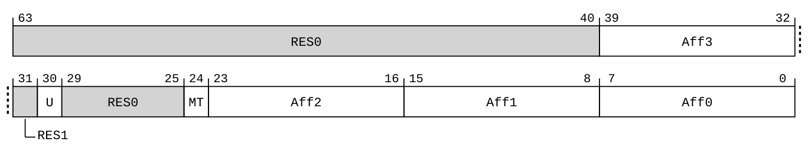
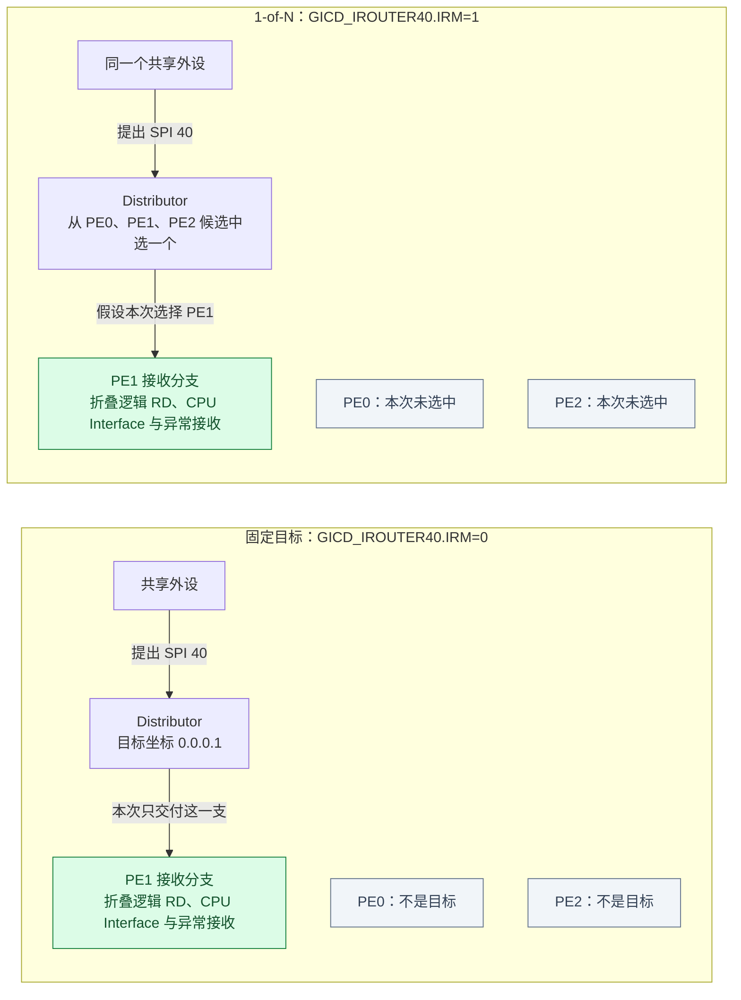
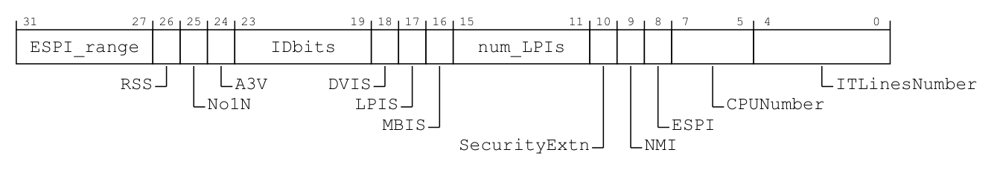
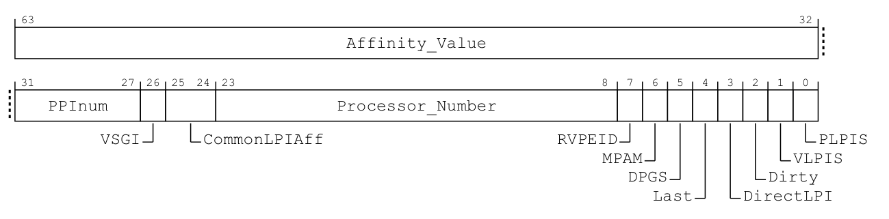
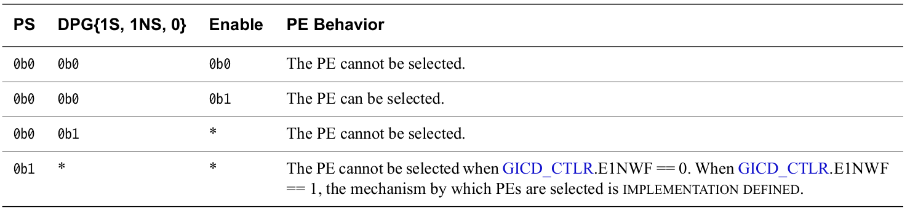
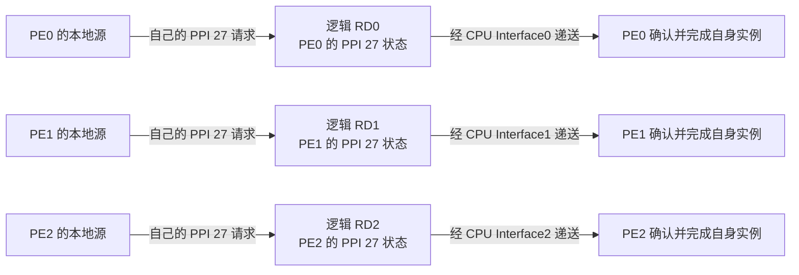

# 第11章\_SPI目标选择与每PE状态

## 11.1\_把请求交给另一个处理器\_改变了什么

**讲解层次：概念层。** 本章按 IHI0069 H.b 建立目标选择与每 PE 状态的归属；转入 GIC-600 r1p6 的电路映射时另行标明，软件通知与电源交接留给下一章。

上一章已经按所有权准备好接收路径，并区分接口唤醒与配置完成；第六章也已闭合 **通用中断控制器（Generic Interrupt Controller，GIC）** 的确认与完成协议。现在增加第二个 **处理单元（Processing Element，PE）**：一个共享请求应当交给谁，同号的私有来源又是不是同一个请求？

本章只解决目标与状态身份：先取得硬件亲和性，再比较固定目标和 1-of-N，最后用同号 PPI 检查每 PE 私有状态。它放大 [S0 的目标准备与 S2 的选择](P06_一次中断的状态转换与完成协议.md#6.4_用同一组阶段闭合正常周期)；SGI 如何通知多个 PE、接收者下线时怎样交接工作与电源，随后再展开。

## 11.2\_怎样取得目标PE的硬件亲和坐标

**讲解层次：概念层——处理器身份与 GIC 目标字段的对应。** 依据 IHI0069 H.b 2.3.1 与 DDI0487 M.c 的 MPIDR_EL1 定义，先取得硬件坐标，再把它用于路由。

GICv3 用 **亲和性（Affinity）** 标识处理器在硬件层次中的位置。它由 Aff3、Aff2、Aff1、Aff0 四个字段组成；这些是规范中的字段名，不是四种不同的中断。具体层次怎样对应核、线程或核簇，由处理器与芯片集成定义。

处理器的 `MPIDR_EL1` 是 **Multiprocessor Affinity Register（多处理器亲和性寄存器）**，包含这四个硬件亲和性字段。运行在某个 PE 上的软件可以在权限允许时读取本 PE 的这个寄存器；这次读取取得的是执行读取的 PE 的身份，不是任意远端 PE 的身份。

例如，读出的四个 Aff 字段为 `0、0、1、2`，这个 PE 的硬件坐标就是 `0.0.1.2`。要把一个 SPI 固定交给它，软件随后需要把这四层坐标写入该 SPI 的路由寄存器；只写最低层的 2，不能完整表达目标。读取身份与写入路由是两个动作，下面先定位前一个动作的接口。

本章表格中的 MRS、MSR 是 AArch64 读取、写入系统寄存器的指令名，沿用第三章的访问路径，不另造缩写全称；它们与通过内存地址访问设备寄存器不同。

> 原图来源：[DDI0487 M.c](https://developer.arm.com/documentation/ddi0487/mc)，D24.2.137，印刷页 D24-9484；字段解释续至 D24-9485。它是当前 PE 的 64 位只读系统寄存器，获准时用 `MRS` 读取。下表按原图完整位段作中文对照。

| 位段 | 原文字段 | 中文对照 |
| --- | --- | --- |
| `[63:40]`、`[29:25]` | `RES0` | 保留为零，不属于亲和性坐标 |
| `[39:32]` | `Aff3` | 亲和性第 3 层 |
| `[31]` | `RES1` | 保留为一，不是亲和性字段的高位 |
| `[30]` | `U` | 0 表示处于多处理器系统，1 表示单处理器系统；该位不属于四层亲和性坐标 |
| `[24]` | `MT` | 指示同一高层亲和性下、不同 Aff0 的 PE 性能是否相互依赖；1 表示依赖很强，但该位本身不承诺实现了多线程 |
| `[23:16]`、`[15:8]`、`[7:0]` | `Aff2`、`Aff1`、`Aff0` | 亲和性第 2、1、0 层；四层组合在系统中唯一，各层物理含义仍由实现确定 |

从原图读坐标时，应提取四个 Aff 字段再组合成 `Aff3.Aff2.Aff1.Aff0`，不能把整个 64 位 MPIDR 值原样当作路由坐标，因为 bit 31 的固定一及 U、MT 都夹在中间。读取只取得身份，不会改变中断路由。

这四个字段与 GIC 目标亲和性的对应关系见 IHI0069 H.b 2.3.1（2-39）；读取权限仍受当前异常级与虚拟化控制约束。后文所有 **内存映射输入输出（Memory-mapped I/O，MMIO）** 地址都写成“已发现的组件基址 + 偏移”，不是可以跨芯片照抄的绝对地址；RW（Read/Write）、RO（Read-only）、WO（Write-only）分别表示读写、只读和只写。

### 11.2.1\_固定目标与1-of-N\_一次选择几个接收者

**讲解层次：概念层——SPI 路由契约。** 依据 IHI0069 H.b 1.2.3、2.3.1、12.9.22，图只比较接收者数量与选择规则。

**共享外设中断（Shared Peripheral Interrupt，SPI）** 的目标由 **分发器（Distributor）** 的 `GICD_IROUTER<n>` **中断路由寄存器（Interrupt Routing Registers）** 控制。编号 n 关联对应的 **中断标识号（Interrupt Identifier，INTID）**，而不是“第 n 个 CPU”。以下继续采用已经开启亲和性路由的 GICv3 物理中断模型。

表内用 GICD 表示 GIC Distributor（GIC 分发器），因此“GICD + 偏移”指分发器基址加该偏移。

固定一组教学对象：PE0、PE1、PE2 的硬件坐标依次为 `0.0.0.0`、`0.0.0.1`、`0.0.0.2`，共享外设使用 SPI 40，它对应的路由寄存器记为 `GICD_IROUTER40`。这里特意让 PE 名称中的数字与 Aff0 对齐，只为方便读图；实际目标仍由完整硬件坐标确定。以下先假定目标配置已经稳定，SPI 40 没有旧的 Pending 或 Active，随后外设才提出本次请求；本次选择期间没有其他软件改写目标。该寄存器的 **中断路由模式（Interrupt Routing Mode，IRM）** 决定怎样选择目标：

- **IRM=0，固定目标：** 已建立的目标字段保存 PE1 的完整亲和性坐标，随后产生的这次 SPI 被路由给 PE1。
- **IRM=1，1-of-N：** 在实现支持这一模式时，由硬件从符合条件的候选 PE 中选出一个。假设本次选中 PE1，另外两个 PE 不会因这一次请求各得到一份需要独立确认的 SPI 40。

下面是依据架构语义绘制的两种路由结果。为突出目标数量，接收侧把 **再分发器（Redistributor，简称 RD）** 的逻辑职责、**处理器接口（CPU Interface）** 与 PE 异常接收折叠成一个分支；这不表示三个物理盒子在核外串联。完整映射已在第四章建立。

两幅图的差别在于 **谁决定这个目标**：固定目标由软件给定，1-of-N 由硬件选择；它们都没有把本次 SPI 复制为三个 PE 的私有实例。1-of-N 也不保证轮转或平均负载，更不表示等三个 PE 都完成后才结束一次 SPI。目标可能在以后发生变化，但“目标可变”与“一次广播给多个目标”是两回事。

运行中改目标要另看时间边界。例如，软件把同一个 `GICD_IROUTER40` 的固定目标从 PE0 改为 PE1，修改的是 SPI 40 的目标字段。若 SPI 40 在写入时已经 Pending，架构允许硬件采用旧目标或新目标，要求变更在有限时间内可见，并保证不会因这次变更丢失中断或把它处理多次；不能把“写入已发出”直接等同于“这次请求一定改送 PE1”。如果 PE0 已经确认来源并在执行处理程序，这次路由写入也不会把 PE0 的执行现场搬到 PE1，已有交接仍须按第六章完成协议收尾。前一项旧／新目标保证见 [IHI0069 H.b](https://developer.arm.com/documentation/ihi0069/hb) 12.9.22，印刷页 12-585；这里不把请求目标和软件执行位置混成同一个属性。

把这两个选择放回寄存器时，先复用第五章用于计算数组步长的手册原图，这次重点读 IRM 与亲和性字段的联动条件。

> 原图来源：[IHI0069 H.b](https://developer.arm.com/documentation/ihi0069/hb)，12.9.22，印刷页 12-584。64 位 MMIO，`GICD_base + 0x6000 + 8n`；n 直接是 INTID，本卷普通 SPI 为 32～1019 且须已实现，按安全权限读写。下表为原字段的中文对照，`RES0` 保留为零。

| 位段 | 字段 | 当前读法 |
| --- | --- | --- |
| 63:40 | RES0 | 不承载目标信息 |
| 39:32 | Aff3 | 目标亲和性第 3 层 |
| 31 | IRM | 0 为完整亲和性指定目标；1 为受支持的 1-of-N |
| 30:24 | RES0 | 必须写 0 |
| 23:16 | Aff2 | 目标亲和性第 2 层 |
| 15:8 | Aff1 | 目标亲和性第 1 层 |
| 7:0 | Aff0 | 目标亲和性第 0 层 |

本例固定 PE1 时，四个 Aff 字段为 `0、0、0、1`，IRM 为 0。IRM 为 1 时，架构不再把这些 Aff 字段解释成候选列表，其值为 UNKNOWN，即架构不承诺其值，不能读取它们来推算“本次硬件选中了谁”。来源身份由寄存器编号 40 确定，寄存器里面没有再放一份 SPI 40 编号。

> 官方对照：[规范 IHI0069 H.b](https://developer.arm.com/documentation/ihi0069/hb)，1.2.3 Models for handling interrupts（1-24～1-25）、2.3.1 Routing SPIs and SGIs by PE affinity（2-39～2-40），以及 12.9.22 GICD_IROUTER<n>, Interrupt Routing Registers（12-584）。核对两种模式都只选择一个 SPI 接收者；MPIDR 与亲和性关系也可在[概览 198123，3.2-01](https://developer.arm.com/documentation/198123/0302) 第 5、7 章检索 Affinity。

### 11.2.2\_候选资格是PE的状态\_路由属性仍属于SPI

**讲解层次：概念层——按架构接口区分状态作用域。** 依据 IHI0069 H.b 2.3.2、12.11.2；“本 PE 的状态”不等于“电路一定放在本 PE 附近”。

上图把三个 PE 都画成候选，只是固定了比较前提。实际使用 1-of-N 时，软件先读 `GICD_TYPER.No1N`；这是 **分发器类型寄存器** 中报告是否缺少 1-of-N 支持的字段。`No1N=1` 表示不支持，不能仍把 IRM 写成 1 并期待获得上述结果。

即使实现支持，也不是每个 PE 随时都能被选中。为看清正常情况，先限定本 PE 已退出休眠交接。对应 **再分发器控制寄存器** `GICR_CTLR` 中，`DPG1S`、`DPG1NS`、`DPG0` 分别用于禁止本 PE 参与安全第 1 组、非安全第 1 组、第 0 组 SPI 的 1-of-N 选择；它们是 **禁止处理器选择（Disable Processor selection）** 字段。能否使用这些字段，由 **再分发器类型寄存器** `GICR_TYPER.DPGS` 报告。

| 本 PE 的状态 | 对相应组 SPI 的 1-of-N 选择意味着什么 |
| --- | --- |
| 未休眠、该组在本 PE 已使能，且受支持的对应 DPG 位为 0 | 本 PE 可以成为候选；不保证本次一定选中它 |
| 未休眠，但该组在本 PE 未使能 | 本 PE 不能被选中 |
| 未休眠，且受支持的对应 DPG 位为 1 | 本 PE 不能被选中；这不等于改写了 SPI 的目标坐标 |

当 `DPGS=0` 时，DPG 位读为零、写入被忽略，软件不能据此声称已经主动移除了该候选。休眠状态另有分支：`GICR_WAKER.ProcessorSleep` 是本 PE 的休眠交接状态；它为 1 且 `GICD_CTLR.E1NWF=0` 时，该 PE 不参与选择。`E1NWF` 是 **允许 1-of-N 唤醒（Enable 1 of N Wakeup Functionality）** 字段；在实现支持并将它置 1 的情况下，休眠 PE 如何被选择由实现定义，不能把上表外推成所有低功耗情形的固定算法。完整休眠交接在[第 12.3 节](P12_SGI核间通知与电源交接.md#12.3_目标准备下线时_要交接的不只是路由)继续说明。

“先读能力，再改参与状态”要跨过两个寄存器类别：TYPER 报告实现能力，CTLR 保存控制。RD_base 是当前 PE 的再分发器控制页基址；先看两张能力寄存器的原始布局，避免把只读能力位当作软件选择开关。

> 原图来源：[IHI0069 H.b](https://developer.arm.com/documentation/ihi0069/hb)，12.9.38，印刷页 12-618；字段定义续至 12-621。32 位只读 MMIO，`GICD_base + 0x0004`；下表按原布局作中文对照，后续代际字段保留名称并标注当前范围。

| 位段 | 原文字段 | 中文对照与当前范围 |
| --- | --- | --- |
| `[31:27]` | `ESPI_range` | 扩展 SPI 编号上界编码，仅 ESPI 功能存在时有效；本卷普通 GICv3.0 不使用 |
| `[26]` | `RSS` | 0 支持定向 SGI 的 Aff0 0～15，1 支持到 255；下一章与 CPU Interface 能力联合检查 |
| `[25]` | `No1N` | 0 支持 SPI 的 1-of-N；1 不支持，注意名称是否定式 |
| `[24]` | `A3V` | 1 支持非零 Aff3，0 仅支持 Aff3=0 |
| `[23:19]` | `IDbits` | 已支持 INTID 位数减一，不等于所有编号都已实现 |
| `[18]` | `DVIS` | GICv4 的直接虚拟 LPI 注入能力；当前 GICv3.0 分支为保留零 |
| `[17]` | `LPIS` | 是否支持 LPI，消息中断章节使用 |
| `[16]` | `MBIS` | 是否支持通过 Distributor 写接口产生消息型 SPI；它不等同于 LPI 支持 |
| `[15:11]` | `num_LPIs` | 0 时 LPI 数量按 IDbits 确定；其他值编码支持的 LPI 数为 `2^(num_LPIs+1)`，仍受 IDbits 上界限制 |
| `[10]` | `SecurityExtn` | 报告是否支持两安全状态；`DS=1` 时读零 |
| `[9]`、`[8]` | `NMI`、`ESPI` | NMI 与扩展 SPI 能力；本卷不采用这些后续扩展 |
| `[7:5]` | `CPUNumber` | 非亲和性路由模式可用 PE 数减一；不支持 ARE=0 时为 0，不能用来推算当前亲和性系统总核数 |
| `[4:0]` | `ITLinesNumber` | 值 N 给出普通 SPI 编号上界 `32×(N+1)-1`，仍排除 1020～1023；0 表示无 SPI，不保证上界内每个来源都实现 |

> 原图来源：同规范 12.11.37，印刷页 12-711；字段定义续至 12-714。64 位只读 MMIO，`RD_base + 0x0008`；下表为完整布局的中文对照。

| 位段 | 原文字段 | 中文对照与当前范围 |
| --- | --- | --- |
| `[63:32]` | `Affinity_Value` | 该 Redistributor 所属 PE 的身份；从高到低每字节为 Aff3、Aff2、Aff1、Aff0 |
| `[31:27]` | `PPInum` | GICv3.1 的 PPI 上界编码；本卷 GICv3.0 为保留零，普通 PPI 仍为 16～31 |
| `[26]` | `VSGI` | GICv4.1 的直接虚拟 SGI 能力；当前范围为保留零 |
| `[25:24]` | `CommonLPIAff` | 共享 LPI 配置表的亲和性范围：00 全部 RD，01 同 Aff3，10 同 Aff3.Aff2，11 同 Aff3.Aff2.Aff1；不决定当前 SPI 的目标 |
| `[23:8]` | `Processor_Number` | 实现给出的 PE 标识，供中断翻译服务（ITS）的部分目标格式使用；本章 SPI 亲和性路由使用上方的 `Affinity_Value`，不使用此字段 |
| `[7]`、`[6]` | `RVPEID`、`MPAM` | 分别是 GICv4.1 的驻留虚拟 PE 标识模式与 GICv3.1 的资源分区监控能力；本卷范围为保留零 |
| `[5]` | `DPGS` | 1 才支持 CTLR 的 DPG 字段；0 表示这些控制位不受支持 |
| `[4]` | `Last` | 本页是否是一组连续 Redistributor 页中的末项；标记的是地址页序列的终点，不是亲和性坐标的大小 |
| `[3]` | `DirectLPI` | 直接 LPI 注入能力；不控制普通 SGI 的目标列表 |
| `[2]`、`[1]` | `Dirty`、`VLPIS` | 虚拟 LPI 相关能力；GICv3 的 VLPIS 为保留零，相应 Dirty 也为保留零 |
| `[0]` | `PLPIS` | 是否支持物理 LPI |

读完原图，当前选择只需其中两项证据：Distributor 的 `No1N=0` 证明模式存在，当前 Redistributor 的 `DPGS=1` 证明可以通过 DPG 主动退出候选。其余字段回答不同能力问题；例如只看到 LPIS=1，不能据此推出可以设置 DPG。

> 原图来源：同规范 12.11.2，印刷页 12-641。完整字段已在[第十章控制与完成](P10_初始化顺序与硬件完成握手.md#10.3_写入顺序_内存可见与硬件完成是三个问题)解释；此处复用原图以检查 `[26:24]` 的三个 DPG 与 bit 3 的 RWP，不重复制造另一张全寄存器摘要。

对应组的 `DPG1S[26]`、`DPG1NS[25]`、`DPG0[24]` 置 1 禁止本 PE 被该组的 1-of-N SPI 选中，`DPGS=0` 时读零写忽略；写入之后若要依赖新状态，先观察 RWP 为 0。两安全状态下 DPG0、DPG1S 对非安全访问读零写忽略，单安全状态下 DPG1S 不使用。休眠分支还读取 `GICD_CTLR.E1NWF[7]`，其布局见[第九章三视图](P09_权限_安全分组与异常路由.md#9.3.2_硬件结构与配置归属先对齐)，不是某个 SPI 的目标位。

规范 12.11.2 的参与表把上述正常与休眠分支合在一起。先看原表，再逐行对照中文；PS 是 ProcessorSleep，Enable 是本 PE 对应组的接收使能，`*` 表示该行不依赖此项取值。DPG 使用受支持的对应组字段，不是全局组使能。

> 原表来源：[IHI0069 H.b](https://developer.arm.com/documentation/ihi0069/hb)，12.11.2，印刷页 12-644，未单独编号的 PE participation 表。下表保留同样四种条件，作中文对照。

| PS | 对应 DPG | Enable | 该 PE 是否可被 1-of-N 选中 |
| --- | --- | --- | --- |
| 0 | 0 | 0 | 不可 |
| 0 | 0 | 1 | 可以，但不保证当选 |
| 0 | 1 | * | 不可 |
| 1 | * | * | E1NWF=0 时不可；E1NWF=1 时选择机制由实现定义 |

读最后一行时要先进入休眠分支，不能把第一部分的 DPG、Enable 条件机械叠加过去。该表重排自 IHI0069 H.b 12.11.2 的 PE participation 表（印刷页 12-644，无单独表号）。

因此，**SPI 40 的路由模式由 GICD_IROUTER40 表达，PE1 的参与状态由 PE1 对应的 GICR 控制接口表达**。这不是 PE1 又持有一套 SPI 40 的独立路由属性，也不能用 DPG 把 PE1 的私有事件改派给 PE2。这里区分的是状态身份和架构访问窗口，不能只从 GICR 前缀断定物理位置。

**概念到实现的映射——GIC-600 r1p6：** 产品把所有 PE 的 GICR 控制页放在 Distributor 物理块中，SGI/PPI 页的状态才由服务这些 PE 的 PPI 块维护。因此，本节 DPG、WAKER 等控制不能画成“外置逻辑 RD 的设置再影响 PPI 块”，也不能一律归入 PPI 块。逻辑 Redistributor 的职责在这个产品中分布到不同物理块；这是同一架构接口的实现映射，不是复制出的第二套配置。

> 产品映射依据：[GIC-600 r1p6](https://developer.arm.com/documentation/100336/0106)，1.2（1-13）、2.2（2-29）；配置路径图见[第九章](P09_权限_安全分组与异常路由.md#9.3.2_硬件结构与配置归属先对齐)。

> 官方对照：[规范 IHI0069 H.b](https://developer.arm.com/documentation/ihi0069/hb)，2.3.2 Participating nodes（2-40）、12.9.22 的 No1N 条件，以及 12.11.2 GICR_CTLR（12-641～12-644）的 DPG 字段和 PE participation 表。表中的休眠、组使能与 DPG 必须结合分支阅读，不能把候选条件压成“只要在线即可”。

### 11.2.3\_多个PE上的同号PPI\_为什么不是广播

**讲解层次：概念层——每 PE 的私有来源身份。** 依据 IHI0069 H.b 1.2.1、3.1、4.3；以下三个逻辑对象不要求三个独立 PPI 物理块。

**私有外设中断（Private Peripheral Interrupt，PPI）** 本来就属于特定 PE，不能靠 SPI 路由寄存器把它改成另一个 PE 的私有定时事件。假设三个 PE 的本地中断源恰好都使用 PPI 27，它们可以各自触发，但状态身份分别是“PE0 的 PPI 27”“PE1 的 PPI 27”和“PE2 的 PPI 27”。这个编号只用于教学，不声明某颗芯片的具体接线。

图中的 RD0、RD1、RD2 分别表示三个 PE 对应的 Redistributor 逻辑职责，状态身份彼此独立。映射到 GIC-600 时，这三份状态可以由同一个 PPI 块按 PE 分别维护，也可以按已确定的硬件集成分布到不同 PPI 块。

图中是三条私有路径：即使三个事件同时发生，也不是 Distributor 把一个请求广播了三份。PE1 完成自己的实例，不会代替 PE0 清除它的本地事件或完成义务。由此也能看出，只观察到“几个核都报告同一个编号”，还不足以判定是广播；必须同时核对来源类型与状态归属。

> 官方对照：[规范 IHI0069 H.b](https://developer.arm.com/documentation/ihi0069/hb)，1.2.1 的 Private Peripheral Interrupt 定义、3.1 The GIC logical components（3-42）及 4.3 Private Peripheral Interrupts（4-59）。图为本专题按“每 PE 私有实例”规则绘制的示意图。

现在可以分清三件事：SPI 的目标选择不复制来源实例，每 PE 的参与资格不等于 SPI 的路由属性，同号 PPI 也各自保有完成义务。接下来把请求发起者换成软件：PE0 如何通知一个或多个 PE，工作内容放在哪里，接收者要下线时又该先交接什么？下一章沿 SGI、共享队列和电源接口追踪这些问题。

上一篇：[初始化顺序与硬件完成握手](P10_初始化顺序与硬件完成握手.md#10.1_全局_每核与每个来源分别准备什么)

[专题大纲](大纲.md#1.2_因果阅读地图)

下一篇：[SGI核间通知与电源交接](P12_SGI核间通知与电源交接.md#12.1_核间中断传的是提醒_工作内容存在哪里)
