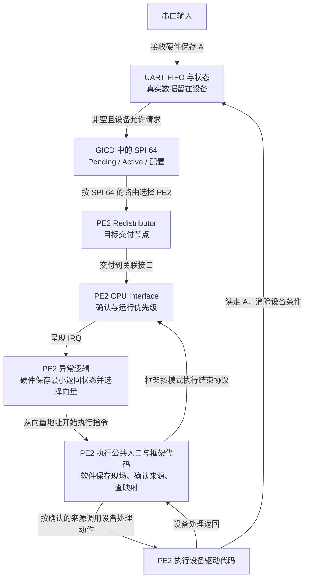
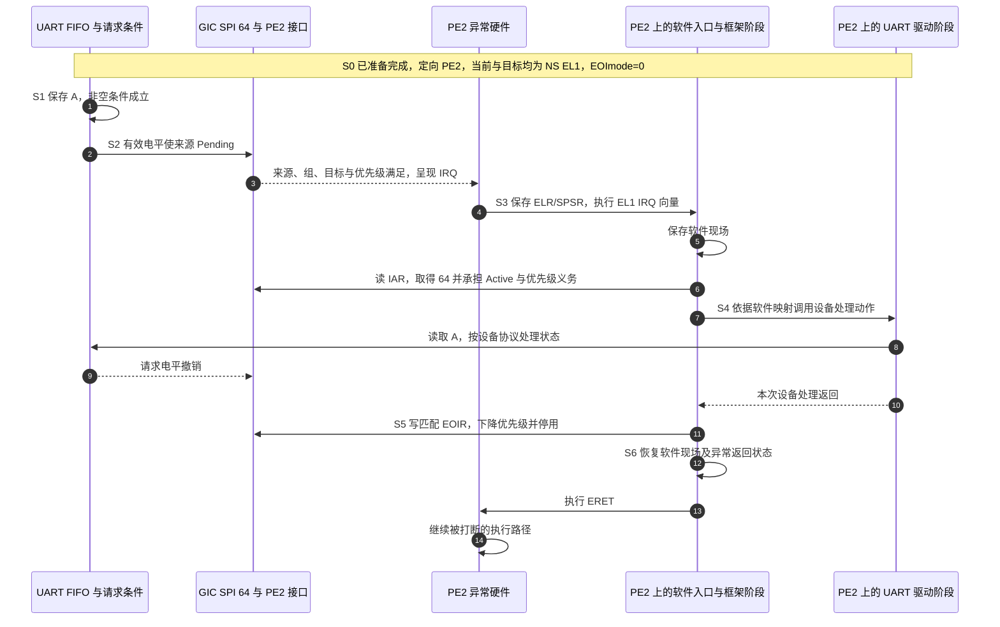

# 第11章\_UART中断的端到端流程复盘

前十章分别建立了来源、状态、优先级、权限与消息翻译。本章把镜头收回到一个串口：字节 A 已经到达，为什么程序尚未读到它？我们沿同一次请求追踪到返回，再改变一个条件，判断它会停在哪个交接点。读完后，应能把设备数据、控制器通知和处理器执行现场分别画出来，而不是把所有寄存器接成一条流水线。

这是连续教材的综合章，沿用第四章的状态模型和第六章的两安全状态、AArch64 异常模型；后文出现的名称会提醒其当前职责。所有编号、亲和性与串口条件都是教学设定，不是 RK3588 串口的真实配置，也不宣称某个 Linux 版本按本章顺序执行结束动作。

## 11.1\_阶段导航

固定一个 **通用异步收发器（Universal Asynchronous Receiver/Transmitter，UART）**。它的接收 **先进先出缓冲（First-In, First-Out，FIFO）** 保存字节；本例约定 FIFO 非空时，且设备接收中断已使能、未屏蔽，输出持续有效电平。实际串口可能按阈值、超时或错误组合产生请求，移植时首先替换的是这条设备契约。

芯片把这根请求接到 **共享外设中断（Shared Peripheral Interrupt，SPI）**，教学 **中断标识符（Interrupt Identifier，INTID）** 为 64，定向到 **处理单元（Processing Element，PE）** PE2。PE2 的教学亲和性为 0.0.0.2，当前在 Non-secure EL1 执行，IRQ 也路由到这一层。这里的 Non-secure 是非安全访问域，EL1 是运行内核的异常级，两个名称不描述来源的紧急程度。默认采用 EOImode=0，没有嵌套，并假定必要访问权限与内存顺序已经建立。

本章只使用[第四章的 S0～S6](P04_一次中断的状态转换与完成协议.md#4.4_用同一组阶段闭合正常周期)。一个阶段可以包含多个动作，编号不规定硬件串行执行次序。

| 统一阶段 | 本例追踪的交接 | 继续阅读 |
| --- | --- | --- |
| S0 准备 | 来源、目标、权限、向量和处理函数就绪 | [把配置放到正确状态位置](#11.2_S0_先把编号变成可定位的配置) |
| S1 事件 | A 写入 FIFO，外设条件成立 | [设备数据与请求](#11.3_S1到S2_字节留在外设_通知进入控制器) |
| S2 保留与选择 | Pending、使能、目标、组与优先级共同决定递送 | [逐项检查递送条件](#11.4_S2_待处理为什么不等于现在能递送) |
| S3 异常进入与确认 | PE 进入向量，入口保存现场，再读确认寄存器认领来源 | [异常路由](#11.5_S3_先进入哪个异常入口)与[来源确认](#11.6_S3_进入异常以后才领取具体来源) |
| S4 设备处理 | 读出数据、处理错误并撤销设备条件 | [数据消费与清源](#11.7_S4_处理字节并让设备撤销请求) |
| S5 完成协议 | 下降运行优先级，按模式停用来源 | [完成与返回的区别](#11.8_S5到S6_先兑现交接义务_再恢复执行现场) |
| S6 继续执行 | 恢复软件现场，异常返回或继续处理 | [完整时间线与故障复盘](#11.9_沿同一次事件检查正常与失败路径) |

## 11.2\_S0\_先把编号变成可定位的配置

“UART 对应 INTID 64”首先是一个接线假设。设备树可以描述这条连接，控制器驱动可以改变它的触发配置和接收目标，但不能靠写路由寄存器把任意 UART 物理接到任意 SPI 输入。确认真实连接应查芯片中断表、适用的硬件描述与控制器能力，不能把教学编号复制到开发板。

**分发器（Distributor）** 提供 SPI 的系统范围配置和状态，并按目标路由到相应 **再分发器（Redistributor）**；再分发器提供每个 PE 的 SGI/PPI 与接收侧电源接口，在实现支持 LPI 时还提供其相关接口，也把路由到本 PE 的 SPI 交给关联 **处理器接口（CPU Interface）**。处理器接口管接收侧优先级、确认和结束。CPU 是中央处理器的英文缩写。这三者描述的是硬件的架构逻辑职责，SPI 的状态不会因为经过 PE2 的 Redistributor 就变成 PE2 的私有中断状态。

`GICD_` 是分发器寄存器前缀。不同寄存器族每个条目容纳的来源数不同，**INTID 64 不等于“所有寄存器都写第 64 项”**：

下表沿用前章记号：RW（Read/Write，读写）、RO（Read-only，只读）、WO（Write-only，只写）表示访问属性；IRM 是 **中断路由模式（Interrupt Routing Mode）** 字段，先固定为指定单个目标的 0。MMIO 是 **内存映射输入输出（Memory-mapped I/O）** 访问；MRS、MSR 则是读取、写入系统寄存器的 AArch64 指令名，不另造缩写全称。

先算一个动作：来源使能采用每项 32 位、每来源一位的布局，64 除以 32 得寄存器索引 2、余数 0，因此这次要改变的是第 2 项的 bit 0。设置本例来源使能，向 `GICD_ISENABLER2` 写 bit 0 为 1 即可，其他位写 0 不改变其他来源。普通读改写与这种“写 1 执行动作”不同；这里也没有提供一个实际物理地址，因为地址属于芯片集成与软件映射层。第三章的[索引算例](P03_多核控制器的角色_寄存器与编号.md#3.7_动手计算同一个编号的不同寄存器索引)可以交叉验算下面各项。

同一个 INTID 的触发、优先级和路由采用不同容量的条目，必须分别计算。下表把本次配置及观察位置逐一对齐，并不表示其中每个寄存器都要在初始化时写一遍。

| 接口与当前用途 | INTID 64 的位置与 GICD 基址内偏移 | 访问属性及本例效果 |
| --- | --- | --- |
| `GICD_ISENABLER<n>` / `GICD_ICENABLER<n>`，置/清来源使能 | 各自寄存器 2，bit 0；偏移 0x0108 / 0x0188 | 32 位 RW，每项覆盖 32 个来源；读返回使能，写 1 分别置/清使能、写 0 不变；不清设备数据 |
| `GICD_ISPENDR<n>`，观察/设置挂起 | 寄存器 2，bit 0；偏移 0x0208 | 32 位 RW，每来源一位；读 1 表示存在 Pending，写 1 软件置挂起、写 0 无作用；读取不确认来源 |
| `GICD_IGROUPR<n>` / `GICD_IGRPMODR<n>`，安全归属 | 各自寄存器 2，bit 0；偏移 0x0088 / 0x0D08 | 32 位 RW、受安全权限限制；每来源一个分组位和一个修饰位；本例 IGROUPR 位为 1，选择 Non-secure Group 1 |
| `GICD_ICFGR<n>`，触发配置 | 寄存器 4，bits 1:0；偏移 0x0C10 | 32 位 RW，每项 16 个来源、每来源两位；本例字段写 00，选择电平；改变配置须满足下文条件 |
| `GICD_IPRIORITYR<n>`，优先级 | 优先级区字节偏移 64，即 GICD+0x0440；按 32 位访问为寄存器 16 的 bits 7:0 | RW，32 位寄存器并支持字节访问；每来源一字节；本例在一致的非安全视图中用 0x60 |
| `GICD_IROUTER<n>`，目标亲和性 | `GICD_IROUTER64`，偏移 0x6200 | 64 位 RW，每 INTID 一项；IRM[31]=0，Aff3/Aff2/Aff1/Aff0 为 0/0/0/2；改变目标规则不改变设备接线 |

表中 GICD 基址由芯片资源发现和映射取得。前五类数组按各自每项容纳数量计算索引、步长为 4 字节；IROUTER 按 INTID 索引、步长为 8 字节。本卷普通 SPI 为 32～1019 且须实际实现、当前访问有权，不能把数组保留范围当成可用来源。完整索引与位图见[第三章](P03_多核控制器的角色_寄存器与编号.md#3.7_动手计算同一个编号的不同寄存器索引)，安全组组合见[第六章](P06_权限_安全分组与初始化闭环.md#6.3.1_来源分组位放在哪里_与其他组有什么区别)，路由字段见[第七章](P07_目标选择_核间通知与电源交接.md#7.2.1_固定目标与1-of-N_一次选择几个接收者)。

本例的触发字段为 0b00，表示电平；0b10 表示边沿。不能把“配置电平”理解为在任意运行时刻清两位：来源使能期间改变触发配置不在架构可依赖的保证内，已有 Pending 时切换电平/边沿也无法保留一个可预测的挂起状态。应在来源受控、设备与处理路径已经同步后按协议配置；不是边运行边试哪个值能进中断。

> 官方对照：[IHI0069 H.b](https://developer.arm.com/documentation/ihi0069/hb)，其中 IHI0069 是 Arm Generic Interrupt Controller（通用中断控制器，GIC）架构规范的文档编号，H.b 是本次核对的修订。参见 12.9 的 GICD_ISENABLER、GICD_IGROUPR、GICD_ICFGR、GICD_IPRIORITYR、GICD_IROUTER 条目；尤其 12.9.9 的字段索引与修改前提。这里推导的是公开编程接口，不猜测控制器内部存储布局。

## 11.3\_S1到S2\_字节留在外设\_通知进入控制器

字节 A 到达后，UART 接收硬件把它写入 FIFO。设备自己的接收使能、屏蔽和触发条件决定是否使请求输出有效；接收数据、发送空间可用和错误也可能汇总到同一根线。本例只打开接收非空这一项，所以 FIFO 从空变为 [A] 时请求有效。

GIC 观察到有效输入后形成 **挂起（Pending）** 条件。GIC 没有复制 A，也不知道 FIFO 中究竟有几个字符。此时两处状态是：UART 保存数据 [A]，GIC 保存来源 64 的通知状态。以后软件必须读设备数据寄存器才能取走 A。

CPU Interface 与异常逻辑属于硬件；公共入口、框架和驱动则是 **同一个 PE2 上依次执行的软件阶段**。向量入口先确定从哪里开始执行，软件随后确认来源并分派处理动作；设备处理返回后，由承担结束责任的框架路径操作 CPU Interface。Redistributor 的出现表示请求交付节点，不是第二份 SPI 64 路由或使能配置。箭头依据 IHI0069 H.b 3.1 的 SPI 逻辑路径描述通信职责，不规定芯片内部必须按这张图布线；产品功能块的对应关系见[第三章的 GIC-600 布局](P03_多核控制器的角色_寄存器与编号.md#3.4.1_PPI块为什么这样设计_从布线与电源约束到每核状态归属)，其中 GIC-600 是控制器产品名称。

来源使能为 0 时，普通 SPI 仍然可能挂起，使能控制的是后续递送资格。因此“关了来源但看到 Pending”不是自相矛盾。不过“仍然可以挂起”也不等于电平被永远锁存：若唯一的电平条件在确认前撤销，挂起状态会按电平规则改变；边沿锁存与软件置挂起则要分别分析。排障应记录观察时刻和触发类型，不能拿两次不同时刻的快照拼成同一个瞬间。

**活动（Active）** 要等真实确认以后才建立。在 S2，进入向量的通知尚未被软件认领，不能因为设备线已经有效就写“UART 正在被 ISR 处理”。Pending 和 Active 是控制器协议的两个维度；FIFO 数据、来源使能、处理器执行位置是其他维度。

> 官方对照：[IHI0069 H.b](https://developer.arm.com/documentation/ihi0069/hb)，4.1.2 Interrupt handling state machine 与 4.5 Shared Peripheral Interrupts。沿“有效电平、撤销电平、确认、停用”分别查状态改变；UART 的非空触发是教学设备契约。

## 11.4\_S2\_待处理为什么不等于现在能递送

先检查安全归属。采用第六章的两安全状态配置时，来源 64 对应的 IGROUPR 位为 1，就属于 **非安全第 1 组（Non-secure Group 1）**；它不是“优先级第一组”。若 IGROUPR 为 0，再由 IGRPMODR 区分 Secure Group 0 和 Secure Group 1。归属配置必须由拥有权限的软件建立，普通设备驱动不能夺取安全固件的来源。

属于某组与该组已经放开也不同。全局分发器的适用组使能和 PE2 的 `ICC_IGRPEN1_EL1` 接收使能都要成立，还需要来源 64 自己使能。全局开关的字段名字随安全访问视图而异；本例所说的“允许 Non-secure Group 1”是逻辑条件，不能把安全视图中的寄存器写值直接给非安全驱动使用。

随后检查目标。`GICD_IROUTER64` 的 IRM 为 0 时，本例指定完整亲和性 0.0.0.2。亲和性来自硬件身份，与 `MPIDR_EL1` 的坐标关系对应；PE2 是本例标签，不保证等于 Linux 逻辑 CPU2。IRM 为 1 的 1-of-N 则是在合适接收者中选一个，不是广播，也不保证负载平均。支持相应功能时，`GICR_CTLR.DPG*` 控制对应组是否参与 1-of-N 分发；它不是定向路由的任意改写开关。

目标还要准备好。PE2 的 `GICR_WAKER.ProcessorSleep` 是软件电源交接请求，`ChildrenAsleep` 是硬件握手状态；两者不是 Linux 的 online 标志。若 PE2 尚在完成休眠退出，就不能仅凭目标字段正确宣布可以接收。GIC-600 的唤醒请求能否通过电源控制器恢复接收，取决于芯片连接和平台协议；软件下线、执行 **等待中断指令（Wait For Interrupt，WFI）** 和真正断电不能混成一个状态。当前正常路径假定握手已经完成。

最后看优先级。`GICD_IPRIORITYR` 中的来源优先级、`ICC_PMR_EL1` 中的门槛、`ICC_RPR_EL1` 所反映的运行优先级共同参与判断。PMR 要求来源数值严格更小；BPR 决定用于抢占的高位部分。它们的全称和按位推导已在第五章建立，这里只把它们放回同一次请求。

固定同一非安全数值视图、有效优先级位足够、访问条件成立：来源 0x60、PMR 0x80 且接收侧无未结束的优先级占用，满足门槛条件。若 PMR 改为 0x60，等于门槛也不能通过。若另一个来源正在占用优先级，即便通过 PMR，还要按 BPR 比较组优先级；子优先级不同可以改变排队次序，却不能让相同组优先级互相抢占。完整优先级与非安全可见值的转换不能省略，详见[第五章的数值视图](P05_优先级_屏蔽与嵌套处理.md#5.4.2_分割点编码与软件看到的数值不能混用)。

| 本节复用的接口与范围 | 访问位置、宽度与本章字段 | 本例操作语义与详细入口 |
| --- | --- | --- |
| `GICD_CTLR`，全局组许可 | GICD+0x0000，32 位；两安全状态、亲和性路由开启时，安全视图 EnableGrp1NS[1]，非安全视图为 EnableGrp1A[1] | 允许整个 Non-secure Group 1 递送；受视图与权限约束，见[组使能表](P06_权限_安全分组与初始化闭环.md#6.3.2_硬件结构与配置归属先对齐) |
| `ICC_IGRPEN1_EL1`，PE2 的组接收 | 64 位系统寄存器 RW，Enable[0] | 本 PE 当前安全状态副本置 1；不会打开其他 PE；同见组使能表 |
| `ICC_PMR_EL1` / `ICC_RPR_EL1`，PE2 的优先级接口 | 各 64 位系统寄存器；PMR RW、RPR RO；相关优先级为 [7:0] | PMR 设置门槛；RPR 观察运行优先级，读取不认领中断；见[优先级接口表](P05_优先级_屏蔽与嵌套处理.md#5.3_先过固定门槛_再过当前处理的门槛) |
| `ICC_BPR1_EL1` / `ICC_BPR0_EL1`，PE2 的分割点 | 各 64 位系统寄存器，按视图与配置读写，BinaryPoint[2:0] | 本例 Group 1、CBPR=0 使用 BPR1；共同分割点分支及最小编码见[分割点表](P05_优先级_屏蔽与嵌套处理.md#5.4_为什么还要区分组优先级与子优先级) |
| `MPIDR_EL1`，当前 PE 的身份 | 64 位 RO 系统寄存器；Aff3[39:32]、Aff2[23:16]、Aff1[15:8]、Aff0[7:0] | 读硬件坐标，不分配 Linux CPU 编号；见[亲和性表](P07_目标选择_核间通知与电源交接.md#7.2_硬件目标坐标不是Linux逻辑编号) |
| `GICR_CTLR`，PE2 的候选参与状态 | RD_base+0x0000，32 位；DPG1S[26]、DPG1NS[25]、DPG0[24] | DPG 的能力、权限与完成条件见[候选表](P07_目标选择_核间通知与电源交接.md#7.2.2_候选资格是PE的状态_路由属性仍属于SPI)；本例 IRM=0，不用它选择定向目标 |
| `GICR_WAKER`，PE2 的电源交接 | RD_base+0x0014，32 位；ProcessorSleep[1] RW、ChildrenAsleep[2] RO | 本例两位都已为 0；请求与完成不同，访问权限及转换条件见[电源握手表](P07_目标选择_核间通知与电源交接.md#7.5_目标准备下线时_要交接的不只是路由) |

系统寄存器的读写使用获准的 MRS/MSR，MMIO 访问则使用对应组件映射；本表不是设备驱动可以越过公共框架重配的清单。这里复用前章已经给出的 IHI0069 H.b 接口定义，只列同一次 UART 请求需要判断的含义。

因此，检查 S2 时应把这些条件并列考虑：存在可递送挂起请求、来源与组使能、目标匹配且接收侧可用、通过 PMR 和抢占判断，并且没有未停用 Active 等状态约束阻止同一普通来源再次递送。这是逻辑关系，不是控制器按软件 if 语句串行走过的八级流水线。

> 官方对照：[概览 198123，3.2-01](https://developer.arm.com/documentation/198123/0302)，第 5 章 Configuring the Arm GIC；[IHI0069 H.b](https://developer.arm.com/documentation/ihi0069/hb)，4.5、4.6、4.8 与 GICR_CTLR 的 DPG 字段；[GIC-600 r1p6](https://developer.arm.com/documentation/100336/0106)，3.6.2 的电源握手。分别核对分组、门槛、目标和实现支持，不能让一个读数替其他条件作证。

## 11.5\_S3\_先进入哪个异常入口

上一节解决“把哪条请求呈现给哪个 PE”。现在 GIC 为 PE2 呈现的是 **中断请求（Interrupt Request，IRQ）** 还是 **快速中断请求（Fast Interrupt Request，FIQ）**，还要看来源安全组与 PE 当前状态。在本例 Non-secure EL1 下，Non-secure Group 1 呈现 IRQ；Group 0 呈现 FIQ，Secure Group 1 在这一非安全执行状态下也呈现 FIQ。换到 Secure EL1 或 EL3，必须重新查呈现关系，不能把 Group 1 永久等同于 IRQ。FIQ 的 Fast 是架构名称，不保证具体设备处理更快。

**GIC 的路由选 PE，PE 的异常路由选 EL。** `SCR_EL3` 是安全配置寄存器，其 IRQ/FIQ 路由控制可以让高权限固件接管异常；`HCR_EL2` 是虚拟机管理程序配置寄存器，其适用 IMO/FMO 控制可以把物理 IRQ/FIQ 路由到 EL2。前者的路由优先于后者。本例固定两层都不接管这条物理 IRQ，且目标执行状态为 AArch64，才得到 EL1 入口；不能从 GIC 的一个安全分组位直接推导所有异常路由。

再检查 **处理器状态（Processor State，PSTATE）**。当前在 EL1、目标也是 EL1 时，I 位为 1 会屏蔽 IRQ，I 位为 0 才允许这项接收；对应 FIQ 看 F 位。A 位关联 SError 异步系统错误，D 位关联适用的调试异常，它们不是普通 GIC 来源的两个额外开关。

软件通过名为 DAIF 的系统寄存器入口访问这些屏蔽位；这个名称由 D、A、I、F 四个位名组成，仍是当前 PE 的处理器状态接口。

这条 I/F 判断具有层次边界：若 IRQ 从 EL0 路由到更高的 EL1，不能用 EL0 当前 I 位判断内核是否能够接收；若目标比当前 EL 更低，处理器也不会为接收它强行降级。高权限软件的物理中断接管还应核对完整路由条件。这正是先确定当前层与目标层，再解释屏蔽位的原因。

选好了 EL1，仍未选择 UART 函数。`VBAR_EL1` 是 **向量基地址寄存器（Vector Base Address Register）**，提供一组架构入口的起点。硬件根据异常类别、来源执行状态以及同级入口的栈选择，决定向量偏移：

| 已限定的进入条件 | IRQ 向量相对 VBAR_EL1 的偏移 |
| --- | --- |
| 当前 EL1 使用 `SP_EL1`，IRQ 进入当前 EL1 | 0x280 |
| 较低 EL0 以 AArch64 执行，IRQ 进入 EL1 | 0x480 |

SP_EL1 是本层使用的栈指针。偏移定位的是入口槽位，不是 UART 的函数地址；同一个 IRQ 槽位可以先后接住很多不同设备。完整向量表还有其他异常与栈组合，不应把这两个偏移当作通用常量。

进入异常时，PE 将返回位置写入 **异常链接寄存器（Exception Link Register，ELR）** `ELR_EL1`，把原处理器状态写入 **保存的程序状态寄存器（Saved Program Status Register，SPSR）** `SPSR_EL1`，再转入向量。通用寄存器不会因此全部自动压栈；公共入口软件要建立栈帧保存被打断的现场，尤其必须在允许同 EL 嵌套之前保存 ELR/SPSR，否则下一次进入会覆盖返回链。

下面按本次用途复用前章表项。后续 **异常返回指令（Exception Return，ERET）** 会使用恢复的返回地址和状态；此处先标出保存位置，不提前执行返回。

| 处理器接口 | 访问方式、宽度与本章所用内容 | 这次异常中的作用及复用入口 |
| --- | --- | --- |
| `SCR_EL3` / `HCR_EL2` | 64 位系统寄存器，由有权的高异常级软件 MRS/MSR；前者 IRQ[1]、FIQ[2]，后者 IMO[4]、FMO[3] | 决定是否接管到高 EL；本例沿用第六章限定的普通路由前提，见[异常路由表](P06_权限_安全分组与初始化闭环.md#6.3.3_安全组怎样影响IRQ与FIQ_又怎样到达EL) |
| `DAIF`，PSTATE 屏蔽位入口 | 64 位系统寄存器，当前条件下 EL1 可 MRS/MSR；D、A、I、F 分别为 bit 9、8、7、6 | 当前 EL1 接收 IRQ 时查看 I；写屏蔽位不清 GIC 状态，见[屏蔽位表](P05_优先级_屏蔽与嵌套处理.md#5.5.1_哪些异常受哪个屏蔽位约束) |
| `VBAR_EL1` | 64 位系统寄存器 RW；向量基址字段 VBA[63:11]，基址须 2 KiB 对齐并是有效地址 | 给公共向量起点，不保存 UART 函数指针；见[向量基址表](P06_权限_安全分组与初始化闭环.md#6.4_全局_每核与每个来源分别准备什么) |
| `SP_EL1` | 当前 PE 的 64 位 EL1 栈指针；本例选择它作为当前栈指针，软件经此地址寻址保存现场 | 它保存栈地址，不保存 INTID；本例只使用已经准备好的栈，不把 SP_EL1 当作普通 EL1 可随意 MRS/MSR 的 GIC 寄存器 |
| `ELR_EL1` / `SPSR_EL1` | 64 位系统寄存器，当前条件下 EL1 可 MRS/MSR；ELR 保存返回地址；SPSR 保存条件标志、DAIF[9:6]、模式 M[4:0] 等有效状态 | 硬件异常进入时写入，公共软件保护并恢复，ERET 使用；详细副作用见[异常现场表](P05_优先级_屏蔽与嵌套处理.md#5.6.1_硬件先保存什么_公共入口还必须保存什么) |

这些对象都属于 PE，不是 GIC 的 MMIO 寄存器。读写返回现场既不会确认来源，也不会下降 GIC 运行优先级；表中省略的高层截获、执行状态及地址合法性条件仍沿用上述主讲章节。

> 官方对照：[Exception model，Version 1.0](https://developer.arm.com/-/media/Arm%20Developer%20Community/PDF/Learn%20the%20Architecture/Exception%20model.pdf?revision=a62f2bf2-b08a-4a4f-8cbe-38c67ddf4434)，5.2 Taking an exception、5.3 Routing asynchronous exceptions、5.5 Returning from an exception、第 6 章 The vector tables。组到 IRQ/FIQ 的关系另查[概览第 4 章 Security model](https://developer.arm.com/documentation/198123/0302)。

## 11.6\_S3\_进入异常以后才领取具体来源

PE2 已经执行 EL1 的 IRQ 入口，只知道“有一类 IRQ 需要检查”。软件随后读取 `ICC_IAR1_EL1`，即 **中断确认寄存器（Interrupt Acknowledge Register，IAR）**，取得该组路径上当前可确认的 INTID。这个读取同时执行确认，不是拿来随时窥视的无副作用状态查询。

本例得到 64，GIC 建立该来源的 Active，并更新接收侧运行优先级。UART 的请求电平如果仍有效，还可能同时具有 Pending。**这不证明又收到第二个字节**，也不表示同号来源现在就能再次进入；旧 Active 的停用责任还在。

接口必须与路径配对：Group 1 使用本例的 `ICC_IAR1_EL1` 与 `ICC_EOIR1_EL1`；Group 0 对应 `ICC_IAR0_EL1` 与 `ICC_EOIR0_EL1`。其中的 0/1 指来源安全组路径，EL1 是寄存器命名中的异常级，两者不是同一个编号。读 IAR1 不会把 Group 0 自动改成 Group 1；是否有权访问仍由当前安全状态与高层配置决定。

| 当前 PE 的确认接口 | 访问方式与字段 | 本章可依赖的效果 |
| --- | --- | --- |
| `ICC_IAR0_EL1` / `ICC_IAR1_EL1` | 64 位 RO 系统寄存器，MRS；INTID[23:0] | 普通有效返回同时确认来源并建立优先级占用；不是无副作用调试读。特殊值不建立普通来源的完成义务 |

这一确认接口复用[第四章的接口与配对规则](P04_一次中断的状态转换与完成协议.md#4.3_确认_清源_优先级下降与停用)；表中的 RO 只表示软件不能写，不表示读取无副作用。结束操作及其接口表在 11.8 节展开，不能在取得一个特殊返回值后无条件写 EOIR/DIR。

异常通知与确认之间存在时间窗口。设来源 64 导致 IRQ 呈现，入口尚未读 IAR，另一个更高有效优先级的来源 65 成为可确认候选，IAR 可以返回 65。选择依据是确认时的可领取状态，不是异常通知瞬间拍下的一个永久设备标签。来源变得不可确认时，还可能返回 1023 这样的特殊值；1020～1023 不属于普通 SPI，必须依据实际接口的语义处理，不能调用设备函数再无条件写结束寄存器。

如果上层软件是 Linux，它还需要把 GIC 域中的硬件编号对应到软件 IRQ，再沿软件描述对象找到注册的设备处理函数。`irq_domain` 承担编号映射，`irq_desc` 是软件中断描述对象，`irqaction` 关联注册的处理动作；这些是软件对象，GIC 不保存这些 C 结构或函数地址。驱动通过 `request_irq` 等接口登记处理函数，也不等于把函数地址写进 GIC。这里说明对象职责，具体版本调用链仍由[Linux IRQ 专题](../../../../knowledge/linux/synchronization_and_asynchrony/asynchrony/interrupts/P03_Linux_的中断抽象_irq_chip_irq_domain_与_irq_desc.md)负责。

所以可以把这段交接说完整：硬件向量决定从哪里开始执行公共入口；IAR 确定本次领到哪个硬件来源；软件映射确定调用哪个设备处理动作。三次选择不能省成“GIC 调用 UART ISR”。ISR 是 **中断服务程序（Interrupt Service Routine）**，实际执行者仍是 PE2。

> 官方对照：[IHI0069 H.b](https://developer.arm.com/documentation/ihi0069/hb)，4.1.1 Physical CPU interface、12.2.14 ICC_IAR1_EL1，以及特殊 INTID 的定义。重点核对确认的状态副作用和无有效来源的返回条件。本节没有声称已核验某个 RK3588 Linux 构建的函数体。

## 11.7\_S4\_处理字节并让设备撤销请求

设备服务程序进入时，需要先读 UART 状态。INTID 64 只能定位到设备来源，不能保证本次一定有接收数据，也不能区分接收溢出、帧错误或发送空间可用。驱动依设备契约判断原因，再读数据、处理错误或执行清除动作。

本例读一次数据寄存器取出 A，FIFO 变空，请求电平撤销。若 B、C 在本轮处理前已到达，FIFO 变为 [A,B,C]，当前 ISR 可以连续读走三个字节；GIC 不给这些数据贴上“下一次中断才能读”的标签。软件还要把读出的字节放到自己的接收队列，处理队列已满等失败，设备数据搬进内存才算真正发生了消费。

真实串口可能需要读状态后再读数据、写指定清除寄存器，或分别清除错误；不能把本例“读空”当作所有设备的清源方法。持续输入时也不能无界忙到 FIFO 为空：设置处理预算后，必须留下可靠的后续消费路径。电平仍有效可以继续提出请求，边沿设备则不能假定退出后一定再产生一个新边沿。

清源与停用的先后决定一个常见故障。若 A 根本没读走，却先停用来源 64，外设电平仍要求服务；当其他接收条件允许时，它会再次递送。反复进入并不一定代表产生了许多新事件，可能只是同一个设备条件没有消除。反过来，FIFO 已空却漏掉停用，来源仍可能 Active；此时“没有风暴”也不是处理正确的证据。

第四章的[状态实验](P04_一次中断的状态转换与完成协议.md#4.7_亲手分开数据_挂起与完成义务)已经把这两类故障分开。实际硬件还存在设备访问和请求撤销的传播时延：PE 先处理设备，不自动证明 GIC 先观察到请求撤销。若停用先被观察到，来源可短暂保留 Pending；若期间再次被确认，还会产生新一轮完成义务，具体分支见[清源与停用的两条路径](P04_一次中断的状态转换与完成协议.md#4.4.1_清源与停用先后不同_谁保证状态正确)。

这些状态转换由 GIC 硬件保证，驱动负责遵守设备与控制器的接口协议，并在有依赖时取得规定的完成保证。不能据传播时延给每次 UART 处理凭空增加“等几个 GIC 周期”或“轮询 Active/Pending 都为零”的步骤；也不能把主机模型里的立即更新当作真实硬件已经同步。

## 11.8\_S5到S6\_先兑现交接义务\_再恢复执行现场

设备处理结束后，还有两项 GIC 义务。第一项是 **优先级下降（Priority drop）**：释放本次确认对 PE2 运行优先级的占用。第二项是 **停用（Deactivation）**：结束来源 64 的 Active。设备是否已清源是前一节的另一件事，GIC 不读取 FIFO 来代替软件判断。

本例 EOImode=0，向 `ICC_EOIR1_EL1` 写入与本次确认匹配的结束信息，同时完成两项动作。如果没有其他挂起条件，来源回到 Inactive；若还有待处理请求，停用不会把它一并删除。`EOIR` 是 **中断结束寄存器（End Of Interrupt Register）** 的名称缩写。

若改为 EOImode=1，EOIR 只下降优先级，稍后由承担停用责任的路径写 `ICC_DIR_EL1`，即 **中断停用寄存器（Deactivate Interrupt Register）**。分离模式允许优先级占用与来源完成发生在不同时间，例如设备交给另一执行上下文处理时；代价是必须显式追踪后续责任。漏写 DIR 不能靠重复 EOIR 补救，没有新确认也不应多写一次 EOIR。

这时再对齐本例用到的完成接口。每次写入都承接前面的真实确认；模式已经在 S0 约定，不是临近返回时任选一个寄存器。

| 当前 PE 的完成控制接口 | 访问方式与字段 | 本章可依赖的效果 |
| --- | --- | --- |
| `ICC_EOIR0_EL1` / `ICC_EOIR1_EL1` | 64 位 WO 系统寄存器，MSR；INTID[23:0] | 写与确认匹配的 INTID，完成优先级下降；EOImode=0 时同时停用普通来源 |
| `ICC_DIR_EL1` | 64 位 WO 系统寄存器，MSR；INTID[23:0] | 分离模式下停用已经确认且需结束 Active 的普通来源；不补做优先级下降 |
| `ICC_CTLR_EL1` | 64 位系统寄存器，控制位按权限读写；EOImode[1] | 0 合并优先级下降与停用，1 分离两步；本例预先采用 0，不能在处理途中任意切换来省略义务 |

存在嵌套时，优先级下降按确认的逆序配对：先确认外层 B、再确认内层 A，就先结束 A 的优先级占用，再结束 B。恢复的是此前的约束，不是总把运行优先级清成空闲值。分离模式下 Active 与当前正在运行的 C 函数也不一一对应，不能只从函数返回次数推算停用完成。

S6 才是处理器返回。公共退出代码恢复软件保存的通用寄存器、ELR/SPSR，再执行 **异常返回指令（Exception Return，ERET）**，据此恢复原状态与执行位置。普通 C 函数 return 只是回到调用者，EOIR/DIR 只推进 GIC 协议，ERET 才完成处理器异常返回；三者不能互相顶替。

本章选择先服务设备、再以合并模式结束，是用于闭合正常路径的协议示例。有些内核在分离模式下更早下降优先级、较晚停用，实际次序必须按目标版本核对。不要把下面的教学时间线当作对所有 Linux 实现的描述。

> 官方对照：[IHI0069 H.b](https://developer.arm.com/documentation/ihi0069/hb)，4.1.1 的 Priority drop、Deactivation 与 ICC_CTLR/ICC_EOIR/ICC_DIR 这些寄存器族的接口条目；异常返回见 Exception model 5.5。第四章的[分离原因](P04_一次中断的状态转换与完成协议.md#4.3.1_同一来源还没收尾_为什么接收侧可以先释放优先级)给出异步交接的成本与适用边界。

## 11.9\_沿同一次事件检查正常与失败路径

先固定一条没有新事件、请求撤销先被 GIC 观察到的正常路径，不在时间线中同时切换结束模式与异常级。图中的观察顺序是这次推演的条件，不是软件先清源就天然建立的硬件传播保证；另一顺序及再次确认的分支已经在第四章展开。

步骤 4 不包含步骤 6 的确认，步骤 9 不包含步骤 11 的停用，步骤 10 的设备函数返回也不包含步骤 13 的异常返回。能把这三对动作说清，才有办法根据证据判断失败发生在哪层。

现在做三道故障推演。先遮住下一段解答，按图标出最后一个得到证据支持的阶段：

1. FIFO 有 A，来源 64 Pending，目标与组都正确，但优先级等于 PMR。会到步骤 4 吗？
2. 已读走 A，改成分离模式后只写 EOIR，B 随后到达。同一来源为何可能再也不进入？
3. 从 EL0 进入 EL1 IRQ 前，观察到应用上下文 I 位为 1。能否据此判定内核不会接收？

第一题停在 S2 的优先级条件，等于门槛不通过；应检查相同数值视图与有效位后再解释，不能先改向量。第二题尚欠 S5 的停用，B 的数据和挂起可以存在，旧 Active 却仍约束同一普通来源；应找到承担 DIR 的路径，而不是额外读 IAR 抢走请求。第三题不能这样判断：当前与目标 EL 不同，低层屏蔽位不是阻止更高层接收的通用门；本例需要重新应用异常路由与目标层规则。

再把第三题换成“当前 EL1、目标 EL1，I=1”，结论才变为这一接收条件被屏蔽。改动仅一个前提，就改变结果，说明排障记录必须写出当前 EL、目标 EL 与安全状态，而不能只有“屏蔽位的值”。

## 11.10\_把观察位置与能证明的事情对齐

这张表用于查询刚才走过的流程，不替代前面的解释。寄存器位应通过所有权清楚的系统驱动与调试设施观察；IAR 有认领副作用，不能作为普通日志读取。

| 状态或接口 | 谁持有、谁改变 | 对应阶段与证明边界 |
| --- | --- | --- |
| UART 数据、接收使能、屏蔽、阈值、错误状态 | 设备硬件与设备驱动 | S1、S4；证明真实条件与消费，不证明 GIC 已确认 |
| 芯片请求接线、触发配置 | 集成连线；控制器驱动在授权范围配置 | S0、S2；决定怎样解释来源，不是设备函数地址 |
| GICD 分组、来源使能、Pending/Active、优先级、路由寄存器 | 配置软件与控制器硬件 | S0、S2、S3、S5；不能由 Pending 推出设备字节数 |
| `GICR_WAKER`、适用的 DPG 参与控制 | 平台电源路径、控制器软件与硬件握手 | S0、S2；不能替代内核 online 与软件工作交接 |
| `ICC_SRE`、`ICC_IGRPEN`、PMR、BPR、RPR | 当前 PE 的授权软件与 CPU Interface | 接口访问、S2 筛选和 S3、S5 优先级状态 |
| SCR/HCR、PSTATE、VBAR | 高权限软件与 PE 异常逻辑 | S0、S3；决定目标层、屏蔽与向量，不定位设备 |
| ELR/SPSR、软件栈帧 | PE 保存最小返回状态，公共代码保存完整现场 | S3、S6；不能替代控制器结束 |
| IAR、软件 IRQ 映射与处理动作 | 公共入口、控制器驱动、IRQ 框架 | S3、S4；确认与分派发生在不同层 |
| EOImode、EOIR、DIR | 控制器初始化与协议结束路径 | S5；模式决定哪项义务由哪个动作完成 |
| ERET | PE 执行退出代码中的架构指令 | S6；不读取设备，也不清除 Active |

ICC_SRE 的职责是控制系统寄存器接口访问，不能等 IRQ 到来才临时猜它是否开放。记录这些状态时还要区分“配置预期值”和“硬件实际读回值”，以及快照之间是否可能已经有新事件。只看某一层的一次计数，无法证明全链路完成。

## 11.11\_换一种来源时\_保留什么\_重新检查什么

前面已经各自建立 SPI、私有外设中断（Private Peripheral Interrupt，PPI）、软件产生中断（Software Generated Interrupt，SGI）和 LPI，现在才做同轴比较。共同骨架仍然是工作产生、形成可接收请求、确认、消费与结束；变化落在来源归属、状态载体和完成义务。

| 来源类型 | 替换 UART 主线的哪一部分 | 必须重新检查的条件 |
| --- | --- | --- |
| SPI，共享外设中断 | 设备电平/边沿进入分发器共享来源 | 接线、触发类型、路由寄存器与来源所有权 |
| PPI，私有外设中断 | 本 PE 定时等事件进入其私有来源 | 对应再分发器；触发配置是否可编程取决于实现，不能当 SPI 改目标 |
| SGI，软件产生中断 | 发送方发布共享工作后写 SGI 生成接口 | `ICC_SGI1R_EL1` 的目标列表与亲和性；通知合并不等于工作合并 |
| LPI，局部性专属外设中断 | 设备消息通过翻译/接收路径建立本地挂起 | 内存属性、配置失效、映射与命令同步；没有普通来源 Active，不套 DIR 停用 |

SPI 对应的设备可以是 UART、串行外设接口控制器、网络控制器或汇总的其他请求，设备种类不改变 SPI 的架构身份。SGI 常用于调度通知或地址转换缓存维护请求，但真实工作仍在软件共享状态中。PCIe 的 MSI/MSI-X 则常经 ITS 映射到 LPI；消息值、设备身份、GIC 编号和 Linux IRQ 编号需要各自定位，不能因为它们碰巧相等就删掉映射层。

LPI 没有 Active，却仍占用接收侧运行优先级，所以不能把“两状态”理解为“不必 EOI”。这项差量已经在[第八章](P08_从消息请求到内存中的中断状态.md#8.2_确认LPI后_为什么仍要结束优先级)独立建立；ITS 的命令完成也不等于设备工作完成，见[第九章](P09_设备事件翻译与命令完成.md#9.5_命令读走了_不等于全部副作用完成)。

本章至此能把同一次中断的状态、通信、配置和恢复过程连起来。真正移植到某块板时，还需要把教学 UART 的清源方法换成设备手册，把编号与地址换成芯片集成证据，把示例约定的结束次序换成目标软件实现；这些变化应逐项取证，不能由一张总图替代。

### 11.11.1\_与正文一致的导出图

需要单独查看或导出时，可以打开[请求路径架构图](../../../../assets/images/gic/gicv3_中断传递架构图.png)、[UART 中断完整流程图](../../../../assets/images/gic/gic3中断产生流程.png)及[可缩放请求路径图](../../../../assets/images/gic/gicv3_interrupt_edraw_spacious_zfixed.svg)。这些附件从当前正文的 Mermaid 图生成：架构图组合[含 ITS 的接收关系](P09_设备事件翻译与命令完成.md#9.2.1_把消息翻译放回完整硬件关系)与[SGI 完整发送路径](P03_多核控制器的角色_寄存器与编号.md#3.3.4_SGI的发送侧和接收侧都要画出来)，UART 图组合本章的角色图与 S0～S6 时序图。

维护时以对应正文为图源，同步重新导出附件。图中的组件表示硬件逻辑职责，入口、框架和驱动表示同一 PE 上的软件阶段；物理功能块的具体组合另查第三章与 RK3588 集成图，不从逻辑框图推断芯片布线或块数量。

上一篇：[软件交接、部署与分层排障](P10_软件交接_部署与分层排障.md#10.1_硬件模型闭合后_软件该接管哪一段)

[专题大纲](大纲.md#1.2_因果阅读地图)
