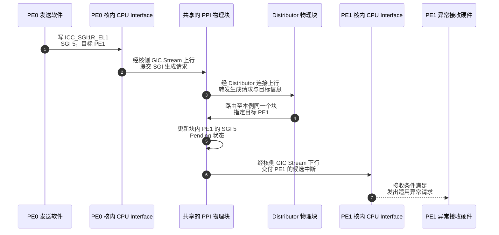
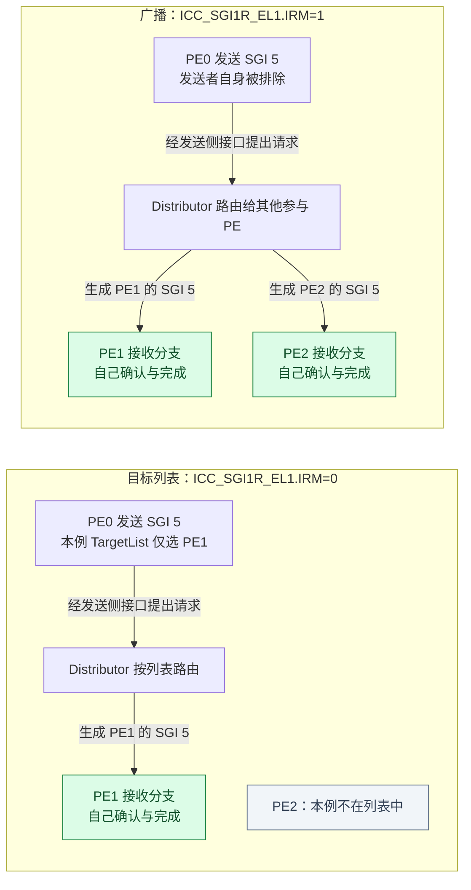
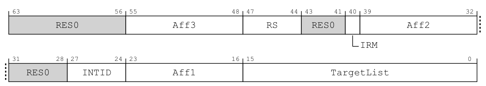
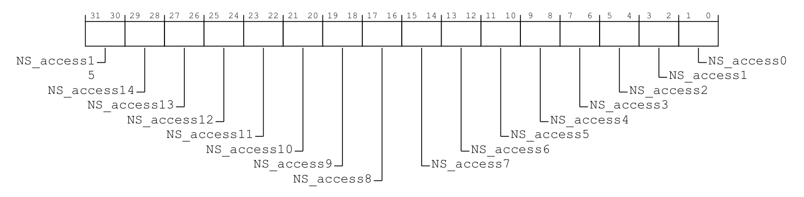
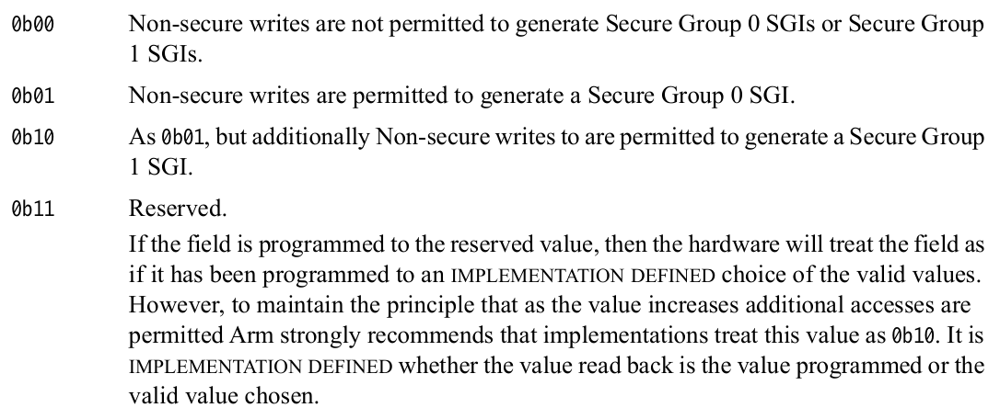
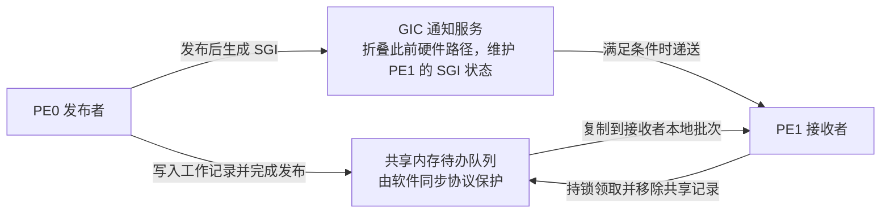
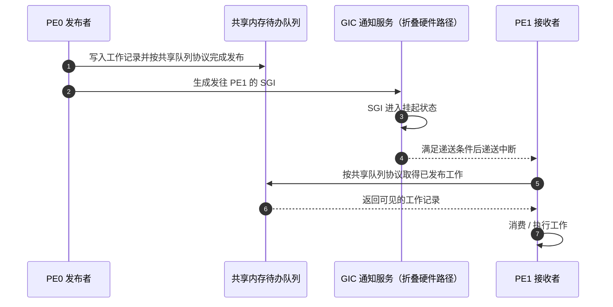
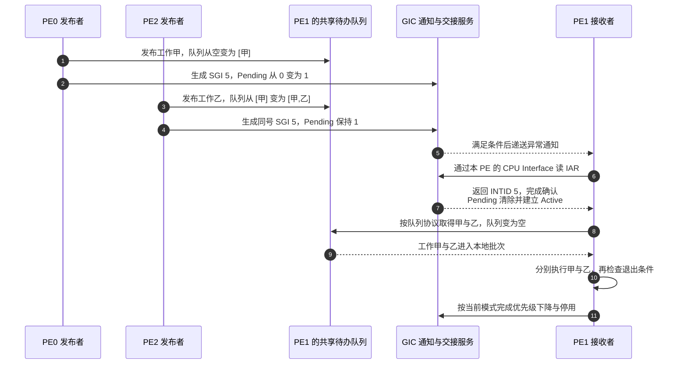

# 第12章\_SGI核间通知与电源交接

## 12.1\_核间中断传的是提醒\_工作内容存在哪里

**讲解层次：概念层——先区分硬件通知与软件任务。** 依据 IHI0069 H.b 4.4；后面分别展开产品请求路径与软件教学队列。

上一章已经区分一个 SPI 的目标选择与每 PE 的私有来源状态：1-of-N 只选择一个接收者，同号 PPI 也不能当作广播。本章把请求发起者换成软件，只追踪通知、工作内容与接收能力怎样配合：先发出 SGI，再用共享队列检验通知合并，最后处理接收者下线和退出前的新工作。

**软件产生中断（Software Generated Interrupt，SGI）** 是软件通过 GIC 生成的请求，常用于 **处理器间中断（Inter-Processor Interrupt，IPI）**。前者是控制器来源类型，后者描述软件的核间通知用途；两者不能无条件看成同一层 API。

### 12.1.1\_先沿硬件接口送出一次SGI

**讲解层次：概念到实现的映射。** 先按 IHI0069 H.b 3.1、4.4 确定 SGI 的架构路径，再用 GIC-600 r1p6 1.2、2.2 的物理块划分落实同一过程。

前面比较的是外设请求交给谁，现在由 PE0 主动请求通知 PE1。普通 **非安全第 1 组（Non-secure Group 1，中断安全归属名称）** 的生成入口为发送侧 CPU Interface 的 `ICC_SGI1R_EL1`，即 **Interrupt Controller Software Generated Interrupt Group 1 Register（中断控制器 Group 1 软件产生中断寄存器）**。这里假定软件在非安全状态下使用该寄存器生成非安全第 1 组 SGI；其他安全状态的生成与权限关系不能照搬这一前提。

架构路径是发送侧 CPU Interface 提交生成请求，经关联 Redistributor 的逻辑职责送到 Distributor，再分发给目标 PE 对应的 Redistributor，最后交给目标 CPU Interface。逻辑上的两次 Redistributor 角色出现，不足以判定访问了两个物理块。

**实现层——GIC-600 r1p6，固定 PE0、PE1 共用一个 PPI 块的集成例子。** 两个 CPU Interface 分别在各自处理器核内，图中的 PPI 块则只有一个：它既承接发送侧上行请求，又维护目标 PE1 的 SGI 状态。该分组在硬件集成时确定，软件发送 SGI 不会临时把 PE 移入另一 PPI 块。图只展开请求路径；确认和结束仍使用第六章的完整协议。

步骤 3～4 仍经过 Distributor 路由；步骤 5 改的是同一 PPI 块中 PE1 的实际 SGI 状态，不是再把一个外置 RD 的 Pending 复制进来。**经过某个组件转发，不等于该中断的所有配置与状态都归那个组件所有。** 若两个 PE 属于不同 PPI 块，第 4 步才交到另一物理块，架构上的来源身份与完成规则仍相同。发送者也没有把普通软件工作对象塞进这条硬件链，工作数据放在哪里要到本节后半段单独解决。

> 官方对照：[规范 IHI0069 H.b](https://developer.arm.com/documentation/ihi0069/hb)，3.1（3-42）、4.4（4-60）确定逻辑路径；[GIC-600 r1p6](https://developer.arm.com/documentation/100336/0106)，1.2（1-13）、2.2～2.2.2（2-29～2-30）确定 PPI 块、Distributor 连接与核内 CPU Interface 的物理端点。图不展开内部事务编码、缓冲队列或传播周期。

### 12.1.2\_目标列表与广播\_同名IRM为什么有不同含义

**回到概念层——SGI 的架构目标规则。** 依据 IHI0069 H.b 2.3.1、4.4、12.2.22，下面的接收分支只用于数目标，不表示 PPI 块数量。

沿用上一章的三个教学目标：PE0、PE1、PE2 的亲和性坐标分别为 `0.0.0.0`、`0.0.0.1`、`0.0.0.2`，这次让 PE0 通知一个或多个接收者。`ICC_SGI1R_EL1` 写入值中的来源编号、亲和性字段和 **目标列表（TargetList）** 共同指定 SGI。它的 IRM 是“这一条 SGI 怎样选目标”的字段，不能直接套用 SPI 路由寄存器的解释。

- **IRM=0，目标列表：** `Aff3.Aff2.Aff1` 指定相应亲和性范围，TargetList 的位指定其中的目标 PE。按本例坐标，仅设置 bit 1 会通知 PE1；同时设置 bit 1、bit 2 会分别通知 PE1 和 PE2。合法目标也可以包含发送者自己。
- **IRM=1，广播形式：** 向本 GIC 系统范围内除发送者以外的其他参与 PE 生成 SGI，不再按上面的目标列表挑选。按本例三 PE 的前提，就是 PE1 和 PE2；**排除 PE0**。这种模式下亲和性与 TargetList 等相应字段按规范要求写零。

下图仍使用同一组三个 PE。绿色接收分支包含其 RD、CPU Interface 与 PE，箭头表示通知的目标；前一图已经展开这些分支内部的路径。

SGI 多目标发送在各目标处形成各自的本地中断状态：PE1 已确认，不表示 PE2 也已确认；PE1 已完成，也不替 PE2 完成。由此回看 SPI 的 1-of-N，差别就在 **从候选中选择一个接收者** 与 **让选中的多个接收者各自取得通知**，不能只凭两个字段都叫 IRM 判断相同。

TargetList 只有 16 位；扩展亲和性范围时，还涉及 **范围选择字段（RangeSelector，RS）** 及相应支持能力。广播范围则是当前 GIC 的架构范围，不是机器中一切处理器或设备。无论采用列表还是广播，目标选择都不豁免安全状态与中断组匹配规则，也不绕过第七至九章已经建立的优先级门限、PE 异常控制和组接收许可；选为目标与立刻执行处理程序仍是两件事。SPI 的 DPG 候选控制也不能直接套成 SGI 广播接收开关。

现在直接对照 `ICC_SGI1R_EL1` 的手册原图。它是发送 PE 的 64 位只写系统寄存器，用 `MSR ICC_SGI1R_EL1, Xt` 提出一条完整生成请求，前提是系统寄存器访问获准；不能通过读回它判断目标完成。

> 原图来源：[IHI0069 H.b](https://developer.arm.com/documentation/ihi0069/hb)，12.2.22，印刷页 12-276；字段续至 12-277。下表为逐字段中文对照，与 IROUTER 原图比较可见 IRM 位号和目标字段组织都不同。

| 位段 | 字段 | 目标列表方式下保存什么 |
| --- | --- | --- |
| 63:56 | RES0 | 保留为 0 |
| 55:48 | Aff3 | 目标范围的亲和性第 3 层 |
| 47:44 | RS | TargetList 对应哪一组 16 个 Aff0 值 |
| 43:41 | RES0 | 保留为 0 |
| 40 | IRM | 0 按目标列表；1 向除自身外的其他 PE 广播 |
| 39:32 | Aff2 | 目标范围的亲和性第 2 层 |
| 31:28 | RES0 | 保留为 0 |
| 27:24 | INTID | 要生成的 SGI 编号，范围 0～15 |
| 23:16 | Aff1 | 目标范围的亲和性第 1 层 |
| 15:0 | TargetList | 每个置位位选择一个目标；目标 Aff0 为 `16 × RS + 位号` |

本例使用 RS=0，所以 TargetList=`0x0002` 选 PE1，`0x0006` 选 PE1、PE2。使用非零 RS 需要 CPU Interface 的 `ICC_CTLR_EL1.RSS[18]` 与 Distributor 的 `GICD_TYPER.RSS[26]` 都报告 **范围选择支持（Range Selector Support，RSS）**；不能仅因字段宽度有 4 位就假定支持。前者的原图与只读属性见[第六章 CTLR 字段](P06_一次中断的状态转换与完成协议.md#6.3_确认_清源_优先级下降与停用)，后者见[上一章的 GICD_TYPER 原图](P11_SPI目标选择与每PE状态.md#11.2.2_候选资格是PE的状态_路由属性仍属于SPI)。广播时 Aff3、Aff2、Aff1 和 TargetList 按规范为 `RES0`，本例 RS 也保持 0。

再把本节实际采用的安全条件摊开：以下只摘取规范表 12-14 中“非安全 EL1/EL2 写 ICC_SGI1R_EL1”的分支，限定两安全状态有效、两侧亲和性路由开启且系统寄存器访问已获准。**非安全访问控制寄存器（Non-secure Access Control Register）** `GICR_NSACR` 是目标 PE 侧逐 SGI 的跨安全域授权控制，不是发送者能随意绕过的许可。

| 目标 PE 上这个 SGI 的安全归属 | 是否允许本次生成请求转发 |
| --- | --- |
| Non-secure Group 1 | 允许；这是本节主线 |
| Secure Group 1 | 只有目标对应 GICR_NSACR 字段允许时才转发 |
| Secure Group 0 | 只有目标对应 GICR_NSACR 字段允许时才转发；本表限定 DS=0，不采用单安全状态例外 |

这张表判断生成请求能否转发，不保证目标立刻进入处理程序。本节没有配置跨安全域授权，因此教学 SGI 保持 Non-secure Group 1；换用其他生成寄存器或安全状态时，必须换用它们各自的规则，不能只换一个组名。

要核对“目标允许”的含义，再看目标 PE 的授权寄存器原图。它位于 `SGI_base + 0x0E00`，32 位；`DS=0` 时安全访问可读写、非安全访问读零写忽略，`DS=1` 时读零写忽略。

> 原图来源：[IHI0069 H.b](https://developer.arm.com/documentation/ihi0069/hb)，12.11.30，印刷页 12-697；访问规则续至 12-698。每个 `NS_access<x>` 占 `[2x+1:2x]`，x=0～15，对应一个 SGI，不对应目标 PE 位号。

> 编码来源：同条目 12-697 的四种字段取值；下表是中文对照，保留保留编码的硬件处理边界。

| `NS_access<x>` 编码 | 中文对照 |
| --- | --- |
| `00` | 不允许非安全写生成安全 Group 0 或安全 Group 1 SGI |
| `01` | 允许非安全写生成安全 Group 0 SGI |
| `10` | 在 `01` 的基础上，也允许生成安全 Group 1 SGI |
| `11` | 保留，不作有效配置选择；写入后硬件按某个实现定义的合法值处理，读回也可能是原值或所选合法值，不能当作更大的通用权限 |

例如 SGI 5 的授权在 `[11:10]`，而发给 PE1 的 TargetList 是 bit 1。两者虽然都参与同一次生成，索引对象却不同；修改 NSACR 只改变许可，不生成中断，也不作用于 PPI。

> 官方对照：[规范 IHI0069 H.b](https://developer.arm.com/documentation/ihi0069/hb)，2.3.1（2-39～2-40）、4.4（4-60）、12.2.22 ICC_SGI1R_EL1（12-276～12-277）；安全状态与组生成关系见 Table 12-14（12-207）。核对 IRM、RS、TargetList、排除发送者及不同生成寄存器的权限边界。

### 12.1.3\_通知之外\_把工作保存在共享内存

**讲解层次：概念层——软件协议教学模型。** 共享队列由本专题自定，用来满足 GIC 通知之外的数据保存与交接要求；本节推演通知双方必须遵守的协议。

固定一个场景：PE0 为 PE1 准备了一项工作。工作内容保存在共享内存中的待办队列，包含要处理的对象；SGI 只提醒 PE1 去查看该队列，不把整个工作对象放入中断信号。

先给这个教学队列一个具体落点：普通共享内存中的 `work_queue` 对象，内含有限容量的记录数组 `records`、未领取数量 `count` 和保护它们的锁 `lock`。这些名字是本例自定的软件字段，不是 GIC 寄存器。记录按值保存本例全部工作参数；若换成指向外部对象的指针，还必须另行保证被指对象的生命周期。这里只允许 PE0（下一节再加入 PE2）发布，PE1 的接收路径是唯一消费者。

发布者先取得锁，检查容量，写入完整记录并更新数量，随后释放锁；空间不足就报告发布失败，不能覆盖未消费记录后仍声称发布成功。接收者取得同一把锁，把当前记录复制到自己独占的本地批次，再清空共享队列并释放锁。**清空的是“尚未领取”的集合，实际工作此时只是转交给本地批次，还没有执行完成。** 接收者在锁外执行批次，随后重新检查队列；发送者因此不必等待一整批工作执行结束才能追加下一批。

| 本例的状态位置 | 谁写入 | 谁读取，以及何时改变归属 |
| --- | --- | --- |
| 共享 `work_queue.records/count` | PE0、PE2 持锁追加；PE1 持锁取走并清空 | PE1 在 S4 领取；发布者在 S1 检查容量。锁串行化数组与数量的组合修改 |
| PE1 的本地批次 | PE1 在锁内从共享数组复制，在锁外消费 | 只有 PE1 使用；领取后即使共享队列已经为空，批次里仍可能有未执行工作 |
| PE1 的 SGI Pending/Active | GIC 按生成、确认和停用协议更新 | S2～S5 的通知与交接状态；不存储数组内容，也不根据 `count` 自动更新 |

这里要求锁本身提供目标系统规定的互斥和内存可见性，使接收者在成功取得锁后能够读取完整记录，而不是只看到新数量、却仍读到旧内容。所有参与者必须遵守同一规则。锁临界区只搬运有界记录，不执行工作函数；当前角色安排也不允许消费者在同一 PE 上打断一个持有这把锁的发布者后再忙等它。若改变角色或加入其他调用上下文，就必须重新检查抢占、锁和生命周期条件，不能只复制这些字段名。

下面两图切换到软件协议视角，把上面已经展开的 SGI 硬件路径折叠为一个通知对象，专门追踪“工作在哪里、谁发布、谁消费”。它们不是另一种绕过 Distributor 的硬件连线。

队列是数据通信，SGI 是通知通信。两条路径要配套：如果先发送 SGI，后发布队列内容，PE1 可能先进入处理入口却看不到工作。只写队列而没有对应通知或接收侧轮询协议，则工作可能一直留在那里。

锁解决了记录的一致读写，还要把发布与通知的先后落实到目标系统：成功发布、释放锁后，发送者通过满足所需内存顺序的接口生成 SGI。原始“写一个 SGI 系统寄存器”不能自动替所有先前普通内存写入建立所需的软件同步契约；仅在源码中把两行前后排列，也不等于完成这份可见性保证。具体实现应使用目标系统已经封装好的核间调用接口；本节没有给出可在任意机器上照抄的屏障指令组合。

> 官方对照：[概览 198123，3.2-01](https://developer.arm.com/documentation/198123/0302)，第 7 章 Sending and receiving Software Generated Interrupts（PDF 第 38～40 页），以及[规范 IHI0069 H.b](https://developer.arm.com/documentation/ihi0069/hb) 4.4 Software Generated Interrupts。共享队列是本专题为解释“数据与通知”添加的教学对象，GIC 规范不替某个软件队列提供锁或发布协议。

## 12.2\_两个发送者会不会得到两次计数

**讲解层次：概念层——SGI 契约与软件队列的组合推演。** GIC 状态规则依据 IHI0069 H.b 4.4，队列仍是上一节的教学对象；图中把控制器访问折叠为通知服务，具体硬件端点见第 12.1.1 节。

本节沿用三个 PE，改为 PE0 和 PE2 共同发送、PE1 接收。两名发送者各有一项工作要交给 PE1。首先必须分开两次写入：**发送者写共享内存队列，增加工作记录；发送者生成 SGI，要求 GIC 通知 PE1。** GIC 不读取队列，也不会替发送者追加工作、增加队列长度或创建一个软件回调。

在 GICv3 亲和性路由模型下，同一目标 PE 的同一个 SGI INTID 只有一个挂起状态，不按发送者另存挂起计数。若 PE0 和 PE2 在 PE1 确认以前都发出 SGI 5，第二次通知可以并入已经置位的 Pending。**减少的是可区分的通知次数，已经发布的两份工作记录仍然存在。**

下面固定队列支持多发送者安全发布，且空间足够、没有并发消费者；两个通知都在首次确认以前到达。接收者通过 **中断确认寄存器（Interrupt Acknowledge Register，IAR）** 领取来源。不满足这些前提时，先分析队列竞争与容量，不能从 GIC 状态推断工作一定安全。

步骤 3 已经把第二项工作放入队列；步骤 4 只负责通知，不应该再把同一工作追加一遍。用两列独立状态观察就不会把它们混成一个计数器：

| 时刻 | 共享内存中的未领取工作 | PE1 的 SGI 5：Pending / Active |
| --- | --- | --- |
| 初始 | `[]`，0 项 | 0 / 0 |
| PE0 发布甲并生成通知后 | `[甲]`，1 项 | 1 / 0 |
| PE2 发布乙并生成通知后 | `[甲,乙]`，2 项 | 1 / 0；没有 Pending=2 |
| PE1 确认后，尚未领取队列 | `[甲,乙]`，2 项 | 0 / 1 |
| PE1 取得甲乙并执行后 | `[]`，0 项 | 0 / 1；控制器仍待完成 |
| 本轮停用后且无新通知 | `[]`，0 项 | 0 / 0 |

按[本专题阶段](P06_一次中断的状态转换与完成协议.md#6.4_用同一组阶段闭合正常周期)看，发布工作属于 S1 的真实工作产生，Pending 属于 S2，读 IAR 属于 S3，队列消费属于 S4，控制器收尾属于 S5。SGI 合并发生在通知层，不把甲乙合成同一项任务；软件若另外维护工作数量，那也是软件在队列协议中更新的计数，不是 GIC 的隐藏功能。

如果 PE2 的通知晚于 PE1 的确认，SGI 可以变为 Active and Pending，停用后仍有一次请求等待确认。即使 PE1 本次已经从队列取走乙，之后也可能多进入一次并发现队列为空。正确处理应以队列里的实际工作为准，既不能假定每次入口只执行一项，也不能假定每次入口一定有新工作。

退出时仍有一个边界要处理：PE1 刚检查到空，发送者就发布新工作。最直观的协议要求 **每次成功发布后都生成通知**，并使用目标系统规定的发布与通知顺序；新通知可能在当前处理中被消费，也可能保留到后续，但接收者必须重新检查队列。若为了减少通知，只在“空变非空”时发 SGI，就需要共享的待处理标志、锁或原子交接协议，以及退出前的复查，保证发送者不会误以为接收者还在工作而省掉最后一次唤醒。这个协议必须由队列与通知接口实现，单写 SGI 寄存器不能提供它。

> 官方对照：[规范 IHI0069 H.b](https://developer.arm.com/documentation/ihi0069/hb)，4.4 Software Generated Interrupts、12.2.22 ICC_SGI1R_EL1。查 v3 亲和性路由下的状态归属、目标列表和 IRM 语义；不要把 GICv2 的按发送者状态或 SPI 的 1-of-N 选择带进这条路径。

## 12.3\_目标准备下线时\_要交接的不只是路由

**讲解层次：概念层——工作、路由与接口状态的交接。** 先使用 IHI0069 H.b 的架构契约，再转入 GIC-600 r1p6 的核侧电源协议；两者都不替代具体 SoC 的电源控制器协议。

目标变化至少涉及三件事：

1. 未来请求往哪里走？
2. 旧目标上已经挂起的请求如何处理？
3. 已经确认的处理过程怎样收尾？

改变一个路由寄存器，不会自动迁移设备驱动的栈或正在执行的代码。

从软件角度，需要先阻止新的工作被分配给即将下线的接收者，再依照来源类型和控制器规则处理已有状态，最后完成接收侧电源交接。普通 SPI、私有 PPI 与后文消息中断的迁移规则不同，不能复用一个“改目标即可”的算法。

再分发器的 `GICR_WAKER`，即 **再分发器唤醒寄存器（Redistributor Wake Register）**，用于电源握手；**ProcessorSleep（处理器休眠）** 表达软件交接请求，**ChildrenAsleep（下属接口已休眠）** 报告硬件交接状态。这里延续第十章建立的接口握手：有权软件在适当关闭接收条件后设置 ProcessorSleep，并等待 ChildrenAsleep 表示相关接口完成休眠交接，随后才由平台电源协议关闭相应资源。接收侧仍在使用，不能仅凭软件已发出请求就切断时钟或电源。

这里复用[第十章 WAKER 原图与完整字段对照](P10_初始化顺序与硬件完成握手.md#10.2_唤醒接收侧为什么要握手)：32 位 MMIO 位于当前 PE 的 `RD_base + 0x0014`，`ProcessorSleep[1]` 由软件写，`ChildrenAsleep[2]` 只读。关核时先关闭 CPU Interface 的组使能，再把 bit 1 从 0 改为 1、等待 bit 2 为 1；恢复时先确认 bit 2 已为 1，再清 bit 1、等待 bit 2 为 0。地址与字段没有改变，这里新增的是 **旧工作和目标迁移须先交接** 的条件。

两安全状态下，此架构接口只允许安全访问读写，非安全访问读零写忽略；单安全状态按 RW 访问，芯片还可能另有产品约束。这两个位是架构握手，不是电源控制器的实际断电位。依据 IHI0069 H.b 12.11.42（12-728～12-729）；GIC-600 另外定义的整体 LPI 缓存休眠字段留到[下一章](P13_从消息请求到内存中的中断状态.md#13.6_整体关闭与禁止一个来源不是同一保证)。

**讲解层次切换：实现层——GIC-600 r1p6 的处理器核电源管理。** 以下依据产品手册 3.6.2，假定服务该核的 PPI 块已经供电且通信可用。对一个已按协议休眠的专门目标收到请求时，GIC-600 可以通过 WakeRequest 块的 `wake_request` 输出请求平台电源控制器唤醒。该信号必须实际连接到电源控制器，且恢复路径可用；它不是 CPU Interface 继续向已经断电的核发送普通异常请求。

还要区分普通等待与真正电源交接：**WFI（Wait For Interrupt，等待中断）** 是处理器指令名称，不等于设置 ProcessorSleep。哪些低功耗状态需要电源控制器唤醒、哪些仍由正常接口接收，必须联合核对处理器与 GIC-600 手册。

下表将 GIC-600 r1p6 3.6.2 的关核动作整理到各自的完成边界，补出“适当关闭接收条件”所包含的内容。它仍须与具体处理器的关核协议配套，不能取代前面的工作迁移和来源收尾。

| 顺序与执行者 | 动作 | 能依赖的结果 |
| --- | --- | --- |
| 软件先控制当前核 | 屏蔽该核中断，关闭 CPU Interface 的组使能，并按核接口要求禁止中断旁路 | 关核过程中不再把正常中断递送当作可继续使用的路径 |
| 有权软件请求交接 | 置对应 GICR_WAKER.ProcessorSleep=1 | 仅提出休眠交接请求，尚不能断电 |
| 软件观察硬件 | 轮询 ChildrenAsleep，直到其为 1；超时按失败处理 | 核侧 GIC Stream 接口已完成交接，没有未完成事务 |
| 平台电源路径 | 按处理器及芯片协议关闭本次获准关闭的核侧资源 | 之后的专门目标请求需通过实际连接的 wake_request 唤醒路径恢复；单核交接不授权关闭共享 PPI 块 |

这里的 **中断旁路（interrupt bypass）** 指绕过正常 CPU Interface 递送控制的接口功能，是否存在及怎样禁止由处理器实现决定，不能由这张表虚构一个所有核通用的寄存器位。表依据 GIC-600 r1p6 TRM 3.6.2（3-57～3-58）的顺序说明重排；它解释正常接口关闭与平台唤醒为何必须同时成立。

这里尤其要分开三个范围。`ProcessorSleep/ChildrenAsleep` 是 **逐 PE 的架构交接状态**，其 GICR 控制页由产品 Distributor 实现；GIC Stream 的另一端是该 PE 核内的 CPU Interface。**物理 PPI 块** 可以同时服务若干 PE，里面分别维护这些 PE 的 SGI/PPI 配置与状态。**电源域** 则由处理器与 SoC 的集成决定，不能由“每 PE 一个逻辑 Redistributor”推导为“每 PE 一个 PPI 块和一个独立电源域”。

例如 PE0、PE1 共用一个 PPI 块，PE0 的 ChildrenAsleep 已为 1，而 PE1 仍在运行。此时 PE0 的核侧接口交接已完成，PPI 块却仍须为 PE1 维护来源并递送请求；不能把整个块一并断电。3.6.2 对共享簇 GIC Stream 接口的关闭，要求簇内所有核完成相应交接。PPI 块自身还存在 3.6.1 的 Redistributor 电源协议，SoC 还要满足共享电源与时钟条件；它们不能被一次 WAKER 握手取代，本节也不据公开功能说明猜测芯片内有哪些电源开关。

> 范围依据：[GIC-600 r1p6](https://developer.arm.com/documentation/100336/0106)，1.2（1-13）、2.2（2-29）区分物理块与逐 PE 状态；3.6.1～3.6.2（3-57～3-58）分别描述 Redistributor 与处理器核电源管理。这里解释两类协议的边界，不构造一份缺少平台依据的完整上电程序。

## 12.4\_接收者刚检查到空\_新工作会不会遗失

**回到概念层——软件队列与 SGI 状态的交错推演。** 继续第 12.1.3 节的软件模型，假定接收者保持可接收、可执行；本节不执行前述断电流程。

把第 12.2 节的场景推进到退出前。PE1 已确认 SGI 5 并消费旧工作，检查队列为空；恰在它准备停用之前，PE0 发布工作丙，并按“每次发布都通知”的协议生成同号 SGI。请同时记录队列、Pending 与 Active，而不是只数入口次数。

在工作发布与通知顺序成立、硬件正常接收且没有其他消费者的前提下，新通知到达时旧 SGI 仍 Active，因此可以形成 Active and Pending。旧实例停用后留下 Pending；后续确认时读取队列，就能取得丙。若 PE1 在退出前再次查队列并提前消费丙，后续入口可能看见空队列，但不能据此把它当作“伪造了一项工作”。

如果新通知在停用之后才到达，则它从非活动建立 Pending，结论仍是后续存在服务机会。两条交错之所以都成立，是因为工作先被可靠保存，通知随后产生，而不是因为停用动作替发送者扫描了队列。

现在去掉 PE0 的这次通知，理由是“我觉得 PE1 还在处理中”。若 PE1 已做完最后一次空队列检查，就可能退出且再无通知，丙留在内存无人消费。减少 SGI 次数的优化必须增加可证明的退出交接，例如由锁保护的工作/唤醒状态和复查；这部分复杂度是优化的成本，不能凭猜测省去。

最后区分安全性与推进：上述协议说明在给定前提下工作不会因通知合并而从队列消失；若 PE1 永久屏蔽接收、掉电或不再调度处理路径，并不能证明工作最终一定执行。队列保存、通知可达和消费者持续推进是三个独立条件。

### 12.4.1\_同名IRM与同号中断\_分别需要几份完成记录

**讲解层次：概念层——按来源身份核对完成义务。** 以下只用本章已经建立的架构规则。

再用同一组三个 PE 检查目标模型。假设相应能力受支持，来源配置与接收条件都成立，且没有重复触发或其他发送者加入；每个例子只观察本题所说的这一次请求。

1. SPI 40 的 `GICD_IROUTER40.IRM=1`，三个 PE 都是候选。本轮是否必须等三个 PE 都确认并完成？
2. PE0 以 `ICC_SGI1R_EL1.IRM=0` 发送 SGI 5，目标列表同时选中 PE1、PE2。PE1 完成以后，能否宣布 PE2 也已经完成？
3. PE0 将同一 SGI 生成寄存器的 IRM 改成 1。PE0 是否也因这次广播取得一份 SGI？
4. 三个本地源同时触发各自的 PPI 27。三个 PE 都记录到 INTID 27，是否证明 GIC 广播了一个 PPI？

**参考答案：**

1. 不需要。1-of-N 为本次 SPI 选择一个 PE，另外两个候选没有因此各取得一份相同 SPI；若测试要求三个核都报告完成，需要另外建立软件工作与应答协议，不能从 IRM=1 推出。
2. 不能。两个目标各有 SGI 5 的本地状态，分别确认并完成。若发送者需要等两项软件工作都做完，还必须由软件记录各自的完成结果；GIC 的中断完成不替代这份工作记录。
3. 不会。广播排除发送者 PE0，本例目标为 PE1、PE2；如果需要通知自己，应使用允许包含自身的目标列表方式或适当的软件路径。
4. 不能。三个 PE 观察到的是各自的私有实例；编号相同不等于来源、状态和完成义务相同。

现在已能把多核通知拆成“工作状态、通知状态、接收能力”三件事。下一章面对大量消息设备时继续问：若每个事件都需要一个可编程来源，状态应该继续全部挤在寄存器中吗？

官方对照：[GIC-600 r1p6 技术参考手册（Technical Reference Manual，TRM）](https://developer.arm.com/documentation/100336/0106)，3.6.2 Processor core power management（3-57～3-58），核对关核前置条件、握手与唤醒请求。

上一篇：[SPI目标选择与每PE状态](P11_SPI目标选择与每PE状态.md#11.1_把请求交给另一个处理器_改变了什么)

[专题大纲](大纲.md#1.2_因果阅读地图)

下一篇：[从消息请求到内存中的中断状态](P13_从消息请求到内存中的中断状态.md#13.1_来源越来越多_为什么让设备发送一条消息)
