# 第13章\_从消息请求到内存中的中断状态

## 13.1\_来源越来越多\_为什么让设备发送一条消息

**讲解层次：概念层。** 本章先按 Arm IHI0069 H.b 中适用于 GICv3.0 的物理 LPI 契约建立状态与内存模型；进入 GIC-600 r1p6 产品时再说明实际载体。

前面用 **通用中断控制器（Generic Interrupt Controller，GIC）** 处理普通来源，并把多核通知的数据与信号分开。现在换成一个有许多工作队列的设备：每个队列都可能产生完成事件。若每个事件来源都要求一根专用信号线，连接与收敛的规模就随来源数量增长。

**消息中断（Message-Signaled Interrupt，MSI）** 让设备用一次约定的写事务表达请求。写事务到达控制器的接收接口，控制器再按配置识别和递送；这不是设备直接跳进处理器代码，也不是把完整工作数据都写进一个中断寄存器。

GICv3 引入 **局部性专属外设中断（Locality-specific Peripheral Interrupt，LPI）** 来支持大量消息来源。译名用于辨认术语，关键是职责：它有自己的编号空间、内存配置和挂起状态模型。LPI 总是消息型，但消息型不必然就是 LPI，因为 **共享外设中断（Shared Peripheral Interrupt，SPI）** 也可以由实现提供的消息接口触发。

本章只建立 LPI 的配置与状态。消息中的设备身份怎样翻译成 LPI，下一章再解释，不提前把所有翻译表塞进来。

> 官方对照：[消息指南 102923，1.0-01](https://developer.arm.com/documentation/102923/0100)，第 1 章 Introduction 与第 2 章 LPIs（PDF 第 6～7 页）；[规范 IHI0069 H.b](https://developer.arm.com/documentation/ihi0069/hb)，4.2 Locality-specific Peripheral Interrupts。先确认消息通知方式与 LPI 来源类型不是同一分类轴。

## 13.2\_确认LPI后\_为什么仍要结束优先级

**讲解层次：概念层。** 本节依据 IHI0069 H.b 区分 LPI 来源状态与每个 PE 的 CPU Interface 优先级状态。

普通来源在确认以后保留 **活动（Active）** 状态，直到 **停用（Deactivation）**；LPI 只有 **Inactive（非挂起）** 与 **Pending（挂起）** 两种状态。确认一个 LPI 就使其从 Pending 转到 Inactive，不会为该 LPI 建立普通来源那样的 Active 状态。

这不表示软件已经处理完设备，也不表示接收侧运行优先级自动恢复。仍然要区分：LPI 来源自身的状态、处理器接口的优先级状态、软件正在处理的数据。**确认清挂起，结束寄存器负责优先级下降；LPI 不需要普通来源的 DIR 停用动作。**

若软件处理期间又来同号消息，它可以再次挂起；是否立即递送还受当前优先级与接收条件限制。同样，挂起位不是无限计数器，工作量仍应保存在设备完成队列等位置。

例如，一条消息让 LPI 9000 在目标接收侧挂起；处理器确认 9000 时，硬件清除这次挂起并建立运行优先级占用。设备完成队列中的数据仍等软件读取。软件处理后写匹配的 EOIR 释放优先级，既没有新增普通来源的 Active，也没有一项等待 DIR 才能清除的 Active。这就是下面接口表要兑现的一次最小周期。

这里的 DIR 是停用寄存器的简称，对应 **`ICC_DIR_EL1`（Interrupt Controller Deactivate Interrupt Register，中断控制器停用寄存器）**，不是“软件处理结束”的通用命令。**再分发器（Redistributor）** 是与目标处理单元关联的接收侧配置和状态接口。

下表沿用 **中断标识符（Interrupt Identifier，INTID）** 记录来源，沿用 **中断结束寄存器（End Of Interrupt Register，EOIR）** 下降优先级。它是对已经读过的接口所做的 **LPI 差量归纳**：原位布局、访问编码和字段解释回看[确认、结束与停用接口](P06_一次中断的状态转换与完成协议.md#6.3_确认_清源_优先级下降与停用)，不把这张归纳表当作另一份手册原表。访问属性记号 RO（Read-only，只读）、WO（Write-only，只写）、RW（Read/Write，读写）只说明软件访问方向，不承诺读取无副作用。

| 复用的处理器接口 | 访问属性与相关字段 | LPI 路径中的含义 |
| --- | --- | --- |
| `ICC_IAR1_EL1` / `ICC_EOIR1_EL1` | AArch64 系统寄存器，64 位；前者 RO 但读取有确认副作用，后者 WO；INTID[23:0] 标识本次来源 | 对真实 LPI 的确认清 Pending；匹配的 EOIR 写入仍须下降运行优先级 |
| `ICC_DIR_EL1` | AArch64 系统寄存器，64 位 WO；INTID[23:0] 指定需停用的普通来源 | LPI 没有 Active，不给它增加一次 DIR 停用步骤；普通来源的分离模式契约见[第六章](P06_一次中断的状态转换与完成协议.md#6.3_确认_清源_优先级下降与停用) |

这里复用 IHI0069 H.b 12.2 的确认、结束与停用接口；访问权限和特殊 INTID 的排除规则不因来源换成 LPI 而取消。

相对 [S0～S6 普通周期](P06_一次中断的状态转换与完成协议.md#6.4_用同一组阶段闭合正常周期)，LPI 的关键差量是：

| 既有阶段 | LPI 改变了哪一处 |
| --- | --- |
| S0 | 配置和挂起存储需要准备内存表及访问属性 |
| S1～S2 | 设备消息经实现采用的接收路径，使目标再分发器中的 LPI 挂起；本卷下一章继续展开消息翻译过程 |
| S3 | 确认清除该挂起实例，没有普通来源的 Active 状态 |
| S4 | 仍然由软件处理设备数据，不由 GIC 代劳 |
| S5 | 仍需结束优先级占用，但不对 LPI 做普通中断停用 |
| S6 | 返回或继续处理满足条件的请求 |

把来源状态和接收侧状态分成两列角色，就能看清为什么少了 Active 仍然不能少写 EOIR。下图固定一次有效的 LPI 9000 确认，期间没有新消息，接口访问与来源配置都已准备好；消息怎样选中这个编号和目标，留在下一章展开。图中 Redistributor 是按 PE 划分的逻辑角色，不是承诺在核外存在一块同名独立器件；确认带来的两个状态效果分别画出，是为区分状态归属，不规定硬件内部先更新哪一份存储。

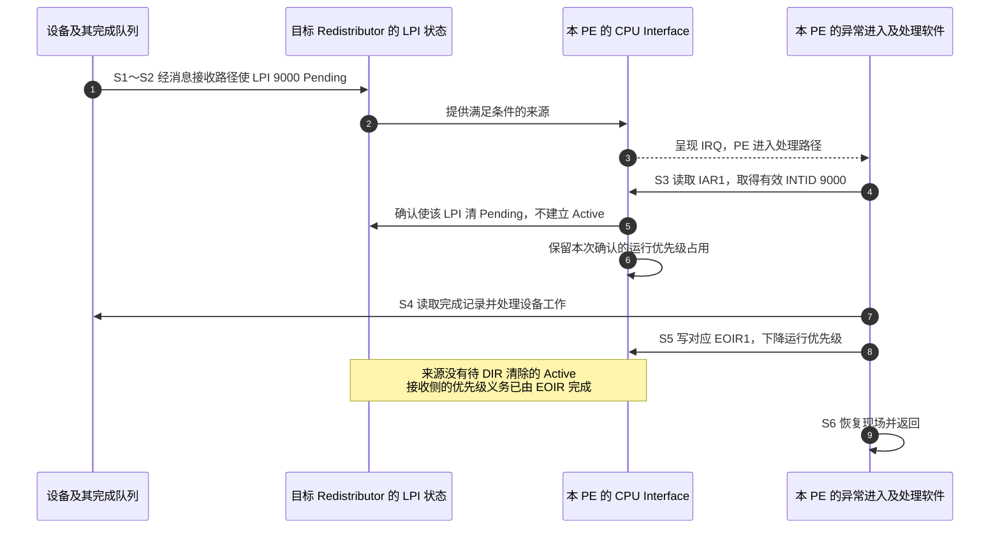

步骤 5 只改变来源的待处理状态，步骤 7 才处理真实工作，步骤 8 才释放接收侧优先级。若漏掉步骤 8，即便 LPI 已不再 Pending，接收侧仍可能挡住其他优先级较低的请求；再写一个 DIR 不能补做欠下的优先级下降。

> 官方对照：[规范 IHI0069 H.b](https://developer.arm.com/documentation/ihi0069/hb)，4.2 Locality-specific Peripheral Interrupts 与 5.1 LPIs（5-86 起）；[消息指南 102923，1.0-01](https://developer.arm.com/documentation/102923/0100) 第 2 章 LPIs。重点查“没有 Active 状态”，同时保留处理器接口优先级下降义务。

## 13.3\_两张表分别归谁维护

**讲解层次：概念层。** 本节先按 IHI0069 H.b 5.1 建立配置与挂起的所有权，再读发布表地址的架构寄存器。

消息替代了大量专用请求线，控制器却仍须记住每个来源是否使能、使用什么优先级，以及哪个接收者还有请求。若把这些信息继续全部对应到固定的寄存器窗口，来源数量一扩大，固定存储与访问窗口也要跟着扩展。GICv3 让软件按所支持的编号范围准备内存表，并允许控制器在内部缓存相关状态；这把大规模来源的状态存储引到了内存，却增加了地址、容量、可见性和维护权的约束。

其中，属性是同一个 LPI 的配置策略，挂起则是目标接收侧当前有没有待办。两者的更新者和生命周期不同，因此需要分别安排存储，而不是让软件和硬件随意共同改一张数组。

**LPI 配置表（LPI Configuration table）** 为每个 LPI 保存属性，由软件初始化和更新，控制器读取。物理 LPI 配置具有全局一致性要求；多个再分发器可以指向同一份配置表。是否允许使用不同副本由实现决定；即使允许，各副本也必须按规范在启用和配置失效等操作时保持内容一致并对控制器可见，不能把同一个编号在不同接收者上偷偷配置成不同语义。

**LPI 挂起表（LPI Pending table）** 为每个再分发器保存自己的挂起状态，运行时由该再分发器维护。这些表不能当作多个接收者共用的一张全局挂起表。

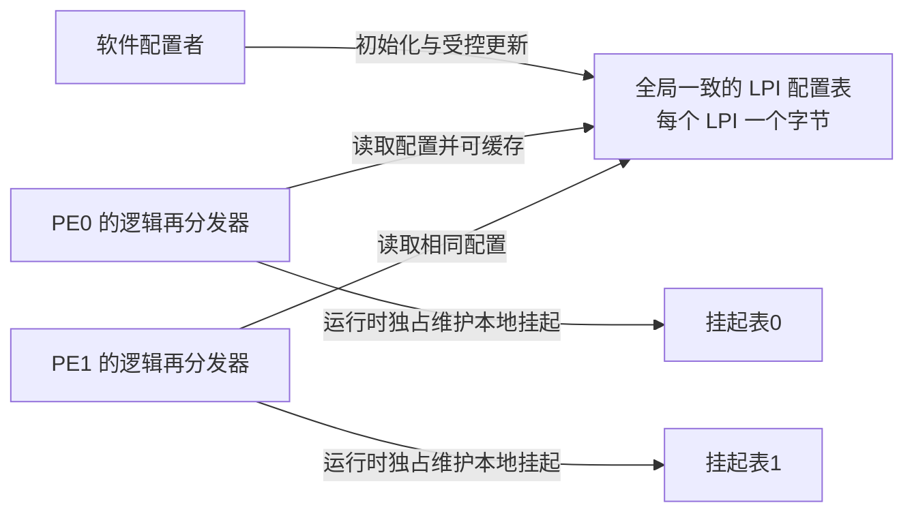

软件在初始化时分配并清零挂起表，然后将运行时维护权交给硬件。LPI 启用期间，软件写挂起表会违反架构契约；而且内存中的位不一定实时反映控制器内部缓存，不能把一次内存查看当作完整实时状态。

先走一次准备与接收过程。软件为 LPI 9000 写好使能和优先级，为各接收者分配并清零自己的挂起表；在满足初始化条件后，把表的位置交给控制器。随后一条消息选择 PE0 的 LPI 9000，硬件维护的是 PE0 的挂起状态，PE1 的挂起表不会因此一起置位。PE0 确认后，硬件清除该挂起实例；软件继续消费设备数据。这里描述的是逻辑状态变化，不承诺每次置位、清位都立即写回外部内存。

这些内存由软件分配，硬件不会自动知道它们放在哪里；还需要一组寄存器发布表的物理地址、覆盖范围和访问约定。`GICR_PROPBASER` 是 **Redistributor Properties Base Address Register（再分发器属性基地址寄存器）**，本节属性就是 LPI 配置；`GICR_PENDBASER` 是 **Redistributor LPI Pending Table Base Address Register（再分发器 LPI 挂起表基地址寄存器）**。它们是寄存器名称，告诉控制器到哪个物理内存位置访问表，以及采用怎样的属性。

先看手册怎样画这两个寄存器。下面是 **原 PDF 位布局节选**，保留了上下两排各 32 位的排布和全部保留位；不是本文重新画的示意图。两张图中的 `Physical_Address` 虽然跨越两排，仍属于同一个 64 位寄存器，不能把换行误当成两个寄存器。

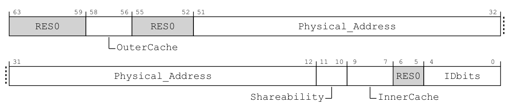

> 原图来源：[Arm IHI0069 H.b](https://developer.arm.com/documentation/ihi0069/hb)，12.11.33 “GICR_PROPBASER, Redistributor Properties Base Address Register”，Field descriptions，印刷页 12-703。访问表在 12-705；该位布局没有独立图号。

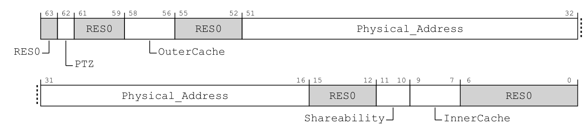

> 原图来源：同一规范 12.11.32 “GICR_PENDBASER, Redistributor LPI Pending Table Base Address Register”，Field descriptions，印刷页 12-700；访问表在 12-702。以下中文表是 **按原图字段整理的对照**，不冒充手册原表。

先沿低位读图：PROPBASER 的地址字段到 bit 12 为止，PENDBASER 的地址字段到 bit 16 为止；更低的位置分别放属性字段或保留位，不是物理地址低位。结合字段定义规定的低位补零，才能得出前者 4 KiB、后者 64 KiB 的对齐要求。再沿高位看，只有挂起表多出 PTZ；它描述已有内存内容，是否触发清零要继续读 PTZ 的文字定义，不能只按名字推断。

下表把再分发器简称为 RD，把 **GIC 分发器（GIC Distributor）** 简称为 GICD；RD_base 是当前 PE 的再分发器控制页基址。**挂起表已为零（Pending Table Zero，PTZ）** 是软件对内存现状的声明。两个寄存器都使用内存映射输入输出（Memory-mapped I/O，MMIO）：PROPBASER 为 RD_base + 0x0070，PENDBASER 为 RD_base + 0x0078，宽度均为 64 位。前者通常 RW，但实现可以固定为 RO；后者 RW，PTZ 单独为 WO、读回 0。

| 原图字段 | PROPBASER 的位段 | PENDBASER 的位段 | 中文事实对照 |
| --- | --- | --- | --- |
| Physical_Address | [51:12] | [51:16] | 保存对应表的物理地址高位；分别补 12 位、16 位零。未实现的物理高地址位为 RES0 |
| IDbits | [4:0] | 无 | 配置表覆盖的 LPI INTID 位数减一；大于 GICD_TYPER.IDbits 时按后者，小于 13 时全部物理 LPI 越界 |
| PTZ | 无 | [62] | 0 表示表包含有效数据；1 表示软件已经将挂起表清零，软件须先兑现该条件；写 1 不命令硬件清零 |
| OuterCache | [58:56] | [58:56] | 控制器访问对应表的外层缓存属性，编码见后表；实现可以固定其取值 |
| Shareability | [11:10] | [11:10] | 控制器访问对应表的共享属性，编码见后表；实现可以固定其取值 |
| InnerCache | [9:7] | [9:7] | 控制器访问对应表的内层缓存属性，编码见后表 |
| RES0 | [63:59]、[55:52]、[6:5] | [63]、[61:59]、[55:52]、[15:12]、[6:0] | 原图这些位置全部保留为 0，不可存放软件标志 |

地址、容量和能力之间的关系现在可以归纳为下面的速查表。`GICD_TYPER` 的原布局及能力字段解释复用[第十一章的能力与候选资格阅读](P11_SPI目标选择与每PE状态.md#11.2.2_候选资格是PE的状态_路由属性仍属于SPI)。

| 寄存器与逻辑范围 | MMIO 位置、宽度与属性 | 地址和容量字段 |
| --- | --- | --- |
| `GICR_PROPBASER`，LPI 配置表描述 | 当前 RD_base + 0x0070；64 位 RW，实现可将它固定为 RO | Physical_Address[51:12] 保存表物理地址高位，低 12 位为 0，即 4 KiB 对齐；IDbits[4:0] 为覆盖的 INTID 位数减一，受 GICD_TYPER.IDbits[23:19] 报告的能力限制 |
| `GICR_PENDBASER`，本 RD 的挂起表描述 | 当前 RD_base + 0x0078；64 位 RW，其中 PTZ 为 WO、读回 0 | Physical_Address[51:16] 保存表物理地址高位，低 16 位为 0，即 64 KiB 对齐；PTZ[62]=1 声明软件已经把表清零，不会命令硬件替软件清零 |
| `GICD_TYPER`，Distributor 的能力报告 | GICD + 0x0004；32 位 RO | LPIS[17] 报告 LPI 支持，IDbits[23:19] 报告 INTID 位数减一。读取能力不分配表，也不启用 LPI |

地址正确还不够。软件可能刚在处理器缓存中写好 LPI 9000 的属性，控制器却通过另一条内存访问路径读取它；这条路径是否参与共享、是否缓存，决定软件该怎样让新内容可见。因此基址寄存器除了指明“读哪里”，还描述“怎样访问”。下面细化这组访问约定；“共享”和“可缓存”都不是替软件完成更新同步的命令。

这些数值不能只靠中文摘要核对。下面直接保留 PROPBASER 的三组 **原字段编码说明**：先看 OuterCache，再看 Shareability 和 InnerCache。原件采用字段说明中的编码列表，这里保留原排版，没有把它冒充一张原本不存在的合并表。

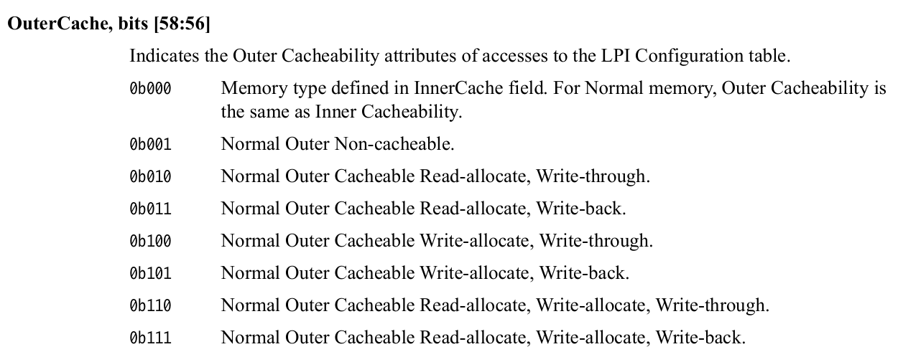

> 原件来源：[Arm IHI0069 H.b](https://developer.arm.com/documentation/ihi0069/hb)，12.11.33，OuterCache，印刷页 12-703。

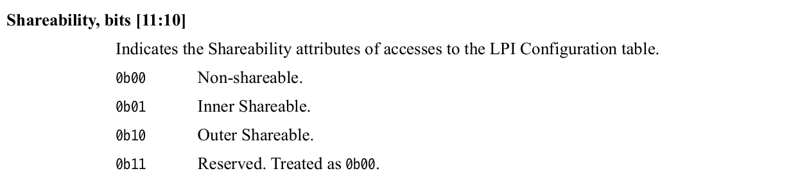

> 原件来源：同一条目的 Shareability，印刷页 12-704。这里按 H.b 的 00、01、10、11 逐项阅读，不从其他寄存器或旧资料抄一套同名字段编码。

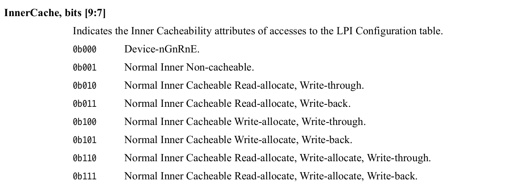

> 原件来源：同一条目的 InnerCache，印刷页 12-704。PENDBASER 的对应定义见 12.11.32，印刷页 12-700～12-701；两者在本版规范中的这些编码相同。

两个基址寄存器的共同访问属性字段 **中文对照** 如下。表内地址是控制器使用的物理地址，不能写入处理器的虚拟指针；未实现的高地址位须写 0。

| 位段 | 字段 | 编码与用途 |
| --- | --- | --- |
| 58:56 | OuterCache | 000 采用 InnerCache 指定的类型；对普通内存同时采用相同外层缓存属性。其余值使用下表相同缓存编码 |
| 11:10 | Shareability | 00 非共享；01 内部共享；10 外部共享；11 保留，按 00 处理。实际允许值由平台与实现约束 |
| 9:7 | InnerCache | 指定控制器访问表所用的内层缓存属性；编码见下表 |

缓存策略中的“读分配／写分配”回答未命中时，是否因相应读／写访问把数据填入缓存；“直写／回写”回答缓存中的写入是同时向下级推进，还是可以先留在缓存、随后再写出。这些选择改变访问方式和维护要求，并不改变哪一方拥有配置表或挂起表。

| 3 位缓存编码 | InnerCache 的含义 | OuterCache 使用该值时的含义 |
| --- | --- | --- |
| 000 | Device-nGnRnE 设备内存 | 使用 InnerCache，不能独立解释为设备内存 |
| 001 | 普通、不可缓存 | 普通、外层不可缓存 |
| 010 / 011 | 普通、读分配，分别为直写 / 回写 | 相同策略用于外层缓存 |
| 100 / 101 | 普通、写分配，分别为直写 / 回写 | 相同策略用于外层缓存 |
| 110 / 111 | 普通、读写分配，分别为直写 / 回写 | 相同策略用于外层缓存 |

“共享”和“可缓存”描述控制器怎样访问内存，不自动替软件建立缓存可见性。实现可以固定部分属性，软件须按实际支持值配置；多个已启用 RD 的 PENDBASER 访问属性也必须一致。EnableLPIs=1 时不能改 PENDBASER，也不能把 PROPBASER 当作可随意切换表的指针；受控关闭与再次配置的条件见 [13.6 节](#13.6_整体关闭与禁止一个来源不是同一保证)。上述中文对照依据 IHI0069 H.b 12.11.32～12.11.33（12-700～12-705），保留位已逐项列出。地址、属性和 IDbits 的复位值多为架构 **UNKNOWN（未知值）**，即软件不能依赖某个确定值，不能用“刚复位”代替完整初始化；PTZ 的读零也不能证明表已经清零。

**讲解层次：概念到实现的映射。** 现在把上述 LPI 9000 场景放入 GIC-600 r1p6，核对“由目标 Redistributor 维护”在产品中到底落在哪里。

架构按 PE 区分逻辑 Redistributor：两个 PE 就有两份接收职责、两张挂起表。GIC-600 的 **Distributor 物理块** 集中实现同一芯片所有 PE 的 LPI 功能和缓存；产品称为 **Redistributor 的物理块（PPI block）** 则保存一组 PE 的 SGI/PPI 功能。于是图中两份逻辑 Redistributor 的 LPI 职责都落在 Distributor 内部，不需要在它后面再串接两个独立的“LPI Redistributor 器件”。

| 已建立的架构对象 | GIC-600 r1p6 的实际载体与数量关系 | 软件怎样选中或影响它 |
| --- | --- | --- |
| 配置表地址与覆盖范围 | 同一芯片共享一份 GICR_PROPBASER 状态；配置表仍在软件分配的外部内存 | 任一 PE 对应的 PROPBASER 地址视图都访问这份共享状态，不能为同一芯片的不同 PE 写不同配置表 |
| 各 PE 的挂起表地址与挂起状态 | 每个 PE 仍有自己的 PENDBASER 地址描述和挂起表；LPI 功能与缓存集中在 Distributor | 目标 PE 的控制页选择其 PENDBASER；缓存保存逻辑上属于该 PE 的状态，集中保存不取消 PE 身份 |
| 控制器访问 LPI 表的属性 | PROPBASER 属性全芯片一份，PENDBASER 的属性也全芯片一份；两组属性彼此区分 | 各 PE 的地址视图必须使用一致属性；不能把 PENDBASER 的共享属性误读成共享挂起表地址 |
| 物理 LPI 的启用与接收侧控制 | 各 PE 的 GICR 控制页及 LPI 功能在 Distributor 内 | MMIO 地址选中目标 PE 的控制页；写 EnableLPIs 改该接收侧的 LPI 条件，不改其他 PE 的 SGI/PPI 使能 |
| SGI/PPI 的私有配置、挂起与活动状态 | 产品 PPI block 中的逐 PE 功能；本章的 LPI 表不放在这些 SGI/PPI 页里 | SGI/PPI 页访问从 Distributor 的编程入口进入，再到对应 PPI block 的目标 PE 状态 |
| CPU Interface 的运行优先级 | 对应 PE 核内的 CPU Interface | PE 执行 IAR、EOIR 等系统寄存器访问；它不通过 LPI 表地址描述符访问这些状态 |

下面只画本章需要的物理载体。Distributor 外框内的两个小框表示已确认的功能分区，未断言缓存由多少 SRAM、队列或仲裁单元组成；外部挂起表仍按 PE 分开。

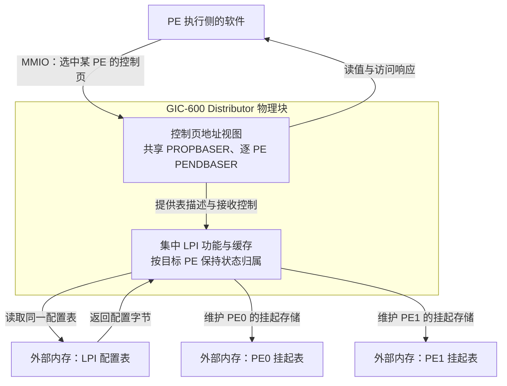

假设初始化时由 PE0 上的软件替 PE1 准备挂起表。它写的是 **PE1 控制页的 PENDBASER 地址**，事务经系统互连到 Distributor 编程从接口，修改 Distributor 内属于 PE1 的表描述。后来 LPI 9000 以 PE1 为目标到达，Distributor 的 LPI 功能使用 PE1 的挂起状态和这份表描述，必要时经自己的内存主接口读取或回写挂起表。发起初始化的 PE0 并不会因此成为该中断的接收者。读回 PENDBASER 也是从控制器返回寄存器值，不是从核内 CPU Interface 读表。

这个映射也限定共享的代价：配置地址或公共访问属性不是某一核可随意改变的私有设置；同一物理缓存又可能同时持有多个 PE 的挂起信息，后面的整体保存协议必须覆盖这些状态。详细的 SGI/PPI 与控制页地址关系见[第四章对应关系](P04_GIC600的物理实现_从逻辑映射到输入输出.md#4.1_从GICv3到GIC600_逻辑角色怎样落到物理块)。上述落点依据 GIC-600 r1p6 1.2（1-13）、2.1.3（2-25～2-26）、4.1.1（4-103～4-104）与表 3-8 的 SYN_PROPBASE_ACC、SYN_PENDBASE_ACC 项（3-78）；内部缓存的完整布局与替换细节不是这些公开接口所给出的保证。

> 官方对照：[规范 IHI0069 H.b](https://developer.arm.com/documentation/ihi0069/hb)，5.1.1 LPI Configuration tables、5.1.2 LPI Pending tables；寄存器在 12.11.33 GICR_PROPBASER 与 12.11.32 GICR_PENDBASER。GIC-600 的实际共享范围与缓存落点见 [100336 r1p6](https://developer.arm.com/documentation/100336/0106) 1.2 Components（1-13）及附录 B 表 B-1（Appx-B-204）。查每类表是谁写、谁可以缓存、何时允许软件访问，不把 CPU 能读写某块内存等同于协议允许。

## 13.4\_用一个编号实际计算表项位置

**讲解层次：概念层。** 回到 IHI0069 H.b 的内存布局；下面的编号与地址计算不依赖 GIC-600 如何集中实现 LPI 功能。

**中断标识符（Interrupt Identifier，INTID）** 是控制器编号。LPI 从 8192 开始。对于编号 N，配置表条目的字节偏移为 N−8192；挂起表中则按 N/8 的整数商找字节，按 N 对 8 的余数找位。两张表的下标起点不同。

```text
教学编号 N = 9000
配置表：字节偏移 808（从 0 计），因为 9000 - 8192 = 808
挂起表：字节偏移 1125（从 0 计）的 bit 0，因为 9000 / 8 = 1125
```

配置条目中的 bit 0 是使能，bit 1 是保留为 1 的位置，bits 7:2 表示优先级高位；优先级低两位按 0 处理，具体实现还可能减少有效位。**RES1（Reserved, must be one，保留且必须为 1）** 是规范对保留位取值的标记，不是软件自定义状态。两安全状态下还要遵循优先级访问视图规则，不能把表内编码不经区分地与安全侧优先级比较。

先看规范保留的一个完整字节及其字段定义。它是内存表项，不是 MMIO 寄存器；但同样应先读原布局，再核对中文解释。

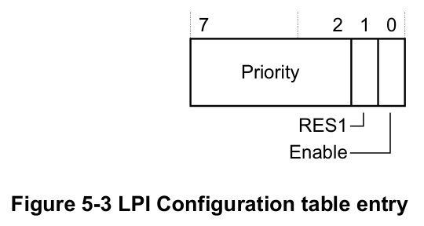

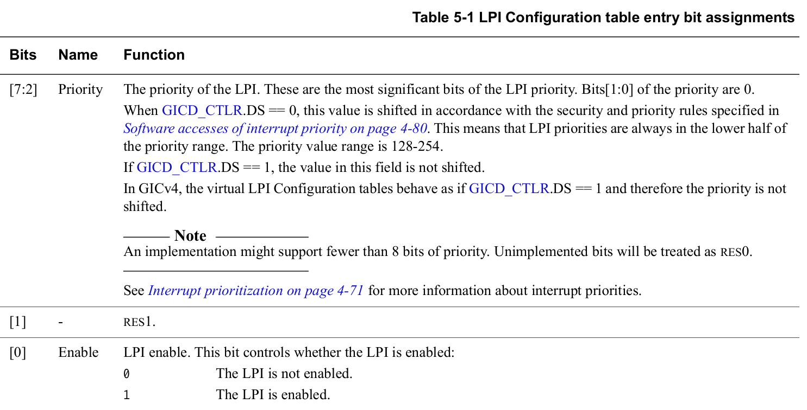

> 原图表来源：[Arm IHI0069 H.b](https://developer.arm.com/documentation/ihi0069/hb)，5.1.1 “LPI Configuration tables”，图 5-3 与表 5-1，印刷页 5-90。下表按原图从高位到低位给出 **中文对照**；本节编号 9000 的计算是本文推导。

| 位段 | 名称 | 读写含义 |
| --- | --- | --- |
| 7:2 | Priority，优先级 | 保存优先级高 6 位，优先级低两位为 0；未实现位为 RES0。DS=0 时按安全优先级规则移位，规范给出的结果范围为 128～254；DS=1 时不移位 |
| 1 | RES1 | 保留且必须为 1，不是第二个使能位 |
| 0 | Enable，使能 | 1 允许该 LPI，0 禁止该 LPI；不是整个接收侧的 EnableLPIs |

例如只改变某个 LPI 的使能，就是受控修改这个字节的 bit 0，同时保留它的优先级和 bit 1；并不是去普通 SPI 的 ISENABLER 寄存器找同号位。原表还说明 GICv4 虚拟 LPI 的表优先级按 DS=1 处理，这是后续架构分支，不改变本卷两安全状态物理 LPI 的主线。把原表中的安全视图条件一起读完，才能判断一个配置字节与接收侧门槛是否真的可直接比较。

物理 LPI 在本专题的两安全状态配置中属于 **非安全第 1 组（Non-secure Group 1）**，没有在每个条目里任选安全组的字段。

假设配置支持 B 位编号，编号空间上界为 2 的 B 次方：配置表逻辑数据量为 2 的 B 次方减 8192 字节；每个挂起表逻辑数据量为 2 的 B 次方除以 8 字节。若 B 为 16，分别为 56 KiB 与 8 KiB，KiB 表示 1024 字节。实际分配还要满足寄存器规定的基地址对齐、实现限制与内存属性，不能把逻辑大小直接当成分配器参数。

挂起表前 1 KiB 对应的区域不能被解释为普通中断的挂起位；规范允许它保存实现定义的信息，初次分配时也必须清零。不要因为 LPI 从 8192 开始，就擅自删掉这 1 KiB。

把 B=16 时的两个内存区并排看，偏移为什么不同就更直观了。下表中的“末尾”都是逻辑数据范围，基地址仍须另行满足对齐。

| 内存区 | 表内字节范围 | 内容 | 基地址对齐 |
| --- | --- | --- | --- |
| 配置表 | 0～57343 | 依次为 INTID 8192～65535 的 57344 个属性字节 | 4 KiB；由 GICR_PROPBASER 的地址字段表达 |
| 每个接收者的挂起表前部 | 0～1023 | 实现定义区域；不是 INTID 0～8191 的普通中断挂起表 | 整张挂起表为 64 KiB 对齐 |
| 同一挂起表的 LPI 区 | 1024～8191 | 每字节 8 位，依次对应 INTID 8192～65535 | 沿用 GICR_PENDBASER 的整表基地址 |

`GICR_PROPBASER.IDbits` 编码的是编号位数减一，所以本例 B=16 对应字段值 15，并且不得超出实现报告的能力。4 KiB 与 64 KiB 是基地址对齐要求，不是这两张表恰好只占这些大小；例如 56 KiB 的配置数据依然可以从 4 KiB 对齐的地址开始。布局与对齐依据 IHI0069 H.b 5.1.1～5.1.2（5-89～5-91）、12.11.32～12.11.33（12-700～12-704），没有假定 RK3588 已按本例分配内存。

> 官方对照：[规范 IHI0069 H.b](https://developer.arm.com/documentation/ihi0069/hb)，5.1.1 LPI Configuration tables（5-88～5-89）、5.1.2 LPI Pending tables（5-90～5-91）。以规范核对起始下标、配置字节位域和挂起表前 1 KiB；本节 9000 与 16 位空间是按这些规则推导的教学算例。

## 13.5\_软件改了属性\_硬件为什么还在使用旧值

**讲解层次：概念层。** 本节按 IHI0069 H.b 的配置可见性与失效契约，区分处理器缓存和 GIC 配置缓存。

固定一个失败过程：软件把某 LPI 的使能位置 1，写入停留在处理器缓存中；控制器读取内存时可能仍看到旧值。即使更新已经对控制器可见，再分发器还可能持有此前缓存的配置条目。两种旧值来源不同，需要分别处理。

因此受控更新至少包括三件事：修改配置条目；按平台内存访问规则让更新对控制器可见；使控制器的旧配置缓存失效，并等待规定的完成条件。中断翻译服务提供用于配置失效的命令，其参数和作用在[15.4 节](P15_ITS翻译表_命令队列与完成.md#15.4_初始化与创建一个映射的完整职责)展开，指定目标的完成条件见[15.3 节](P15_ITS翻译表_命令队列与完成.md#15.3_命令读走了_不等于全部副作用完成)。这两个环节处理控制器的配置状态，与处理器自身的缓存维护不是同一个动作。

把同一次更新放进表里比较。固定 LPI 9000，目标为甲，甲的 EnableLPIs 已为 1；本次只将配置字节的 Enable 从 0 改为 1，保留其优先级与保留位。开始时旧配置已经同步，甲的 Pending 为 0。观察期间没有新消息、确认、清挂起、迁移、关闭接收侧或并发配置写入，映射也不改变。下表描述协议能够保证什么，不是在读取控制器内部缓存快照。

| 阶段与已完成动作 | 配置表内存对控制器的可见性 | RD 配置缓存与可依赖的判断 | 甲的 LPI 9000 Pending |
| --- | --- | --- | --- |
| U0：旧配置同步完成，尚未更新 | Enable=0 | 本例可依赖 Enable=0；是否实际驻留缓存由实现决定 | 0 |
| U1：处理器执行 Enable=1 的内存写入 | 软件已写新值，但还没有新值全局可见的保证 | 不能依赖已采用 1，也不能断言一定继续使用 0 | 0；属性写入不产生请求 |
| U2：按平台规则完成内容可见性 | Enable=1 已全局可见；若有多个配置副本，此时须全部一致 | 仍不能保证已采用 1；旧条目可能保留，也可能已被替换或重新取入 | 0 |
| U3：发布相应 INV 与针对甲的 SYNC，尚未观察同步完成 | 1 | 失效可能尚未执行，也可能已经生效；仅凭命令已发布或 INV 已读走，不能宣布完成 | 0 |
| U4：观察到消费进度越过该 SYNC | 1 | 可以依赖甲相关的配置更新已生效；后续按此配置判断 Enable=1，不要求条目永久留在缓存中 | 0；使能完成仍不等于发生新事件 |

U1～U3 不写成“缓存值必为 0”，是因为架构允许条目随时进入缓存，也不保证缓存条目一直保留旧值。**同步完成给出的是软件可以依赖新配置的界限，不是硬件第一次可能看见新值的时刻。** 本例 Pending 一直为 0，则依赖上面排除了产生和清除请求的动作：恢复设备消息以后，新的请求才可能将它置 1；确认、清挂起或迁移又会按各自协议改变它。若起点已有 Pending=1，更新 Enable 不能被当成清挂起操作，还须把后续交付和确认单独纳入观察。

内存屏障约束访问关系，不会凭空让一个不参与缓存一致性的设备取得处理器私有的脏数据。

**讲解层次：实现层·RK3588 芯片集成。** RK3588 TRM V1.0 Part1 11.1 限制 LPI 表访问只能采用 Non-shareable；本章映射中的表读取方是 Distributor 的内存主接口。处理器更新表以后，必须按该平台的内存路径建立可见性，再完成 GIC 配置失效；不能仅从“表在内存里”推导控制器会自动看见处理器缓存的新值。具体集成证据见[平台记录](../../rockchip/rk3588/P01_RK3588的GIC-600集成与手册核对.md#1.3_内存地址与访问属性怎样影响实现)。

> 官方对照：[消息指南 102923，1.0-01](https://developer.arm.com/documentation/102923/0100)，3.2 Reconfiguring LPIs（PDF 第 10 页）；[规范 IHI0069 H.b](https://developer.arm.com/documentation/ihi0069/hb)，5.1.1 LPI Configuration tables（5-89～5-90，含 Caching 规则）及 5.3.15 SYNC（5-119～5-120）。分别追踪软件内存更新、控制器配置缓存失效和完成同步，不能用其中一个动作替代另外两个。

## 13.6\_整体关闭与禁止一个来源不是同一保证

**讲解层次：概念层。** 先按 IHI0069 H.b 区分单个来源属性、每 PE 的 EnableLPIs 与完成状态。

单个 LPI 的属性使能位与再分发器 `GICR_CTLR.EnableLPIs` 不同。`GICR_CTLR` 是 **再分发器控制寄存器（Redistributor Control Register）**，EnableLPIs（启用 LPI）是该接收侧物理 LPI 支持的整体启用字段。

当 EnableLPIs 为 0，试图让该再分发器上的 LPI 挂起不会像普通被禁止的 SPI 那样保留请求，而可能被丢弃。不能用“先全局关 LPI，事件都在里面等着”作为无丢失协议。

下面还会使用 **寄存器写入待完成（Register Write Pending，RWP）** 状态判断受跟踪写入是否完成；它与某个 LPI 的 Pending 不是同一种状态。

同样，不能在 EnableLPIs 为 1 时随意换配置表或挂起表基地址。还必须先核对目标实现是否允许将已置位的 EnableLPIs 清零，不能把“写入了 0”当作关闭成功；允许清零时，也要读回确认，并等待 `GICR_CTLR.RWP` 报告写入完成，才能继续依赖规范对挂起表停止访问的保证。释放内存还需要同时处理消息生产者、翻译映射、在途请求和软件处理，仅把一个位清零不足以证明全部内存都可以归还。

下表是 **LPI 关闭路径的归纳**。`GICR_CTLR` 的完整原位布局在[第十章的控制与完成状态](P10_初始化顺序与硬件完成握手.md#10.3_写入顺序_内存可见与硬件完成是三个问题)已经展开；这里沿同一张图读 bit 0 的请求与 bit 3 的完成状态。RWP 并没有记录“软件想写什么”，所以必须同时读回 EnableLPIs，才能区分“未接受关闭”和“关闭仍在推进”。

| 接口与范围 | 地址、宽度与属性 | 本章使用的位与完成条件 |
| --- | --- | --- |
| `GICR_CTLR`，当前 RD 的 LPI 接收控制 | RD_base + 0x0000，32 位；控制位 RW、状态位 RO | EnableLPIs[0]=1 启用物理 LPI；RWP[3] RO 跟踪规定写入，包括 EnableLPIs 从 1 清为 0。能否清零取决于实现，先读回 EnableLPIs，再等 RWP=0；不能把 RWP=0 单独当作关闭成功 |

表依据 IHI0069 H.b 12.11.2（12-641～12-644），不要求读者先使用后续架构扩展的能力字段。该寄存器里用于 SPI 候选资格的 DPG 位另见[第十一章](P11_SPI目标选择与每PE状态.md#11.2.2_候选资格是PE的状态_路由属性仍属于SPI)。

**讲解层次：概念到实现的映射。** 13.3 节已经把 GIC-600 r1p6 的逐 PE 挂起状态、共享配置与集中 LPI 缓存放到 Distributor 中。现在要保存这些缓存状态，仅关闭某一 PE 的接收条件并不等于已把它们写回各自的挂起表。

**讲解层次：实现层·GIC-600 r1p6。** 产品手册建议通过中断翻译服务解除中断映射；若必须清除 EnableLPIs，应先完成其 `GICR_WAKER.Sleep` 握手来刷新 LPI 缓存。这里的 Sleep 是产品定义的整体休眠握手字段，与上一章每 PE 的 ProcessorSleep 不同，不能用单核休眠请求替代。虽然软件可以经任一 PE 的 WAKER 地址访问 Sleep，最终修改的是全芯片那一份请求状态；Quiescent 也是这一整体保存过程的反馈。实施时必须遵循整个产品电源与状态保存流程。

把这个产品握手放回一次状态保存：先按上一章完成所有 PE 的休眠交接，再由有权软件请求整体 Sleep；硬件保存相应 LPI 挂起状态并报告 Quiescent 后，平台才继续后续电源流程。它多出的环节正是把控制器内部状态交给可保存的内存，不能只发出 Sleep 请求就认定已经完成。

现在把架构中的 WAKER 原图与产品手册对照。架构将两处位留给实现定义；GIC-600 r1p6 在这两处赋予 Sleep 和 Quiescent 含义。下面直接保留产品手册的原位图与字段表，读者可以看出哪些位是每 PE 握手，哪些是整个芯片共享的握手。

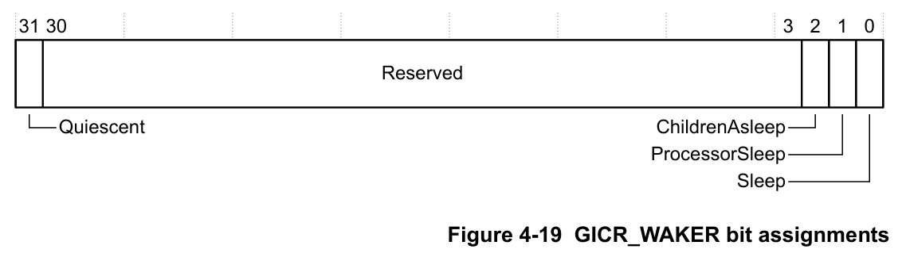

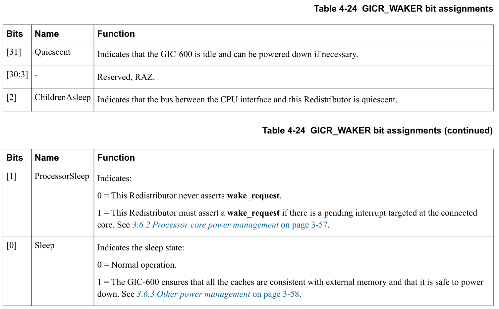

> 原图表来源：[GIC-600 r1p6 TRM，100336_0106_00_en](https://developer.arm.com/documentation/100336/0106)，4.4.3 “Power Management Control Register, GICR_WAKER”，图 4-19、表 4-24，印刷页 4-130～4-131。表图按原有顺序拼接跨页部分，保留原英文、位号与脚注。此处引用的是产品定义，不能用它改写所有 GIC 的架构布局。

原图中 [30:3] 为保留位；bit 2、bit 1 是已经建立的 ChildrenAsleep 与 ProcessorSleep；bit 31、bit 0 才是本节新增的整体交接。以下为 **产品字段的中文对照与流程归纳**。所有字段仍在同一个 32 位 WAKER 中，不能因为共享范围不同，就凭空拆成两个 MMIO 地址。

| GIC-600 r1p6 的整体握手字段 | 访问位置、宽度与属性 | 前置条件与效果 |
| --- | --- | --- |
| `GICR_WAKER`.Sleep[0] | 任一 RD_base + 0x0014 的 32 位 WAKER 中，RW；全芯片共享一个 Sleep | 所有 PE 的 ProcessorSleep、ChildrenAsleep 均为 1 后才能置 1，发起整体状态保存；Sleep=1 期间到达的消息可能被忽略，必须先处理生产者 |
| `GICR_WAKER`.Quiescent[31] | 同一寄存器，RO；全芯片共享一个 Quiescent | 等其为 1，表示相应 LPI 挂起状态已保存，可按产品协议继续掉电；恢复正常 PE 接口前，Sleep、Quiescent 都须为 0 |

本表是 **产品字段**，不把规范中实现定义的位扩写成所有 GIC 的通用接口；依据 GIC-600 r1p6 3.6.3（3-58～3-59）与 4.4.3 表 4-24（4-130～4-131）。普通每 PE 的 ProcessorSleep[1]、ChildrenAsleep[2] 仍按[上一章的局部握手表](P12_SGI核间通知与电源交接.md#12.3_目标准备下线时_要交接的不只是路由)解释。

还要注意：关闭 LPI 支持不保证控制器把全部缓存挂起状态写回内存；如果任务要求保存并恢复已有请求，应采用对应电源与状态保存协议，而不是把“禁止”当作“刷新快照”。

## 13.7\_从边界编号检查两张表

**讲解层次：概念层·纸面验证。** 本节检查 IHI0069 H.b 的表布局与更新协议，不把算例当作 RK3588 板上读数。

做一次不用硬件的索引验算。仍采用 B=16 的编号空间，先为 8192、8199、8200 和 65535 计算配置表字节偏移、挂起表字节与位，再对照下表。整数除法与余数的用途已经在第五章建立，这次变化在于两张表的起点不同。

| INTID | 配置表字节偏移 | 挂起表字节偏移 | 挂起位 |
| --- | --- | --- | --- |
| 8192 | 0 | 1024 | 0 |
| 8199 | 7 | 1024 | 7 |
| 8200 | 8 | 1025 | 0 |
| 65535 | 57343 | 8191 | 7 |

最后一行恰好落在 57344 字节配置数据与 8192 字节挂起存储的末尾。若把挂起表也减去 8192 再寻址，第一个 LPI 就会误落到前 1 KiB 的实现保留区域；算出的内存地址也许仍在分配块内，却不属于正确协议位置。编号 65536 已超出这次配置空间，不能因为整数运算还能算出偏移就认为硬件支持。

再做属性更新的故障推演：软件已经将一个 LPI 的使能置 1，并让处理器缓存中的更新对控制器可见，但仍观察不到新请求。能否排除“旧配置”原因？不能，再分发器可能仍缓存旧条目；还需要对应失效与完成协议。反过来，只完成配置失效却没有建立新内存内容的可见性，也可能重新取到旧值。

本节只通过算术验证表布局，通过协议推演区分两层缓存，没有读取运行时挂起表。禁止整个接收侧 LPI、停止一个来源以及停止设备生产也不同；需要无丢失交接时，应先回答在途消息保存在哪里，而不是在这些开关之间猜一种等效替换。

现在能回答 LPI 的状态在哪里、由谁维护、为什么写内存不等于立即生效。剩下的问题是：来自两个设备的相同事件号，怎样找到正确的全局 LPI 与目标再分发器？

官方对照：[规范 IHI0069 H.b](https://developer.arm.com/documentation/ihi0069/hb)，5.1 LPIs、5.1.2 LPI Pending tables 和 12.11.2 GICR_CTLR 中的 EnableLPIs；[GIC-600 r1p6](https://developer.arm.com/documentation/100336/0106) 3.6.3 Other power management（3-58～3-59）及表 3-8 的 SYN_LPI_CLR 错误标识符项（3-78）。核对整体关闭时消息处理与缓存写回保证的边界；大小计算与状态推演是静态说明，不是本机运行寄存器值。

上一篇：[SGI核间通知与电源交接](P12_SGI核间通知与电源交接.md#12.1_核间中断传的是提醒_工作内容存在哪里)

[专题大纲](大纲.md#1.2_因果阅读地图)

下一篇：[设备事件身份与ITS实现映射](P14_设备事件身份与ITS实现映射.md#14.1_两个设备都发事件0_怎样区分)
