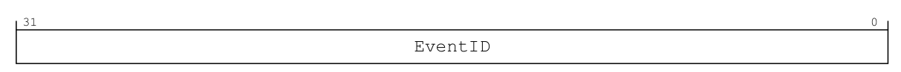
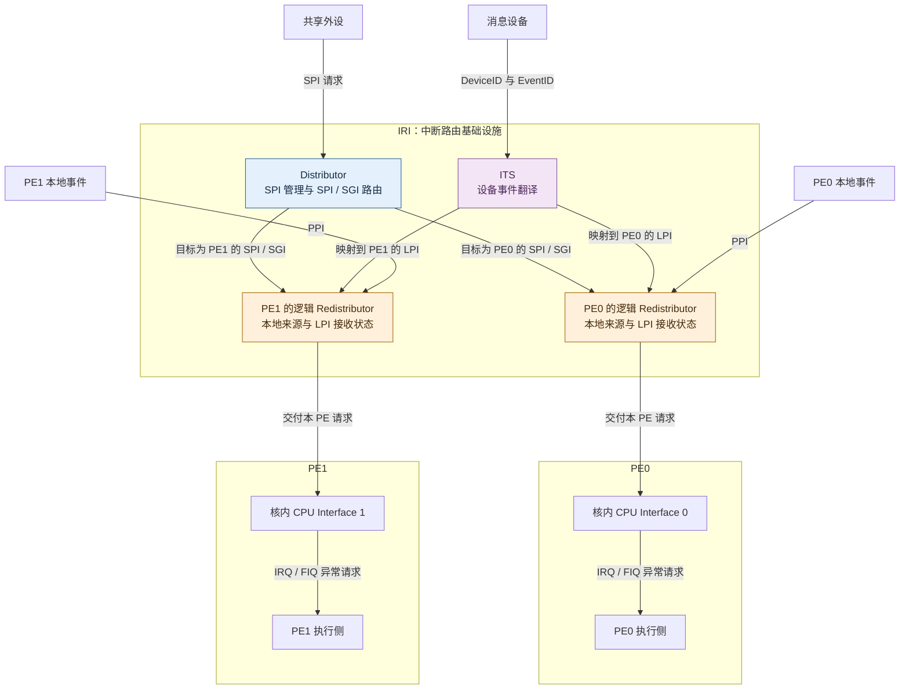
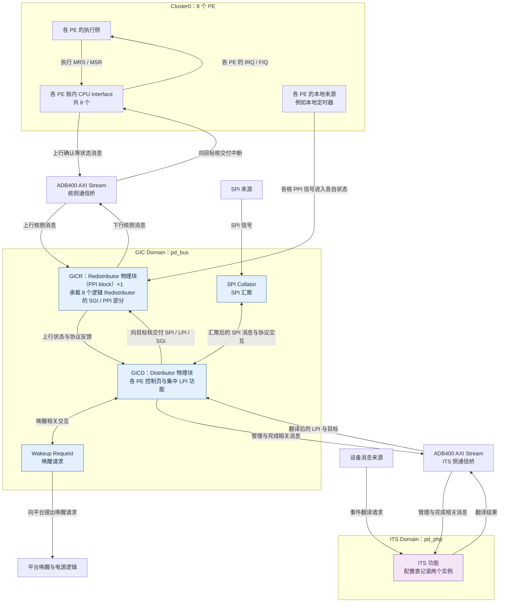
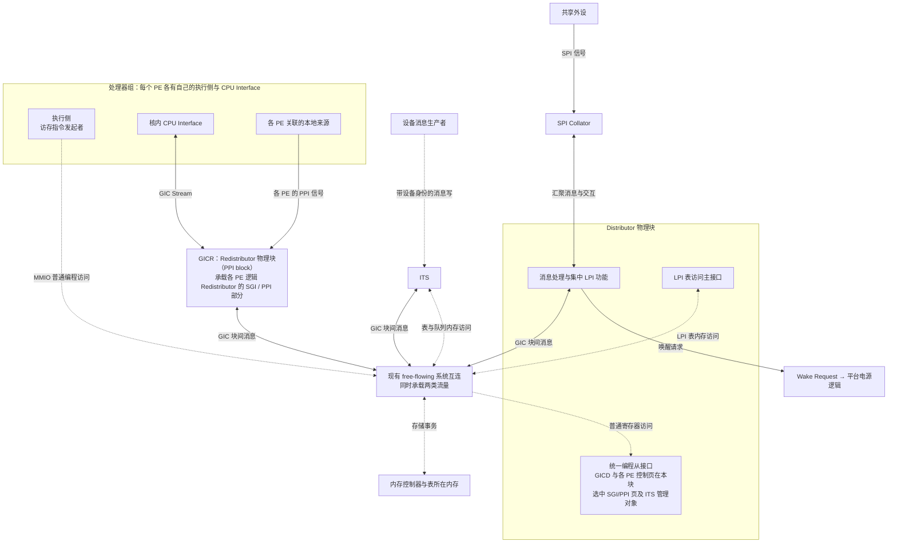
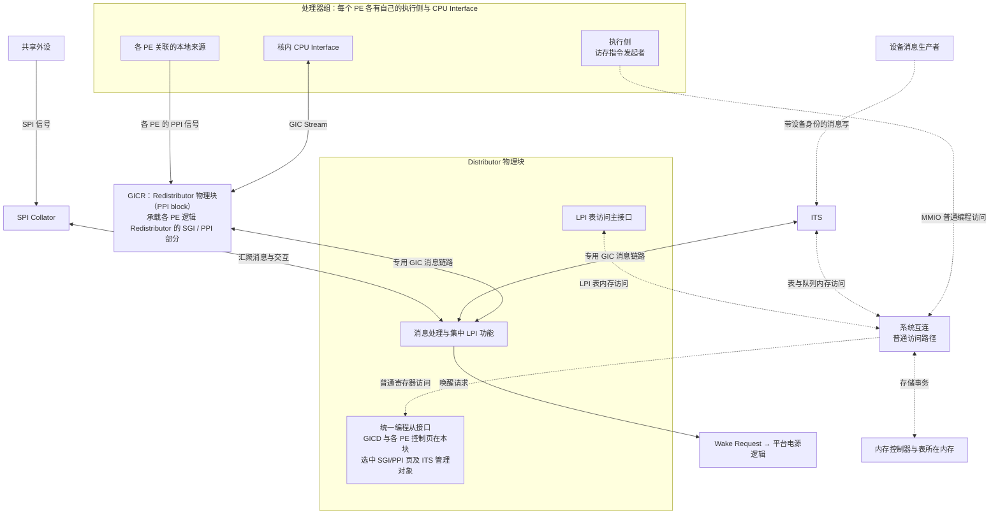
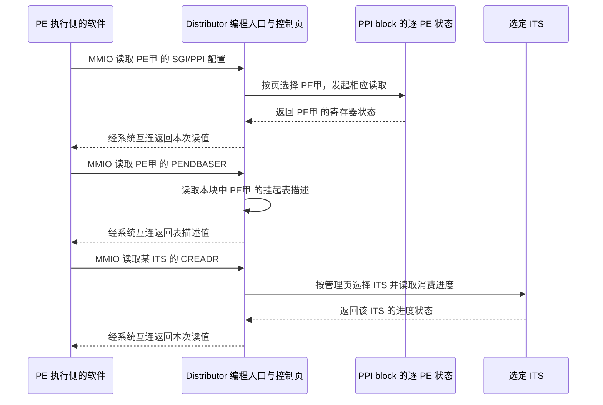

# 第14章\_设备事件身份与ITS实现映射

## 14.1\_两个设备都发事件0\_怎样区分

**讲解层次：概念层。** 先依据 Arm IHI0069 H.b 中适用于 GICv3.0 的 ITS 契约建立身份与翻译职责，再映射到 GIC-600 r1p6 和 RK3588 集成。

上一章建立了 **通用中断控制器（Generic Interrupt Controller，GIC）** 中 **局部性专属外设中断（Locality-specific Peripheral Interrupt，LPI）** 的内存配置和挂起状态。现在有两个设备都发送“事件 0”：如果只看这个数，就无法知道该使用哪条中断和哪个接收者。

于是需要 **中断翻译服务（Interrupt Translation Service，ITS）**。它是控制器硬件提供的翻译功能，接收设备消息，把“哪个设备的哪个事件”对应到全局中断编号和目标再分发器。

本章固定一条已经建立映射的设备事件，先分清消息带来的身份与软件预先配置的关系，再把 ITS、目标 Redistributor 和 CPU Interface 放回 GIC-600 的实际载体。读完应能追踪事件从哪个接口进入、由哪个物理块维护目标 LPI、怎样交付到核，并区分消息入口与软件编程入口。怎样创建、更新和同步映射，还需要展开翻译表与命令协议，留给下一章。

## 14.2\_设备消息怎样进入ITS\_翻译功能怎样接入GIC

**讲解层次：概念层。** 本节读 IHI0069 H.b 的消息身份、逻辑目标与 TRANSLATER 接口；这里的 ITS 首先指架构规定的硬件翻译角色。

**设备标识（Device Identifier，DeviceID）** 用于区分消息生产者；**事件标识（Event Identifier，EventID）** 用于区分同一设备的不同事件。这两个协议字段共同标明消息来源。

设备向 `GITS_TRANSLATER` 写入事件值。其官方名称是 ITS Translation Register（ITS 翻译寄存器），承担消息翻译接收接口；EventID 来自约定的写入内容，而 DeviceID 怎样随事务被识别，由芯片互连与设备集成定义。软件不能默认“向某个地址随便写一个数”就能冒充任意设备。

**中断标识符（Interrupt Identifier，INTID）** 则标识 GIC 中的目标中断。EventID 可以和 INTID 相同，也可以不同；这是映射选择，不是必须靠相等建立联系。

目标管理再增加一个角色：**Collection（集合）** 是把若干物理 LPI 关联到同一个目标再分发器的逻辑分组。集合号不是处理器编号，也不是 LPI 编号；它让软件可以共同管理一组中断的递送位置。

先只看一次已有映射的递送：设备 5 产生事件 3，向消息入口写入 3，事务同时提供设备身份 5。ITS 用这一对身份查出 LPI 9000 和集合 2，再由集合 2 找到接收者甲，将请求交给甲的再分发器。设备没有在这次写入中同时提交“9000、集合 2、甲”三个参数；这些关系由软件预先建立。下面先定位设备真正写入的入口，[下一章的 15.1 节](P15_ITS翻译表_命令队列与完成.md#15.1_三个查找层次怎样闭合一次翻译)再拆开其后的查找过程。

本章地址表沿用 **内存映射输入输出（Memory-mapped I/O，MMIO）** 访问；WO（Write-only，只写）、RO（Read-only，只读）、RW（Read/Write，读写）表示软件访问属性。设备发起写事务不意味着它拥有软件配置整个 ITS 的权限。

> 原图来源：[Arm IHI0069 H.b](https://developer.arm.com/documentation/ihi0069/hb)，12.19.12 “GITS_TRANSLATER, ITS Translation Register”，Field descriptions，印刷页 12-846。图没有独立图号；访问表在 12-847。下面为原字段和访问条件的 **中文对照**。

| 原图位置或接口属性 | 手册定义及当前读法 |
| --- | --- |
| [31:0] EventID | 待翻译的事件编号；完整 32 位均属于这一字段，没有 DeviceID 子字段，也没有 INTID 子字段 |
| 32 位，WO | 写入发起翻译请求；不能靠读回确认“当前事件”。必须支持 [15:0] 的 16 位写入，此时 [31:16] 按 0 写入 |
| ITS 翻译页 + 0x0040 | 翻译页位于 ITS 基址 + 0x10000，合成地址为 ITS 基址 + 0x10040；不能漏掉翻译页偏移 |
| EventID 有效宽度 | 硬件上限由 GITS_TYPER.ID_bits 报告，每设备范围还由设备映射命令 MAPD 确定；能力字段与命令见 [15.4 节的映射建立流程](P15_ITS翻译表_命令队列与完成.md#15.4_初始化与创建一个映射的完整职责)。超出硬件位宽的非零位可能被忽略，也可能使整个写入被忽略，不能依赖截断 |
| 写入被忽略的条件 | ITS 未启用、DeviceID 越界或未映射、EventID 超出该设备范围或事件未映射；这些检查发生在取得事务身份以后 |

现在重新读图：图里唯一的大矩形是 EventID，因此 DeviceID 必须从事务身份另行取得；“只写入 3 就找到设备 5 的 LPI 9000”依赖外部身份与已有映射，不能从这个 32 位值独立恢复。原图证明数据布局，旁边的 Purpose、Accessing 文字才定义触发效果和无效条件。

这是 IHI0069 H.b 12.18 的 ITS 页布局与 12.19.12（12-846～12-847）的本章用法。后文管理寄存器使用 **ITS 控制页**，即 ITS 基址所在页；不能将控制页偏移与翻译页偏移混在一起。真实设备能写到哪个入口，还受芯片地址路由与访问控制约束。

> 官方对照：[规范 IHI0069 H.b](https://developer.arm.com/documentation/ihi0069/hb)，5.2 The Interrupt Translation Service、5.2.2 Interrupt collections，以及 12.19.12 GITS_TRANSLATER, ITS Translation Register；[消息指南 102923，1.0-01](https://developer.arm.com/documentation/102923/0100) 第 4 章 ITS（PDF 第 11～12 页）。核对设备身份与写入事件值的不同来源。

### 14.2.1\_把消息翻译放回完整硬件关系

**讲解层次：概念层。** 下面按 IHI0069 H.b 3.1 的逻辑划分说明角色，不划定产品物理块。

现在已经知道 ITS 接收什么、翻译成什么，可以补上第三章暂时省略的支路。**中断路由基础设施（Interrupt Routing Infrastructure，IRI）** 是规范对 Distributor、各 Redistributor 及可选 ITS 的合称；它不包含 CPU Interface。这里的“基础设施”是硬件逻辑组件的组合名称，不是另一个位于它们上级的路由器。

先按处理器计数：**每个 PE 对应一个逻辑 Redistributor，并有自己的 CPU Interface。** 因而两个教学 PE 对应两份逻辑 Redistributor 与两个核内 CPU Interface；逻辑图中的两个 Redistributor 方框说明各 PE 的状态归属，尚未规定芯片把这些功能做成几个物理块。

以下画一个带 ITS 的 GICv3 物理中断逻辑组织，PE0、PE1 仍是教学标签。图中保留三类已经建立的来源：共享外设中断（Shared Peripheral Interrupt，SPI）、私有外设中断（Private Peripheral Interrupt，PPI）与软件产生中断（Software Generated Interrupt，SGI）。实线表示请求交付，省略确认返回和 SGI 的发送半程；后者沿[第三章的发送路径](P03_多核角色与架构编程接口.md#3.3.4_SGI的发送侧和接收侧都要画出来)进入 Distributor。本地来源单独画出；它发出的 PPI 信号不由 CPU Interface 产生。

ITS 让设备事件进入 LPI 路径，不会把已有 SPI、PPI 或 SGI 都变成必须先翻译的请求。图中一个 ITS 方框表示翻译职责，一次事件按映射选择目标，并不表示每个 LPI 都要同时发给两个 PE；一个 GIC 实例可以有多个 ITS。

还存在 **直接 LPI（Direct LPI）** 的实现选择：设备使用 Redistributor 的直接 LPI 接口，不经过 ITS 翻译。在本专题的 GICv3 范围内，实现若支持 LPI，应在直接接口与 ITS 翻译这两种机制中选择一种，不能把它们随意叠成两个同时必需的步骤。RK3588 的本章主线采用 ITS，直接接口只用于理解规范为什么还画了“没有 ITS”的另一幅逻辑图。

> 图与正文依据：[规范 IHI0069 H.b](https://developer.arm.com/documentation/ihi0069/hb)，3.1，图 3-1、图 3-2 GIC logical partitioning with an ITS、图 3-3 GIC logical partitioning without an ITS（3-42～3-44）。本图重绘逻辑分工；ITS 与 Redistributor 的实际通信机制由实现决定，不能把图上的相邻位置或一根箭头解释为具体芯片布线。

### 14.2.2\_RK3588框图中的功能块与电源域

**讲解层次：概念到实现的映射。** 先把上述架构角色对应到 GIC-600 r1p6 的实际载体，再使用 RK3588 TRM V1.0 Part1 确认实例数量与连接。

同名并不代表同边界。架构的 ITS 表示翻译与命令职责，GIC-600 的 ITS block 是兑现这些职责的产品物理块；架构的每 PE Redistributor 则分散在产品 Distributor 和 PPI block 中实现。先把前文那次“设备 5、事件 3 → LPI 9000 → 接收者甲”需要的功能放到载体上：

| 架构中已建立的职责 | GIC-600 r1p6 的载体 | 该载体的输入、状态和输出 |
| --- | --- | --- |
| ITS 的事件翻译与命令执行 | ITS 物理块；配置可以具有多个实例 | 接收带设备身份的 TRANSLATER 写入；使用映射表及翻译缓存；向 Distributor 发送已翻译的 LPI 与目标，处理管理命令及其完成交互 |
| 目标逻辑 Redistributor 的 LPI 接收、配置与挂起维护 | Distributor 内的集中 LPI 功能、缓存及逐 PE 控制页 | 接收 ITS 的翻译结果，依据目标 PE 的启用状态及共享 LPI 配置维护挂起；通过相应 PPI block 交付目标核；LPI 表内存访问也由 Distributor 发起 |
| 各 PE 的 SGI/PPI 配置、Pending 和 Active | 产品 Redistributor 物理块，即 PPI block 中按 PE 区分的功能 | 保存逐 PE 的 SGI/PPI 编程状态，监测本地 PPI 输入；把这些来源与 Distributor 送来的候选中断一起排序，再通过核侧接口交付 |
| 每 PE 的确认与运行优先级 | 各 PE 内的 CPU Interface | 接收该 PE 的候选中断；本 PE 执行 IAR、EOIR 等访问，接口通过核侧协议反馈相应状态变化 |

这里的“按 PE 区分”有实际选择手段：软件用各 PE 的 GICR 页地址选中配置对象；GIC-600 核侧 GIC Stream 用 `iritdest` 标明下行目标核、用 `icctid` 标明上行消息来自哪个核。Distributor 与 PPI block 之间还有块身份，用于先找到承载该核的物理块。块内记录由何种存储电路构成、同一拍怎样仲裁，并不能从这些接口说明推出。表的功能落点依据 GIC-600 r1p6 1.2、2.1～2.3；目标与来源标记见 2.1.1、2.2.2。

**讲解层次：实现层·RK3588 芯片集成。** RK3588 TRM V1.0 Part1 的 11.2 Block Diagram 给出了其 GIC-600 的连接框图，并区分 **电源域（Power domain）**：能够按平台电源管理边界控制供电的一组电路。文中的 `pd_bus` 与 `pd_php` 是芯片手册定义的电源域名称；前者对应图中的 GIC Domain，后者对应 ITS Domain。

先认出图中多出的三个功能块：**SPI 汇聚器（SPI Collator）** 接收分散的 SPI 信号并用内部消息送往 Distributor；**唤醒请求块（Wake Request）** 将需要唤醒核的请求提供给平台；**ADB400** 是 Arm 的接口桥产品名，原图用它承载两处 AXI Stream 连接。AXI Stream 是流式事务接口协议名称，这里只需理解桥承载控制器块之间或控制器与核之间的通信，不把它看作新增的中断类型。

先把刚才的按 PE 计数规则应用到 RK3588：八个 PE 对应 **八个逻辑 Redistributor、八个核内 CPU Interface**。再问这八份逻辑功能落在哪些电路里：GIC-600 将它们的 SGI/PPI 部分放入产品称为 **Redistributor 物理块（PPI block）** 的电路，图中缩写为 GICR；各 PE 的控制页和集中 LPI 功能则放在 Distributor 物理块。一个 PPI 物理块可以承载多份逻辑 Redistributor 的部分功能，不能把产品块的数量直接当作逻辑 Redistributor 的数量。

下图依据原件图 11-1 重绘功能连接，保留其 Cluster0、GICR、GICD、两个桥位置和域划分，并把核侧的本地来源、CPU Interface 与执行侧分开。中断下行交付与核侧上行反馈分开画出；ITS 支路也区分翻译结果与管理、完成相关消息。框的大小和位置不代表芯片版图尺寸，桥处于连接边界，不能仅凭绘图位置推出它自己的电源控制归属。

这里要对齐的是 **逻辑功能怎样分布到产品物理块**。架构图中每个 PE 的逻辑 Redistributor 包括本地中断与 LPI 职责；在 GIC-600 中，它的 SGI/PPI 页和相关功能落在 PPI 物理块，控制页与 LPI 功能及缓存落在 Distributor 物理块。因此，RK3588 图上 ITS 通过桥连到 GICD，与“ITS 把 LPI 交给目标逻辑 Redistributor”能够同时成立：前者画实现位置，后者画状态归属。第四章的[逻辑接口到产品块映射](P04_GIC600的物理实现_从逻辑映射到输入输出.md#4.1_从GICv3到GIC600_逻辑角色怎样落到物理块)逐项对照这两种视角。

继续跟随同一条有效事件：设备消息被所选 ITS 接收并完成翻译，LPI 9000 与接收者甲的信息经 ITS 侧桥到 Distributor；Distributor 维护甲的 LPI 挂起状态，再把满足条件的候选交给承载甲的 PPI block。PPI block 结合甲的 SGI/PPI 与其他候选进行优先级选择，经核侧桥把请求交到甲的 CPU Interface。甲执行 IAR 取得编号并确认时，相关上行协议消息沿核侧链路返回；逻辑上属于甲的 LPI 挂起由 Distributor 中的 LPI 功能更新。随后软件处理设备工作，EOIR 处理的是甲的运行优先级义务。消息写的总线响应、IAR 的确认和软件处理完成是不同阶段，不能合成一个“ITS 返回完成”。

原图用一个 ITS 方框概括该功能，而 11.1 的表 11-1 明确给出 `its_count=2`。**功能框图用于查连接，配置表用于查实例数量**，不能数图里的矩形来推翻配置表。类似地，Cluster0 是这张 GIC 集成图的标签，单靠标签不足以说明处理器缓存结构；还要核对 TRM 第三章的 CPU 原图。该图将 4 个 A55、4 个 A76 接入同一个 DSU-L3，即承载共享三级缓存的 DynamIQ 共享单元（DynamIQ Shared Unit），与 GIC 表的 `num_clusters=1`、`cpus_per_clsuter_0=8` 交叉对应；完整原证据和官方摘要 “Dual-cluster” 的用词差异见[一个八核簇与一个 PPI 块](../../rockchip/rk3588/P01_RK3588的GIC-600集成与手册核对.md#1.4.2_一个八核簇与一个PPI块_怎样核对数量)。

同一配置表中的 `ppi_count=1` 表示一个 GIC-600 PPI 物理块，而 `cpus_per_clsuter_0=8` 表示该配置支持八个核。合在一起看，是 **八个逻辑 Redistributor 的 SGI/PPI 部分由一个 PPI 物理块承载，各份状态仍按 PE 独立**。这里没有在外部先放八个完整 Redistributor，再让它们接入另一个 PPI 接线盒；PPI 块本身就是那些私有功能的实现位置之一。图中汇入一个矩形的 PPI 箭头只省略内部按 PE 区分的路径。

这也解释了为什么“普通 SPI 已能工作”不能自动证明 ITS/LPI 路径可用：后者还依赖自身电源域、桥、消息接入、翻译配置和内存表。该判断来自硬件分工，尚不是某块开发板的运行测试结论。

> 图与正文依据：RK3588 TRM V1.0 Part1（2022-03-09），11.1 表 11-1（PDF 第 1312 页）、11.2 Block Diagram 的图 11-1（PDF 第 1313 页），原件入口见[资料证据表](../../../../reference/external_resources/arm/README.md#1.4.2_型号判断的证据与适用边界)；GIC-600 的功能落点另核对 [100336 r1p6](https://developer.arm.com/documentation/100336/0106) 1.2 Components（1-13）与 2.2 Redistributor（2-29）。这是按原件事实绘制的教学连接图，省略未参与本节推理的端口与存储访问支路。

### 14.2.3\_同一组功能块可以怎样互连

**讲解层次：实现层·GIC-600 r1p6 产品组织。** 本节比较产品支持的两种互连组织；这不是在替 RK3588 推测未公开的接线选择。

再退回 GIC-600 产品层，就能回答第四章留下的问题：图里分开的物理块一定要通过同一种总线通信吗？r1p6 TRM 的图 1-1、图 1-2 给出两种组织。第一种借助现有的 **自由流动互连（free-flowing interconnect）** 运输块间 GIC 消息；这里的自由流动要求事务能前进到目的地，不依赖其他事务形成非暂态的阻塞关系，不表示传播没有延迟。

下图重绘图 1-1 中参与本节比较的路径。实线为 GIC 协议或中断信号，虚线为普通编程、消息入口或内存访问；两类流量共享中间互连。每个 PE 仍各有一个逻辑 Redistributor；PPI 物理块承载其中的 SGI/PPI 部分，控制页与 LPI 部分则在 Distributor 物理块。图中的执行侧发起普通 MMIO 编程访问，本地来源发出 PPI 信号，核内 CPU Interface 负责 GIC Stream 交互，三种端点分别连线。两幅拓扑图只画编程请求方向，读值与访问响应在后面的事务时序中单独追踪。

第二种把 GIC 块间消息放到专用互连，普通编程和内存访问仍走系统互连。下图重绘图 1-2 的这个区别：PPI 块和 ITS 各自直接连到 Distributor 的 GIC 消息链路，不再把这部分通信画成必须绕行普通系统互连。

| 对照项目 | 图 1-1 对应方案 | 图 1-2 对应方案 |
| --- | --- | --- |
| PPI 块、ITS 与 Distributor 的 GIC 消息 | 通过现有 free-flowing 互连 | 通过分开的 GIC 消息链路 |
| 处理器编程与 GIC 表访问 | 系统互连向 Distributor 的统一编程入口发起访问；D/ITS 也经互连访问表 | 同样保留这两种方向；专用消息链路不取代它们 |
| 中断状态的逻辑归属 | 不变 | 不变；换互连不会把 SPI 变成私有状态 |

两图都特意区分 **处理器经系统互连访问 Distributor 的统一编程入口** 与 **Distributor/ITS 主动访问表内存**。GIC-600 的 GICD、GICR 和 ITS 管理寄存器访问均由前一入口接收；设备写入 GITS_TRANSLATER 的消息入口另列在 ITS 一侧，不能把所有 ITS 配置都画成直接访问这个消息端口。

把统一入口用于三次不同访问，就能分清“经过哪个块”与“修改谁”。软件写目标 PE 的 SGI/PPI 页时，Distributor 接收并按页找到对应 PPI block，最终改变该块内目标 PE 的私有配置；写同一 PE 的 PENDBASER 时，修改的是 Distributor 内该 PE 的 LPI 表描述；访问某个 ITS 的管理页时，页地址选中该 ITS，再通过块间通信完成相应管理操作。地址页选择发生在普通 MMIO 路径上，不是用核侧 GIC Stream 的核编号替代 MMIO 地址。

对于读取，数值由被访问的寄存器状态产生，再作为这次读事务的响应经 Distributor 编程从接口、系统互连返回发起 PE。对于写入，总线写响应只结束该次访问；如果字段要求等待 RWP、Quiescent 或 ITS 的指定目标同步命令，软件仍须另外观察对应完成条件；ITS 的 SYNC 保证在[15.3 节](P15_ITS翻译表_命令队列与完成.md#15.3_命令读走了_不等于全部副作用完成)单独展开。Distributor 经内存主接口读 LPI 表、ITS 经自己的内存主接口读命令和翻译表，则是 **控制器作为发起者的另一类事务**，数据返回到发起读取的硬件块，不返回为处理器的一次 IAR 读值。

以下把三次普通读取放在一起，只为显出相同入口后面的不同状态落点。第三次使用 **GITS_CREADR（ITS Read Register，ITS 读取寄存器）**，它记录 ITS 消费管理命令的进度；本章先把它定位为 ITS 管理状态，队列含义与原位布局见[15.2 节](P15_ITS翻译表_命令队列与完成.md#15.2_为什么用命令队列管理映射)。系统互连归并在软件与 Distributor 的访问箭头里；PPI block、Distributor、ITS 都是实际产品块，没有另画独立的逻辑 Redistributor 器件。

第三次读取之所以不会“读走一条命令”，是因为 CREADR 是由 ITS 推进的软件观察状态；实际命令读取另从 ITS 的内存主接口发出。接口地址相似、都由 Distributor 接收，也不会改变这几份状态各自的写入者。

共享接口还保留目的地身份。Distributor 的下行块间接口用目的块标记分派到某个 PPI block 或 ITS，上行接口保留来源块标记；PPI block 再利用核侧 `iritdest`、`icctid` 区分核。它们分别解决“哪个块”和“哪个核”，并不把多个 PE 的私有状态合成同一份。使用 AXI4-Stream 也不意味着电气上的单线串行通信；产品给出的数据位宽、两方向接口与身份字段都必须一起理解，不能从一条概念箭头推出线数。

原图还画有具体设备接入、内存控制器和跨芯片支路；这里归并外围访问，仅保留比较所需的块与连接。图 1-2 的产品组织使用所提供的 16 位 AXI4-Stream GIC 互连，但芯片如何选型、桥接和分电源域仍应由 RK3588 图 11-1 证明，不能仅因“长得相似”就给芯片补出未记录的互连属性。来源：[GIC-600 r1p6 TRM](https://developer.arm.com/documentation/100336/0106) 1.2，图 1-1（1-14）与图 1-2（1-15）；编程与存储端口按 1.4 Registers and programming（1-18）、2.1.1～2.1.3（2-24～2-26）、2.2.2（2-30）与 2.3.1～2.3.3（2-33～2-36）核对。ITS 与 Distributor 合为 monolithic 组织时可共享相应 ACE-Lite 端口；上述两图采用分开的产品块，不能因此宣布所有产品配置都具有相同外部端口数量。

现在可以沿同一事件区分三条路径：设备携带身份向消息入口写入，ITS 把翻译结果交给目标 LPI 的实际实现，软件通过管理地址读取或修改控制状态。逻辑 Redistributor 的归属与产品块的连接也已逐项对应。仍未解决的是这些映射如何保存在硬件表中，以及软件改变关系后怎样知道旧状态已经收敛；下一章继续使用设备 5、事件 3、LPI 9000 和集合 2，把查找、命令发布与完成条件接起来。

上一篇：[从消息请求到内存中的中断状态](P13_从消息请求到内存中的中断状态.md#13.1_来源越来越多_为什么让设备发送一条消息)

[专题大纲](大纲.md#1.2_因果阅读地图)

下一篇：[ITS翻译表_命令队列与完成](P15_ITS翻译表_命令队列与完成.md#15.1_三个查找层次怎样闭合一次翻译)
