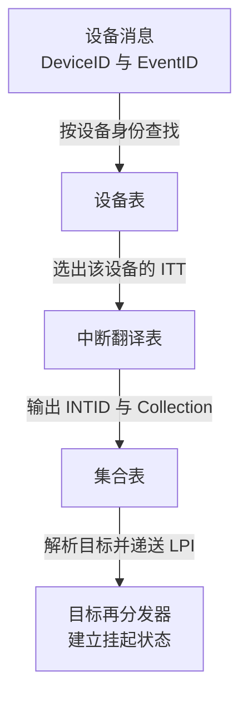
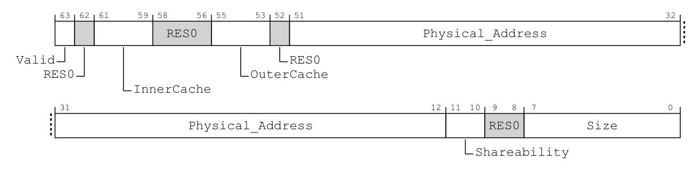
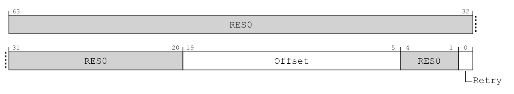
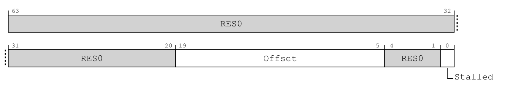
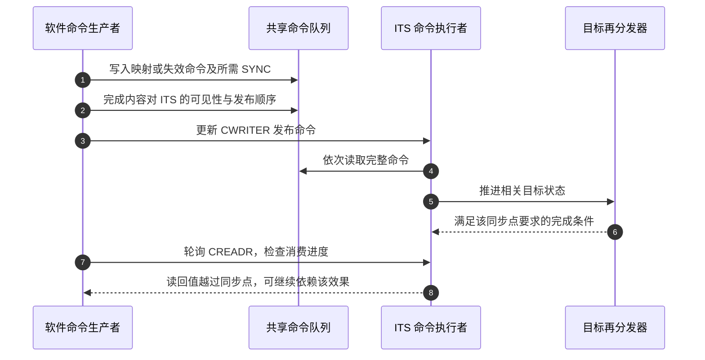
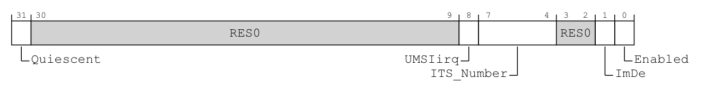
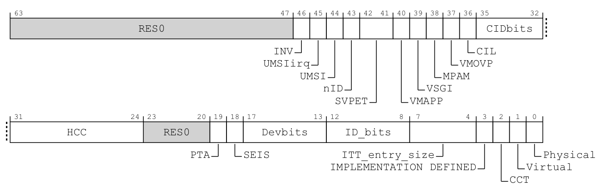
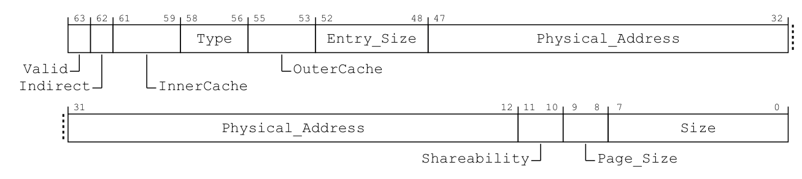
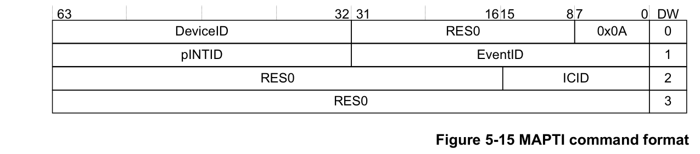

# 第15章\_ITS翻译表\_命令队列与完成

## 15.1\_三个查找层次怎样闭合一次翻译

**讲解层次：概念层。** 本章先按 Arm IHI0069 H.b 中适用于 GICv3.0 的 ITS 表与命令契约建立状态和完成条件，涉及 GIC-600 r1p6 的实际载体时再明确切换层次。

上一章已经沿一条设备事件，区分了设备身份、事件号、LPI 编号和目标集合，并把 ITS 与目标逻辑 Redistributor 放回产品物理块。但那条路径假定映射已经存在：软件怎样建立它，怎样改变目标，又怎样知道硬件不再使用旧状态？本章从映射保存位置出发，将查找、命令发布、同步和撤销接成一个完整管理周期。LPI 的配置与挂起状态仍采用第十三章的模型。

先拆开上一章已经发生的那一次翻译。以下三个查找层次表示职责，不等同于三块物理器件。

为什么不直接把事件号当成数组下标，取出一个处理器编号？因为不同设备可以使用相同事件号，而同一设备的一组事件又可能一起改变接收位置。前一步需要保留设备自己的编号空间，后一步需要把事件身份与目标位置分开。

**设备表（Device table）** 先按设备身份选择该设备的 **中断翻译表（Interrupt Translation Table，ITT）**。ITT 再按事件号给出全局 INTID 与集合；**集合表（Collection table）** 负责把集合解析为目标。这样，事件 3 在哪张 ITT 中解释，由设备身份决定；这一组中断送到哪里，则由集合映射决定。

沿用上一章的教学值：设备身份 DeviceID 为 5，事件号 EventID 为 3，对应的 LPI INTID 为 9000，集合号为 2，接收者为甲。先以 DeviceID 5 找到它的 ITT，在其中以 EventID 3 找到 INTID 9000 与集合 2，最后由集合 2 找到甲。三个查找职责依次闭合，目标再分发器才知道应为哪个 LPI 建立挂起状态。



图中的映射结构是由内存支持或实现内部保存的硬件表结构。下表把已经走过的输入、输出逐项对齐：

| 结构 | 索引与输出 | 解决的问题 |
| --- | --- | --- |
| Device table，设备表 | DeviceID → 该设备的翻译表 | 相同事件号如何按设备区分 |
| Interrupt Translation Table，ITT，中断翻译表 | EventID → INTID 与 Collection | 设备自己的事件如何进入全局编号空间 |
| Collection table，集合表 | Collection → 目标再分发器 | 一组事件应交给哪个接收者 |

软件为这些结构分配和准备内存，再通过命令让 ITS 建立映射；不能猜测硬件内部表项格式后直接改写。某些集合可以由实现内部保存，概念上的查找职责仍存在。

另一个设备的事件 3 不会因为事件号相同而天然冲突，但软件必须为它分配不同的物理 LPI INTID：规范禁止把多个 DeviceID/EventID 组合映射到同一个物理 LPI INTID。即使选择不同的目标 PE，也不能把这种重复映射当作合法隔离方式。

这放大了 [S1～S2 的请求形成与目标选择](P06_一次中断的状态转换与完成协议.md#6.4_用同一组阶段闭合正常周期)；到达再分发器后，继续使用[第十三章的 LPI 状态](P13_从消息请求到内存中的中断状态.md#13.2_确认LPI后_为什么仍要结束优先级)，而不是再发明第三套确认协议。

> 官方对照：[规范 IHI0069 H.b](https://developer.arm.com/documentation/ihi0069/hb)，5.2.1 The ITS tables、5.2.3 The Device table、5.2.4 The Interrupt translation table、5.2.5 The Collection table，以及 5.2.10 Restrictions for INTID mapping rules（5-100）；[消息指南 102923，1.0-01](https://developer.arm.com/documentation/102923/0100) 4.3 The sizes and layout of Collection and Device tables（第 14～15 页）。图中箭头是逻辑查找关系，不承诺每次请求都发生三次外部内存读取。

## 15.2\_为什么用命令队列管理映射

**讲解层次：概念层。** 本节依据 IHI0069 H.b 的命令队列契约，先说明存储所有权与发布过程，再展开架构寄存器。

刚才假定“设备 5、事件 3”已经能找到甲。现在软件要建立或改变这条关系，却不能只向某块内存写入“甲”：硬件表的内部格式由实现定义，ITS 可能缓存映射，接收侧还可能持有已经产生的挂起状态。软件需要告诉控制器改的是哪个对象、执行什么动作，并取得对应的完成保证。命令接口就把这些更新表达成控制器能够执行和确认的协议操作。

一条更新又包含对象身份、动作和参数；软件与 ITS 的推进速度也不相同，需要明确“哪些完整命令已经交付”“哪些位置还在被读取”。**命令队列（Command queue）** 为此提供一段双方共享的环形内存：软件生产命令并发布边界，ITS 按顺序读取并报告消费进度。存储可以绕回使用，但软件必须保留尚未消费的内容，不能把它当作无穷容量的寄存器。

每条命令占 32 字节；队列基地址需要满足 64 KiB 对齐，大小按 4 KiB 的倍数配置，KiB 表示 1024 字节。

三个寄存器分别承载不同的通信状态：**`GITS_CBASER`（ITS Command Queue Descriptor，ITS 命令队列描述符）** 提供基址、大小及访问属性；**`GITS_CWRITER`（ITS Write Register，ITS 写入寄存器）** 由软件发布生产进度；**`GITS_CREADR`（ITS Read Register，ITS 读取寄存器）** 反映 ITS 消费进度。后两者的 Offset 字段是队列偏移，不是指向任意内存的裸指针。

假设队列已经初始化并启用，读写偏移都为 0，当前为空。软件先把一条完整的 32 字节命令写入队首，使内容对 ITS 可见，再把 CWRITER 的偏移发布为 32。ITS 于是可以从偏移 0 读取命令，消费进度随后向前推进；读取进度不等于命令的全部外部效果已完成，这个差别下一节单独展开。

生产一个命令需要先检查空位，再写完整内容，使内容对 ITS 可见，最后更新写入进度。如果先更新 CWRITER，ITS 可能读取尚未准备好的内容。若多个软件执行者共同生产，还需要队列锁或等效串行化；硬件提供两个进度寄存器，不会自动保护软件生产者之间的竞争。

队列要保留区分满与空的空间。当新的写入位置会追上尚未消费的位置时，不能覆盖旧命令；等待必须处理超时和硬件停滞，而不是无限覆盖或假装成功。

这次交接需要一个存储描述和两个进度位置。先读 CBASER 的原位图：它沿用地址和访问属性，但 InnerCache 已移到高位，低位 Size 也不再表示 INTID 宽度。



> 原图来源：[Arm IHI0069 H.b](https://developer.arm.com/documentation/ihi0069/hb)，12.19.2 “GITS_CBASER, ITS Command Queue Descriptor”，Field descriptions，印刷页 12-830；字段与访问条件续至 12-832。以下是 **按原图展开的中文对照**。

`GITS_CBASER` 位于 ITS 控制页 +0x0080，为 64 位 RW；可分别访问两个 32 位半部。成功写入会将 CREADR 清零，因此它描述的是一次队列存储交接，不能当作运行中无害的地址变量。

| 原图位段 | 原字段 | 中文对照 |
| --- | --- | --- |
| [63] | Valid | 0 表示未为队列分配内存，1 表示已经分配；复位为 0，置 1 不会替软件分配或清零 |
| [62]、[58:56]、[52]、[9:8] | RES0 | 全部写 0，不属于地址或大小 |
| [61:59] | InnerCache | 队列访问的内层缓存属性；使用[第十三章原编码及中文对照](P13_从消息请求到内存中的中断状态.md#13.3_两张表分别归谁维护) |
| [55:53] | OuterCache | 队列访问的外层缓存属性；000 采用 InnerCache 的内存类型，普通内存同时采用相同外层策略 |
| [51:12] | Physical_Address | 队列物理基址高位；[15:12] 还须为 0，形成 64 KiB 对齐；未实现高地址位为 RES0 |
| [11:10] | Shareability | 00 非共享，01 内部共享，10 外部共享，11 保留且按 00 处理；实际配置仍受实现与平台限制 |
| [7:0] | Size | 分配的 4 KiB 页数减一；0 对应 4 KiB，255 对应 1 MiB |

64 KiB 对齐不能只从图中地址字段结束于 bit 12 推出：还必须读 Physical_Address 的文字限制，确认 [15:12] 也为零。这个例子说明 **原图给位置，字段说明给合法取值与副作用**，两者共同决定一个值能否写入。写 CBASER 前须满足后文的 Enabled=0、Quiescent=1；InnerCache 等多数配置的复位值为 UNKNOWN，不能省略初始化。

接着并排读生产者与消费者的原布局。它们的位形状几乎一样，但 Offset 的写入者不同，bit 0 的动作也不同。



> 原图来源：同一规范 12.19.5 “GITS_CWRITER, ITS Write Register”，印刷页 12-836；访问表在 12-837。



> 原图来源：同一规范 12.19.3 “GITS_CREADR, ITS Read Register”，印刷页 12-833，原页同时包含字段定义与访问表。以下为 **逐字段中文对照**。

| 接口与位段 | 原字段 | 中文对照 |
| --- | --- | --- |
| CWRITER +0x0088；64 位 RW；[19:5] | Offset | 软件下一条将写入位置的字节偏移；补零的 [4:0] 使每槽按 32 字节对齐 |
| CWRITER [0] | Retry | 写 1 在发生命令错误停滞时请求重新处理；未停滞时无作用。写 0 无作用，读回 0；不表示跳过坏命令 |
| CREADR +0x0090；64 位 RO；[19:5] | Offset | ITS 下一条待处理命令的字节偏移；低 5 位同样为 0。硬件推进它，软件读取不使其出队 |
| CREADR [0] | Stalled | 1 表示命令处理因命令错误停滞；0 表示没有这种停滞，不等于所有异步副作用完成 |
| 两者的 [63:20]、[4:1] | RES0 | 都为保留零；两个寄存器的两个 32 位半部允许独立访问 |

回到刚才的一条命令：软件把 CWRITER 的 **偏移值** 更新为 32，实际就是让 [19:5] 中的数从 0 变成 1；硬件消费以后，CREADR 的相同位段反映进展。它们都是相对 CBASER 的位置，不能直接填任意物理地址。所有偏移须落在配置的环内，越界可能使队列停止或被作为未知有效值处理；“低 5 位为零”只证明对齐，不证明范围合法。下一节继续辨别读走命令与完成副作用。

> 官方对照：[消息指南 102923，1.0-01](https://developer.arm.com/documentation/102923/0100)，4.1 The command queue、4.4 Adding a new command to the command queue；[规范 IHI0069 H.b](https://developer.arm.com/documentation/ihi0069/hb)，5.2.8 The ITS command interface 与 12.19.2/12.19.3/12.19.5 的队列寄存器条目。核对内存发布与读写偏移的先后、环形空间及停滞条件。

## 15.3\_命令读走了\_不等于全部副作用完成

**讲解层次：概念层。** 本节依据 IHI0069 H.b 的 SYNC 保证追踪逻辑目标的完成；图中角色不表示新增的物理块。

ITS 按顺序读取命令，但命令对再分发器的副作用可能异步完成。以下简写 CREADR 与 CWRITER 分别指刚才的 ITS Read Register（ITS 读取寄存器）和 ITS Write Register（ITS 写入寄存器）。因此，观察到 CREADR 追上 CWRITER，并不能对任意先前操作宣布“所有目标都已经同步”。

**SYNC** 是协议定义的同步命令名称（Synchronize，同步；保留规范命令拼写，不另造全称），用于等待相关先前命令对指定目标再分发器的效果完成。它不是对所有硬件和所有设备的全局屏障，也不表示设备工作已经完成。需要相应完成保证时，软件提交 SYNC，并等待消费进度越过该同步点。



步骤 2 解决内存内容发布，步骤 6～8 解决协议副作用完成与软件观察。步骤 7～8 是软件主动读取进度，不是 ITS 自动回调通知软件。两类完成不是同一个屏障。多目标更新要依据命令契约选择对应的同步目标，不能把“执行过一次 SYNC”当作万能证明。

**讲解层次：概念到实现的映射。** 在上一章已经建立的 GIC-600 r1p6 组织中，软件发布 CWRITER 或读取 CREADR，经系统互连进入 Distributor 的编程从接口，再选中所需 ITS；ITS 对命令内存的读取从它的主接口发出。若命令影响目标 PE 的 LPI 配置缓存，实际需要推进的是 Distributor 中的 LPI 功能，并非另一个完整的外置 Redistributor。ITS 与 Distributor 完成有关协议交互后，软件仍须读到越过对应 SYNC 的进度，才能继续依赖其保证。这里没有增加新的完成协议，只是把概念图的参与者放回[14.2.3 节确定的载体与访问路径](P14_设备事件身份与ITS实现映射.md#14.2.3_同一组功能块可以怎样互连)。

> 官方对照：[规范 IHI0069 H.b](https://developer.arm.com/documentation/ihi0069/hb)，5.3.15 SYNC（5-119～5-120）及 5.2.8 The ITS command interface。SYNC 约束指定再分发器相关的先前操作，原文也说明后续翻译必须受这些效果影响；不能从 CREADR 一次追平推出没有相应同步命令保证的结论。

## 15.4\_初始化与创建一个映射的完整职责

**讲解层次：概念层。** 本节先按 IHI0069 H.b 展开初始化契约与能力发现，具体产品固定了哪些选项另行标明。

先发现 ITS 支持的表类型与条目大小，再准备内存。`GITS_BASER<n>` 是 **ITS Table Descriptors（ITS 表描述符）**，其类型、条目大小和页配置字段用于发现及配置硬件表；不能假定每个实现的第 0、1 个寄存器都固定代表同一种表，也不能自己定义任意 C 结构作为表项。

在 ITS 尚未启用时，软件准备设备表、集合表和命令队列，按规则初始化内存并建立控制器可见性，然后通过 **`GITS_CTLR`（ITS Control Register，ITS 控制寄存器）** 启用。表和队列基址不是运行中可以随意替换的配置。

沿设备 5 的例子，初始化要先闭合存储，再闭合身份映射。第一层让 ITS 能找到保存设备关系的表以及软件投递命令的队列；第二层才告诉它“设备 5 用哪张 ITT、集合 2 对应谁、事件 3 对应哪个 LPI”。缺少第一层，命令没有可用的存储与传递通路；只完成第一层，硬件也仍不知道设备事件的含义。

下面是 **命令语义伪代码**，不是二进制命令编码，也不是可调用的函数清单。MAPD、MAPC、MAPTI 等是规范中的命令名称：分别表示 **设备映射（Map device）**、**集合映射（Map collection）** 和 **翻译后中断映射（Map translated interrupt）**。这些英文短语解释动作，精确命令名以规范标题为准。INV 表示失效（Invalidate）命令；Valid（有效）与 Size（大小）是参数名，取值及目标编码在下表结合能力解释。

```text
设备消息输出保持停止，目标 LPI 表和接收侧已经准备好
ITS 禁用且完成静止交接后，配置已准备好的设备表、集合表和命令队列
确认内存内容与描述均满足约定，再启用 ITS 处理后续命令
为设备分配符合其事件范围与实现格式的 ITT
MAPD：把 DeviceID 5 关联到这张 ITT
MAPC：把 Collection 2 关联到接收者甲的再分发器
MAPTI：把设备5的事件3关联到 INTID 9000 与 Collection 2
按需要提交针对甲的 SYNC，并确认完成
设置 LPI 9000 的属性，使内存更新对控制器可见
INV：使相应配置缓存失效；SYNC 后确认所需更新完成
最后允许设备开始向正确的消息接收接口发送事件
```

现在回看这条流程的第一层：表项到底多大、设备号能覆盖多宽、目标使用哪种身份，不能由教学值推断；运行中更换描述又会让硬件失去原先的存储。因此先用下面的能力与控制字段细化“准备多少内存”和“何时可以交接”。以下地址均相对于选定 ITS 的控制页；每个 ITS 有自己的这组接口。**`GITS_TYPER`（ITS Type Register，ITS 类型寄存器）** 报告能力，其中 PTA（Physical Target Addresses，物理目标地址）选择目标编码，HCC（Hardware Collection Count，硬件集合数量）报告内部集合容量；读取这些字段不会替软件创建集合映射。

先读控制接口的原布局。图中 bit 31 与 bit 0 处于相反两端，但它们仍在同一个 32 位寄存器中，共同组成“提出禁用 → 等待静止”的握手。



> 原图来源：[Arm IHI0069 H.b](https://developer.arm.com/documentation/ihi0069/hb)，12.19.4 “GITS_CTLR, ITS Control Register”，Field descriptions，印刷页 12-834；字段及访问表续至 12-835。H.b 原图同时标出后续架构特性，下面 **中文对照** 明确区分本卷 GICv3.0 主线。

`GITS_CTLR` 位于 ITS 控制页 +0x0000，32 位，寄存器可读写，但 Quiescent 是 RO。原图各字段不能因同处一个寄存器就一律当作可写配置。

| 原图位段 | 原字段 | 中文对照与适用条件 |
| --- | --- | --- |
| [31] | Quiescent | RO；Enabled=0 后，1 表示事务和使映射数据与外部内存一致的操作均已完成；复位为 1。GICv3.0 的 Enabled=1 时其值 UNKNOWN |
| [30:9]、[3:2] | RES0 | 保留零 |
| [8] | UMSIirq | 未映射消息的报告中断使能；仅当 GITS_TYPER.UMSIirq=1 时有效，否则 RES0。本章不使用此可选报告路径 |
| [7:4] | ITS_Number | GICv4 多 ITS 的有关操作使用；在本卷 GICv3 中为 RES0，不是软件任选的 ITS 编号配置 |
| [1] | ImDe | GICv3 中为 RES0；不能为本章初始化自行赋予用途 |
| [0] | Enabled | RW，复位为 0；0 时忽略 TRANSLATER 写入且不继续处理新命令，1 时开始翻译和处理命令 |

从 Enabled 的定义还要读出转换义务：1→0 要让映射缓存与外部内存一致，未完成前 Quiescent 保持 0；Quiescent=0 时重新启用属于 **UNPREDICTABLE（行为不可依赖）** 情形，软件不能假定它会正常继续，也不能假定它只会忽略此次写入。由这两条定义才能推出等待条件，位图中的“Quiescent”名称本身不足以证明队列和表已经交还软件。

能力寄存器的原图则回答初始化之前必须知道哪些上限。它的字段全是报告或保留位置，读取它不会创建任何设备或集合。



> 原图来源：同一规范 12.19.13 “GITS_TYPER, ITS Type Register”，Field descriptions，印刷页 12-848；各字段条件续至 12-852。原图保留 H.b 的完整布局，下面先对照本章真正用来分配存储和编码目标的字段。

`GITS_TYPER` 位于 ITS 控制页 +0x0008，为 64 位 RO。表中的“减一”是编码规则：读到 15 表示 16 位身份，不能把 15 当作最大设备编号。

| 原图位段 | 原字段 | 本章所需中文对照 |
| --- | --- | --- |
| [36]、[35:32] | CIL、CIDbits | 集合编号宽度选择与“位数减一”。CIL=0 时支持 16 位集合号、CIDbits 为 RES0；CIL=1 时按 CIDbits。若不支持外部集合表，CIL 为 RES0，数量由 HCC 报告 |
| [31:24] | HCC | 无须外部存储即可支持的集合数；这些内部集合复位时尚未映射 |
| [19] | PTA | 0 时命令目标按 GICR_TYPER.Processor_Number；1 时按目标 RD 的物理基址 |
| [17:13] | Devbits | 所实现 DeviceID 位数减一 |
| [12:8] | ID_bits | 所实现 EventID 位数减一；每设备的有效范围还受 MAPD 约束 |
| [7:4] | ITT_entry_size | 一个 ITT 条目所需字节数减一；条目内部格式仍由实现决定 |
| [2] | CCT | 0 时支持的集合总量由内存集合数决定；1 时把 HCC 加入该数量。HCC=0 或不支持外部集合表时为 RES0 |
| [0] | Physical | 物理 LPI 支持；此规范要求为 RES1，读到 1 不表示软件已经完成 LPI 初始化 |

其余图示位置仍有边界，不能因为本章不使用就全部填零解释：[63:47]、[23:20] 是 RES0；[3] 由实现定义；[46] INV、[45] UMSIirq、[44] UMSI 分别报告禁用后的缓存失效和未映射消息报告能力；[18] SEIS 报告系统错误中断支持。图中的 [43:39] 与 [37]、[1] 属于相应 GICv4/4.1 特性，GICv3.0 中为 RES0；[38] MPAM 报告 **内存分区与监控（Memory Partitioning and Monitoring，MPAM）** 支持，仅在具备相应 GICv3.1 特性时有意义。本章不据这些扩展位给 RK3588 增加能力，产品实际实现仍查 GIC-600 r1p6 手册。

PTA=0 时接着去目标再分发器的 `GICR_TYPER` 读取 Processor_Number[23:8]：它是目标 RD_base +0x0008 的 64 位 RO 寄存器，原位图见[第十一章的身份与能力表](P11_SPI目标选择与每PE状态.md#11.2.2_候选资格是PE的状态_路由属性仍属于SPI)。软件从目标 RD 控制页取得这个硬件编号，再填入 ITS 命令的目标字段。PTA=1 才改用目标 RD 的物理基地址；同一个 RDbase 参数必须先依据 PTA 选择解释方式。

**讲解层次：实现层·GIC-600 r1p6。** 产品手册 3.10（3-64）把上述选项具体化：PTA 固定为 0，命令用目标 GICR_TYPER.ProcessorNumber；集合采用内存支持的表，软件在启用 ITS 前必须准备设备表、集合表与命令队列。一个 ITS 物理块的内部翻译缓存可以减少外部访存，但不免除这些存储准备。

**讲解层次：概念层。** 下面继续阅读 IHI0069 H.b 的 BASER 布局与命令参数，保留规范允许的选项，便于读者区分接口契约和刚才的产品选择。

`GITS_BASER<n>` 的每个已实现项描述一种硬件表。软件先读出该项对应设备表还是集合表、每条需要多少字节，再准备相应存储，最后发布地址、大小和有效状态；n 只选择描述符，不选择表中的某个设备。

存储组织还有一个选择：平坦表直接在表内排列条目；间接表让第一级保存指向下一级表页的描述符。后者用于大范围表按页安排存储，代价是多一层寻址关系，而且只在实现支持时采用。这个区别说明下面 Indirect、Page_Size 和 Size 为什么必须一起解释，不能只复制另一个平台的基址值。



> 原图来源：[Arm IHI0069 H.b](https://developer.arm.com/documentation/ihi0069/hb)，12.19.1 “GITS_BASER&lt;n&gt;, ITS Table Descriptors”，Field descriptions，印刷页 12-826；字段和访问表续至 12-829。下面是 **按原图字段展开的中文对照**。

各项位于 ITS 控制页 +`0x0100 + 8 × n`，n=0～7，64 位，可独立访问两个 32 位半部；配置字段可写，Type 与 Entry_Size 为 RO，未实现项整体 RES0。先读出硬件给出的表类型与条目大小，再决定分配多少内存；不能把数组项 n 当作 DeviceID 或 Collection ID。

| 位段与字段 | 属性 | 如何解释 |
| --- | --- | --- |
| Valid[63] | RW | 1 表示软件已为该表准备内存；0 表示没有。所需设备表无效，或集合表无效且 HCC=0 时，ITS 丢弃翻译页写入；置 1 本身不替软件初始化表，复位为 0 |
| Indirect[62] | RW，可能读零写忽略 | 0 为平坦表；实现支持时 1 表示第一级存放指向下一级页的描述符。Size 此时度量第一级页数，不能照平坦表计算最终条目数 |
| Type[58:56] | RO | 000 未实现，001 设备表，100 集合表；010 是仅用于 GICv4 的 vPE 表，本卷 GICv3.0 不采用；其余编码保留。ITT 通过 MAPD 关联，不是另一种 BASER 表类型 |
| Entry_Size[52:48] | RO | 单个表项所需字节数减一；条目内部格式由实现定义 |
| Physical_Address[47:12] | RW | 表基址编码，必须按 Page_Size 对齐；64 KiB 页时有下述高地址位重排，不能统一当作原地址直接掩码 |
| Page_Size[9:8] | RW，实现可固定页大小 | 00/01/10 分别是 4/16/64 KiB；11 保留且按 10 处理，软件应选合法编码 |
| Size[7:0] | RW | 分配页数减一，描述 1～256 页；Type=0 时读零写忽略。它不同于 MAPD 的事件范围 Size |
| InnerCache[61:59] | RW | 内层缓存属性，采用[第十三章的原编码与中文对照](P13_从消息请求到内存中的中断状态.md#13.3_两张表分别归谁维护) |
| OuterCache[55:53] | RW，可固定 | 外层缓存属性；000 采用 InnerCache 所指定内存类型，普通内存同时采用相同外层属性 |
| Shareability[11:10] | RW，可固定 | 00 非共享，01 内部共享，10 外部共享，11 保留且按 00 处理；实际配置仍须满足芯片限制 |

地址重排也值得在这里说清：4/16 KiB 页时，寄存器 [47:12] 承载物理地址相同位段，物理地址 [51:48] 为 0；16 KiB 对齐还要求低 14 位为 0。64 KiB 页时，寄存器 [47:16] 承载物理地址 [47:16]，寄存器 [15:12] 改为承载物理地址 [51:48]，物理地址低 16 位为 0；实际未实现的高地址位仍不能使用。

读图时尤其要注意这里仍只画了一个 Physical_Address 矩形，但 Page_Size 改变了矩形内部位的解释。对齐与地址重排须一起按字段文字执行，不能仅凭原图画框的边界生成掩码。BASER 与 CBASER 一样，只能在 Enabled=0 且 Quiescent=1 时写入；多数配置字段的复位值为 UNKNOWN，初始化必须给出实际取值。

这些表依据 IHI0069 H.b 12.19.1（12-826～12-829）、12.19.4（12-834～12-835）、12.19.13（12-848～12-852）及 12.11.37。它们给出的是接口布局，设备表、集合表与 ITT 的内部条目格式仍由 ITS 实现管理。

`INV` 是针对有关映射所对应中断的失效命令，`INVALL`（Invalidate all，整体失效）用于一个集合相关的配置失效；两者都不替软件处理器执行普通缓存清理。目标再分发器在命令中使用物理地址还是 Processor_Number 硬件编号，按前表 `GITS_TYPER.PTA` 的选择解释。

现在可以把用到的命令参数摊开。每条命令都是队列中的 32 字节包，不是同名寄存器；DeviceID、EventID、INTID 和集合号在不同字段中出现，不能因为教学值都较小就混用。ICID 是规范用来标记中断集合号的参数名，pINTID 是物理中断编号的参数名；下面保留这些原名以便与包字段对应。

| 命令与操作码 | 参数及必要约束 | 产生的改变 |
| --- | --- | --- |
| MAPD，0x08 | DeviceID、ITT_addr、Size、V；ITT_addr 按 256 字节对齐；Size 为支持的事件编号位数减一，须在实现能力内；V 是有效位 | V=1 关联设备与已初始化为零的新 ITT；不能用它无条件覆盖仍有有效事件的旧映射。V=0 撤销设备映射，先满足事件拆除条件 |
| MAPC，0x09 | ICID（集合号）、RDbase（目标编码）、V | V=1 关联集合与目标，V=0 撤销集合；撤销时 RDbase 写 0，并先清理集合中的映射。已有中断的集合改目标还要满足 [15.5 节的迁移约束](#15.5_迁移和删除为什么不能只改一个目标) |
| MAPTI，0x0A | DeviceID、EventID、pINTID、ICID；pINTID 是物理 LPI 的 INTID，且在接收侧覆盖范围内 | 把设备事件关联到指定 LPI 与集合；设备和集合须先映射，同一 DeviceID/EventID 的既有事件映射不能直接用 MAPTI 覆盖，也不能复用其他事件已占用的物理 INTID |
| INV，0x0C | DeviceID、EventID，且其映射有效 | 使这条事件对应 LPI 的配置缓存与内存配置一致；不替 CPU 清理脏缓存 |
| INVALL，0x0D | 已映射的 ICID | 使集合相关 LPI 的配置缓存失效；作用对象不等于全系统所有内存缓存 |
| SYNC，0x05 | RDbase；PTA=1 用 64 KiB 对齐的 RD 物理地址编码，PTA=0 用目标 Processor_Number | 等待有关先前操作对指定目标全局可见；软件还要观察队列消费越过该同步点 |

前表是 **命令语义归纳**，并非命令原编码表。下面只选择本章需要实际代入位段的 MAPTI，先展示规范原图，再逐行填写相同的设备、事件、LPI 和集合值；其他命令在本章只解释动作与前提，不据其参数摘要编写二进制包。



> 原图来源：[Arm IHI0069 H.b](https://developer.arm.com/documentation/ihi0069/hb)，5.3.12 “MAPTI”，图 5-15，印刷页 5-115；操作码及前置条件位于该命令条目。原图中四排是一个命令的四个双字，不是四个 MMIO 寄存器。

下表是原图的 **中文位段对照与教学值代入**。DW（Doubleword）是 64 位双字；DW0、DW1、DW2、DW3 是四个双字的序号，依次位于命令起点的 +0、+8、+16、+24 字节。每个双字内的位号独立从 0 开始，保留位写 0。

| 双字 | 位段布局 | 代入设备 5、事件 3、INTID 9000、集合 2 |
| --- | --- | --- |
| DW0 | [63:32] DeviceID；[31:8] RES0；[7:0] 操作码 | DeviceID=5，操作码=0x0A |
| DW1 | [63:32] pINTID；[31:0] EventID | pINTID=9000，EventID=3 |
| DW2 | [63:16] RES0；[15:0] ICID | ICID=2 |
| DW3 | [63:0] RES0 | 全部为 0 |

因此，一次 MAPTI 写入的是 **命令内存槽**，发布的是 CWRITER；设备随后触发消息时，写入的才是 TRANSLATER，两个写动作不能替代。命令表摘取并重排自 IHI0069 H.b 表 5-6（5-101～5-102）、5.3.6～5.3.15 的对应条目；MAPTI 布局见图 5-15（5-115）。

失败路径也有顺序：设备尚未放开时，可按已建立资源逐项撤销；设备已经能够发消息后，应先停止生产并处理在途事务，再撤销映射与接收侧状态。任何硬件仍可能访问的 ITT、队列或挂起表，都不能先释放给其他对象。

> 官方对照：[消息指南 102923，1.0-01](https://developer.arm.com/documentation/102923/0100)，4.2 Initial configuration of an ITS、4.5 Mapping an interrupt to a Redistributor；[规范 IHI0069 H.b](https://developer.arm.com/documentation/ihi0069/hb)，5.3.9 MAPC、5.3.10 MAPD、5.3.12 MAPTI、5.3.6 INV、5.3.7 INVALL，以及 12.19.13 GITS_TYPER 的 PTA。指南给顺序，规范给命令字段和前置条件，两者都不是可以跳过平台内存约束的可运行驱动。

## 15.5\_迁移和删除为什么不能只改一个目标

**讲解层次：概念层。** 本节按 IHI0069 H.b 的映射和挂起状态迁移契约推演，不把目标修改解释为重新接线或改变物理 PPI 分组。

更改集合映射主要影响后续消息选择；旧目标已经挂起的请求属于另一项状态。把“未来路由”与“既有挂起”混为一体，可能让旧目标下线以后仍留下待办。

ITS 提供 `MOVI`（Move interrupt，移动中断）这类按设备事件迁移的命令：它改写该事件 ITT 表项中的 ICID，并把仍处于挂起状态的请求移向新集合所对应的再分发器。命令中的 DeviceID、EventID 用于选中现有映射，本次 MOVI 不改写这对事件身份，也不改写表项中的 pINTID。哪些值暂时保持、哪些值已经生效，要放到一个具体过程里判断。

仍用设备 5、事件 3、LPI 9000。开始时它属于集合 2，集合 2 指向甲；另一个已经建立的集合 3 指向乙，两侧都有效且启用了 LPI。甲已经确认过一次 9000，处理程序尚未结束；随后同号消息又使甲的 Pending 成为 1，乙的 Pending 为 0。为单独观察迁移动作，下面固定消息源已经停发、在途消息已经收敛，两侧不再确认或清除这个 LPI，也没有其他映射命令；原处理程序在观察区间尚未结束。表中表项表示协议状态，软件仍通过 ITS 命令管理它，不能据表格自行改写 ITT 内部格式。

| 阶段与完成依据 | 设备 5／事件 3 的 ICID | pINTID | LPI 9000 的 Pending（甲，乙） | 已确认那次的软件处理 |
| --- | --- | --- | --- | --- |
| M0：迁移前，原映射已生效 | 2，目标甲 | 9000 | （1，0） | 在甲，尚未结束 |
| M1：软件写入 MOVI(5,3,3)，随后写入 SYNC(甲)，发布队列进度 | 尚不能依赖新值 3 已对后续请求生效 | 9000；这两条命令不改此字段 | 可能尚未开始迁移，也可能正在推进；没有完成快照保证 | 仍在甲；发布命令不搬移执行现场 |
| M2：消费进度经过 MOVI，但尚未经过 SYNC | 不能仅凭 MOVI 被消费，宣布全部相关效果已经完成 | 9000 | 仍须等待迁移副作用完成 | 仍在甲；消费命令不完成设备处理 |
| M3：消费进度越过针对原目标甲的 SYNC | 可以依赖 ICID=3，目标乙 | 9000 | 在上述观察条件下为（0，1） | 仍在甲；本例尚未发生处理结束动作 |

M1～M2 没有指定内部表项和挂起状态同一拍变化；硬件可能已经推进某一部分，软件却还没有完成证据。本次选择 **SYNC(甲)**，因为甲是 MOVI 执行前的源集合所对应的再分发器，要收敛从它迁出的相关操作；不能只因乙是新目标就把同步对象替换成乙。对应队列进度还必须按 15.6 节的环形规则判断，不能把一次数值比较当作越过同步点。

现在逐项放开观察条件。若迁移时原来源并未挂起，MOVI 不会凭空在乙产生一份 Pending；若甲早已确认并开始处理，那次软件处理也不会随集合迁移搬到乙。M3 之后的新消息按新映射交给乙；乙再确认时会清除其对应挂起状态，而甲原来的处理仍按自己的完成路径结束。再次改变映射也有顺序：若紧接着把同一事件从集合 3 移到第三个集合，H.b 要求 **第二条 MOVI 之前，先对最初集合 2 对应的甲执行 SYNC**。本例 M3 已完成这一步；跳过 M3 连续发布两次 MOVI，就不能据“队列按序读取”推导正确交接。

`MOVALL`（Move all，整体移动）的范围更大：它移动旧再分发器上所有仍处于挂起状态的 LPI，未挂起的来源不受该移动影响。H.b 说明，事件到集合、集合到目标的映射通常不受 MOVALL 影响，但实现可以选择把受影响集合重映射到新目标。因此，软件必须 **事先确保所有可能受影响的 LPI 已指向新再分发器**，不能依赖 MOVALL 自动补齐映射；也不能为了移动一个设备，搬走旧目标上其他设备仍应留在原处的请求。

若采用另一条路径，把已有中断的集合 2 整体从甲重映射到乙，MAPC 修改的是集合 2 的目标记录，事件表中的 ICID=2 与 pINTID=9000 不因这次 MAPC 而改写；甲先前已有的 Pending 仍需配套 MOVALL 迁出。按本专题采用的 H.b 规范，**MAPC 后、MOVALL 前必须对旧目标甲执行 SYNC**；若多个集合一起从甲迁往乙，所有相关 MAPC 都须先全局可见。在 MAPC 之后、MOVALL 全局可见之前，也不能穿插其他影响这些集合中断的 ITS 命令，规定的同步除外。MOVALL(甲,乙) 之后再用针对源甲的 SYNC 收敛移动效果，并观察消费进度越过该同步点，才依赖移动完成。两侧目标必须有效且支持接收 LPI；若目标乙禁用了 LPI，规范允许清掉被迁移的挂起状态或把它留在源甲，不能把这样的乙当作安全暂存处。

> 迁移依据：[规范 IHI0069 H.b](https://developer.arm.com/documentation/ihi0069/hb)，5.3.9 MAPC（5-112）的既有集合重映射条件、5.3.13 MOVALL（5-117）、5.3.14 MOVI（5-118～5-119）与 5.3.15 SYNC（5-119～5-120）。[消息指南 102923，1.0-01](https://developer.arm.com/documentation/102923/0100) 4.6（PDF 第 18 页）在 MOVI 后以及 MOVALL 后均列出源目标的 SYNC；其集合迁移示例在 MOVALL 前却列出新目标 SYNC，H.b 明确要求此处同步旧目标，不能用该示例省略本规范要求。

撤销一个事件映射时，通常需要先禁止相应 LPI 并完成配置可见与失效，再发出 `DISCARD`（丢弃映射及相应挂起状态的命令），通过针对相关目标的同步确认效果。删除整个设备映射还需处理它的各个事件，并用无效化的 MAPD 完成设备级撤销。

| 本节命令与操作码 | 参数 | 与前面映射命令不同的状态效果 |
| --- | --- | --- |
| MOVI，0x01 | DeviceID、EventID、新 ICID | 修改该事件的集合映射，并移动已有挂起状态；两侧映射与目标须合法 |
| MOVALL，0x0E | RDbase1（旧目标）、RDbase2（新目标） | 移动旧目标全部挂起 LPI；本表不赋予它代替 MAPC 或 MOVI 更新映射的含义，须满足前段的集合与同步前提 |
| DISCARD，0x0F | DeviceID、EventID | 移除该事件映射、清相应挂起，并使相关配置缓存与内存一致；不等待设备停止或软件处理退出 |

这些参数仍按 [15.4 节的身份与目标编码](#15.4_初始化与创建一个映射的完整职责)解释；依据 IHI0069 H.b 图 5-7（5-106）、图 5-16（5-117）、图 5-17（5-118）。它们都是共享命令队列中的 32 字节命令，不能通过向某个同名 MMIO 地址写参数来执行。

这些动作不会自动证明设备不会再发消息，也不会等待所有正在执行的软件处理退出。完整拆除还需生产者停止、在途消息收敛、软件处理同步和内存生命周期交接。一次寄存器读数不是所有层次的完成证明。

## 15.6\_绕回队首之后\_怎样知道还有空位

**讲解层次：概念层·纸面验证。** 本节用 IHI0069 H.b 的队列协议验算偏移与完成条件，不假定某块板上已采用这些教学值。

命令队列的公式也值得亲手推一遍。采用最小教学配置：4096 字节环，每命令 32 字节；读写偏移都按命令对齐。规范定义读写偏移相等为空、写偏移在环上位于读偏移之前 32 字节时为满，因此软件必须保留一个空槽。这个环共有 128 个位置，最多同时保留 127 条尚未消费的命令；这来自 ITS 队列协议，不能当作可以自行取消的留空优化。

设读偏移为 r，写偏移为 w，下一个写入位置为 `(w + 32) % 4096`。只有它不等于 r，软件才可使用当前位置写入新命令，然后完成内容可见性并发布新的 CWRITER。分别预测：

| 当前偏移 | 下一写位置 | 是否可以提交一条 |
| --- | --- | --- |
| r=0，w=4064 | 0 | 不可，下一位置会追上读位置 |
| r=32，w=4064 | 0 | 可以，旧队首已经消费 |
| r=0，w=0 | 32 | 按上述队列满空规则，当前为空 |

第二行发布后 w 变成 0，并不表示生产进度倒退。环上的位置要按模数解释，不能用“读指针数值更大”证明某一同步点已经经过。如果并发生产者继续绕环，甚至可能再次看见相同数值；工程实现需要在串行化与在途命令范围内跟踪自己的完成目标，不用一次裸整数大小比较替代协议。

再将一次 LPI 配置失效和针对目标甲的 SYNC 接在队列中。看到读取进度经过这个同步点，只能依赖它保证的甲的相关效果；不能据此证明目标乙也已经完成，更不能释放仍被设备、ITS 或其他接收者引用的内存。

如果队列没有前进，先停止覆盖未消费槽位，记录对应命令、读写位置与停滞状态，按目标实现处理超时。将 CWRITER 强行推进不会修好一个无效命令，只会让命令所有权与错误现场更难追踪。这里的算例、前面的内存发布顺序与指定目标同步，必须一起成立。

上一章确定的设备事件身份，现在已经对应到可建立、可更新、可撤销的硬件映射；命令内存的所有权、发布边界和指定目标的完成条件也接在同一条管理流程中。仍需由实际软件承担内存准备、同步和失败回收，控制器不会替软件完成这些职责。[第十六章的软件交接](P16_软件交接_部署与分层排障.md#16.1_硬件模型闭合后_软件该接管哪一段)把普通来源与消息来源汇入部署过程，并按故障所在层选择证据。

官方对照：[消息指南 102923，1.0-01](https://developer.arm.com/documentation/102923/0100)，4.6 Migrating interrupts between Redistributors、4.7 Removing interrupt mappings、4.8 Remapping or removing the mapping of devices；精确命令再查 [IHI0069 H.b](https://developer.arm.com/documentation/ihi0069/hb) 的 5.3.13 MOVALL、5.3.14 MOVI、5.3.4 DISCARD 与 5.3.10 MAPD，队列满空定义查 5.2.8（5-100）。本文是机制讲解，不是完整 ITS 驱动；命令伪代码不包含全部二进制编码。

上一篇：[设备事件身份与ITS实现映射](P14_设备事件身份与ITS实现映射.md#14.1_两个设备都发事件0_怎样区分)

[专题大纲](大纲.md#1.2_因果阅读地图)

下一篇：[软件交接_部署与分层排障](P16_软件交接_部署与分层排障.md#16.1_硬件模型闭合后_软件该接管哪一段)
