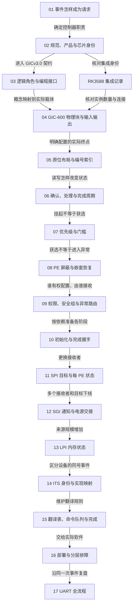

# 第1章\_GICv3物理中断专题大纲

## 1.1\_独立讲懂概念\_也能带着问题读官方文档

本专题从“外设收到了数据，正在运行的程序怎样知道”开始，逐步推导 **通用中断控制器（Generic Interrupt Controller，GIC）** 的职责，再学习 RK3588 芯片所用控制器的规则与实现。无需先懂 Arm 平台分类、控制器模块或代际差异；这些名称在问题出现时才建立。

本专题按问题组织连续教材。**不打开原件，也应能从正文理解概念、因果关系、状态与设计边界；实际承担寄存器推导的原位布局和必要访问表直接放在正文，读者可以据此核对中文解释，再沿相邻的官方对照查阅完整条目。** 教学场景、编号算例和自绘示意图帮助推理；手册原图节选单独标注，不与教学图或芯片实测混称。

首次出现的专题术语使用“中文名（English Full Name，缩写）”，并将这组名称整体加粗；关键比较中的易混术语也突出显示，后续普通引用不反复加粗。没有通行缩写时只列中英文名，产品型号、字段与命令保留官方拼写并说明名称性质，不杜撰词源。本卷按连续教材阅读，后章回顾已经建立的关键认识，不要求读者先背总术语表；独立查阅时可沿章节标明的前置入口补齐语境。

当前第一卷包括十六篇物理中断主线正文、一篇 UART 综合复盘与一篇芯片集成记录。架构版本、硬件产品与芯片的区别在第二章独立建立；没有把“GICv3.0、GIC-600 r1p6、RK3588”当作已经懂得的三个前提。

正文在进入解释和切换层次时，先标明 **概念层、概念到实现的映射、实现层** 及适用资料。GICv3.0 规定逻辑角色与保证；GIC-600 r1p6 说明产品怎样兑现它们；RK3588 记录实际集成数量与连接。先讲概念，再说明一对多或分散实现的对应关系，最后追踪实际配置、输入、输出与反馈，不能把这三层的名称当作同一种器件轮流使用。

## 1.2\_因果阅读地图

箭头表示前一问题解决后暴露的下一缺口，不是信号接线。默认顺序完整阅读正文；芯片记录在第二章先看身份证据，到内存与部署章节再按需回访约束。

| 真实章节 | 承接的前置结论 | 本章解决什么 | 留下的下一问 |
| --- | --- | --- | --- |
| [01 从外设事件到中断请求](P01_从外设事件到中断请求.md#1.1_数据已经到了_程序为什么还不知道) | 程序在处理器上执行 | 从轮询价值与代价推出请求和控制器职责 | 规则、产品、芯片是不是同一层？ |
| [02 从控制器规则到芯片与软件身份](P02_从控制器规则到芯片与软件身份.md#2.1_已经知道职责_为什么还要分清名称) | 控制器需要管理请求 | 区分架构、实现、芯片、板与软件，核对首个平台 | 多处理器系统中哪些状态共享？ |
| [03 多核角色与架构编程接口](P03_多核角色与架构编程接口.md#3.1_增加第二个处理器后_什么必须拆开) | 身份与职责已分层 | 建立逻辑角色、来源编号及 MMIO／系统寄存器接口 | 每 PE 的逻辑角色实际由什么电路实现？ |
| [04 GIC600的物理实现_从逻辑映射到输入输出](P04_GIC600的物理实现_从逻辑映射到输入输出.md#4.1_从GICv3到GIC600_逻辑角色怎样落到物理块) | 知道每 PE 一个逻辑 Redistributor | 逐项映射到 GIC-600，沿配置、输入与反馈定位状态；解释共享接口和物理分组 | 知道实际落点后，怎样选中某个来源的字段？ |
| [05 寄存器位图与编号索引](P05_寄存器位图与编号索引.md#5.1_一个编号怎样找到对应状态位) | 接口与物理载体已经对应 | 从原始位图推导字段索引，用 C 程序检查同一 INTID 的不同定位 | 找到来源以后，何时才算处理完？ |
| [06 一次中断的状态转换与完成协议](P06_一次中断的状态转换与完成协议.md#6.1_处理入口已经运行_为什么还没有完成) | 能定位来源配置 | 用 S0～S6 和完整实验区分设备、控制器、处理器及软件状态 | 有待办为何仍不能进入？ |
| [07 优先级数值_门槛与分组](P07_优先级数值_门槛与分组.md#7.1_已经挂起的请求_为什么仍然不能进入) | 确认与完成有配对义务 | 区分数值优先级、PMR 门槛、运行优先级及二进制分组 | 满足 GIC 条件后，PE 是否一定接受？ |
| [08 处理器屏蔽与嵌套恢复](P08_处理器屏蔽与嵌套恢复.md#8.1_控制器屏蔽与处理器屏蔽不能互相替代) | 候选优先级已能比较 | 区分控制器与 PE 屏蔽，沿嵌套过程保存和恢复现场 | 谁有权建立这些条件，异常又送往哪里？ |
| [09 权限_安全分组与异常路由](P09_权限_安全分组与异常路由.md#9.1_为什么照着寄存器名写值还不够) | 递送与异常接收是不同阶段 | 把权限、安全组和异常路由连接起来，分清各配置实际作用对象 | 怎样按依赖关系准备整条路径？ |
| [10 初始化顺序与硬件完成握手](P10_初始化顺序与硬件完成握手.md#10.1_全局_每核与每个来源分别准备什么) | 已知配置权限及作用范围 | 分开全局、每核、每来源初始化，核对唤醒和硬件完成握手 | 更换接收者会改变什么？ |
| [11 SPI目标选择与每PE状态](P11_SPI目标选择与每PE状态.md#11.1_把请求交给另一个处理器_改变了什么) | 目标必须先具备接收条件 | 区分 SPI 固定目标、1-of-N 选择与每 PE 接收状态 | 核间提醒多个接收者时，工作内容放在哪里？ |
| [12 SGI核间通知与电源交接](P12_SGI核间通知与电源交接.md#12.1_核间中断传的是提醒_工作内容存在哪里) | 一个 SPI 的选核不同于通知多个 PE | 用 SGI 追踪共享工作、通知合并与退出窗口，再区分逐 PE 和块级电源交接 | 大量消息来源的状态怎样承载？ |
| [13 从消息请求到内存中的中断状态](P13_从消息请求到内存中的中断状态.md#13.1_来源越来越多_为什么让设备发送一条消息) | 通知不等于完整工作数据 | 推导 LPI 的内存状态与硬件缓存，映射其实际维护位置 | 设备事件怎样对应目标中断？ |
| [14 设备事件身份与ITS实现映射](P14_设备事件身份与ITS实现映射.md#14.1_两个设备都发事件0_怎样区分) | LPI 状态由内存与硬件共同承载 | 建立设备身份和 ITS 翻译职责，再映射到产品及芯片互连 | 映射规则存在哪里，更新后怎样确认生效？ |
| [15 ITS翻译表_命令队列与完成](P15_ITS翻译表_命令队列与完成.md#15.1_三个查找层次怎样闭合一次翻译) | 已知 ITS 的输入、输出和实现位置 | 闭合翻译表、命令发布、完成、迁移及队列绕回 | 真实软件怎样接管并验证整条路径？ |
| [16 软件交接_部署与分层排障](P16_软件交接_部署与分层排障.md#16.1_硬件模型闭合后_软件该接管哪一段) | 普通请求与消息路径已闭合 | 建立软件所有权、部署基线、观察证据与实验边界 | 能否用同一个串口事件串起全部阶段？ |
| [17 UART中断的端到端流程复盘](P17_UART中断的端到端流程复盘.md#17.1_阶段导航) | 前十六章的物理中断主线 | 沿 UART 的统一 S0～S6 追踪配置、入口、确认、清源、完成与返回 | 把教学前提替换成目标设备、软件与实测证据 |
| [RK3588 的 GIC-600 集成与手册核对](../../rockchip/rk3588/P01_RK3588的GIC-600集成与手册核对.md#1.1_通用规则没有告诉我们这颗芯片接了什么) | 已区分规范、产品与芯片 | 核对产品修订、CPU 簇、PPI 物理块及芯片访问约束 | 板与软件实际启用了什么？ |

第六章的 [S0～S6 完整周期](P06_一次中断的状态转换与完成协议.md#6.4_用同一组阶段闭合正常周期)是后续放大状态与通信的共同坐标；消息中断明确解释哪些阶段沿用、哪些硬件状态不同。阶段号是本专题的叙述工具，不是规范的寄存器编码。

若疑问是“硬件状态是否要等几个时钟才能刷新”，先看[时钟与硬件传播](P04_GIC600的物理实现_从逻辑映射到输入输出.md#4.2_硬件状态怎样传播_一个时钟周期能说明什么)，再沿[清源与停用的先后分支](P06_一次中断的状态转换与完成协议.md#6.4.1_清源与停用先后不同_谁保证状态正确)区分硬件正确性与软件义务，最后查[接口同步的具体保证](P10_初始化顺序与硬件完成握手.md#10.3_写入顺序_内存可见与硬件完成是三个问题)。

复查容易混淆的边界时，可以从[串口数据与通知状态的分工](P06_一次中断的状态转换与完成协议.md#6.5.1_串口数据由谁保存_当前处理能否读走后来到达的字节)，进入[优先级按位分割](P07_优先级数值_门槛与分组.md#7.4.1_把一个优先级数值按位拆开)，再对照[硬件结构与配置归属](P09_权限_安全分组与异常路由.md#9.3.2_硬件结构与配置归属先对齐)及[安全组到异常级的路由](P09_权限_安全分组与异常路由.md#9.3.3_安全组怎样影响IRQ与FIQ_又怎样到达EL)。[嵌套现场的保存责任](P08_处理器屏蔽与嵌套恢复.md#8.2.1_硬件先保存什么_公共入口还必须保存什么)与[多发送者SGI合并](P12_SGI核间通知与电源交接.md#12.2_两个发送者会不会得到两次计数)分别检验“谁在执行”和“谁保存工作”。

### 1.2.1\_沿章节动手与检验自己的预测

前两章用缓冲容量和资料身份做纸面推演，先练习提出正确问题；第五章的[寄存器索引算例](P05_寄存器位图与编号索引.md#5.3_动手计算同一个编号的不同寄存器索引)使用主机 C11 编译器，第六章的[状态模型实验](P06_一次中断的状态转换与完成协议.md#6.7_亲手分开数据_挂起与完成义务)把漏清源、漏停用、通知合并与设备数据分开观察。源码放在本目录 `examples/`，正文同时给出完整程序、运行位置、预测、结果解释和恢复方法。

第七至十五章继续改变一个条件，依次练习优先级判断、启动失败回滚、核间通知退出窗口、LPI 表布局与 ITS 队列绕回；解答跟在问题之后，先自行作答再对照。第十六章提供[目标 Linux 板只读观察](P16_软件交接_部署与分层排障.md#16.6_先做只读观察_再设计有边界的实验)，第十七章把同一事件从产生追到返回。主机模型验证教学推理，纸面推演验证因果关系；两者都不代替实际硬件、驱动或板上结果。

### 1.2.2\_按问题寻找硬件结构与请求路径图

逻辑组件、寄存器配置与产品功能块回答不同问题。下面按学习顺序寻找图示；第三章建立普通来源的逻辑结构，第四章完成产品映射；第十四章在消息概念成立后再补含 ITS 的全景，避免用一张塞满陌生模块的总图代替推导。

| 当前想看清什么 | 对应图示与正文 | 图表达的边界 |
| --- | --- | --- |
| Distributor 与每 PE 的接收侧是什么关系？ | [一个实例与多个处理器](P03_多核角色与架构编程接口.md#3.3.1_一个控制器实例怎样配上多个处理器) | GIC 架构逻辑组织 |
| SPI、PPI、SGI 分别从哪里进入？ | [SPI 与 PPI 两条路径](P03_多核角色与架构编程接口.md#3.3.3_SPI先选择目标_PPI直接进入本地)、[SGI 发送与接收侧](P03_多核角色与架构编程接口.md#3.3.4_SGI的发送侧和接收侧都要画出来) | 分类型请求交付，不混入配置控制箭头 |
| 每 PE 一个 Redistributor，实际配置与状态到底放在哪里？ | [软件实际修改对象、核侧交付过程与物理分块](P04_GIC600的物理实现_从逻辑映射到输入输出.md#4.1_从GICv3到GIC600_逻辑角色怎样落到物理块) | 先逐项映射规范角色与产品物理块，再追踪两核同号 PPI 的配置、输入与核侧反馈；分别解释布线、电源和硬件集成参数 |
| RK3588 实际有几个簇、几个 PPI 物理块？ | [CPU 原图与 GIC 集成原表的交叉核对](../../rockchip/rk3588/P01_RK3588的GIC-600集成与手册核对.md#1.4.2_一个八核簇与一个PPI块_怎样核对数量) | TRM 的一个共享 DSU 八核簇、GIC 集成分组和 PPI 块数量分别核验，不从大小核分组推算 |
| 寄存器怎样访问，一个编号对应哪个字段？ | [原位布局、MMIO 与系统寄存器原访问表](P03_多核角色与架构编程接口.md#3.4_软件怎样访问GIC_地址访问与系统寄存器)、[置／清使能原图与字段对照](P05_寄存器位图与编号索引.md#5.1_一个编号怎样找到对应状态位)、[寄存器组原图与索引算例](P05_寄存器位图与编号索引.md#5.3_动手计算同一个编号的不同寄存器索引) | 先依据原图和定义读字段，再核对中文解释及算式；系统寄存器编码与 MMIO 偏移分开阅读 |
| 全局组开关为什么约束本地 PPI？ | [请求流向与配置作用范围](P09_权限_安全分组与异常路由.md#9.3.2_硬件结构与配置归属先对齐) | 实线请求图与虚线控制范围图分别阅读 |
| 一次通知到底由一个还是多个 PE 处理？ | [SPI 固定目标与 1-of-N](P11_SPI目标选择与每PE状态.md#11.2_怎样取得目标PE的硬件亲和坐标)、[SGI 目标列表与广播](P12_SGI核间通知与电源交接.md#12.1.2_目标列表与广播_同名IRM为什么有不同含义) | 同一组三个 PE 的目标与独立状态对照 |
| 消息翻译组件位于哪里，RK3588 怎样集成？ | [含 ITS 的逻辑关系](P14_设备事件身份与ITS实现映射.md#14.2.1_把消息翻译放回完整硬件关系)、[RK3588 功能块与电源域](P14_设备事件身份与ITS实现映射.md#14.2.2_RK3588框图中的功能块与电源域) | 架构逻辑图与芯片手册连接图分别作证 |
| 同一产品的各物理块可以怎样互连？ | [GIC-600 的两种产品互连全景](P14_设备事件身份与ITS实现映射.md#14.2.3_同一组功能块可以怎样互连) | 对照产品图 1-1/1-2 的连接方案，区别于逻辑职责图和 RK3588 集成图 |

上述硬件关系与过程图主要是依据规范与实现手册重绘的 Mermaid 示意图，邻近正文给出文档修订、章节及原图定位。寄存器位布局采用标明来源的手册原图节选。两者都不表示真实芯片版图尺寸，也不证明开发板当前的软件配置或运行结果。

## 1.3\_怎样使用每节旁边的官方对照

“官方对照”给出文档身份、固定版本、原文目录和本节需要复核的具体问题。章节编号与英文标题优先于 PDF 页码；指南通常使用连续页码，架构规范使用如 4-50 的印刷页码，不应混为 PDF 阅读器的页序号。在线入口可能重定向，仍可按已下载原件的目录和关键词定位。

| 正文中的来源简称 | 对应官方原件与版本 | 阅读任务 |
| --- | --- | --- |
| 概览 198123，3.2-01 | [Learn the architecture — Generic Interrupt Controller v3 and v4, Overview](https://developer.arm.com/documentation/198123/0302)，198123_0302_01_en | 先理解角色和普通处理过程 |
| 规范 IHI0069 H.b | [Arm Generic Interrupt Controller Architecture Specification, GIC architecture version 3 and version 4](https://developer.arm.com/documentation/ihi0069/hb) | 核对状态、寄存器、命令的规范保证；只选择当前 v3.0 适用部分 |
| 消息指南 102923，1.0-01 | [Learn the architecture — Generic Interrupt Controller v3 and v4, LPIs](https://developer.arm.com/documentation/102923/0100)，102923_0100_01_en | 对照第十三至十五章的内存状态和翻译管理 |
| GIC-600 手册 100336，r1p6 | [Arm CoreLink GIC-600 Generic Interrupt Controller Technical Reference Manual](https://developer.arm.com/documentation/100336/0106)，100336_0106_00_en | 查该硬件实现的选择与限制 |
| RK3588 手册 | [资料索引中的原件入口](../../../../reference/external_resources/arm/README.md#1.4.2_型号判断的证据与适用边界)，TRM V1.0 Part1，2022-03-09 | 查芯片集成；不拿软件现象替代型号核验 |

普通中文论证是本专题自己的教学表达；“架构规定”必须能回到规范，“该产品或芯片采用”必须能回到实现资料，“可能导致”需要注明所依赖的条件。原图或原表旁标出文档修订、章节和印刷页码；原件没有独立图表号时直接说明，不编造编号。原图中的位号、字段名、保留位、视图标签保持原样，正文的中文字段表明确标为释义或重排，作者的归纳与比较放在这些材料之后。

读一个寄存器时，先确认是哪一版本、哪一种安全／访问视图，再沿高位到低位看布局，接着看字段取值、实现条件和访问规则，最后用一次读写解释返回值与状态副作用。位布局不能代替 Purpose、Configurations 和 Accessing 中的条件；例如 RO 不能证明读取没有副作用。原图中出现后续架构扩展时保留它的名称与位置，并说明本卷 GICv3.0 下如何解释，不能悄悄擦掉字段后仍称原图。

第三章的 [GICD_CTLR 与 ICC_IAR1_EL1 完整读表示范](P03_多核角色与架构编程接口.md#3.4_软件怎样访问GIC_地址访问与系统寄存器)建立这种读法。后续在首次需要字段推理的位置展开对应寄存器；复盘已建立的接口时精确回链，避免把同一份字段说明复制到每一章。图像与原件页码的对应关系另见[原图来源清单](../../../../assets/images/gic/registers/source_manifest.json)，它保存核对记录，不代替正文的读图过程。

完整书目、缓存位置、官方入口和下载校验由[资料索引](../../../../reference/external_resources/arm/README.md#1.4.3_先读哪几份资料)统一维护。本大纲只组织阅读，不复制第二份下载清单。

## 1.4\_本卷边界与后续扩展

本卷已形成独立物理中断讲解，不代表全部架构分支、真实 Linux 函数体或板上实验已经完成。软件实现需要另行固定内核、固件、配置与设备描述；本卷的伪代码只说明协议职责，不能直接部署。

Linux 的中断请求（Interrupt Request，IRQ）管理仍在[原有专题](../../../../knowledge/linux/synchronization_and_asynchrony/asynchrony/interrupts/大纲.md#1.3_与独立GIC专题的分工)解释软件对象与接口，两边不复制完整教程。后续先从零补 GICv3 自身已有的虚拟化，再在问题成立时扩展 GICv4；后续计划由[建设路线](../../../../atlas/roadmaps/gic_learning_plan.md#1.5_GICv3_学到哪里可以结束_何时才进入_GICv4)维护，不在这里制造未落地章节。

人工阅读与评审进度只在[评审地图](../../../../atlas/maps/knowledge_review_map.md)维护；基础格式和资料核对不等于开发者已经完成评审。
