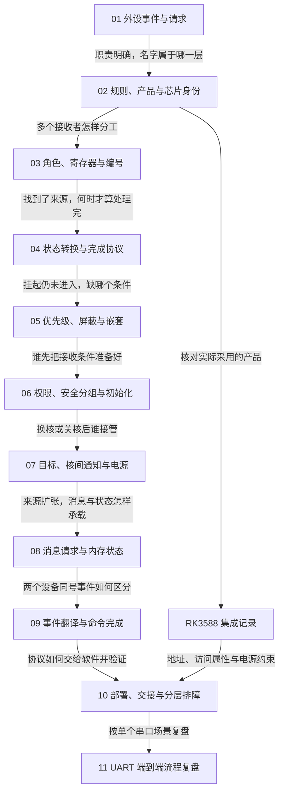

# 第1章\_GICv3物理中断专题大纲

## 1.1\_独立讲懂概念\_也能带着问题读官方文档

本专题从“外设收到了数据，正在运行的程序怎样知道”开始，逐步推导 **通用中断控制器（Generic Interrupt Controller，GIC）** 的职责，再学习 RK3588 芯片所用控制器的规则与实现。无需先懂 Arm 平台分类、控制器模块或代际差异；这些名称在问题出现时才建立。

这里不是官方文档的逐页翻译，也不是只有链接的资料目录。**不打开原件，也应能从正文理解概念、因果关系、状态与设计边界；需要查字段、例外或更细规则时，再沿相邻的官方对照返回原文。** 教学场景、编号算例和示意图帮助推理，不冒充芯片实测或规范原图。

首次出现的专题术语使用“中文名（English Full Name，缩写）”，并将这组名称整体加粗；关键比较中的易混术语也突出显示，后续普通引用不反复加粗。没有通行缩写时只列中英文名，产品型号、字段与命令保留官方拼写并说明名称性质，不杜撰词源。本卷按连续教材阅读，后章回顾已经建立的关键认识，不要求读者先背总术语表；独立查阅时可沿章节标明的前置入口补齐语境。

当前第一卷包括十篇物理中断主线正文、一篇 UART 综合复盘与一篇芯片集成记录。架构版本、硬件产品与芯片的区别在第二章独立建立；没有把“GICv3.0、GIC-600 r1p6、RK3588”当作已经懂得的三个前提。

## 1.2\_因果阅读地图

箭头表示前一问题解决后暴露的下一缺口，不是信号接线。默认顺序完整阅读正文；芯片记录在第二章先看身份证据，到内存与部署章节再按需回访约束。

| 真实章节 | 承接的前置结论 | 本章解决什么 | 留下的下一问 |
| --- | --- | --- | --- |
| [01 从外设事件到中断请求](P01_从外设事件到中断请求.md#1.1_数据已经到了_程序为什么还不知道) | 程序在处理器上执行 | 从轮询价值与代价推出请求和控制器职责 | 规则、产品、芯片是不是同一层？ |
| [02 从控制器规则到芯片与软件身份](P02_从控制器规则到芯片与软件身份.md#2.1_已经知道职责_为什么还要分清名称) | 控制器需要管理请求 | 区分架构、实现、芯片、板与软件，核对首个平台 | 多处理器系统中哪些状态共享？ |
| [03 多核控制器的角色、寄存器与编号](P03_多核控制器的角色_寄存器与编号.md#3.1_增加第二个处理器后_什么必须拆开) | 身份与职责已分层 | 由来源关系推出角色、编号与访问方式 | 进入处理入口为什么还没结束？ |
| [04 一次中断的状态转换与完成协议](P04_一次中断的状态转换与完成协议.md#4.1_处理入口已经运行_为什么还没有完成) | 能定位来源配置 | 分开设备、控制器、处理器和软件状态，闭合一次周期 | 有待办为何仍不能进入？ |
| [05 优先级、屏蔽与嵌套处理](P05_优先级_屏蔽与嵌套处理.md#5.1_已经挂起的请求_为什么仍然不能进入) | 确认与完成有配对义务 | 区分排队、抢占和各层屏蔽，解释嵌套恢复 | 谁有权建立接收条件？ |
| [06 权限、安全分组与初始化闭环](P06_权限_安全分组与初始化闭环.md#6.1_为什么照着寄存器名写值还不够) | 接收取决于一组条件 | 建立权限、初始化作用域和硬件完成握手 | 换目标、关核时怎样交接？ |
| [07 目标选择、核间通知与电源交接](P07_目标选择_核间通知与电源交接.md#7.1_把请求交给另一个处理器_改变了什么) | 接收者必须先准备好 | 分开工作数据、通知状态与目标存活条件 | 大量消息来源的状态放在哪里？ |
| [08 从消息请求到内存中的中断状态](P08_从消息请求到内存中的中断状态.md#8.1_来源越来越多_为什么让设备发送一条消息) | 通知不等于完整工作数据 | 推出消息来源、内存表与不同状态模型 | 设备事件如何找到目标编号？ |
| [09 设备事件翻译与命令完成](P09_设备事件翻译与命令完成.md#9.1_两个设备都发事件0_怎样区分) | 消息状态由内存与硬件共同承载 | 分开设备身份、映射、命令发布与完成 | 真实软件怎样接管和验证？ |
| [10 软件交接、部署与分层排障](P10_软件交接_部署与分层排障.md#10.1_硬件模型闭合后_软件该接管哪一段) | 物理请求与消息路径已闭合 | 建立软件所有权、证据层次与实验边界 | 固定目标软件后再深入实现与实验 |
| [11 UART 中断的端到端流程复盘](P11_UART中断的端到端流程复盘.md#11.1_阶段导航) | 前十章的物理中断主线 | 沿统一 S0～S6 追踪同一次串口事件，辨别配置索引、异常入口、来源确认与结束义务 | 把教学前提替换成目标设备、软件与实测证据 |
| [RK3588 的 GIC-600 集成与手册核对](../../rockchip/rk3588/P01_RK3588的GIC-600集成与手册核对.md#1.1_通用规则没有告诉我们这颗芯片接了什么) | 区分规则与芯片 | 记录具体身份、地址宽度、访问属性、电源和摘要冲突 | 板与软件实际启用了什么？ |

第四章的 [S0～S6 完整周期](P04_一次中断的状态转换与完成协议.md#4.4_用同一组阶段闭合正常周期)是后续放大状态与通信的共同坐标；消息中断明确解释哪些阶段沿用、哪些硬件状态不同。阶段号是本专题的叙述工具，不是规范的寄存器编码。

若疑问是“硬件状态是否要等几个时钟才能刷新”，先看[时钟与硬件传播](P03_多核控制器的角色_寄存器与编号.md#3.4.2_硬件状态怎样传播_一个时钟周期能说明什么)，再沿[清源与停用的先后分支](P04_一次中断的状态转换与完成协议.md#4.4.1_清源与停用先后不同_谁保证状态正确)区分硬件正确性与软件义务，最后查[接口同步的具体保证](P06_权限_安全分组与初始化闭环.md#6.6_写入顺序_内存可见与硬件完成是三个问题)。

复查容易混淆的边界时，可以从[串口数据与通知状态的分工](P04_一次中断的状态转换与完成协议.md#4.5.1_串口数据由谁保存_当前处理能否读走后来到达的字节)，进入[优先级按位分割](P05_优先级_屏蔽与嵌套处理.md#5.4.1_把一个优先级数值按位拆开)，再对照[硬件结构与配置归属](P06_权限_安全分组与初始化闭环.md#6.3.2_硬件结构与配置归属先对齐)及[安全组到异常级的路由](P06_权限_安全分组与初始化闭环.md#6.3.3_安全组怎样影响IRQ与FIQ_又怎样到达EL)。[嵌套现场的保存责任](P05_优先级_屏蔽与嵌套处理.md#5.6.1_硬件先保存什么_公共入口还必须保存什么)与[多发送者SGI合并](P07_目标选择_核间通知与电源交接.md#7.4_两个发送者会不会得到两次计数)分别检验“谁在执行”和“谁保存工作”。

### 1.2.1\_沿章节动手与检验自己的预测

前两章用缓冲容量和资料身份做纸面推演，先练习提出正确问题；第三章的[寄存器索引算例](P03_多核控制器的角色_寄存器与编号.md#3.7_动手计算同一个编号的不同寄存器索引)使用主机 C11 编译器，第四章的[状态模型实验](P04_一次中断的状态转换与完成协议.md#4.7_亲手分开数据_挂起与完成义务)把漏清源、漏停用、通知合并与设备数据分开观察。源码放在本目录 `examples/`，正文同时给出完整程序、运行位置、预测、结果解释和恢复方法。

第五至九章继续改变一个条件，依次练习优先级判断、启动失败回滚、核间通知退出窗口、LPI 表布局与 ITS 队列绕回；解答跟在问题之后，先自行作答再对照。第十章提供[目标 Linux 板只读观察](P10_软件交接_部署与分层排障.md#10.6_先做只读观察_再设计有边界的实验)，第十一章把同一事件从产生追到返回。主机模型验证教学推理，纸面推演验证因果关系；两者都不代替实际硬件、驱动或板上结果。

### 1.2.2\_按问题寻找硬件结构与请求路径图

逻辑组件、寄存器配置与产品功能块回答不同问题。下面按学习顺序寻找图示；第三章先建立普通来源的局部结构，第九章在消息概念成立后再补含 ITS 的全景，避免用一张塞满陌生模块的总图代替推导。

| 当前想看清什么 | 对应图示与正文 | 图表达的边界 |
| --- | --- | --- |
| Distributor 与每 PE 的接收侧是什么关系？ | [一个实例与多个处理器](P03_多核控制器的角色_寄存器与编号.md#3.3.1_一个控制器实例怎样配上多个处理器) | GIC 架构逻辑组织 |
| SPI、PPI、SGI 分别从哪里进入？ | [SPI 与 PPI 两条路径](P03_多核控制器的角色_寄存器与编号.md#3.3.3_SPI先选择目标_PPI直接进入本地)、[SGI 发送与接收侧](P03_多核控制器的角色_寄存器与编号.md#3.3.4_SGI的发送侧和接收侧都要画出来) | 分类型请求交付，不混入配置控制箭头 |
| 为何设置 PPI 物理块，每 PE 的接口又怎样放进去？ | [PPI 块的布线与电源动机、请求过程及功能块映射](P03_多核控制器的角色_寄存器与编号.md#3.4.1_PPI块为什么这样设计_从布线与电源约束到每核状态归属) | 先比较集中与就近放置，再用表 2-7～2-9 细化配置和接口，区分请求路径与每 PE 状态 |
| 寄存器怎样访问，一个编号对应哪个字段？ | [MMIO 与系统寄存器对照](P03_多核控制器的角色_寄存器与编号.md#3.4_软件怎样访问GIC_寄存器接口怎样落到物理电路)、[使能接口表](P03_多核控制器的角色_寄存器与编号.md#3.5_一个编号怎样找到对应状态位)、[寄存器组与索引算例](P03_多核控制器的角色_寄存器与编号.md#3.7_动手计算同一个编号的不同寄存器索引) | 给出接口、基址类型、偏移、宽度、字段及相关读写效果，不把系统寄存器写成 MMIO 地址 |
| 全局组开关为什么约束本地 PPI？ | [请求流向与配置作用范围](P06_权限_安全分组与初始化闭环.md#6.3.2_硬件结构与配置归属先对齐) | 实线请求图与虚线控制范围图分别阅读 |
| 一次通知到底由一个还是多个 PE 处理？ | [SPI 固定目标与 1-of-N](P07_目标选择_核间通知与电源交接.md#7.2_硬件目标坐标不是Linux逻辑编号)、[SGI 目标列表与广播](P07_目标选择_核间通知与电源交接.md#7.3.2_目标列表与广播_同名IRM为什么有不同含义) | 同一组三个 PE 的目标与独立状态对照 |
| 消息翻译组件位于哪里，RK3588 怎样集成？ | [含 ITS 的逻辑关系](P09_设备事件翻译与命令完成.md#9.2.1_把消息翻译放回完整硬件关系)、[RK3588 功能块与电源域](P09_设备事件翻译与命令完成.md#9.2.2_RK3588框图中的功能块与电源域) | 架构逻辑图与芯片手册连接图分别作证 |
| 同一产品的各物理块可以怎样互连？ | [GIC-600 的两种产品互连全景](P09_设备事件翻译与命令完成.md#9.2.3_同一组功能块可以怎样互连) | 对照产品图 1-1/1-2 的连接方案，区别于逻辑职责图和 RK3588 集成图 |

各图为本专题依据规范与实现手册重绘的 Mermaid 示意图，邻近正文给出文档修订、章节及原图定位。框图不表示真实芯片版图尺寸，也不证明开发板当前的软件配置或运行结果。

## 1.3\_怎样使用每节旁边的官方对照

“官方对照”给出文档身份、固定版本、原文目录和本节需要复核的具体问题。章节编号与英文标题优先于 PDF 页码；指南通常使用连续页码，架构规范使用如 4-50 的印刷页码，不应混为 PDF 阅读器的页序号。在线入口可能重定向，仍可按已下载原件的目录和关键词定位。

| 正文中的来源简称 | 对应官方原件与版本 | 阅读任务 |
| --- | --- | --- |
| 概览 198123，3.2-01 | [Learn the architecture — Generic Interrupt Controller v3 and v4, Overview](https://developer.arm.com/documentation/198123/0302)，198123_0302_01_en | 先理解角色和普通处理过程 |
| 规范 IHI0069 H.b | [Arm Generic Interrupt Controller Architecture Specification, GIC architecture version 3 and version 4](https://developer.arm.com/documentation/ihi0069/hb) | 核对状态、寄存器、命令的规范保证；只选择当前 v3.0 适用部分 |
| 消息指南 102923，1.0-01 | [Learn the architecture — Generic Interrupt Controller v3 and v4, LPIs](https://developer.arm.com/documentation/102923/0100)，102923_0100_01_en | 对照第八、九章的内存状态和翻译管理 |
| GIC-600 手册 100336，r1p6 | [Arm CoreLink GIC-600 Generic Interrupt Controller Technical Reference Manual](https://developer.arm.com/documentation/100336/0106)，100336_0106_00_en | 查该硬件实现的选择与限制 |
| RK3588 手册 | [资料索引中的原件入口](../../../../reference/external_resources/arm/README.md#1.4.2_型号判断的证据与适用边界)，TRM V1.0 Part1，2022-03-09 | 查芯片集成；不拿软件现象替代型号核验 |

普通中文论证是本专题自己的教学表达；“架构规定”必须能回到规范，“该产品或芯片采用”必须能回到实现资料，“可能导致”需要注明所依赖的条件。理解本节结论所需的硬件图、表项和寄存器字段直接放在正文，并说明相关条件与读写效果；官方对照用于核验出处和继续深入，第一次阅读不以打开原件为前提。正文表格按当前问题整理所用字段，未列字段不代表可以随意写入；也不能把引用省略为模糊的“参考 Arm 文档”。

完整书目、缓存位置、官方入口和下载校验由[资料索引](../../../../reference/external_resources/arm/README.md#1.4.3_先读哪几份资料)统一维护。本大纲只组织阅读，不复制第二份下载清单。

## 1.4\_本卷边界与后续扩展

本卷已形成独立物理中断讲解，不代表全部架构分支、真实 Linux 函数体或板上实验已经完成。软件实现需要另行固定内核、固件、配置与设备描述；本卷的伪代码只说明协议职责，不能直接部署。

Linux 的中断请求（Interrupt Request，IRQ）管理仍在[原有专题](../../../../knowledge/linux/synchronization_and_asynchrony/asynchrony/interrupts/大纲.md#1.3_与独立GIC专题的分工)解释软件对象与接口，两边不复制完整教程。后续先从零补 GICv3 自身已有的虚拟化，再在问题成立时扩展 GICv4；后续计划由[建设路线](../../../../atlas/roadmaps/gic_learning_plan.md#1.5_GICv3_学到哪里可以结束_何时才进入_GICv4)维护，不在这里制造未落地章节。

人工阅读与评审进度只在[评审地图](../../../../atlas/maps/knowledge_review_map.md)维护；基础格式和资料核对不等于开发者已经完成评审。
