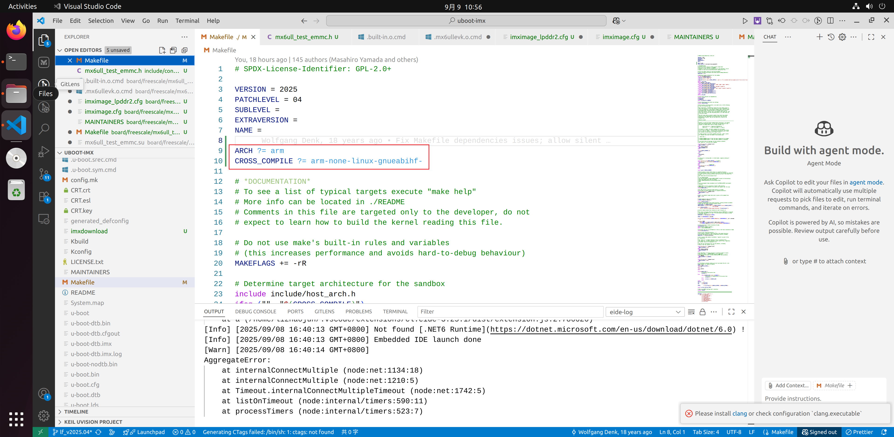

# 第1章\_移植基线与交叉编译环境

把一块开发板启动到 Linux 命令行，不是把几个软件分别编译成功就结束了。上一段程序必须把下一段需要的内存、镜像和硬件描述交给它；后者接管之后，还要用自己的驱动重新建立运行环境。串口里出现 U-Boot 提示符，只证明启动链走到了引导程序；出现 `Starting kernel`，也还没有证明根文件系统能够挂载。

本组记录以 **正点原子 i.MX6ULL 阿尔法板、原记录标注的 v2.2 硬件、eMMC 配置和 LAN8720A 双网口** 为场景，讲清从 NXP 参考板派生配置的过程。读者需要会用 Linux Shell、Git、C 和基本设备树语法，不需要先移植成功另一块板。原理图摘图随外设章节提供，具体内存颗粒、PCB 修订和启动拨码仍须与手中实物对应。

## 1.1\_先看启动链上的交接物

上电时，处理器还不能假定外部 DDR 可用。芯片内的 Boot ROM 按启动模式读取启动介质，执行所选镜像的初始化协议，之后进入 U-Boot。U-Boot 能访问 DDR 后，才有条件把 Linux 镜像和描述本板硬件的 DTB 放进内存。Linux 接管处理器，按自身配置与 DTB 初始化驱动，挂载根文件系统，再启动第一个用户进程。


图中的箭头是交接关系，不表示所有阶段都使用同一种设备树。U-Boot 的控制 DTB 描述 **U-Boot 自己** 要管理的设备；交给 Linux 的 DTB 来自 Linux 那一份板级描述。它们描述同一块实物，但绑定、驱动和构建入口可能不同。改了 U-Boot 的屏幕配置，不会自动改掉 Linux 的屏幕配置。

后面按这一条链推进：先让构建过程可追溯，再让新板配置被正确选中，随后解决 DDR 和外设，最后闭合用户态启动。网络启动中的 TFTP 负责把镜像送到 U-Boot，NFS 负责让 Linux 访问服务器上的根目录；二者不能互相替代。

## 1.2\_把原实验与本次核对的版本分开

原稿来自作者的[移植记录](https://blog.csdn.net/charlie114514191/article/details/147116372)，参考了[网口讨论](https://blog.csdn.net/ZHONGCAI0901/article/details/118310802)及[正点原子系统移植课程](https://www.bilibili.com/video/BV12E411h71h?p=24)。这些入口保留材料来历；下面各章在正文中解释所需步骤，不要求先看完视频。

原稿与图片提供了实验线索，但并未交付当时所有源码补丁、完整 `.config`、镜像摘要和板卡测量结果。为避免把不同时间的代码拼成一个版本，本次用以下固定材料核对机制：

| 对象 | 原记录能确认什么 | 本文使用的核对边界 |
| --- | --- | --- |
| 宿主 | Ubuntu 22.04、x86-64，原机器使用 Intel i9 | 命令在 Linux 宿主 Bash 执行；CPU 品牌不是构建契约 |
| 目标 | i.MX6ULL，Cortex-A7、ARMv7-A、32 位 ARM | `ARCH=arm`，不能换成 AArch64 交叉编译器 |
| U-Boot | NXP `lf_v2025.04` 分支，截图有本地修改 | 本次核对提交 `99518e6b6f20cb6a2bf19115e355db9f58100af8`；不宣称它就是原实验提交 |
| Linux | 截图显示 6.1.55 及 `lf-6.1.55-2.2.0` 标签线索 | NXP 标签解引用提交 `770c5fe2c1d1529fae21b7043911cd50c6cf087e`；板级差量另外维护 |
| 交叉工具链 | Arm GNU 10.3-2021.07，`arm-none-linux-gnueabihf-` | 后续用户态必须配套这套工具链的 sysroot 与 ABI |
| BusyBox | 浮动 snapshot，截图为 `1.38.0.git` | 本次用 1.37.0 发布源码核对配置、init 和 mdev，不把快照冒充固定发布版 |
| Buildroot | 截图显示 2025.08 | 后文以 2025.08 的包依赖为准 |

本平台记录采用 Linux 6.1.55，不与仓库其他机制专题的 [Linux 6.12.20 源码基线](../../../../../research/source_reading/linux/SOURCE_BASELINE.md)混用。旧稿全文保存在[历史原稿附件](../../../../../assets/archives/imx6ull_porting/porting_original.txt)，用于核对原始日志和改写来历；其中旧命令与未核实推断不是当前操作步骤。

本次完成的是材料与源码核对，没有重新在目标板上烧录或运行。后文把已有截图称为 **原记录**，把读者应执行的步骤称为 **验证方法**，两者不混写成新的实测结果。

## 1.3\_交叉编译器首先要匹配目标架构

宿主 GCC 生成宿主可执行文件，例如构建时运行的镜像工具；目标交叉 GCC 生成开发板上的 ARM 指令。两个编译器可能在同一次构建中同时出现，所以“宿主能执行 gcc”并不能证明目标工具链已经配置好。

原稿引用 U-Boot `doc/build/gcc.rst` 中 SUSE 安装 `cross-aarch64-gcc10` 的例子，推断“要求 GCC 10，ARMv7 也能用这条命令”。这混合了两个问题：**安装示例不是最低版本声明，AArch64 编译器也不是 ARM32 编译器。** 选择 GCC 10.3 是这份实验的工具链选择，不能用那个例子证明所有 2025.04 构建都必须用 GCC 10。

下面沿用原记录的 [Arm GNU 10.3-2021.07 ARM32 Linux hard-float 工具链](https://developer.arm.com/-/media/Files/downloads/gnu-a/10.3-2021.07/binrel/gcc-arm-10.3-2021.07-x86_64-arm-none-linux-gnueabihf.tar.xz)。解压位置自行选择，命令中的 `toolchain_dir` 指向包含 `bin/` 的目录。

```bash
# Linux 宿主 Bash；改成实际已解压的工具链目录。
toolchain_dir="$HOME/tools/gcc-arm-10.3-2021.07-x86_64-arm-none-linux-gnueabihf"
export CROSS_COMPILE="$toolchain_dir/bin/arm-none-linux-gnueabihf-"
"${CROSS_COMPILE}gcc" --version
"${CROSS_COMPILE}gcc" -dumpmachine
"${CROSS_COMPILE}gcc" -print-sysroot
```

这里的 `${CROSS_COMPILE}gcc` 是“前缀与工具名拼接”。应看到 ARM Linux hard-float 目标标识，并得到目标头文件、库所在的 sysroot。若得到 `aarch64` 或宿主 `x86_64`，先修正工具链，不要继续靠改源码来消除架构错误。变量只影响当前 Shell 及其子进程，不必覆盖 `/etc/profile`，也不必重启 Ubuntu。

`gnueabihf` 表示用户态硬浮点 ABI；它影响函数传参约定及运行库匹配。U-Boot 和内核还会根据自身规则添加编译选项，不能仅凭工具链名字推断它们按普通用户程序方式使用浮点。

## 1.4\_固定源码并把产物放到独立目录

先得到可重复查看的源码身份，后续再加新板补丁。以下命令创建新目录；已有工作树应先记录当前修改，不要在其中盲目切换版本。

```bash
# Linux 宿主 Bash；实验目录可以自行命名。
mkdir -p "$HOME/work/imx6ull-port"
cd "$HOME/work/imx6ull-port"
git clone https://github.com/nxp-imx/uboot-imx.git uboot-imx
git -C uboot-imx switch --detach 99518e6b6f20cb6a2bf19115e355db9f58100af8
git -C uboot-imx switch -c board/imx6ull-test
git clone https://github.com/nxp-imx/linux-imx.git linux-imx
git -C linux-imx switch --detach 770c5fe2c1d1529fae21b7043911cd50c6cf087e
git -C linux-imx switch -c board/imx6ull-test
```

两个 `board/imx6ull-test` 分支分属两个仓库。Git 提交锁定上游起点，本地板级提交记录差量；二者合起来才构成自己的移植版本。`lf_v2025.04`、`lf-6.1.y` 分支会前进，不能只把分支名写在实验报告里。

先不改板，编译参考配置可帮助分开“工具环境失败”和“板级修改失败”。

```bash
# 在 uboot-imx 根目录，沿用 1.3 节的 CROSS_COMPILE。
uboot_out="$PWD/../out-uboot-evk"
make O="$uboot_out" ARCH=arm CROSS_COMPILE="$CROSS_COMPILE" mx6ull_14x14_evk_emmc_defconfig
make O="$uboot_out" ARCH=arm CROSS_COMPILE="$CROSS_COMPILE" -j"$(nproc)"
```

`O=` 把 `.config`、对象文件和镜像放入独立输出目录，每次调用保持同一个值。无需往上游顶层 Makefile 写本机工具链路径。构建若缺主机开发库，依据第一个实际错误安装对应依赖；U-Boot 官方 [Building with GCC](https://docs.u-boot.org/en/v2025.04/build/gcc.html)列出的包覆盖多种构建目标，不是这块板每个包都必需。

原记录曾直接修改顶层 Makefile，下面保留其对照图；当前步骤使用上面的命令行参数。



## 1.5\_用证据区分构建成功与启动成功

构建结束之后，记录 Git `HEAD`、本地补丁、工具链版本、输出 `.config` 和镜像 SHA-256。构建日志中的 `CC`、`DTC`、`MKIMAGE` 分别表示编译、设备树转换和镜像包装；它们没有测量板上的 DDR 或 PHY。

| 观察 | 可以推出 | 不能推出 |
| --- | --- | --- |
| 参考配置构建退出码为 0 | 此工具环境能完成该配置的构建 | 参考板镜像适合自己的 DDR 与引脚 |
| 串口出现 U-Boot 提示符 | Boot ROM 到 U-Boot 的路径至少已运行到控制台 | Linux 的 DTB、驱动和 rootfs 正确 |
| `VFS: Mounted root` | 内核已经挂载指定根文件系统 | PID 1 的加载器与依赖库均可用 |
| `which gpiodetect` 找到路径 | PATH 中存在这个文件 | 它可执行、可打开 GPIO 芯片或能控制目标引脚 |

练习：宿主使用 `aarch64-linux-gnu-gcc` 构建 i.MX6ULL 失败，能否通过把 `ARCH=arm` 改成 `arm64` 修复？不能。`ARCH` 选择源码架构，交叉编译器决定目标指令和 ABI；目标硬件仍是 ARM32，两个选择都必须与它一致。

现在可以得到一份身份清楚的参考构建，但其中仍是 EVK 的板级资源。下一章要解决的就是：**一个新的板名究竟通过哪些入口变成真正被编译和使用的代码？**

上一篇：无；[专题大纲](大纲.md)；下一篇：[从参考板派生 U-Boot 配置](P02_从参考板派生U-Boot配置.md)。
