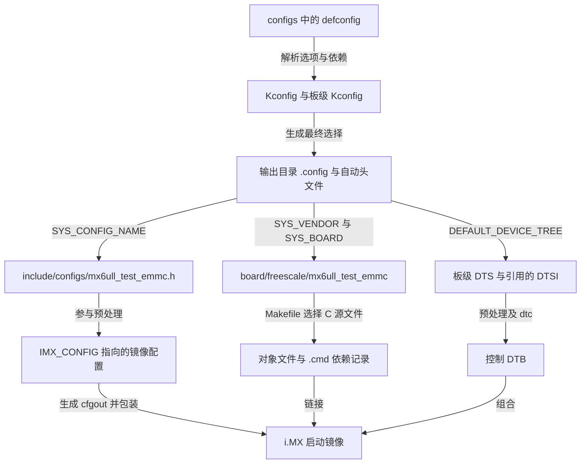
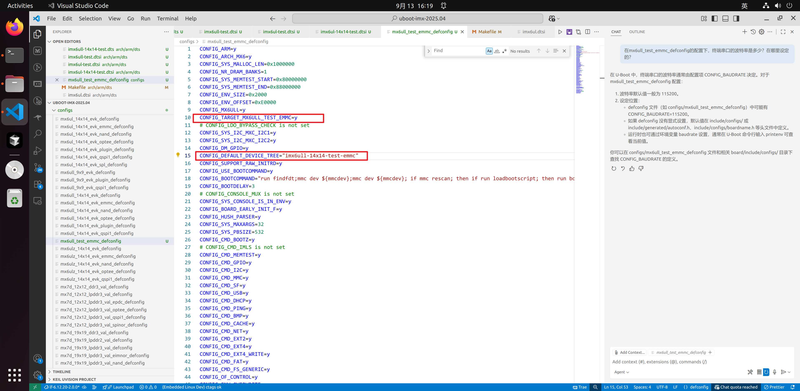
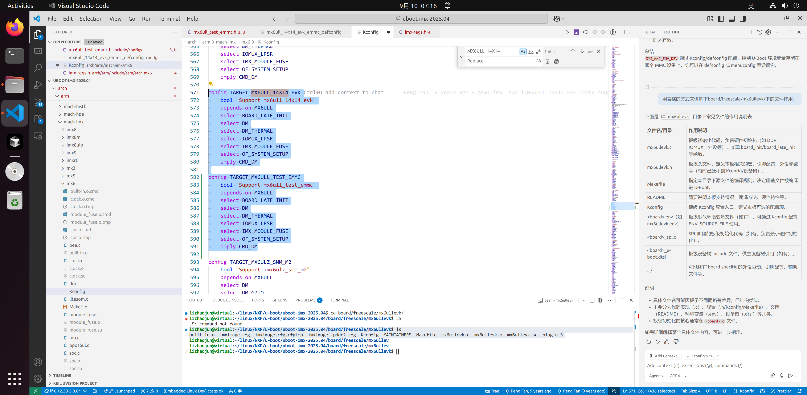
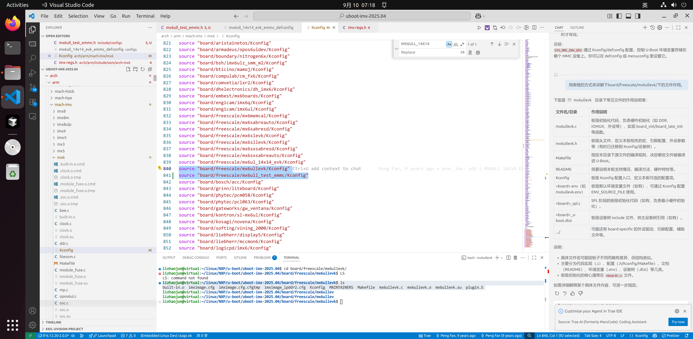
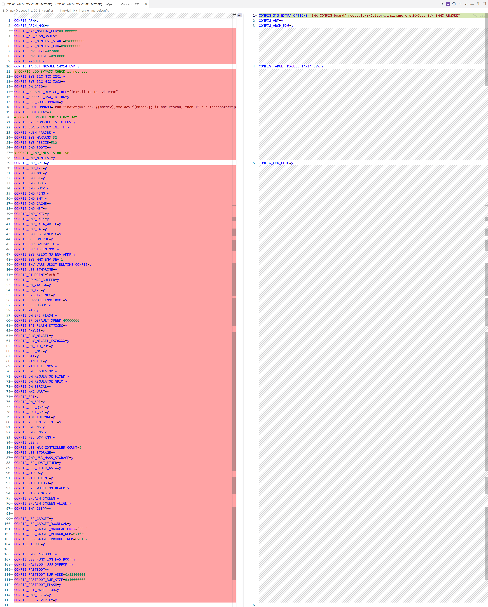
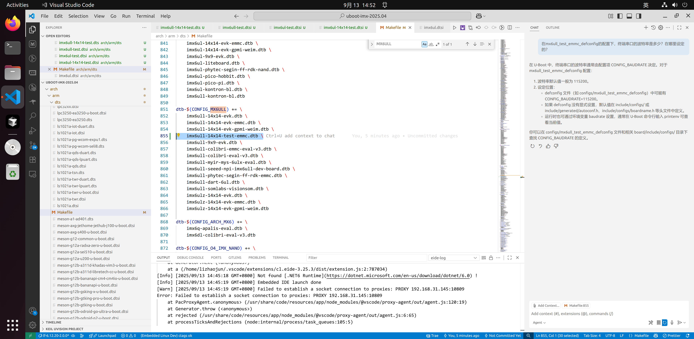
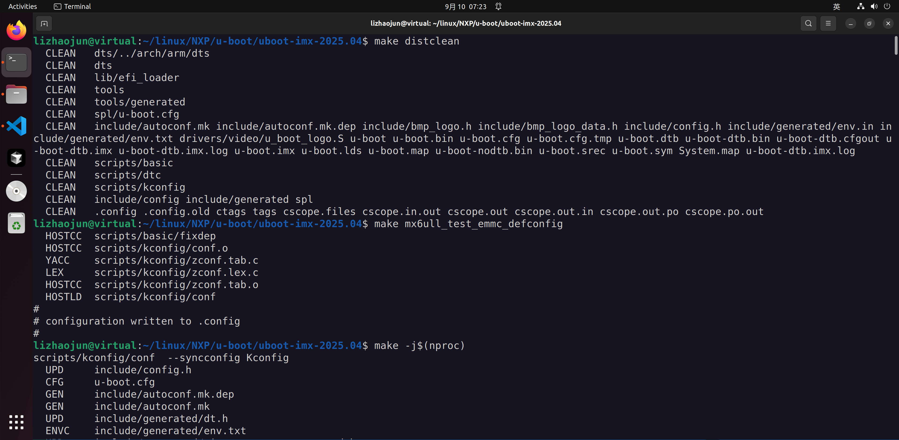
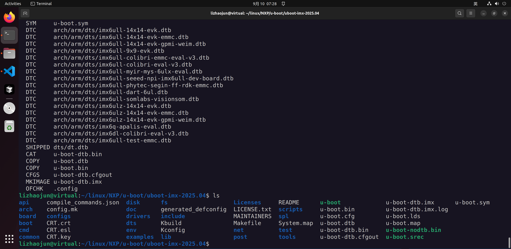

# 第2章\_从参考板派生U-Boot配置

上一章能够构建 EVK 配置，但换一个输出镜像文件名并不会改变开发板身份。编译系统仍会选 EVK 板源、EVK 设备树和 EVK DDR 配置。要隔离自己的板级差量，需要沿配置选择链建立新入口，随后只修改确实因硬件不同而变化的部分。

本章统一使用 `mx6ull_test_emmc` 作为 **教学板名**，设备树名为 `imx6ull-14x14-test-emmc`。这些字符串由我们选择；`14x14` 沿用参考板命名，不是编译器强制要求的语法。真正的要求是各入口相互一致。

## 2.1\_先分清可维护的输入与可重建的输出

源文件决定构建行为，输出文件记录或承载某次构建结果。如果手改输出目录中的 `.cmd`，下一次 Make 仍会根据源 Makefile 重建它；如果手改 `.cfgtmp`，预处理器仍会从 `.cfg` 再生成它。于是出现一种假象：目录里的名字改了，重建后却又回来了。这不是缺少“再改几个文件”，而是改错了所有权。



| 文件或目录 | 归属与用途 | 是否手工维护 |
| --- | --- | --- |
| `configs/*_defconfig` | 用户选择的配置种子；默认值还由 Kconfig 补齐 | 是，通常由 `savedefconfig` 回存 |
| 板目录 `Kconfig`、`Makefile`、`.c`、镜像 `.cfg` | 板选择、源码选择、初始化与启动包装输入 | 是 |
| `include/configs/*.h` | 尚以 `CFG_` 等形式表达的板级常量与默认环境 | 是；不是所有常量都已迁到 Kconfig |
| `arch/arm/dts/*.dts/.dtsi` | 此 NXP 板使用的控制设备树输入 | 是；先确认版本采用的树路径 |
| `.config`、自动头文件 | 当前输出目录解析后的完整配置 | 通过配置工具修改，自动头文件不手改 |
| `.o`、`.built-in.o.cmd`、`.mx6ullevk.o.cmd`、`.su` | 对象、命令/依赖、编译器栈使用报告 | 否；`.su` 不保证构建后自动消失 |
| `.cfgtmp`、`.cfgout` | 镜像配置预处理的中间结果 | 否；追溯到 `.cfg` 与宏定义 |
| `u-boot`、`u-boot.bin`、`u-boot.dtb`、`*.imx` | ELF、二进制、控制 DTB、带 i.MX 包装的镜像 | 否；烧录使用哪一个取决于工具协议 |
| `System.map`、`u-boot.map`、`u-boot.sym` | 符号及链接布局观察材料 | 否 |

`spl/` 可是 SPL 构建输出区域，SPL 公共源码在 `common/spl/` 等位置；看到目录名不能推断本板一定通过 SPL 启动。`generated_defconfig` 也不是需要给每块板新建的权威配置入口。

## 2.2\_让新板名真正选中板源

在干净的 U-Boot 源码树中复制参考板的 **已跟踪源文件**。如果旧树已经在源码目录构建过，先用 `git ls-files board/freescale/mx6ullevk` 确认哪些是源码；不要把整个混有产物的目录当成模板搬走。

```bash
# Linux 宿主，在 U-Boot 根目录；新板目标路径应尚不存在。
test ! -e board/freescale/mx6ull_test_emmc || exit 1
mkdir -p board/freescale/mx6ull_test_emmc
git ls-files -z board/freescale/mx6ullevk |
while IFS= read -r -d '' source_file; do
    board_file=${source_file#board/freescale/mx6ullevk/}
    target_file=board/freescale/mx6ull_test_emmc/$board_file
    mkdir -p "$(dirname "$target_file")"
    cp "$source_file" "$target_file"
done
cp include/configs/mx6ullevk.h include/configs/mx6ull_test_emmc.h
cp configs/mx6ull_14x14_evk_emmc_defconfig configs/mx6ull_test_emmc_defconfig
mv board/freescale/mx6ull_test_emmc/mx6ullevk.c board/freescale/mx6ull_test_emmc/mx6ull_test_emmc.c
```

这里复制的是原工作树中被 Git 跟踪的文件，已有本地修改也会被复制，所以第一章要求先记录工作树身份。接下来把新板 `Makefile` 中板对象改成 `mx6ull_test_emmc.o`，把头文件 include guard 改成该板独有名称，并保留原有版权与许可证声明。

板级 `Kconfig` 用下面的选择关系；它们是配置符号，不是 C 函数：

```kconfig
if TARGET_MX6ULL_TEST_EMMC

config SYS_BOARD
    default "mx6ull_test_emmc"

config SYS_VENDOR
    default "freescale"

config SYS_CONFIG_NAME
    default "mx6ull_test_emmc"

config IMX_CONFIG
    default "board/freescale/mx6ull_test_emmc/imximage.cfg"

config TEXT_BASE
    default 0x87800000

endif
```

`SYS_BOARD` 与 `SYS_VENDOR` 选择板目录；`SYS_CONFIG_NAME` 选择头文件；`IMX_CONFIG` 选择包装输入；`TEXT_BASE` 是此配置的链接基址，不能把它单独当成完整启动入口协议。DDR 的实际范围仍必须覆盖镜像所需地址。

在 `arch/arm/mach-imx/mx6/Kconfig` 的参考目标旁，加入同层目标并在文件的板级 `source` 区域接入新文件：

```kconfig
config TARGET_MX6ULL_TEST_EMMC
    bool "Support mx6ull_test_emmc"
    depends on MX6ULL
    select BOARD_LATE_INIT
    select DM
    select DM_THERMAL
    select IOMUX_LPSR
    select IMX_MODULE_FUSE
    select OF_SYSTEM_SETUP
    imply CMD_DM

# 放在与现有板级 source 同层的位置，不塞进上一个目标的帮助文本。
source "board/freescale/mx6ull_test_emmc/Kconfig"
```

只复制板级 Kconfig 而不 `source` 它，配置系统看不到那些默认值；只加 `source` 而没有目标，用户又无法选中新板。最后在新 defconfig 中把 EVK 目标替换为 `CONFIG_TARGET_MX6ULL_TEST_EMMC=y`，并令 `CONFIG_DEFAULT_DEVICE_TREE="imx6ull-14x14-test-emmc"`。不要同时保留两个目标为 `y`。

原记录的三张图展示了这三个入口，行号随版本变化，定位时搜索符号：





`checkboard()` 中的板名打印可改为教学板名并带换行，但打印名不参与上述选择。`MAINTAINERS` 则记录真实维护者及实际维护文件；不能照抄 NXP 维护者信息，宣称对方负责新板，也不要把未维护的 EVK plugin/ULZ 配置保留在新板 `F:` 列表里。

## 2.3\_旧宏消失后要追职责而非猜替代物

2016 与 2025 的配置位置变化很大。部分 `CONFIG_` 宏转入 Kconfig，部分常量改为 `CFG_`，还有部分工作由初始化代码承担。“头文件中没搜到”只能证明它不在那里，不能证明功能取消。




下表以第一章固定 U-Boot 提交为边界，修正原稿中容易连锁误解的几项：

| 问题 | 当前代码实际表达 | 移植时如何判断 |
| --- | --- | --- |
| `BOARD_LATE_INIT` 是否取消 | mx6 目标仍 `select BOARD_LATE_INIT` | 不能因 defconfig 没显式列出而推断取消 |
| `NR_DRAM_BANKS` 是否一律为 4 | 全局有默认值，但本板 defconfig 明确为 1 | 看最终 `.config`；它是软件内存区域描述槽位，不是 DDR 颗粒内部 bank 数 |
| `dram_init()` 如何得容量 | 调用 `imx_ddr_size()` 解读 MMDC 已有配置 | 不是自动探测并修复错误 DDR 初始化；先保证控制器几何参数正确 |
| i.MX6ULL 的 `IRAM_SIZE` | 条件分支为 `0x00020000`，即 128 KiB | `0x00040000` 是 256 KiB，不能写成 128 KiB |
| 初始栈在哪里 | ARM `crt0.S` 选择 `SYS_INIT_SP_ADDR` 或适用的 SPL 栈地址，再对齐、预留 GD | 地址、预留空间与最大栈占用是三个问题；`SPL_STACK` 不能当成旧普通 U-Boot 栈大小的通用替代 |
| `SYS_HZ=1000` | `get_timer()` 的毫秒计数约定 | 不是 CPU 主频，也不是 DDR 时钟 |
| `SYS_LOAD_ADDR` | 默认下载地址；本 SoC 条件默认 `0x80800000` | 实际加载还受命令、环境和内存占用约束 |
| `CFG_MXC_UART_BASE` | 板头文件中的 UART 基址常量 | 和 Linux 的串口设备名不是同一种编号 |
| `CFG_SYS_FSL_ESDHC_ADDR` | 参考头文件的 USDHC 基址配置 | 不能单靠它推出所有 MMC 逻辑设备号 |

环境存储还要分清 **设备、硬件分区、字节偏移、大小**。本参考 defconfig 的 `SYS_MMC_ENV_DEV=1`、`ENV_SIZE=0x2000`、`ENV_OFFSET=0xE0000` 是选定 MMC 设备中环境区域的配置；`SYS_MMC_ENV_PART` 默认 0 表示用户硬件区，不是分区表的第一个分区。正偏移相对所选硬件分区起点，负偏移相对其末端。`saveenv` 会写这块区域，因此必须先与自己的分区和启动镜像布局核对，不能把 EVK 的数值当成任意卡上的空闲位置。

源码依据：[板级 defconfig](https://github.com/nxp-imx/uboot-imx/blob/99518e6b6f20cb6a2bf19115e355db9f58100af8/configs/mx6ull_14x14_evk_emmc_defconfig)、[MMDC 容量解码](https://github.com/nxp-imx/uboot-imx/blob/99518e6b6f20cb6a2bf19115e355db9f58100af8/arch/arm/mach-imx/mmdc_size.c)、[ARM 启动栈选择](https://github.com/nxp-imx/uboot-imx/blob/99518e6b6f20cb6a2bf19115e355db9f58100af8/arch/arm/lib/crt0.S)、[环境 Kconfig](https://github.com/nxp-imx/uboot-imx/blob/99518e6b6f20cb6a2bf19115e355db9f58100af8/env/Kconfig)。

## 2.4\_设备树隔离的是板级差量

SoC 的寄存器布局没有因为换一块 PCB 就变化。若把 `imx6ul.dtsi`、`imx6ull.dtsi` 都复制改名，后续修复公共 SoC 描述时会出现两份不同步的事实。新板需要独立的是板上连接、电源、引脚和外设参数；公共 SoC DTSI 继续引用上游文件。

本例从三层板级输入派生：`imx6ull-14x14-test-emmc.dts` 引用 `imx6ull-14x14-test.dts`；后者引用上游 `imx6ull.dtsi`、自己的 `imx6ul-14x14-test.dtsi` 和适用的 U-Boot 专用板级 DTSI。EVK 公共板级文件中启用的摄像头、扩展 GPIO、电源等都要对照实板审查，不能为了“少改动”保持不存在的硬件为 `okay`。

```bash
# 在 U-Boot 根目录复制板级描述；不复制公共 SoC DTSI。
cp arch/arm/dts/imx6ull-14x14-evk-emmc.dts arch/arm/dts/imx6ull-14x14-test-emmc.dts
cp arch/arm/dts/imx6ull-14x14-evk.dts arch/arm/dts/imx6ull-14x14-test.dts
cp arch/arm/dts/imx6ul-14x14-evk.dtsi arch/arm/dts/imx6ul-14x14-test.dtsi
cp arch/arm/dts/imx6ul-14x14-evk-u-boot.dtsi arch/arm/dts/imx6ul-14x14-test-u-boot.dtsi
```

在副本中对应修改 `#include`，保留 `#include "imx6ull.dtsi"`。`model` 写实际板名；根 `compatible` 应准确表达实际板与 SoC，不能只为命中 EVK 私有处理而冒充 EVK。新板需要专用兼容串时，应为它维护相应绑定。eMMC 顶层文件仍覆盖 `&usdhc2` 的 8 位总线、非可移除和对应高速 pinctrl 状态；只有实板确实按该连接布线时才能沿用。

在该版本 `arch/arm/dts/Makefile` 的 `dtb-$(CONFIG_MX6ULL)` 列表加入新 DTB。随后用构建输出确认实际生成和选中了它，不以“未加入似乎也能编译”为依据。



## 2.5\_重建一次以验证选择链

```bash
# 在 U-Boot 根目录；输出到新的板级构建目录。
uboot_out="$PWD/../out-uboot-test"
make O="$uboot_out" ARCH=arm CROSS_COMPILE="$CROSS_COMPILE" mx6ull_test_emmc_defconfig
make O="$uboot_out" ARCH=arm CROSS_COMPILE="$CROSS_COMPILE" V=1 -j"$(nproc)"
make O="$uboot_out" ARCH=arm CROSS_COMPILE="$CROSS_COMPILE" savedefconfig
cp "$uboot_out/defconfig" configs/mx6ull_test_emmc_defconfig
```

`V=1` 显示实际命令，便于看板源路径和设备树输入。正确并行参数是 `-j"$(nproc)"`；原稿的 `-jn$(nproc)` 混入了 `-n` 的干运行含义，不能作为编译命令。`savedefconfig` 保存与默认值不同的配置，之后重新载入它应得到同样的关键选择。




检查 `.config` 的目标、`SYS_BOARD`、`SYS_CONFIG_NAME`、`IMX_CONFIG` 和 `DEFAULT_DEVICE_TREE`，再检查详细日志中的板 `.c` 路径与 DTB 名称。如果仍指向 EVK，回到选择链找断点；不要修补生成的 `.cmd`。如使用 plugin 路径，还须让镜像配置中的 `plugin.bin` 路径指向实际新板构建产物。

练习：新板名已在串口打印，但 `.config` 仍选 EVK，能证明派生成功吗？不能。打印字符串是代码行为，配置身份要由最终配置及实际编译输入共同证明。现在选择链建立了，下一章还要回答：**这些正确命名的输入是否真的能让 Boot ROM 获得可用 DDR？**

上一篇：[移植基线与交叉编译环境](P01_移植基线与交叉编译环境.md)；[专题大纲](大纲.md)；下一篇：[DDR 初始化与镜像封装](P03_DDR初始化与镜像封装.md)。
