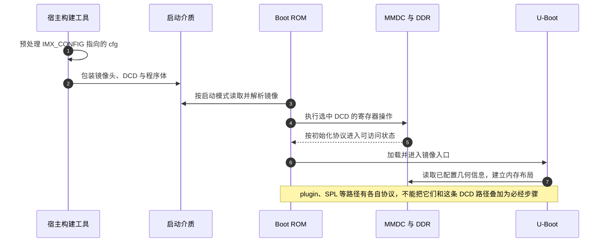

# 第3章\_DDR初始化与镜像封装

上一章让编译系统选中了新板的文件，但处理器上电后还无法直接使用那些程序假定存在的大块 DDR。DDR 的行列组织、总线宽度、时钟和读写时序必须先建立。程序若在这些条件成立之前把栈或代码放入 DDR，接下来连一次可靠的函数调用都无法保证。

这就是镜像中早期初始化信息存在的原因。本章先解释它怎样被消费，再读原记录的校准结果。这里不能提供适用于所有阿尔法板的万能寄存器数值：原材料缺少完整 DDR 颗粒型号、工具输入和测试工况，不能用“串口启动过一次”补齐这些证据。

## 3.1\_为什么\_ROM\_需要\_DCD

本例参考配置用 i.MX 镜像包装。**DCD（Device Configuration Data，设备配置数据）** 是供 Boot ROM 按镜像协议解释的配置命令序列，它能在进入普通 U-Boot 代码前设置时钟、I/O 与 MMDC。**MMDC（Multi Mode DDR Controller）** 是芯片中控制 DDR 访问的硬件，不能与 DDR 颗粒本身混为一物。



第二章 `IMX_CONFIG` 选中的 `.cfg` 是宿主工具输入，不是 Boot ROM 在卡上按文本打开的文件。构建时先处理 `#ifdef`，再生成二进制镜像中的命令。`CONFIG_USE_IMXIMG_PLUGIN` 选择 plugin 分支时，流程使用相应插件；`imximage_lpddr2.cfg` 也只是另一种内存配置输入，不因为它存在于目录里就会和 DDR3 配置同时生效。

在 `.cfg` 中，`DATA 4 地址 值` 表达一次 4 字节写操作，`CHECK_BITS_SET` 表达按镜像格式检查位条件。`IMAGE_VERSION`、`BOOT_FROM`、`PLUGIN`、`CSF` 各有包装含义；它们不是普通 C 语句。详细语法可追到固定 U-Boot 提交的 [doc/imx/mkimage/imximage.txt](https://github.com/nxp-imx/uboot-imx/blob/99518e6b6f20cb6a2bf19115e355db9f58100af8/doc/imx/mkimage/imximage.txt)。

## 3.2\_校准只能解决时序链中的一部分

先有正确的内存类型、容量组织、工作频率、电压和基本时序，再讨论采样窗口。写数据时，控制器发出的 DQ 数据和 DQS 数据选通信号经过不同走线；读数据时，DDR 发回的数据又要被控制器在有效窗口内采样。走线、器件和工况产生的相对延迟，才是写 leveling、读 DQS gating、读写 delay-line 校准处理的问题。

如果把一个 16 位总线板误配成另一种数据宽度，即使某个延迟测试返回中点，也没有修复地址映射和有效数据通路。若换了 DDR 型号、PCB 或频率，“只替换四个校准值”就更没有成立前提。保留原始参数表、颗粒手册、工具版本、测试频率及全部日志，才能解释后来的启动失败来自哪里。

原记录给出的日志如下。它证明当时工具报告了一组结果，不能证明这些值适合另一块板，也不是本次复测：

```text
Byte 0: (0x08 - 0x5c), middle value:0x32
Byte 1: (0x0c - 0x60), middle value:0x36
MMDC0 MPWRDLCTL = 0x40403632

Write leveling calibration
MMDC_MPWLDECTRL0 ch0 (0x021b080c) = 0x00000000
MMDC_MPWLDECTRL1 ch0 (0x021b0810) = 0x000A000A

Read DQS Gating calibration
MPDGCTRL0 PHY0 (0x021b083c) = 0x014C0148
MPDGCTRL1 PHY0 (0x021b0840) = 0x00000000

Read calibration
MPRDDLCTL PHY0 (0x021b0848) = 0x40403036

Write calibration
MPWRDLCTL PHY0 (0x021b0850) = 0x40403632
Success: DDR calibration completed!!!
```

对写延迟窗口，可先做一个不需要硬件的小检查：Byte 0 的 `(0x08 + 0x5c) / 2 = 0x32`，Byte 1 的 `(0x0c + 0x60) / 2 = 0x36`，与日志中点一致。这只检查算术和抄录，不能替代内存压力测试。也不能看到日志打印了 CTRL1 就推断板上存在四个有效字节通道；通用工具可能打印当前目标不使用的字段。

## 3.3\_从日志定位到寄存器

下面是本章使用的寄存器查用表，MMDC 基址为 `0x021B0000`。这些是 **32 位 MMIO 寄存器**，不是 U-Boot 环境变量。表中只解释当前校准涉及的职责，不把整字当成可任意覆盖的普通变量；保留位和触发位必须遵守手册。

| 寄存器 | 偏移 / 绝对地址 | 当前需要理解的字段与读写效果 | 原日志值 |
| --- | --- | --- | --- |
| `MMDC_MPWLDECTRL0` | `0x80C` / `0x021B080C` | Byte 0/1 的 `WL_CYC_DEL`、`WL_HC_DEL`、`WL_DL_ABS_OFFSET` 组合整周期、半周期和细延迟；写入用于配置，校准模式下部分字段反映结果 | `0x00000000` |
| `MMDC_MPDGCTRL0` | `0x83C` / `0x021B083C` | DQS gating 延迟；还含 `HW_DG_EN` 启动校准及自动清除、`HW_DG_ERR` 结果、`RST_RD_FIFO` 自清除控制，不能只看延迟数值覆盖全寄存器 | `0x014C0148` |
| `MMDC_MPRDDLCTL` | `0x848` / `0x021B0848` | `RD_DL_ABS_OFFSET0/1` 调整读访问中 DQS 相对 DQ 的延迟；其他位按该实现的保留要求处理 | `0x40403036` |
| `MMDC_MPWRDLCTL` | `0x850` / `0x021B0850` | `WR_DL_ABS_OFFSET0/1` 调整写访问中 DQ/DM 相对 DQS 的延迟 | `0x40403632` |

依据是 **i.MX 6ULL Applications Processor Reference Manual，Rev. 1，11/2017**：35.12.34、35.12.44、35.12.47、35.12.49，印刷页 2313–2315、2336–2338、2342–2343、2346–2347。原件身份与取得入口见[ARM 资料索引](../../../../../reference/external_resources/arm/README.md)及同目录 manifest，不用名称相近的 i.MX6UL 手册字段直接替换。

原稿有三份看起来相似的 DDR 配置：较早 `.cfg` 中 `0x021B083C` 为 `0x41640158`，预处理残片还保留其他旧值，最终校准记录及其后配置为 `0x014C0148`。它们不是同一组结果。重建时只修改 **实际被 IMX_CONFIG 选中的源 `.cfg`**，检查生成镜像使用了对应值；不要同时编辑 `.cfgtmp` 来制造表面一致。

复现校准应遵循芯片/板卡工具的进入下载模式、供电与连线要求，并依次完成：确认 DDR 几何及基础时序 → 加载与该板匹配的测试初始化 → 运行校准保存窗口与结果 → 更新所选源配置 → 重建镜像 → 冷启动和压力测试。某一步失败时回到该层处理，不把未知地址和值拼成“可复制万能 DCD”。原记录视频只作为[工具操作补充](https://www.bilibili.com/video/BV1yE411h7uQ?p=48)。

## 3.4\_镜像已经带头时不能再盲目加一次头

U-Boot 输出的 `u-boot-dtb.bin` 与 `u-boot-dtb.imx` 不是两个随意互换的名字。前者是相应构建中的程序/DTB 组合，后者经过 i.MX 镜像包装，供特定启动协议消费。下载工具还可能自己补镜像头或 DCD，所以“某工具接受 bin”不等于“它应该接受已经包装好的 imx”。

原记录用 `imxdownload u-boot-dtb.bin /dev/sdb` 烧录，但没有交付该 `imxdownload` 的固定源码、版本及完整写入布局。本次不能据此确认它是否重写 DCD，也不能证明原记录的 DDR 校准最终生效。`/dev/sdb` 只是作者当时的设备名，复制到另一台宿主可能覆盖另一块盘。

先做只读核对：

```bash
# Linux 宿主；检查目标介质身份及生成镜像，尚不写盘。
lsblk -o NAME,SIZE,MODEL,TRAN,MOUNTPOINTS
file "$uboot_out/u-boot" "$uboot_out/u-boot-dtb.bin" "$uboot_out/u-boot-dtb.imx"
sha256sum "$uboot_out/u-boot-dtb.bin" "$uboot_out/u-boot-dtb.imx"
```

再根据选定下载工具的源码或版本文档确认输入格式、是否补头、写入偏移与长度，并与启动模式、卡分区及环境区域比较。只有这些条件已确定，才形成该板的烧录命令。这里保留原操作线索而不提供缺少工具协议的通用写盘命令；这是一项尚缺历史材料的具体边界。

启动后的最小观察顺序是：串口是否输出 → U-Boot 报告的 RAM 容量是否符合颗粒与布局 → 镜像是否确实为本次构建 → 在不覆盖 U-Boot、栈、保留区和待启动镜像的测试区域验证读写。`mtest` 的地址范围必须来自当前内存布局，不能直接使用参考板的最大范围覆盖正在运行的程序。

练习：`imx_ddr_size()` 返回 512 MiB，能否证明全部地址都可靠？不能。它解码控制器配置；错误几何、时序边缘或地址别名仍可能在访问时暴露。至此我们分清了构建包装与早期内存条件，下一章再让板上可见的屏幕和网口按真实线路工作。

上一篇：[从参考板派生 U-Boot 配置](P02_从参考板派生U-Boot配置.md)；[专题大纲](大纲.md)；下一篇：[LCD 与双网口的板级适配](P04_LCD与双网口的板级适配.md)。
