# 第4章\_LCD与双网口的板级适配

U-Boot 能在串口运行以后，仍可能屏幕不亮、网口不通。原因并不神秘：参考板使用的面板、PHY、复位脚和供电线路未必与新板相同。设备树描述的是这些具体连接，驱动根据描述操作硬件；改一个型号名无法自动修复信号方向、时钟或电源。

本章沿原记录的 LCD 与双 LAN8720A 网口展开。所有原理图都是已有材料的摘图，正文把能从图中确认的连接与尚需实板确认的条件分开。

## 4.1\_先让像素数据与屏幕采样节奏对应

LCDIF 从内存取像素，按像素时钟输出颜色数据，同时输出行同步、场同步和数据有效信号。屏幕必须在相同的节奏下解释它们。如果分辨率正确但前后消隐区或极性错误，仍可能偏移、闪烁甚至没有稳定画面；背光亮只说明背光支路工作，不说明像素链路正确。

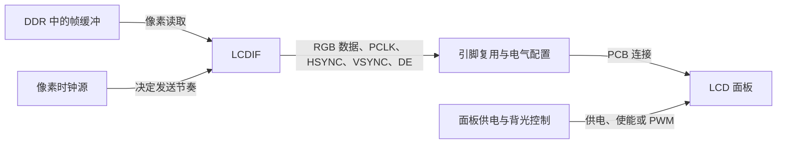

原记录采用 ATK4384 的 **800×480** 参数，正文中“800×400”是笔误；31 MHz 应写成 `31,000,000 Hz`，不能少一个零。

| 方向 | 有效像素/行数 | 前沿消隐 | 同步宽度 | 后沿消隐 | 总计 |
| --- | --- | --- | --- | --- | --- |
| 水平 | 800 像素时钟 | 40 | 48 | 88 | 976 像素时钟/行 |
| 垂直 | 480 行 | 13 | 3 | 32 | 528 行/帧 |

按这组输入，刷新率为 `31,000,000 / (976 × 528) ≈ 60.16 Hz`。这个计算帮助发现数量级错误；最终允许的时钟、极性和时序范围仍来自实际屏幕规格，不能仅凭接近 60 Hz 判断适配正确。

在第二章派生的板级 DTSI 中，替换已有 LCDIF 对应的 timing 内容，避免新增第二份同名节点：

```dts
&lcdif {
    pinctrl-names = "default";
    pinctrl-0 = <&pinctrl_lcdif_dat &pinctrl_lcdif_ctrl>;
    display = <&display0>;
    status = "okay";

    display0: display@0 {
        bits-per-pixel = <24>; /* 帧缓冲格式须由所选驱动支持。 */
        bus-width = <24>;      /* 面板侧并行数据总线宽度。 */
        display-timings {
            native-mode = <&timing0>;
            timing0: timing0 {
                clock-frequency = <31000000>;
                hactive = <800>;
                vactive = <480>;
                hfront-porch = <40>;
                hsync-len = <48>;
                hback-porch = <88>;
                vfront-porch = <13>;
                vsync-len = <3>;
                vback-porch = <32>;
                hsync-active = <0>;
                vsync-active = <0>;
                de-active = <1>;
                pixelclk-active = <0>;
            };
        };
    };
};
```

`hactive/vactive` 是有效区，porch 与 sync 是区外节奏；它们不能用来填补少接的 RGB 引脚。`bus-width` 描述外部信号宽度，`bits-per-pixel` 描述驱动使用的像素格式，两者数值可以不同。例如 Linux 章节原例使用 16 位帧缓冲、24 位输出总线，但必须由对应驱动完成格式处理。

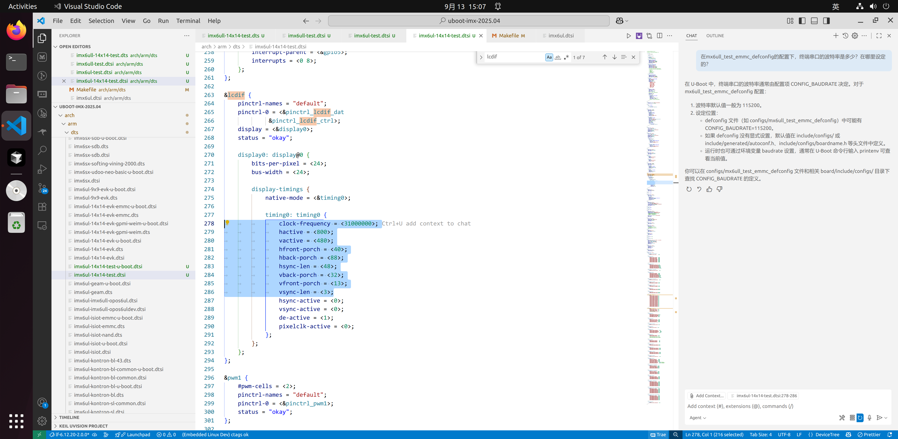
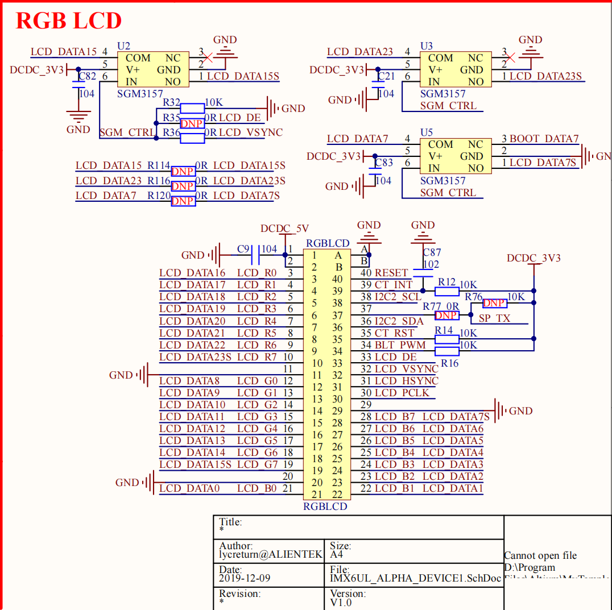

读原理图时分别追颜色数据、时钟/同步、背光和复位。图中 RESET 支路没有证明它连接到了 EVK 默认的 GPIO5_IO09，因此不能保留 EVK 的这项驱动操作并宣称它在复位本板屏幕。若实物与摘图一致，删除板源 `setup_lcd()` 中对 GPIO5_IO09 的申请和翻转，同时移除该复位脚的 pinctrl 项；背光 GPIO1_IO08 的配置则按实际连接保留。

数据引脚从 `MX6UL_PAD_LCD_DATA00__LCDIF_DATA00` 连续到 DATA23；控制引脚为 LCD_CLK、LCD_ENABLE、LCD_HSYNC、LCD_VSYNC。原例为这些引脚设置 `0x79`，Linux 数据脚示例改用 `0x49`。这些值是 pad 电气配置，不是像素颜色或 pin 编号；应按实际电压、驱动强度和频率核对，不能认为两阶段“颜色相同”就可以任意替换。完整原始引脚列表仍在历史附件，当前修改以板源中这两组 pinctrl 为位置，不必手抄全部 24 个未变化的引脚。

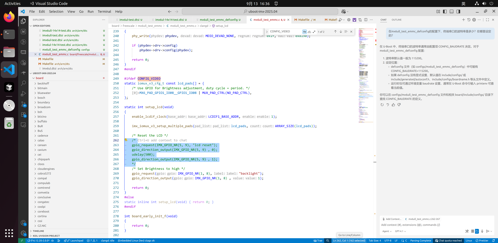

先显示静态色块或测试图，再检查错色、偏移、闪烁与背光。整屏黑时沿图从供电到时钟再到数据检查，不要把所有症状都归为设备树 `status` 没开启。

## 4.2\_双网口需要分开数据通路与管理通路

SoC 内部的 **MAC** 负责以太网帧与 DMA，板上的 **PHY** 负责物理链路。RMII 传输帧数据；MDIO/MDC 则用来读 PHY 身份、状态和控制寄存器。两个 MAC 可以连接各自 PHY，同时由一条管理总线访问两个不同地址的 PHY。设备树中两个 PHY 都挂在 FEC2 的 `mdio` 下，并不表示两路帧数据都要经 FEC2。

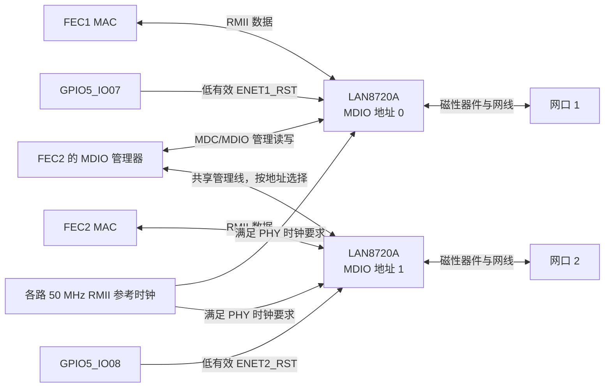

下面三张原图给出两颗 PHY 的地址绑带与复位连接。地址 0/1 是硬件采样的管理地址，`reg=<0>` 不会把实际地址为 2 的芯片变成 0；必须让描述与绑带一致。

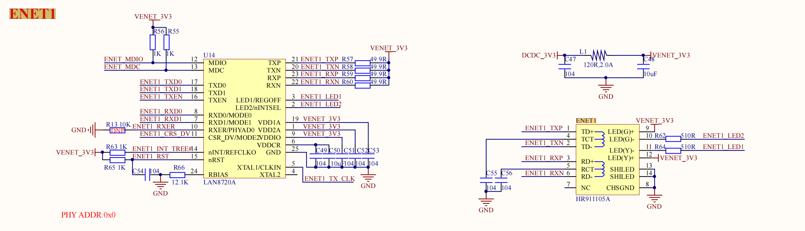
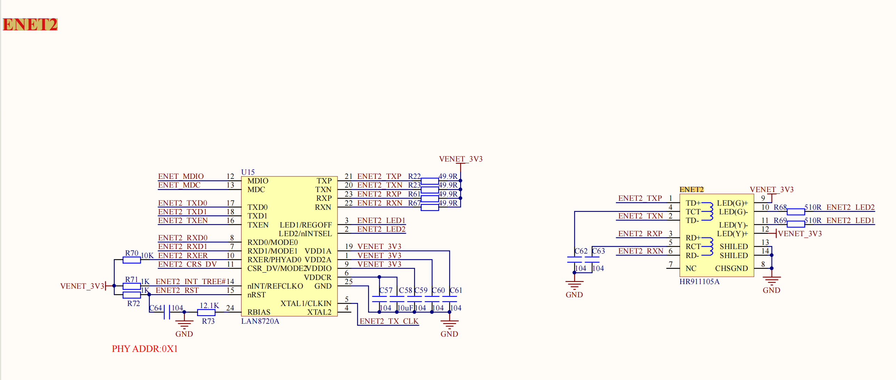
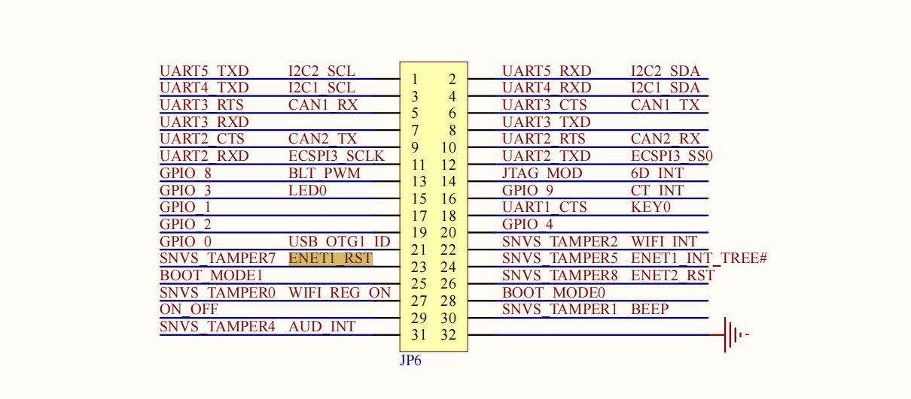

参考 EVK 使用 Micrel KSZ8081，本板材料为 LAN8720A。新 defconfig 应选择 `CONFIG_PHY_SMSC=y`，按是否还有 Micrel 设备决定关闭对应选项。不能为沿用旧 `compatible` 就把 KSZ8081 驱动改造成 LAN8720A 驱动；型号身份及私有寄存器语义都应真实。

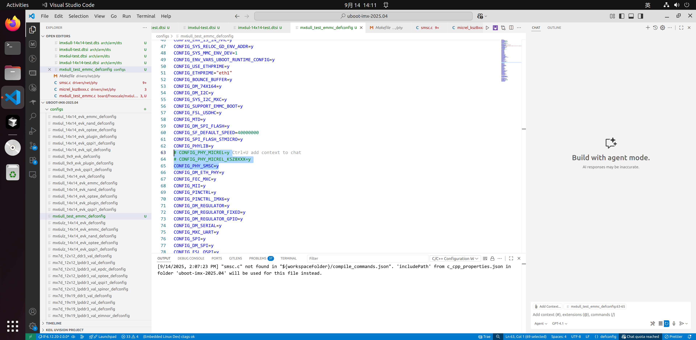
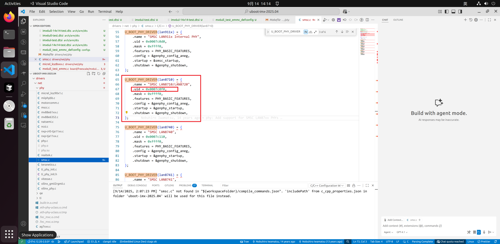
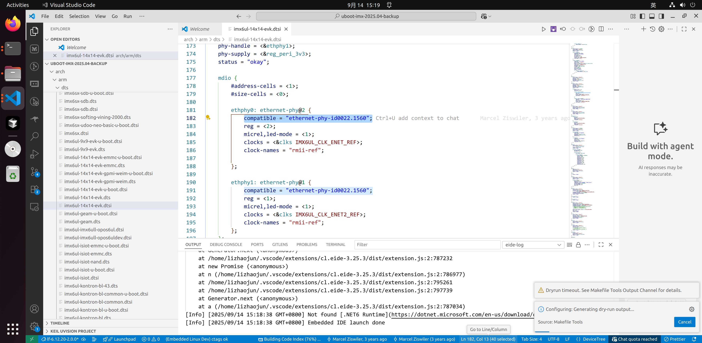
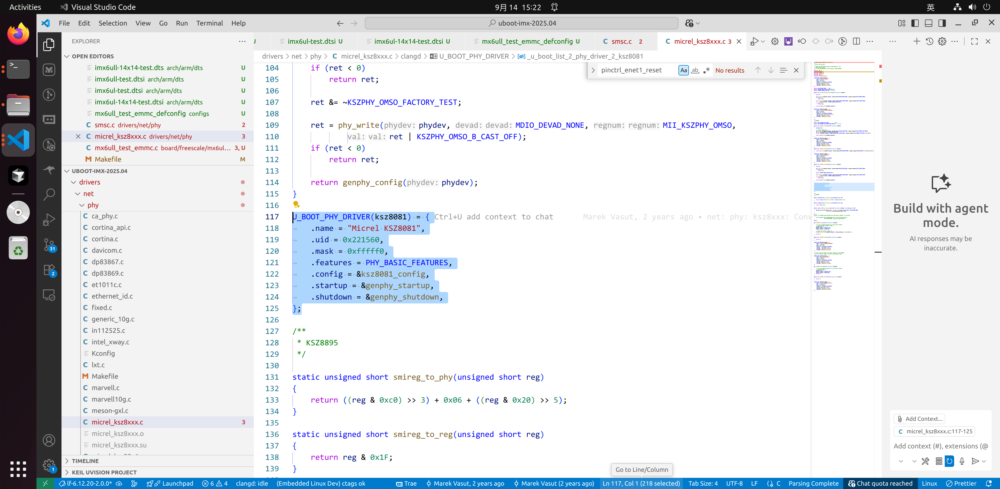

固定 U-Boot 版本 `drivers/net/phy/smsc.c` 的 LAN8710/LAN8720 项使用 ID `0x0007c0f0` 和 mask `0xffff0`。`compatible="ethernet-phy-id0007.c0f0"` 是 PHY 子节点属性，**不是 mdio 总线节点的型号**。能够正常读 ID 时也可使用相应通用 PHY 描述由总线识别；强制 ID 不应掩盖 MDIO 接线或复位错误。

## 4.3\_先解决复位脚所有权\_再配置时序

原 EVK 的 `spi-4`/74HC595 使用 GPIO5_IO07 和 IO08，本板将它们接到 PHY 复位。两个驱动若都操作同一条线，一个在发送 SPI 片选，另一个认为在释放 PHY，硬件当然无法按预期工作。应禁用实板不存在的整项 `spi-4`，并审查其子节点和依赖它的供电消费者，而不是删掉两个属性却保留一个不完整的活动 SPI 控制器。

```dts
/* 放在新板 DTSI 中；本例实板不使用 EVK 的这条 SPI GPIO 扩展链。 */
&{/spi-4} {
    status = "disabled";
};

/* i.MX6ULL 的 SNVS pad 使用对应控制器与 MX6ULL 宏。 */
&iomuxc_snvs {
    pinctrl_enet1_reset: enet1resetgrp {
        fsl,pins = <MX6ULL_PAD_SNVS_TAMPER7__GPIO5_IO07 0x10b0>;
    };
    pinctrl_enet2_reset: enet2resetgrp {
        fsl,pins = <MX6ULL_PAD_SNVS_TAMPER8__GPIO5_IO08 0x10b0>;
    };
};
```

这里修正原稿的 `&iomux` 写法以及把 i.MX6UL pad 偏移直接套到 ULL SNVS 控制器的做法。`imx6ull.dtsi` 定义 `iomuxc_snvs@2290000`，`imx6ull-pinfunc-snvs.h` 提供相对该控制器的元组；它与普通 `iomuxc` 不是同一套基址。两个控制器的引脚组可以同时放进 FEC 的一个 `pinctrl-0` 列表。

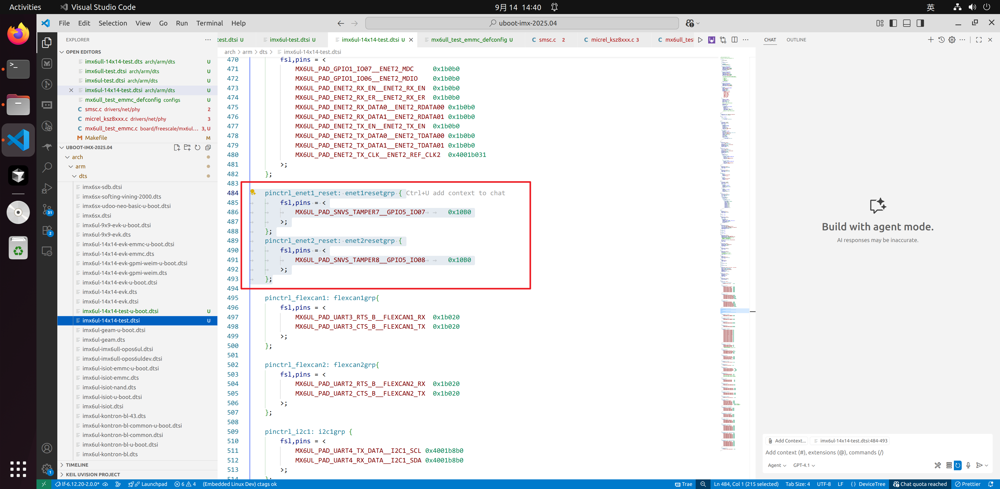
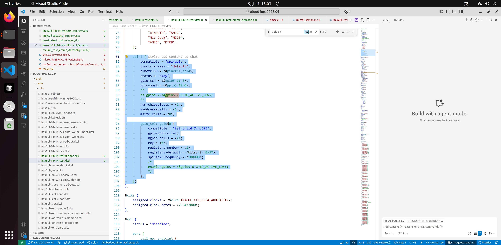

在已复制的板级文件中编辑 **现有** `ethphy0/ethphy1` 节点，把第一个节点名从 `ethernet-phy@2` 改为 `ethernet-phy@0`，其 `reg` 改为 0；第二个保持地址 1。保留 FEC2 下共享 MDIO 的硬件关系。U-Boot 这份 FEC 驱动读取如下旧式 MAC 级复位属性：

```dts
&fec1 {
    pinctrl-names = "default";
    pinctrl-0 = <&pinctrl_enet1 &pinctrl_enet1_reset>;
    phy-mode = "rmii";
    phy-handle = <&ethphy0>;
    phy-reset-gpios = <&gpio5 7 GPIO_ACTIVE_LOW>;
    phy-reset-duration = <200>;
    phy-reset-post-delay = <200>;
    status = "okay";
};

&fec2 {
    pinctrl-names = "default";
    pinctrl-0 = <&pinctrl_enet2 &pinctrl_enet2_reset>;
    phy-mode = "rmii";
    phy-handle = <&ethphy1>;
    phy-reset-gpios = <&gpio5 8 GPIO_ACTIVE_LOW>;
    phy-reset-duration = <200>;
    phy-reset-post-delay = <200>;
    status = "okay";
};

&ethphy0 {
    compatible = "ethernet-phy-id0007.c0f0";
    reg = <0>;
};

&ethphy1 {
    compatible = "ethernet-phy-id0007.c0f0";
    reg = <1>;
};
```

这段是对已有节点的覆盖，不是完整板树。`phy-reset-duration/post-delay` 在这里的单位为 **毫秒**，200 是原记录的实验选择，不能写成 LAN8720A 普遍要求。`GPIO_ACTIVE_LOW` 使逻辑 assert 对应低电平，驱动先 assert、等待，再 deassert、等待。Linux 新式 PHY 级 `reset-assert-us` 等则使用微秒，下一章会区分，不能原样换属性名而不换单位。

还要检查 `phy-supply`。EVK 的 `reg_peri_3v3` 用 GPIO5_IO02 控制，而原板连接器图把这个引脚用作 WIFI_INT；两张网口图显示 PHY 供电来自板上 3.3 V 支路。若完整原理图确认 PHY 电源不可软件切换，就应将板级电源节点描述为实际固定电源，去掉 EVK 的 GPIO 控制及其 pinctrl；不能仅把标签名字保留就认为供电已适配。禁用 `spi-4` 后，引用 `gpio_spi` 的 CAN 电源或摄像头等也必须逐一禁用或改成真实连接，否则会留下永久 deferred probe。

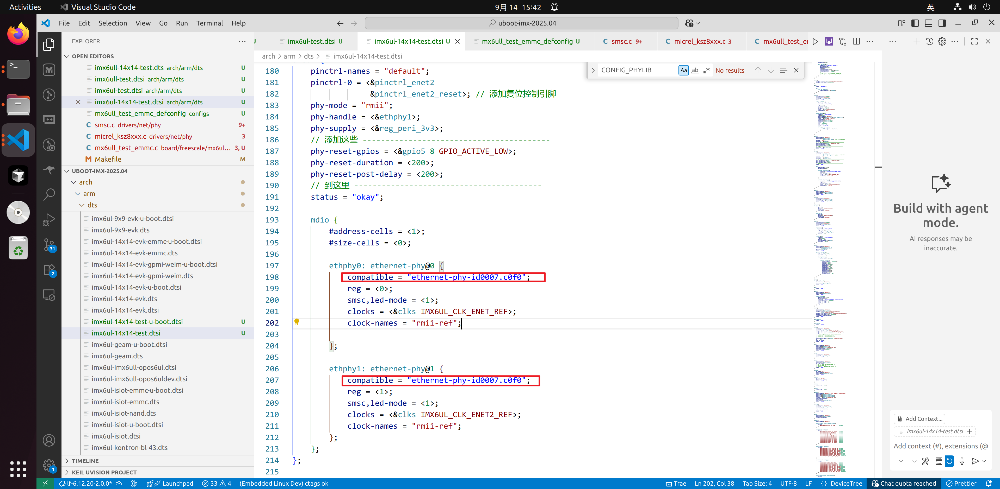
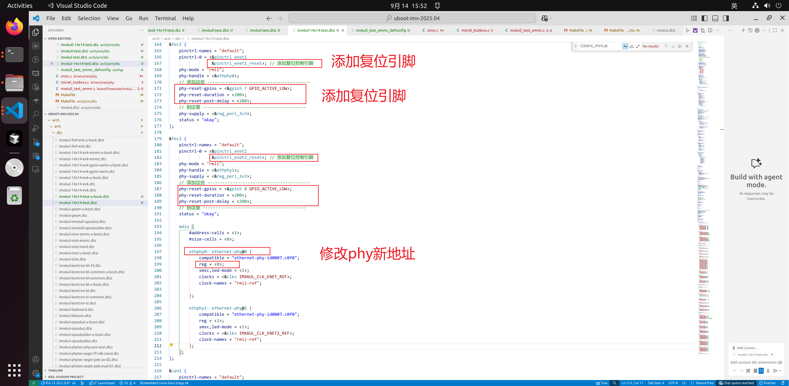

## 4.4\_已有复位路径不能靠再加一次掩盖

复位有两种不同载体：GPIO 驱动外部 RESET 引脚；MDIO 写 PHY 控制寄存器触发内部软复位。二者都有时钟、供电和完成条件，不能把“网口不通”直接解释成“所有 PHY 都少一次复位”。

固定 U-Boot 版本的 `phy_connect_dev()` 已调用 `phy_reset()`；后者经 MDIO 触发软复位并等待完成。原记录截图在通用 `genphy_config_aneg()` 中再次插入 `phy_reset()`，这个改动会影响更多 PHY 和每次协商路径，不应作为新板默认补丁。

更容易被漏掉的是 EVK 板源自己的 `board_phy_config()`：它先向 PHY 寄存器 `0x1f` 写 `0x8190`，再调用所选 PHY 驱动配置。这是参考板特定操作，换成 LAN8720A 后不能因为换了驱动选项就仍保留它。对本教学板，将该函数改成只调用已经匹配的驱动配置并传播返回值：

```c
/* 新板 board_phy_config；去掉不属于本板 PHY 的私有寄存器写入。 */
int board_phy_config(struct phy_device *phydev)
{
    if (phydev->drv->config)
        return phydev->drv->config(phydev);
    return 0;
}
```

这里没有增加另一层复位，只清理了错误硬件身份留下的动作。若之后仍失败，记录硬件 RESET 波形、RMII 参考时钟、PHY ID 读值和驱动返回码，再确定是否属于特定器件勘误或调用顺序问题。

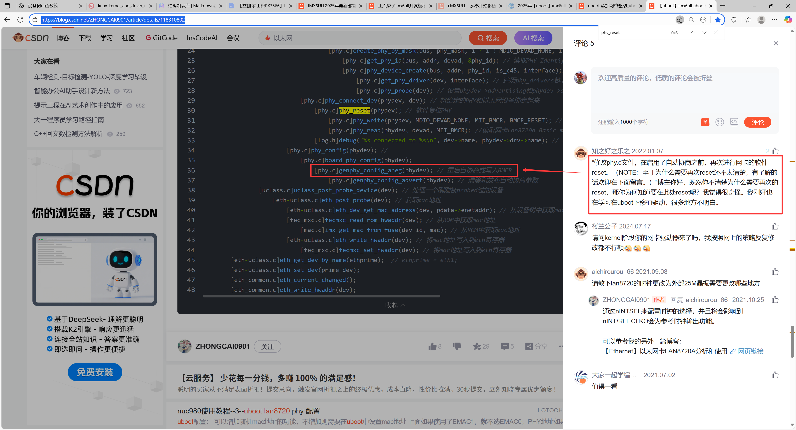
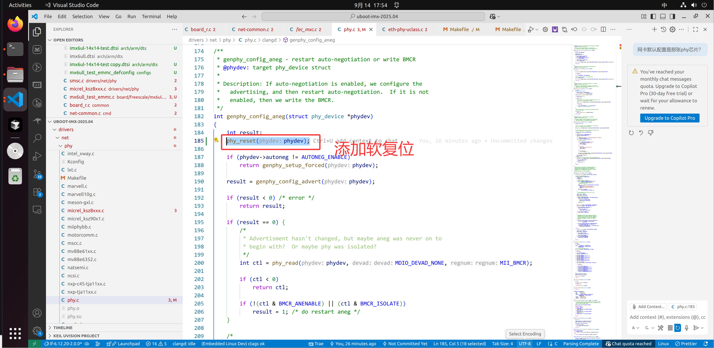

| 管理操作 | 访问位置 | 读写意义 | 观察边界 |
| --- | --- | --- | --- |
| PHY ID | MDIO Clause 22，寄存器 2、3 | 只读身份，高低字组合后与驱动 ID/mask 比较 | 强制 compatible 不能证明实物 ID 读通 |
| 基本控制 BMCR | MDIO，寄存器 0；复位位 bit 15 | 写 1 请求软复位，硬件完成后清除 | 软件应按驱动协议等待完成，不能用固定 CPU 指令数代替 |
| 链路/协商状态 | PHY 状态寄存器，由对应驱动读取 | 表达物理链路和协商结果 | 链路建立还未证明 IP、路由、TFTP 可用 |

本章软件链依据：[NXP 板源](https://github.com/nxp-imx/uboot-imx/blob/99518e6b6f20cb6a2bf19115e355db9f58100af8/board/freescale/mx6ullevk/mx6ullevk.c)、[PHY 公共连接与复位](https://github.com/nxp-imx/uboot-imx/blob/99518e6b6f20cb6a2bf19115e355db9f58100af8/drivers/net/phy/phy.c)、[FEC 复位属性读取](https://github.com/nxp-imx/uboot-imx/blob/99518e6b6f20cb6a2bf19115e355db9f58100af8/drivers/net/fec_mxc.c)、[ULL SNVS 引脚元组](https://github.com/nxp-imx/uboot-imx/blob/99518e6b6f20cb6a2bf19115e355db9f58100af8/arch/arm/dts/imx6ull-pinfunc-snvs.h)。

练习：PHY ID 能读到但 ping 失败，是否还应先加软复位？不应。先区分 RMII 时钟/数据链路、协商、MAC 地址和 IP 设置；MDIO 成功只证明管理通路。下一章把这些硬件事实交给 Linux，但 Linux 使用的是自己的配置、DTB 和驱动生命周期。

上一篇：[DDR 初始化与镜像封装](P03_DDR初始化与镜像封装.md)；[专题大纲](大纲.md)；下一篇：[Linux 配置与板级设备树](P05_Linux配置与板级设备树.md)。
