# 第5章\_Linux配置与板级设备树

U-Boot 的屏幕和网口适配建立后，只证明它自己的驱动能够操作这些硬件。Linux 接管时会使用自己的驱动、时钟和资源管理，不能把 U-Boot 已经设置过的寄存器当成永久条件。本章采用第一章固定的 NXP Linux **6.1.55，`lf-6.1.55-2.2.0`**，把相同硬件事实重新落实到内核配置和 Linux DTB。

## 5.1\_内核配置决定有什么代码\_设备树决定板上有什么

设备树节点不是一个“自动下载驱动”的指令。内核必须编入对应驱动，或在适当时机加载匹配模块，才能消费节点。`CONFIG_FEC=y` 与 `CONFIG_FEC=m` 的区别是驱动随内核到达还是稍后从文件系统加载；`status="okay"` 不能把未构建的驱动变出来。

网络根文件系统尤其能暴露这个先后关系：内核要先用网卡访问 NFS 根目录，而模块若只放在那个尚未挂载的根目录里，就形成循环依赖。因此无 initramfs 辅助的 NFS 启动，所需 MAC、PHY、网络协议、NFS 根支持必须在挂载根之前可用，通常内建为 `y`。

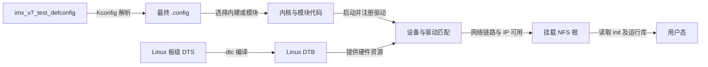

`imx_v7_defconfig` 是 NXP ARMv7 平台配置起点，不是仅服务这一块板的最终答案；`multi_v7_defconfig` 是多 ARMv7 平台配置，**不是多核专用配置**。是否 SMP 由相应内核选项决定。该版本 i.MX6ULL 的相关构建条件使用 `CONFIG_SOC_IMX6UL`，原稿中 `CONFIG_SOC_MX6UL` 与假定的 `CONFIG_SOC_IMX6ULL` 都不能直接照抄。

```bash
# Linux 宿主，在第一章固定的 linux-imx 根目录。
kernel_out="$PWD/../out-linux-test"
cp arch/arm/configs/imx_v7_defconfig arch/arm/configs/imx_v7_test_defconfig
make O="$kernel_out" ARCH=arm CROSS_COMPILE="$CROSS_COMPILE" imx_v7_test_defconfig
make O="$kernel_out" ARCH=arm CROSS_COMPILE="$CROSS_COMPILE" menuconfig
```

`menuconfig` 修改的是输出目录 `.config`。保存后用 `savedefconfig` 回存板级种子，后面重建不要先 `distclean` 再把尚未保存的修改擦掉。

| 本场景关键选项 | 作用与选择依据 |
| --- | --- |
| `CONFIG_SOC_IMX6UL` | 该树中包含本目标的 SoC 支持 |
| `CONFIG_FEC=y`、`CONFIG_SMSC_PHY=y` | NFS 根挂载前就要有的 MAC 与 LAN8720A 驱动 |
| `CONFIG_IP_PNP=y`、`CONFIG_NFS_FS=y`、`CONFIG_ROOT_NFS=y` | 内核早期 IP 设置及 NFS 根支持；NFSv3 场景核对 `CONFIG_NFS_V3` |
| `CONFIG_DEVTMPFS=y`、`CONFIG_DEVTMPFS_MOUNT=y` | 普通根文件系统挂载后提供基本设备节点 |
| `CONFIG_FB_MXS=y` | 原记录使用的 MXS framebuffer 路径；不能无说明切换为另一套 DRM 绑定 |
| `CONFIG_MICREL_PHY` | 若实板没有 Micrel PHY 可关闭；关闭它不等于关闭所有 Micrel 网络设备选项 |

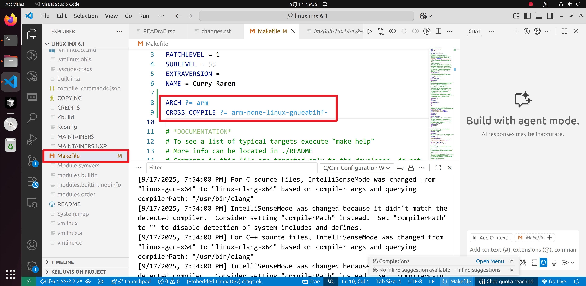
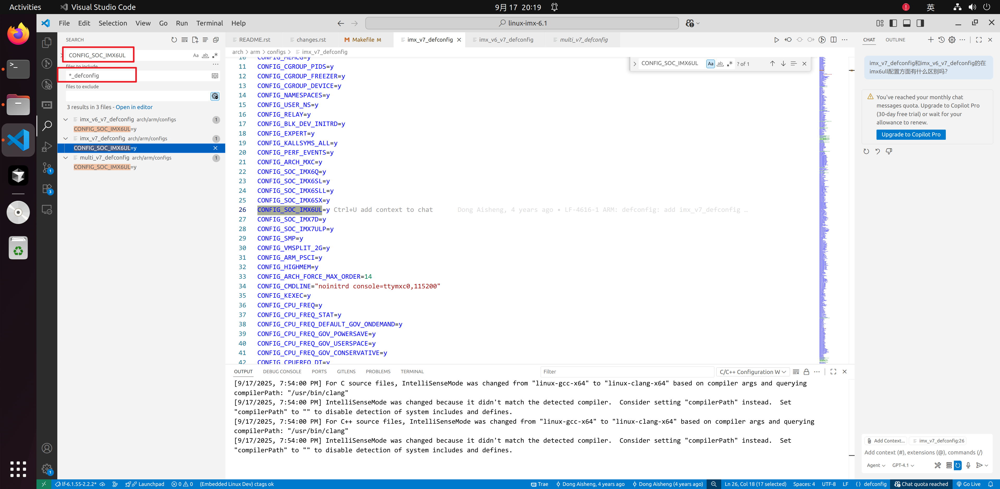
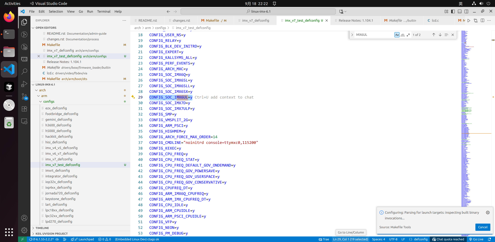
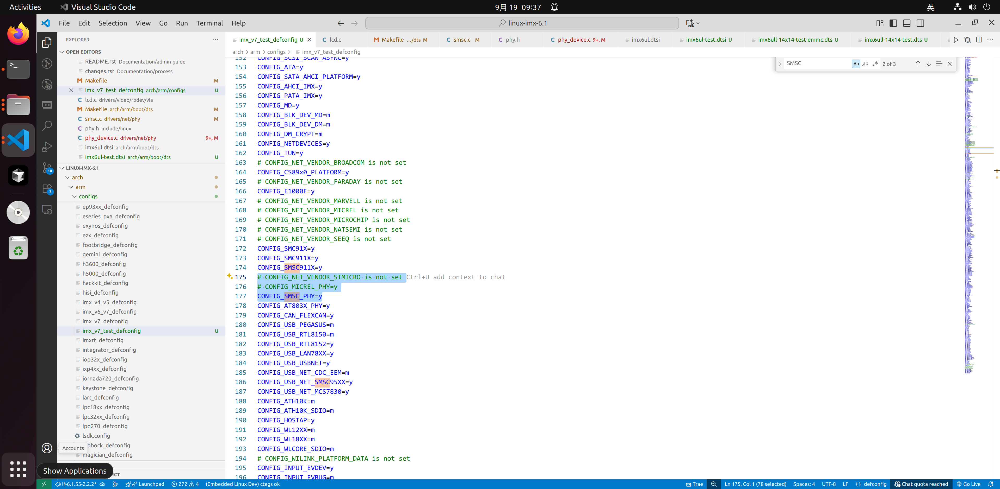

## 5.2\_Linux\_DTB\_要从自己的源码树构建

与第二章相同，派生板级文件，保留公共 `imx6ull.dtsi` 和 `imx6ul.dtsi`。这次目录是 **Linux 6.1.55 的 `arch/arm/boot/dts/`**，不是 U-Boot 的 `arch/arm/dts/`；后续版本可能重新组织为厂商子目录，不能把那套路径反写进本版本命令。

```bash
# 在 linux-imx 根目录；复制本版本的板级输入。
cp arch/arm/boot/dts/imx6ull-14x14-evk-emmc.dts arch/arm/boot/dts/imx6ull-14x14-test-emmc.dts
cp arch/arm/boot/dts/imx6ull-14x14-evk.dts arch/arm/boot/dts/imx6ull-14x14-test.dts
cp arch/arm/boot/dts/imx6ul-14x14-evk.dtsi arch/arm/boot/dts/imx6ul-14x14-test.dtsi
```

eMMC 顶层引用自己的 `test.dts`，后者引用公共 `imx6ull.dtsi` 与板级 `test.dtsi`。不要引入 U-Boot 的 `*-u-boot.dtsi`。审查根 `model/compatible`、`memory`、eMMC 总线宽度、电源和未装配设备，再把新 DTB 加到 `arch/arm/boot/dts/Makefile` 的 `dtb-$(CONFIG_SOC_IMX6UL)` 列表。

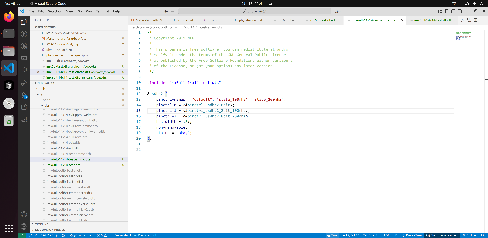
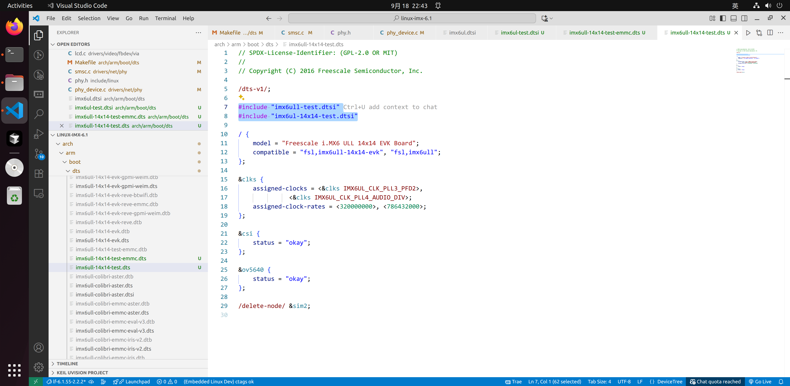
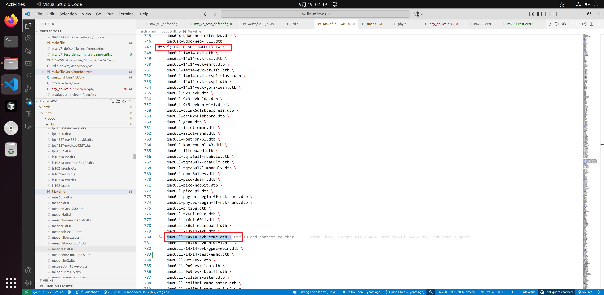

LCD 的 800×480、31 MHz 及 porch/sync 参数沿用第四章的硬件条件，Linux 原例额外给 `lcdif` 指定时钟父节点，并使用 `bits-per-pixel=<16>`、`bus-width=<24>`。本版本示例采用下面两项时钟选择；它们选择来源，像素时钟目标仍由 timing 描述：

```dts
&lcdif {
    assigned-clocks = <&clks IMX6UL_CLK_LCDIF_PRE_SEL>;
    assigned-clock-parents = <&clks IMX6UL_CLK_PLL5_VIDEO_DIV>;
};
```

在板级现有 `display0/timing0` 中填写第四章完整时序，再将该显示节点的帧缓冲格式设为 16。不重复创建第二个 display 节点。LCD 控制脚中同样移除不存在的 GPIO5_IO09 复位连接；数据脚的 pad 配置需要与电气条件对应，不能把 U-Boot 的寄存器残留当成 Linux 配置。

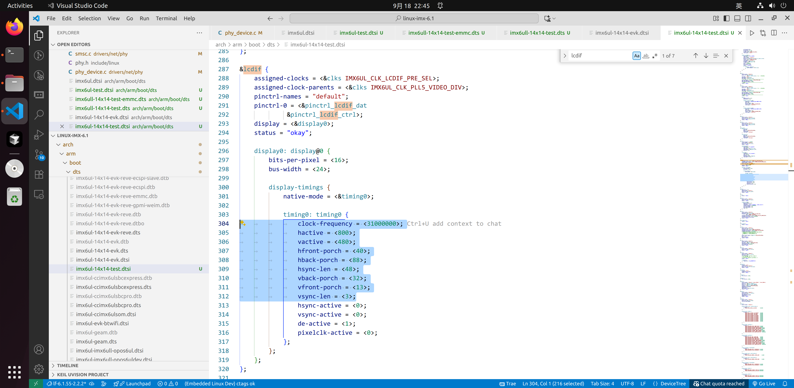
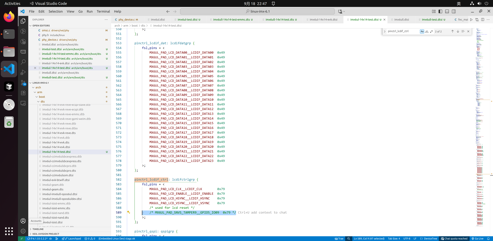

## 5.3\_复位绑定要跟随\_Linux\_驱动协议

第四章已经建立 MAC、MDIO 地址、RMII 和复位脚的关系。Linux 这份 `fsl,fec.yaml` 仍记录旧 `phy-reset-*` 属性，但明确标为 deprecated，建议将复位放到 PHY 节点。新板 Linux 描述可采用 PHY 级绑定，并从 MAC 节点删掉旧复位属性，避免两套机制同时控制同一条线。

```dts
/* 在现有板树上覆盖；ethphy0/1 的地址与节点名按第四章先改为 0/1。 */
&fec1 {
    pinctrl-0 = <&pinctrl_enet1 &pinctrl_enet1_reset>;
    phy-mode = "rmii";
    phy-handle = <&ethphy0>;
    status = "okay";
};

&fec2 {
    pinctrl-0 = <&pinctrl_enet2 &pinctrl_enet2_reset>;
    phy-mode = "rmii";
    phy-handle = <&ethphy1>;
    status = "okay";
};

&ethphy0 {
    compatible = "ethernet-phy-id0007.c0f0";
    reg = <0>;
    reset-gpios = <&gpio5 7 GPIO_ACTIVE_LOW>;
    reset-assert-us = <200000>;
    reset-deassert-us = <200000>;
};

&ethphy1 {
    compatible = "ethernet-phy-id0007.c0f0";
    reg = <1>;
    reset-gpios = <&gpio5 8 GPIO_ACTIVE_LOW>;
    reset-assert-us = <200000>;
    reset-deassert-us = <200000>;
};
```

这里将原记录 200 ms 转为 200000 µs，仅说明迁移单位的方法；实际最小复位保持时间、释放后等待与时钟要求应按器件和板卡确定。`pinctrl_enet*_reset` 使用第四章的 **ULL SNVS 控制器** 定义，禁用冲突的 `spi-4`，并完成相关电源消费者修正。

Linux SMSC 驱动的 LAN8710/LAN8720 项已有 `.soft_reset = smsc_phy_reset`，最后调用 `genphy_soft_reset()`；PHY 初始化还承担复位、配置和错误传播。原截图向通用 `__genphy_config_aneg()` 加软复位，不能作为每块 LAN8720A 板都要打的补丁，更不能据此判定芯片“不稳定”。先排查 GPIO、供电、时钟和状态，再针对已证实的版本问题设计最小修复。

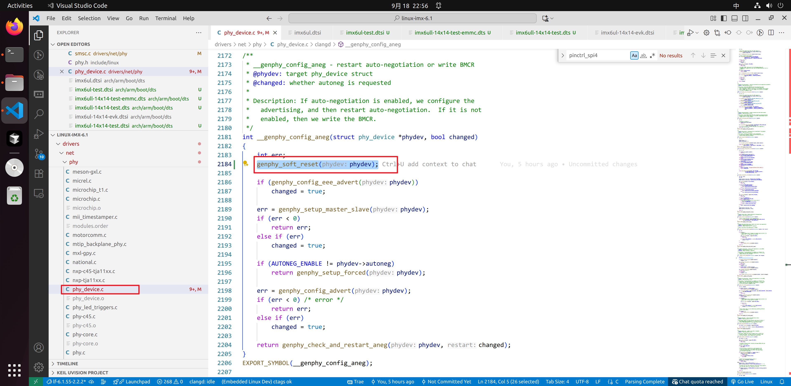

依据：[FEC 绑定](https://github.com/nxp-imx/linux-imx/blob/770c5fe2c1d1529fae21b7043911cd50c6cf087e/Documentation/devicetree/bindings/net/fsl%2Cfec.yaml)、[PHY 复位绑定](https://github.com/nxp-imx/linux-imx/blob/770c5fe2c1d1529fae21b7043911cd50c6cf087e/Documentation/devicetree/bindings/net/ethernet-phy.yaml)、[SMSC 驱动](https://github.com/nxp-imx/linux-imx/blob/770c5fe2c1d1529fae21b7043911cd50c6cf087e/drivers/net/phy/smsc.c)与[PHY 初始化](https://github.com/nxp-imx/linux-imx/blob/770c5fe2c1d1529fae21b7043911cd50c6cf087e/drivers/net/phy/phy_device.c)。

## 5.4\_固件应在驱动请求时能够取得

原记录出现 `imx/sdma/sdma-imx6q.bin` 缺失。名字中有 `imx6q` 不代表一定放错：本版本公共 `imx6ul.dtsi` 的 SDMA 节点用 `fsl,sdma-ram-script-name` 指定的正是这个文件名，驱动按描述请求它。固件是由 SDMA 执行的程序数据，既不是主 CPU 的 Linux 模块，也不是设备树编译出来的内容。

有两种提供方式。文件放入目标根文件系统 `/lib/firmware/imx/sdma/`，便于单独更新，但必须在请求发生时能访问；若该固件确实在根文件系统可用之前就必需，可通过 `CONFIG_EXTRA_FIRMWARE` 编入内核，代价是固件更新要重建镜像并遵守固件分发许可。

```text
CONFIG_EXTRA_FIRMWARE="imx/sdma/sdma-imx6q.bin"
CONFIG_EXTRA_FIRMWARE_DIR="/srv/imx6ull-firmware"
```

这里 `/srv/imx6ull-firmware` 是 **宿主构建输入目录示例**，文件应位于其 `imx/sdma/` 子目录；它不是开发板运行时搜索目录。使用绝对输入目录可避免 `O=` 构建时误判相对路径。不要把一个同名 HTML 下载错误页编入镜像：从[linux-firmware 官方仓库](https://git.kernel.org/pub/scm/linux/kernel/git/firmware/linux-firmware.git/)选定不可变版本，记录文件摘要与许可证，确认内容和大小，再构建。

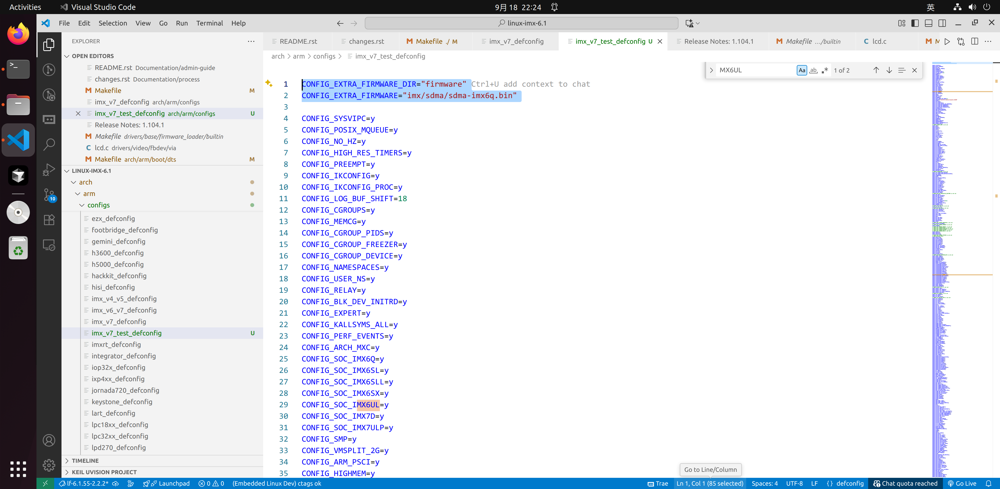

## 5.5\_生成文件帮助解释构建\_但不是修改入口

```bash
# 在 linux-imx 根目录，保持 kernel_out 与工具链一致。
make O="$kernel_out" ARCH=arm CROSS_COMPILE="$CROSS_COMPILE" savedefconfig
cp "$kernel_out/defconfig" arch/arm/configs/imx_v7_test_defconfig
make O="$kernel_out" ARCH=arm CROSS_COMPILE="$CROSS_COMPILE" -j"$(nproc)" zImage dtbs modules
make O="$kernel_out" ARCH=arm CROSS_COMPILE="$CROSS_COMPILE" INSTALL_MOD_PATH="$PWD/../rootfs" modules_install
```

本树的内核镜像在输出目录 `arch/arm/boot/zImage`，DTB 在 `arch/arm/boot/dts/`。最后一条命令将模块安装到实验父目录的 `rootfs/lib/modules/<kernel release>/`，第六章继续向同一个 rootfs 安装 BusyBox；模块与运行内核 release、配置及符号版本须匹配。第一条命令保存配置，不是完成编译。`dtbs` 可能构建多个板的 DTB，复制到 TFTP 目录时只选择已核对的新板文件。

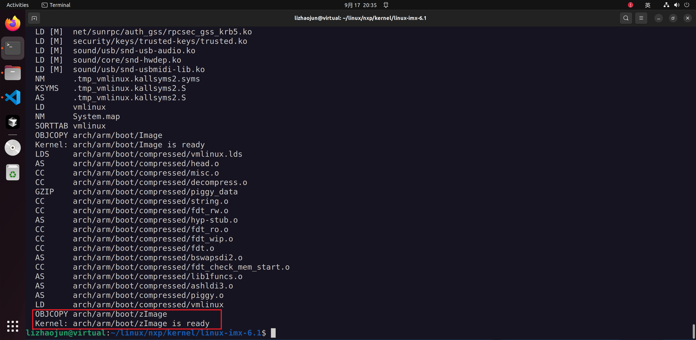

源码目录按职责阅读：`arch/` 放体系结构和平台，`drivers/` 放驱动，`kernel/` 放调度等核心机制，`mm/` 管理内存，`fs/` 管理文件系统，`net/` 管理网络，`init/` 组织启动，`include/` 提供接口，`scripts/` 承担构建生成；`block/`、`crypto/`、`ipc/`、`security/`、`sound/`、`virt/` 各负责对应子系统。`Documentation/`、`samples/` 和维护文件是阅读入口，`usr/` 在这里与 initramfs 构建相关，不是目标 rootfs 的 `/usr`。

| 输出或维护文件 | 正确解释 | 不能据此推断 |
| --- | --- | --- |
| `vmlinux`、`zImage` | 前者为 ELF 内核，后者是 ARM 可启动压缩镜像 | 二者可随意用同一种启动命令互换 |
| `System.map` | 最终内核的符号地址表 | 某个符号存在就证明路径已运行 |
| `Module.symvers`、`modules.order` 等 | 模块符号版本、构建/安装顺序等材料 | 任意版本 `.ko` 均可加载 |
| `.mailmap` | 规范化贡献者姓名/邮箱映射 | 邮件订阅列表 |
| `.version` | 构建计数相关文件 | 单凭它确定 Linux 发布版本 |
| `.missing-syscalls.d` | 编译器生成的头文件依赖记录 | “有内容就说明缺系统调用实现” |
| `.tmp_vmlinux.kallsyms*` 等 | 多轮链接与 kallsyms/BTF 等处理的中间产物，取决于配置 | 仅凭 `.tmp` 前缀确定具体用途或错误原因 |

`Kbuild` 的 `missing-syscalls` 目标运行 `scripts/checksyscalls.sh`。脚本生成预处理条件，比较系统调用编号宏与其忽略列表，诊断输出来自预处理警告；传入的 `c_flags` 中 `-MMD` 产生 `.d` 依赖。它不是扫描所有函数体的实现完整性检测器。读 `.missing-syscalls.d` 应看到目标与依赖头文件，而不是作者编造的缺失函数清单。

`scripts/link-vmlinux.sh` 则解释了为何可能有多轮 kallsyms：把符号表放进镜像会改变布局，布局变化又会改变符号地址，因此需再链接并比较。不能笼统说所有临时文件最后都靠一次 `mv` 保证整个构建“原子性”。报错时先保存实际命令和第一个诊断，再追对应生成规则。

依据：[Kbuild](https://github.com/nxp-imx/linux-imx/blob/770c5fe2c1d1529fae21b7043911cd50c6cf087e/Kbuild)、[checksyscalls.sh](https://github.com/nxp-imx/linux-imx/blob/770c5fe2c1d1529fae21b7043911cd50c6cf087e/scripts/checksyscalls.sh)、[link-vmlinux.sh](https://github.com/nxp-imx/linux-imx/blob/770c5fe2c1d1529fae21b7043911cd50c6cf087e/scripts/link-vmlinux.sh)。

## 5.6\_性能策略是运行约束\_不是移植成功条件

原记录把默认 CPUFreq governor 改为 `performance`。它请求策略允许范围内的高频，仍受 OPP、电压、温度及策略上下限约束；不等于强制芯片永远运行在某个固定 MHz，也不是修复 DDR 或网络错误的方法。初次验证可以保留参考策略；需要减少频率变化对测试的影响时，再明确修改目的与功耗代价。

下面保留原记录完整配置过程：进入 CPU Power Management → CPU Frequency scaling → Default governor，选择 performance，保存 `.config`。当前用上一节 `savedefconfig` 回存，无需手工从 `.config` 挑拷一长串配置。

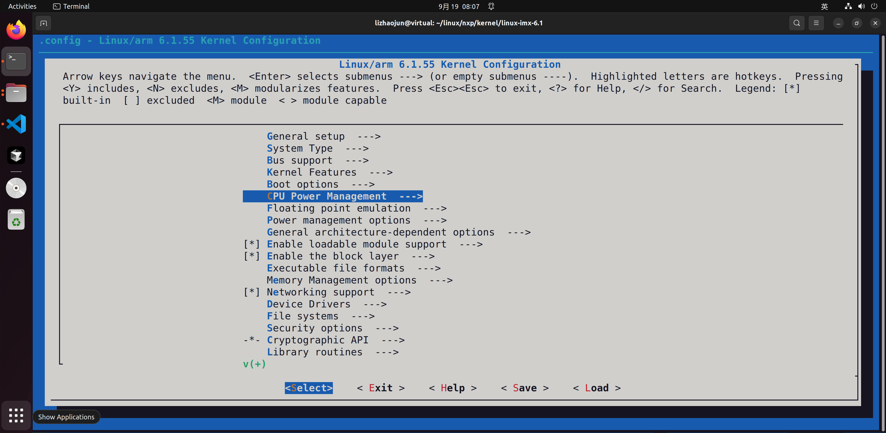
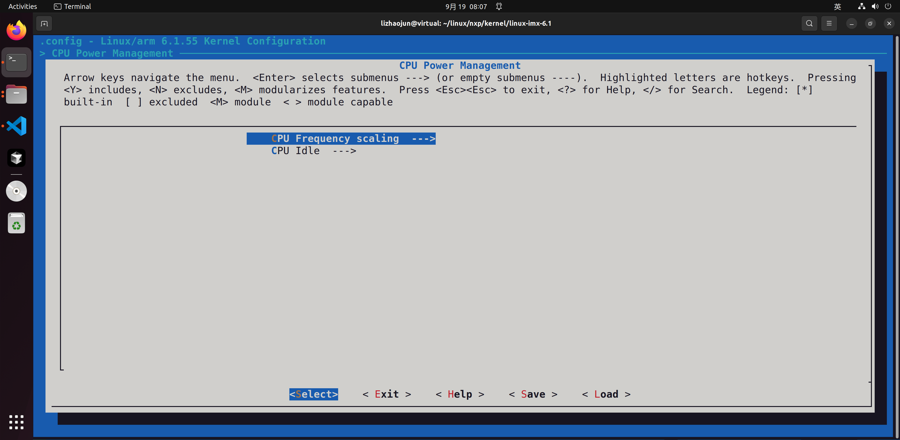
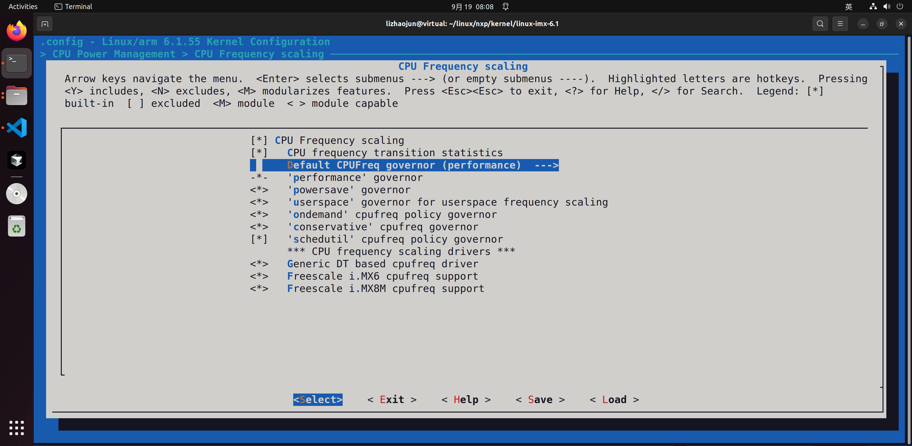
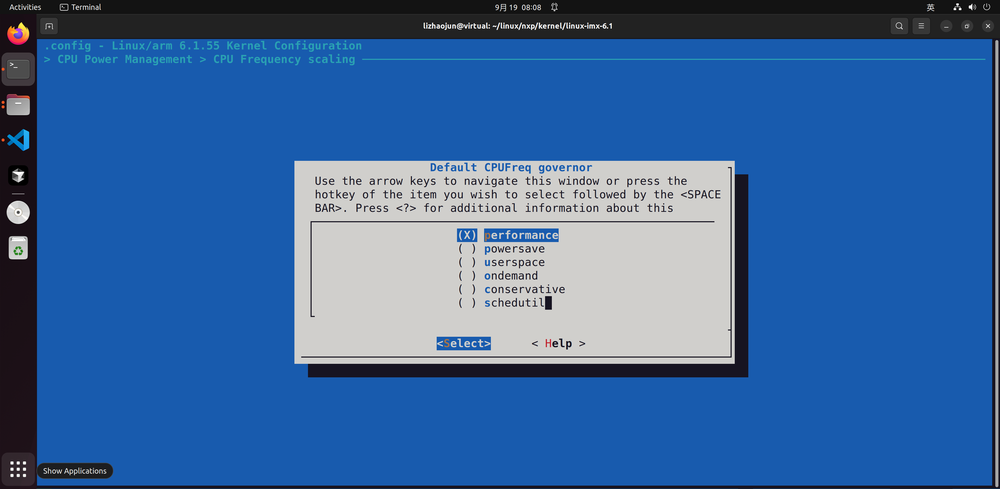
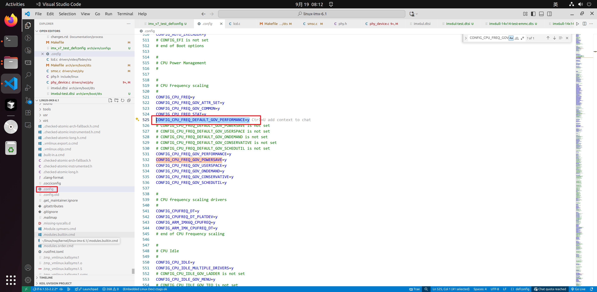
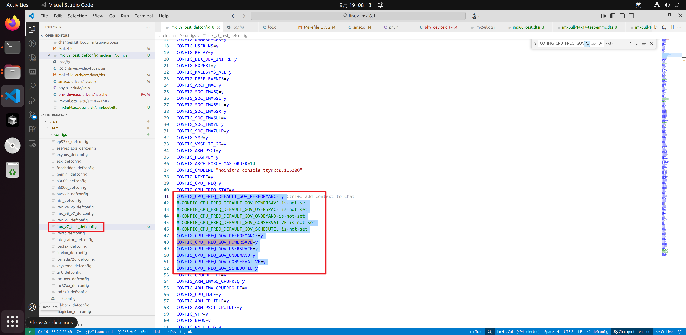
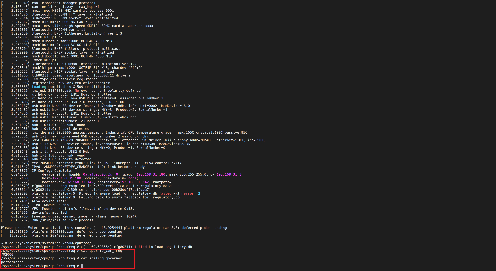

启动后读取 `/sys/devices/system/cpu/cpufreq/policy0/scaling_governor`、`scaling_min_freq`、`scaling_max_freq`；目录缺失时先查 CPUFreq 驱动是否注册，不以菜单截图代替运行结果。频率观测还要结合驱动提供的实际接口，不能只根据 governor 名称报告性能提升。

练习：根目录在 NFS 上，而 FEC 仅编成模块放在该根目录中，会在哪一步停住？内核还没取得网络根就无法读取模块。解决的是启动依赖顺序：将必要链内建，或由已可用的 initramfs 提供模块和加载流程。下一章选前一种最小路径，建立内核能实际执行的用户态。

上一篇：[LCD 与双网口的板级适配](P04_LCD与双网口的板级适配.md)；[专题大纲](大纲.md)；下一篇：[BusyBox 根文件系统与网络启动](P06_BusyBox根文件系统与网络启动.md)。
