# 第6章\_BusyBox根文件系统与网络启动

上一章准备了 Linux 镜像、DTB 和挂载网络根所需的内建驱动。内核接下来要运行谁？仅有一个空目录，即使 NFS 挂载成功，也没有第一个用户进程。我们要给它提供可执行的 init、Shell、运行库和初始化配置，并让这些文件的架构与内核支持的用户态一致。

本章使用 **NFS 根文件系统 + BusyBox init** 的实验路径。根文件系统是挂载在 `/` 的文件系统及其中的目录内容，可以由 NFS、ext4、initramfs 等承载；它不是必须放在某个固定分区中的文件夹。这里 zImage 和 DTB 由 TFTP 下载，rootfs 由 NFS 提供。其他系统也可以把内核镜像放在根文件系统的 `/boot`，不能把本实验的分开存放推广为所有 Linux 的规则。

## 6.1\_BusyBox\_提供程序\_不会自动完成所有系统配置

BusyBox 把多个小工具编入一个可执行文件，通过调用名选择不同 applet。`/bin/sh`、`/sbin/init` 等可以是指向 BusyBox 的链接。安装它得到的是一组程序入口；挂载点、启动脚本、共享库和网络服务仍要配置。

| 路径 | 本实验的用途 |
| --- | --- |
| `/bin`、`/sbin` | Shell、基础命令和 init 等程序入口；执行权限由文件权限决定，不能仅凭 sbin 目录名判断只有 root 能执行 |
| `/lib`、`/usr/lib` | ARM 用户态运行库及 ELF 加载器；静态链接所需的 `.a` 通常不必部署到只运行程序的目标 |
| `/etc` | inittab、fstab、启动脚本及必要网络配置 |
| `/dev` | devtmpfs 的挂载点，承载设备节点；不是所有硬件都有一个设备文件 |
| `/proc`、`/sys` | 内核虚拟文件系统挂载点，导出运行状态和设备模型接口 |
| `/run`、`/tmp` | 易失运行数据和临时文件，使用 tmpfs |
| `/usr` | 更多用户空间软件；目录用途不依赖把名字展开成某句缩写 |
| `/var`、`/root`、`/mnt`、`/opt` | 可变数据、管理员家目录、附加挂载点和可选软件 |

原稿选择会变化的 `busybox-snapshot.tar.bz2`，截图为 `1.38.0.git`。重新实验应记录快照摘要，或选固定发布版。下面固定到 **BusyBox 1.37.0** 讲解配置，不声称它与原快照逐字一致。

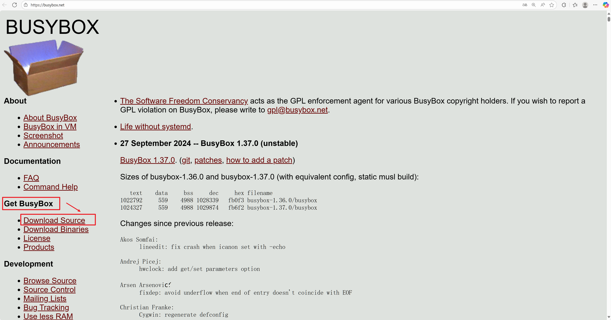


```bash
# Linux 宿主，在第一章的实验父目录；下载固定发布包。
curl -fLO https://busybox.net/downloads/busybox-1.37.0.tar.bz2
sha256sum busybox-1.37.0.tar.bz2
tar -xf busybox-1.37.0.tar.bz2
cd busybox-1.37.0
busybox_out="$PWD/../out-busybox"
rootfs_dir="$PWD/../rootfs"
mkdir -p "$busybox_out" "$rootfs_dir"
make O="$busybox_out" ARCH=arm CROSS_COMPILE="$CROSS_COMPILE" defconfig
make O="$busybox_out" ARCH=arm CROSS_COMPILE="$CROSS_COMPILE" menuconfig
```

本次核对的官方 1.37.0 归档 SHA-256 为 `3311dff32e746499f4df0d5df04d7eb396382d7e108bb9250e7b519b837043a4`。如下载内容不同，先查下载结果和上游发布信息。不要只根据解压目录名认定版本。

## 6.2\_先选择链接方式\_再准备它需要的运行环境

本例沿用动态链接：BusyBox 文件较小，但目标必须有匹配的加载器和共享库。静态链接省去一部分动态运行依赖，却通常增大程序；“静态链接必然不能 DNS”不是普遍规则。DNS 行为还取决于 libc、NSS 配置、实际 applet 和构建方式，不能用一句结论排除所有静态系统。

本例关闭 `CONFIG_STATIC`，启用 init、ash、mount、mountpoint、mkdir、chmod、mdev 等后面实际使用的 applet；需要模块管理时启用适合该内核模块格式的 modprobe/insmod/depmod。简化 modutils 是另一种取舍，不是“所有根文件系统必须取消”的原则。

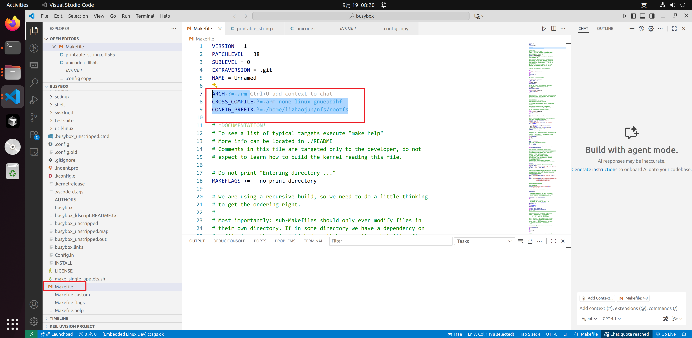
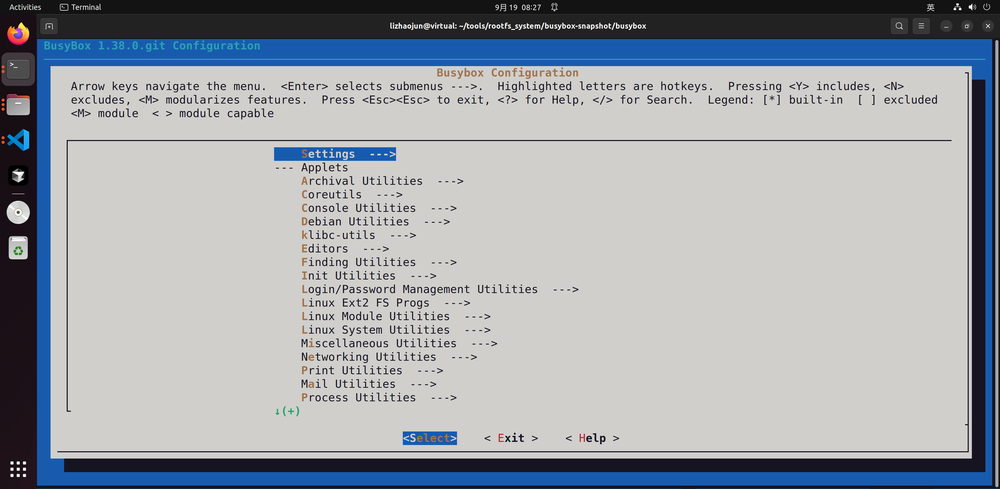
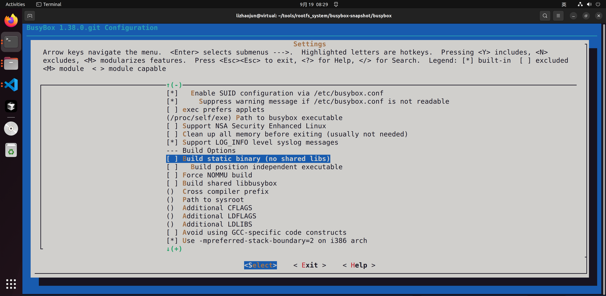
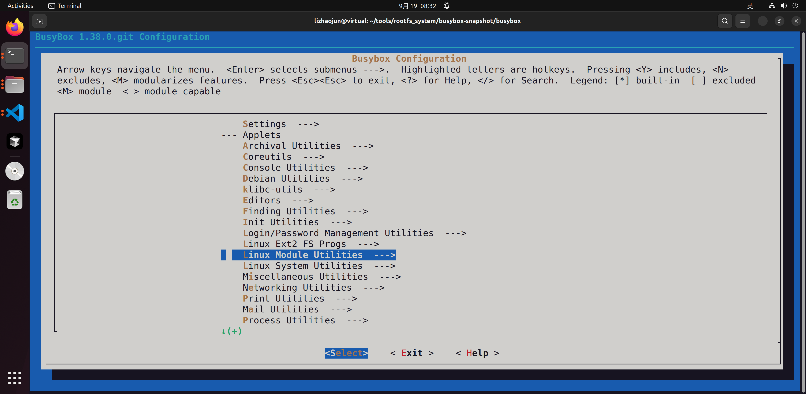
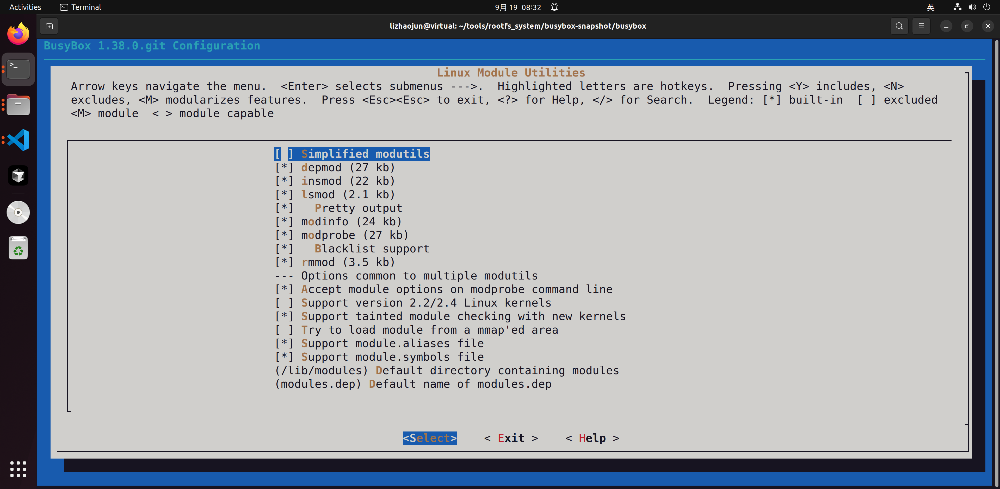
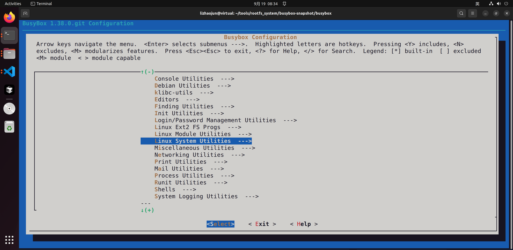
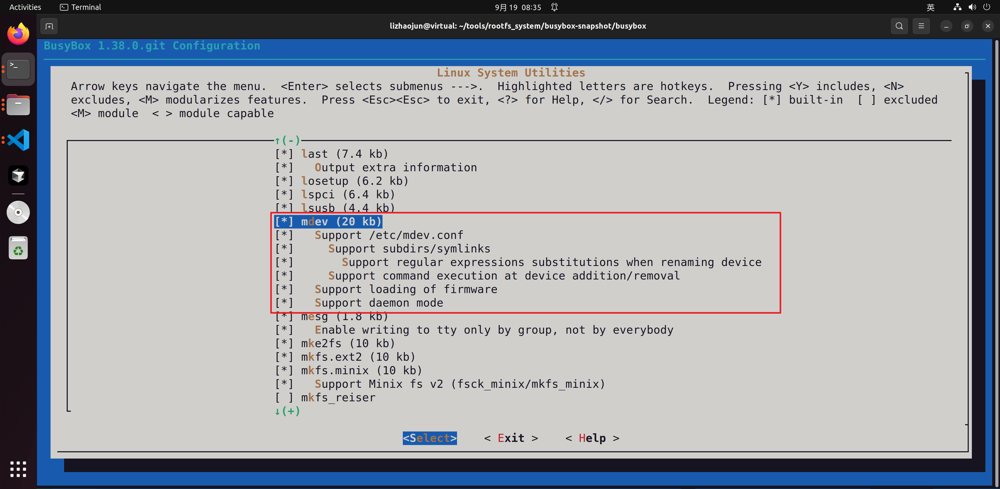

保存后构建并安装：

```bash
# 在 BusyBox 根目录，继续使用上面的输出与 rootfs 变量。
make O="$busybox_out" ARCH=arm CROSS_COMPILE="$CROSS_COMPILE" -j"$(nproc)"
make O="$busybox_out" ARCH=arm CROSS_COMPILE="$CROSS_COMPILE" CONFIG_PREFIX="$rootfs_dir" install
cp "$busybox_out/.config" ../busybox_saved.config
mkdir -p "$rootfs_dir"/{dev,etc/init.d,lib,mnt,proc,root,run,sys,tmp,usr/lib,var,opt}
```

`CONFIG_PREFIX` 是宿主上的安装根目录，不能写成下载前缀。命令执行后应得到目标树的 `bin/busybox` 及 applet 链接。所有安装操作都指向 `$rootfs_dir`，不应安装进宿主 `/bin` 或 `/sbin`。

## 6.3\_一个存在的文件为什么还会报\_找不到

Linux 执行动态 ELF 时，先读取其 `PT_INTERP` 指定的加载器路径，再由加载器查找 `DT_NEEDED` 共享库。因此文件 `/sbin/init` 明明存在，仍可能因为 `/lib/ld-linux-armhf.so.3` 不存在或链接断裂而执行失败。这个错误不能靠重新编译内核解决。

```bash
# 宿主检查 ARM ELF 元数据，不在宿主直接运行目标程序。
"${CROSS_COMPILE}readelf" -h "$rootfs_dir/bin/busybox"
"${CROSS_COMPILE}readelf" -l "$rootfs_dir/bin/busybox"
"${CROSS_COMPILE}readelf" -d "$rootfs_dir/bin/busybox"
sysroot_dir=$("${CROSS_COMPILE}gcc" -print-sysroot)
test -d "$sysroot_dir/lib" || exit 1
```

检查 `Machine` 为 ARM、解释器路径和每项 `NEEDED`。库必须来自同一目标 ABI 的工具链 sysroot；不要使用宿主 x86-64 库，也不要对不明目标程序运行宿主 `ldd` 来“试一下”。

为了先建立完整运行环境，本例复制该 sysroot 中的共享库文件及链接，后续可按实际依赖裁剪：

```bash
# Linux 宿主 Bash；变量来自前文，先确认打印出的源、目标都正确。
printf 'sysroot=%s\nrootfs=%s\n' "$sysroot_dir" "$rootfs_dir"
for lib_dir in lib usr/lib; do
    test -d "$sysroot_dir/$lib_dir" || continue
    mkdir -p "$rootfs_dir/$lib_dir"
    find "$sysroot_dir/$lib_dir" -maxdepth 1 \( -type f -o -type l \) -name '*.so*' \
        -exec cp -a -- '{}' "$rootfs_dir/$lib_dir/" \;
done
```

原稿的 `cp *.so.* *.a* $(cross_compile)/libc/lib -d` 方向相反，而且 Shell 的 `$(cross_compile)` 是执行名为 cross_compile 的命令，不是取变量。这里统一使用 `$sysroot_dir`、`$rootfs_dir`，源在前、目标在后。若某个运行库不在 sysroot 的上述两层目录，用 `${CROSS_COMPILE}gcc -print-file-name=库名` 找到该工具链选中的位置，复制该库及其完整链接链；继续对每个库检查 `NEEDED`，直到依赖闭合。

加载器可以是符号链接，只要目标在开发板根目录语义下存在且内容匹配。不能把“不能是链接”当成 ELF 规则。绝对链接 `/lib/...` 应在 **目标根目录** 内解释，宿主对暂存树执行普通 `readlink -f` 可能误解析到宿主 `/lib`，检查时要明确这个边界。

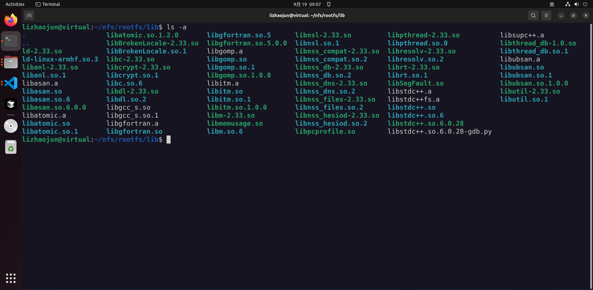
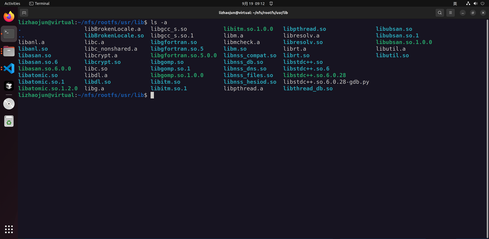

## 6.4\_中文显示应先修正\_Unicode\_配置

UTF-8 一个字符可以占多个字节，中文字符还常占两个显示列。原稿删除“字节大于等于 0x7f”的检查，让高位字节透传；这样可能让某些文件名看起来正常，却不能建立正确的字符数量、显示宽度和截断规则，甚至可能从中间切断一个 UTF-8 字符。

BusyBox 1.37.0 已提供相应配置。使用其内部 Unicode 实现时，下面这组是支持中文的起点：

```text
CONFIG_UNICODE_SUPPORT=y
# CONFIG_UNICODE_USING_LOCALE is not set
CONFIG_UNICODE_WIDE_WCHARS=y
CONFIG_LAST_SUPPORTED_WCHAR=0
# CONFIG_FEATURE_CHECK_UNICODE_IN_ENV is not set
```

最后一项关闭表示内部 Unicode 处理不再等待环境变量启用；若启用它，要提供源码识别的 UTF-8 locale 环境值。若选择 libc Unicode 路径，则还要提供 libc 的 locale 支持。`LAST_SUPPORTED_WCHAR` 默认 767 不覆盖常用汉字，`0` 表示不以该上限过滤有效字符。终端编码与字体也要支持 UTF-8；BusyBox 不负责给串口终端安装字体。

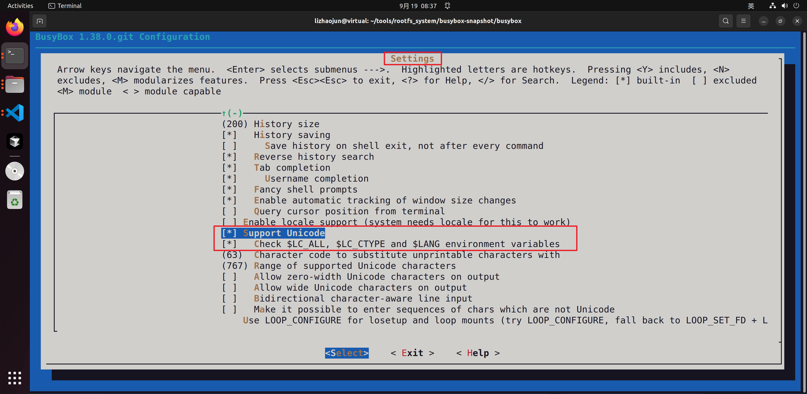

在开发板临时目录创建包含中文的文件名，比较 `ls`、Shell 光标移动和截断显示；若只是 `cat` 内容正常而 `ls` 变成问号，继续区分字节传输与 applet 的字符处理。原来两个修改后的函数保留在历史附件用于追溯，不作为当前源码补丁。依据：BusyBox 1.37.0 `libbb/Config.src`、`libbb/unicode.c` 和 `libbb/printable_string.c`。

## 6.5\_PID\_1\_把目录树变成可操作的系统

根挂载成功后，内核执行 init；BusyBox init 读取 `/etc/inittab`，其中 `sysinit` 执行启动脚本，再建立串口 Shell。脚本先挂载提供运行状态的虚拟文件系统，才有条件扫描设备。状态来自内核，脚本负责把这些接口挂到可见路径，并启动必要的用户态服务。

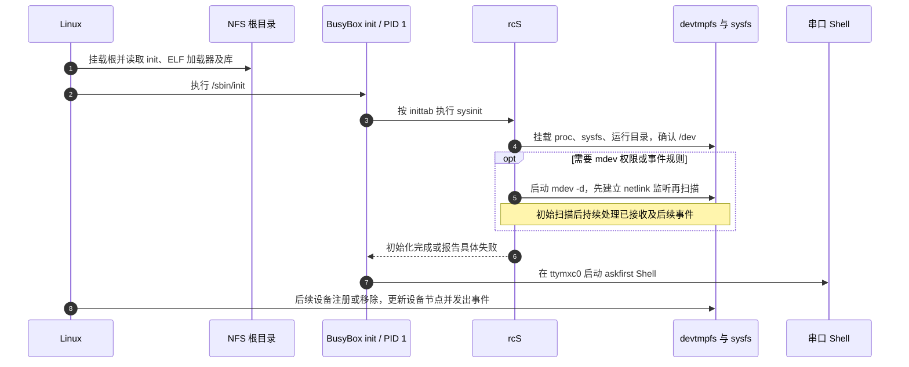

在暂存树 `$rootfs_dir/etc/inittab` 写入以下内容：

```text
::sysinit:/etc/init.d/rcS
ttymxc0::askfirst:-/bin/sh
::restart:/sbin/init
::ctrlaltdel:/sbin/reboot
::shutdown:/bin/umount -a -r
::shutdown:/sbin/swapoff -a
```

四列为 `id:runlevels:action:process`；BusyBox 忽略 runlevels，`ttymxc0` 指终端，`askfirst` 要求按回车后启动进程，`-` 前缀让 Shell 按登录 Shell 方式启动。这个不验证口令的串口 Shell 用于当前调试环境；有登录需求时应配置 getty/login 和账号，而不是把调试配置当成产品登录机制。

`$rootfs_dir/etc/fstab` 只列本实验必需的本地虚拟挂载：

```text
proc    /proc    proc    defaults            0 0
sysfs   /sys     sysfs   defaults            0 0
tmpfs   /run     tmpfs   mode=0755           0 0
tmpfs   /tmp     tmpfs   mode=1777           0 0
```

写 `$rootfs_dir/etc/init.d/rcS`：

```sh
#!/bin/sh
# 在开发板执行；内核已按 bootargs 建立网络并挂载 NFS 根。
PATH=/sbin:/bin:/usr/sbin:/usr/bin
export PATH

mkdir -p /proc /sys /run /tmp /dev
mount -a || { echo 'rcS: 基础文件系统挂载失败' >&2; exit 1; }
if ! mountpoint -q /dev; then
    mount -t devtmpfs devtmpfs /dev || exit 1
fi
mkdir -p /dev/pts
mount -t devpts devpts /dev/pts || exit 1
chmod 1777 /tmp

# 本例依赖 devtmpfs 维护基本节点；不重复修改 NFS 根所用网卡的 IP。
exit 0
```

然后在宿主执行 `chmod +x "$rootfs_dir/etc/init.d/rcS"`。基础挂载失败会显示错误，不再把每条命令的错误都丢弃后继续报告成功。第 5 章要求 `CONFIG_DEVTMPFS_MOUNT=y`，普通 NFS 根启动时通常已挂好 `/dev`，脚本仅在尚未挂载时补挂。initramfs 路径的自动挂载规则不同，不应照搬本实验假设。

**冷扫描不是热插拔的替代。** `mdev -s` 扫描当时的 sysfs，后插入的设备不会因之前扫描过一次就自动执行 mdev 规则。devtmpfs 已可维护基础节点；若需要 mdev 的权限、重命名或脚本规则，启用 `CONFIG_FEATURE_MDEV_DAEMON`，在挂载 sysfs 和 devtmpfs 后启动 `mdev -d`。1.37.0 的 daemon 路径建立 netlink 监听、执行初始扫描后进入事件处理，避免把人工串联的扫描与监听误写成天然无缝。

旧 `/proc/sys/kernel/hotplug` 接口是否存在与 `CONFIG_UEVENT_HELPER` 等配置有关，不是“新内核只支持冷插拔”。本例不依赖这个接口。原稿还在 `mount -a` 挂 NFS 后才启动 DHCP；这里 NFS 根的网络已由内核建立，不能在 rcS 再随意更换地址。附加网络挂载应在网络确实可用后单独执行。

依据：[Linux devtmpfs 与 uevent 配置](https://github.com/nxp-imx/linux-imx/blob/770c5fe2c1d1529fae21b7043911cd50c6cf087e/drivers/base/Kconfig)，BusyBox 1.37.0 `examples/inittab`、`util-linux/mdev.c`、`docs/mdev.txt`。

## 6.6\_TFTP\_与\_NFS\_分别服务启动链的哪一段

为使例子具体，下面用 **文档示例地址** `192.0.2.10` 表示 Ubuntu 服务器、`192.0.2.20` 表示开发板，掩码 `/24`。执行前必须整体替换为实验网段中实际分配且不冲突的地址，服务器网卡先配置好该地址。TFTP 根用 `/srv/tftp`，NFS 导出根用 `/srv/imx6ull/rootfs`。

Ubuntu 22.04 宿主安装服务，并创建目录：

```bash
# Linux 宿主；以下服务只用于已经规划好的实验网络。
sudo apt-get install tftpd-hpa nfs-kernel-server
sudo install -d -m 0755 /srv/tftp /srv/imx6ull/rootfs
sudo cp "$kernel_out/arch/arm/boot/zImage" /srv/tftp/
sudo cp "$kernel_out/arch/arm/boot/dts/imx6ull-14x14-test-emmc.dtb" /srv/tftp/
sudo cp -a "$rootfs_dir/." /srv/imx6ull/rootfs/
```

`cp -a` 保留链接和权限，源是准备好的目标树。TFTP 服务配置 `/etc/default/tftpd-hpa` 中设 `TFTP_DIRECTORY="/srv/tftp"`、`TFTP_ADDRESS=":69"`、`TFTP_OPTIONS="--secure"`；保留该包配置中的服务用户。重启 `tftpd-hpa` 后确认服务状态及文件读取权限。

在 `/etc/exports` 增加一条只对本实验开发板地址开放的导出：

```text
/srv/imx6ull/rootfs 192.0.2.20(rw,sync,no_subtree_check,no_root_squash)
```

`no_root_squash` 让板端 root 在这个开发根中保留 root 身份，适合此隔离实验的根文件系统语义，因此地址范围应限制到该板；不要把服务器其他目录一并开放。执行 `sudo exportfs -ra`，用 `sudo exportfs -v` 核对实际导出。若配置了防火墙，还需允许实验接口上的 TFTP 以及选定 NFSv3/RPC 服务；根据服务实际端口配置，不通过全局关闭防火墙“解决”。

虚拟机应有能被板访问的网络路径，例如桥接到实际有线接口。NAT、桥接、Wi-Fi 隔离和不同网段会改变可达性；原截图的“复制物理网络连接状态”只是一次环境设置，不是 ping 成功的充分必要条件。

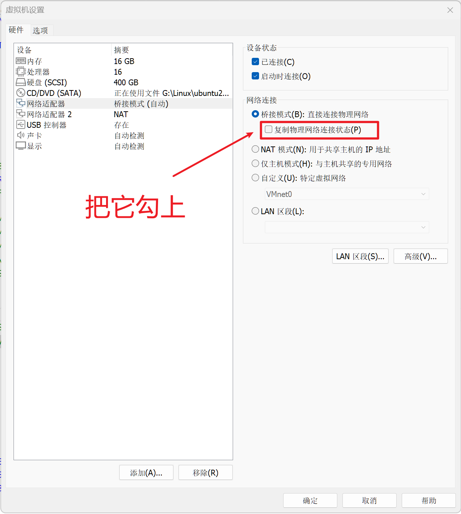

在 U-Boot 控制台设置当前会话网络，先不保存到介质：

```text
setenv ipaddr 192.0.2.20
setenv serverip 192.0.2.10
setenv netmask 255.255.255.0
ping ${serverip}
```

同一子网通信不依赖默认网关；跨网段才配置实际网关。MAC 地址优先使用板卡正式分配值；无正式值的封闭实验可分配不冲突的本地管理单播地址，例如 `02:00:00:00:00:20`，不能把作者的全球管理地址复制到多块板。双网口还应确认当前 `ethact` 与实际插线口对应。

## 6.7\_传输成功以后才能进入内核

先确认 RAM 容量及已占用区域，再选加载地址。下面沿用原记录 `0x80800000` 和 `0x83000000`，只有它们处于本板可用 RAM 且不与 U-Boot、解压区域、保留区重叠时才可用。成功下载后记录文件大小并比较服务器镜像摘要；地址只是起点，不能忽略镜像长度。

```text
setenv kernel_addr_r 0x80800000
setenv fdt_addr_r 0x83000000
setenv bootargs 'console=ttymxc0,115200 root=/dev/nfs nfsroot=192.0.2.10:/srv/imx6ull/rootfs,vers=3,proto=tcp rw ip=192.0.2.20:192.0.2.10::255.255.255.0:imx6ull:eth0:off'
if tftp ${kernel_addr_r} zImage; then if tftp ${fdt_addr_r} imx6ull-14x14-test-emmc.dtb; then bootz ${kernel_addr_r} - ${fdt_addr_r}; fi; fi
```

这条条件链保证两次传输都成功才 `bootz`。原来的分号串联在一次 TFTP 失败后仍会启动旧内存内容，容易把传输错误误诊成内核错误。`bootz` 的第二参数 `-` 表示本次不传 initrd；第三参数是 Linux DTB 地址。`ip=` 依次提供客户端、服务器、网关、掩码、主机名、接口和自动配置方式，网关空字段适用于本例同网段路径。

先运行会话中的命令验证，确认稳定后再把同一条件链写入 `bootcmd`。只有第三章核对了环境存储区域，才执行 `saveenv`；保存不是验证网络通畅的步骤。

观察失败层：TFTP 超时先查服务和链路；`Unable to mount root fs` 查内建网络/NFS 支持、`bootargs` 和导出；根挂载后 init 执行失败查 ELF 加载器、库、权限与脚本；Shell 出来后命令不存在再查 BusyBox applet 和安装路径。`/linuxrc` 可能由 BusyBox 安装生成，但本例内核执行 `/sbin/init`，不能把存在 `linuxrc` 当作所有 rootfs 的必要条件。

练习：`/sbin/init` 是有效链接，BusyBox 也是 ARM ELF，内核仍报告无法执行 init，还缺什么证据？检查 `PT_INTERP` 指定路径在目标根内能否解析，以及加载器、每个依赖库、执行权限是否匹配。到这里，启动链才从内核闭合到用户态；下一章增加工具时，要继续维护这个依赖闭环。

上一篇：[Linux 配置与板级设备树](P05_Linux配置与板级设备树.md)；[专题大纲](大纲.md)；下一篇：[Buildroot 工具与运行时依赖](P07_Buildroot工具与运行时依赖.md)。
