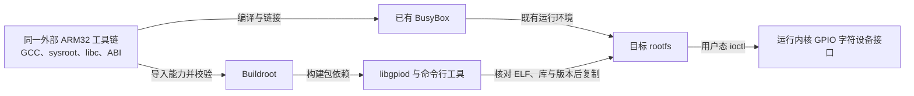
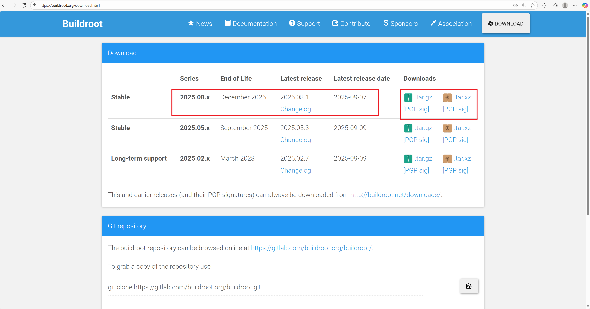
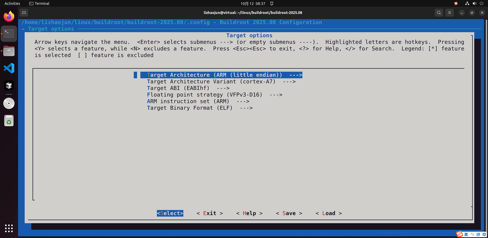
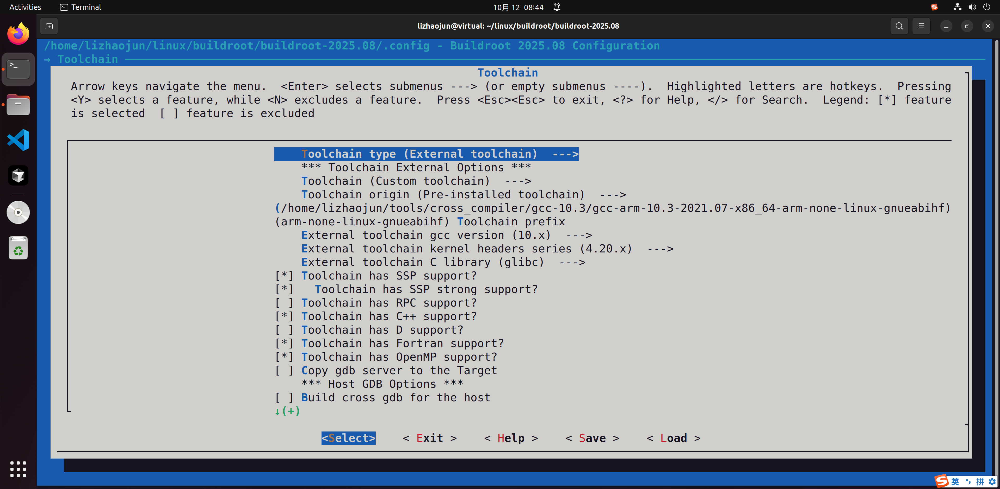
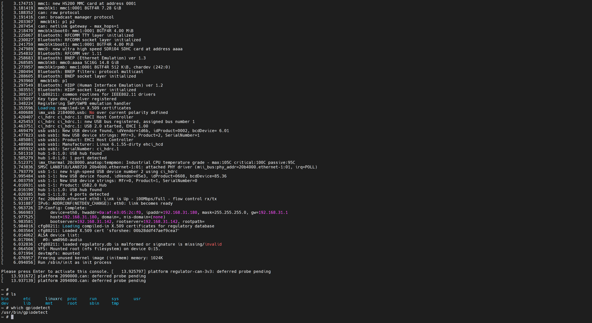

# 第7章\_Buildroot工具与运行时依赖

上一章的根文件系统已经能运行基础命令。现在想增加 GPIO 调试工具，是否必须重做 U-Boot、内核和 BusyBox？不必。Buildroot 可以构建所需用户态软件及依赖，但它生成的工具必须与已有 rootfs 的 ABI、加载器和库配套。只复制一个同名可执行文件，仍可能得到“找不到文件”“缺少符号”或 ioctl 不支持。

本章保留原记录的 **外部工具链 + 增量部署 libgpiod 工具** 场景，以截图对应的 Buildroot 2025.08 为边界。完整 Buildroot 系统构建、包定义和交付方法另见[Buildroot 专题](../../../../../knowledge/system_software/buildroot/大纲.md)；本章解释它与这份手工 rootfs 的交接。

## 7.1\_外部工具链带进来的不只是\_GCC

工具链包含编译器、链接器、目标 libc、头文件和 sysroot。已有 BusyBox 来自 Arm GNU 10.3 工具链，就优先用同一套工具链构建增量工具，避免将另一套 glibc/musl 或软浮点库混入根目录。即使用同一版本号的 GCC，也不能据此推断 libc 与 ABI 相同。



原下载页面和菜单截图保留如下；页面中的“最新版本”是截图时间的状态，本章固定使用 2025.08，不按今天下载页自动换版本：



```bash
# Linux 宿主，在已解压并核对版本的 Buildroot 2025.08 根目录。
buildroot_out="$PWD/../out-buildroot-tools"
mkdir -p "$buildroot_out"
make O="$buildroot_out" menuconfig
```

使用新的 `O=` 目录，避免原稿一开始就 `distclean` 擦除既有配置。目标架构选择 ARM little endian、Cortex-A7、EABIhf；原例浮点子集为 VFPv3-D16，指令集为 ARM。这个子集应同时受 CPU 和工具链支持，不能拿宿主 x86 的能力作证。



## 7.2\_菜单中的能力声明必须来自工具链事实

Toolchain 选择 External toolchain → Custom toolchain → Pre-installed toolchain。路径填包含 `bin/` 的工具链根目录；这里的 prefix 填 `arm-none-linux-gnueabihf`，**不带末尾连字符**，与传给 Make 的 `CROSS_COMPILE=...-` 写法不同。

| 配置项 | 本实验原选择 | 怎样核对 |
| --- | --- | --- |
| GCC version | 10.x | `gcc -dumpfullversion -dumpversion` |
| C library | glibc | 工具链发布信息、sysroot 及目标 libc 身份 |
| Kernel headers series | 原截图选择 4.20.x | 查看工具链 sysroot 的 `linux/version.h`；不是填正在运行的 Linux 6.1 |
| SSP / SSP strong | 原截图启用 | 工具链实际支持及 Buildroot 导入校验 |
| C++ / Fortran / OpenMP | 原截图启用部分能力 | 对应前端与运行库实际存在；本章 C 工具不要求为了齐全而全选 |
| RPC support | 原截图关闭 | libc 与工具链能力，不根据内核是否支持 NFS 猜测 |
| Kernel / Bootloaders | 本场景不启用构建 | 保留前几章已有内核与引导程序 |



用交叉编译器查看它实际选中的头文件宏：

```bash
# Linux 宿主，CROSS_COMPILE 指向前面同一套工具链。
"${CROSS_COMPILE}gcc" -dumpfullversion -dumpversion
"${CROSS_COMPILE}gcc" -print-sysroot
printf '#include <linux/version.h>\n' |
    "${CROSS_COMPILE}gcc" -E -dM -x c - | grep LINUX_VERSION_CODE
```

头文件版本描述编译时可用的用户接口声明，运行内核版本描述执行时实现的接口。较新内核运行用较旧头文件构建的程序通常成立，但程序无法仅靠填一个更高菜单数字获得不存在的声明。反过来，使用新接口构建出的程序也需要运行内核提供对应 ioctl。具体 libc 的最低内核要求还要单独满足。

Buildroot 导入外部工具链时会检查配置声明与实际能力；若报 header series 不一致，修正声明或更换真实工具链，不要修改检测脚本跳过这个矛盾。

## 7.3\_libgpiod\_版本与内核接口要一起选择

libgpiod 是 GPIO 字符设备的用户态库，命令行工具再调用这个库。本版本 Buildroot 同时提供两个包入口，不能把它们简单解释成“不同版本里换了个名字”。

| Buildroot 2025.08 选项 | 包的职责 | 本版本配置门槛 |
| --- | --- | --- |
| `BR2_PACKAGE_LIBGPIOD` | libgpiod 1.x | 工具链头文件至少 4.8；目标需要对应 GPIO 字符设备 ABI |
| `BR2_PACKAGE_LIBGPIOD_TOOLS` | 安装 1.x 命令行工具 | 仅启用库并不自动等于有全部工具 |
| `BR2_PACKAGE_LIBGPIOD2` | libgpiod 2.x | 工具链头文件至少 5.10，与 1.x 包互斥；运行内核也须支持 5.10 引入的 GPIO uAPI v2 |
| `BR2_PACKAGE_LIBGPIOD2_TOOLS` | 安装 2.x 命令行工具 | 依赖 2.x 库选择 |

原截图声明头文件 4.20.x，那么按该 Buildroot 版本依赖只能选择 1.x 路径。板上运行 Linux 6.1 并不会自动升级 sysroot 头文件。若要使用 2.x，使用确实满足条件的工具链，同时评估对已有 rootfs 运行库的影响；不要仅把菜单中的 header series 改成 5.10。

在 Target packages → Libraries → Hardware handling 选择 `libgpiod`，并选其 `install tools` 子项。确认 Kernel 和 Bootloaders 未启用，保存后构建：

```bash
# 在 Buildroot 根目录；内部各包会按构建配置处理并行度。
make O="$buildroot_out"
make O="$buildroot_out" savedefconfig BR2_DEFCONFIG="$PWD/imx6ull_tools_defconfig"
```

记录完整 `.config`、外部工具链身份、Buildroot 版本及包版本。依据：[2025.08 libgpiod 配置](https://github.com/buildroot/buildroot/blob/2025.08/package/libgpiod/Config.in)、[libgpiod2 配置](https://github.com/buildroot/buildroot/blob/2025.08/package/libgpiod2/Config.in)、[外部工具链说明](https://github.com/buildroot/buildroot/blob/2025.08/docs/manual/configure.adoc)。

## 7.4\_部署的是依赖闭合的增量

`output/host` 是宿主工具区域，不能把里面的程序当作开发板工具；`output/staging` 为开发 sysroot 提供入口；`output/target` 是目标文件暂存树，但它不天然等于已经具备设备节点和最终权限的可启动镜像。本实验从 `O=` 输出目录的 `target/` 取增量文件，并继续使用第六章已有 rootfs。

先检查准备部署的目标工具：

```bash
# Linux 宿主；已有 rootfs_dir 仍指向第六章暂存树。
target_dir="$buildroot_out/target"
"${CROSS_COMPILE}readelf" -h "$target_dir/usr/bin/gpiodetect"
"${CROSS_COMPILE}readelf" -l "$target_dir/usr/bin/gpiodetect"
"${CROSS_COMPILE}readelf" -d "$target_dir/usr/bin/gpiodetect"
```

确认 ARM ELF、加载器路径和 `NEEDED`。再检查 `libgpiod.so.*` 的依赖及符号版本。如果程序要求的 `GLIBC_*` 版本高于已有 libc，仅复制 libgpiod 不会解决；若启用 C++ 绑定，还要检查 libstdc++ 和 libgcc_s。应回到同一工具链与依赖构建方案，而不是把新 libc 零散覆盖到旧系统。

```bash
# 先列出实际增量；不存在时先查 install tools 配置，不复制空匹配。
find "$target_dir/usr/bin" -maxdepth 1 -name 'gpio*' -print
find "$target_dir/usr/lib" -maxdepth 1 -name 'libgpiod*.so*' -print
mkdir -p "$rootfs_dir/usr/bin" "$rootfs_dir/usr/lib"
cp -a "$target_dir"/usr/bin/gpio* "$rootfs_dir/usr/bin/"
cp -a "$target_dir"/usr/lib/libgpiod*.so* "$rootfs_dir/usr/lib/"
```

通配符匹配列表要先审阅，因为它可能包括本章未讨论的额外工具。复制保留符号链接，并补齐上一段检查发现的依赖，不能以“两个 cp 都成功”代替依赖检查。然后将同一组已核对文件复制到 NFS 导出根的对应位置；如板端正在执行这些动态程序，应在停用它们后更新，避免运行中的程序看到一半新一半旧的文件。

## 7.5\_从存在到能控制引脚分四层验证

原记录最后给出的日志是：

```text
[    6.064508] VFS: Mounted root (nfs filesystem) on device 0:15.
[    6.071994] devtmpfs: mounted
[    6.076957] Freeing unused kernel image (initmem) memory: 1024K
[    6.094056] Run /sbin/init as init process
Please press Enter to activate this console.
~ # which gpiodetect
/usr/bin/gpiodetect
```



这证明了根挂载、init 启动和文件路径可见，尚未证明工具执行成功。实际验收继续分层：

| 层次 | 观察方法 | 失败时回到哪里 |
| --- | --- | --- |
| 文件存在 | `command -v gpiodetect` | 安装路径与 PATH |
| ELF 能运行 | `gpiodetect --version` | 加载器、库、ABI、执行权限 |
| 能访问内核接口 | `gpiodetect`、`gpioinfo` | `CONFIG_GPIO_CDEV`、设备节点、权限和 uAPI 版本 |
| 目标线路符合预期 | 依据原理图选择空闲线路，再按所安装版本工具语法操作和测量 | line 归属、pinmux、电气连接、外部负载 |

GPIO line offset 不是 SoC 引脚名，也不是所有 gpiochip 的全局编号。尤其不要用 PHY 复位、DDR、eMMC 或正在工作的外设线来验证一个新工具；先找到明确空闲且可测量的测试线。libgpiod 1.x 与 2.x 工具语法和请求生命周期不同，执行前看该版本 `--help`，不要把网上另一代 `gpioset` 命令直接套用。

原完整日志里还出现 CAN 电源 deferred probe。这不能由 `which` 成功“抵消”，应回到第四章检查已禁用 GPIO 扩展链的消费者。只测了 GPIO 文件路径，就只能报告这一层完成。

练习：Linux 6.1 能支持 uAPI v2，为什么本例 Buildroot 仍不允许勾选 libgpiod2？因为该版本包配置还约束 **构建工具链头文件**，而原工具链声明为 4.20；构建时声明与运行时实现是两个证据。现在整条移植链可以逐段定位：每一段既有输入身份，也有能证明到哪一步的观察，后续增加设备仍沿这个方法维护。

上一篇：[BusyBox 根文件系统与网络启动](P06_BusyBox根文件系统与网络启动.md)；[专题大纲](大纲.md)；下一篇：无。
