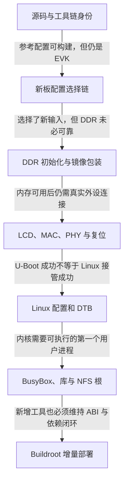

# 第1章\_i.MX6ULL移植阅读路线

这组平台记录把原先集中在一篇长文中的 U-Boot、Linux、BusyBox 与 Buildroot 操作，按一次启动的交接关系展开。目标是能解释每个配置为什么存在、失败落在哪层，以及当前观察到底证明了什么。硬件场景为原记录标注的正点原子 i.MX6ULL 阿尔法 v2.2、eMMC 与 LAN8720A；不是任意 i.MX6ULL 板的通用烧录包。

## 1.1\_沿着一个交接问题进入下一章

| 章节 | 承接的结论 | 本章解决的问题 | 留给下一章的问题 |
| --- | --- | --- | --- |
| [P01 移植基线与交叉编译环境](P01_移植基线与交叉编译环境.md) | 会使用 Linux Shell、Git 与基本 C | 哪个源码、编译器与目标组成可追溯构建 | 新板怎样被真正选中 |
| [P02 从参考板派生 U-Boot 配置](P02_从参考板派生U-Boot配置.md) | 参考构建身份明确 | 配置、板源、头文件、DTB 与生成物的关系 | 镜像如何得到可用 DDR |
| [P03 DDR 初始化与镜像封装](P03_DDR初始化与镜像封装.md) | 输入选择链成立 | DCD、校准、寄存器与下载工具协议的边界 | 屏幕和网口是否匹配实物 |
| [P04 LCD 与双网口的板级适配](P04_LCD与双网口的板级适配.md) | 早期启动与内存条件可区分 | 时序、引脚、电源、MDIO 与复位所有权 | Linux 如何独立接管 |
| [P05 Linux 配置与板级设备树](P05_Linux配置与板级设备树.md) | 已建立板上连接模型 | 内建/模块、DTB、固件和构建诊断 | 内核能否运行用户态 |
| [P06 BusyBox 根文件系统与网络启动](P06_BusyBox根文件系统与网络启动.md) | 内核与必要驱动已准备 | ELF 依赖、PID 1、设备节点、TFTP/NFS | 新工具怎样保持运行兼容 |
| [P07 Buildroot 工具与运行时依赖](P07_Buildroot工具与运行时依赖.md) | 最小用户态与网络根成立 | 外部工具链、libgpiod 版本、增量依赖与验证 | 将相同证据方法用于新外设 |

## 1.2\_材料与实测的边界

原稿的 61 张图片继续嵌在对应问题旁；截图属于原实验，不是本次重新上板的证明。正文就地修正旧做法，完整旧日志、生成文件片段和讨论保留在[历史原稿附件](../../../../../assets/archives/imx6ull_porting/porting_original.txt)。不用打开附件或外链也能读懂当前流程；附件承担核查来历的作用。

本次固定源码核对分别使用 NXP U-Boot 2025.04 系列提交、NXP Linux 6.1.55 发布提交、BusyBox 1.37.0 和 Buildroot 2025.08，完整身份见 P01。DDR 实物参数及原下载工具协议未完整交付，所以本文不伪造一份已验证的通用 DCD/烧录命令；P03 明确给出复现时需补齐的输入和观察方法。

## 1.3\_与其他专题如何衔接

[Linux 驱动学习路线](../../../../../atlas/tracks/linux_driver_track.md)建立设备与驱动的通用模型，本组文档把模型落在一块具体板上。[Buildroot 专题](../../../../../knowledge/system_software/buildroot/大纲.md)进一步解释完整系统生成和软件包维护；这里 P07 只负责与现有手工 rootfs 的交接。更换 SoC、BSP 或工具链时，重新核对平台边界，不复制本板的寄存器值和路径。
