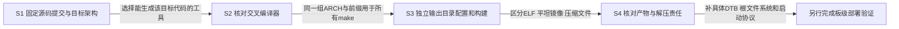
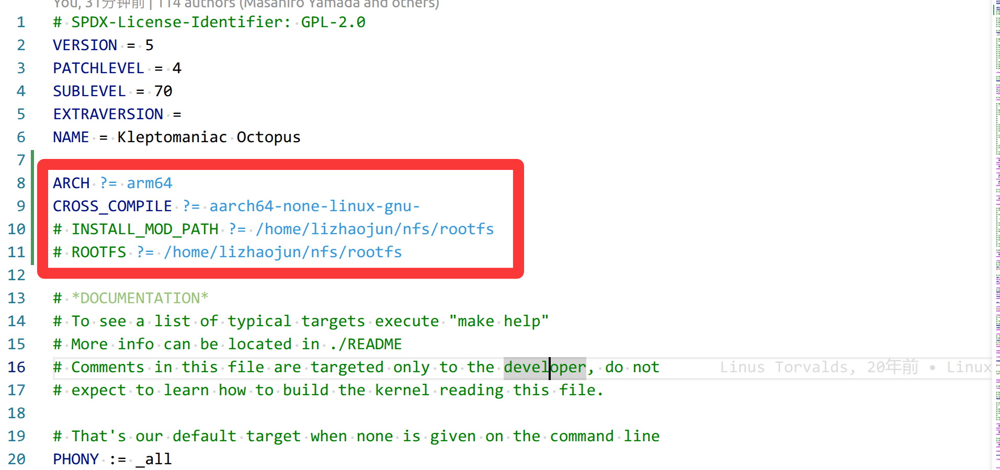

# 第1章\_imx\_v8配置与ARM64内核构建

旧记录使用 `aarch64-none-linux-gnu-` 工具链、`ARCH=arm64` 和 `imx_v8_defconfig`，这是一条 NXP ARM64/i.MX8 内核构建路线。它不能用于只有 Arm Cortex-A7/AArch32 处理器的 i.MX6ULL；原来放在 i.MX6ULL 目录下容易让读者按目录选错架构，因此本篇按实际配置移到 i.MX8 平台记录。

本篇解决三个问题：怎样把源码版本、目标架构和编译器连成一组可追溯输入；怎样把输出隔离出来；怎样理解 `Image` 与 `Image.gz` 的交付责任。原记录没有确定具体 i.MX8 板型、DTB、根文件系统和完整启动日志，所以这里建立到“可核对构建产物”的步骤，不把一个通用 defconfig 写成已经完成某块板的移植。

## 1.1\_先固定构建的到底是哪一版内核

分支名方便找到厂商发布线，但分支可以前进；本地目录叫 `linux-imx-5.4` 也不证明其中一定是 5.4.70。本次将旧记录所给的 NXP 分支解析到实际提交，并核对顶层 Makefile、ARM64 配置和镜像规则。后续步骤使用固定提交，避免几个月后同名分支已经变化。

| 输入身份 | 本篇固定范围 | 能证明什么 |
| --- | --- | --- |
| 官方仓库 | `https://github.com/nxp-imx/linux-imx.git` | NXP 厂商内核来源 |
| 原记录分支 | `imx_5.4.70_2.3.0` | 发布线索，不是本地目录名 |
| 本次核对提交 | `b34a9c9644c11a0393def0fb56d6f9184f722c24` | 下列源码事实的不可变身份 |
| 顶层版本 | Linux `5.4.70` | Makefile 的 VERSION/PATCHLEVEL/SUBLEVEL |
| 配置文件 | `arch/arm64/configs/imx_v8_defconfig` | ARM64 的 i.MX 配置，含 `CONFIG_ARCH_MXC` 与多种 i.MX8 支持 |
| 板级描述 | 必须另选实际板卡对应 DTB | 通用内核配置不提供唯一板型身份 |

这是历史 5.4.70 构建记录的独立证据，不改变本仓库通用源码研究所用的 [Linux 6.12.20 基线](../../../../research/source_reading/linux/SOURCE_BASELINE.md)。两个版本的工具、配置和函数结论不能无说明地混用。



在 Linux 构建环境准备一个新的工作目录，并从官方仓库取得源树。下面是供读者执行的步骤，本轮没有重新克隆整棵内核或进行构建。

```bash
# Linux构建环境；当前目录用于保存本次独立实验，先确认imx8-build尚不存在。
set -eu
mkdir imx8-build
cd imx8-build
git clone --branch imx_5.4.70_2.3.0 --single-branch \
    https://github.com/nxp-imx/linux-imx.git linux-imx-5.4
cd linux-imx-5.4
git checkout --detach b34a9c9644c11a0393def0fb56d6f9184f722c24
git remote get-url origin
git rev-parse HEAD
```

clone 得到源树，checkout 选择本篇核对的提交；若仓库无法提供该对象，应停止并检查来源，不以另一提交继续冒充相同结果。目录 `linux-imx-5.4` 只是本实验的自定名称，真正身份由远端和 HEAD 共同确定。已有工作的源树不要直接覆盖配置或切换提交，使用独立检出更容易保留原工作。

## 1.2\_工具运行在哪台机器\_生成给谁执行的代码

内核构建同时使用两类编译器。宿主编译器生成在构建机上运行的辅助程序；交叉编译器生成目标 AArch64 指令。两者都叫 GCC，也可能输出相似版本号，但并不承担同一任务。`ARCH=arm64` 选择内核源码分支，`CROSS_COMPILE` 决定目标工具前缀，二者需要一致。

旧记录选择的压缩包是 `gcc-arm-9.2-2019.12-x86_64-aarch64-none-linux-gnu.tar.xz`：`x86_64` 描述构建工具运行的宿主，`aarch64-none-linux-gnu` 描述目标工具系列。它来自 Arm GNU-A 9.2-2019.12 发布包，不应由 U-Boot 的 Windows 主机工具说明推导出来。该说明中的 GCC 9.1.0 是当时 MSYS2 宿主工具环境的版本记录，并不是 NXP ARM64 内核必须使用 GCC 9.2 的证明。[U-Boot v2020.04主机工具说明](https://docs.u-boot.org/en/v2020.04/build/tools.html)

为保留原实验的版本选择，可从 [Arm历史发布包](https://armkeil.blob.core.windows.net/developer/Files/downloads/gnu-a/9.2-2019.12/binrel/gcc-arm-9.2-2019.12-x86_64-aarch64-none-linux-gnu.tar.xz) 取得文件，配套发布说明见 [GNU-A 9.2-2019.12 Release Note](https://documentation-service.arm.com/static/65202f45bc48b0381ce0e350?token=)。本轮只确认下载入口响应与来源，没有下载整个工具链、核验发布签名或执行其二进制；不能把下面的步骤当作已完成的兼容矩阵。

```bash
# Linux构建环境；从源码目录回到imx8-build，下载并解包到独立tools目录。
cd ..
mkdir tools
curl -fL -o gcc-arm-9.2-2019.12-x86_64-aarch64-none-linux-gnu.tar.xz \
    https://armkeil.blob.core.windows.net/developer/Files/downloads/gnu-a/9.2-2019.12/binrel/gcc-arm-9.2-2019.12-x86_64-aarch64-none-linux-gnu.tar.xz
sha256sum gcc-arm-9.2-2019.12-x86_64-aarch64-none-linux-gnu.tar.xz
tar -xJf gcc-arm-9.2-2019.12-x86_64-aarch64-none-linux-gnu.tar.xz -C tools
```

记录 SHA-256 用于之后识别本地包；只有再与可信发布摘要或签名核对，才形成来源完整性验证，不能仅打印一个哈希就宣布下载可信。`-C tools` 指定解包位置，后面的前缀必须与实际解包目录一致；原稿解压路径和加入 PATH 的路径多了一层 `arm64`，容易让命令找到另一套工具。

```bash
# Linux构建环境，当前位于imx8-build；使用绝对工具前缀，不修改全局profile。
compiler_dir="$PWD/tools/gcc-arm-9.2-2019.12-x86_64-aarch64-none-linux-gnu/bin"
export CROSS_COMPILE="$compiler_dir/aarch64-none-linux-gnu-"
"${CROSS_COMPILE}gcc" --version
"${CROSS_COMPILE}gcc" -dumpmachine
make --version
gcc --version
```

目标编译器的 `-dumpmachine` 应对应 AArch64 Linux 系列；最后一条普通 `gcc` 则是宿主编译器。使用绝对前缀后不依赖多份工具链在 PATH 中的先后，也不需要替换系统 GCC。构建所需 make、flex、bison、bc、OpenSSL 开发库等宿主依赖，应对照该提交的 `Documentation/process/changes.rst` 与实际配置准备；缺一个宿主头文件不等于目标交叉编译器选错。

## 1.3\_把配置和产物放进同一个独立输出目录

源码身份和工具确认后，S3 才生成 `.config`。`imx_v8_defconfig` 是一份配置起点，经过 Kconfig 求值后形成实际 `.config`；随后每次 make 都要使用同一个 `O=` 输出目录、ARCH 和工具前缀，否则可能读到另一份配置或把产物写回源树。

```bash
# Linux构建环境，当前仍在imx8-build；源码和输出目录并列。
source_dir="$PWD/linux-imx-5.4"
output_dir="$PWD/out-imx-v8"
mkdir "$output_dir"
make -C "$source_dir" O="$output_dir" ARCH=arm64 \
    CROSS_COMPILE="$CROSS_COMPILE" imx_v8_defconfig
```

这一步应生成 `out-imx-v8/.config`。第一次使用新输出目录不需要先执行 `make distclean`；清理源树并不是选择新架构的必要动作，也会掩盖此前配置从哪里来。若输出目录已经存在，应先核对它属于哪次构建，不把 mkdir 失败忽略后继续覆盖原配置。

```bash
# Linux构建环境；核对配置架构，再构建明确要求的产物。
grep -E '^(CONFIG_ARM64|CONFIG_ARCH_MXC)=' "$output_dir/.config"
make -C "$source_dir" O="$output_dir" ARCH=arm64 \
    CROSS_COMPILE="$CROSS_COMPILE" -j"$(nproc)" Image Image.gz modules dtbs
```

预期配置启用 ARM64 与 MXC。`Image`、`Image.gz` 是两种镜像形式，`modules` 生成所选可加载模块，`dtbs` 生成该配置覆盖的设备树产物；生成多个 DTB 并不等于已经为实际板选对了一个。并行数只是构建资源选择，内存不足时可以降低，不能把命令退出失败当作已经生成可用系统。

固定版本的 `arch/arm64/Makefile` 默认目标本来就是 `Image.gz`，`arch/arm64/boot/Makefile` 规定先从 `vmlinux` 生成 Image，再压缩得到 Image.gz。本例显式列目标，是让构建意图与产物对应，不要求读者记住默认规则。

## 1.4\_Image与Image.gz把解压责任交给了谁

S4 要先分清编译产物的用途。`vmlinux` 是带 ELF 结构的内核链接结果，适合查看机器类型、节和符号；`Image` 是 ARM64 启动协议使用的平坦镜像；`Image.gz` 是它的 gzip 压缩结果。不能因为文件都含内核代码，就用同一个命令或地址条件启动。

| 产物 | 位置，相对输出目录 | 当前可以检查什么 |
| --- | --- | --- |
| `.config` | `.config` | 本次实际配置，而非原始defconfig文本 |
| ELF内核 | `vmlinux` | ELF机器类型、段、节和符号 |
| ARM64平坦镜像 | `arch/arm64/boot/Image` | 镜像头与未压缩文件内容 |
| gzip镜像 | `arch/arm64/boot/Image.gz` | gzip完整性及解压后是否等于Image |
| 设备树 | `arch/arm64/boot/dts/` 下对应板型文件 | 是否描述实际板卡和连接，不能按文件名猜测兼容 |
| 模块 | 对应构建子目录的 `.ko` | 必须与同次内核配置、版本和符号条件配套 |

```bash
# Linux构建环境；前面的构建成功后检查产物，不直接烧写。
"${CROSS_COMPILE}readelf" -h "$output_dir/vmlinux"
od -An -tx1 -j56 -N4 "$output_dir/arch/arm64/boot/Image"
gzip -t "$output_dir/arch/arm64/boot/Image.gz"
gzip -dc "$output_dir/arch/arm64/boot/Image.gz" |
    cmp - "$output_dir/arch/arm64/boot/Image"
```

ELF头应表明 AArch64；Image 的偏移56处应读到字节 `41 52 4d 64`。最后两项分别检查 gzip 流完整性和解压内容与 Image 一致。它们能发现产物类型或压缩文件问题，不能证明板级引导和驱动工作。

为什么本构建没有 ARM32 的 zImage？在此版本 ARM64 启动协议中，压缩 Image 的解压由引导侧完成，内核不附带该自解压器；不支持解压的引导侧应使用未压缩 Image。ARM32 zImage 则含有自己的启动解压路径。这是交付接口和职责分配的区别，不能由此推导“ARM32 引导程序都不会解压”或“采用 zImage 必然重复解压两次”。[Linux 5.4 AArch64启动协议](https://www.kernel.org/doc/html/v5.4/arm64/booting.html)

同一协议规定 Image 头长64字节，下面列出理解布局所需的字段；它们是镜像字节，不是处理器寄存器。

| 字节偏移 | 大小 | 字段与作用 |
| --- | --- | --- |
| 0、4 | 各4字节 | `code0`、`code1`：入口代码 |
| 8 | 8字节 | `text_offset`：相对规定对齐基址的镜像偏移 |
| 16 | 8字节 | `image_size`：内核运行映像所需范围 |
| 24 | 8字节 | `flags`：字节序、页大小与放置条件等标志 |
| 32、40、48 | 各8字节 | 保留字段 |
| 56 | 4字节 | 魔数 `0x644d5241`，以上按字节检查可避免宿主端序混淆 |
| 60 | 4字节 | 保留位置在EFI入口方案中用于PE头偏移 |

镜像地址需要按头部与启动协议计算，不能简化为“随便放在2MB对齐处”，也不能承诺引导程序永远无需搬移。`Image` 是否支持 EFI 入口还取决于对应构建配置与入口条件，并非所有平坦文件天然就是可交给任意 UEFI 的通用可执行文件。

## 1.5\_从构建成功到板上启动还缺什么

经过上述检查，只能说明源码、配置、工具与产物可以被追溯。实际交付还需要确定具体板型、DTB、内存布局、根文件系统、模块安装位置，以及引导程序支持的镜像格式。旧记录没有这些完整身份，因此本篇不编造一组烧写地址或替所有 i.MX8 板选择同一个 DTB。

例如 U-Boot 的 `booti` 能否处理压缩 Image，取决于那个 U-Boot 版本与配置支持的压缩格式，某些路径还要求解压缓冲区地址和大小。本次查到的 [U-Boot v2025.04 booti文档](https://docs.u-boot.org/en/v2025.04/usage/cmd/booti.html) 展示了这些条件，但它不能倒过来证明旧记录提到的 `uboot-imx-2020.04` 已经具备相同行为；需要在实际引导版本中核对。

完成一次新的板级验证时，应一起保存源码HEAD、目标工具版本、`.config`、实际DTB、镜像摘要、引导版本及完整启动日志。看到 `Starting kernel ...` 只是交出入口，不等于根文件系统已经挂载、模块已经匹配或外设已经可用。通用启动交接继续阅读 [镜像怎样成为Linux入口现场](../../../../knowledge/system_software/uboot/P11_内存镜像如何变成Linux入口现场.md)。

## 1.6\_保留旧截图\_纠正它能够支持的结论

下图保留原笔记对内核 Makefile 的手工编辑。它确实显示 Linux 5.4.70 和 ARM64 工具前缀，但不能证明某个 i.MX6ULL 目标可以执行 ARM64 内核；图中的个人路径也只是历史环境，不能直接复制到新机器。



本篇改为命令行显式传入架构、前缀与输出目录，保留原工具链版本和分支线索。旧稿的大段 `/etc/profile`、针对 Windows host tools 的引文和问答中的设计动机推测不再作为当前操作依据，原文可在重构前提交 `a76be623` 找到。已确认的事实由固定源码和官方启动协议承担，而不是由一段无法定位出处的问答承担。

练习：如果 `-dumpmachine` 输出 AArch32 系列，而配置使用 `ARCH=arm64`，应该修改哪一层？先更换正确目标工具，不通过重命名 Image 来掩盖指令集不匹配。再看 `Image.gz` 比 Image 小，能否直接推导启动一定更快？不能；读取成本、解压成本和引导实现都参与结果，需要在同一板级条件下测量。最后，两个目录都叫 `linux-imx-5.4`，能否视为相同证据？不能，应核对提交、实际配置与工具身份。

> 源码依据：[NXP固定提交](https://github.com/nxp-imx/linux-imx/tree/b34a9c9644c11a0393def0fb56d6f9184f722c24)，具体为顶层 `Makefile`、`arch/arm64/Makefile`、`arch/arm64/boot/Makefile`、`arch/arm64/configs/imx_v8_defconfig`、`Documentation/arm64/booting.rst` 与 `Documentation/admin-guide/README.rst`。本轮核对这些文件及官方文档，未完成交叉工具链运行、整核构建、烧写或目标板启动。
