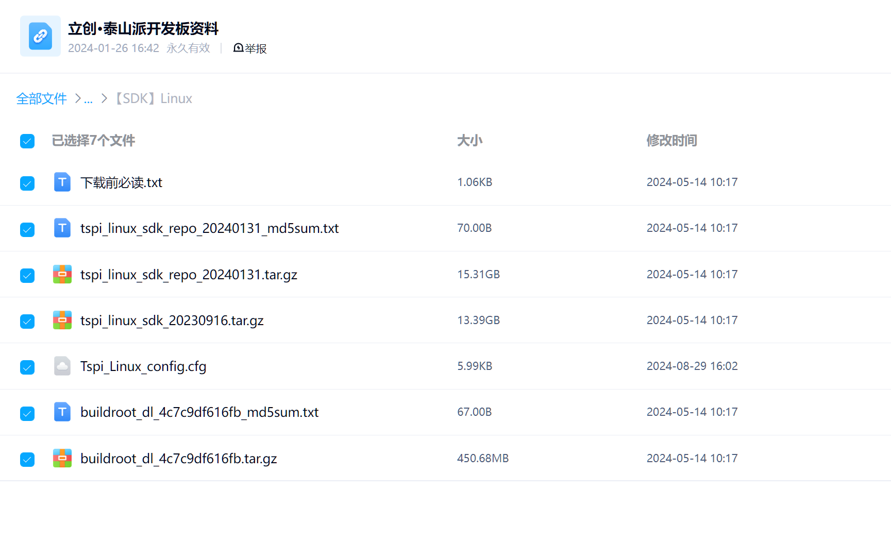
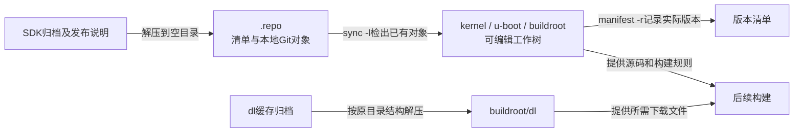
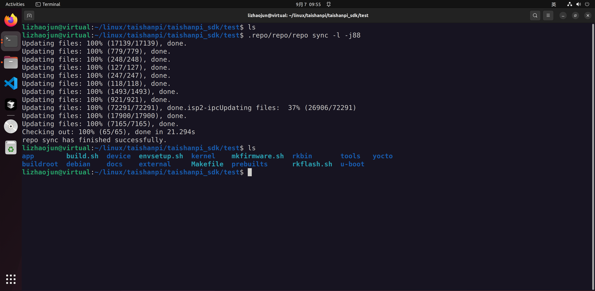
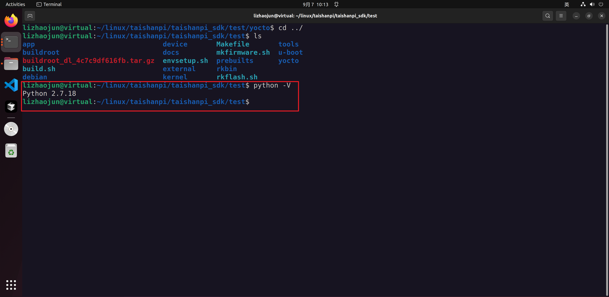

# 第1章\_从SDK归档到可追溯构建环境

要给泰山派 RK3566 编译 Linux 系统，仅有内核源码还不够：引导程序负责把内核带起来，板级配置说明板上器件和接线，根文件系统提供启动后的程序与库。这些部分必须彼此匹配。厂商 SDK（Software Development Kit，软件开发套件）把相关源码、工具、配置和构建脚本组织在一起，目的是让这套组合能够再次生成。

本章从原记录使用的 `tspi_linux_sdk_repo_20240131.tar.gz` 出发，建立“归档文件 → 配套仓库版本 → 可编译工作树 → 宿主环境”的过程。它是 **旧 SDK 的复现与诊断记录**，不是所有 RK3566 开发板的通用安装命令。原构建日志日期为 2025-09-07；本次没有重新取得完整 SDK 或完成整套构建。阅读路线见 [大纲](大纲.md)。

## 1.1\_先确定是哪套资料再讨论能否编译

SDK 文件名中的日期只能帮助区分发布包，不能替代包的摘要和每个仓库的提交。否则，同样叫“泰山派 SDK”的两次下载，可能已经包含不同内核、构建脚本或工具。若发生错误却只记住板名，后来就无法判断是代码变化还是环境变化。

原记录的资料入口为 [百度网盘](https://pan.baidu.com/s/1HtnpytCBBqBOqZi8mfV4VQ?pwd=qcxx)，提取码 `qcxx`；网盘中的历史目录是 `泰山派/第05章.【立创·泰山派】系统SDK/【SDK】Linux`。这是资料站的分类位置，不是要求在本地创建同名目录。发布位置可能变化，可由 [立创下载中心](https://wiki.lckfb.com/zh-hans/tspi-rk3566/download-center.html) 重新定位，并保存当次下载说明。

下图是原记录保留的文件清单。注意旧包实际名为 `tspi_linux_sdk_20230916.tar.gz`，并不带 `repo`：



三个包的职责不同。源码归档恢复本次构建的输入；repo 版还保存多仓库管理数据；`dl` 包提供 Buildroot 构建所需的下载缓存。把下载缓存当成编译结果，或者把两个 SDK 解压到同一个目录，都无法得到可靠的版本组合。

| 历史资料 | 在这条复现路径中的用途 | 不能据此推导的结论 |
| --- | --- | --- |
| `tspi_linux_sdk_20230916.tar.gz` | 下载说明称其为不带 Git/repo 的旧版源码包 | 不是 20240131 包的补丁，也不应混合解压 |
| `tspi_linux_sdk_repo_20240131.tar.gz` | 本文使用的 repo 版输入归档 | 日期不等于每个项目的 Git 提交 |
| 同名 `_md5sum.txt` | 与发布方记录比较，检查下载是否一致 | 同一来源的 MD5 文件不构成独立的来源认证 |
| `buildroot_dl_4c7c9df616fb.tar.gz` | 缓解构建时下载第三方源码失败的问题 | 不能保证所有配置都无需网络，也不是根文件系统镜像 |

保留已有归档及其说明，不因为选择新版就删除旧包。下面以 Linux Bash 为操作环境。先把这次使用的归档和摘要文件放入自建的 `rk3566_work/archives`，工作树单独放在 `rk3566_work/sdk`；这些目录名是本文约定。不要在 Windows PowerShell 中直接执行后面的 Linux 构建命令。

```sh
# 在已经准备好 archives 子目录的 rk3566_work 中执行。
md5sum archives/tspi_linux_sdk_repo_20240131.tar.gz
cat archives/tspi_linux_sdk_repo_20240131_md5sum.txt
sha256sum archives/tspi_linux_sdk_repo_20240131.tar.gz > sdk_archive.sha256
```

前两行的摘要必须一致，不一致就先处理下载。第三行记录自己取得的文件身份，便于之后比较，不能把自算的摘要说成发布方已经认证。原笔记没有保存发布方摘要的具体数值，因此这里不补造一个“正确值”。

## 1.2\_为什么解压后只有.repo目录

Git 的对象数据与可编辑工作树不是同一份东西。repo 是管理多个 Git 项目的工具：manifest 清单记录项目路径及版本选择，`.repo` 目录保存管理数据及仓库对象；检出后才会在 SDK 根目录看到 `kernel`、`u-boot`、`buildroot` 等源码目录。解压后只有 `.repo`，不表示源码包是空的。



图中的两条输入路径独立：检出源码不等于取得了全部第三方下载文件；缓存齐全也不能代替源码和配置。先查看归档结构，再在空目录解压，避免覆盖自己的旧工作树：

```sh
# 仍在 rk3566_work 中；sdk 必须是本次新建的目录。
tar -tzf archives/tspi_linux_sdk_repo_20240131.tar.gz | head -n 20
mkdir sdk
tar -xzf archives/tspi_linux_sdk_repo_20240131.tar.gz -C sdk
cd sdk
ls -ld .repo
```

`tar -t` 列目录，`-x` 提取，`-z` 处理 gzip，`-f` 指定归档，`-C` 指定提取位置。此流程对应原下载说明“解压后直接得到 `.repo`”的布局；如果实际包多了一层目录，应进入真正含 `.repo` 的目录，而不是复制几个子目录来拼接。预览通过 `head` 提前结束，tar 可能因管道关闭而报提示；它不承担完整性检查，实际解压必须成功。

检出前先完成下一节的解释器核对。然后在包含 `.repo` 的 SDK 根目录执行：

```sh
# SDK 根目录；先确认包内 repo 能在当前环境运行。
.repo/repo/repo --version
.repo/repo/repo sync -l -j4
.repo/repo/repo manifest -r -o ../sdk_manifest.xml
```

`-l` 是 local-only：只利用已经存在的仓库对象更新工作树，**不从远端 fetch 新对象**。原记录使用 `-j88`，88 只是当时指定的并行数，不能照搬成所有电脑的要求；这里用 4 减少资源争用，仍须按实际机器调整。若报缺对象，应核对归档完整性和该版本的下载说明，不能把去掉 `-l` 的联网更新当成等价重试，因为它可能改变输入版本。[repo 官方 sync 选项说明](https://gerrit.googlesource.com/git-repo/+/HEAD/man/repo-sync.1) 中的 `--local-only` 可用于核对这个语义；包内工具的具体选项仍以该版本为准。

`manifest -r` 把项目版本固定到提交，输出到 SDK 目录之外，便于随构建记录保存。它不保存工作树中未提交的修改；修改源码后还应另外保存补丁及各项目状态。原日志没有这份清单，不能从包名反推它。



截图末尾显示检出 65 个项目、成功结束以及源码目录。它证明那次本地检出完成，不证明当前下载、当前配置或后续编译也已完成。

若准备了缓存归档，先在 `archives` 中比较对应 MD5，再查看它的内部目录；原说明约定其解压结果落到 `buildroot/dl`。只有结构匹配才在 SDK 根目录执行：

```sh
# SDK 根目录；归档位于相邻 archives，先查看应出现 buildroot/dl。
tar -tzf ../archives/buildroot_dl_4c7c9df616fb.tar.gz | head -n 20
tar -xzf ../archives/buildroot_dl_4c7c9df616fb.tar.gz
ls -ld buildroot/dl
```

下载说明中的 `md5sum ...` 是校验命令，不是文件名。也不应手工把全部缓存文件摊平到任意位置；构建系统要按自身规则找到并校验它们。

## 1.3\_旧SDK为什么需要单独确认宿主环境

构建运行在宿主机，生成的系统运行在 RK3566。宿主上的编译器可能先编译一个打包工具，再由这个工具制作目标系统镜像。因此，即使板子的处理器和源码没变，更换宿主 GCC、库或脚本解释器，也可能在尚未生成目标程序时失败。第三章的 `host-squashfs` 就是这样的例子。

2026-10-18 核对的 [立创旧版 Linux 编译说明“准备工作”](https://wiki.lckfb.com/zh-hans/tspi-rk3566/sdk-compilation/linux-compilation.html) 展示 Ubuntu 18.04.6；本仓库旧记录使用 Ubuntu 22.04，并留下了需要修补工具的日志。原作者在 Ubuntu 24 环境的失败没有保存足够诊断，不能据此宣布“Ubuntu 24 及以上一定无法编译”，也不能猜测一定是某个库被删除。

复现旧记录时，优先保持已核对的整套环境，记录发行版、宿主编译器和 SDK 版本；迁移到新环境则把每个新错误作为待定位问题。虚拟机或容器可以隔离依赖，但其名字本身不能证明包版本、架构和权限已经合适。

```sh
# Linux 构建环境中，输出随本次构建记录保存。
cat /etc/os-release
gcc --version
g++ --version
make --version
df -h .
df -i .
```

前四项确定工具环境，最后两项分别查看容量和 inode 余量。原说明给出约 100 GB 的空间准备量；它是旧组合的估计，源码、对象文件、下载缓存和多套输出都会占空间，不能把“尚余 100 GB”当作任何配置的成功保证。

### 1.3.1\_先找到Python调用者再选择解释器

这里的 Python 是 SDK 已有构建工具的运行依赖。repo 和部分脚本由 Python 实现，C 编译器不能直接执行这些脚本；保留这个真实工具依赖，与使用 C/C++ 讲解编程机制并不矛盾。

旧记录显示过 Python 2.7.18，但未保存每个脚本的提交和要求。它不能证明整个 SDK 都应使用 Python 2。先在 SDK 根目录查看入口与实际命令位置：

```sh
head -n 1 .repo/repo/repo
command -v python python2 python3
```

`#!` 首行给出脚本的解释器入口；若通过 `/usr/bin/env python` 启动，还会查找当前 PATH。只对确实存在的命令查询版本，例如 `python3 --version`；若证据确实要求 Python 2，再检查 `python2 --version`。启动器也可能再次选择解释器，所以首行必须结合包内版本要求阅读。

[repo 官方 Python 支持说明](https://gerrit.googlesource.com/git-repo/+/stable/docs/python-support.md) 区分 repo 2.0 开始的 Python 3.6 要求与旧 1.x 路线，所核对页面已不再支持旧 Python。这说明版本要成对确定，不能证明归档中恰好是哪一版，更不能擅自升级包内 repo 后沿用旧构建结论。

### 1.3.2\_把解释器选择限制在需要它的工具

如果一个已确认的脚本需要 Python 2，而 repo 需要 Python 3，就分别满足其调用契约。不要改写全局 `/usr/bin/python`、卸载系统的 `python-is-python3` 或用 alternatives 强制所有脚本切换：同一个系统入口还可能被其他工具使用。

在隔离的旧环境确实需要 Python 2 时，先用 `apt-cache policy python2` 查看该发行版仓库是否提供候选及来源。没有候选就回到厂商环境方案，不混入其他发行版的软件源。发生语法或缺模块错误时，记录脚本路径、完整首错、SDK 和解释器版本，再处理那个调用者。



截图只证明当时 `python -V` 的结果；不能证明所有子进程均使用该解释器。本文也没有在本机安装旧解释器或修改系统软链接。

## 1.4\_依赖包按职责安装而不是混用发行版

解释器之外，构建还会调用本机编译、解析、压缩和镜像制作工具。下面保留原记录的依赖集合，去掉重复的 `chrpath`。它对应旧 Ubuntu 环境，包名能否取得、版本是否适配仍要在该环境确认；不要把 apt 找不到包解释成目标板不支持 Linux。

```sh
# 在已选定的 Ubuntu 构建环境中执行，先检查软件源和候选版本。
sudo apt-get install git ssh make gcc libssl-dev liblz4-tool expect \
    g++ patchelf chrpath gawk texinfo diffstat binfmt-support \
    qemu-user-static live-build bison flex fakeroot cmake gcc-multilib \
    g++-multilib unzip device-tree-compiler ncurses-dev
```

这条命令安装宿主依赖，不是给开发板安装程序。下面按当前用途分组，帮助从错误找到缺少的环节，而不是要求所有包都参与每个构建分支：

| 工具或包 | 当前职责 |
| --- | --- |
| git、ssh | 版本管理与远程取得资料 |
| make、gcc/g++、cmake、bison、flex、gawk | 运行构建规则、编译宿主程序与生成解析代码 |
| libssl-dev、liblz4-tool、ncurses-dev | 某些宿主工具的加密库开发文件、压缩工具和文本配置界面依赖 |
| patchelf、chrpath、diffstat、texinfo、unzip、expect | 二进制路径处理、补丁统计、文档、解包及交互脚本支持 |
| gcc/g++-multilib | 在受支持宿主上满足部分不同位宽工具的构建需求 |
| binfmt-support、qemu-user-static、live-build、fakeroot | 部分系统镜像分支的异构程序执行、镜像组织和文件属性处理 |
| device-tree-compiler | 把设备树源描述编译为二进制形式 |

现在可以说明一棵 SDK 工作树由哪些输入组成，也能区分宿主依赖和目标系统。试着判断：“repo 本地检出成功且缓存包已经解压，是否意味着构建不再需要网络？”答案是否定的：所选配置可能要求缓存中没有的文件，源码取得与包下载也属不同阶段。下一章用 [板级配置与构建产物](P02_从板级配置到系统镜像.md) 把这套输入接到具体板卡。
