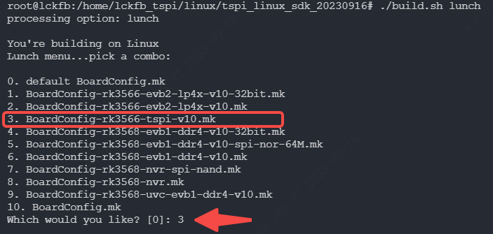
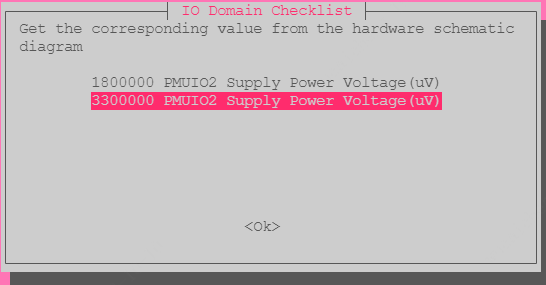
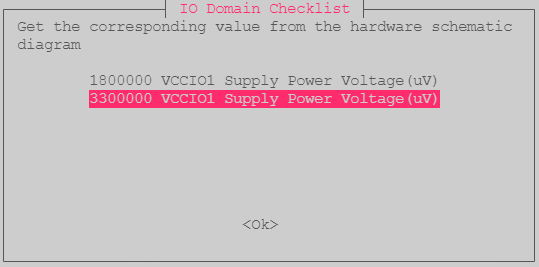
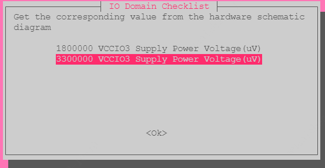
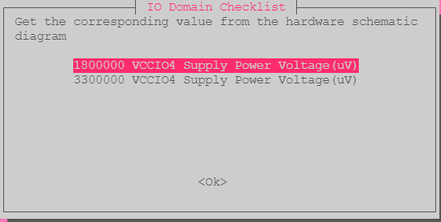
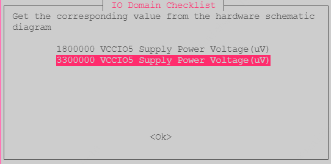
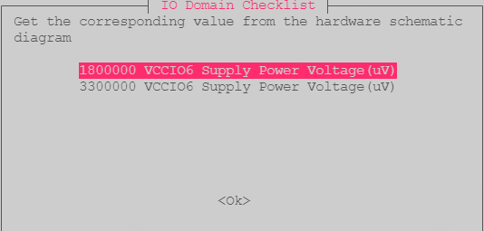
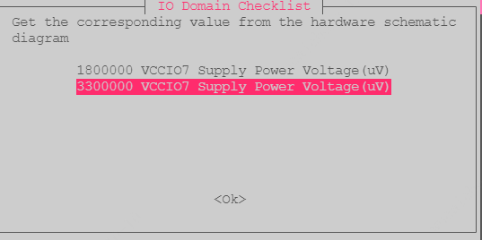
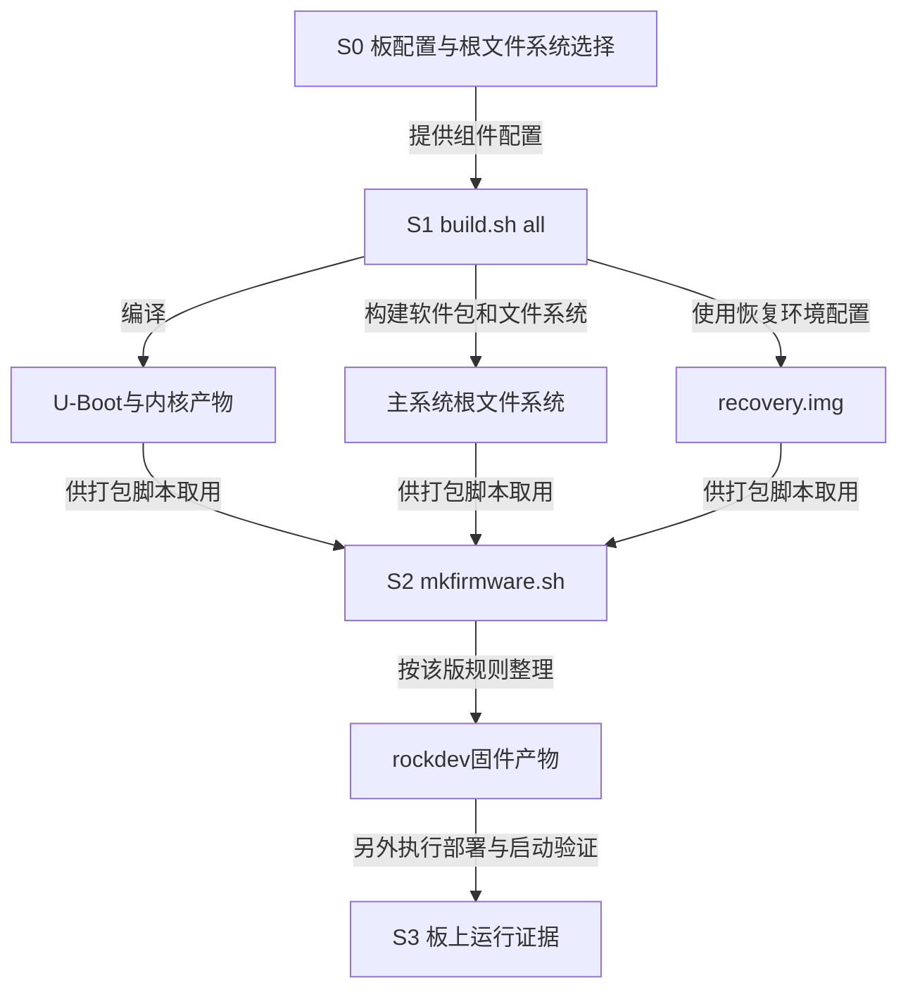

# 第2章\_从板级配置到系统镜像

[上一章](P01_从SDK归档到可追溯构建环境.md) 得到了版本可记录的源码和宿主环境，但同一套 SDK 可能服务多种板卡。知道芯片是 RK3566，还不能决定设备树、引脚供电或根文件系统。本章沿原 `BoardConfig-rk3566-tspi-v10.mk` 配置，说明这些选择如何进入构建，以及成功日志到底能证明到哪一步。

命令对应旧泰山派 SDK 的流程，示例均在 Linux Bash 的 SDK 根目录执行。涉及实际板卡电气配置时，应把板卡修订、对应原理图与该版本源码配成一组；原截图的菜单位置和高亮项不构成所有泰山派版本的配置要求。

## 2.1\_为什么必须先选择板而不只选择芯片

同一处理器可以接不同内存、存储器和外设。软件需要知道板上有哪些器件、怎样连接，以及要生成哪种系统。**板级配置** 把这些选择关联到具体内核配置、设备树、根文件系统配置及打包规则，构建脚本才能沿同一组输入执行。

原流程提供一个配置文件路径来选择目标。先确认文件存在，再执行选择动作：

```sh
# SDK 根目录，检查后再选择这份旧版泰山派配置。
ls device/rockchip/rk356x/BoardConfig-rk3566-tspi-v10.mk
./build.sh device/rockchip/rk356x/BoardConfig-rk3566-tspi-v10.mk
./build.sh -h kernel
```

第一行确认路径，第二行由 SDK 脚本设置板级选择，第三行按旧版接口检查内核构建帮助中显示的配置。若文件不存在，说明当前包不符合这条命令的前提，应核对该包的配置目录与说明，而不是新建空文件使检查通过。这里的 `-h kernel` 用法来自 [立创旧版说明“泰山派SDK板级配置”](https://wiki.lckfb.com/zh-hans/tspi-rk3566/sdk-compilation/linux-compilation.html)，不能假定所有版本都保留这个接口。

另一个入口是 `./build.sh lunch` 的交互菜单，两种方式选择同一对象，通常选其中一种即可。下图来自旧资料，其路径显示 20230916 包，所以它只用于识别文件名，不证明 20240131 包的序号也固定为 3：



选择后继续指定根文件系统方案：

```sh
# 在后续调用 build.sh 的同一个 Bash 会话中设置。
export RK_ROOTFS_SYSTEM=buildroot
```

根文件系统包含内核启动后要使用的程序、库和目录。这里选择由 **Buildroot** 这套构建系统组织它；变量值是构建分支选择，不是根文件系统的存放路径。`export` 让子进程可见，换了终端就应重新核对。

## 2.2\_电压域检查为什么不能当作普通菜单确认

构建可能弹出 IO Domain Checklist。**IO 电压域** 是一组使用相关供电条件的输入输出接口。板上电源提供实际电压，SoC 内部的电压模式与设备树中的供电描述需要和它配合。如果描述了 1.8 V，却实际接在 3.3 V 供电上，编译器仍可能生成文件，但这份文件并不能证明电气配置正确。

菜单要求从硬件原理图取得值：应先找到本板修订中对应 PMUIO/VCCIO 的电源网络，再确定它连接的电源及可能的动态切换，最后核对设备树供电引用。点击菜单并不等于硬件电压已经测量或改变。供电可动态切换时，只有一个截图中的静态值也不足以解释运行中的全部状态。

Linux 的 [Rockchip IO-domain binding 说明](https://github.com/nxp-imx/linux-imx/blob/dfaf2136deb2af2e60b994421281ba42f1c087e0/Documentation/devicetree/bindings/power/rockchip-io-domain.yaml) 明确区分供电与 IO-domain 配置：后者根据供电电压使 SoC 配置保持一致，并不负责决定调压器应输出哪种电压。这里用固定 Linux 6.12.20 源码解释这条职责边界；它不是旧 SDK 内核身份，也不能替代当前板卡原理图。涉及设备树一般知识可回看 [设备树专题](../../../../../knowledge/driver_model/device_tree/大纲.md)。本章不直接读写电压配置寄存器。

### 2.2.1\_先读菜单中的单位和对象

菜单中的 `1800000` 与 `3300000` 单位是微伏（µV），分别是 1.8 V 与 3.3 V；PMUIO2、VCCIO1 等是电压域名称，不是 GPIO 全局编号。以下表格只转录原图的高亮项，提供对照，**不将历史选择升级为本次板卡验证结果**。

| 菜单对象 | 原图高亮值（µV） | 换算 |
| --- | --- | --- |
| PMUIO2 | 3300000 | 3.3 V |
| VCCIO1 | 3300000 | 3.3 V |
| VCCIO3 | 3300000 | 3.3 V |
| VCCIO4 | 1800000 | 1.8 V |
| VCCIO5 | 3300000 | 3.3 V |
| VCCIO6 | 1800000 | 1.8 V |
| VCCIO7 | 3300000 | 3.3 V |

图中没有提供全部可能电压域，不能据此宣称遗漏的域不存在或无需配置。也不能把所有接口一律选成 3.3 V 来“统一”。

### 2.2.2\_对照原始选择画面

PMUIO2 与 VCCIO1 的画面均高亮 3300000。画面顶部的要求是取得原理图对应值，并不是让用户任选一个能通过编译的值：





VCCIO3 高亮 3300000，VCCIO4 高亮 1800000。两个域的差异说明“同一芯片”并不意味着各域配置相同：





最后三张中，VCCIO5 与 VCCIO7 高亮 3300000，VCCIO6 高亮 1800000。应逐域核对，而非记住菜单顺序后批量按回车：







本次没有取得与读者实物一一对应的板修订和原理图，所以这些画面保留为历史证据，实际烧写前的电气核对仍未完成。

## 2.3\_把编译成功与固件打包分成两个阶段

板级输入确定以后，构建脚本会分别驱动引导程序、内核、根文件系统与 recovery 等部分。**Recovery** 是这里单独生成的恢复环境镜像；它有自己的构建配置和输出，不应把它与主系统根文件系统的目录混成一份。



图中 S1 的成功只说明它负责的构建步骤完成，S2 才整理固件，S3 还要验证实际写入和启动。每一段都消费上一段的产物，日志不能替后面的阶段作证。按照原流程运行：

```sh
# SDK 根目录；先完成 S0，并保留原始标准输出、标准错误与退出状态。
./build.sh all
```

若失败，在这一步停下，按 [第三章](P03_从构建首错定位宿主工具与输出状态.md) 找到出错组件。不要在失败后继续打包旧输出，再以“有镜像文件”宣称本次成功。确认 S1 成功后才继续：

```sh
# 同一份 SDK 和板配置，S1 成功后执行 S2。
./mkfirmware.sh
ls -l rockdev
```

`rockdev` 是旧流程的固件输出位置。查看时间、符号链接目标与文件摘要，并保存对应的 SDK 清单和补丁，才能判断产物来自哪次输入。它不自动意味着已经生成升级总包；总包、分散镜像和烧写入口要以该版打包脚本及目标介质要求区分。本章不提供未经核对的分区地址或烧写命令。

## 2.4\_怎样阅读一次recovery成功日志

下面保留原 2025-09-07 日志。仅将原机器的 SDK 绝对路径统一替换为 `<sdk>`，其他数字、时间与摘要保持原记录；这不是本次重新构建输出。

```text
...
Done in 9min 00s
log saved on <sdk>/br.log
====Build rockchip_rk356x_recovery ok!====
pack recovery.img...fdt {
kernel {
ramdisk {
resource {
FIT description: U-Boot FIT source file for arm
Created:         Sun Sep  7 12:18:42 2025
 Image 0 (fdt)
  Description:  unavailable
  Created:      Sun Sep  7 12:18:42 2025
  Type:         Flat Device Tree
  Compression:  uncompressed
  Data Size:    118138 Bytes = 115.37 KiB = 0.11 MiB
  Architecture: AArch64
  Load Address: 0xffffff00
  Hash algo:    sha256
  Hash value:   7f63ee7695ea3addd42d4d2a0ecfdf499294d80b374608ffab22ee611a544d84
 Image 1 (kernel)
  Description:  unavailable
  Created:      Sun Sep  7 12:18:42 2025
  Type:         Kernel Image
  Compression:  uncompressed
  Data Size:    22390792 Bytes = 21866.01 KiB = 21.35 MiB
  Architecture: AArch64
  OS:           Linux
  Load Address: 0xffffff01
  Entry Point:  0xffffff01
  Hash algo:    sha256
  Hash value:   525a5cf668720894110bcb98fcc458397d978cadf799c8d9057648877d56c305
 Image 2 (ramdisk)
  Description:  unavailable
  Created:      Sun Sep  7 12:18:42 2025
  Type:         RAMDisk Image
  Compression:  uncompressed
  Data Size:    7813163 Bytes = 7630.04 KiB = 7.45 MiB
  Architecture: AArch64
  OS:           Linux
  Load Address: 0xffffff02
  Entry Point:  unavailable
  Hash algo:    sha256
  Hash value:   dbd81a4032ada0ef8ed6be1a0fbfafff6a84b51b4ed49144e8657e73af4a971b
 Image 3 (resource)
  Description:  unavailable
  Created:      Sun Sep  7 12:18:42 2025
  Type:         Multi-File Image
  Compression:  uncompressed
  Data Size:    1533440 Bytes = 1497.50 KiB = 1.46 MiB
  Hash algo:    sha256
  Hash value:   cdfa088a984535e0f646c152df5c9e992546ac68b9cdae2a685afabbe8b733ea
 Default Configuration: 'conf'
 Configuration 0 (conf)
  Description:  unavailable
  Kernel:       kernel
  Init Ramdisk: ramdisk
  FDT:          fdt
done.
you take 9:01.02 to build recovery
Running build_recovery succeeded.
Skipping build_ramboot for missing configs:  RK_CFG_RAMBOOT.
Running build_all succeeded.
```

这段输出引入 **FIT（Flattened Image Tree）**：它把内核、设备树、ramdisk 等子镜像及组合配置放在可描述的镜像结构中，供引导程序选择和加载。日志里的 `fdt` 是设备树子镜像，`ramdisk` 是内存盘镜像；`resource` 是本例另一个子镜像，不能仅凭名字推断其所有内容。`conf` 则引用要组合使用的子镜像。

先分清“格式里写了什么”和“目标机器已经做了什么”，再读这些字段。依据 [U-Boot v2023.10 FIT 格式说明](https://docs.u-boot.org/en/v2023.10/usage/fit/source_file_format.html) 的 image、hash 与 configuration 定义，本例可以这样解读；引用用于说明格式，不将该文档版本当作旧 SDK 的 U-Boot 版本：

| 日志字段 | 可以读出的信息 | 不能证明的内容 |
| --- | --- | --- |
| `Type`、`Architecture`、`OS` | 该子镜像元数据声明的类型、架构、系统 | 已在对应处理器上运行 |
| `Data Size` | 此次记录的子镜像数据长度 | 全部固件所需分区大小 |
| `Compression: uncompressed` | FIT 层标记的处理方式；不要求引导器在该层解压 | ramdisk 内部也一定无压缩 |
| `Hash algo/value` | 此子镜像的数据摘要记录 | 可信发布者签名或实际启动时已验证 |
| `Load Address`、`Entry Point` | 日志打印的加载和入口字段 | 这些值可直接当作本板物理地址使用 |
| `Default Configuration: conf` | 默认组合及其 kernel、ramdisk、fdt 引用 | 设备树电气描述与实际板卡已一致 |

这里连续出现 `0xffffff00`、`0xffffff01`、`0xffffff02`，不能据此手写内存装载命令。是否存在厂商占位值及重定位约定，需要继续核对该 SDK 的镜像生成器和引导实现；这段日志本身没有提供足够证据。它们也不是通用 FIT 规范规定的固定地址。

末尾 `Running build_recovery succeeded` 与 `Running build_all succeeded` 说明原记录的相关构建结束；`Skipping build_ramboot ... RK_CFG_RAMBOOT` 说明一个缺配置的分支被跳过，不能改写成所有可选模块均构建成功。日志没有给出本次 `mkfirmware.sh`、实际烧写和启动结果，这些仍是独立步骤。

## 2.5\_用同一条证据链检查自己的结果

如果菜单选择成功、`build_all` 成功，但启动后串口无输出，应该先怀疑 C 编译器还是认定启动已完成？两者都不能直接推出。应把已知证据停在 S1，先核对 S2 是否使用这次产物，再核对部署介质、实际引导镜像和串口条件，之后才依据启动日志定位失败阶段。

如果更换了板卡修订，只保留旧 `BoardConfig` 和电压截图，是否足以复用配置？也不够：需要重新建立板卡供电与设备树的对应关系。现在已经能从资料、配置追到产物；下一章继续解决 [构建中途失败时怎样读首错](P03_从构建首错定位宿主工具与输出状态.md)，避免把不同阶段的问题揉成一次“清缓存”。
