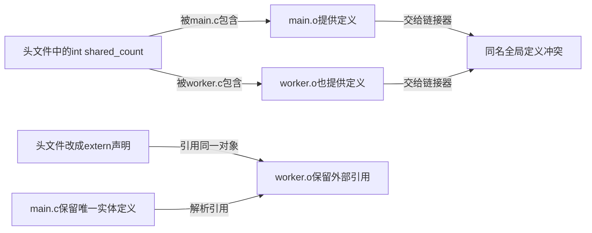
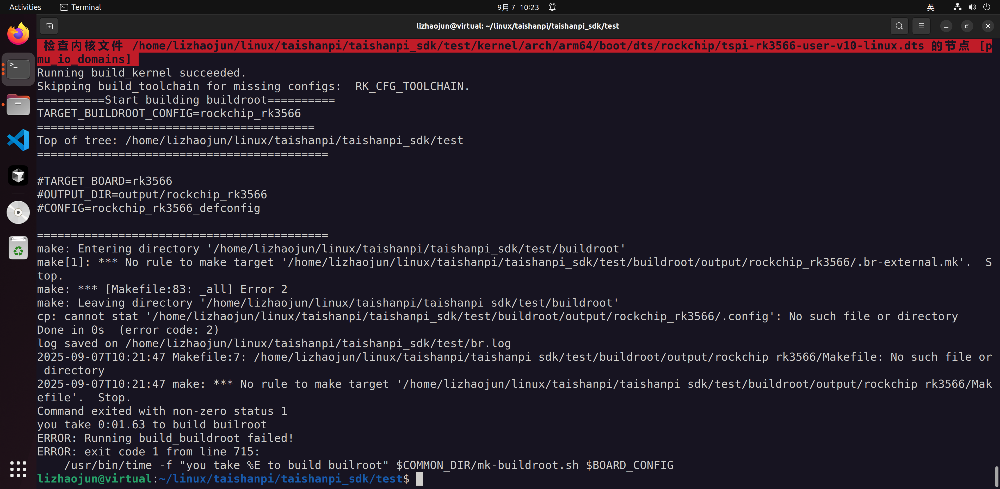

# 第3章\_从构建首错定位宿主工具与输出状态

[上一章](P02_从板级配置到系统镜像.md) 区分了板配置、组件构建、固件打包与实际启动。构建失败时也要沿这条顺序找边界：最后一行 `build_all failed` 只是上层脚本报告下层失败，不等于最初原因。本章用原记录的两个错误，分别追踪宿主程序的链接和 Buildroot 输出配置的生成。

下面的历史日志只将原机器 SDK 的绝对路径替换为 `<sdk>`，保留错误、对象文件、时间与版本标识。`<sdk>` 是日志阅读占位，不是可以原样输入的 shell 路径。本文给出的最小 C 实验可以独立运行，但它不能替代整个旧 SDK 构建。

## 3.1\_先从错误中找出谁正在构建什么

原构建在生成 `mksquashfs` 时失败。SquashFS 是压缩只读文件系统；`mksquashfs` 是制作相应镜像的程序。这里的 `host-squashfs` 表示工具运行在 **宿主机**，它把数据做成给目标系统使用的镜像。因此调用 `/usr/bin/gcc` 并不奇怪：此时不是在编译运行于 RK3566 上的内核指令。

```text
2025-09-07T11:31:20 /usr/bin/gcc  -L<sdk>/buildroot/output/rockchip_rk3566/host/lib -Wl,-rpath,<sdk>/buildroot/output/rockchip_rk3566/host/lib unsquashfs.o unsquash-1.o unsquash-2.o unsquash-3.o unsquash-4.o swap.o compressor.o unsquashfs_info.o gzip_wrapper.o lzma_xz_wrapper.o xz_wrapper.o lzo_wrapper.o lz4_wrapper.o read_xattrs.o unsquashfs_xattr.o -lpthread -lm -lz -llzma -llzma  -llzo2 -llz4 -o unsquashfs
2025-09-07T11:31:20 /usr/bin/gcc  -L<sdk>/buildroot/output/rockchip_rk3566/host/lib -Wl,-rpath,<sdk>/buildroot/output/rockchip_rk3566/host/lib mksquashfs.o read_fs.o action.o swap.o pseudo.o compressor.o sort.o progressbar.o read_file.o info.o restore.o process_fragments.o caches-queues-lists.o gzip_wrapper.o lzma_xz_wrapper.o xz_wrapper.o lzo_wrapper.o lz4_wrapper.o xattr.o read_xattrs.o -lpthread -lm -lz -llzma -llzma  -llzo2 -llz4 -o mksquashfs
2025-09-07T11:31:20 /usr/bin/ld: read_fs.o:(.bss+0x0): multiple definition of `fwriter_buffer'; mksquashfs.o:(.bss+0x400be8): first defined here
2025-09-07T11:31:20 /usr/bin/ld: read_fs.o:(.bss+0x8): multiple definition of `bwriter_buffer'; mksquashfs.o:(.bss+0x400bf0): first defined here
2025-09-07T11:31:20 /usr/bin/ld: action.o:(.bss+0x0): multiple definition of `fwriter_buffer'; mksquashfs.o:(.bss+0x400be8): first defined here
2025-09-07T11:31:20 /usr/bin/ld: action.o:(.bss+0x8): multiple definition of `bwriter_buffer'; mksquashfs.o:(.bss+0x400bf0): first defined here
2025-09-07T11:31:20 /usr/bin/ld: sort.o:(.bss+0x100000): multiple definition of `fwriter_buffer'; mksquashfs.o:(.bss+0x400be8): first defined here
2025-09-07T11:31:20 /usr/bin/ld: sort.o:(.bss+0x100008): multiple definition of `bwriter_buffer'; mksquashfs.o:(.bss+0x400bf0): first defined here
2025-09-07T11:31:20 /usr/bin/ld: info.o:(.bss+0x10): multiple definition of `bwriter_buffer'; mksquashfs.o:(.bss+0x400bf0): first defined here
2025-09-07T11:31:20 /usr/bin/ld: info.o:(.bss+0x8): multiple definition of `fwriter_buffer'; mksquashfs.o:(.bss+0x400be8): first defined here
2025-09-07T11:31:20 /usr/bin/ld: restore.o:(.bss+0x0): multiple definition of `fwriter_buffer'; mksquashfs.o:(.bss+0x400be8): first defined here
2025-09-07T11:31:20 /usr/bin/ld: restore.o:(.bss+0x8): multiple definition of `bwriter_buffer'; mksquashfs.o:(.bss+0x400bf0): first defined here
2025-09-07T11:31:20 /usr/bin/ld: process_fragments.o:(.bss+0x0): multiple definition of `fwriter_buffer'; mksquashfs.o:(.bss+0x400be8): first defined here
2025-09-07T11:31:20 /usr/bin/ld: process_fragments.o:(.bss+0x8): multiple definition of `bwriter_buffer'; mksquashfs.o:(.bss+0x400bf0): first defined here
2025-09-07T11:31:20 /usr/bin/ld: xattr.o:(.bss+0x8): multiple definition of `fwriter_buffer'; mksquashfs.o:(.bss+0x400be8): first defined here
2025-09-07T11:31:20 /usr/bin/ld: xattr.o:(.bss+0x10): multiple definition of `bwriter_buffer'; mksquashfs.o:(.bss+0x400bf0): first defined here
2025-09-07T11:31:20 collect2: error: ld returned 1 exit status
2025-09-07T11:31:20 make[2]: *** [Makefile:228: mksquashfs] Error 1
2025-09-07T11:31:20 make[1]: *** [package/pkg-generic.mk:231: <sdk>/buildroot/output/rockchip_rk3566/build/host-squashfs-3de1687d7432ea9b302c2db9521996f506c140a3/.stamp_built] Error 2
2025-09-07T11:31:20 make: *** [<sdk>/buildroot/output/rockchip_rk3566/Makefile:16: _all] Error 2
Command exited with non-zero status 1
you take 27:26.32 to build builroot
ERROR: Running build_buildroot failed!
ERROR: exit code 1 from line 715:
    /usr/bin/time -f "you take %E to build builroot" $COMMON_DIR/mk-buildroot.sh $BOARD_CONFIG
```

从后往前看，`build_buildroot failed` 是构建脚本发现错误，`.stamp_built` 是包构建阶段未完成，真正决定链接失败的是 `multiple definition`：多个 `.o` 都提供了 `fwriter_buffer` 与 `bwriter_buffer` 的定义。`first defined here` 表示链接器已经见过一个同名定义，并不是说那一份地址天然更正确。

日志没有打印 GCC 的确切版本，不能只凭 Ubuntu 22.04 推定当时一定是 GCC 11。可以保存 `gcc --version` 和完整编译命令，并据此核对默认选项及显式覆盖。以下原理来自 [GCC 10 移植说明“Default to -fno-common”](https://gcc.gnu.org/gcc-10/porting_to.html)：GCC 10 起默认不再把这种 C 暂定定义作为可合并的 common 符号处理。下面直接指定选项，避免实验依赖本机默认值。

## 3.2\_为什么同一头文件会制造多份定义

考虑一个队列工具的两个源文件。两者都需要访问同一个计数，所以把 `int shared_count;` 写进头文件，看上去像是在“共享变量”。但预处理会把头文件分别展开到各个源文件里；每个翻译单元都会带上这个文件作用域的 **暂定定义**。头文件保护宏只能防止同一个翻译单元重复包含，不能使两个独立编译的文件只定义一次对象。



图的上半部是重复产生实体的路径，下半部是明确所有者后的路径。`extern` 告诉使用者“这个对象由别处提供”；链接时仍必须有一处真正的定义。它不会分配一份额外对象，也不是把链接错误隐藏起来。

### 3.2.1\_先运行一个会失败的两文件例子

在独立的 `common_demo` 目录创建下面三个文件，或取用 [完整材料](materials/common_bad.h)。先不要改头文件；我们要让失败证明问题来自哪里。

`common_bad.h`：

```c
#ifndef COMMON_BAD_H
#define COMMON_BAD_H

/* 故意保留错误：每个包含者都会形成暂定定义。 */
int shared_count;
void increment_count(void);

#endif
```

`main.c`：

```c
#include <stdio.h>
#include "common_bad.h"

/* 此文件是对象的实际所有者；修正后仍保留这一份定义。 */
int shared_count;

int main(void)
{
    increment_count();
    printf("shared_count=%d\n", shared_count);
    return shared_count == 1 ? 0 : 1;
}
```

`worker.c`：

```c
#include "common_bad.h"

void increment_count(void)
{
    /* 使用共享对象，使用者不应再提供一个独立定义。 */
    ++shared_count;
}
```

在该目录执行：

```sh
# Linux Bash，安装了支持这些选项的宿主 GCC；此条预期链接失败。
gcc -std=c11 -Wall -Wextra -fno-common main.c worker.c -o common_demo
```

应看到 `shared_count` 多重定义。不要运行可能残留的同名旧程序来判断这次编译成功。为比较旧的宽松处理方式，可以给出不同输出名：

```sh
gcc -std=c11 -Wall -Wextra -fcommon main.c worker.c -o common_merged
./common_merged
```

在支持该行为的 GCC 环境，链接可以合并 common 符号，程序输出 `shared_count=1`。这解释了为何旧工程可能长期没有暴露问题；它不说明头文件中的对象所有权已经清楚，也不构成把整个 SDK 都加上 `-fcommon` 的理由。

### 3.2.2\_只让拥有者定义对象

现在把 `common_bad.h` 中的 `int shared_count;` 改成 `extern int shared_count;`，其他文件保持不变，再执行第一条 `-fno-common` 编译命令，并运行 `./common_demo`。应成功输出 1：`main.c` 提供对象，`worker.c` 引用同一对象。若把 `main.c` 的定义也删除，错误会变为没有定义，说明仅有 `extern` 声明还不够。

回到旧 SquashFS，已核对的上游提交为 `3de1687d7432ea9b302c2db9521996f506c140a3`。其中 [squashfs-tools/mksquashfs.h](https://kernel.googlesource.com/pub/scm/fs/squashfs/squashfs-tools/+/3de1687d7432ea9b302c2db9521996f506c140a3/squashfs-tools/mksquashfs.h) 第 136 行把两个指针放成暂定定义，而 [mksquashfs.c](https://kernel.googlesource.com/pub/scm/fs/squashfs/squashfs-tools/+/3de1687d7432ea9b302c2db9521996f506c140a3/squashfs-tools/mksquashfs.c) 第 257 行已经提供相同对象。这与实验的所有权问题对应。实际修补应按语句定位；其他版本的行号可以不同，已经修过的版本也不应重复应用。

## 3.3\_让修补经得住重新解包

在 `output/.../build/host-squashfs-...` 里临时修改头文件，可以快速验证原因；但下次清理、换输出目录或重新解包时，修改会丢失。为了让相同输入能重建，应将修改保存到包的补丁目录，让构建系统每次解包后应用。

在已确认使用上述 SquashFS 提交、且尚未含有同一修补的 SDK 中，补丁可保存为 `buildroot/package/squashfs/0001-multiple-definition.patch`。先检查该目录已有补丁和加载规则，避免覆盖现有文件；材料提供 [同内容补丁](materials/0001-multiple-definition.patch)：

```diff
diff --git a/squashfs-tools/mksquashfs.h b/squashfs-tools/mksquashfs.h
--- a/squashfs-tools/mksquashfs.h
+++ b/squashfs-tools/mksquashfs.h
@@ -135,3 +135,3 @@
 extern struct cache *reader_buffer, *fragment_buffer, *reserve_cache;
-struct cache *bwriter_buffer, *fwriter_buffer;
+extern struct cache *bwriter_buffer, *fwriter_buffer;
 extern struct queue *to_reader, *to_deflate, *to_writer, *from_writer,
```

这个补丁只改变头文件中的声明，不删除 `mksquashfs.c` 的实体。正文已在固定上游文件上验证补丁可应用；尚未验证读者 SDK 是否含额外厂商差量，也未完成整套宿主工具编译。

### 3.3.1\_为什么只重新make可能看不到新补丁

Buildroot 用阶段印记记录包是否已解包、打补丁、配置和构建。新增补丁文件后，如果原输出还标记“补丁阶段已经完成”，只重做编译可能继续使用旧的展开源码。因此要让这个包重新走解包及补丁阶段，而不是删一个链接失败的可执行文件。

已核对的 [Buildroot 2018.02-rc3 包重建说明](https://github.com/buildroot/buildroot/blob/2018.02-rc3/docs/manual/rebuilding-packages.txt) 区分 `rebuild`、`reconfigure` 和 `dirclean`。这个版本的 [squashfs.mk](https://github.com/buildroot/buildroot/blob/2018.02-rc3/package/squashfs/squashfs.mk) 也选择上述 SquashFS 提交。它提供机制对照，不等于本次取得了厂商 SDK 的全部修改。

| 动作 | 从哪里重新开始 | 对本次新增补丁的意义 |
| --- | --- | --- |
| `host-squashfs-rebuild` | 编译、安装阶段 | 通常不足以重新应用包目录的新补丁 |
| `host-squashfs-reconfigure` | 配置及之后阶段 | 同样不等于重新解包、打补丁 |
| `host-squashfs-dirclean` 后再构建 | 删除该包展开构建目录，下次从源码展开重新开始 | 可让新补丁进入流程；临时放在展开目录的手改会被丢弃 |

先把需要的改动保存为补丁，再确认该 SDK 保留对应目标。原日志主系统输出目录是 `buildroot/output/rockchip_rk3566`，如果当前仍然是它，可以在 SDK 根目录执行：

```sh
# 仅在输出目录、包名和版本均核对一致后运行。
# 这一步清理该包的展开构建目录，不是清理整个 SDK。
sdk_dir=$(pwd -P)
make -C buildroot O="$sdk_dir/buildroot/output/rockchip_rk3566" host-squashfs-dirclean
./build.sh all
```

后续日志应出现该包重新解包、应用补丁与链接。确认生成文件的相关行已经是 `extern`，而不是仅看退出码。包级重编也不自动保证最终文件系统镜像和固件已经重建；回到第二章 S1、S2 的完整产物链继续验证。不要为了绕过一个宿主包错误替换整套目标交叉工具链。

## 3.4\_缺少.br-external.mk是另一条故障链

原记录另一段日志是 recovery 输出缺少 `.br-external.mk`：

```text
===========================================
make: Entering directory '<sdk>/buildroot'
make[1]: *** No rule to make target '<sdk>/buildroot/output/rockchip_rk356x_recovery/.br-external.mk'.  Stop.
make: *** [Makefile:83: _all] Error 2
make: Leaving directory '<sdk>/buildroot'
Command exited with non-zero status 2
you take 0:00.07 to build recovery
ERROR: Running build_recovery failed!
ERROR: exit code 2 from line 858:
    /usr/bin/time -f "you take %E to build recovery" $COMMON_DIR/mk-ramdisk.sh recovery.img $RK_CFG_RECOVERY
```

这里失败于读取 Makefile 所需的生成片段，尚未进入前面的 C 链接问题。两个报错先后出现，不构成前一个必然导致后一个的证据。

原文还有一张标题误写为“没有设置 RK_ROOTFS_SYSTEM”的截图，实际显示主系统输出中 `.br-external.mk`、`.config` 和输出 Makefile 缺失。图本身不能证明变量未设置：



截图路径属于 `rockchip_rk3566`，上面的文本日志属于 `rockchip_rk356x_recovery`。两者是不同输出配置，修复其中一个并不自动修复另一个。

### 3.4.1\_先弄清这个文件由谁产生

Buildroot 允许把额外包和配置放在主源码树之外，称为 **br2-external 树**，通过 `BR2_EXTERNAL` 指明。为了记住选择并纳入相关规则，构建过程生成一个 Makefile 片段，即这份旧版本中的 `.br-external.mk`。即使没有额外树，也会生成表示“没有额外树”的片段，不能把文件缺失简单解释成用户没有配置扩展包。

已核对的 [Buildroot 2018.02-rc3 Makefile](https://github.com/buildroot/buildroot/blob/2018.02-rc3/Makefile) 第 193～203 行按以下顺序运行：先可选读取旧片段，再调用 `support/scripts/br2-external -m -o ...` 重新生成，之后强制读取。如果生成器无法写出文件，后续 include 就会报缺失。这说明真正需要查的是 **生成动作为什么没有留下所需文件**。

该版本 [support/scripts/br2-external](https://github.com/buildroot/buildroot/blob/2018.02-rc3/support/scripts/br2-external) 的入口是 Bash，使用数组等语法。缺文件并不直接证明 Python 版本错误；同样，不能把它交给 `sh` 运行后将语法错误归因于 SDK 内容损坏。新版手册使用 `.br2-external.mk` 的名字，排查旧日志时应坚持旧版本的实际名称。

### 3.4.2\_保留现场并定位生成失败

先保存完整日志和已经确认的配置，再按失败输出目录检查。下面为 recovery 日志提供只读起点；检查主系统截图时应使用其 `rockchip_rk3566` 目录，不能混用：

```sh
# SDK 根目录，针对原 recovery 日志中的输出路径。
ls -ld buildroot/output/rockchip_rk356x_recovery
ls -la buildroot/output/rockchip_rk356x_recovery
head -n 1 buildroot/support/scripts/br2-external
ls -l buildroot/support/scripts/br2-external
command -v bash
df -h buildroot
df -i buildroot
```

目录是否存在、权限与可用空间、生成器是否存在且可执行，分别对应不同原因。再查 SDK 的构建脚本如何传入 `O=`、`BR2_EXTERNAL` 和 recovery 配置；若输出目录曾被搬动，还要查其中记录的旧路径。完整日志中位于 “No rule to make target” 之前的 shell 错误，往往比最后一行更能说明问题。

确认缺失或配置错误的原因后，由该 SDK 的配置入口重新生成相应输出。旧记录采用下面的顺序重试，但没有保存足够证据证明它为何奏效：

```sh
# SDK 根目录；前提是本版支持这些入口，配置与生成失败原因已处理。
./build.sh recovery
# 只有上一条成功后才继续全量组件构建。
./build.sh all
```

这是一条原案例的恢复路径，不是“任何 external 错误都必须先 recovery”的规则。不要手工创建空 `.br-external.mk` 来消除报错，它可能遮住尚未纳入的包规则；也不要在未保存配置和手改前删除整个输出目录。恢复后要确认实际生成文件、使用的配置及该阶段成功日志。

## 3.5\_把诊断结论限制在证据能够支持的位置

本章两个例子有共同方法：先从包装脚本向下找到失败动作，再追到它消费的输入或应产生的状态。第一个是多个翻译单元各自产生全局定义，修复对象所有权后重建包；第二个是输出配置片段没有生成，先查生成器和输出目录，不能靠给 C 头文件加 `extern` 解决。

练习：日志同时有“multiple definition”和“build_buildroot failed”，应先换 RK3566 编译器吗？答案是先辨认当前编译器服务的对象：本例是宿主 `mksquashfs`，先检查其头文件定义与宿主 GCC 选项。再问：“创建一个空 `.br-external.mk` 后 make 不再报同一句错误，能否证明恢复成功？”不能。应证明片段来自正确生成过程，并且配置、包规则与后续产物一致。

这次重构验证了 C 最小模型、固定 SquashFS 头文件补丁，以及旧 Buildroot 生成器在空 external 配置下的行为；没有下载并构建完整 SDK，也没有完成板上启动。读者完成局部修复后，仍须回到 [第二章的 S1～S3](P02_从板级配置到系统镜像.md#2.3_把编译成功与固件打包分成两个阶段)，逐段建立自己的产物与运行证据。
