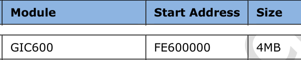
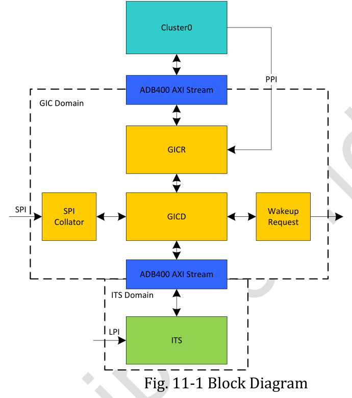
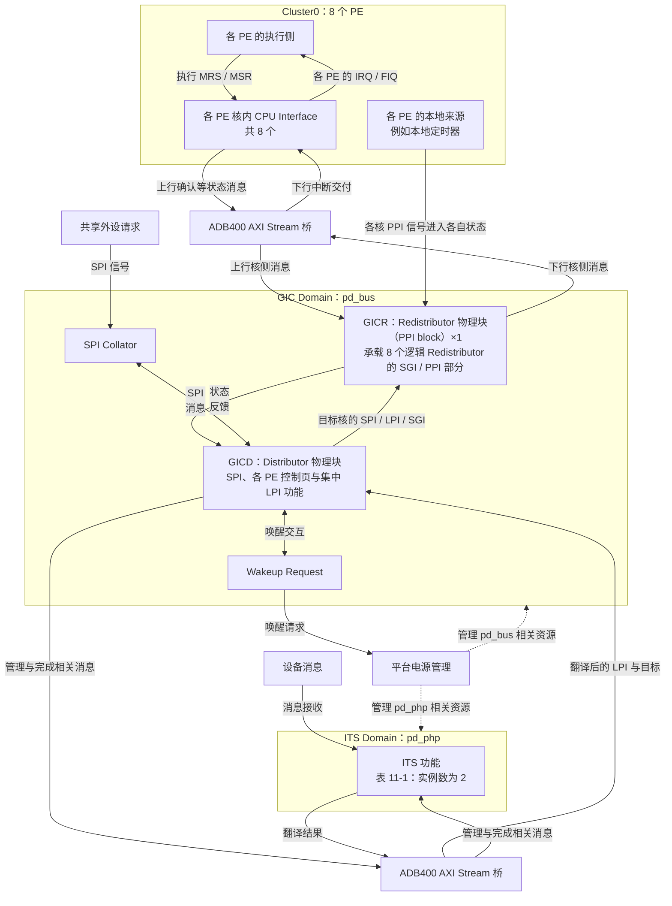
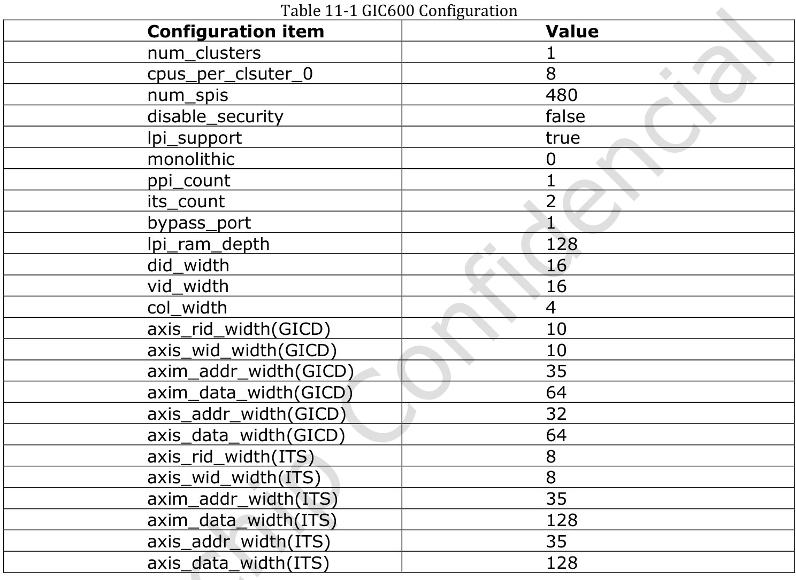
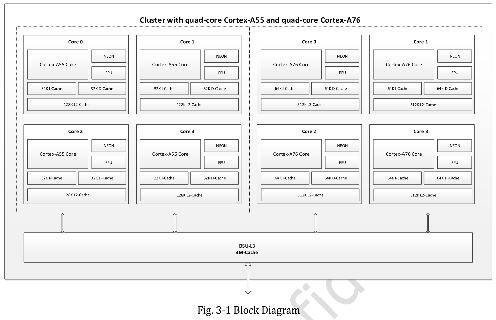

# 第1章\_RK3588的GIC-600集成与手册核对

## 1.1\_通用规则没有告诉我们这颗芯片接了什么

**讲解层次：概念到实现的映射。** 本页把 GICv3.0 的职责，经 GIC-600 r1p6 产品落实到 RK3588；芯片事实以 RK3588 TRM V1.0 Part1（2022-03-09）为主。

**通用中断控制器（Generic Interrupt Controller，GIC）** 架构规定中断的状态和软件操作规则；RK3588 是 Rockchip 的 **系统级芯片（System on Chip，SoC）** 产品，必须自己选择控制器实现、地址、连接和集成选项。规则与芯片不能相互代替。

本记录保存 RK3588 特有的手册证据与工程约束，不重复完整 GIC 教材。第一次接触这些名称时，可从[身份关系章节](../../architecture/gic/P02_从控制器规则到芯片与软件身份.md#2.1_已经知道职责_为什么还要分清名称)顺序建立概念；当前页只要求读者区分“架构规则”“硬件产品”“芯片集成”和“运行软件”。

证据基线为 RK3588 **技术参考手册（Technical Reference Manual，TRM）** V1.0 Part1，日期 2022-03-09，以及 Arm GIC-600 r1p6 TRM，文档编号 100336_0106_00_en。2026-10-17 复核原件文字、寄存器页与框图；尚未执行板上实验，也未把某套板级软件配置当作这些手册的同义物。

## 1.2\_怎样确认控制器身份

**讲解层次：实现层·芯片与产品身份。** 本节以 RK3588 TRM 11.1 确认集成对象，再以 GIC-600 r1p6 TRM 核对其遵循的架构版本。

先查 RK3588 TRM 第 11.1 节表 11-1 上方的 Overview 正文，确认采用 GIC600（手册对 GIC-600 产品专名的写法），修订 r1p6-00rel0；再查 Arm 对应 TRM 的 1.3 Compliance，确认该硬件产品遵循 GIC 架构版本 3.0。前一步解决“采用谁”，后一步解决“这个产品实现什么规则”；表 11-1 继续给出这颗芯片的具体集成配置。

表中 **局部性专属外设中断（Locality-specific Peripheral Interrupt，LPI）** 是 GIC 的消息来源类型；**中断翻译服务（Interrupt Translation Service，ITS）** 把设备事件对应到目标 LPI 和接收者。页码采用 **可移植文档格式（Portable Document Format，PDF）** 原件的阅读器页序。

| 原件位置 | 已核对信息 | 应如何使用 |
| --- | --- | --- |
| RK3588 TRM，PDF 第 1312 页，11.1 Overview，表 11-1 上方正文 | GIC600，r1p6-00rel0 | 选择 GIC-600 r1p6 实现手册，不由 600 推断代际 |
| Arm 100336，PDF 第 17 页，1.3 | 遵循 GICv3.0 | 筛选架构规范中的适用版本，不把后续扩展套进来 |
| RK3588 TRM，同一配置表 | 接入 8 个处理器、启用 LPI、配置两个 ITS | 后续学习需要覆盖消息路径；不能据此声称软件已启用全部功能 |
| RK3588 TRM，PDF 第 18 页，地址映射 | GIC600 窗口从 0xFE600000 开始 | 是查找芯片地址布局的入口，不是所有寄存器共用同一地址 |

两个 ITS 表示芯片提供两个这样的硬件实例，不表示可以任意选一个地址发送所有设备消息。官方对照：[GIC-600 r1p6 手册 100336](https://developer.arm.com/documentation/100336/0106)，1.3 Compliance；RK3588 TRM V1.0 Part1 的 11.1 Overview 与表 11-1，原件入口见[资料证据表](../../../../reference/external_resources/arm/README.md#1.4.2_型号判断的证据与适用边界)。

地址入口也应直接与原表核对。下面保留地址映射表的原列头和 GIC600 对应行；其余无关外设行省略，原来的列对应关系保持不变。

> 原表来源：Rockchip《RK3588 TRM V1.0 Part1》，2022-03-09，地址映射表，PDF 第 18 页。此图由同页原表头和 GIC600 行拼接而成，不是本文重绘；官方取得入口及原件校验值见[资料证据表](../../../../reference/external_resources/arm/README.md#1.4.2_型号判断的证据与适用边界)。

沿原表先找模块名称，再读同一行的起始地址与大小；它定位的是 GIC600 的芯片窗口。具体访问还须继续选择 Distributor、Redistributor 或 ITS 的页，再加相应寄存器偏移；不能把窗口基址直接拿来访问每个寄存器。

表 11-1 的完整集成参数放在[功能块与参数的对照](#1.4.1_把功能块与原件集成参数对应起来)中。先看控制器怎样访问内存、各块怎样连接，再区分来源容量、内部存储与接口宽度，避免把一串整数都当成同一种“中断数量”。

本页不罗列未经核对的设备中断编号。为某个设备写描述以前，还要找到它的连接条目，明确手册使用绝对硬件编号还是类型内编号，再和目标软件的绑定规则核对。

## 1.3\_内存地址与访问属性怎样影响实现

**讲解层次：概念到实现的映射。** 架构规定 LPI 的配置、逐 PE 挂起以及 ITS 的翻译关系；进入芯片地址约束前，先确定哪个物理块实际访问相应内存。

在 GIC-600 r1p6 中，**GIC 分发器（GIC Distributor，GICD）** 物理块除了处理共享来源，还集中实现各 PE 的 LPI 功能，其内存主接口访问 LPI 配置表和挂起表。ITS 物理块承担事件翻译，使用自己的内存主接口访问设备表、ITT、集合表和命令队列。两者都可以发起存储事务，不能把所有表访问都画成 CPU 发出的寄存器访问。这个功能落点依据产品手册 1.2、2.1.3 和 2.3.2；逐 PE 状态与共享缓存的完整对应见[内存状态章节](../../architecture/gic/P13_从消息请求到内存中的中断状态.md#13.3_两张表分别归谁维护)。

**讲解层次：实现层·RK3588 芯片集成。** RK3588 TRM 第 11.1 节给出这两部分内存访问地址宽度相关配置，并说明其访问范围为 0～32 GB；原件表 11-1 中相应主接口地址宽度为 35 位。从地址位数看，这是低 32 GiB 的地址空间，GiB 表示 2 的 30 次方字节。为控制器分配表时，必须确认使用的是它能够到达的物理地址，而不只是处理器能访问的虚拟地址。

同一节明确说明该芯片对 LPI 表访问只支持 **Non-shareable（非共享）** 属性。这里描述控制器发起内存访问的属性约束，不表示“整个芯片没有缓存一致性”，也不允许推导“所有普通内存都必须禁用缓存”。

影响路径是具体的：处理器写表 → 更新需要按该访问路径可见 → 控制器读取配置 → 控制器可能再缓存条目。如果软件把其他平台的共享属性或缓存假设照搬过来，处理器看到新表，控制器仍可能用旧内容。实现要核对内存分配、可访问范围、属性读回、缓存维护与失效完成等环节，不能只加一条没有语义依据的屏障。

配置表与挂起表的读写所有权见[内存状态章节](../../architecture/gic/P13_从消息请求到内存中的中断状态.md#13.3_两张表分别归谁维护)；ITS 自身的设备表、翻译表与命令队列还要分别核对其接口属性，不能凭“也是一张表”就默认所有限制完全相同。

## 1.4\_硬件连接与集成选择\_怎样约束两条中断路径

**讲解层次：概念到实现的映射。** 本节先将 IHI0069 H.b 中适用于 GICv3.0 的每 PE 职责对应到 GIC-600 r1p6，再进入 RK3588 的物理连接与电源域。

先区分图中的请求：**共享外设中断（Shared Peripheral Interrupt，SPI）** 从共享设备进入，**私有外设中断（Private Peripheral Interrupt，PPI）** 属于相应 **处理单元（Processing Element，PE）**，**软件产生中断（Software Generated Interrupt，SGI）** 则承载软件发起的核间通知。各核的 **处理器接口（CPU Interface）** 负责接收侧确认与完成；CPU 是 Central Processing Unit（中央处理器）的缩写。

先按 PE 建立逻辑对应关系：**每个 PE 各有一个逻辑 Redistributor，并有自己的核内 CPU Interface**。RK3588 的八个 PE 因而对应八个逻辑 Redistributor 和八个 CPU Interface；各 PE 的 SGI/PPI 配置、状态与接收侧接口独立。这个计数回答每份私有状态归谁，不直接规定芯片划成几个物理块。

再读芯片框图的物理实现。**GICD** 表示 Distributor 物理块；图中的 **GICR** 是产品的 **Redistributor 物理块（PPI block）**。GIC-600 把每个逻辑 Redistributor 的 SGI/PPI 页及相关功能放在 PPI 物理块，把控制页和 LPI 功能放在 Distributor 物理块。RK3588 配置的一个 PPI 物理块因此能够承载八份逻辑 Redistributor 的 SGI/PPI 部分；不是先在外部做出八个完整 Redistributor，再接入一个只负责接线的 PPI 盒子。完整字段与接口落点见[逻辑接口与物理块映射](../../architecture/gic/P04_GIC600的物理实现_从逻辑映射到输入输出.md#4.1_从GICv3到GIC600_逻辑角色怎样落到物理块)。处理器、私有请求、共享请求及 ITS 经集成链路协作，共同组成这颗芯片的中断控制系统。

这些对应关系需要具体到状态，不能只说 GICR “实现了一部分”。下面按已经建立的职责分开列出产品载体；它是对 GIC-600 r1p6 1.2、2.1、2.2 与 4.1.1 的中文整理，不是新增的芯片内部电路图。

| 逻辑职责或状态 | RK3588 中采用的产品载体 | 可依赖的关系 |
| --- | --- | --- |
| 八个 PE 各自的 SGI/PPI 分组、使能、优先级、触发配置、Pending 和 Active | 一个 PPI 物理块中的逐 PE 功能；SGI/PPI 寄存器页分别寻址 | PPI 输入按 PE 接入；一核的私有使能不等于整块所有核的使能；SGI/PPI 页的配置和状态由对应 PE 的页地址选中 |
| 逐 PE 的控制页、LPI 启用与挂起表描述 | Distributor 物理块 | GICR 控制页地址选中 PE，仍可能命中 Distributor 内部状态；不能从寄存器的 GICR 前缀推导它位于图中的 GICR 物理块 |
| LPI 配置与挂起维护 | Distributor 内的集中 LPI 功能和缓存，外部内存中保留配置表及逐 PE 挂起表 | 同芯片共享 PROPBASER 配置；各 PE 仍有自己的挂起状态。缓存集中不让同号 LPI 在所有 PE 同时挂起 |
| SPI 编程、路由、LPI 转送以及 SGI 路由 | Distributor 物理块 | 共享来源先在此选择目标；PPI 块收到目标候选后，与目标 PE 的本地候选一起排序并转送核侧 |
| 核侧确认、运行优先级与异常请求 | 八个核内 CPU Interface | 由各自 PE 的系统寄存器访问操作；普通 MMIO 编程及定时器 PPI 输入不是这个接口发出的事务 |
| 设备事件翻译与映射命令 | 两个 ITS 物理实例 | 设备消息入口和 ITS 管理页是不同用途；它们通过集成互连与 Distributor 协作，不取代各 PE 的私有状态 |

一个配置访问可以检验这张表。假设运行在某核的软件要使能 PE甲 的一个 PPI，软件用 **PE甲 的 SGI/PPI 页地址** 经系统互连访问 Distributor 编程从接口；Distributor 根据地址把操作送到 PPI 物理块中属于 PE甲 的使能状态。写入者运行在哪个核不决定目标，目标由地址选中。若软件在满足[表地址重配条件](../../architecture/gic/P13_从消息请求到内存中的中断状态.md#13.6_整体关闭与禁止一个来源不是同一保证)后改写 PE甲 的 PENDBASER，入口仍相同，落点却是 Distributor 内 PE甲 的 LPI 表描述。这两次 MMIO 访问不直接写核内 CPU Interface 的 ICC 配置寄存器；对应地址选择的是上述两份状态。

这不表示核内接口此后停留在原状态。PPI 使能生效后，若它已经挂起且其余准入条件满足，硬件便可以继续向 PE甲 交付；PE甲 随后确认该请求，又会改变 CPU Interface 的运行优先级等处理状态。直接配置落点、请求交付与确认副作用是先后不同的动作。至于各核连接哪个 PPI 物理块，已由这颗芯片的集成连线确定，两次寄存器访问均没有改写连接关系的字段。

运行路径与编程路径则不同：PE甲 的定时器把 PPI 信号送进 PPI block 中对应的私有功能，依据该 PPI 的使能、优先级及接收条件参与选择；下行消息经核侧桥送往 PE甲 的 CPU Interface。核侧协议使用目标/来源身份区分核，确认等上行信息沿同一组核侧连接的反方向返回。MMIO 读值则是寄存器状态经 Distributor 和系统互连返回软件，两条返回路径不能混画。产品手册给出了这些功能与端口关系，没有公开 RK3588 此块内部全部仲裁和存储电路；本页不为这些内部细节补造方框。

**讲解层次：实现层·RK3588 芯片集成。** **电源域（Power domain）** 是可以由平台独立管理供电或相关运行资源的一组硬件。RK3588 TRM 第 11.2 节框图与说明指出，**GIC 域（GIC Domain）** 和 **ITS 域（ITS Domain）** 分开，分别位于名为 `pd_bus` 与 `pd_php` 的电源域；这两个名字是芯片集成标识，不是 GIC 架构统一规定的名称。它们约束实际供电与交接，不能由每 PE 的逻辑状态数量推导。

先保留芯片手册的原连接图。读图时从上方 Cluster0 沿核侧 AXI Stream 桥向下找到 GICR，再沿它与 GICD 的连接观察共享来源与 ITS 支路；具体有几个核、几个 PPI 块，仍要与下一节的配置表配对。

> 原图来源：Rockchip《RK3588 TRM V1.0 Part1》，2022-03-09，11.2 Block Diagram，图 11-1，PDF 第 1313 页。下方 Mermaid 是用于逐条解释通信方向的 **教学重绘**，原件和重绘的职责分开保留。

这是原件图 11-1 的功能连接重绘：实线表示请求或协议交互，虚线表示根据正文补出的电源管理范围；保留了原图的两个 ADB400 桥位置，省略其他编程端口和时钟细节。核侧额外展开三类端点：执行侧通过系统寄存器访问 CPU Interface，本地来源把 PPI 信号送进对应 PE 的私有功能，CPU Interface 与控制器交换请求、确认和完成信息。PPI 信号没有穿过 CPU Interface；本图也未把普通 MMIO 访问画成该接口发出的事务。桥是接口通信部件，不是额外的中断控制器；桥自身的电源归属不能只凭图中摆放推断。一个 ITS 方框表示功能，实例数量仍以表 11-1 的 2 为准。

由此可以提出一个有依据的排障假设：普通来源工作正常而消息路径在某次电源切换后失败时，应额外检查 ITS 所属域与连接，而不是直接断言整个控制器都正常。该假设仍须运行证据确认。架构逻辑图与本图的逐项对应见[消息翻译章的两种观察粒度](../../architecture/gic/P14_设备事件身份与ITS实现映射.md#14.2.2_RK3588框图中的功能块与电源域)，不用回到原 PDF 才能看到必要连接。

> 对照 RK3588 TRM V1.0 Part1，11.2 图 11-1（PDF 第 1313 页），以及 [GIC-600 r1p6 TRM](https://developer.arm.com/documentation/100336/0106)，1.2 Components 与 2.2 Redistributor。芯片框图证明功能块及电源域连接，实现手册解释块内承载的每核逻辑职责。

### 1.4.1\_把功能块与原件集成参数对应起来

**讲解层次：实现层·RK3588 芯片集成。** 本节读取 TRM 11.1 表 11-1 的综合和集成参数；它们描述芯片构成，不是运行时软件可重新组织的分组。

现在用原件参数检验刚才的连接。先沿消息路径走一次：设备事件进入 ITS，ITS 区分设备和事件、选出 LPI 及接收者，再通过连接把请求交给 GIC 接收侧。因此 ITS 个数回答有几个翻译硬件实例，设备、事件和集合的宽度回答它能区分多大的身份空间；它们都不能代替图中 PPI 块所承载的每 PE 私有功能。DeviceID 是设备身份，事件号区分同一设备的事件，Collection ID 是把一组 LPI 关联到接收者的集合身份。

连接又有两种访问方向：处理器等主方访问控制器的从接口来提交事务，控制器也会作为主方访问表内存。因此接口地址宽度约束它能够寻址的范围，数据宽度描述一次传输的数据通路，不能从“128 位接口”推导“128 个中断”。先保留表 11-1 的原有两列，让读者能沿原件的参数顺序核验数值，再看后面的中文分组解释。

> 原表来源：Rockchip《RK3588 TRM V1.0 Part1》，2022-03-09，11.1 Overview，Table 11-1 “GIC600 Configuration”，PDF 第 1312 页。保留原表头、参数名、值和顺序；官方取得入口及原件身份见[资料证据表](../../../../reference/external_resources/arm/README.md#1.4.2_型号判断的证据与适用边界)。

原表把实例数、身份位数、内部存储深度和接口宽度列在一起。先找 `its_count=2`，再找 `did_width=16`，即可看到前者数硬件实例，后者数设备身份的位；同样，`axim_addr_width(GICD)=35` 和 `axis_addr_width(GICD)=32` 位于不同访问方向，不能以后一项否定前一项的低 32 GiB 寻址范围。下面按功能与接口两组给出全部配置项的 **中文对照和读法**，分组是本文整理，数值必须能逐项回到原表。

**这些是芯片综合、集成时选择的参数，不是一组待软件写入的寄存器。** 原件字段 `cpus_per_clsuter_0` 的拼写照录，不能因为拼写像笔误就改成另一项证据。

**中断标识符（Interrupt Identifier，INTID）** 是 GIC 的来源编号。芯片内部 **随机存取存储器（Random Access Memory，RAM）** 的配置深度描述内部存储配置，也不等于 INTID 空间大小。这样，下面的来源数、实例数、存储深度和身份宽度就有了各自的比较对象。

| 配置项 | 原件值 | 在本记录中的读法 |
| --- | --- | --- |
| num_clusters | 1 | 这张 GIC 配置表中的 cluster 数量，不独立证明处理器缓存拓扑 |
| cpus_per_clsuter_0 | 8 | 该 cluster 配置 8 个核 |
| num_spis | 480 | 配置的 SPI 数；实际设备连接还须对应芯片中断表 |
| disable_security | false | 集成时没有禁用安全扩展，不等于报告当前运行时安全配置 |
| lpi_support | true | 集成支持 LPI，不等于软件已启用 |
| monolithic | 0 | ITS 与 Distributor 分开，11.2 正文据此解释独立 ITS 域 |
| ppi_count | 1 | 一个 PPI 物理块，内部服务多个 PE 的独立私有功能 |
| its_count | 2 | 两个 ITS 硬件实例 |
| bypass_port | 1 | 原件的旁路端口集成参数；不据此推断当前软件绕过了 ITS |
| lpi_ram_depth | 128 | 原件的内部 LPI RAM 深度参数；不是可用 LPI 编号总数 |
| did_width | 16 | DeviceID 宽度配置，与 ITS 的设备身份能力对应 |
| vid_width | 16 | ITS 事件标识宽度配置；名字中的 vid 不能拿来证明 GICv4 虚拟中断支持 |
| col_width | 4 | Collection ID 宽度配置，与集合身份能力对应 |

接口宽度的单位都是位，下表将 **GIC 分发器（GIC Distributor）** 简记为 GICD。`axim` 表示模块作为主方发起访问的接口，`axis` 表示接收访问的从接口；这里的 `axis_` 配置前缀不能仅凭拼写当成 AXI Stream 总线名。读写事务标识宽度与数据宽度也不是同一个量。

| 接口配置项 | GICD 的原件值 | ITS 的原件值 | 用来核对什么 |
| --- | --- | --- | --- |
| axis_rid_width | 10 | 8 | 从接口读事务标识宽度 |
| axis_wid_width | 10 | 8 | 从接口写事务标识宽度 |
| axim_addr_width | 35 | 35 | 主接口能发出的地址位数；对应 1.3 节的低 32 GiB 约束 |
| axim_data_width | 64 | 128 | 主接口数据宽度，不是 INTID 宽度 |
| axis_addr_width | 32 | 35 | 从接口接收地址的宽度，不取代芯片窗口映射 |
| axis_data_width | 64 | 128 | 从接口数据宽度 |

例如原件的 `axim_addr_width(GICD)=35` 已在上表 GICD 列展开，其他带 `(GICD)`、`(ITS)` 的项同理。这两张表保留全部 25 个原件参数值；对应 PDF 第 1312 页表 11-1。DeviceID、事件和集合宽度参数的用途还可与 GIC-600 r1p6 表 4-37（4-144）的能力说明核对，而不能仅按参数英文猜含义。

### 1.4.2\_一个八核簇与一个PPI块\_怎样核对数量

**讲解层次：实现层·RK3588 的两套数量证据。** CPU 共享结构依据 TRM 第三章，GIC 集成数量依据第十一章；两者分别建立后才交叉核对。

现在可以回答一个容易被“簇”这个词混淆的问题：RK3588 在本记录采用的 TRM 中是几个 CPU 簇，GIC 又配置了几个 PPI 块？先按每 PE 一份的架构关系计数：**八个 PE 对应八个逻辑 Redistributor、八个核内 CPU Interface**。再看物理集成：按这份 TRM 的 CPU 共享结构与 GIC 集成口径，四个 Cortex-A55 和四个 Cortex-A76 组成一个八核簇，八份逻辑 Redistributor 的 SGI/PPI 部分由一个 PPI 物理块承载。核数、逻辑接口数与物理块数分别回答不同问题，不能只由前一个数推导后一个数。

先独立核对 CPU 章节，避免用 GIC 的一个参数包办处理器拓扑。TRM 第 3.1 节明确将四个 A55 和四个 A76 描述为一个 cluster；第 3.2 节说明这些核经 DSU-L3 连接系统总线，并由它处理跨时钟域问题。**DynamIQ 共享单元（DynamIQ Shared Unit，DSU）** 是 Arm 的处理器共享模块名称；本图中的 DSU-L3 直接标出了它所承载的 3 MB 共享三级缓存，而不是一个额外的 CPU 核。

> 原图来源：Rockchip《RK3588 TRM V1.0 Part1》，2022-03-09，3.2 Block Diagram，图 3-1，PDF 第 363 页。前一页的 3.1 Overview、表 3-1 CPU Configuration 与 3.2 正文在 PDF 第 362 页；原件入口与校验值见[资料证据表](../../../../reference/external_resources/arm/README.md#1.4.2_型号判断的证据与适用边界)。

按原图从核向外读：每个 A55 有自己的 128 KB L2，每个 A76 有自己的 512 KB L2；八个核都连到下方 **同一个 DSU-L3 3M-Cache 方框**。整个外框的标题也将两类四核合称一个簇。图中两类核分别从 Core 0 编到 Core 3，这是各类型内部的图示标号；把两组放回整个外框，就能数出连接同一个 DSU-L3 的八个核。

再与上节的[原集成参数表 11-1](#1.4.1_把功能块与原件集成参数对应起来)并列核对，才能从 CPU 结构走到 GIC 数量。下面只是对两处原件的 **中文证据对照**：

| 所数的对象 | 原件依据 | 本记录可下的结论 |
| --- | --- | --- |
| CPU 共享结构中的簇 | 3.1 的单簇描述、图 3-1 的一个 DSU-L3 与八核外框 | 一个包含 4 个 A55、4 个 A76 的共享 DSU 簇 |
| GIC 集成中的处理器簇与核数 | 表 11-1：`num_clusters=1`、`cpus_per_clsuter_0=8` | GIC 按一个包含八核的 Cluster0 集成，与 CPU 章节交叉印证 |
| 逻辑 Redistributor | 架构的每 PE 一份对应关系，与表 11-1 的八个核 | 八份逻辑 Redistributor；各份 SGI/PPI 状态与 LPI 接收职责归对应 PE |
| 核内 CPU Interface | 架构的每 PE 接收侧接口 | 八个 CPU Interface，分别服务各自 PE；不承载普通 MMIO 发起和 PPI 信号产生职责 |
| GIC-600 PPI 物理块 | 表 11-1：`ppi_count=1`；图 11-1 的 GICR 功能框 | 一个物理块承载八份逻辑 Redistributor 的 SGI/PPI 部分；控制页及 LPI 功能另在 Distributor 物理块 |

因此，**八个逻辑 Redistributor 与一个 PPI 物理块能够同时成立**：前者按 PE 划分状态与接口契约，后者提供其中 SGI/PPI 部分的物理实现，另外的控制与 LPI 部分放在 Distributor。不能把 PPI 块误画成连接八个外置完整 Redistributor 的第九级模块。`ppi_count` 也不表示“只有一路 PPI 请求”；具体每个 PE 有哪些 PPI 输入还须查接口与连接定义。

官方摘要里还存在另一种用词。[Rockchip《RK3588 Brief Datasheet V1.0》，2025-08-28，第 2 页](https://www.rock-chips.com/uploads/pdf/2022.8.26/191/Rockchip%20RK3588%20Brief%20Datasheet%20V1.0_20250828.pdf)在系统图中写 **“Dual-cluster Core”**，其下并列 Cortex-A76 Quad-Core 与 Cortex-A55 Quad-Core，并列出共享的 3 MB L3。阅读这张摘要时可以说它按大小核两组来展示 CPU；讨论共享 DSU 结构或 GIC 接线时，则必须回到 TRM 的具体结构与参数，不能把摘要中的“两组”直接解释为两个 DSU 或两个 PPI 物理块。

不同文档对 cluster 的使用范围要连同出处一起保留。本页的数量结论分别由 CPU 共享结构原图和 GIC 集成参数取证。

## 1.5\_手册中的摘要冲突怎样处理

**讲解层次：实现层·证据核对。** 本节比较 RK3588 TRM 的摘要与详细描述；架构和产品接口用于限定其可执行含义，不由摘要改写通用契约。

同一本手册也可能包含复用模板、概括或笔误。不能因为材料来自厂商，就不区分摘要与可执行的编程契约。

以下对照沿用刚才区分的处理器接口与 SGI：前者负责接收侧确认与完成，后者是由软件发起的通知类型。两者一个是接口角色、一个是来源类型，不因摘要提到“寄存器”就都采用同一种访问方式。

| 需要继续核对的说法 | 为什么不能直接转成代码 | 本专题处理方式 |
| --- | --- | --- |
| 前部摘要与第 11.1 节的共享来源数量不完全一致 | “编号空间”“配置数量”“实际连接”可能被混写 | 保留第 11 章 num_spis=480 为配置表事实，实际可用来源继续核对能力寄存器与连接表 |
| 私有来源数量与触发方式的概括 | 实现可能对某些私有输入固定类型 | 不默认每个来源都可任意切换边沿/电平 |
| “所有寄存器均内存映射” | GICv3 CPU Interface 使用系统寄存器，访问方式不能混写 | 以架构接口与实现手册分别确认 |
| 摘要提及旧式 SGI 生成入口 | GIC-600 不支持旧式兼容操作 | 主线使用已确认的系统寄存器生成路径，不照抄旧寄存器例子 |

处理冲突不是自行挑一个喜欢的数字。应同时保留原件位置、比较对象、适用条件与尚待确认项；需要运行结果才能裁决的内容，就标明未完成，而不是把推测写成芯片事实。

## 1.6\_从手册走向目标板还缺哪些证据

**讲解层次：实现层·板级验证边界。** 当前依据是 RK3588 与 GIC-600 r1p6 文档，尚未形成特定开发板及软件版本的运行证据。

下一轮板级核对应固定具体开发板、启动固件、内核提交、配置和设备描述，观察硬件能力寄存器与实际启动日志，再选择普通外设、核间通知和消息中断分别做最小实验。不能拿一条计数增长代替三条路径各自的证明。

当前已确认的是控制器身份和上述文档约束，尚未完成板上初始化、缓存一致性或休眠恢复验收。完整学习顺序由[专题大纲](../../architecture/gic/大纲.md#1.2_因果阅读地图)组织；进入实际部署时，按[第 16.3 节的板与软件基线核对](../../architecture/gic/P16_软件交接_部署与分层排障.md#16.3_部署之前先固定板与软件基线)固定目标环境和观测条件，再执行本节所列的三类最小实验。

资料的官方入口、修订、校验值与取得方式统一见[外部资料索引](../../../../reference/external_resources/arm/README.md#1.4.2_型号判断的证据与适用边界)与[机器清单](../../../../reference/external_resources/arm/manifest.json)。本文不复制原版 PDF，不以本机缓存路径代替来源身份。
