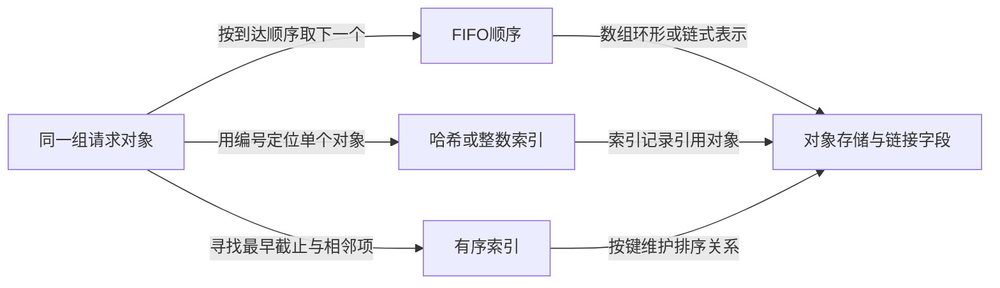

# 第2章\_Linux内核中常用的数据结构和算法

[上一章](P01_linux系统基础知识.md) 已经区分运行系统、源码和配置。本章把视线缩小到内核管理的对象：一个请求保存在哪里，怎样找到它，何时可以删除它？链表、哈希表和树回答的是其中不同部分；任务、文件和网络报文则是这些结构服务的业务对象，不能把它们当成同一层的容器名称来背。

本章是一条按问题选择结构的阅读路线。先用同一组请求比较访问需求，再把容器放回内存、执行、文件和设备职责中。各结构的完整算法和实验由链接的权威专题展开；这里要得到的是选择理由、层次关系和继续阅读的明确问题。

## 2.1\_同一组请求为什么需要不同的组织方式

假设程序管理四个请求，每个请求都有整数编号、到达次序和截止时间。若只要求按到达次序处理，可以依次从队首取出；若经常按编号取消某个请求，就需要快速按键查找；若总要选择最早到期者，又需要维护截止时间的次序。对象仍是同一组，变化的是查询问题。

**队列** 先表达处理规则，例如先进先出（FIFO）；**链表** 表达连接方式。队列可以用链表，也可以用数组构成的环形缓冲区。**优先队列** 则按优先级选择下一个对象，并不等于“任意名为 queue 的结构都会自动排序”。先分清规则和表示，才能讨论成本。

对象很少时，数组线性扫描通常容易实现：每次查看若干项，找到了就返回；连续存储也便于顺序读取。若对象增长到许多项，而频繁查询只要一个编号，每次都扫到尾部的成本才会显现。哈希把键映射到桶，先缩小候选集合，再比较真实键；它需要额外桶空间，并承担冲突处理和分布不佳时的退化。

图中多个索引可以引用同一个对象，但每个索引都带来更新责任：删除请求时，如果只从到达队列摘下，却让编号索引仍指向已释放内存，快速查找会更快地返回一个坏指针。**查询效率和对象生存期是两项独立保证。**

| 需求 | 可考虑的表示 | 必须一起承担的代价或条件 |
| --- | --- | --- |
| 小集合、批量顺序读取 | 数组与线性扫描 | 更新可能移动元素；“线性”不意味着小规模一定更慢 |
| 已知节点附近插入删除、按连接顺序遍历 | 单链表、双向或循环链表 | 查找节点仍可能逐项走；单链删除还需定位前驱关系 |
| 按键等值查找 | 哈希表 | 冲突后仍比较键；桶数量、分布与扩容策略影响成本 |
| 按排序键寻找前驱、后继、最小项 | 平衡搜索树 | 插入删除维护排序和平衡；比较规则与重复键策略由使用者明确 |
| 按稀疏整数索引取对象 | XArray 等整数索引 | 适用的键模型与接口合同不同于通用比较树，不自动管理业务对象全部生命周期 |
| 查某个地址落在哪段范围、找空洞 | 范围索引，例如 Maple Tree | 需定义端点、覆盖、拆分和并发规则，不能直接当作单点键表 |

链表的单向、双向、循环形式及完整插入删除实验从 [链表大纲](../../../knowledge/linux/data_structures/单链表_linked_list/大纲.md) 进入；冲突如何形成、为什么 `hlist` 只解决桶内连接，见 [哈希表大纲](../../../knowledge/linux/data_structures/哈希表_Hash_Table/大纲.md)。树的高度、退化、旋转和内核接口从 [树专题](../../../knowledge/linux/data_structures/红黑树_rb-tree/大纲.md) 进入。不要从上表直接跳到 API，先在对应专题建立那个结构所维护的不变量。

## 2.2\_有序查询不能只比较算法名字

继续请求场景。如果请求只在批次开始时生成，之后反复查询，先排序再二分查找是合理候选：构建阶段付排序成本，查询时反复排除一半的有序区间。若请求一直动态插入、取消，维护有序数组可能频繁搬移元素，这才引出动态有序树的价值。二分查找的前提是可按中点访问且已按同一规则排序，不能直接套在任意链表上。

红黑树与 AVL 都通过额外约束避免二叉搜索树长成细链。AVL 更直接限制左右子树高度差，红黑树用颜色与黑高约束限制高度；具体取舍要连同查询次数、更新、节点布局和实现成本比较。固定的 Linux `rbtree` 接口使用嵌入对象的 `rb_node`，而不是替调用者保存任意键和值；查找比较和并发保护仍由调用方组织。AVL 在本章用于理论对照，不虚构一个通用内核 `struct avl_tree` 接口。

固定版本的 [`Documentation/core-api/rbtree.rst`](../../../research/source_reading/linux/Documentation/core-api/rbtree.rst) 还给出平衡所需旋转次数的界：插入最多两次、删除最多三次，查找保持 `O(log n)`。旋转有界不等于一次操作只有常数时间，因为定位、沿路径调整和实际访存仍有成本；也不能把该文档的历史应用举例直接当作 6.12 的全部现状。

跳表用多层前进链接减少有序链上逐项行走的次数。增加索引层可减少查找步数，同时增加指针和更新责任；常见随机层高方案给出概率意义上的性质，不能把它当成所有实现统一的确定性最坏界。旧大纲的“跳表在内核中的应用”没有给出版本与调用位置，本章不据此声称 Linux 有一个应优先使用的通用跳表 API。

快速排序、归并排序也是需要按场景选择的算法。要比较的是当前数据表示、是否要求稳定、额外空间和最坏情况约束；不能因为函数叫 `sort` 就认定内部一定使用快速排序。若准备研究内核实际采用的排序实现，必须先锁定源码文件与版本，再分析代码，本章不把算法名目录冒充那项实现核对。

对于范围查询，再多一个约束：请求可能不是“编号等于 8”，而是“地址 8 属于哪个映射区间”。Linux 6.12 的 `mm_struct.mm_mt` 是 Maple Tree，`address_space.i_pages` 是 XArray；这两个已核对字段说明范围与整数索引承担不同任务。它们不是“6.12 把所有树都换掉”的证据，也不能把旧版 VMA 红黑树字段无条件用于本版。范围查询的四种不同答案在 [VMA 查询单元](../../../knowledge/linux/data_structures/红黑树_rb-tree/P14_从地址查询到VMA范围修改.md) 展开。

> 版本依据：上述字段来自 [固定 Linux 基线](../../../research/source_reading/linux/SOURCE_BASELINE.md) 的 [`include/linux/mm_types.h`](../../../research/source_reading/linux/include/linux/mm_types.h) 与 [`include/linux/fs.h`](../../../research/source_reading/linux/include/linux/fs.h)。这里以字段存在证明使用关系，不据此推导整套算法或性能。具体 Maple 实现沿树专题进入其对应模块导读。

## 2.3\_分配内存\_描述映射和缓存内容各管什么

选择了容器，还得决定节点来自哪里。**物理页分配** 解决取得哪些页的问题，伙伴系统按块阶组织空闲页并支持分裂、合并；**对象分配** 则常通过 slab 类分配器把页组织成适合某类对象的槽位。二者是不同粒度的协作，不能因为都返回可用内存就把它们统称为同一个“内存池”。预留对象以保障特定路径进展的池，又有独立的资源预算与回收合同。

随后还要解释地址。**页表** 保存地址转换与访问属性，**VMA** 描述进程虚拟地址区间的映射语义和权限。存在一段 VMA，不意味着其每一页都已分配、驻留并可立即访问；缺页处理可能在后续按条件补齐映射。分段属于另一类地址组织概念，不能在没有架构条件时把“分页与分段”写成所有 Linux 目标都相同的硬件流程。

物理页还可能按地址范围或访问限制分成不同 zone。DMA 相关区域、高端内存等名称反映平台与配置约束，不能假定每个系统都有同一组 zone，更不能用 HighMem 为 32 位进程增加指针宽度。虚拟范围、物理容量、窗口映射和高端内存的区别在 [地址空间与容量](../../../knowledge/foundations/computer_architecture/address_space_and_capacity.md) 已有完整说明。

最后是缓存：文件内容驻留在内存，可让后续读取复用已有数据；它需要同时维护“哪份文件的哪个偏移”“内容状态”“谁仍在使用”。页缓存与路径查找使用的目录项缓存不是同一种对象。下一节把这些状态放回一次文件操作，避免把所有包含 cache 的结构都当成可以随便丢弃的副本。

## 2.4\_对象结构保存业务状态\_容器负责组织关系

一个请求由线程发出，内核需知道它属于谁、操作哪个文件，以及什么时候可以继续。于是出现任务、文件、等待项等业务对象。它们可以包含链表节点、索引键或锁，但“里面有链表”并不是对象存在的全部理由。

| 当前问题 | 相关对象与保存的职责 | 容易混淆的边界与后续阅读 |
| --- | --- | --- |
| 谁在执行或等待 | `task_struct` 描述任务；运行队列组织可运行者，等待队列登记某个条件的等待者 | 被唤醒不等于立刻运行；CFS、实时策略等名称须结合版本与调度类，不能把所有任务当成同一固定时间片队列。见 [等待通知](../../../knowledge/linux/synchronization_and_asynchrony/synchronization/waiting_notification/大纲.md) |
| 一次打开后的状态在哪里 | 文件描述符是进程可见的整数索引，`struct file` 表示打开文件状态，`file_operations` 提供操作入口 | fd 不是 inode 指针；`dentry` 连接名字与路径关系，inode 描述文件系统对象，超级块关联文件系统实例。见 [VFS](../../../knowledge/kernel_subsystems/vfs/大纲.md) |
| 中断怎样找到软件处理入口 | `irq_desc` 等软件状态连接 Linux 中断管理与处理动作 | 软件描述符不等于芯片中的硬件状态，也不等于外设数据。见 [中断专题](../../../knowledge/linux/synchronization_and_asynchrony/asynchrony/interrupts/大纲.md) |
| 后续动作由谁执行 | 工作队列登记工作对象，由相应工作线程执行；定时器表达时间到达后的回调 | `queue_work` 与 `flush_work` 分别承担提交和特定等待职责，不能仅从名字推出重复事件计数或全部退出安全。见 [工作队列](../../../knowledge/linux/synchronization_and_asynchrony/asynchrony/workqueue/大纲.md)、[定时器](../../../knowledge/linux/synchronization_and_asynchrony/asynchrony/timers/大纲.md) |
| 设备怎样找到驱动 | `device`、`device_driver` 与总线组织设备、实现和匹配关系 | 注册设备、匹配成功、探测成功是不同节点；设备树提供描述，不是自动执行全部硬件配置。见 [设备模型](../../../knowledge/linux/device_model/大纲.md) |
| 一个 GPIO 由谁提供和使用 | `gpio_chip` 关联提供者，`gpio_desc` 表达供消费者使用的线描述 | 描述符不是可以任意访问的整数地址；申请、方向、极性与生命周期分开。见 [GPIO](../../../knowledge/driver_model/gpio/大纲.md) |

网络对象也按同样方法识别：socket 面向通信端点，协议相关的 `sock` 保存通信状态，`sk_buff` 描述报文与相关元数据，`net_device` 表示网络设备。报文对象与数据缓冲区的所有权可能分开，同一协议状态也不等于一份报文字节。收发队列用于组织交接，轮询与中断属于如何获得处理机会的机制；它们不是互相可替换的数据结构名。继续研究网络时，应从某一条真实收发路径追踪对象创建、排队、交接与释放，而不是把本段当成全部网络实现。

这里已经能回答旧清单中“为何要认识这么多结构”：它们保存的业务事实不同。容器帮助查询和排序，分配器提供存储，业务对象表达含义，执行和通知机制推进状态；一项完整操作需要把这些层连起来。

## 2.5\_找到对象之后还要保证它可以使用

回到按编号取消请求的场景。CPU A 从索引找到对象，CPU B 同时把它从队列和索引撤下并释放。A 手里的地址数值没有变化，但该地址的存储可能已归别的对象使用。把链表换成哈希表或平衡树，并没有解决这个问题。

需要分别建立访问互斥、可见性和生命周期协议。锁可以保护一段访问顺序；引用计数可以记录某类持有责任；RCU 可让读者与延迟回收按特定规则协作；内存顺序原语约束观察顺序。这些机制各有前提，不能用一条屏障代替引用，也不能用“无锁结构”推断对象永远不会被回收。完整推导从 [生命周期与 kref](../../../knowledge/linux/object_lifetime/kref/大纲.md)、[锁](../../../knowledge/linux/synchronization_and_asynchrony/synchronization/locks/大纲.md) 和 [RCU](../../../knowledge/linux/synchronization_and_asynchrony/synchronization/rcu/大纲.md) 进入。

在固定 Linux 6.12 的 [`include/linux/wait.h`](../../../research/source_reading/linux/include/linux/wait.h) 中，等待项类型使用 `wait_queue_entry_t`，不能把旧稿中的 `wait_queue_t` 当作跨版本声明。自旋锁、互斥锁、信号量、读写锁也不是仅以“快慢”排序的同类选项：能否睡眠、资源是否具有所有者、是否需要多份许可和当前执行上下文，都影响选择。这些条件应先于 API 名称进入分析。

本章作为选择路线，没有展开一套新的并发算法。下面的手工推演只判断容器选择，明确假定单执行者，不用它证明并发安全。

## 2.6\_用四个请求做一次选择练习

按顺序到达四个请求：`(编号7, 截止30)`、`(编号2, 截止10)`、`(编号9, 截止20)`、`(编号4, 截止10)`，截止数值使用同一教学时间单位，数字小者更早。规定截止相同时按到达顺序处理。

先预测：FIFO 的第一个是谁？最早截止的第一个是谁？取消编号 9 时能否直接利用截止排序认出编号的位置？

**解析：** FIFO 首先处理 7；截止顺序首先是 2，然后是 4。仅按截止时间排序，并没有同时按编号排序，所以不能拿编号 9 对截止键做二分查找。若编号取消很频繁，可以建立额外编号索引，但取消时必须同步移除所有相关登记。若只有四个元素、取消很少，直接扫描也可能更简单，不必为了使用某种树而增加维护责任。

再改变一个条件：请求一直追加，但只要按到达顺序消费且容量固定。环形队列可复用槽位，省去每项独立分配的需要；代价是必须定义满队列的拒绝、覆盖或等待策略。若还要任意按编号取消，槽位复用与取消标识又成为新问题。数据结构选择因此来自操作合同，不是从“内核经常用什么”倒推需求。

最后检查原先混在清单中的三项：伙伴系统负责提供页，VMA 负责描述地址区间，工作队列负责后续执行。三者都可能内部使用容器，却不是三种可以相互替换的查找算法。带着这些职责进入 [内核引导与初始化](P03_内核引导和初始化.md)，就能继续追问它们何时获得存储、执行者与可用接口。
