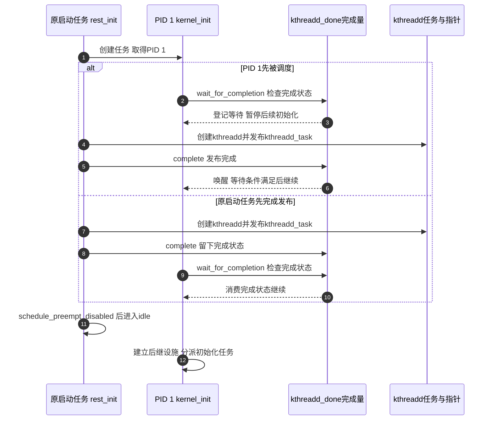

# 第3章\_内核引导和初始化

前两章讨论了 Linux 的系统角色和常用数据结构，但这些对象不会在处理器上电的一刻全部就绪。内核文件最初只是存储设备上的字节；处理器必须先取得可执行指令，前级软件再准备内存与入口条件，内核接手后才能逐步建立调度、中断、驱动和用户空间。

本章沿一次启动回答两个问题：**控制权交给了谁，他此时可以依赖哪些已经成立的条件？** 先建立从复位到用户程序的连续认识，再用 Linux 6.12.20 的固定源码核对内核阶段。[下一章](P04_uboot启动流程说明.md) 回到内核入口之前，细化 U-Boot 怎样兑现交接合同；完整构建与搬迁教程则在 [U-Boot 专题](../../../knowledge/system_software/uboot/大纲.md)，不在读书笔记中重复维护。

## 3.1\_处理器能取指\_不等于已经能运行Linux

设想一块从 eMMC 启动的开发板。eMMC 接受存储协议命令，不会因为其中保存了程序，就自动成为处理器可以直接取指的普通内存。处理器需要先从 SoC 规定的复位入口执行已有代码；这段代码可能属于片上 BootROM，再按芯片启动协议读取下一阶段。究竟从哪个地址开始、是否经过某段固件，由处理器和芯片集成共同限定，不能由“ARM64”推出固定从物理地址 0 或 NOR 开始。

这里已经有两个不同动作：**取得下一阶段的字节**，以及 **让处理器在满足条件后执行这些字节**。如果 DDR 尚不可用，就要先利用片上可用存储建立最小环境；有的平台由 ROM 按配置完成部分准备，有的平台用 SPL 等小镜像执行。SPL 是一种分阶段方案，不是每块板都必须经过的架构步骤。NOR 的 XIP、NAND/eMMC 的装载路径与 DDR 的作用见 [存储介质与取指路径](../../../knowledge/foundations/computer_architecture/boot_storage_paths.md)，那里有完整的本地图表与反例。

图中的前级固件是一项职责，实际可能由多个镜像分担。箭头表达信息与执行权的交接，不规定固定镜像数量。内核接手的内存、设备树和寄存器现场也不是 U-Boot 私有 GD 的原样延续；双方按内核启动协议传递信息。GD 是 U-Boot 的运行数据，内核不因地址上还有它的副本就自动认识其布局。

同样要分开镜像搬迁和内存映射。将程序从 SRAM 装到 DDR，可以只改变字节所在位置和下一次取指位置，SoC 的 SRAM、DDR 窗口保持原样。若镜像中的绝对引用需要修正，还要另行完成重定位；若启用页表，则改变的是地址解释。它们在 [地址与搬迁单元](../../../knowledge/system_software/uboot/P07_镜像搬迁为什么不等于改变内存映射.md) 分别推导，不能合称“DDR 接管零地址”。

## 3.2\_内核入口先建立自己的地基

前级已经把执行权交过来，为什么还不能立刻调用任意驱动？因为“内存可以读写”与“内核分配器、任务、锁和中断处理路径可用”不是同一件事。一个驱动若在中断返回路径尚未建立时打开设备中断，处理器即使收到了请求，也未必具备完成处理的环境；若在调度条件尚未成立时等待工作线程，等待对象甚至可能还没有执行者。

因此，架构入口先把启动协议给定的现场转换成内核需要的执行环境，再进入公共 C 初始化。这一过程涉及具体架构的页表、执行状态和入口汇编；不能把 AArch32 的 `r0～r2` 与 AArch64 的 `x0～x3` 混成同一套参数，也不能把 `start_kernel` 当作固件可以随意直接跳入的裸入口。两套合同及所需内存区域在 [4.3 的本地寄存器与区域表](P04_uboot启动流程说明.md#4.3_Linux接手的是一组条件_不只是一个入口地址) 对照。

**讲解层次：实现层，Linux 6.12.20 公共初始化。** 以下函数顺序来自 [源码基线](../../../research/source_reading/linux/SOURCE_BASELINE.md) 所固定的 NXP 官方提交 `dfaf2136deb2af2e60b994421281ba42f1c087e0`，原件为 [`init/main.c`](../../../research/source_reading/linux/init/main.c)。这是跨架构公共路径；SMP、具体驱动和架构钩子的实际工作量受配置影响，不表示本次工作树一定启用了多核或 ARM64。

`start_kernel()` 先显式关闭本地中断，并建立 boot CPU、体系结构与启动参数相关状态。随后准备内存管理和调度器基础，再建立中断、定时器和计时设施，才到正常开启本地中断的节点。顺序的价值在于：当异步事件到来时，处理它所需的对象已经有了位置和初始状态。这里不是把全部驱动串行调用一遍，许多工作要到有完整任务执行环境后才开始。

把这个过程分成五个观察阶段，可以避免用一条“启动完成”布尔值描述所有子系统。K0～K4 是本章阅读编号，不是源码中的枚举；内核实际维护的是多组相关状态。

| 阶段 | 当前执行者与进入条件 | 新建立的状态及后继消费者 | 此时仍不能证明什么 |
| --- | --- | --- | --- |
| K0，内核入口 | 前级按架构协议转入内核入口代码 | 架构启动路径建立后续 C 执行需要的现场，保留或解析启动信息 | 尚不能证明驱动、任务和用户程序可运行 |
| K1，公共基础设施 | boot CPU 执行 `start_kernel` | 初始化内存、调度、IRQ/时钟等基础；后续任务和中断路径消费这些状态 | `sched_init` 返回不代表所有 CPU 已上线；早期可登记工作不等于已有工作线程执行它 |
| K2，启动任务分流 | 原启动任务执行 `rest_init` | 创建 PID 1，建立并发布 `kthreadd_task`，通过 `kthreadd_done` 交接；原任务进入 idle 路径 | PID 1 此时首先执行内核的 `kernel_init`，尚未成为用户态 init |
| K3，可调度的后续初始化 | PID 1 等待交接后继续 | `kernel_init_freeable` 建立后继设施、分派 initcall，等待初始文件系统并准备根环境 | 某个 initcall 返回不证明所有设备已成功绑定、所有异步工作已结束 |
| K4，执行用户入口 | PID 1 完成必要同步和初始化内存回收 | `kernel_execve` 按选择的路径建立用户程序；程序接着组织系统服务 | 内核进入 `SYSTEM_RUNNING` 或打印尝试执行日志，不证明用户程序执行成功 |

K1 中有个很有代表性的区别：`workqueue_init_early()` 允许早期创建工作队列、登记或取消工作，真正依赖内核线程的执行要等后面的 `workqueue_init()`。**存放请求的状态先建立，消费请求的执行者后建立**，这不是丢失请求，也不是一个同名“初始化”动作已经完成所有责任。读具体子系统时应继续追踪它的状态地址和执行者何时接上，而不能只按函数名猜测。

## 3.3\_为什么创建PID1之后还要等待kthreadd

K1 已经使调度等基础设施可用，后续初始化还可能创建线程、等待设备或进行可阻塞分配。如果把这些工作永远留在原启动执行流里，就无法清晰分开“无事可做时运行的 idle 任务”和“完成初始化、最终进入用户空间的任务”。`rest_init()` 因而把它们分流。

先创建 PID 1，是为了让第一个普通进程身份留给 init；随后创建 `kthreadd`，由它服务内核线程创建需求。但新建 PID 1 一旦被调度，就可能先于父执行流跑起来。如果它立即进入需要 `kthreadd` 的初始化，就会遇到执行者尚未就绪的问题。源码不靠“这两行之间应该很快”解决它，而是使用明确的完成量。

`kthreadd_done` 是 `init/main.c` 中静态声明的完成量对象，放在初始化数据中。原启动任务创建 `kthreadd` 并将任务指针写入 `kthreadd_task` 后，调用 `complete(&kthreadd_done)`；PID 1 的 `kernel_init` 首先调用 `wait_for_completion(&kthreadd_done)`。因此等待者早到时会等待，完成方先到时也会留下可被消费的完成状态，不要求两者同时运行。

图中并列执行流的绝对时间可以变化，但“发布 `kthreadd_task` 后才能让这次等待完成”是明确的交接关系。若完成先发生，图中的等待者走已有状态分支；不能把这个分支读成凭空跳过发布。`complete` 也不是证明 `kthreadd` 已经处理了所有未来请求，只证明这里约定的初始化交接条件已经成立。

此时应同时跟踪三个对象：原任务继续承担启动 CPU 的 idle 路径；PID 1 继续执行后续初始化；`kthreadd` 留作内核线程创建的服务者。它们不是三个依次调用后返回的普通函数，更不能把 idle 任务、PID 1 和第一个用户程序当成同一个时间点。已有 [RCU 模块导读](../../../research/source_reading/rcu/navigation/P01_Linux_6.12_RCU源码总阅读索引.md) 用这项前提解释 GP 线程何时能创建；需要具体登记与调用裁剪时，见唯一的 [early initcall 实现说明](../../../research/source_reading/rcu/source_explanations/P05_Linux_6.12_Tree_RCU_GP全局生命周期源码实现.md#5.5.1_先从内核启动链定位early_initcall)。本章只保留公共启动关系。

## 3.4\_初始化表把哪些工作安排到可用的阶段

K2 解决了执行者的交接，K3 还要安排许多子系统的建立顺序。如果每个驱动都要求人工向一个总函数添加调用，公共启动文件会不断膨胀，模块化构建也很难管理。Linux 允许内建组件把初始化入口登记进特定的链接区间，由启动路径按阶段遍历；这就是这里所说的 **initcall，初始化调用登记机制**。

登记发生在构建产物组织阶段，调用发生在本次启动。函数有了登记项，不表示它已经运行；函数开始运行，也不代表它启动的异步工作已经全部结束。各层级提供粗粒度先后关系，不能自动推导任意两台设备间完整的依赖关系。

在固定版本中，`kernel_init_freeable()` 先建立完整 workqueue 等设施，再调用 `do_pre_smp_initcalls()`，之后才执行 `smp_init()`、`sched_init_smp()` 等步骤。`do_basic_setup()` 又进入普通 initcall 分派。下表给出本章实际使用的区间信息，不要求读者跳回源码才能知道 `early` 与普通八级的关系。

| 登记区间 | 本版分派者与位置 | 当前可以据此判断的先后 |
| --- | --- | --- |
| early：`__initcall_start` 到 `__initcall0_start` | `do_pre_smp_initcalls`，在 K3 的 SMP 初始化之前 | 已经过 `kthreadd_done` 交接；不能因名称 early 就放到 `start_kernel` 最前面 |
| 0～7：pure、core、postcore、arch、subsys、fs、device、late | `do_initcalls` 逐级调用 `do_initcall_level`，后者遍历相邻区间并调用 `do_one_initcall` | 层级按表中顺序进入；这一粗粒度序列不是所有设备都已可用的证明 |
| 普通区间终点：`__initcall_end` | 与各级起点共同构成遍历边界 | 是链接布局边界，不是运行时“全部初始化成功”的标志位 |

为什么不能把遍历结束当作全成功？直接看本版 `do_initcall_level()` 的职责即可：它逐项调用 `do_one_initcall()`，并没有把每个返回值汇总为“所有驱动成功”的总条件。具体函数可能记录失败，设备还可能等待后续依赖或异步工作。因此定位一个未出现的设备时，要追踪其登记项是否进入镜像、是否被调用、返回了什么，以及后续依赖是否满足；不能用“已经跑到 late”替代这些证据。

这一阶段还不能提前回收所有启动代码。某项初始化可能排出了异步任务，函数返回时任务仍在执行 `__init` 代码。`kernel_init()` 在 `kernel_init_freeable()` 返回后调用 `async_synchronize_full()`，再进入 `SYSTEM_FREEING_INITMEM` 并回收初始化内存。这项同步面向相应 async 工作，不是对任意驱动私有线程、定时器或自建队列的万能排空。使用这些机制的代码仍须遵守各自生命周期协议。

回收的是按生命周期标识的初始化代码与数据，不是“创建于启动期间的一切对象”。一个启动时创建的长期任务及其主循环可以继续存在，创建它的一次性 `__init` 函数却可以释放。若长期路径还保留对已释放初始化区域的引用，就是生命周期错误；内核不会因为那个指针仍有数值就保留整段区域。

## 3.5\_根文件系统与第一个用户程序怎样接上

内核已能调度和访问设备，但用户程序仍需要代码、解释器或动态链接器，以及它将使用的文件系统环境。这里的 **根文件系统** 是路径 `/` 所在的文件系统视图，不是“板上容量最大的内存”，也不是内核 Image 的另一个名字。

一种启动方式是提供 initramfs：内核把归档中的文件展开到初始 rootfs，使早期用户程序可以在内存中的文件系统上执行。它可以继续准备磁盘、解锁存储或切换到最终根环境。另一种路径是在没有可用早期 init 的情况下，由内核的 `prepare_namespace()` 等逻辑准备根环境，再寻找正常 init。是否使用前者取决于镜像、配置与文件内容，不能由“有 initrd 地址”直接推断早期程序一定可执行。

固定版本的 `ramdisk_execute_command` 默认指向 `/init`，可以由 `rdinit=` 改变；`execute_command` 对应 `init=`。K3 等待 initramfs 准备并打开初始控制台后，先检查早期入口的访问条件。若该检查失败，会清除早期入口选择并调用 `prepare_namespace()`。稍后 K4 才真正尝试执行程序。**能通过前一项访问检查，不等于 ELF 格式、架构或解释器依赖都正确。**

| K4 的尝试顺序 | 选择条件与成功动作 | 固定版本的失败行为 |
| --- | --- | --- |
| 保留下来的早期入口，默认 `/init` | `ramdisk_execute_command` 非空时调用 `run_init_process` | 执行失败打印错误并继续下面的选择；不因此返回 K3 自动重新运行 `prepare_namespace` |
| `init=` 指定路径 | `execute_command` 非空时尝试该程序 | 明确指定的程序执行失败会 panic，不继续默认候选 |
| `CONFIG_DEFAULT_INIT` | 构建配置非空时尝试该路径 | 失败报告错误，再尝试通用候选 |
| `/sbin/init`、`/etc/init`、`/bin/init`、`/bin/sh` | 依次尝试，成功后不再继续后续候选 | 全部失败后报告 `No working init found` 并 panic |

`run_init_process()` 最终调用 `kernel_execve()`，为已有 PID 1 安装用户程序的执行内容，而不是另建一个 PID 1。这里的 exec 交接与一次普通函数调用不同：成功后最终进入用户执行路径，不能指望用户态 init 完成系统服务后返回到 U-Boot。`kthreadd` 则继续是另一个内核任务。

有一个很实用的日志边界：本版 `Run ... as init process` 在 `kernel_execve()` **之前** 打印。因此看到它只能证明程序选择走到了尝试位置，不能证明程序已经开始执行。即使文件存在，也可能由于体系结构不匹配、解释器缺失或文件依赖不完整而失败。反过来，串口没有显示某行也不能单独证明代码未执行，控制台配置和输出路径同样需要核对。

> 文件系统概念对照 Linux 6.12 文档 [Ramfs, rootfs and initramfs](https://docs.kernel.org/6.12/filesystems/ramfs-rootfs-initramfs.html) 的 What is initramfs 与 External initramfs images；失败类别见 [Explaining the “No working init found.” boot hang message](https://docs.kernel.org/6.12/admin-guide/init.html)。本表的实际分支以固定 `init/main.c` 为依据，不从旧版概述推断当前每项返回行为。

## 3.6\_用现象判断走到了哪个交接点

现在可以把启动排障改成有边界的推理。先判断证据由哪一阶段产生，再问它证明的是“开始尝试”“局部完成”还是“后继已经消费”。无需操作硬件，也能用以下三个场景练习。

**场景一：U-Boot 打印 `Starting kernel` 后没有新输出。** 能否断言问题在第一个用户程序？不能。该信息来自最终跳转之前的引导路径，尚未证明 K0 成功。应先核对内核镜像、入口协议、DTB 与控制台条件，再沿 K0～K4 缩小范围；不能直接用“启动日志最后一行”给根文件系统定罪。

**场景二：已经创建 PID 1，但 `kthreadd_done` 尚未完成。** 能否让 PID 1 继续创建依赖完整线程环境的设施？不能。它可以被调度执行到等待点，却须停在那里。若完成先于等待，状态会保存在完成量里，后到的等待者可以继续；不需要用固定延时猜测另一个执行流何时准备好。

**场景三：日志出现 `Run /init as init process`，紧跟执行失败。** 为什么“归档里确实有 `/init`”仍不能反驳日志？因为路径存在和可执行格式、架构、解释器等条件是不同检查。还应按本地选择表追踪后续候选；不能假设执行失败会自动重新挂载另一份根文件系统，也不能把 `init=` 与 `rdinit=` 的失败行为当成相同。

最后做一次顺序判断：把 `free_initmem()` 移到 initcall 遍历刚结束的位置，是否只会节省一点内存？答案是否定的。尚在运行的异步初始化可能继续取指或访问初始化数据，提前回收使这些引用指向可被复用的区域。正确性依赖生命周期证明，不能只比较两条语句之间隔了多少毫秒。

本章已经建立从前级交接到用户入口的过程，但没有据此声称某块板实际启动成功。下一章细化前级必须准备的镜像、参数和处理器状态；要深入某个子系统，再沿其权威专题追踪具体状态、驱动路径与配置。旧版本启动摘录和调用图保存在 [历史证据记录](../../../research/investigations/uboot_vendor_baselines.md#1.6_读书笔记的旧启动图能证明到哪一步)，不把来源未定的图当作本版执行顺序。
