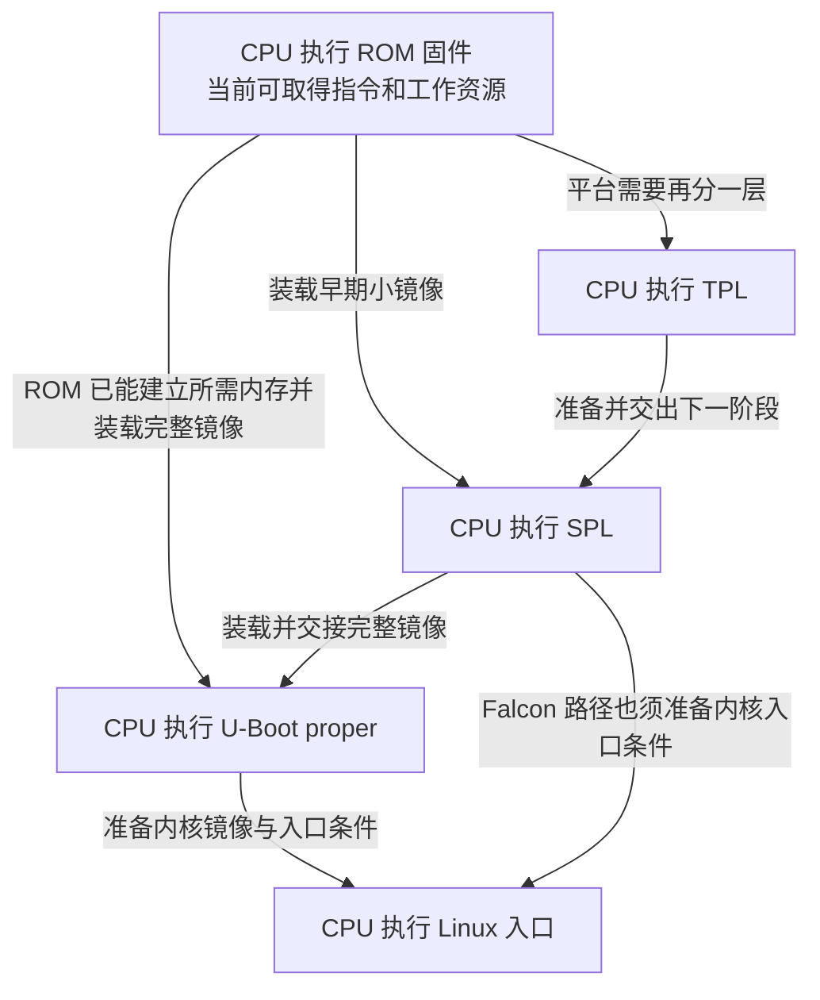
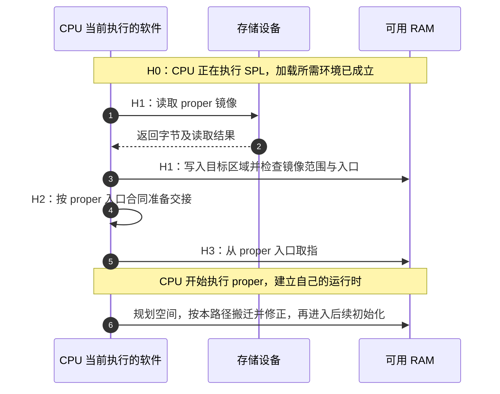
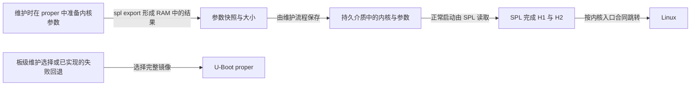

# 第4章\_uboot启动流程说明

读完 [内核引导和初始化](P03_内核引导和初始化.md)，还需要把内核入口之前的工作接起来：内核文件在存储设备中，处理器怎样开始执行它？一个函数调用能传递几个寄存器，却不能自动准备可靠的 RAM、设备树和处理器运行状态。本章沿这些交接条件复盘启动，而不把 BootROM、TPL、SPL、U-Boot proper 和 Linux 当成每块板都必须依次经过的五站。

这是本组读书笔记的引导桥接章。U-Boot 的完整构建与启动机制由 [权威专题](../../../knowledge/system_software/uboot/大纲.md) 连续展开；本章侧重各阶段交出什么、Linux 接手时要求什么，以及为什么“开始运行内核”和“用户进程拥有地址空间”仍是不同事件。这里的推导和练习不要求读者操作硬件，也不构成某块板的启动验收。

## 4.1\_内核尚不能运行时\_先由谁建立它需要的环境

**讲解层次：概念层，分阶段加载的职责。** 以一块内核镜像保存在 SD 卡、主内存使用外接 DDR 的板为例。处理器不能把 SD 卡的文件名直接当成指令地址；它要先执行一段已经可取得的程序，由这段程序访问存储控制器、取得字节，再把字节放到能够执行的位置。与此同时，DDR 控制器和板上内存还可能需要初始化。负责初始化 DDR 的程序自己也必须先有可靠的取指位置和工作空间。

这形成了启动问题的起点：**用当前已经可靠的资源，建立下一段程序所需的资源。** SoC（System on Chip，片上系统）把处理器和控制器等集成在芯片中；其 BootROM 是固化程序的存储载体，处理器执行其中的固件。不能把 CPU 与 BootROM 画成两个互相调用的软件线程。复位入口地址和启动映射由架构及芯片集成规定，不能从“ARM64”推出地址必为 0，也不能从 U-Boot 的 `reset` 标签推出处理器刚刚发生硬件复位。

片内 SRAM 是可用作早期工作区的静态 RAM；本例外接主内存采用 DDR SDRAM，需要控制器和存储器的配置配合。这里关心的是当前哪块存储已经可靠，不是把 SRAM 与 DDR 当成两种软件阶段。

如果固件能把一个较小的可修改加载器装入片内 SRAM，这个加载器便可继续建立 DDR、读取更大的下一阶段。U-Boot 的 **SPL（Secondary Program Loader）** 就用于这样的早期加载任务；**proper** 指完整 U-Boot 镜像。若所选平台还需要更早的一层小加载器，可以使用 **TPL（Tertiary Program Loader）**。名称描述工程分工，不保证 TPL 和 SPL 分别驻留在哪块存储器，也不保证 DDR 一定由 SPL 初始化。

反过来，如果 ROM 支持解释板级内存配置，再把完整镜像装入已经可用的 DDR，就可能不需要 SPL。i.MX6ULL 的 DCD（Device Configuration Data，设备配置数据）就是一个实际反例：ROM 解释配置记录，执行相应寄存器操作。DCD 是数据，不是自动运行的另一段 C 程序；其字段与完整过程见 [DCD 怎样改变启动分工](../../../knowledge/system_software/uboot/P05_为什么需要SPL以及它怎样交出下一阶段.md#5.3_用DCD反例校正BootROM的能力边界)。

图中盒子是同一处理器执行的不同程序阶段，箭头表示选定配置下的交接；分支是不同路径，不能把所有箭头串成一次启动。图省略安全固件、可信执行环境等可选阶段；存在这些阶段时还需单独核对其入口协议，不能让一个普通跳转替代它们的职责。

现在才适合比较各阶段，因为读者已经知道它们共同面对的资源约束。

| 阶段 | 当前必须先成立的条件 | 本阶段可能完成的工作 | 不能由名字推断的事 |
| --- | --- | --- | --- |
| ROM 固件 | 芯片规定的复位取指与启动资源可用 | 选择启动源，解释头或配置，装载下一段 | ROM 一定不能初始化 DDR |
| TPL/SPL | 前级已放好此镜像，并满足其入口合同 | 建立工作内存、初始化加载所需设备、检查并交出下一镜像 | 代码永远在 SRAM；必然不搬迁；所有板都需要两级 |
| U-Boot proper | 镜像及早期运行条件满足本构建要求 | 建立完整运行时、加载系统、选择启动或维护操作 | 链接地址就是最终搬迁位置；能够任意覆盖全部 RAM |
| Linux 入口 | 加载器已满足对应架构启动协议 | 建立内核自己的运行环境，继续系统初始化 | 已经建立了用户进程、根文件系统或正常控制台 |

## 4.2\_把镜像放进内存\_为什么还不能立即宣布交接成功

前级完成一次读取，只证明目标区域得到了一些字节。下一段程序能否接手，还取决于镜像格式、装载范围、入口地址、寄存器参数，以及读取这些字节的处理器状态。把“加载成功”和“下一阶段已启动”分开，才能定位没有日志时究竟断在哪一步。

先以 SPL 装载 proper 为例。SPL 在自己当前的代码与栈上运行，加载器把 proper 写入另一区域，生成入口等描述。SPL 完成该目标要求的交接准备后才跳转。proper 进入自己的汇编入口，再建立自身的栈、GD 和早期 C 环境；不能认为它直接继承 SPL 的整个 C 运行时，也不能把镜像入口直接等同于 `_main`。

**GD（global data）** 是 U-Boot 汇总当前运行信息的结构，包含内存规划等状态。它不是一块凭名字就可定位的固定硬件存储。以专题固定的 ARM proper 路径为例，早期代码先保留栈和 GD，调用 `board_init_f` 规划后续空间，按所选路径搬迁并修正地址，清理 BSS 后进入 `board_init_r`。SPL 中也存在同名函数，但它属于另一镜像和构建上下文；`f`、`r` 的字母不应被重新解释成每个阶段都通用的“功能证明”。

搬迁解决的是当前镜像在内存中的布局问题。`_TEXT_BASE` 表达链接基址，而 `gd->relocaddr` 表达运行时选定的搬迁目标，两者不能互换。把镜像复制到新位置不会自动修改 SoC 的 SRAM/DDR 地址窗口；指针修正也不等于建立页表。完整推导和可运行的数值实验见 [链接地址、运行地址和搬迁地址](../../../knowledge/system_software/uboot/P07_镜像搬迁为什么不等于改变内存映射.md#7.3_同一个镜像移动后哪些数值应该改变)。

下面固定一个教学路径：SPL 当前在 SRAM，proper 将在 DDR 运行。图中只有 CPU 执行软件；RAM 是保存字节的对象。

步骤 3 之后，RAM 中有镜像，但执行者仍是 SPL；步骤 5 才跨过入口边界。步骤 6 也不是“所有 proper 都必做完全相同的动作”，而是本例所选路径。之后 proper 装载 Linux 时，再发生一次 H1～H3，但目标协议已经改变。

| 阶段 | 谁改写什么状态 | 完成条件与失败边界 |
| --- | --- | --- |
| H0：准备加载环境 | 当前固件准备控制器、工作栈和可用 RAM | 未就绪时不能把目标窗口当成可靠内存 |
| H1：装载并检查 | 当前加载器写目标 RAM，保存尺寸、入口与校验结果 | 读取失败可能已改变部分 RAM；错误不能直接穿透到跳转 |
| H2：准备入口合同 | 当前固件设置参数，处理缓存、设备和运行状态 | 对下一阶段可见的内容与状态符合约定；“函数已返回”不足以证明全部条件 |
| H3：转交执行 | CPU 改变执行位置，下一镜像开始取指 | 此后出现的日志才能说明下一段实际运行；不能把前级成功提示当成其证据 |

发生故障时，首先确定最后一个得到证据的 H 阶段。H1 之前重点查启动源、读取和 RAM；H1～H2 查装载区重叠、格式与参数；H3 后查入口状态及下一段自己的早期环境。缓存关闭、内存自检或增加串口都是有条件的诊断方法，不是可以无条件插入任意平台的修复动作。

## 4.3\_Linux接手的是一组条件\_不只是一个入口地址

proper 提供命令行后，`bootm`、`bootz`、`booti` 等入口按所支持的镜像类型和配置组织引导；命令名本身不能证明任意格式都能启动。无论由哪条命令或 SPL 路径发起，最后都必须遵守所选 Linux 架构的入口合同。

**讲解层次：实现层，NXP Linux 6.12.20 固定发布提交的 ARM 与 AArch64 启动协议。** 版本身份见 [源码基线](../../../research/source_reading/linux/SOURCE_BASELINE.md)。以下分别摘取两份 `booting.rst` 中与本章交接有关的条件；不把 ARM32 的参数寄存器套到 AArch64，也不把“进入内核时 MMU 关闭”扩写成“整个 U-Boot 从未使用 MMU”。

### 4.3.1\_先放好内核真正要读取的数据

**设备树二进制 DTB** 是内存中的硬件描述数据。加载器把它放好，并把物理地址交给内核；内核随后从那里读取内存布局、设备和启动参数等信息。一个数值看起来像地址，不代表它所在区域仍保存着 DTB。如果解压内核覆盖了这一区域，寄存器设置完全正确也不能恢复已经丢失的数据。

类似地，外部 **initramfs** 是可选的早期用户空间文件归档，加载到内存后必须与内核、DTB 和仍在使用的固件区域错开。加载器还要停止可能继续 DMA 写内存的设备：CPU 即将跳转，不会使网卡或存储设备自动停止往旧缓冲区写入。

因此，H1 的结束条件应包含“内容仍在正确位置”，H2 的结束条件应包含“下一阶段能观察到这些内容，而且旧设备不会继续破坏它们”。缓存维护的目的也在这里：把前级写入的指令和数据按协议变成后级可见的内容；不能把含糊的“清一下缓存”当成一种通用指令。

| 对象 | ARM32 协议中的相关条件 | AArch64 协议中的相关条件 |
| --- | --- | --- |
| 内核镜像 | `zImage` 可按协议在 RAM 中调用；原始非 `zImage` 内核另有装载偏移要求 | 压缩 `Image` 需要前级解压；按头中 `text_offset` 从 2 MiB 对齐基址定位，并为 `image_size` 保留空间 |
| DTB | 8 字节对齐，在内核低端映射可覆盖且不会被解压器覆盖的 RAM 中 | 8 字节对齐，大小不超过 2 MiB，不与要求特殊映射属性的 2 MiB 区域冲突 |
| 外部 initramfs | 可选；放在低端映射可覆盖且不会被解压器覆盖的位置 | 可选；与内核完整落在一个按 1 GiB 对齐、大小至多 32 GiB 的物理窗口内 |
| 保留 RAM | 不覆盖引导仍需使用的数据；具体用途由平台约定 | 告知内核的 RAM 若未标成保留，内核可视作可用；驻留固件等区域必须正确保留 |

这些数值来自各自协议，不能凭这张表自行给一块未知板分配地址。实际规划还要把装载区、解压后的区间、栈、参数和驻留固件放到同一张板级内存图上，并核对真实容量与保留区。AArch64 头的旧版本例外及镜像标志含义，仍由同一版本协议限定。

### 4.3.2\_两种执行状态使用不同的寄存器合同

H2 完成后，CPU 即将从内核入口取指。内核入口代码首先面对的是寄存器和处理器状态，并没有机会先调用 U-Boot 的参数查询函数。寄存器约定因此是双方必须一致的接口。ARM32 的 ATAG 是旧式启动参数列表，DTB 是另一种参数载体；应按目标内核支持选择，不能把两个地址同时塞进同一参数寄存器。

| 接口项 | ARM32 的入口要求 | AArch64 主 CPU 的入口要求 |
| --- | --- | --- |
| 第一个参数 | `r0=0` | `x0=DTB` 的物理地址 |
| 其余参数 | `r1` 为机器类型；DT-only 平台建议置为全 1；`r2` 为 ATAG 列表或 DTB 的物理地址 | `x1=x2=x3=0`，保留 |
| 中断 | IRQ、FIQ 屏蔽 | `PSTATE.DAIF` 屏蔽 Debug、SError、IRQ、FIQ |
| 执行级与状态 | 无虚拟化扩展时为 SVC；支持时可按协议进入 HYP，否则 SVC；支持 ARM 指令集的 CPU 按 ARM 状态进入 | 非安全 EL2 或 EL1；EL2 是协议推荐入口；不能直接以 EL3 作为普通内核入口状态 |
| 地址转换与缓存 | MMU 关闭、D-cache 关闭；I-cache 可开可关 | MMU 关闭；I-cache 不得含对应镜像的旧内容；镜像范围清理到一致性点 PoC，并遵守系统缓存条件 |

表中的 `rN`、`xN` 是 CPU 通用寄存器，通过指令传参，不是某个外设 MMIO 基址的偏移。`PSTATE.DAIF` 是 AArch64 处理器状态中的异常屏蔽位组；PoC（Point of Coherency，一致性点）指协议要求维护后各相关观察者取得一致内容的位置，不等同于简单地把所有缓存开关关闭。

AArch64 的这张表聚焦主 CPU 的入口参数；次级 CPU 入口要求 `x0～x3` 都为 0。各 CPU 还要满足相同入口异常级、一致性域、定时器和系统寄存器条件。更高特权级固件承担的配置，不会因为 U-Boot 自己能执行普通代码而自动满足。GIC 的系统寄存器访问许可、异常路由等交接沿 [GIC 专题](../../../platforms/arm/architecture/gic/大纲.md) 继续核对；本章不把局部参数表当作完整板级移植清单。

> 本地原件：[ARM booting.rst](../../../research/source_reading/linux/Documentation/arch/arm/booting.rst)，第 4～6 节；[AArch64 booting.rst](../../../research/source_reading/linux/Documentation/arch/arm64/booting.rst)，第 2～4 节。它们同属固定提交 `dfaf2136deb2af2e60b994421281ba42f1c087e0`；这里已就地写出当前推理所需条件，原件承担完整合同与版本追溯。

## 4.4\_Falcon减少了一段正常路径\_准备责任去了哪里

现在考虑一台用途固定的设备：每次上电都装载同一组内核和参数，正常启动不需要交互式命令行。如果 SPL 已能访问所需存储、建立内存并遵守 Linux 入口合同，再运行完整 U-Boot 来重复准备，就可能成为可以削减的工作。**Falcon mode** 将这条正常路径缩为 SPL 直接引导系统；它并没有放宽上一节的任何入口条件。

**讲解层次：实现层，U-Boot v2022.10 的 Falcon 文档模型。** 文档描述一种预先准备参数快照的流程：维护阶段先进入完整 U-Boot，准备内核参数，在实际跳进内核之前停止，把参数快照保存到持久介质；之后 SPL 读取内核和这份快照，在 H2 完成所需准备后交接。原先每次启动生成的信息，变成需要维护和更新的输入。

这里最容易漏掉两个动作。第一，`spl export` 准备 RAM 中的结果，本身不把结果写入持久介质；保存位置、长度和更新一致性仍由维护流程负责。第二，改变板配置、内核参数或镜像布局后，旧快照可能不再匹配。如果仍机械加载旧内容，省掉的初始化工作就会转化成难以解释的启动失败。

| 选择 | 正常启动执行的工作 | 换来的责任与适用条件 |
| --- | --- | --- |
| SPL → proper → Linux | proper 运行所选驱动、环境与启动策略，再准备内核交接 | 需要动态选择、交互诊断或维护功能时保留；实际成本应测量 |
| SPL → Linux | SPL 直接取得系统及所需参数并完成交接 | 适合参数与介质路径足够确定、SPL 能兑现入口合同的系统；维护镜像与参数的一致性 |
| 正常 Falcon，按条件进入 proper | 正常路径直接启动，维护分支加载完整 U-Boot | 需要明确选择信号、可达的恢复镜像和经过验证的回退路径 |

因此，Falcon 不是“启动必然极快”或“必然失去恢复能力”。收益取决于实际省去了什么；恢复能力取决于系统是否设计并验证了选择与回退。不能因为某文档示例失败后会转入 proper，就假设所有加载器的任意失败都已覆盖。

> 原件：[U-Boot v2022.10，doc/README.falcon](../../../research/source_reading/uboot/upstream/v2022.10/doc/README.falcon)，Introduction、Configuration、Using spl command。该文档带有特定板和旧镜像格式示例，并保留 FDT 导出路径当时未测试的说明；这里使用它解释职责与取舍，没有把示例命令直接当成当前板的已验证操作。固定提交及其他加载实现从 [U-Boot 源码索引](../../../research/source_reading/uboot/navigation/README.md) 进入。

## 4.5\_内核建立虚拟地址空间\_没有改变板上的内存容量

内核入口合同要求 MMU 关闭，是为了让最初的执行条件明确；它不意味着 U-Boot 此前从未开启地址转换，更不意味着 Linux 永远使用物理地址。对于本节讨论的有 MMU 的系统，内核会建立自己的页表和运行环境，之后才有用户进程及其虚拟地址空间。

**讲解层次：概念层，虚拟地址范围与物理容量。** 页表描述一个虚拟地址应访问哪一物理页，并给出访问属性。两个进程可以使用相同虚拟地址，却通过各自页表访问不同物理页；也可以按共享映射规则指向同一页。换一张映射表并不会凭空增加 RAM，允许表达一个很大的地址也不保证那里已经安装了内存。

假设应用需要处理一个 6 GiB 数据集，当前采用 32 位虚拟地址和 3G/1G 用户/内核划分。进程不能一次把整个数据集映射进自己的用户区：`mmap` 虽可推迟物理页装入，映射本身仍占虚拟地址范围。可行的窗口方式是一次映射一部分，处理完解除映射，再用同一虚拟窗口映射下一段。程序付出窗口管理、数据依赖安排和潜在 I/O 等成本，得到的是分批处理能力。

多进程是另一种安排：每个进程取得自己的虚拟范围，按任务分工处理不同部分，再通过进程间通信交换结果。共享对象也要占各进程的虚拟地址；通信、同步和数据复制可能增加成本。浏览器或游戏使用多进程还可能为了隔离、可靠性等目标，不能把其设计原因归结为绕过 32 位限制。

**讲解层次：实现层，ARM Linux 的配置边界。** LPAE（Large Physical Address Extension，大物理地址扩展）改变的是可表达的物理地址和页表格式，不会把 32 位进程的虚拟指针自动变宽。支持它的处理器配合内核配置，可以把不同进程的页映射到更大的物理范围；板上容量、SoC 解码以及内核支持仍各有约束。AArch64 则提供更宽的虚拟地址选择，但实际使用位数也由硬件能力、页大小和内核配置共同决定。

| 当前要问什么 | 应查的依据 | 不能替代它的数字 |
| --- | --- | --- |
| 32 位进程有多少用户虚拟范围 | ARM `VMSPLIT_*` 配置及实际映射占用；例如 3G/1G 或 2G/2G | 处理器是 32 位，不等于用户区固定 3 GiB |
| ARM 内核能否利用 4 GiB 以上的物理地址 | 处理器 LPAE 能力、`CONFIG_ARM_LPAE`、SoC 地址地图和实际内存 | 单进程指针宽度不能直接推断全系统物理容量 |
| AArch64 使用多少虚拟地址位 | `ARM64_VA_BITS_*`、页大小及硬件支持；该版本配置包含多种选择 | “64 位”不等于实际使用全部 64 位虚拟地址 |
| 板上可以分配多少 RAM | 实际容量、内存描述、保留区与内核可用页 | 地址窗口大小和虚拟地址范围都不是可分配容量 |

该固定内核的 [ARM LPAE 页表定义](https://github.com/nxp-imx/linux-imx/blob/dfaf2136deb2af2e60b994421281ba42f1c087e0/arch/arm/include/asm/pgtable-3level.h) 使用三级页表、8 字节表项和 40 位最大物理范围，即 1 TiB；顶层只使用四项来覆盖 4 GiB 输入范围。这正说明扩大物理地址与保持 32 位虚拟范围可以同时成立。其他架构也有物理地址扩展机制，例如 x86 的 PAE，但其格式和位数须按自身规范判断，不能直接套用 ARM 的表。

例如，Linux 6.12 的 AArch64 内存布局文档给出 4 KiB 页、四级页表、48 位地址的方案，其用户虚拟范围是 `0x0000000000000000～0x0000ffffffffffff`，大小为 256 TiB；不能把别的架构常见的 128 TiB 用户区数值搬过来。这个范围也不是一次分配能够得到的实际 RAM。

> 配置证据：[ARM Kconfig](../../../research/source_reading/linux/arch/arm/Kconfig) 的 Memory split、[ARM MM Kconfig](../../../research/source_reading/linux/arch/arm/mm/Kconfig) 的 ARM_LPAE、[ARM64 Kconfig](../../../research/source_reading/linux/arch/arm64/Kconfig) 的 Virtual address space size；布局证据：[同提交 memory.rst](../../../research/source_reading/linux/Documentation/arch/arm64/memory.rst) 及 [Linux 6.12 官方布局页](https://docs.kernel.org/6.12/arch/arm64/memory.html)。配置用于约束结论，不从某个示例推断所有处理器的地址宽度。

窗口化、进程拆分、Windows 的 LAA/4GT 条件以及 GPU 资源的访问预算，另见 [地址空间与容量](../../../knowledge/foundations/computer_architecture/address_space_and_capacity.md)。这些机制各自改变不同限制，不会把一个有限地址空间自动变成完整物理内存的直接视图。

## 4.6\_用交接条件检查一段启动描述

现在把观察对象收回到启动本身。读一份新板日志或源码时，先确认当前 CPU 正在执行哪段固件、它可以访问哪块内存，再记录 H0～H3 的证据。执行位置、镜像位置、参数位置和映射规则分别记录，便不会再把“到了 DDR”“进行了重定位”“进入 Linux”当成同一动作。

试着判断下面三段描述，再看解析。

1. SPL 已打印“kernel loaded”，于是内核一定开始执行；没有日志只能说明串口驱动坏了。
2. AArch64 主 CPU 入口的 `x0` 指向正确 DTB，但仍在 EL3；只要镜像有效便可跳转。
3. 给 32 位内核启用 LPAE，就能把 6 GiB 文件完整映射到一个 3 GiB 用户空间进程中。

第一段只给出 H1 的线索，仍需检查 H2 的入口准备及 H3 的实际转移；读取、范围检查和打印语句之间也要核对真实代码，不能按消息文字补出全部保证。第二段不满足本章 AArch64 Linux 的非安全 EL2/EL1 入口要求；参数地址正确只满足合同的一项。第三段混淆物理寻址与进程虚拟范围；窗口映射或任务拆分要改变应用的处理方式，LPAE 自己不会完成这种改造。

再做一次设计选择：固定设备正常启动无需交互，但现场必须可以恢复系统。可选择保留正常 proper 路径，也可在已经实现的 Falcon 路径之外保留可触发的 proper 维护分支。选择后应分别验证正常启动、维护入口和故障回退，测量真实启动时间；不能用“少一个方框”替代验证。

本章建立的是跨阶段交接模型。要继续解释具体构建为何选中某个入口、GD 如何迁移、RELA 如何修正指针，沿 [U-Boot 专题阅读地图](../../../knowledge/system_software/uboot/大纲.md) 进入相应单元；要解释内核接手后如何初始化系统，则回到本组的 [内核引导笔记](P03_内核引导和初始化.md)。两条阅读任务分别成立，不把一份启动总览继续扩写成第二套 U-Boot 源码教材。
