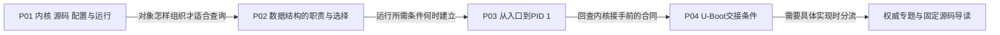

# 第1章\_奔跑吧Linux内核

本目录保存围绕《奔跑吧 Linux 内核（入门篇·第 2 版）》主题整理的个人读书笔记。书籍作者为笨叔、陈悦，ISBN 为 `978-7-115-55560-1`。这里的章节包含仓库作者的理解、扩展和公开源码核对，不是原书电子版或官方配套资料；材料权属和反馈方式见 [版权与免责声明](copyright_and_disclaimer.md)。

本组的任务是把几个学习阶段接起来：先认识内核与源码，再按问题选择数据结构，随后理解启动中各类对象何时可用，最后回看引导程序必须交给内核什么。详细机制只维护在相应知识专题中，读书笔记提供连续视角与入口。

## 1.1\_沿四个问题阅读现有章节

不需要在开始之前背完所有内核结构。先从一次文件读取认识职责，再问保存状态、找到对象和推进执行各需什么条件；第三章就能接着解释这些条件怎样建立。

| 本组章节 | 本地解决的问题 | 读完后继续追踪什么 |
| --- | --- | --- |
| [P01 Linux 系统基础知识](P01_linux系统基础知识.md) | 区分应用、内核、源码、配置与实际产物；从职责定位文件 | 对象如何存储、查找和保护 |
| [P02 Linux 内核中常用的数据结构和算法](P02_Linux内核中常用的数据结构和算法.md) | 用同一组请求比较顺序、等值、有序和范围查询，区分容器与业务对象 | 分配、执行者和通知设施何时可用 |
| [P03 内核引导和初始化](P03_内核引导和初始化.md) | 沿 K0～K4 解释基础设施、任务分流、initcall、内存回收与用户入口 | 前级怎样提供正确镜像和处理器现场 |
| [P04 U-Boot 启动流程说明](P04_uboot启动流程说明.md) | 分开资源准备、镜像安置和入口合同，比较普通路径与 Falcon | 按需进入 U-Boot 构建、搬迁、命令和装载单元 |

P04 是对启动前半段的第二遍细读，不表示真实机器先运行 Linux 再执行 U-Boot。读书顺序服务于理解，实际执行顺序仍以前两篇建立的交接图为准。

## 1.2\_版本身份随证据走

旧笔记记录过 NXP `imx_5.4.70_2.3.0` 和 Ubuntu 22.04，仓库也有 6.1 与 U-Boot 2025.04 的板级实践。它们是不同环境记录，不能在首页用一个版本号覆盖全部正文，更不能把“5.4 用基数树、6.1 才有 XArray”作为统一分代规则。

本轮公共 Linux 实现核对采用 [源码基线](../../../research/source_reading/linux/SOURCE_BASELINE.md)：官方 NXP `linux-imx` 的 Linux 6.12.20，标签 `lf-6.12.20-2.0.0`，提交 `dfaf2136deb2af2e60b994421281ba42f1c087e0`。U-Boot 专题另以 [v2022.10 固定源码](../../../research/source_reading/uboot/navigation/README.md) 为界。板级记录保留其自己的 SDK、配置、镜像与部署条件。

因此，看到旧 VMA 红黑树字段、CFS 调度称呼或某个等待队列类型时，应先核对本篇的版本，再判断是否适用。源码中结构存在、配置选择、成功构建和实物运行分别是证据链上的不同节点；正文里的宿主 C 模型也只证明它模拟的部分，不会自动成为内核或开发板验证。

## 1.3\_按当前缺口进入权威专题

本组保留原学习计划的主题范围，但把“知道一个名词”改成可追踪的问题。先确定自己卡在哪项职责，再进入下表对应入口；不要按表一次性学习所有模块。

| 当前缺口 | 阅读入口与所需结果 |
| --- | --- |
| 不熟悉 GNU C 扩展、嵌入节点、`container_of` 或内存布局 | 从 [链表专题](../../../knowledge/linux/data_structures/单链表_linked_list/大纲.md) 的对象与节点模型开始；涉及静态注解时再读 [内核静态注解](../../../knowledge/foundations/c_language/kernel_static_annotations/大纲.md)。内联汇编随启动或架构问题学习，不当作所有章节的前置考试 |
| 不知道等值、有序、整数或范围索引怎样选择 | 先读 P02 的同场景比较，再到 [哈希](../../../knowledge/linux/data_structures/哈希表_Hash_Table/大纲.md) 与 [树和范围索引](../../../knowledge/linux/data_structures/红黑树_rb-tree/大纲.md)；不要仅按 API 名称替换容器 |
| 混淆页、VMA、地址空间、对象分配和缓存 | 从 [地址空间与容量](../../../knowledge/foundations/computer_architecture/address_space_and_capacity.md) 和 P02 的分层说明建立坐标，再追固定源码中的 `page`、`mm_struct`、`vm_area_struct`、zone 与分配器职责 |
| 不知道运行队列、等待队列、锁和通知的关系 | [等待通知](../../../knowledge/linux/synchronization_and_asynchrony/synchronization/waiting_notification/大纲.md)、[锁](../../../knowledge/linux/synchronization_and_asynchrony/synchronization/locks/大纲.md) 与 [序列计数器](../../../knowledge/linux/synchronization_and_asynchrony/synchronization/sequence_counters/大纲.md) 分别解释条件等待、互斥与一致快照；每 CPU 状态也要追踪谁读写，不能因“本地”就忽略迁移和通信 |
| 取得对象指针后不知道能保留多久 | [kref](../../../knowledge/linux/object_lifetime/kref/大纲.md) 与 [RCU](../../../knowledge/linux/synchronization_and_asynchrony/synchronization/rcu/大纲.md) 区分持有责任和读侧保护；不是把引用计数字段抄进对象就完成协议 |
| 混淆文件、路径、inode、超级块与操作表 | [VFS](../../../knowledge/kernel_subsystems/vfs/大纲.md) 沿打开、引用、读写与关闭解释对象关系；用户 fd 与内核对象分开 |
| 不知道设备注册后怎样出现在模型与用户接口中 | [设备模型](../../../knowledge/linux/device_model/大纲.md) 和 [class/sysfs](../../../knowledge/linux/device_model/class_sysfs/大纲.md) 解释 `device`、驱动、总线与 kobject/ktype/kset；需要硬件描述时再进入 [设备树](../../../knowledge/driver_model/device_tree/大纲.md) |
| 不知道中断后续工作和定时动作由谁执行 | [中断](../../../knowledge/linux/synchronization_and_asynchrony/asynchrony/interrupts/大纲.md)、[工作队列](../../../knowledge/linux/synchronization_and_asynchrony/asynchrony/workqueue/大纲.md)、[定时器](../../../knowledge/linux/synchronization_and_asynchrony/asynchrony/timers/大纲.md) 各自说明执行上下文、对象状态及退出；jiffies、`ktime_t` 等时间表示随所选机制阅读 |
| 想把抽象关系落到板上 | 原 [i.MX8 ARM64构建记录](../../../platforms/arm/nxp/imx8/P01_imx_v8配置与ARM64内核构建.md) 与 [U-Boot/内核移植记录](../../../platforms/arm/nxp/imx6ull/porting/大纲.md) 提供各自环境线索；执行前仍须确认实际源码、板卡和存储布局 |

原计划还包含网络和调试扩展。网络部分先用 P02 区分 socket、`sock`、`sk_buff` 与 `net_device`，再选择一条收发路径追对象交接；不把报文缓存、设备队列与协议状态合并成一个结构。调试部分应先提出可验证的问题，例如“是否执行到回调”“返回值是什么”“哪个持有者没有释放”，再选择日志、tracepoint、ftrace 或其他观测工具。procfs、sysfs、debugfs、BPF 映射也各有用途，不能因都能显示或保存信息就视为同一种调试接口。

## 1.4\_把学习计划写成可完成的操作

一次练习只选择一个操作周期。初阶可以在链表或树专题运行已有完整 C/C++ 程序，先预测输出，再改一个输入，解释结构和结果怎样变化；中阶可沿一次文件打开或驱动请求追踪对象创建、查找、等待与释放；进入内核模块或真实板实验后，再核对配置、加载、失败回滚与退出。

工具为问题提供证据，不代替问题本身。旧计划列举的 cscope/ctags、源码浏览器、QEMU/GDB、日志、ftrace、eBPF 和 SystemTap 等，不构成每项练习都必须安装的工具链。需要的是所选实验明确给出的工具、版本和可观察结果；例如宿主容器模型不能验证板上 GPIO，实板某次点灯成功也不能证明容器并发回收正确。

不要用“已阅读两周”作为阶段完成条件。可以用三个问题检查：能否解释当前对象为什么存在，能否预测一个反例会破坏哪项保证，能否在配套实验中观察并说明结果。达成后再沿阅读图进入下一步；尚未达成就回到对应模型与证据，不必先记住更多结构名称。
