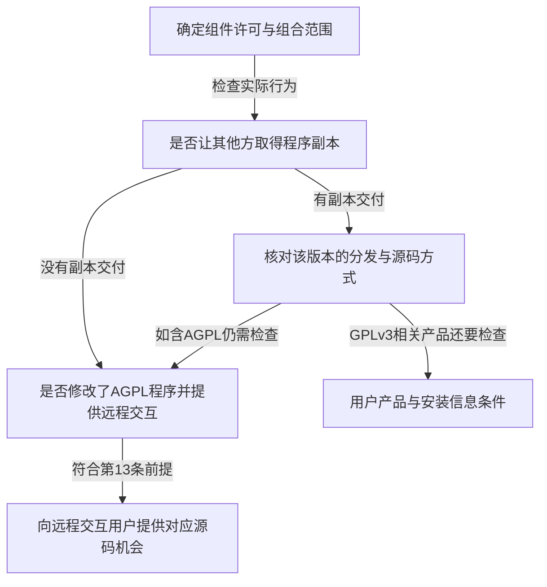

# 第1章\_GPL\_协议说明(总论)

本页用于工程查询：确认一个软件组件的许可版本、一次交付触发哪些条件，以及需要保存什么材料。它区分许可原文、维护组织的解释与工程实践，不对某个未提供事实的商业项目作法律结论；组合程序、合同与具体法域存在争议时，需要专业法律审查。

判断起点不是“用了开源代码就必须公开整个产品”，也不是“没有收费就没有义务”。应先确定 **哪个作品、什么许可、怎样组合、向谁交付了什么**。同一固件中的内核、独立应用、库、数据和文档可以有不同许可，不能只看仓库根目录的一张 LICENSE。

## 1.1\_先确认许可身份与适用作品

GNU 通用公共许可证（GNU General Public License，GPL）通过许可给予复制、修改和再分发等权利，同时对相关行为附加条件。**Copyleft** 要求受覆盖作品的相应再分发继续保留这些权利，不等于禁止商业使用，也不等于所有同介质文件自动使用同一许可。

GPLv1 是历史版本；当前工程常见 GPLv2、GPLv3，以及针对库组合提供额外许可的 LGPL 和增加远程交互源代码条款的 AGPL。它们不能只用“强／弱”两个词代替具体版本和条文。

| 许可身份 | 本页主要核对位置 | 关键区别 |
| --- | --- | --- |
| [GPLv2](https://spdx.org/licenses/GPL-2.0-only.html) | 第 1～3、6～7、9 条 | 源码与目标码分发条件；没有 GPLv3 式安装信息条款 |
| [GPLv3](https://spdx.org/licenses/GPL-3.0-only.html) | 第 0～6、8、10～11、14 条 | convey、对应源码、用户产品安装信息与更明确的专利安排 |
| [LGPLv2.1](https://spdx.org/licenses/LGPL-2.1-only.html) | 第 2、5～6 条 | 库修改与使用库的作品分别判断，组合分发有替换或重链接等条件 |
| [LGPLv3](https://spdx.org/licenses/LGPL-3.0-only.html) | 额外许可第 0～4 条，结合 GPLv3 | 不能只读 LGPL 短文本而忽略其纳入的 GPLv3 条款 |
| [AGPLv3](https://spdx.org/licenses/AGPL-3.0-only.html) | 第 13 条，结合其他分发条款 | 修改版本支持网络远程交互时，向交互用户提供对应源码机会 |

表中链接为 SPDX 许可证清单所收录的文本；发布方入口为 [GNU 许可证页面](https://www.gnu.org/licenses/)。本次核对日期为 2026-10-18。正文是说明，不是许可原文的改写版本，发行物仍应保留实际适用许可全文和版权通知。

**`-only` 与 `-or-later`** 说明可选择的许可版本，不是对程序新旧的描述。`GPL-2.0-only` 不赋予接收者自行改用 GPLv3 的权利；`GPL-2.0-or-later` 则有相应版本选择。还要核对文件级例外和双许可表达式：`OR` 表示可选分支，`AND` 表示同时适用，`WITH` 表示附带特定例外。不能只修改 SPDX 行就把第三方代码重新许可。

## 1.2\_先判断行为再选择源码交付方式

仅运行或私下修改 GPL 程序，通常不会因此产生向公众发布源码的要求；把程序副本交给其他主体则需要核对分发条件。GPLv3 的 **convey** 指使其他方能够取得副本的传播；仅网络交互而没有副本转移不属于这一概念。设备内预装、固件下载、安装包和容器镜像都应按实际交付对象逐项分析，不能因为没有“源码下载按钮”就当作没有交付。



这张图是检查顺序，不是自动判定法律关系的算法。向其他组织、承包方或集团中的不同实体交付时，不能只凭“内部项目”一词跳过主体与合同关系核对；GPLv3 第 2 条另有受约束的代修改、代运行安排，应按真实情形分析。

### 1.2.1\_源码必须对应实际交付版本

源码应当是适于修改的形式，并覆盖适用条款要求的构建、接口和安装控制文件。仅给上游首页、一个不断变化的分支或不包含本地补丁的发行标签，不能证明它对应已经交付的二进制。工具链及系统库是否需要包含，应按该版本的排除条件判断，不能把所有构建机文件一概打包，也不能把定制生成器一概排除。[GPLv2 第 3 条](https://spdx.org/licenses/GPL-2.0-only.html)、[GPLv3 第 1 条](https://spdx.org/licenses/GPL-3.0-only.html) 给出各自定义。

工程上可以把固件摘要、源码提交、补丁、配置和构建说明绑定到同一发布编号，再在干净环境尝试构建。可复现检查有助于发现漏件，但“必须逐字节产生同一二进制”不能凭空写成所有 GPL 条款的统一要求。

### 1.2.2\_书面要约不是所有发行方式的统一选项

先选择实际符合的条款路径，再制定履行计划。下面只列常用方式，不把例外转交路径当作商业发行的一般规则：

| 版本与路径 | 适用动作 | 关键条件 |
| --- | --- | --- |
| GPLv2 第 3(a) 条 | 目标码随附完整对应源码 | 使用通常用于软件交换的介质；源码按相应许可条件提供 |
| GPLv2 第 3(b) 条 | 随目标码提供书面要约 | 至少三年；面向任何第三方；收费不超过实际物理源码分发成本 |
| GPLv2 第 3 条末段 | 从指定位置提供目标码下载 | 从同一位置提供等价的源码取得机会 |
| GPLv3 第 6(a) 条 | 物理产品或介质附带目标码 | 同时附带耐久介质上的对应源码 |
| GPLv3 第 6(b) 条 | 物理产品或介质随附书面要约 | 至少三年，且覆盖仍为该产品型号提供备件或客户支持的期间；面向持有目标码者；提供物理副本时收费不超过合理实际提供成本，或提供免费网络取得方式 |
| GPLv3 第 6(d) 条 | 从指定位置提供目标码取得入口 | 同方式、同位置提供不另收费的等价源码入口；源码在另一服务器时须有清楚指引并持续履行可用性义务 |

GPLv2 第 3(c) 条及 GPLv3 第 6(c) 条转交他人要约有非商业等限制，不能拿供应商一份要约就推定本公司的所有交付都已覆盖。源码要约也不能只是一个无人处理的邮箱或到期即失效的链接。具体选项见 [GPLv2 第 3 条全文](https://spdx.org/licenses/GPL-2.0-only.html) 与 [GPLv3 第 6 条全文](https://spdx.org/licenses/GPL-3.0-only.html)。

源码取得权不应再被保密协议或禁止再分发条款抵消。保留版权、许可和修改声明，并按具体版本核对交互界面的法律通知；“每个程序都必须有关于框”不是统一条文要求。

## 1.3\_链接与同介质分发需要分开判断

把两个独立程序放在同一安装介质，与把代码组合成一个受覆盖作品，是不同问题。静态链接、动态链接、插件、共享复杂数据结构或进程间通信，都需要结合实际组合和通信语义判断。不能把“动态库”或“REST 接口”当成自动免责开关，也不能仅凭同一容器就宣称所有文件均受 GPL 覆盖。

如果实际形成了基于 GPL 程序的受覆盖整体，分发时应按适用 GPL 的整体许可条件处理，不能仅公开其中原本来自上游的几行代码，就把其余受覆盖部分排除。真正独立作品的单纯聚合则另行判断。GPLv2 第 2 条与 GPLv3 第 5 条分别规定这一边界，具体例外需继续核对。

[FSF FAQ 的聚合与插件说明](https://www.gnu.org/licenses/gpl-faq.en.html#MereAggregation) 给出其判断立场：既考察通信机制，也考察交换内容；共享地址空间的紧密组合与独立程序的普通通信有区别。这是许可维护组织的解释，不是对每个法域、每个程序已经作出的司法裁判。

### 1.3.1\_LGPL给应用额外选择也保留具体条件

LGPL 库可以用于不公开应用源码的某些组合，但必须满足所选版本的要求。应分开检查库本身及修改的源码义务、版权和许可通知、允许相关修改调试的条款，以及应用与修改后库重新组合的实际能力。

以 LGPLv2.1 第 6 条为例，可以按相应路径提供库源码和足以重新链接的应用目标码或源码，也可以使用符合条件的共享库机制。后者应允许使用接口兼容的修改版库；只是文件扩展名叫 `.so`，却强制校验原库并拒绝替换，不足以证明符合条件。应用条款还应允许为调试相关修改进行逆向工程，不能用一条全面禁止逆向工程的终端协议把许可条件抵消。[LGPLv2.1 第 6 条](https://spdx.org/licenses/LGPL-2.1-only.html)

LGPLv3 第 4 条使用 Combined Work、Minimal Corresponding Source 和 Corresponding Application Code 等定义组织类似选择，并要求提供 GPLv3 与 LGPLv3 文本；安装信息只在其引用的 GPLv3 条件成立、且为重组合后的作品安装运行所需的范围内适用。不能直接把 LGPLv2.1 的“给目标文件”一句话复制为全部 LGPLv3 义务。[LGPLv3 第 4 条](https://spdx.org/licenses/LGPL-3.0-only.html)

### 1.3.2\_兼容性有版本和方向

兼容性讨论的是能否按所选条件组合并分发，不是能否在同一台电脑运行。保留原代码的版权与通知义务，也不因为组合整体采用 GPL 就抹掉原来源。

| 场景 | 判断要点 |
| --- | --- |
| 常见 MIT、BSD-2-Clause、BSD-3-Clause、ISC 代码并入 GPL 作品 | 按各自完整文本保留通知，核对组合许可；不要把所有名叫 BSD 的历史变种混为一谈 |
| Apache-2.0 代码并入 GPLv3 作品 | Apache 官方说明认可这个方向；不代表可反向把 GPLv3 代码仅按 Apache-2.0 分发 |
| Apache-2.0 与 GPLv2-only 的同一受覆盖组合 | 通常不兼容，需另有有效授权或可选择的许可分支；同机独立运行是另一问题 |
| GPLv2-or-later 与 GPLv3 的组合 | 先确认所有相关权利人确实授予 later 选择，再按可用版本组合 |
| GPLv3 与 AGPLv3 组合 | 两许可第 13 条提供特定组合安排；各部分许可仍有区别，远程源码条款按组合条件适用 |

Apache 的方向与版本限制见 [Apache Software Foundation 兼容性说明](https://www.apache.org/licenses/GPL-compatibility.html)；其他常见关系可对照 [FSF 的 GPLv3 兼容性图解](https://www.gnu.org/licenses/quick-guide-gplv3.pdf)。兼容性图不是重新许可授权，具体例外和文件头仍须保留。

## 1.4\_AGPL远程交互不能简化为所有网络服务

AGPLv3 第 13 条以 **修改程序** 为重要前提：修改版本支持远程网络交互时，必须显著向与它交互的所有用户提供通过网络免费取得该版本对应源码的机会。它不只指浏览器网站，也不能简化为“任何联网软件都须公开整个服务器”。依第 13 条与 GPLv3 作品组成相应组合时，远程提供的对应源码还包括该被纳入作品的对应源码。普通二进制分发仍要遵守其他条款；没有修改也不意味着可以删掉上游已经提供的通知与源码入口。[AGPLv3 第 13 条](https://spdx.org/licenses/AGPL-3.0-only.html)

工程检查应先确定服务中哪一个程序受 AGPL 覆盖、是否形成修改或组合版本、用户与谁交互，以及源码入口是否对应正在服务的版本。不能因为 API 经另一层代理转发就不再检查实际交互关系，也不应把独立数据库、所有业务数据与操作系统自动算成该程序对应源码。

例如部署一个经过修改的 AGPL 服务，用户只远程调用、未取得服务器二进制：仅按 GPL 的副本交付检查会漏掉第 13 条。应在用户实际交互路径上落实显著入口，保存对应源码和版本映射。具体界面怎样安排，要结合服务协议和可用交互方式，而不是一概要求新增网页按钮。

## 1.5\_设备安装信息与专利安排各有前提

GPLv3 的安装信息规则旨在使符合条件的接收者能够安装、运行修改版本。它不是对所有设备的无条件“交出全部签名密钥”。先核对是否属于 **User Product**：通常用于个人、家庭或家用目的的有形消费品，或设计、销售用于住宅组成部分的物品；不能把“终端用户会操作”直接作为定义。

还要核对目标码是否在该产品中、随产品或专供其使用而交付，以及交易是否转移了永久或固定期间的占有和使用权。条件成立时，需要提供足以安装和运行修改版本的流程、授权信息等；但若分发者和任何第三方都不保留安装修改目标码的能力，例如相应程序确实固化于 ROM，则有条文例外。无需因此继续为用户修改版本提供支持、保修或更新。[GPLv3 第 6 条](https://spdx.org/licenses/GPL-3.0-only.html)

有签名启动时，应检查修改版本可用的授权路径，不能一方面声称可修改，一方面仅因为修改就阻止运行。可行方案取决于产品设计及条文条件，不自动等于必须公开所有生产密钥。GPLv3 第 3 条对反规避法律的安排也不应改写成“任何 DRM 技术都被禁止”。

专利方面，GPLv3 第 11 条规定贡献者对其所控制的、符合定义的必要专利权利要求授予相应许可，并对依赖专利许可的传播及歧视性安排另设条件。第 10 条限制针对本程序相关行为提起相应专利诉讼；第 8 条处理不符合许可的后果。不能把它压缩成“每个分发者把全部专利授权”或“任何反诉都自动终止一切权利”。GPLv2 虽无同样结构的明示贡献者专利条款，第 7 条仍处理相冲突义务，不能理解为完全没有专利边界。[GPLv3 第 8、10、11 条](https://spdx.org/licenses/GPL-3.0-only.html)、[GPLv2 第 7 条](https://spdx.org/licenses/GPL-2.0-only.html)

## 1.6\_Linux内核许可与模块标记分别解决什么

Linux 内核整体以 GPLv2-only 提供，并有明确的系统调用例外；单个文件可能采用兼容许可、双许可或特定例外。用户态程序仅通过系统调用与内核交互，不因此自动继承内核 GPL 条件；使用 UAPI 头文件时仍应核对对应文件的许可表达式。[Linux 内核许可规则](https://docs.kernel.org/process/license-rules.html) 是这一区别的官方入口。

`MODULE_LICENSE("GPL")` 是模块向内核报告的许可兼容性标记，供加载、污染状态与符号限制等机制使用。`EXPORT_SYMBOL_GPL` 标记某类导出符号的访问限制。**技术标记不是版权授权本身**：随意填入一个字符串不能取得第三方代码权利，也不能让实际不兼容的模块变得合规。反过来，没有使用 GPL-only 符号，也不能单凭这一点认定模块是独立作品。实际模块与内核的组合、来源及授权需另行判断。

新代码的 SPDX 注释应描述已经确定的授权，例如下面是 C 文件的一种标识写法；它只是语法示例，不授权给任意第三方文件重新贴标签：

```c
/* SPDX-License-Identifier: GPL-2.0-only */
```

Linux 源码自身也可能沿用其规则中接受的 `GPL-2.0` 等标识。应保留上游真实表达式及例外，不能为了统一显示而批量抹掉 `OR`、`WITH Linux-syscall-note` 或其他权限。

## 1.7\_把许可条件落实到每次发行

一个可执行的交付流程应当从组件清单开始，再选择条款路径，最后验证接收者实际能得到的材料。软件物料清单（Software Bill of Materials，SBOM）和 SPDX 扫描帮助发现组件，但不能自动裁定组合关系，也不能证明源码包完整。

| 发行材料 | 应记录的内容 | 检查方法 |
| --- | --- | --- |
| 组件清单 | 名称、版本或提交、来源、文件级许可和例外、组合方式 | 与最终产物实际包含内容对应，不只扫描源码目录 |
| 许可及版权通知 | 适用全文、版权、修改声明及第三方要求 | 检查发行包和适用交互入口，而不是只看开发仓库 |
| 对应源码 | 固定输入、所需补丁、配置、构建及安装控制文件 | 使用发布编号关联产物，检查外链、权限及材料缺漏 |
| 构建说明 | 工具链与环境、配置选择、命令和已验证范围 | 尝试干净环境构建并记录差异，不冒充已测试平台 |
| 源码要约（若适用） | 实际适用条款、对象、材料范围、取得方式、费用边界、履行期间 | 发起一次实际请求，核对响应和持续保存责任 |
| 安装信息或远程源码入口（若适用） | 条件判断及实际可用的安装／获取路径 | 用接收者或交互用户身份检查，不仅由内部管理员验证 |

这些文件名可以由工程自定，例如 `LICENSE`、`THIRD_PARTY_LICENSES/`、`BUILDING.md`、`SOURCE_OFFER.txt` 与 `COMPLIANCE.md`。GPL 并没有统一要求它们必须叫这些名字；创建同名空文件也不算完成义务。保修说明、合规响应联系人和修复流程属于工程组织措施，应明确负责人和期限，但不能把自定服务时限写成许可证原文。

更新依赖时重新核对版本许可、组合方式和源码取得路径。若改为双许可，必须确有权利给予两种选择，不能替其他贡献者决定；若替换组件，要验证真实依赖已经移除。GPLv2 与 GPLv3 的违规终止及恢复规则不同，发现问题后不能凭一句“补上源码就自动恢复”处理全部情况，应按条文与权利人关系落实修复。

对本页范围的最后检查可以用三个问题完成：这次交付的是哪一份作品与许可版本？接收者或远程用户实际取得了哪些权利和材料？每一项未做的动作，是否有明确的不适用条件，而不是仅因“开源”“内部”或“动态链接”几个标签就被跳过？
