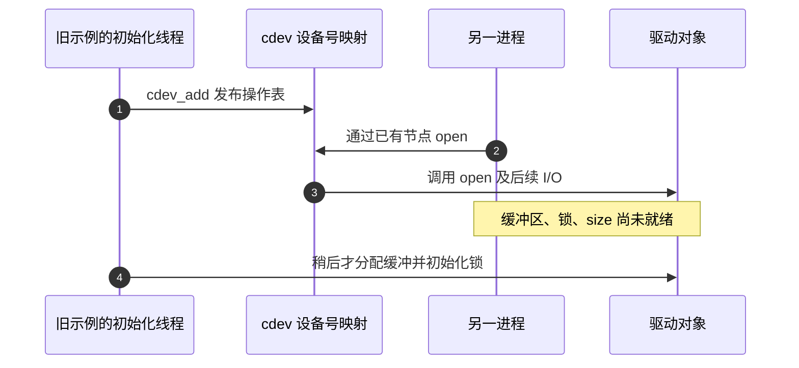
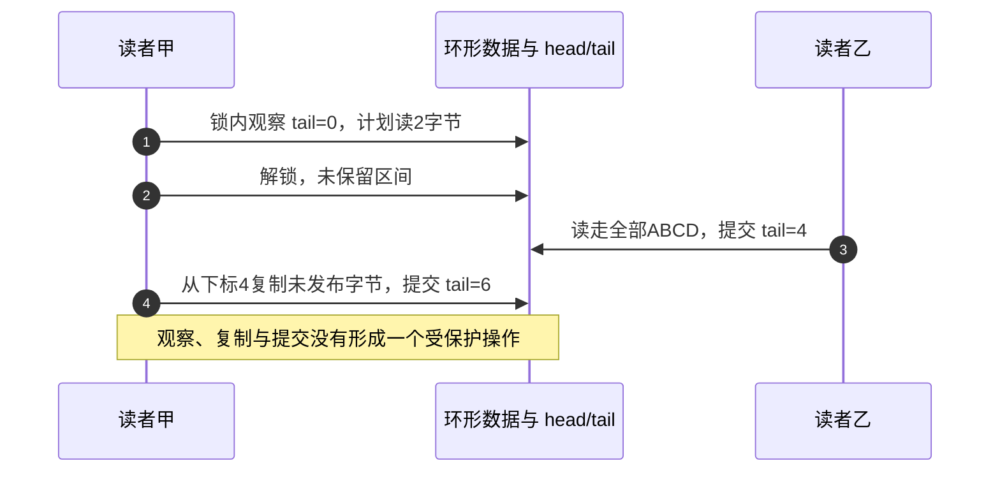

# 第1章\_字符设备扩展接口历史草稿核对

这份材料曾把模块、字符设备、poll、mmap、DMA 和帧环逐轮拼接，最后称作“开箱即用模板”。逐段检查可以发现：接口越来越多，数据归属、发布时机和退出条件却没有一起建立。问题并非少了几个头文件，而是同一块缓冲区被不同路径以不一致的协议访问。

本页保留这些问题的来历、反例和现行阅读去向；入门阅读从[字符设备专题大纲](../../../knowledge/driver_model/character_device/大纲.md)开始。原始 4682 行全文及代码逐字保存在[历史原稿附件](../../../assets/archives/character_device/extended_interfaces_original.txt)，SHA-256 为 `1af182c77e755a72a1bc54306878d4dced8802310f5f56fd8fd6bc8e61a0b83c`。附件中“可直接运行”等旧承诺不代表经过验证，下面的旧节号均指附件。

## 1.1\_先分开原稿身份与核对依据

原稿自述内容摘自 GPT，多处标注“Linux 6.1”，但没有固定源码提交、完整配置、构建日志和目标执行记录。因此不能把它视作 Linux 6.1 的官方说明，也不能把文中预期输出当成实测。

本次的接口核对使用 NXP 官方 `linux-imx` 的 Linux 6.12.20 发布提交 `dfaf2136deb2af2e60b994421281ba42f1c087e0`。当前可访问工作树的分支头已有后续提交，本次只读取固定 Git 对象；版本与配置分开记录。本文指出的多数竞争也可以直接从旧代码的控制流推出，不依赖猜测某块板的运行结果。版本化源码的组织入口见[字符设备源码阅读索引](../../source_reading/character_device/navigation/P01_Linux_6.12_字符设备源码阅读索引.md#1.2_由问题进入模块导读)。

这次没有加载旧模块。尤其是 DMA 示例没有真实设备、DMA mask 和硬件协议，不能为了“跑一次”给它虚构一个设备地址空间。下文完成的是逐段审查和因果反例，不声称每个旧例都经过编译或实板复现。

## 1.2\_入口可见以后再初始化为什么太晚

旧 1.11、1.17、1.26、1.32 和 1.36 的组合例先 `cdev_add()`、`device_create()`，随后才分配缓冲区、初始化锁和等待队列。作者按照 init 函数的书写顺序阅读，容易觉得“还没返回，外面不会访问”；实际上 `cdev_add()` 已把设备号到操作表的映射发布到内核。

设进程已经持有一个相同设备号的节点。注册线程发布 cdev 后，另一个 CPU 上的进程就可能完成 open 并进入回调；此时 `rbuf` 仍为空，`size` 仍为零，锁也可能未初始化。即使不调用 `device_create()`，预先存在或手工建立的节点也能使这条竞争成立。

正确关系是先准备每个会被回调访问的对象，再发布入口；需要分阶段发布时，必须设计实际可执行的就绪判定及失败撤回协议。多实例例还要处理“前几个实例已能打开，后一个实例初始化失败”的回滚，不能直接释放整个实例数组。现行[初始化发布顺序](../../../knowledge/driver_model/character_device/P08_设备模型与硬件子系统交接.md#8.4_初始化发布顺序)和[完整窗口模板](../../../knowledge/driver_model/character_device/P10_字符设备驱动模板.md)承担这一职责。

证据：固定提交的 [fs/char_dev.c](../../source_reading/linux/fs/char_dev.c) 在 `cdev_add` 注释中明确其立即可用；`cdev_del` 注释又说明，移除映射后已经打开的文件仍可调用操作表。发布与撤回必须同时考虑旧访问，而不是只把注册调用倒序执行。

## 1.3\_锁住索引两次仍可能读错同一份数据

旧 1.11 用自旋锁计算可读量和复制长度，然后解锁执行 `copy_to_user()`，最后重新加锁推进 tail。避开自旋锁中的可睡眠复制是必要的，但解锁以后没有保留区间，也没有串行化其他消费者；保存一个长度并没有取得那段数据的所有权。旧 1.17 把锁换成 mutex 后仍在复制前解锁，所以同一缺口保留了下来。

以容量 8、`head=4, tail=0`、有效数据 `ABCD` 为例：读者甲检查可以读 2 字节后解锁；读者乙从 tail 0 读走全部 `ABCD`，把 tail 改成 4；甲随后用 **当前字段** `d->tail` 从下标 4 复制两字节，那里并没有已发布的数据。提交时它又把 tail 推到 6；此时 head 仍为 4，旧计数公式算出的可读量却是 `(4+8-6)%8=6`，空队列被算成六字节。锁分别保护了两次索引访问，却没有保护两次访问之间的数据资格。

解决方法取决于并发场景。纯进程上下文的小型字节流可以用可睡眠互斥锁覆盖状态检查、用户复制和实际进度提交；等待数据时释放锁，醒来重新取得锁并复查。IRQ 生产者不能拿这种 mutex，就需要把可睡眠复制移到受控暂存或预留协议中。不能用“把 spinlock 换成 mutex”替代整个协议设计，也不能让硬中断在用户缺页时等待。

还有第二个独立问题：旧例两段复制中第一段已经成功、第二段失败时，直接返回 `-EFAULT` 且不推进状态。应用已收到部分字节，驱动却把它们仍算成未消费；下次会重复交付。iter 版的 `copy_to_iter()`/`copy_from_iter()` 返回的是 **已复制量**，旧 1.23 也漏掉本轮短复制进度。现行[复制失败的状态变化](../../../knowledge/driver_model/character_device/P05_文件操作契约与数据路径.md#5.3_复制失败并不意味着什么都没发生)及[流式模板](../../../knowledge/driver_model/character_device/P13_流式字符设备与等待通知模板.md#13.3_完整实现与每次复制的提交点)给出相应契约。

## 1.4\_通知与索引快照都不等于领取数据

旧 1.9 把 poll_table 说成用户传入的等待队列，并把 `poll_wait()` 描述成直接挂起进程。实际 poll_table 是内核轮询路径传给驱动的登记接口；驱动先登记等待关系，再检查就绪条件，返回事件位。是否睡眠由上层轮询路径决定，回调也可能在不需要新增登记时被调用。用户请求写在 `events`，返回结果查看 `revents`。

旧单标志例的 `data_ready` 没有配套并发协议，read 又在无数据时返回 0；这表达的是 EOF，不能同时声称它实现了“等下一次数据”的阻塞流。后续 DMA 例只在 mutex 外检查一次 readable，醒来后不在锁内复查；两个读者可能都因同一个事件继续，其中一个已经消费，另一个仍复制旧内容。现行[阻塞判断](../../../knowledge/driver_model/character_device/P06_阻塞_poll与异步通知.md#6.2_阻塞_read()_的判断顺序)和[poll 的观察边界](../../../knowledge/driver_model/character_device/P06_阻塞_poll与异步通知.md#6.3_poll()_怎样观察就绪而不占有数据)把通知与领取分开。

旧 1.32～1.38 的“零拷贝消费者”有同类问题，只是竞争延长到了用户态。`GET_INDEX` 在锁内复制 head/tail，保证的是那次读值，而不是接下来整段用户访问期间帧不被改写。生产者满环时会推进 tail、回收最旧帧；应用还在读旧快照指向的槽位，后续生产就可能覆盖它。另一个消费者或 `CLR_INDEX` 也能使快照过期。

新增 `CONSUME_N` 只按 **当前 tail** 推进，没有核对应用领取的是哪一代、哪几个槽位，因此不能证明归还的就是读过的帧。把 `read()` 换成 ioctl 确实可以去掉那一次数据复制，却没有自动建立领取、禁止覆盖、归还及失败恢复的协议。只改成单消费者也不足以解决生产者覆盖旧帧的问题。要继续研究，应先选择满环丢新帧、可验证的预留令牌、代际检查或其他明确策略，再讨论性能；本页不把尚未实现的方案登记为完成模板。

## 1.5\_有映射有缓存一致性仍不代表存在DMA链路

旧 DMA 示例用 `device_create()` 产生的展示设备作为 DMA API 参数，有的说明甚至允许传 NULL。这个对象能出现在 sysfs，不表示它具有真实 DMA 主设备的寻址能力、总线转换和 IOMMU 关联。`g.cls->p->...` 的所谓“防告警空引用”还穿越内部结构，不是合法取得设备的方法。真实驱动应从对应设备的绑定上下文取得 DMA 设备并核对 DMA mask；纯软件例则使用普通页，不必伪造 DMA。

旧表中 `dma_mmap_coherent(filp, ...)` 的第一参数也写错了，应是同一 **struct device** 对应的设备参数。CPU 地址、CPU 物理地址和 `dma_addr_t` 要分别解释，不能把后者当成页帧号或 CPU 指针。coherent 保证相应缓存可见性，并不保证描述符字段的发布顺序、帧的所有权或设备已经停机；streaming 也不是“必然不一致的一次性 DMA”，映射可在正确 sync 协议下复用。

这些边界由[DMA 地址与交接正文](../../../knowledge/linux/io_model/dma/P01_DMA_映射同步与门铃顺序.md#1.1_DMA_API_同时解决四个问题)及固定提交的 [DMA API](https://github.com/nxp-imx/linux-imx/blob/dfaf2136deb2af2e60b994421281ba42f1c087e0/Documentation/core-api/dma-api.rst)、[dma-mapping.h](https://github.com/nxp-imx/linux-imx/blob/dfaf2136deb2af2e60b994421281ba42f1c087e0/include/linux/dma-mapping.h)支持。它们不替任意设备补上完成寄存器和停止协议。

旧 1.27 用户程序通过 mmap 写字符串，然后立即调用阻塞 read，但驱动只在 **write 回调** 中置 readable 并唤醒。普通映射写入没有调用 write，readable 仍为零，所以给出的成功输出不能从这段代码推出。旧帧环的 hrtimer 也只是 CPU 定时填充普通内容，不能验证真实 DMA、IRQ 确认、描述符回收或 non-coherent 平台行为。

映射本身还有范围、权限与寿命要求。旧例没有统一处理 `vm_pgoff`、部分范围、只读授权和重映射；早期单页例没有清零整页便把它交给用户，会暴露未初始化字节。对 file 的映射引用通常可使最终 release 延后，所以不能反过来武断说“close 后模块必然立即释放页”；真正要分别检查的是 file 引用、后备对象与硬件解绑寿命。现行[mmap 与跨文件生命周期](../../../knowledge/driver_model/character_device/P07_mmap与跨文件生命周期.md#7.1_映射改变了所有权问题)逐项建立这些区别。

## 1.6\_其他会误导复用的接口与测试结论

上面的失败链已经说明为何不能继续使用旧组合模板。还有一些局部结论虽容易修字，却会影响读者判断；下表保留它们的核对结果，避免只修大例而遗留错误口诀。

| 旧位置与表述 | 核对结论 |
| --- | --- |
| 1.2：不同目录的同名模块一定在编译时报给定错误；改 `KBUILD_MODNAME` 就能改身份 | 目录布局、链接产物名、安装索引与运行时内部名分属不同阶段，不能编造统一报错；应改真实 Kbuild 目标并检查产物，见[模块边界](../../../engineering/build/kernel_modules/P02_让多个源文件形成清楚的模块边界.md#2.3_目录解决管理问题而不是自动改变产物) |
| 1.3：modprobe -r 比 rmmod 更安全；引用计数等于应用数 | 前者处理安装依赖，安全仍依赖驱动退出协议；模块引用不是进程数量，不靠命令名获得安全保证 |
| 1.4：`MKDEV(200,5)` 为 1285，major 等于唯一驱动 | 固定内核 `MINORBITS=20`，内核表示为 `209715205`；不同 ABI/磁盘编码要用对应帮助器。分派使用设备号区间，不能将主号简化为驱动一一对应表 |
| 1.5/1.7：owner 必须非空，open 内额外 get 是保险 | `cdev.owner` 与 `fops.owner` 有各自引用路径；内建代码的 `THIS_MODULE` 可为空，普通模块不应盲目重复 get/put。模块代码保活不等于硬件或私有对象保活 |
| 1.7：`.release` 等于每次 close；最小 read 忽略 count | release 对应最终 file 释放；原 read 按整条消息复制，可能超过调用者 count，且没有按偏移切片。不能以一次 cat 成功证明短读安全 |
| 1.8：未知 ioctl 返回 EINVAL，宏自动防冲突 | 未识别命令通常返回 `-ENOTTY`；编码宏表达 ABI，不替代命令分配、参数校验或 32/64 位布局设计。LED 只有软件变量，日志不能证明真实灯改变 |
| 1.23：VFS 总优先 iter，iter 就是异步/零拷贝 | 分派取决于入口；固定版本 `vfs_read` 先选 `.read`，再回退 `.read_iter`。复制到迭代器仍是复制，异步完成也需独立协议 |
| 1.32/1.36：没有 write 实现仍总报告可写 | 就绪位应与实际可完成操作一致，不能为凑接口随意置 `POLLOUT`；共享 IRQ 顶半部还须判断是否本设备，不能无条件当作已处理 |
| 1.35/1.36：READ_ONCE 是原子自增；`READ_ONCE(d->seqno)++` | 读取宏不提供原子读改写，也不建立完整发布顺序；原表达式不是合法的自增目标。选单写者、锁或原子接口要依据真实参与者 |
| 1.36：`CONSUME_N` 用 `_IOW` 却写回结果 | 双向 ABI 应如实表达方向，并定义推进后写回用户失败时的重试语义；否则应用重试可能再次消费 |
| 各用户程序：调用后直接打印预期结果 | 先检查返回值、malloc 失败、短传输和 EINTR；只有失败时 errno 才有诊断意义。旧示例的成功输出尚无实测依据 |

设备号计算依据为固定提交的 [include/linux/kdev_t.h](https://github.com/nxp-imx/linux-imx/blob/dfaf2136deb2af2e60b994421281ba42f1c087e0/include/linux/kdev_t.h)；分派依据为 [fs/read_write.c](../../source_reading/linux/fs/read_write.c)；一次访问的语义见[内存序源码中的 rwonce 讲解](../../source_reading/memory_ordering/source_explanations/include/asm-generic/rwonce.h.md)。旧代码大量使用双参数 `class_create(THIS_MODULE, name)`；这也不能直接套进当前 6.12 的单参数接口。版本迁移必须看真实原型，不能只修改注释里的版本号。

## 1.7\_全部旧内容怎样进入维护中的阅读路线

下表按旧节号覆盖全文。这里区分“机制已有权威讲解”与“那个组合实验已经重新实现”；后者需要独立的构建与运行证据，不能因前者存在就自动打勾。

| 旧节号 | 原问题与材料 | 当前去向或保留边界 |
| --- | --- | --- |
| 1.1～1.3、1.6 | 模块、Kbuild、加载命令、日志 | [模块构建部署](../../../engineering/build/kernel_modules/大纲.md)；日志查询要保留权限与持久化条件，不把 journald 等同于永久存储 |
| 1.4～1.5 | 设备号、cdev、owner | [设备号与节点](../../../knowledge/driver_model/character_device/P02_设备号_注册与设备节点.md)、[打开与操作表](../../../knowledge/driver_model/character_device/P03_打开路径与文件操作.md) |
| 1.7～1.8 | read/write、偏移、ioctl、用户测试 | [数据路径契约](../../../knowledge/driver_model/character_device/P05_文件操作契约与数据路径.md)；不迁移旧错误代码 |
| 1.9 | poll/select/epoll | [等待与通知](../../../knowledge/driver_model/character_device/P06_阻塞_poll与异步通知.md) |
| 1.10 | 单页 mmap 及用户程序 | [映射与寿命](../../../knowledge/driver_model/character_device/P07_mmap与跨文件生命周期.md)；当前不把旧 PFN 例登记为安全模板 |
| 1.11～1.16 | 单实例组合驱动、头文件表、Makefile、四种用户程序和扩展建议 | [窗口模板](../../../knowledge/driver_model/character_device/P10_字符设备驱动模板.md)、[构建验证](../../../knowledge/driver_model/character_device/P11_构建运行与验证.md)、[故障排查](../../../knowledge/driver_model/character_device/P12_常见故障与排查.md)；这些模板只承诺各自明确范围 |
| 1.17～1.21 | 多实例阻塞环、交互菜单、改造建议 | [流式模板](../../../knowledge/driver_model/character_device/P13_流式字符设备与等待通知模板.md)；旧 mmap 与流混用不继续沿用 |
| 1.22～1.23 | miscdevice、iter 两种变体 | 注册便利不替代状态同步；iter 不自动异步，具体差异由[源码扩展接口导读](../../source_reading/character_device/navigation/P03_文件操作与打开寿命导读.md#3.4_扩展接口的核对位置)定位，原完整变体留作反例 |
| 1.24～1.29 | coherent/streaming、DMA mmap、用户程序与注意点 | [DMA 专题](../../../knowledge/linux/io_model/dma/大纲.md)和本页 1.5；缺真实设备及协议，不认定旧 DMA 模块可运行 |
| 1.30～1.34 | IRQ/定时器帧环、read 推进、索引快照 | 本页 1.4～1.5；旧用户例还调用 read 复制，不能称整条数据面无复制 |
| 1.35～1.38 | ioctl 消费、共享映射、零拷贝改造 | 保留为待设计实验需求：设备身份、槽位领取/归还、满环策略、映射权限、停止与回收必须一起建立；不是现成驱动 |

继续研究零拷贝帧环时，先给出具体设备、内核版本、共享 ABI 和允许的消费者模型，再以阻塞、溢出、退出、用户页故障及映射持有检验协议。现在已经能说明旧模板在哪一步失去保证，也能找到对应的成熟机制；尚未完成的是那份真实设备驱动本身，不能以删去复制调用代替它。
