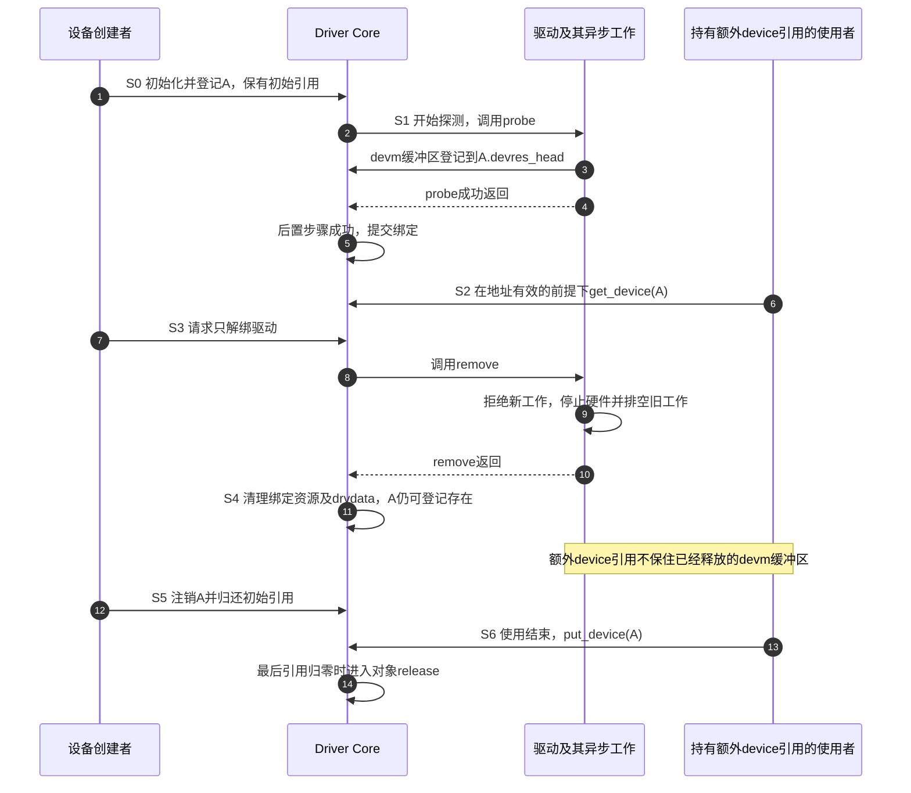
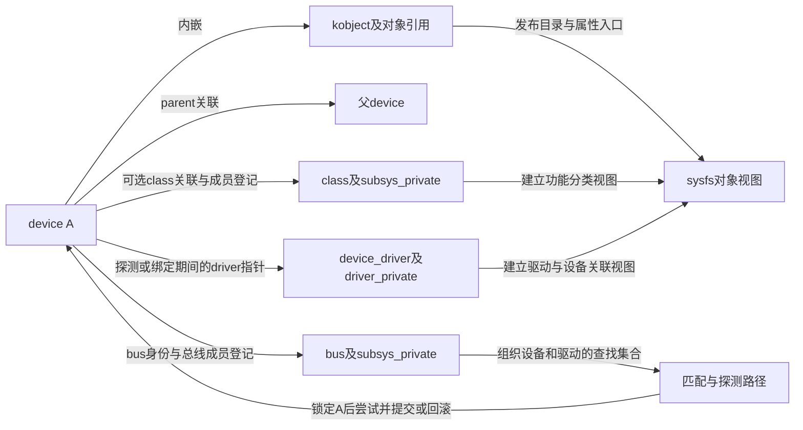

# 第1章\_设备模型34章历史总稿核对

这份旧稿用 34 章介绍对象、匹配、属性、资源和电源管理，但反复把几个独立事实合并成一个“设备已工作”：目录出现就意味着 probe 成功，持有 device 引用就意味着驱动资源仍在，属性名称相同就意味着硬件描述等价。按照这些说法编写代码，会在发布、解绑和跨平台适配时失去必要的判断条件。

本页保存错误形成的原因、反例及每章的现行去向。连续教材从[设备模型专题大纲](../../../knowledge/linux/device_model/大纲.md)进入。完整 10769 行原稿，包括全部 34 章、代码和图表源码，逐字保存在[历史原稿附件](../../../assets/archives/device_model/legacy_34_chapters_original.txt)，SHA-256 为 `51358a6af135b187e2263e0a44de6ca0d13cd996178513378ececb556d35788f`。下文的“旧第几章”指该附件；附件中的源码、命令和预期输出不能直接作为现行教程使用。

## 1.1\_先确定哪些材料能够证明实现

旧稿没有把所有“源码节选”绑定到不可变版本，其中相同函数在不同章还有彼此冲突的函数体。例如第 19 章把绑定画在 probe 前后两个不同位置，第 21 章用从链表头释放的代码声称后进先出，第 31 章又把资源清理画在 remove 之前。不能通过挑选其中一张表解决冲突。

此次核对以 NXP 官方 `linux-imx` 发布标签 `lf-6.12.20-2.0.0`、提交 `dfaf2136deb2af2e60b994421281ba42f1c087e0` 对应的 Linux 6.12.20 为准。可访问工作树的 HEAD 已前进，检查使用固定 Git 对象，没有把当前分支头混入依据。进入源码时先看[驱动入口阅读索引](../../source_reading/driver_entries/navigation/P01_Linux_6.12_驱动入口源码阅读索引.md)，再沿文中标出的实现位置核对。

此次完成了原稿逐段阅读和相关固定源码核对，没有编译或加载这些旧模块，也没有实测 USB 热拔出、休眠、电源域或旧稿里的虚构板级 LED。下面的时序是由接口契约及控制流推出的反例，不是伪装成日志的运行结果。

## 1.2\_为什么目录出现不能证明设备已经工作

先设 A 是一个已登记的平台设备，D 是后来装载的驱动。A 的登记需要先让核心知道这个实例存在，D 的登记则把可供选择的驱动加入总线；两者碰面以后，还要匹配身份、取得供应者资源、执行 probe，并完成核心的后置步骤。这些动作允许失败，所以不能用同一个“成功”标记替代。

在固定版本的 `device_add()` 中，适用的 sysfs 目录和属性先建立；具有有效设备号的设备还进入 devtmpfs 节点创建路径，然后发送 ADD 事件，之后才进入此路径的 `bus_probe_device()`。注册返回成功不意味着某个驱动一定已经绑定。没有候选、关闭自动探测、异步探测或等待供应者，都可能让已登记设备尚未提供服务。

真正探测时，`really_probe()` 在调用驱动 probe 之前就设置 `dev->driver`，并建立相应驱动链接；探测失败会回滚。即使 probe 返回 0，后置属性建立仍可能失败。最终由 `driver_bound()` 维护成功绑定所需的登记。因此 **一个瞬间非空的指针或可见链接，不能独立证明整个绑定事务已经提交**。

旧第 15 章只有打印日志、没有注册 LED class 设备，却展示 `/sys/class/leds/led0` 作为结果；那段输出无法从代码推出。driver 目录、platform device 目录、LED class 实例和字符设备节点分别需要对应的注册动作。

| 要判断的事实 | 状态或证据位置 | 旧稿混淆的相邻事实 |
| --- | --- | --- |
| 模块已装载 | 模块状态及初始化结果 | 不保证模块一定注册了驱动 |
| 设备已登记 | device 的注册状态、总线集合与 sysfs 对象 | 不保证存在匹配驱动 |
| 正在尝试探测 | 设备锁保护下的探测流程、暂设的 dev->driver | 不等于 probe 及后置步骤完成 |
| 已成功绑定 | 核心完成绑定登记，驱动设备集合及完成通知 | 不保证硬件永远可访问 |
| 应用可打开并获得服务 | 设备号映射、file_operations、实例状态和硬件条件 | 不能只看 /dev 路径是否存在 |

platform 的匹配次序也不是旧稿简化的“compatible、名称”两项。固定实现先处理 `driver_override`，再试 OF、ACPI、平台 ID 表，最后才在没有 ID 表时比较名称。override 和已提供的 ID 表分支都有停止条件。设置 override 只改变匹配选择，不会自行解绑、装载模块或使新驱动具备硬件能力。完整过程见[固件与平台适配](../../../knowledge/linux/device_model/P10_fwnode_OF与Platform适配.md#10.4_平台匹配有哪些停止条件)。

## 1.3\_一次解绑为什么没有结束所有寿命

旧第 20、21、24、31 章把设备对象、一次驱动绑定、devm 资源和模块代码画成一条同时生灭的链。反例很简单：A 仍在总线上，管理员只解绑 D，随后又绑定 D。A 的 device 对象可以始终存在，但前一次 probe 取得的 devm 缓冲区已经释放，下一次 probe 会重新申请。

因此，长期持有 `get_device(A)` 只能帮助保护 A 的对象内存，不能保留旧 `drvdata` 指向的 devm 缓冲区，也不能保证硬件供电或回调代码一直有效。若工作队列保存了旧缓冲区指针，remove 必须先阻止新工作，再等待已有工作退出；否则核心清理资源后，工作仍可能访问已释放内存。

S0～S6 是这张教学图的阶段号，不是 Linux 的枚举。S3～S4 结束绑定周期；S5 撤下设备；S6 才可能结束对象寿命。若使用者在 S5 前已经归还额外引用，最终 release 可在 S5 发生。引用必须在已有寿命保护下取得，不能先保存裸地址，等对象可能已经释放后再调用 get。

正常解绑路径先调用相应 remove，再经 `device_unbind_cleanup()` 释放 devres、清空驱动私有指针等状态；旧稿“remove 前先释放全部资源”的顺序会让 remove 自己访问失效资源。最终对象 release 中还有 devres 兜底清理，但这不意味着普通 devm 资源一定活到最后一个 device 引用归零。probe 失败也会执行适用的回滚；未托管资源与异步活动仍由驱动承担退出责任。

旧稿的固定计数表“initialize 为 1、register 再加 1、unregister 减 2”同样错误。`device_register()` 已包含 `device_initialize()` 和 `device_add()`，不能先 initialize 再用 register 初始化第二次；采用分步接口时是 initialize 后 add。`device_unregister()` 执行 del 后 put 初始引用，内部临时引用、父对象引用和外部使用者引用要各自配平，不能套一个固定减二公式。

release 也不是“只打印一行就自动释放容器”。旧第 12 章动态分配 kobject，却在自定义 release 中没有释放其内存，同时没有为自定义类型提供属性访问所需的 sysfs_ops。旧第 20 章把嵌入 platform_device 的 device 指针直接传给 kfree，也没有证明它就是分配起始地址。应使用对象所属子系统提供的分配释放协议，或在自有容器 release 中正确取得容器地址；不要为已经带有释放协议的类型随意替换回调。

模块代码又有自己的保护。固定 `really_probe()` 没有旧第 24 章编造的“每绑定一台设备，永久 try_module_get 一次”的流程；否则通常就无法通过模块退出函数注销仍绑定着的驱动。正常卸载在调用模块 exit、撤销入口和完成所需同步以后，才释放模块代码。字符文件的操作表 owner、异步工作排空、设备引用分别解决不同寿命问题，不能互相代替。详见[热插拔与模块生命周期](../../../knowledge/linux/device_model/P14_热插拔与模块生命周期.md)。

这组结论的直接依据是固定版本 [drivers/base/core.c](https://github.com/nxp-imx/linux-imx/blob/dfaf2136deb2af2e60b994421281ba42f1c087e0/drivers/base/core.c) 的 device_register、device_unregister、device_release，[dd.c](https://github.com/nxp-imx/linux-imx/blob/dfaf2136deb2af2e60b994421281ba42f1c087e0/drivers/base/dd.c) 的 really_probe、device_remove、device_unbind_cleanup，以及 [kernel/module/main.c](https://github.com/nxp-imx/linux-imx/blob/dfaf2136deb2af2e60b994421281ba42f1c087e0/kernel/module/main.c) 的 delete_module 路径。

## 1.4\_把对象关系与用户可见路径分开

旧稿把 device、driver、bus、class 都说成直接内嵌 kobject 的同一种对象，还把 `/sys` 画成设备树的完整复制。这会导致两类错误：驱动访问实际不存在的结构体成员，以及从目录位置推断本来没有保证的所有权。

固定实现中，device 内嵌 kobject；device_driver 通过 driver_private 保存其 kobject；bus 和 class 的注册状态保存在 subsys_private，不能继续使用旧稿的 `bus->p`、`class->p` 公开字段假设。父子关系、总线集合、功能分类和驱动绑定是不同的关系，并非一棵树的四个别名。

`device_create(cls, NULL, ...)` 创建的是新的 class 设备对象，不会凭空把已有 platform device 改名为 class 实例；父对象为 NULL 时也不能声称它落在某个现成平台设备目录下。普通设备 `dev` 属性的内容是主次设备号，不是指向平台设备的符号链接。LED class 常用 brightness 等属性提供控制，没有“一定出现 /dev/led0”的保证。

`device_del(parent)` 不负责递归注销所有子设备；拥有子设备的子系统必须安排撤销顺序。kobject 的 parent 关系与 kset 成员关系也不同：只把 kset 的 kobject 传作 parent，并没有把新对象加入该 kset 的成员集合。sysfs 还可能含属性组子目录、符号链接和二进制属性，不能声称每个目录各对应一个独立 kobject、每个文件都是普通文本变量。

旧稿的属性示例还有实际的类型错误。下面给出 Linux 6.12.20 的 show 回调参数形状，目的是在移植时识别不同类型，返回类型均为 ssize_t；不是让驱动直接越过公开接口访问私有结构。

| 属性类型 | show 参数 | 旧稿需要纠正的点 |
| --- | --- | --- |
| device_attribute | struct device *、struct device_attribute *、char * | 与 kobj_attribute 都嵌入 attribute，不能互相强转当作继承链 |
| class_attribute | const struct class *、const struct class_attribute *、char * | 固定版本有 const 约束 |
| driver_attribute | struct device_driver *、char * | 没有旧稿额外加入的 driver_attribute 参数 |
| bus_attribute | const struct bus_type *、char * | 没有额外的 bus_attribute 参数 |

`CLASS_ATTR_RO(info)` 要找的是 `info_show`，不是旧稿的 `class_info_show`。`DEVICE_ATTR_RW(led_state)` 只定义属性描述，还需相应注册；store 示例写入未声明的 led_state，也不会自动更新 led_state_value。解析输入应检查结果和范围，并按实例状态加锁；sysfs 不替业务数据完成并发同步。文本 show 通常使用 `sysfs_emit()`，PAGE_SIZE 也不应写死为 4 KiB。单次 read 与 show 不是永远一对一，kernfs/seq_file 会参与缓冲。

以上结构与签名可在固定 [device.h](https://github.com/nxp-imx/linux-imx/blob/dfaf2136deb2af2e60b994421281ba42f1c087e0/include/linux/device.h)、[device 子目录](https://github.com/nxp-imx/linux-imx/tree/dfaf2136deb2af2e60b994421281ba42f1c087e0/include/linux/device)、[base.h](https://github.com/nxp-imx/linux-imx/blob/dfaf2136deb2af2e60b994421281ba42f1c087e0/drivers/base/base.h) 核对；完整双实例属性实验见[class 与 sysfs 分支](../../../knowledge/linux/device_model/class_sysfs/大纲.md)。

## 1.5\_描述兼容性不能靠相同名字猜测

旧第 17 章把 compatible 列表解释成整个驱动集合的优先级队列，又说匹配表中第一项成功就立即返回。实际要分开两个选择：核心在已登记驱动中寻找候选；某个驱动的 OF 表与节点比较时，在该表内寻找得分最高的匹配项。后者不会把所有驱动统一排序。

设节点声明 `"example,new-ip", "example,old-ip"`，某张驱动表却先列 old-ip、后列 new-ip，且没有 name/type 附加条件。固定实现按节点 compatible 的位置打分，new-ip 得分更高，最终仍选后面的 new-ip 表项。只有同分时才保留表内先遇到的项。旧稿循环反复取得同一个属性而没有可靠结束条件的函数体，也不能作为实际 OF 字符串遍历实现。

fallback 是硬件对旧编程接口的兼容声明，不是任意 SoC 名字串接，更不是自动创造 `default_driver`。旧稿的 i.MX GPIO compatible 列表、配置结构、寄存器与 IRQ 数字缺少对应 binding 和芯片证据，不能拿来覆盖板级 DTS。platform_get_resource 取得的是已经准备的资源，不是每次自行解析原始 reg；中断资源也不能把硬件编号直接当作 Linux IRQ。

旧第 18 章“每个 DT 节点都生成 platform_device”忽略了节点可用性、总线递归规则、特殊设备类型和由 I²C 等子系统创建的孩子。alias 也不是所有平台设备名字后缀的通用来源；名称应沿具体实例化路径核对。上述创建和匹配边界由[第十章](../../../knowledge/linux/device_model/P10_fwnode_OF与Platform适配.md)集中解释。

fwnode 的统一接口同样有语义边界。旧第 33 章在 ACPI 只写 `_CRS` Memory32Fixed 资源，却用 `fwnode_property_read_u32(..., "reg", ...)` 声称读到相同地址。这不成立：通用属性接口查约定的属性，不会自动把 `_CRS` 资源描述改造成名为 reg 的整数。寄存器地址应沿所属总线的资源转换和取得接口；采样周期之类在不同后端都按同一约定提供的属性，才适合用同一个 property 接口读取。软件节点也必须正确注册、关联并管理寿命，直接给未准备好的 device 写 fwnode 指针不会建立完整协议。

OF 得分依据为固定 [drivers/of/base.c](https://github.com/nxp-imx/linux-imx/blob/dfaf2136deb2af2e60b994421281ba42f1c087e0/drivers/of/base.c) 的 __of_device_is_compatible、__of_match_node；属性分派与 ACPI 查询见 [drivers/base/property.c](https://github.com/nxp-imx/linux-imx/blob/dfaf2136deb2af2e60b994421281ba42f1c087e0/drivers/base/property.c) 和 [drivers/acpi/property.c](https://github.com/nxp-imx/linux-imx/blob/dfaf2136deb2af2e60b994421281ba42f1c087e0/drivers/acpi/property.c)。

## 1.6\_自动管理仍然需要明确的触发与退出条件

旧稿多次用“自动”省略了参与者与前提。事件、资源管理、电源和组合设备解决的问题并不相同，应逐一问谁产生信息、谁读取、谁完成动作。

对于节点创建，devtmpfs 由设备添加路径直接请求创建适用的设备号节点，不是监听 uevent 的守护进程；udev 在用户空间处理事件及规则。sysfs 的 uevent 文件读取反映当前可生成的属性，不保存“最近一次事件日志”；写属性也不自动广播 CHANGE。DEVPATH 是相对 sysfs 挂载点的设备路径，DEVNAME 通常不是带 `/dev/` 前缀的完整路径，各事件也未必都含 MODALIAS 或 DRIVER。

模块自动装载有两条相接的数据来源：设备端从自身身份生成 modalias，模块构建端经 MODULE_DEVICE_TABLE 和 file2alias 等生成支持的别名模式；安装后的 depmod 建索引，用户空间策略才据此请求装载。设备别名不是从尚未装载的驱动表里反向抽取，运行时实际别名也不是模块表里的通配模式。`drivers_autoprobe=0` 控制自动探测，并非关闭用户空间模块装载。完整路径见[第十一章](../../../knowledge/linux/device_model/P11_class_sysfs_uevent与modalias.md)。

资源托管自动执行的是已登记的释放动作。旧第 21 章把普通 kzalloc 指针直接传 devres_add，缺少 devres 分配头；把 request_irq 的返回状态保存为 IRQ 号，也改变了变量语义。普通与托管接口都仍有上下文限制，托管接口不会自动排空所有工作或让错误的硬件顺序安全。devm_clk_get 配对的是取得/归还时钟句柄，不自动完成启停，也不替代 suspend/resume 回调。

电源顺序先从访问依赖推导：子设备收尾可能还要经过父设备，所以系统暂停通常子先父后，恢复父先子后；跨树依赖则要求 consumer 先暂停、supplier 后暂停，恢复反向。旧第 11 章写反了父子顺序。runtime PM 与系统睡眠是不同流程，`pm_runtime_enable()` 只是启用相应管理，不表示设备会自动识别每一次 MMIO 使用；usage count、初始状态及恢复失败处理仍需驱动遵守协议。

| 旧稿说法 | 固定版本中应当如何判断 |
| --- | --- |
| STATELESS 链接不参与 suspend/resume | 它不跟踪普通 managed 链接的驱动在场状态，仍可表达顺序；PM_RUNTIME 是另一项选项 |
| dev_pm_domain_attach_by_id 返回 int 并自动建 link | 返回虚拟 device、NULL 或 ERR_PTR；此接口本身不替调用者建立所需 device link，成功时还需按契约 detach |
| 只要设置 AUTOREMOVE_SUPPLIER 就能补好所有依赖 | 标志控制特定寿命策略；依赖方向、创建时机、managed/stateless 与合法组合仍要正确 |
| pm_runtime_get_sync 失败没有计数变化 | 失败仍可能保留增加的使用计数，错误路径必须遵守接口配平要求 |
| device_shutdown 就是系统睡眠 | shutdown、系统睡眠和运行时 PM 是不同入口，不能把回调名称互换 |

相关依据为固定 [Device links](https://github.com/nxp-imx/linux-imx/blob/dfaf2136deb2af2e60b994421281ba42f1c087e0/Documentation/driver-api/device_link.rst)、[设备 PM](https://github.com/nxp-imx/linux-imx/blob/dfaf2136deb2af2e60b994421281ba42f1c087e0/Documentation/driver-api/pm/devices.rst)、[Runtime PM](https://github.com/nxp-imx/linux-imx/blob/dfaf2136deb2af2e60b994421281ba42f1c087e0/Documentation/power/runtime_pm.rst)，以及 [power/common.c](https://github.com/nxp-imx/linux-imx/blob/dfaf2136deb2af2e60b994421281ba42f1c087e0/drivers/base/power/common.c) 的电源域接入契约。完整状态与标志选择在[第十三章](../../../knowledge/linux/device_model/P13_device_link与电源管理.md)。

组合设备也不能用“自动聚合”略过步骤：MFD 创建各功能子设备并安排资源、撤销；Component 等到所需部件齐备后调用聚合端 bind，聚合端通常再调用 component_bind_all 执行各部件 bind，并处理失败和解除聚合。旧示例未给 display_bind 的实现，不能据此证明部件回调已执行。USB composite 是 Gadget 专用的功能组合机制，一个 function 不必独占一个模块，也不意味着多个功能共享同一个 USB interface 编号。选择边界见[第十五章](../../../knowledge/linux/device_model/P15_复合设备_MFD与Component.md)，调用责任可追到固定 [component.c](https://github.com/nxp-imx/linux-imx/blob/dfaf2136deb2af2e60b994421281ba42f1c087e0/drivers/base/component.c)。

## 1.7\_哪些调试入口需要撤回

旧稿列出的 kobject_list、kobject_refcount、devices_deps、sofwnodes 和 sysfs/trace 等 debugfs 路径，没有对应实现依据，不能因后面加上“调试内核”就视为可用命令。先检查目标版本是否创建该文件、配置是否启用、文件系统是否挂载，再决定它能证明什么。

| 旧操作或结论 | 修正后的观察边界 |
| --- | --- |
| cat 驱动 bind 文件能列出设备 | bind 是写入设备名以请求绑定的控制入口，不能当设备列表读 |
| echo 1 到 drivers_probe 强制匹配全部设备 | 此入口接收要重新尝试的设备名，不能把 1 当通用启动开关 |
| 总线根目录有 drivers_unbind | 通常应定位具体驱动目录的 unbind，且属性是否存在受驱动与配置约束 |
| 只列 drivers 目录就证明设备已经绑定 | 那只能说明驱动已注册；还要查具体实例、关联及探测结果 |
| deferred_probe 是固定 debugfs 文件名 | 固定实现使用 devices_deferred；它也不是电源管理顺序日志 |
| modprobe --show-depends 会禁用自动加载 | 它用于展示解析出的装载依赖，不修改自动加载策略 |
| `of_node/full_name` 必然是可读文件 | of_node 常为指向固件树的链接；节点全路径是内核元数据，不保证有该属性文件 |

旧稿的 DTS reg、IRQ、GPIO 和日志若没有真实 binding、板级接线及执行证据，只能作为待核对素材。对运行设备的 bind/unbind、规则重触发和电源操作会改变系统状态，不应为了验证一个文档猜测去操作正在承担控制台或根文件系统的设备。实际观测按[API 与调试边界](../../../knowledge/linux/device_model/P16_API调试与选择边界.md)逐项选证据。

## 1.8\_34章知识点分别到哪里继续阅读

下面完整列出旧章，避免把“已保存附件”误写成“每个旧实验已重新实现”。现行教材负责建立机制，历史入口保留错误及来源；同一机制重复出现的旧章可以指向同一份权威正文。

| 旧章 | 原主题与处理 | 现行入口 |
| --- | --- | --- |
| 1 | 总览；拆开装载、登记、绑定和服务 | [为什么需要设备模型](../../../knowledge/linux/device_model/P01_为什么需要设备模型.md) |
| 2 | kobject 基础；纠正内嵌关系、初始化与发布 | [对象树](../../../knowledge/linux/device_model/P05_kobject_kset与sysfs对象树.md) |
| 3 | bus 与 driver；撤回伪字段和简化匹配保证 | [总线与驱动登记](../../../knowledge/linux/device_model/P07_bus与driver注册.md) |
| 4 | device/匹配；补足失败与对象状态 | [探测状态机](../../../knowledge/linux/device_model/P08_匹配绑定与probe状态机.md) |
| 5 | OF 匹配；候选选择不等于成功绑定 | [固件与平台适配](../../../knowledge/linux/device_model/P10_fwnode_OF与Platform适配.md) |
| 6 | platform；资源、返回值和释放协议分层 | [固件与平台适配](../../../knowledge/linux/device_model/P10_fwnode_OF与Platform适配.md) |
| 7 | class；不承诺每个实例都有 /dev 节点 | [两个分类实例](../../../knowledge/linux/device_model/class_sysfs/P01_两个没有设备节点的分类实例.md) |
| 8 | sysfs；属性解析、状态同步与输出边界 | [属性与字符读取](../../../knowledge/linux/device_model/class_sysfs/P02_让属性控制字符读取.md) |
| 9 | devm 概述；自动释放不替代停止使用者 | [devres 教材](../../../knowledge/linux/object_lifetime/devres/大纲.md) |
| 10 | 注册调用链；撤回伪函数体和必然绑定结论 | [核心状态拓扑](../../../knowledge/linux/device_model/P04_Driver_Core状态拓扑.md) |
| 11 | PM；修正父子顺序及启停协议 | [依赖与电源](../../../knowledge/linux/device_model/P13_device_link与电源管理.md) |
| 12 | kobject 实例；补正 release、sysfs_ops 和 kset 归属 | [对象树](../../../knowledge/linux/device_model/P05_kobject_kset与sysfs对象树.md) |
| 13 | uevent/udev；分开发送、监听和策略 | [外部视图与事件](../../../knowledge/linux/device_model/P11_class_sysfs_uevent与modalias.md) |
| 14 | 层级；撤回递归销毁与所有对象一棵树的说法 | [核心状态拓扑](../../../knowledge/linux/device_model/P04_Driver_Core状态拓扑.md) |
| 15 | insmod 到 probe；内建 initcall 与模块入口有区别 | [模块生命周期](../../../knowledge/linux/device_model/P14_热插拔与模块生命周期.md) |
| 16 | OF 调用链；按固定实现纠正函数与结束条件 | [固件与平台适配](../../../knowledge/linux/device_model/P10_fwnode_OF与Platform适配.md) |
| 17 | compatible；补最高得分与同分规则 | [匹配停止条件](../../../knowledge/linux/device_model/P10_fwnode_OF与Platform适配.md#10.4_平台匹配有哪些停止条件) |
| 18 | DT 实例化；区分 platform 与子总线创建 | [节点到设备](../../../knowledge/linux/device_model/P10_fwnode_OF与Platform适配.md#10.2_哪些节点会成为platform设备) |
| 19 | probe；暂设 driver、回滚、后置步骤与提交 | [探测状态机](../../../knowledge/linux/device_model/P08_匹配绑定与probe状态机.md) |
| 20 | 引用；删除固定加一减二表与错误容器释放 | [device 生命周期](../../../knowledge/linux/device_model/P06_device注册与生命周期.md) |
| 21 | devres；绑定周期和对象最终释放分开 | [资源事务](../../../knowledge/linux/device_model/P12_devres资源事务.md) |
| 22 | device link；修正 STATELESS 和电源域接入契约 | [依赖与电源](../../../knowledge/linux/device_model/P13_device_link与电源管理.md) |
| 23 | bus/class 实现；替换过时结构与虚构调用链 | [总线与驱动登记](../../../knowledge/linux/device_model/P07_bus与driver注册.md) |
| 24 | 模块引用；撤回每 probe 一次永久加一模型 | [模块生命周期](../../../knowledge/linux/device_model/P14_热插拔与模块生命周期.md) |
| 25 | 热插拔；devtmpfs 直接请求与 uevent 策略分开 | [发布到设备节点](../../../knowledge/linux/device_model/class_sysfs/P03_从发布到设备节点.md) |
| 26 | device_create/属性；节点与 cdev 不是同一入口 | [发布到设备节点](../../../knowledge/linux/device_model/class_sysfs/P03_从发布到设备节点.md) |
| 27 | sysfs 调度；纠正继承比喻、缓冲与伪调试路径 | [系统属性参考](../../../knowledge/linux/device_model/class_sysfs/P05_系统属性与接口选择参考.md) |
| 28 | class/driver 属性；校正回调签名与宏命名 | [系统属性参考](../../../knowledge/linux/device_model/class_sysfs/P05_系统属性与接口选择参考.md) |
| 29 | bus 属性；校正回调参数、私有结构与控制文件 | [系统属性参考](../../../knowledge/linux/device_model/class_sysfs/P05_系统属性与接口选择参考.md) |
| 30 | modalias；区分设备实例身份、模块模式与用户策略 | [外部视图与事件](../../../knowledge/linux/device_model/P11_class_sysfs_uevent与modalias.md) |
| 31 | 解绑；remove、devres、注销、最终 release 分开 | [延迟与解绑](../../../knowledge/linux/device_model/P09_deferred_probe解绑与remove.md) |
| 32 | MFD/Component/USB composite；区分组合目标与调用责任 | [复合设备](../../../knowledge/linux/device_model/P15_复合设备_MFD与Component.md) |
| 33 | fwnode；属性共享约定不等于资源格式自动互译 | [固件属性](../../../knowledge/linux/device_model/P10_fwnode_OF与Platform适配.md#10.3_fwnode为什么要把描述来源挡在属性接口后面) |
| 34 | 全景；以多组状态和完整周期代替单一成功链 | [状态拓扑](../../../knowledge/linux/device_model/P04_Driver_Core状态拓扑.md)与[调试选择](../../../knowledge/linux/device_model/P16_API调试与选择边界.md) |

原稿中的任意板级 LED、供电域、USB composite 或完整 MFD 硬件示例仍没有由本次阅读补成实板实验。要继续它们，需要先固定硬件、资源描述、驱动协议和验收场景；不能因为表中已有机制入口，就宣称对应硬件实验已经完成。
