# 第1章\_旧U-Boot材料的版本身份与平台差量

旧 U-Boot 学习笔记希望通过 NXP i.MX6ULL 与 Rockchip 平台对照，重新建立构建、启动和命令执行的完整认识。这个学习目标仍然成立；问题在于附件、截图和摘录来自不同时间，它们不能共同组成一份已经确认的源码版本。

本记录保存这些材料本身能证明的事实，解释会影响阅读的差量。机制正文从 [链接布局与阶段交接](../../knowledge/system_software/uboot/P01_从链接布局到启动阶段的交接.md) 开始，新的上游实现说明固定在 [v2022.10 源码索引](../source_reading/uboot/navigation/README.md)。这里不把历史附件改写成该版本，也不根据一个目录名补造板卡身份。

## 1.1\_先拆开附件身份再比较启动方案

打开一份配置后，至少要区分三个问题：文件自己声称属于哪个 U-Boot 版本、配置选择了哪个板模板、这份配置实际被用于哪块硬件。前两个可以从文件读取，第三个还需要源码提交、构建产物与板上记录。即使配置能成功构建，也不自动证明与实物接线、内存器件或启动介质一致。

当前三个原附件的关键内容如下。“未出现”仅描述这个文本里没有该行；旧版本还可能从头文件或构建规则提供配置，不能直接把缺行等价为所有相关路径关闭。

| 附件 | 文件头中的版本 | 实际板/CPU 字段 | 能得出的结论 |
| --- | --- | --- | --- |
| [NXP 2016 配置](../../knowledge/system_software/uboot/.config/NXP_IMX6ULL/.config-2016.txt) | U-Boot 2016.03 | `SYS_BOARD="mx6ullevk"`，`SYS_CPU="armv7"` | 一份 ARMv7、mx6ullevk 配置记录；没有不可变源码提交 |
| [NXP 2022 配置](../../knowledge/system_software/uboot/.config/NXP_IMX6ULL/.config-2022.txt) | U-Boot 2022.04 | 同上；`SYS_TEXT_BASE=0x87800000` | 文件自报 2022.04，不能用旁边 2022.10 编辑器截图替代它 |
| [原 RK_3566 目录中的配置](../../knowledge/system_software/uboot/.config/RK_3566/.config.txt) | U-Boot 2017.09 | `SYS_BOARD="evb_rk3568"`，`SYS_CONFIG_NAME="evb_rk3568"`，`SYS_CPU="armv8"` | 板模板字段指向 evb_rk3568；目录名不能证明它是 RK3566 实物的最终配置 |

第三份附件还直接反驳了“RK3566 一定不需要 TPL”这种按芯片名概括阶段的写法。它保存了 `CONFIG_SPL=y`、`CONFIG_TPL=y` 和 `CONFIG_SUPPORT_TPL=y`。这首先证明所记录配置选择了这些构建能力；最终启动介质是否采用对应产物，还需打包与烧录证据。

| Rockchip 附件中的具体值 | 阅读代码时的含义 | 不能扩大成的结论 |
| --- | --- | --- |
| `CONFIG_TPL_TEXT_BASE=0xfdcc1000`，`CONFIG_TPL_MAX_SIZE=61440` | 该配置给出的 TPL 链接起点与大小上限；61440 字节为 60 KiB | 不是实测镜像大小，也不是所有 SRAM 都可用的证明 |
| `CONFIG_SPL_SEPARATE_BSS=y` | SPL 布局要考虑独立 BSS 位置与建立时机 | 不能仅从镜像文件字节数计算全部工作内存 |
| `CONFIG_SPL_STACK_R` 未启用，`CONFIG_SPL_SKIP_RELOCATE=y` | 旧摘录的相应栈/GD 或主体搬迁分支要按配置判断 | “所有 SPL 永不搬迁”不是跨版本契约 |
| `CONFIG_POSITION_INDEPENDENT` 未启用，`CONFIG_STATIC_RELA=y` | 运行期 PIE 修复与宿主构建期 RELA 处理必须分别追踪 | 名字里都有 relocation，不代表同一次地址修正 |
| `CONFIG_ARMV8_SET_SMPEN` 未启用 | 该条件控制的入口写寄存器路径不因核数多就自动执行 | 不能据此断言多核一致性必定不可用；还要核对处理器与前级设置 |
| `CONFIG_HUSH_PARSER=y` | 不能把 simple 解析器的每一条内部规则直接套到此镜像 | 源码中存在 simple 函数不证明运行时选中了它 |

NXP 2016 附件明确未启用 `HUSH_PARSER`，NXP 2022 附件启用了它。因而连同样一段命令文本，也应先核对解析器，再使用 [命令字符串的失败边界](../../knowledge/system_software/uboot/P09_命令字符串怎样跨过缓冲区与失败边界.md) 中的结论。

## 1.2\_资源图说明组件存在但不决定加载阶段

旧笔记用下面的 RK3566A 资源图把 CPU、片上存储、DDR 控制器和外设放在一起。这仍是有价值的系统位置图：处理器负责执行指令，片上 SRAM 提供一部分工作存储，DDR 控制器连接外部内存，存储控制器负责访问启动介质。但 **资源图中的存在关系不包含上电初始化先后**。要决定第一段可执行代码放在哪里，还要知道 ROM 的加载协议、可用区域与镜像格式。

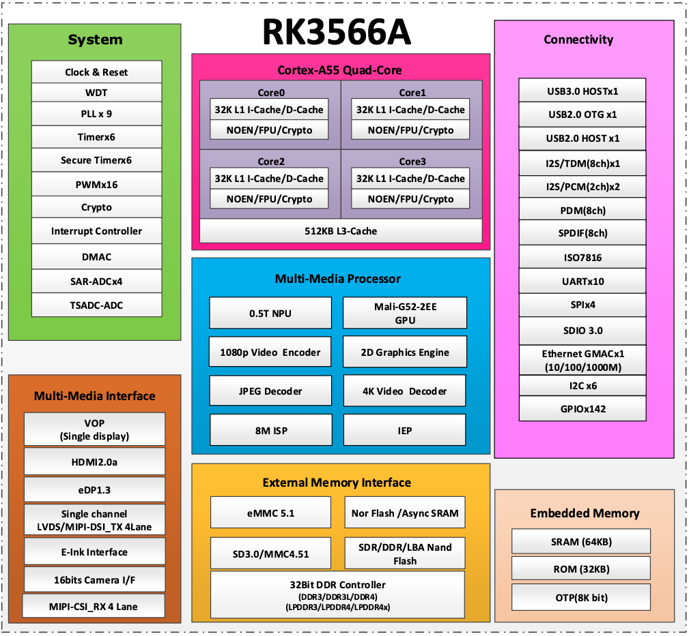

这份图片标题是 RK3566A，内部列出 Cortex-A55 四核、SRAM 64KB、ROM 32KB 等字样，但图片本身没有保留手册版本、页码或完整来源。这里保留其历史图像身份，不以它单独证明全部容量、可用区间或某块板的集成。尤其不能把它与 `evb_rk3568` 配置无条件拼成同一个实验平台。

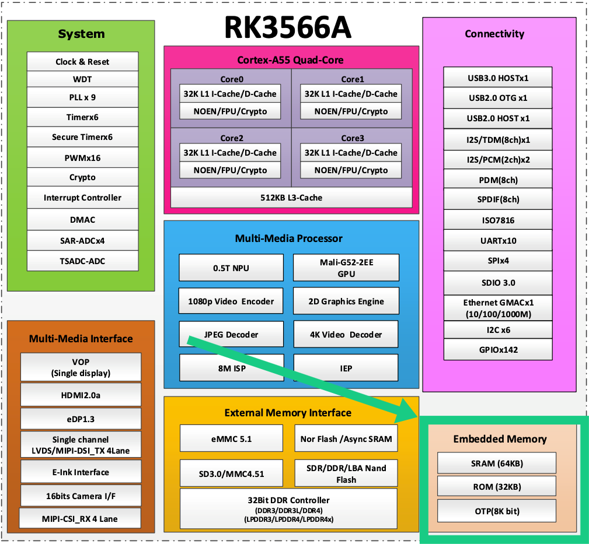

第二张图的绿色箭头只是标注右下角 Embedded Memory，不是“JPEG 模块把程序搬进 SRAM”的数据通路。原图里的连线位置不应被解释成启动时序。实际阶段职责应从可执行内存和加载约束推导，参见 [SPL/TPL 与 ROM 能力](../../knowledge/system_software/uboot/P05_为什么需要SPL以及它怎样交出下一阶段.md)。

旧说明曾把 eMMC/SD、SPI、DDR、UART、I²C/PMIC、USB、GMAC 和 GPIO/PWM/RTC/ADC 分配给固定阶段。更准确的读法是：存储控制器参与介质访问，DDR 控制器和 PHY 参与内存建立，UART 提供观察，电源与时钟设备可能是这些操作的前提；究竟由 ROM、前级固件、TPL、SPL 还是 proper 使用，取决于该启动方案的驱动和协议。资源表不能证明所有模块都会初始化，也不能证明网络、USB 只能出现在某一个阶段。

## 1.3\_旧截图怎样帮助找代码又在哪一步失去证明力

旧笔记的来源截图保留了仓库和搜索动作，适合恢复“当时怎样寻找资料”。它们并不是现在重新执行构建的日志。下面按实际用途保留原图，避免只留下文件链接，让读者仍需另找原材料才能理解差异。

### 1.3.1\_仓库分支与指南版本必须分别读取

第一张图可读到 NXP 的 `uboot-imx` 仓库和 `nxp/imx_v2016.03_4.1.15_2.0.0_ga` 分支，说明旧笔记曾以这条来源为入口。但分支可继续变化，截图没有给出足以绑定所有摘录的完整提交。

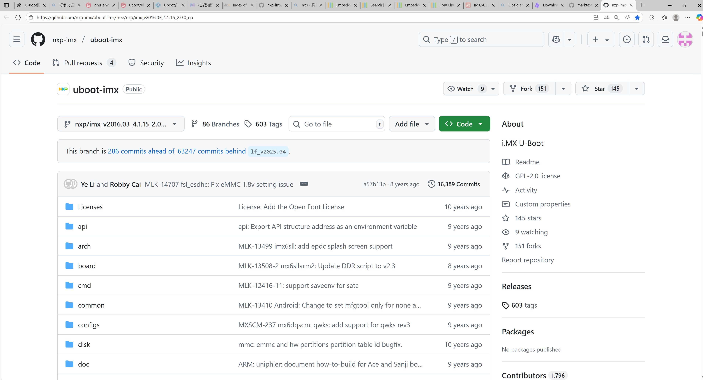

随后两张图分别是查找 i.MX Linux User’s Guide 的结果，以及指南中选择 U-Boot 板配置的页面。第二张实际出现 `lf_v2025.04`；不能因为它放在“2016”附近，就把其中命令当作 2016 发布说明。

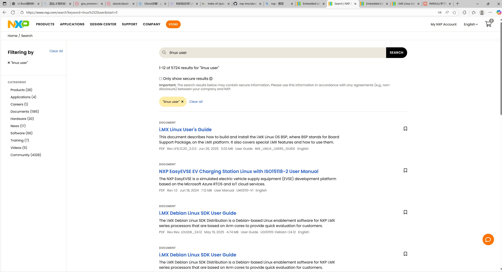

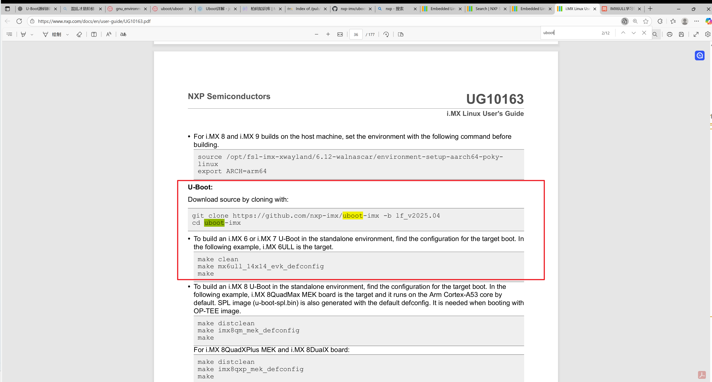

构建页要表达的方法是：先选择与发布相符的源码，再找到目标板的 `defconfig`，最后构建。清理命令和环境设置应按自己当前树执行；图片中的整组命令不是跨版本操作模板。可重复的构建上下文与产物核对步骤已经放在 [配置与构建章节](../../knowledge/system_software/uboot/P03_从板配置到可核对的构建产物.md)。

### 1.3.2\_目录搜索发现候选而不是确定链接结果

下面两张图展示 `arch/` 与 `configs/`。前者让读者找到架构实现的候选位置，后者定位板模板；它们解决的是导航问题。`ARCH` 的实际求值仍需读配置和 Make 规则，不能把 `arch/` 下所有目录名都当成当前目标值，也不能仅凭打开某个 defconfig 就断言当前构建用了它。

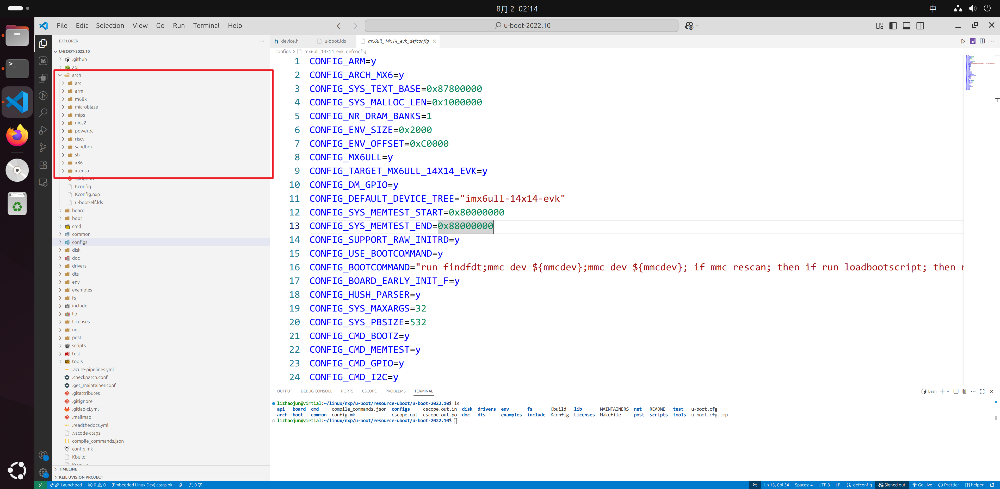

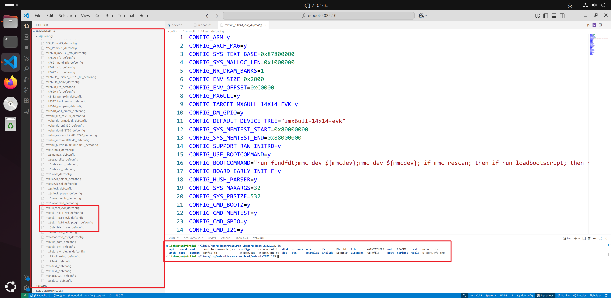

接下来的截图搜索 `head-y`，并沿 `scripts/Makefile.spl` 中的 include 找到架构 Makefile。这是恢复变量定义链的方法：先知道当前子 Make 加载哪些文件，再读赋值顺序。另一张图搜索 `obj-$(CONFIG_SPL_BUILD)`，展示“某对象只在阶段条件满足时参与构建”的写法。截图来自不同目录，不能把其他平台的 DDR 对象作为当前板训练代码。

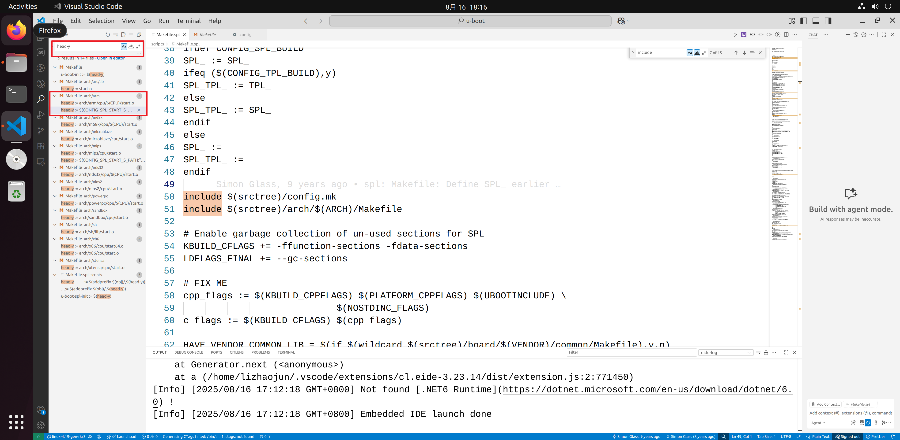

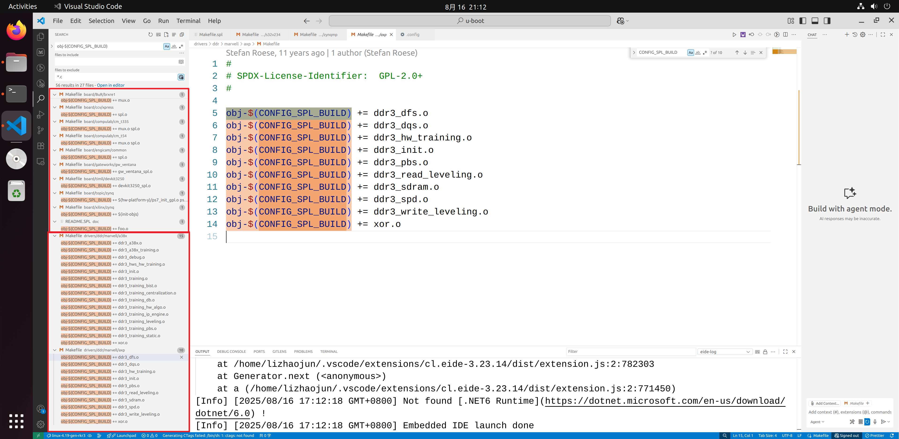

从候选定义到当前镜像，仍要经过配置求值、目标文件、链接结果。这个闭环见 [同名函数与入口选择](../../knowledge/system_software/uboot/P02_从构建上下文找到实际进入镜像的函数.md)，不能止于编辑器搜索到了一个函数。

### 1.3.3\_构建依赖图不能读成处理器执行时序

最后两张旧图把顶层目标和 SPL 产物关系画了出来。图中 `_all → all → ALL-y` 表示构建目标的依赖组织，不是 CPU 依次调用三个 C 函数。SPL 图同样从二进制目标展开 ELF、对象集合和链接脚本；这些是宿主构建关系，目标处理器尚未执行镜像。

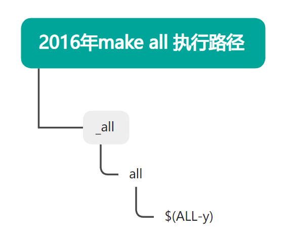

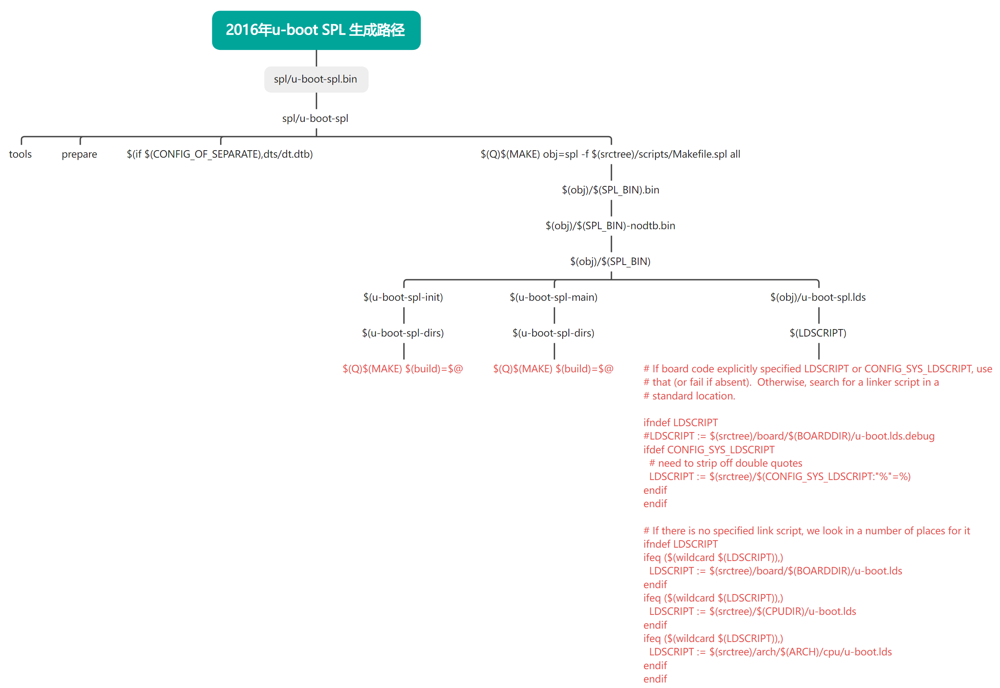

应保留图里的“产物依赖”和“入口对象/主体对象/链接脚本三类输入”认识，但不把图上的条件变量、目录搜索顺序写成所有年份的固定规则。新版本的真实依赖与 ELF 到镜像处理已在 [构建产物实现](../source_reading/uboot/source_explanations/P03_配置求值与构建产物实现.md) 逐项解释。

## 1.4\_旧启动摘录有哪些不能跨平台套用的差量

旧稿将相同函数名放到 NXP 与 Rockchip 两套流程里，这是比较的起点，却不足以证明流程等价。先找会改变执行结果的条件，再比较相同职责怎样实现。

| 旧摘录中的对象或条件 | 应保留的具体认识 | 需要改正的推断 |
| --- | --- | --- |
| `lowlevel_init` 临时栈与 `s_init` | 在调用早期 C 之前，汇编可能建立最小栈并保存返回地址；钩子的可用设施受合同限制 | 某路径说明不使用 GD/BSS，不等于该函数任意实现都可以省略；也不是 ARMv8/v9 必然合并目录的历史证据 |
| Rockchip `crt0_64.S` 的 `SPL_SKIP_RELOCATE` 条件 | 旧摘录允许在指定 SPL 分支进入主体搬迁；所附配置跳过该分支 | 不能拿这一厂商条件覆盖上游 v2022.10 的 crt0 |
| `gd->flags = dummy` 与 `board_init_f_boot_flags` | 旧路径先取得启动标志，再传给板初始化；输入与常见的常量零要区分 | 参数名叫 dummy 不证明永远无意义 |
| `spl_early_init` 失败后 `hang` | 当前执行流停止，不能继续依赖未成立的框架条件 | 它不是“防止其他核同时初始化”的互斥锁 |
| RAM 设备获取失败后 `return` | 该函数提早返回，后面语句未执行 | 仅凭返回本身不能证明外层已经安全终止或 DRAM 已可用 |
| `rk_board_init_f` 弱定义 | 默认函数可能直接成功返回，强定义需结合链接选择确认 | 没找到一个板目录定义，不证明完整源码树绝无覆盖 |
| 返回 BROM 的条件调用 | 一些平台把控制权交回 ROM，由其按协议推进下一阶段 | 不等于失败回退，也不是所有 SPL 的必经动作 |

其中栈/GD 的公共机制由 [早期 C 环境](../../knowledge/system_software/uboot/P04_先建立栈与GD再进入可用的C环境.md) 解释；前级执行条件与权限由 [ARM 入口](../../knowledge/system_software/uboot/P06_从复位入口到异常向量与主核交接.md) 解释。旧 AArch64 摘录在临时栈上 `stp x29,x30,[sp,#-16]!` 后以不带回写的 `ldp x29,x30,[sp]` 恢复寄存器，不能声称这条 `ldp` 同时把 SP 加回 16。后续重新建立栈与恢复普通函数栈，是不同的合同。

旧 SPL 主流程中的 `spl_image.os` 描述 **已加载镜像的目标类型**，不是“当前 SPL 正处于 U-Boot 阶段还是 Linux 阶段”。有些配置下一跳先进入安全固件，例如 ATF 或 OP-TEE，再按约定交给后续载荷，因此描述中会有多组入口地址；它们不应简化成同一个 `entry_point`。普通入口、Linux 入口和安全固件入口的参数与权限合同不同。旧 OMAP 覆盖函数还从保留区取出 ROM 参数并传给目标，说明名称为 `jump_to_image_no_args` 也不能替代对最终强定义签名的核对。

旧代码里 `gd->malloc_ptr` 的调试打印表示早期分配区已经推进的字节偏移，不是“还可分配多少空间”。`bootstage_stash` 保存的是所选启动计时记录，不是保存整个执行现场；失败仅打印的路径，也不能当成已经阻止跳转。新上游主流程仍有对未支持 OS 类型只打印提示再继续的默认分支，因而真正需要拒绝某类镜像时，必须落实明确检查，不能把存在一个 `switch` 当作自动白名单。

### 1.4.1\_启动寄存器说明的是来源线索而不是加载成功

旧 NXP `spl_boot_device` 摘录先选择一个启动配置值，再把位域翻译为 SPL 的软件设备类别。它为什么需要这一步？ROM 已经根据引脚、熔丝或覆盖配置选择了启动方式，后续加载器要获得相应线索，才能选择自己的读取实现；寄存器读数本身没有把镜像数据搬进 RAM。

这份旧代码使用 `GPR10[28]` 在 GPR9 与 SBMR1 间选择，再检查 SBMR2 的启动模式。其注释引用的是 **IMX6DQRM**，并列出 SATA、OneNAND 等分支；不能把这些返回分支直接写成 i.MX6ULL 都具备的硬件功能。i.MX6ULL Rev.1 手册中可核对的本地寄存器信息如下。

| 寄存器 | MMIO 物理地址 | 本次相关字段与读写含义 |
| --- | --- | --- |
| `SRC_SBMR1` | `0x020d8004`，SRC 基址加 `0x04` | 只读启动配置状态，`[31:24]` 至 `[7:0]` 分别为 BOOT_CFG4～1；字段含义需结合该芯片启动章节 |
| `SRC_SBMR2` | `0x020d801c`，基址加 `0x1c` | 只读；`BMOD[25:24]` 反映 POR_B 上升沿锁存的 BOOT_MODE1:0，不能当作当前介质读操作的结果 |
| `SRC_GPR9` | `0x020d8040`，基址加 `0x40` | 手册 51.7.2 将它关联到启动覆盖协议；51.7.14 寄存器表同时标为 Reserved，且注明 ROM 使用，不应当作应用软件自由存储区 |
| `SRC_GPR10` | `0x020d8044`，基址加 `0x44` | 51.7.2 说明 bit 28 让 ROM 以 GPR9 代替 SBMR1；51.7.15 说明相关位为读写且仅 POR 复位，并注明 ROM 使用 |

依据为 [i.MX6ULL Reference Manual Rev.1](https://www.nxp.com/docs/en/reference-manual/IMX6ULLRM.pdf)，51.7.2（p.3517）、51.7.5（pp.3522～3523）、51.7.14～51.7.15（pp.3527～3528），原件身份见 [Arm 资料索引](../../reference/external_resources/arm/README.md)。保留同一手册不同字段的限定，不把 GPR9 的启动用途解释扩大成任意软件都能安全改写它。

旧摘录的转换过程可以按代码本身读懂：先判串行下载条件，再取配置低字节的高四位；`0` 分到并行存储子类、`2` 分到 SATA、`3` 再看串行 ROM 子类、`4～7` 分到 MMC 类、`8～f` 分到 NAND，未识别返回 NONE。这里说明的是该摘录的 **软件分类算法**，不是 i.MX6ULL 介质支持表。返回 `BOOT_DEVICE_MMC1` 也不等于芯片的某个物理控制器已经初始化，更不等于文件已经读取成功；它还要交给 [SPL 候选与加载回调](../../knowledge/system_software/uboot/P05_为什么需要SPL以及它怎样交出下一阶段.md#5.4_SPL的完整周期是准备环境_装载_检查与交接)。

## 1.5\_怎样保持证据可追溯而不继续混用结论

原始长稿可在仓库提交 `d53d5a936389ed6dda3976168ef8321529121fb2` 的 `knowledge/system_software/uboot/uboot-makefile.md` 中复核；它包含作者转录、提问及后续生成说明，并不是上游源码原件。前述构建长稿的十一张原图和三份配置保留入口，不把有待核验的厂商摘录放进 `upstream/v2022.10/` 冒充官方文件。

| 原附件 | SHA-256，按仓库当前保存的文件字节计算 |
| --- | --- |
| `.config-2016.txt` | `ea2fbc596939b0c70fd12a3256024727bf31584c414eb5c78725419ee335b33c` |
| `.config-2022.txt` | `f33d27367b8db17f35632643681f619c10d212ab02f558a499abfd4945158bd7` |
| `RK_3566/.config.txt` | `3711400afa6abd9d7693ccadcbf2725c6b95b0166adeeb123c6e12cebafa6035` |

摘要用于确认自己正在看同一份附件，不会给未知源码补出提交身份。要复现实物启动，还应在对应 SDK 中记录远端、不可变提交、板配置、工具链、最终镜像、打包方式和启动日志；目前这些旧材料没有完整提供这条链。本次整理保留其可用事实，并修正证据边界，没有声称重新完成了 NXP 或 Rockchip 板上的启动实验。

## 1.6\_读书笔记的旧启动图能证明到哪一步

[内核引导读书笔记](../../publications/books/running_linux_kernel/P03_内核引导和初始化.md) 的原稿保存在提交 `773dd8312cc738b54589f05166186f083e61fd65` 的同一路径。它把多轮启动问答接在一起，分别声称某些入口代码来自 2018.11、`crt0_64.S` 来自 2018.03，但没有提供对应 SDK、不可变提交与完整构建配置。摘录还混有后来的配置和执行条件，因此这些年份只能作为原稿的标注保留，不能作为已验证的源码版本。

原稿的这张调用图仍保留在正文中，便于对照它提出的问题。

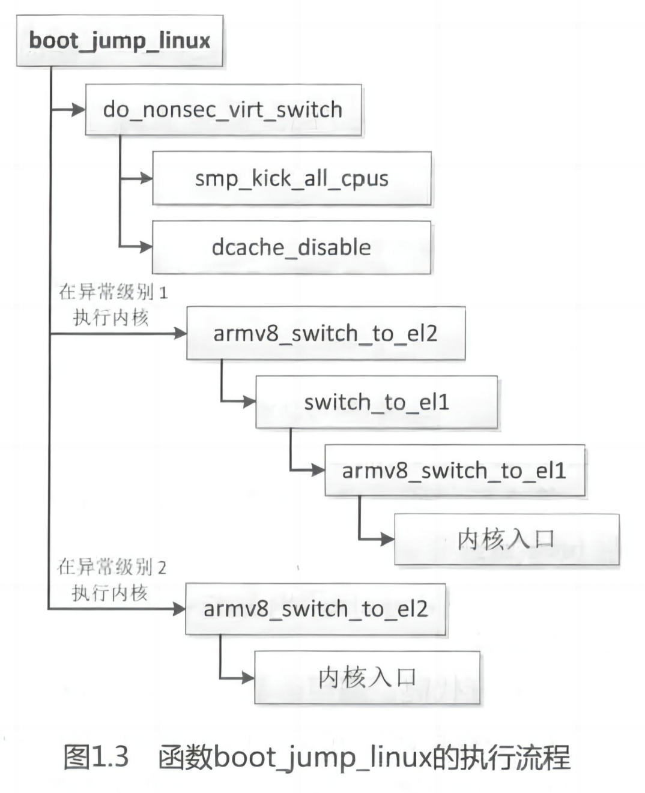

图把 `boot_jump_linux` 后的动作分为不同分支：一侧出现 `do_nonsec_virt_switch`、唤醒其他核与关闭数据缓存的动作；另一侧沿异常级切换辅助函数走向内核入口。它表达的是选定实现中的调用关系，**不是这些节点在所有配置中都会顺次执行的时间线**。特别是图上有 EL2、EL1 两种终点关系，不足以推出所有启动都必须从 EL3 依次下降到 EL2 再到 EL1。

图片没有提供足够的版本与配置标识，本次也未据图补造。当前固定 v2022.10 的实际前置清理、fake 分支、EL 选择和回调返回行为，见 [镜像交接正文](../../knowledge/system_software/uboot/P11_内存镜像如何变成Linux入口现场.md) 及 [M4/M5 实现](../source_reading/uboot/source_explanations/P11_镜像范围与Linux交接实现.md#11.4_M4与M5_准备跳转和返回不是同一个结果)。例如启动提示先于真正跳转，普通 Linux 回调若返回会进入错误处理；这些边界不能从一张静态调用图猜出。

旧稿另有几类重复假设也不能当成平台记录保留：ARM64 一律从零地址 NOR 启动、DDR 就绪即接管零地址、SPL 总在某个固定 SRAM 地址、PIE 自动跨 SoC 通用，以及 GD 自动留给 Linux 调试。它们分别把架构、芯片地图、板级装载、二进制构建和内存生命周期混成一项保证。现有 [入口](../../knowledge/system_software/uboot/P06_从复位入口到异常向量与主核交接.md)、[地址与重定位](../../knowledge/system_software/uboot/P07_镜像搬迁为什么不等于改变内存映射.md) 和 [存储路径](../../knowledge/foundations/computer_architecture/boot_storage_paths.md) 已按实际证据区分这些层次。旧稿列举的若干 SoC 加载基址缺少同一版本的手册与装载配置，不继续作为可复制地址表使用；i.MX6ULL 的已核对窗口及其与实际容量的区别则保留在地址单元。
