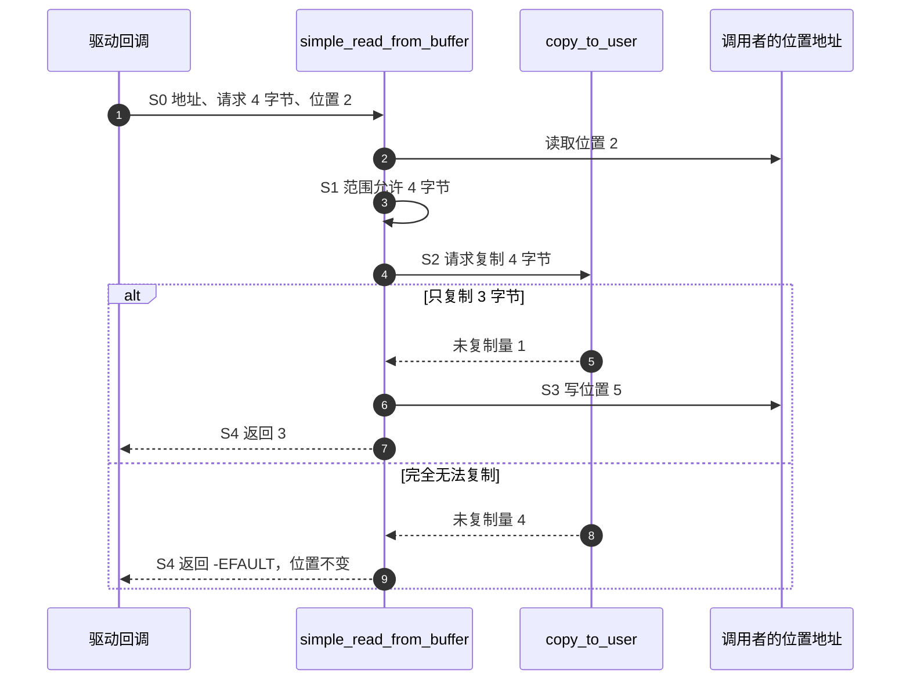

# 第2章\_Linux\_6.12\_有限缓冲区IO模块导读

驱动有八字节有效内容，用户从位置 2 请求四字节，但用户目标地址只接受了三字节。这时应返回 3、返回错误，还是仍把位置推进四字节？正文已建立“报告的进度必须与提交的进度一致”，本篇继续找出固定版本中真正完成这笔换算的对象和调用关系。

阅读结束后，应能追踪同一个请求从范围裁剪、用户复制到位置写回，并判断帮助函数没有替驱动承担哪些保证。前置是[正文第五章](../../../../knowledge/driver_model/character_device/P05_文件操作契约与数据路径.md)的设备状态、打开状态与请求状态；版本与范围由[总阅读索引](P01_Linux_6.12_字符设备源码阅读索引.md#1.1_版本和阅读边界)固定。

## 2.1\_参与者与状态落点

`fs/libfs.c` 提供有限缓冲区复制帮助函数；调用者传入的内核缓冲区仍由调用者拥有。用户访问层由 `include/linux/uaccess.h` 接入，并可能选择架构实现。一次调用里，`pos` 是位置快照，`count` 是裁剪后的本次允许量，`ret` 或 `res` 记录未复制量；`*ppos` 是调用者提供的可更新位置。

这些局部量构成一次请求状态，不是设备自己的全局状态机。共享数据何时可读、设备是否离线、哪个打开者拥有快照，均不在这两个帮助函数中解决。

## 2.2\_按同一组阶段读两个函数

先顺着开头的读请求走一遍：起点 2 小于有效长度 8，剩余六字节足够满足四字节请求，所以允许量仍是 4。复制层返回未复制量 1 后，帮助函数算出进度 3，把调用者的位置从 2 改成 5，再返回 3。下一次读取从 5 开始，已经交付的三个字节不会被当成尚未处理。

若把方向换成用户写入内核缓冲区，范围裁剪和进度换算可以复用，内容副作用却不对称。读取不修改内核源内容，写入可能在确定最终结果以前就修改目标。下面统一编号只描述一次帮助函数请求，不覆盖设备的发布、离线和最终回收。

| 阶段 | 在帮助函数中的落点 | 调用者的责任 |
| --- | --- | --- |
| S0 接受请求 | 从 `*ppos` 取得局部 `pos`，接收地址和长度 | 确保内核对象与位置地址有效 |
| S1 确定范围 | 拒绝负位置；检查末尾和零长度；裁剪 `count` | 提供正确有效长度或可写容量，决定外围设备协议 |
| S2 执行复制 | 分别调用 `copy_to_user` 或 `copy_from_user` | 提供适用的任务上下文、稳定的数据与同步 |
| S3 提交进度 | 从 `count` 扣除未复制量，再写 `*ppos` | 写入后若要扩大有效数据长度，另外维护；不得误认为失败会回滚共享内容 |
| S4 返回 | 范围检查可提前返回错误或零；已尝试复制却无进度时返回错误，有进度时返回完成量 | 向上层保持同一字节数协议，处理设备特有状态 |

按顺序阅读[读取实现](../source_explanations/fs/libfs.c.md#1.1_simple_read_from_buffer)，再比较[写入实现](../source_explanations/fs/libfs.c.md#1.2_simple_write_to_buffer)。相似结构不表示两者拥有完全相同的业务含义：读取的 `available` 通常是有效数据长度，写入的 `available` 通常是可写容量。

尤其注意写帮助函数在位置达到容量时返回零。驱动若承诺“正长度写入、容量已满则返回 ENOSPC”，必须在自己的协议层处理，不能直接把帮助函数的所有返回都当作完整设备规范。

## 2.3\_复制层与调用者的交接

用户访问层报告尚未复制的字节数，帮助函数据此计算进度。若直接写共享缓冲区，即使后来返回错误，目标也可能已经发生变化。普通用户复制的[短复制与清零分支](../source_explanations/include/linux/uaccess.h.md#1.1_普通复制的短复制处理)是理解这一点的证据，而不是要求驱动自行仿造架构复制代码。

步骤 1～4 确定本次请求并发起复制；步骤 5～7 只提交三字节，步骤 8、9 则保持原位置并报告错误。两条分支都假定内核区间一直有效。该序列没有任何获取设备锁的动作，不能从图中推导其他写者已经被排除。用一份临时记录换取“失败不改变旧内容”，属于正文中的协议设计；这两个通用帮助函数本身不承诺事务提交。

最后改变一个输入：位置为 8、请求量仍为 4，复制层还会被调用吗？不会，S1 已到有效范围末尾，直接返回 0。若是写入且设备协议要求满容量时报 `ENOSPC`，这条零返回必须由驱动外围条件转换为自己的容量规则；不能修改用户复制层来实现设备业务。
