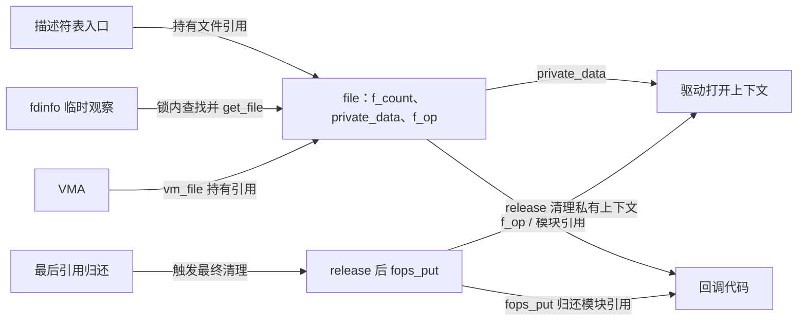
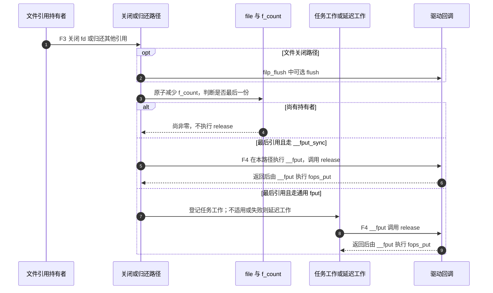
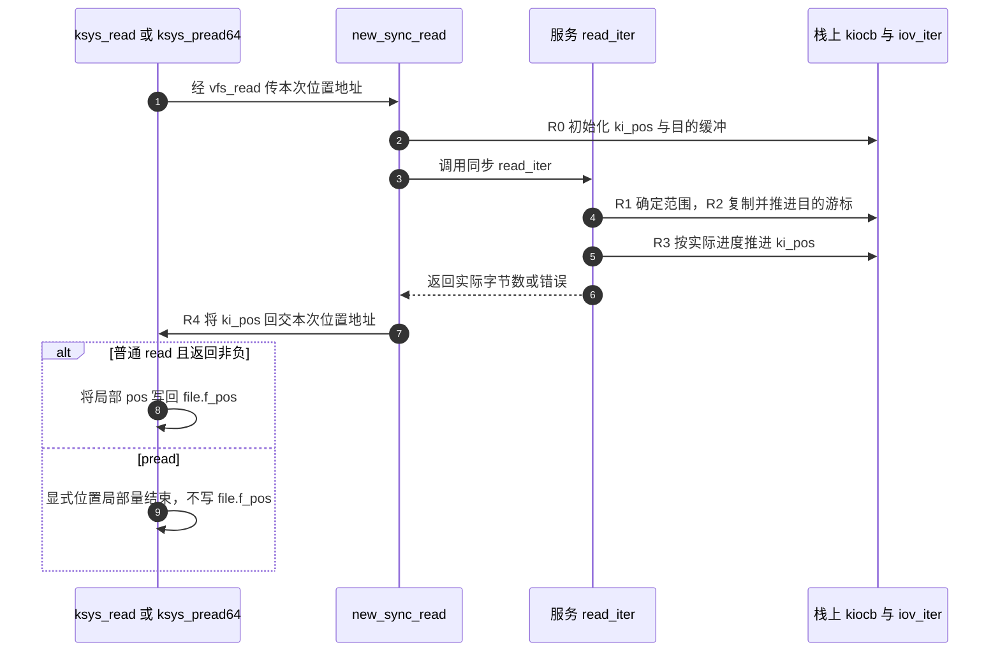
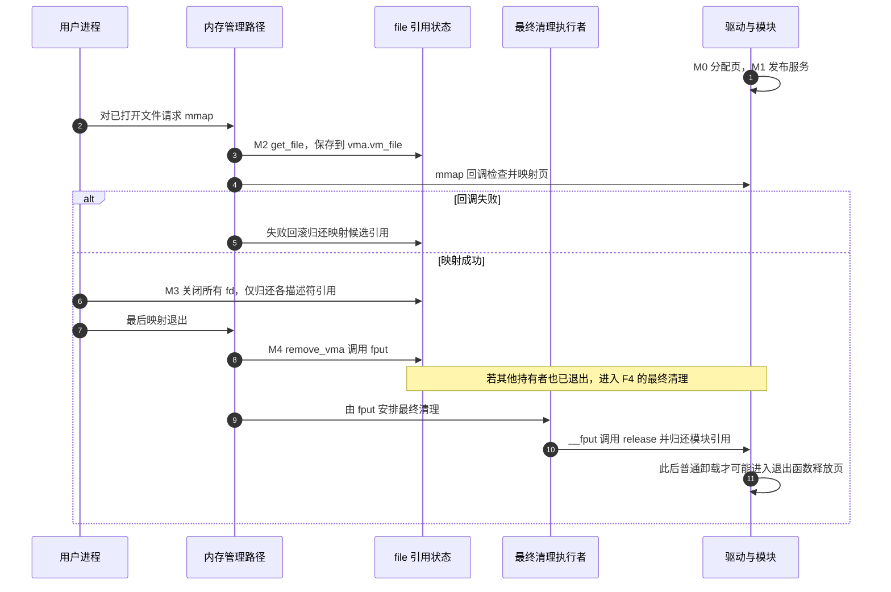

# 第3章\_文件操作与打开寿命导读

一个应用打开设备，再用 dup 得到第二个描述符；它读出几个字节，建立一段映射，然后关闭两个描述符。此时位置已经改变，但设备的 release 仍可能没有发生。若只跟踪 open/read/close 的名字，就无法解释还有谁持有打开对象，也无法判断映射何时不再需要驱动代码和后备页。

本篇分别追踪打开寿命、一次读取和一段映射，把“内容推进了多少”和“谁仍有权访问对象”放回各自状态地址。读完应能判断一次 close、一次短读和一次 munmap 分别结束了哪项责任。[文件操作正文](../../../../knowledge/driver_model/file_operations/大纲.md)负责模型和观察实验，这里负责固定版本的函数协作，不重复展开各函数体。版本为 NXP 官方固定提交 `dfaf2136deb2af2e60b994421281ba42f1c087e0`（Linux 6.12.20），来源见[总阅读索引](P01_Linux_6.12_字符设备源码阅读索引.md#1.1_版本和阅读边界)。

## 3.1\_打开对象由谁持有

描述符只是进程表中的一个数字入口，真正承载这次打开的是 `struct file`。它的 `f_op` 指向操作表，`private_data` 保存驱动可使用的上下文地址，`f_pos` 保存打开位置，`f_count` 记录本版本的文件引用。它们不是同一种状态：改变位置不会增加引用，分配私有对象也不会自动把 file 保活。字段定义见 [include/linux/fs.h](../../linux/include/linux/fs.h) 中的 struct file 与 struct file_operations。

misc_open 用 replace_fops 换到服务的操作表，再调用服务 open。表的模块引用先于该回调取得；具体实现沿[已有 misc 实现讲解](../../driver_entries/source_explanations/P01_对象创建与misc分派.md#1.3_misc打开与注销的交接)阅读，不再抄一份函数体。一次独立打开建立新的 file，而 dup 增加描述符入口与文件引用，不重新执行服务 open。

普通打开路径用 `FMODE_OPENED` 标记回调是否已经成功交付：回调失败须自行回滚私有资源；回调成功、框架设置标记后，即使后续 VFS 检查失败，也要按已打开对象进入最终清理。这个标记不等于用户已经拿到 fd。[打开回调失败与交付边界](../source_explanations/fs/open.c.md#1.3_打开回调失败与交付边界)给出具体写入点；[P28完整文件持有实验](../../../../knowledge/linux/object_lifetime/kref/P28_文件实例与私有对象持有模板.md#28.1_计数单位是文件实例)将这一交接用于共享服务的候选份额。

因此，把开头的现场分成 F0～F4：先准备候选 file，回调成功后接管私有上下文，再由多个入口共同持有，逐份关闭，最后才能清理。映射持有者在内核中表现为 **虚拟内存区域（Virtual Memory Area，VMA）**，其 vm_file 字段稍后单独追踪。F 表示本篇的文件寿命编号，不是内核枚举；它也不描述后面一次读取的进度。

| 阶段 | 事件和状态地址 | 写入者、后续读取者与退出条件 |
| --- | --- | --- |
| F0 | 打开尚未交付，回调可能正在准备私有资源 | 打开路径准备 file；回调失败须回滚自己已取得的资源 |
| F1 | 服务 open 成功，框架设置 FMODE_OPENED；本例上下文地址已写入 file->private_data | 服务回调交付上下文，后续回调通过同一 file 读取 |
| F2 | 描述符、临时使用者或 VMA 持有 file；计数在 file->f_count | VFS 引用接口协调；计数不是驱动自己扫描 fd 数组得到的 |
| F3 | 关闭入口调用可选 flush，再归还文件引用；其他归还者不一定调用 flush | flush 可见同一私有上下文；计数不为零就不能进入最终 release |
| F4 | 最后一份引用归还，__fput 执行清理并调用 release、fops_put | release 清理私有数据；操作表模块引用在其后归还 |

这是打开初始化、持有者集合与驱动私有状态三组协作状态，不是一张由驱动独占的枚举。`fs/proc/fd.c` 的 seq_show 在描述符表锁下找到目标 file 并取得引用，退出锁后才调用 show_fdinfo，最后 fput；因而观察期间 file 仍活着，但字段内容仍可能变化。

接着读 [filp_close](../source_explanations/fs/open.c.md#1.1_filp_close归还文件引用)和[本版本 close 系统调用](../source_explanations/fs/open.c.md#1.2_close系统调用的同步清理)。注意当前 close 系统调用不是直接调用 filp_close：它调用 filp_flush 后走 __fput_sync。通用 fput 可延迟最终处理，不能把这条一般规则说成每次 close 都必然延迟。

`fs/file_table.c` 中 fput 先减 f_count。对这里的已打开文件，仅最后引用才安排 **任务工作**：把清理回调挂到当前任务，交给任务工作执行点运行；不适用或登记失败时，转入待清理文件链表 `delayed_fput_list`，由延迟工作执行。尚未打开且不带内部后备文件标记 `FMODE_BACKING` 的早期失败对象另有直接释放分支，不经过服务 release。__fput_sync 则在减到零时直接 __fput。两条已打开路径的终点相同：先清理事件/锁等登记，处理 fasync，再调用 release，随后 fops_put。release 返回值没有成为 close 的业务保存错误结果。

步骤 1～4 可能只结束一份持有；最后引用的同步分支是步骤 5、6，异步安排分支是步骤 7～9。后者的清理执行者已经改变，驱动不能把“调用 fput 返回”当成 release 已返回。反过来，即使走同步分支，也不能要求它替其他持有者归还引用。

## 3.2\_请求位置怎样回到调用方

文件仍由 F2 的持有者保持有效时，可以发起许多次读取。假设其共享位置是 2，普通 read 成功读三字节后，另一个 dup 描述符应看到位置 5；若改为 pread 从显式位置 10 读三字节，共享位置仍应为 2。差别由上层选择的位置地址及写回规则兑现，不是驱动凭 fd 数字辨别。

`fs/read_write.c` 的 ksys_read 先用局部 `pos` 承接共享位置，读取返回非负且位置指针非空时才写回 `file->f_pos`；ksys_pread64 直接传入本次显式位置的地址，没有共享位置写回。流文件还可能使用空位置指针，这里先限定有位置的设备。沿 vfs_read 看回调分派，再读 new_sync_read 的同步适配，便能把位置变化归属到实际调用者。

迭代回调把本次源位置放入请求描述符 `kiocb.ki_pos`，把一个或多个目的缓冲区的当前进度放入 `iov_iter`。前者回答“接下来读内容哪里”，后者回答“接下来写用户缓冲哪里”，二者都不是打开对象的寿命计数。这里用 R0～R4 跟踪一次读取：R0 构造请求和目的迭代器；R1 确定内容范围；R2 copy_to_iter 推进目的缓冲游标；R3 服务回调推进 ki_pos；R4 适配者回交位置，由上层决定是否更新共享打开位置。

| 状态 | 所在地址和所有权 | 本次请求完成后的去向 |
| --- | --- | --- |
| 打开位置 | file->f_pos，属于共享打开对象 | 普通读路径按位置协调规则写回；pread 不写回 |
| 请求位置 | kiocb.ki_pos，由构造者初始化、回调提交 | 同步适配者读取它，带回调用路径 |
| 缓冲进度 | iov_iter 的当前段、偏移与 count | copy_to_iter 推进；不是文件内容位置 |
| 源内容 | 教学模块的只读 message | 不变数据不需要内容锁；可变源必须另定协议 |

步骤 2、4、5 分别涉及请求位置和目的缓冲进度，步骤 7、8 才把结果交回共享位置；pread 在步骤 9 停止这次位置传递。图中选取 `.read` 缺省、走 `.read_iter` 的同步路径；若回调错误返回却错误推进 ki_pos，适配层并不会替它纠正回调契约。

[vfs_read 的唯一实现讲解](../source_explanations/fs/read_write.c.md#1.1_vfs_read选择回调)显示 .read 优先，缺省才选择 .read_iter；[同步适配](../source_explanations/fs/read_write.c.md#1.2_new_sync_read构造请求)显示本地 kiocb、ITER_DEST 和位置回传。再对照同文件的 vfs_readv：它先选 .read_iter，否则逐段处理旧回调。不能在路径不同的情况下宣布统一优先级。

同一个迭代器接口还能承接内核缓冲或页集合，原因是上层数据来源不总是用户数组。`include/linux/uio.h` 当前的类型名中，UBUF 表示单个用户缓冲，IOVEC 表示用户缓冲向量，KVEC 表示内核缓冲向量，BVEC 表示带页、偏移和长度的向量；FOLIOQ 与 XARRAY 从页集合载体取范围，DISCARD 则用于丢弃输出。教学 readv 的用户向量只是其中一种。这里建立的是类型与存储来源的区分，不展开各后端遍历算法，也不把旧版 PIPE 后端照抄进当前实现。

## 3.3\_映射怎样留住文件

再回到开头关闭两个 fd 的现场。映射让用户在不执行 read 的情况下访问页，因而 fd 数字消失不等于后备页可以释放。先分开两项证明：映射的页范围适合公开给用户；从建图到撤图期间，有一条寿命链保护这些页和必要代码。本节限定带内存管理单元（MMU）的普通页教学模块，页只在普通模块卸载时释放。

第一项由专用分配与范围检查落实。`mm/vmalloc.c` 的 vmalloc_user_noprof 请求清零内存并带 `VM_USERMAP`，即该 vmalloc 区域允许用于用户映射。remap_vmalloc_range 及其 partial 帮助函数检查偏移移位溢出、页对齐、区域身份、允许映射的标志和范围，逐页取得 struct page 并插入映射，成功后设置 `VM_DONTEXPAND` 与 `VM_DONTDUMP`，分别限制区域扩展和核心转储。它不把任意 kmalloc 小对象变成可公开整页。

引用落点在 `mm/mmap.c` 的 mmap_region：文件映射给 vma->vm_file 保存 get_file(file) 的结果，出错路径也要归还。`mm/vma.c` 的 remove_vma 在 vma_close 后对 vm_file 执行 fput。映射的拆分、复制与销毁由内存管理路径维护引用，驱动不能按“只发生一次 mmap 回调”手工猜还剩多少 VMA。

映射周期用 M0～M4 表示：M0 分配专用页，M1 发布服务，M2 建立 VMA 并持有 file，M3 关闭 fd 只归还描述符引用，M4 最后映射及其他引用退出后才可能进入 F4 的最终文件清理。跨层通信靠引用交接和清理回调，不靠驱动后台轮询是否还有映射。普通卸载在文件所持模块引用归还后才能继续，退出函数随后释放页；file 计数本身并不直接执行 vfree。

步骤 3 的引用在步骤 5 的失败回滚或步骤 8 的映射退出归还；步骤 6 不能代替其中任何一个。步骤 9、10 沿上一节的 fput 路径安排并执行最终清理，不保证就在 remove_vma 的调用栈内。若对象支持热拔插或能独立释放实例，模块尚在也可能已经失去硬件与后备对象，必须另外设计实例持有和映射撤销协议，不能沿用静态模块的释放前提。

## 3.4\_扩展接口的核对位置

前三节解决了共享打开对象、一次读取和映射保活。若接下来要增加目录枚举、控制命令或搬运接口，不能按操作表字段名直接套入普通读写模型：目录有枚举游标，控制命令有参数布局，异步命令还需要明确谁最终完成。下面是这些后续任务的证据导航，当前页不承诺讲完每项算法；先从对应问题查明接口约束，再决定驱动是否需要它。

下表给出实际核对过的固定提交位置。标为“只读核对”的文件未在本批保存全文；用总索引中的同一提交 git show 定位，不把工作树 HEAD 当替代。这里不展开第二份上游函数体。

| 问题 | 位置与定位项 | 得到的边界 |
| --- | --- | --- |
| 当前操作表成员 | [include/linux/fs.h](../../linux/include/linux/fs.h)：file_operations、fop_flags_t、dir_emit | 无 iterate/sendpage/mmap_supported_flags；dir_emit 不自动推进 pos；!CONFIG_MMU 才有 mmap_capabilities |
| fdinfo 如何保活 | [fs/proc/fd.c](../../linux/fs/proc/fd.c)：seq_show | 在锁内 get_file，回调后 fput；内容同步仍属驱动 |
| 目录的打开位置 | [fs/readdir.c](../../linux/fs/readdir.c)：iterate_dir | 调用 iterate_shared 前后在 ctx->pos 与 file->f_pos 间交接 |
| ioctl 布局与错误 | [Documentation/driver-api/ioctl.rst](../../linux/Documentation/driver-api/ioctl.rst)、fs/ioctl.c（只读核对） | 方向不会代替复制；固定宽度、布局、指针和标量必须区分 |
| procfs/debugfs | include/linux/proc_fs.h、include/linux/debugfs.h（只读核对） | proc_create 使用 proc_ops；debugfs_create_u32 对应 u32 存储 |
| 文件锁与租约 | fs/locks.c（只读核对）：vfs_lock_file、flock、vfs_setlease | 专用回调以外还有公共路径；setlease 当前使用 file_lease |
| 专用异步命令 | io_uring/uring_cmd.c、include/linux/io_uring/cmd.h（只读核对） | 普通结果、重试与 -EIOCBQUEUED 的完成归属不同；不能两次完成 |
| 范围与搬运 | fs/open.c、fs/remap_range.c、fs/splice.c（后两者只读核对） | 预分配不等于改大小；CAN_SHORTEN 是缩短完成范围；splice 需真实管道/页协议 |
| 同步与访问提示 | fs/sync.c、mm/fadvise.c（只读核对） | 缺少 fsync 回调时该路径返回 EINVAL；访问提示可能被忽略，不是持久化保证 |
| 无 MMU 映射 | mm/nommu.c（只读核对）：validate_mmap_request | 对象类型影响缺省能力，不能把 MMU 与 compat 混成一个轴 |

原文保存范围及检查边界见[源码基线](../../linux/SOURCE_BASELINE.md)。普通页映射不证明 DMA 或设备寄存器映射安全；ARM 语法检查不证明跨架构用户 ABI、真实页表和文件引用实验已经执行。

回到[正文大纲](../../../../knowledge/driver_model/file_operations/大纲.md)完成观察，再用[总索引](P01_Linux_6.12_字符设备源码阅读索引.md#1.2_由问题进入模块导读)按需要继续阅读。

字符特殊inode从默认表进入chrdev_open、缓存重查及驱动表替换的唯一实现，见 [VFS特殊类型分派](../../vfs/source_explanations/P73_特殊inode的类型选择与打开分派.md#73.2_离开缓存锁查找以后必须重查)。其模块入口为 [特殊对象交接导读](../../vfs/navigation/P23_特殊文件与匿名对象的VFS交接.md#23.1_沿建立发布使用退出定位状态)，VFS [总索引](../../vfs/navigation/P01_Linux_6.12_VFS源码阅读索引.md)组织完整上下文。
