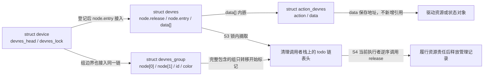
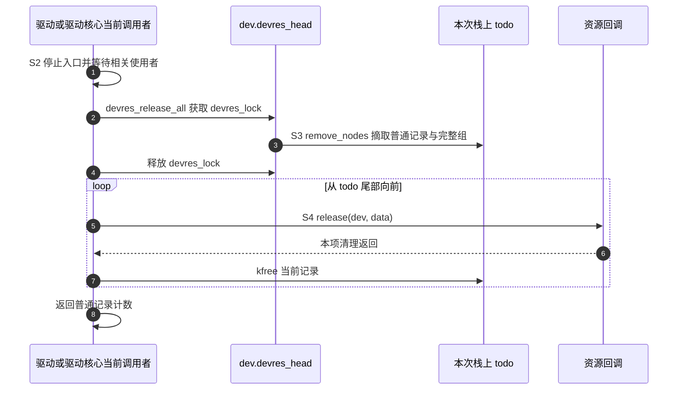

# 第1章\_devres核心登记与分组实现

驱动已经取得资源，并决定把退出动作交给设备账本。接下来仍有两个不同的问题：登记失败时谁负责回滚；登记成功后，某一阶段的记录怎样从整个设备账本中挑出来？本篇沿同一个设备的登记、分组与清理过程，解释实际链表操作。读完应能在纸上预测：哪些记录留下、哪些回调执行、组结构何时释放。

上游位置为 `drivers/base/devres.c`，证据固定为 NXP Linux 6.12.20、标签 `lf-6.12.20-2.0.0`、提交 `dfaf2136deb2af2e60b994421281ba42f1c087e0`；[完整原文](../../../../linux/drivers/base/devres.c)用于追溯。前置模型见[模块状态导读](../../../navigation/P02_记录与分组清理导读.md#2.1_从记录地址追踪S0到S4)：S0 是调用者承担责任，S1 是登记，S2 是停止使用，S3 是摘取记录，S4 是执行清理。这里的分组操作只划定责任范围，不替驱动完成 S2。下列 Doxygen 说明与中文阅读注释均为仓库补充；函数体保留固定版本的算法。

先分清 **资源对象、管理记录和链表头**。驱动的 `data` 指向资源或驱动状态；`struct action_devres` 只保存这个指针和函数地址，不复制整个对象。通用 `struct devres` 在前部保存 `node`，后接 `data[]`；action 数据放在这个可变长度区域里。每个设备有自己的 `devres_head` 和保护链表操作的 `devres_lock`，没有一个替所有设备运行回调的全局线程。



图中 `todo` 的链表头在栈上，记录本身仍是先前分配的对象；摘链没有复制资源。组的两个 `node` 用不同的空回调地址表示开始与结束，`node_to_group` 据此识别组标记。`id` 用于查找，`color` 只在一次范围扫描中计数，不是资源的生命期状态。

## 1.1\_普通action登记成功才转交责任

此处的 `GFP_KERNEL` 是允许普通内核分配路径睡眠的分配标志，`NUMA_NO_NODE` 表示不指定内存节点；它们只描述管理记录的分配选择，不决定资源归谁。分配不成功时，接口用负错误码 `-ENOMEM` 表示内存不足。

仓库补充Doxygen阅读说明：

```c
/**
 * @brief S0到S1：记录分配失败不执行action；成功写入函数与数据再登记。
 * @note 调用者须保证设备、组ID与回调参数期限；链锁不代替业务同步。
 */
```

```c
int __devm_add_action(struct device *dev, void (*action)(void *), void *data, const char *name)
{
	/* 仓库阅读注释：S0到S1：记录分配失败不执行action；成功写入函数与数据再登记。 */
	struct action_devres *devres;

	devres = __devres_alloc_node(devm_action_release, sizeof(struct action_devres),
				     GFP_KERNEL, NUMA_NO_NODE, name);
	if (!devres)
		return -ENOMEM;

	devres->data = data;
	devres->action = action;

	devres_add(dev, devres);
	return 0;
}
```

**实现原理。** `__devres_alloc_node` 为通用头部和 action 数据分配存储，并把包装回调 `devm_action_release` 放入头部。返回给这里的是数据区地址；因此赋值写入的是新记录的 `data`、`action` 字段，而不是驱动对象。分配失败只返回 `-ENOMEM`，没有执行调用者提供的 action，原责任仍在 S0。

两字段写完后，`devres_add` 在设备链锁内把记录追加到链尾。此时才完成 S1，后续清理路径能找到它。S4 调用头部的包装回调，包装回调再执行保存的 `action(data)`。名称 `name` 是调试信息，不参与责任匹配或执行选择。

不能把 `devres_add` 提前到两次赋值以前，否则记录可能在内容尚未就绪时对清理路径可见。调用者还须防止同一设备在登记期间进入不受控的整体退出；单次链操作有锁，不等于整个驱动初始化事务有锁。失败自动执行 action 的差量见[reset 包装](../../include/linux/device.h.md#1.1_reset包装失败直接执行)。

## 1.2\_devres\_open\_group登记开始标记

`INIT_LIST_HEAD` 把链表节点初始化为自环；本函数先准备两个这样的节点，再将开始节点交给追加链表的辅助函数 `add_dr`。因此“组结构已分配”与“结束边界已接入”是两件事。

仓库补充Doxygen阅读说明：

```c
/**
 * @brief S1：分配两标记的组结构，生成或保存ID，只登记开始标记并返回ID。
 * @note 调用者须保证设备、组ID与回调参数期限；链锁不代替业务同步。
 */
```

```c
void *devres_open_group(struct device *dev, void *id, gfp_t gfp)
{
	/* 仓库阅读注释：S1：分配两标记的组结构，生成或保存ID，只登记开始标记并返回ID。 */
	struct devres_group *grp;
	unsigned long flags;

	grp = kmalloc(sizeof(*grp), gfp);
	if (unlikely(!grp))
		return NULL;

	grp->node[0].release = &group_open_release;
	grp->node[1].release = &group_close_release;
	INIT_LIST_HEAD(&grp->node[0].entry);
	INIT_LIST_HEAD(&grp->node[1].entry);
	set_node_dbginfo(&grp->node[0], "grp<", 0);
	set_node_dbginfo(&grp->node[1], "grp>", 0);
	grp->id = grp;
	if (id)
		grp->id = id;
	grp->color = 0;

	spin_lock_irqsave(&dev->devres_lock, flags);
	add_dr(dev, &grp->node[0]);
	spin_unlock_irqrestore(&dev->devres_lock, flags);
	return grp->id;
}
```

**实现原理。** 创建组要一次分配含两个节点的 `devres_group`。开始标记和结束标记起初都指向自身，表示尚未接入设备链；`add_dr` 只把 `node[0]` 追加到链尾。因此后续登记的资源自然位于开始标记之后，尚不存在结束边界。

调用者传入非空 `id` 时保存该值；传入 `NULL` 时以 `grp` 地址作为返回 ID。两者都是比较用的标识，不会替调用者持有 ID 所指对象的引用。分配失败返回 `NULL`，没有写入任何标记；调用者必须当场处理失败，不能把这个 `NULL` 再传给后续组操作并期待它代表“创建失败的那个组”。后者会按[查找规则](devres.c.md#1.8_find_group区分明确ID与最近未关闭组)选取已有的最近未关闭组。

这里的 `gfp` 控制组存储分配约束；`spin_lock_irqsave` 只覆盖标记接链，既互斥同设备链表操作，也保存并关闭本地中断直到解锁恢复。它没有覆盖组内后续资源获取，不能让多次登记自动成为一个排他的阶段。

## 1.3\_devres\_close\_group限定范围

仓库补充Doxygen阅读说明：

```c
/**
 * @brief S1：找到组后登记结束标记；调用者必须保证该组尚未关闭。
 * @note 调用者须保证设备、组ID与回调参数期限；链锁不代替业务同步。
 */
```

```c
void devres_close_group(struct device *dev, void *id)
{
	/* 仓库阅读注释：S1：只追加结束标记；重复关闭不属于合法调用。 */
	struct devres_group *grp;
	unsigned long flags;

	spin_lock_irqsave(&dev->devres_lock, flags);

	grp = find_group(dev, id);
	if (grp)
		add_dr(dev, &grp->node[1]);
	else
		WARN_ON(1);

	spin_unlock_irqrestore(&dev->devres_lock, flags);
}
```

**实现原理。** 关闭组把预先准备的 `node[1]` 放到当前链尾，使“开始之后直到结束之前”的资源成为固定范围；关闭以后再登记的记录在结束标记之外。这里不释放组、不移动普通记录，也没有调用任何资源回调。

`find_group` 在 `id == NULL` 时寻找最近的未关闭组；但显式 ID 分支只比较 ID，不检查结束节点是否已经接链。因此“目标尚未关闭”是调用者的前置条件，不能把 `if (grp)` 读成已经验证了所有调用合法性。没有匹配组时触发 `WARN_ON`，函数没有错误返回值可供重试；重复关闭也不是幂等操作。

## 1.4\_devres\_remove\_group只拿走标记

仓库补充Doxygen阅读说明：

```c
/**
 * @brief 保留资源责任：锁内摘掉两标记，锁外只释放组结构，不处理普通资源。
 * @note 调用者须保证设备、组ID与回调参数期限；链锁不代替业务同步。
 */
```

```c
void devres_remove_group(struct device *dev, void *id)
{
	/* 仓库阅读注释：保留资源责任：锁内摘掉两标记，锁外只释放组结构，不处理普通资源。 */
	struct devres_group *grp;
	unsigned long flags;

	spin_lock_irqsave(&dev->devres_lock, flags);

	grp = find_group(dev, id);
	if (grp) {
		list_del_init(&grp->node[0].entry);
		list_del_init(&grp->node[1].entry);
		devres_log(dev, &grp->node[0], "REM");
	} else
		WARN_ON(1);

	spin_unlock_irqrestore(&dev->devres_lock, flags);

	kfree(grp);
}
```

**实现原理。** `list_del_init` 把节点从链中摘下后重置为自环；尚未关闭的结束节点原本就是自环，也可以采用同一摘除步骤。两标记都不再供设备链查询后，函数释放链锁，再 `kfree(grp)`。没有普通资源记录被移走，没有 release 回调被调用。

例如账本原来是 `A → 开始 → B → 结束 → C`，移除组后成为 `A → B → C`。B 的责任继续由设备承担，后续整体清理仍按 C、B、A 执行。这适合阶段成功后撤掉回滚边界，不能用于阶段失败时归还 B。组结构释放使该组的选取资格结束；自动生成的地址 ID 尤其不能继续使用。找不到组会告警，不能把这条错误路径当成可任意重复调用的契约。

## 1.5\_devres\_release\_group摘取后回调

`LIST_HEAD(todo)` 在当前栈帧声明并初始化一个空链表头，供本次调用接收待清理记录；它没有新建资源对象，也没有创建执行线程。

仓库补充Doxygen阅读说明：

```c
/**
 * @brief S3到S4：按组结束标记或设备链尾选择范围，摘到todo后锁外清理。
 * @note 调用者须保证设备、组ID与回调参数期限；链锁不代替业务同步。
 */
```

```c
int devres_release_group(struct device *dev, void *id)
{
	/* 仓库阅读注释：S3到S4：按组结束标记或设备链尾选择范围，摘到todo后锁外清理。 */
	struct devres_group *grp;
	unsigned long flags;
	LIST_HEAD(todo);
	int cnt = 0;

	spin_lock_irqsave(&dev->devres_lock, flags);

	grp = find_group(dev, id);
	if (grp) {
		struct list_head *first = &grp->node[0].entry;
		struct list_head *end = &dev->devres_head;

		if (!list_empty(&grp->node[1].entry))
			end = grp->node[1].entry.next;

		cnt = remove_nodes(dev, first, end, &todo);
		spin_unlock_irqrestore(&dev->devres_lock, flags);

		release_nodes(dev, &todo);
	} else {
		WARN_ON(1);
		spin_unlock_irqrestore(&dev->devres_lock, flags);
	}

	return cnt;
}
```

**实现原理。** `first` 指向开始标记，`end` 是 **不包含在范围内的哨兵**。组未关闭时，设备链头充当末端；组已关闭时，`end` 取结束标记的下一个节点，所以结束标记本身仍包含在待检查范围内。这正是同一函数能够处理开放组和封闭组的原因。

`remove_nodes` 在锁内把范围中的普通记录、完整包含的组转入本次 `todo`，具体两遍扫描见[范围选择实现](devres.c.md#1.9_remove_nodes用两遍扫描保留组结构完整性)。随后解锁，当前调用者同步执行 `release_nodes`，直至回调结束才返回。返回值 `cnt` 统计普通资源记录数，不含组标记；即使返回 0，也可能已经释放了空组。没有找到组则告警并返回 0，不能仅凭这个计数区分空组成功与无效 ID。

## 1.6\_devres\_release\_all交出待清理记录

仓库补充Doxygen阅读说明：

```c
/**
 * @brief S3到S4：所有已选记录从设备链移到本次todo，锁外完成回调。
 * @note 调用者须保证设备、组ID与回调参数期限；链锁不代替业务同步。
 */
```

```c
int devres_release_all(struct device *dev)
{
	/* 仓库阅读注释：S3到S4：所有已选记录从设备链移到本次todo，锁外完成回调。 */
	unsigned long flags;
	LIST_HEAD(todo);
	int cnt;

	/* Looks like an uninitialized device structure */
	if (WARN_ON(dev->devres_head.next == NULL))
		return -ENODEV;

	/* Nothing to release if list is empty */
	if (list_empty(&dev->devres_head))
		return 0;

	spin_lock_irqsave(&dev->devres_lock, flags);
	cnt = remove_nodes(dev, dev->devres_head.next, &dev->devres_head, &todo);
	spin_unlock_irqrestore(&dev->devres_lock, flags);

	release_nodes(dev, &todo);
	return cnt;
}
```

**实现原理。** 整体清理把范围起点设为设备链的第一个节点，末端设为链头；于是所有当前记录都参与 `remove_nodes` 的选择。栈上的 `todo` 隔离了已经交给本次清理调用的记录：S3 后它们不再由设备链保存，S4 由当前执行者消费，函数返回的是普通记录数。

链头尚未初始化时的 `WARN_ON` 和 `-ENODEV` 是诊断错误对象的路径；空链快路径返回 0。它们没有建立“整体退出与任意新登记可以并行”的协议。驱动核心与调用者须先组织退出，避免有执行者在摘取后继续登记或使用即将归还的资源；否则本次 `todo` 并不代表未来不会再有新记录。

锁只保护摘链，不跨越资源回调。下面的时序以合法的、已经停止使用资源的退出为前提；链锁不是图中 S2 的替代物。



第 1 步属于资源使用协议；第 2～4 步只转移账本所有权；第 5～7 步发生在同一个清理调用中。回调不会自动转交到工作线程，也不会因为已经解锁就获得任意睡眠的许可。

## 1.7\_release\_nodes执行实际清理

仓库补充Doxygen阅读说明：

```c
/**
 * @brief S4：逆序调用每项release，再释放记录；action的包装release再调用action(data)。
 * @note 调用者须保证设备、组ID与回调参数期限；链锁不代替业务同步。
 */
```

```c
static void release_nodes(struct device *dev, struct list_head *todo)
{
	/* 仓库阅读注释：S4：逆序调用每项release，再释放记录；action的包装release再调用action(data)。 */
	struct devres *dr, *tmp;

	/* Release.  Note that both devres and devres_group are
	 * handled as devres in the following loop.  This is safe.
	 */
	list_for_each_entry_safe_reverse(dr, tmp, todo, node.entry) {
		devres_log(dev, &dr->node, "REL");
		dr->node.release(dev, dr->data);
		kfree(dr);
	}
}
```

**实现原理。** 普通记录按登记先后进入 `todo`，反向遍历才使后登记的责任先执行。`safe_reverse` 形式预先保存下一个遍历对象，因此当前记录在回调返回后可以被 `kfree`；这里没有依靠后台线程或延迟通知。回调负责资源本身，核心负责记录存储，不能让自定义回调再次释放同一份管理记录。

组记录也进入这个循环，但只留下其开始节点；它位于 `devres_group` 开头，能够按同一节点布局找到分配地址。组的 release 是不使用数据参数的空函数，随后 `kfree` 释放整个组结构。结束节点已经摘除，不会作为第二个对象被再次释放。这依赖[两遍扫描](devres.c.md#1.9_remove_nodes用两遍扫描保留组结构完整性)维持“每组只释放一次”的不变量。

`devres_log` 提供 trace 与可选调试日志；`CONFIG_DEBUG_DEVRES` 控制附加调试输出，不控制上述回调是否执行。日志缺失不能证明没有清理，日志出现也不能证明驱动已正确完成 S2。

## 1.8\_find\_group区分明确ID与最近未关闭组

关闭、移除和释放组共用一次查找。这里的关键不是资源内容，而是 **从哪一个开始标记确定范围**。调用者持有设备链锁，查找函数只读链表，不创建组、不取得资源引用。

仓库补充 Doxygen 阅读说明：

```c
/**
 * @brief 在设备链中倒序寻找开始标记，按明确 ID 或未关闭状态选组。
 * @param id 非空时比较组 ID；为空时选择最近的未关闭组。
 * @return 找到的组地址，未匹配返回 NULL；调用者持有 devres_lock。
 */
```

```c
static struct devres_group *find_group(struct device *dev, void *id)
{
	struct devres_node *node;

	list_for_each_entry_reverse(node, &dev->devres_head, entry) {
		struct devres_group *grp;

		/* 仓库阅读注释：普通资源与结束标记都不能作为查询入口。 */
		if (node->release != &group_open_release)
			continue;

		grp = container_of(node, struct devres_group, node[0]);

		if (id) {
			if (grp->id == id)
				return grp;
		} else if (list_empty(&grp->node[1].entry))
			return grp;
	}

	return NULL;
}
```

**实现原理。** 普通记录和组标记同处一条链，不能看到一个节点就把它强转成组。代码先比较 release 函数地址，只接受开始标记，然后用 `container_of` 从内嵌的 `node[0]` 找回组结构。倒序查找让最近登记的符合条件的组先被选中。

两个分支的条件不同：明确 ID 只做地址值比较，所以能够找到已关闭组；`NULL` 分支额外要求结束节点仍是自环，所以跳过已关闭组。假设账本是 `外组开始 → 内组开始 → B → 内组结束`，传 `NULL` 会跳过内组并找到外组；传保存的内组 ID 则仍能选择内组。这也是操作已关闭组必须保存 ID 的原因。若调用者重复使用同一明确 ID，函数不会替其检查唯一性，而是返回倒序遇到的首个匹配；阶段设计不能依赖这种歧义。

## 1.9\_remove\_nodes用两遍扫描保留组结构完整性

选出起止节点以后，仍不能简单地把范围内所有节点都移走再逐个释放。一个组有两个标记，却只有一次内存分配；如果把两标记当成两个独立资源释放，会重复释放同一组。另一方面，选择一个内组时，包围它的外组仍须继续存在。两遍扫描把 **普通记录的顺序** 和 **组结构是否完整包含在范围内** 分开处理。

仓库补充 Doxygen 阅读说明：

```c
/**
 * @brief 在锁内选取 [first, end) 的普通记录及完整包含的组。
 * @param todo 接收待清理记录；本函数不执行资源 release。
 * @return 普通资源记录数量，不含组标记。
 * @note 调用者持有 devres_lock，且分组标记必须满足合法结构。
 */
```

```c
static int remove_nodes(struct device *dev,
			struct list_head *first, struct list_head *end,
			struct list_head *todo)
{
	struct devres_node *node, *n;
	int cnt = 0, nr_groups = 0;

	/* 仓库阅读注释：第一遍保留普通记录先后顺序，并清零遇到的组计数。 */
	node = list_entry(first, struct devres_node, entry);
	list_for_each_entry_safe_from(node, n, end, entry) {
		struct devres_group *grp;

		grp = node_to_group(node);
		if (grp) {
			grp->color = 0;
			nr_groups++;
		} else {
			if (&node->entry == first)
				first = first->next;
			list_move_tail(&node->entry, todo);
			cnt++;
		}
	}

	if (!nr_groups)
		return cnt;

	/* 仓库阅读注释：第二遍只剩组标记，计数为二才收走整个组。 */
	node = list_entry(first, struct devres_node, entry);
	list_for_each_entry_safe_from(node, n, end, entry) {
		struct devres_group *grp;

		grp = node_to_group(node);
		BUG_ON(!grp || list_empty(&grp->node[0].entry));

		grp->color++;
		if (list_empty(&grp->node[1].entry))
			grp->color++;

		BUG_ON(grp->color <= 0 || grp->color > 2);
		if (grp->color == 2) {
			list_move_tail(&grp->node[0].entry, todo);
			list_del_init(&grp->node[1].entry);
		}
	}

	return cnt;
}
```

上面省略了上游英文块注释，保留全部可执行语句。**实现原理。** 第一遍把普通记录按遇到顺序追加到 `todo`，每移走一项增加 `cnt`。若移走的正好是 `first`，必须把 `first` 前移，否则第二遍会从已经转入另一条链的节点开始。组标记暂留原链，共用的 `grp->color` 清为 0；`nr_groups` 只用于判断是否需要第二遍，不是返回给调用者的资源数。

第二遍在余下标记上计数。关闭的组需要在选中范围内见到开始、结束两个标记，计数才达到 2；开放组没有结束标记，遇到开始标记时额外加一次，表示它也可完整选中。达到 2 后只把开始节点追加到 `todo`，结束节点摘下并重置为自环。只遇到一个已关闭组标记时不会释放该组结构。两处 `BUG_ON` 检查算法的结构前提，不能把它们当作调用者误用后的正常恢复措施。

用同一条合法嵌套链验证：`A → G开始 → B → H开始 → C → H结束 → D → G结束 → E`。释放 G 时，范围包括 G 的两个标记；第一遍把 B、C、D 按此顺序移入 `todo`，第二遍再把 H、G 的开始标记加入并摘掉对应结束标记。随后逆序清理先处理组的空回调和组存储，再执行资源 D、C、B；A、E 留在设备链，返回值是 3。

若改为只释放 H，则只有 C 和 H 被选中，G 的标记仍包围 B、D。可见“逆序清理”承诺的是普通资源责任的登记顺序；组标记在第二遍才进入 `todo`，不能把它们也想象成保持原链位置的普通资源。

## 1.10\_修改清理路径前先保持三个不变量

这组实现依靠三个相互配合的条件：记录内容完整以后才接入设备链；锁内摘取以后由当前 `todo` 唯一负责清理；每个组结构只以开始节点进入释放循环一次。修改某个链表动作时，应同时检查登记、提前移除、组释放和整体释放，不能只验证被改函数的返回值。

| 拟修改位置 | 必须保持的配对关系 | 能暴露错误的最小检查 |
| --- | --- | --- |
| action 记录布局或登记顺序 | 数据初始化先于接链，包装回调读取相同布局 | 分配失败仍由调用者负责；成功后只执行一次 action |
| 组 ID 查询与关闭条件 | 明确 ID 和 `NULL` 的选择不同，关闭不释放资源 | 最近组已关闭而外组开放时，分别用两种参数查询 |
| 范围扫描与 todo 顺序 | 普通记录保持正序摘取，完整组只留下一个释放节点 | 上述 G/H 嵌套链分别释放外组、内组及整个设备 |
| 锁与回调位置 | 链表变更在锁内，回调在摘链解锁后执行 | 检查调用上下文和资源退出依赖，不能仅看最终空链 |

教材的平面 C 模型可检查责任交接，不能验证这里的链表宏、嵌套扫描或内核并发。修改实现时还需在匹配的内核构建与测试环境中覆盖开放组、封闭组、嵌套组、空组和分配失败；本次只完成固定源码核对与文档检查，没有声称运行了这些内核路径。

返回[模块导读](../../../navigation/P02_记录与分组清理导读.md#2.2_同一周期内比较分组范围)或[总索引](../../../navigation/P01_Linux_6.12_devres源码阅读索引.md#1.2_按问题进入实现)。
