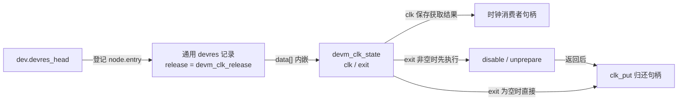

# 第1章\_托管时钟获取与启停实现

取得时钟句柄以后，驱动可能还要 prepare 和 enable。普通获取只承担归还句柄的责任；带 enabled 的获取则还承担先关闭、再反准备的责任。如果初始化失败，尚未登记的包装该归还什么？如果成功，退出时又怎样记住选择了哪种行为？本篇通过记录中的两个字段解释这两条路径。

上游位置 `drivers/clk/clk-devres.c`，NXP Linux 6.12.20，固定提交 `dfaf2136deb2af2e60b994421281ba42f1c087e0`；[完整原文](../../../../linux/drivers/clk/clk-devres.c)。前置职责见[模块导读](../../../navigation/P04_句柄启停与注册契约导读.md#4.1_时钟把退出动作放进同一记录)。以下 Doxygen 与中文阅读注释是仓库补充，源码抽取完整结构及函数，未修改控制流。

## 1.1\_获取与初始化分支

state中的clk保存获取结果，exit保存可选的退出动作；GFP_KERNEL是记录分配标志。普通get传入的init/exit均为空，enabled包装则传入准备使能与关闭反准备两个动作。NULL句柄是否有效由所选get契约决定，IS_ERR检查的只是错误指针。

这里沿用前篇的错误指针表示：ENOMEM表示内存不足，ERR_PTR把负错误码编码为指针，PTR_ERR取回错误码。下面每条失败出口都要同时检查“交还错误的形式”和“此时已经取得哪些资源”，两者不能互相替代。PM（Power Management，电源管理）中的反复启停另有运行协议，本条记录只负责约定的最终清理。

```c
/**
 * @brief 成功获取并完成可选初始化后才登记，失败按已经取得的责任回滚。
 * @note 调用者必须使用匹配的init/exit协议，不能重复消费托管启停责任。
 */
struct devm_clk_state {
	struct clk *clk;
	void (*exit)(struct clk *clk);
};

static struct clk *__devm_clk_get(struct device *dev, const char *id,
				  struct clk *(*get)(struct device *dev, const char *id),
				  int (*init)(struct clk *clk),
				  void (*exit)(struct clk *clk))
{
	/* 仓库阅读注释：记录、句柄、初始化依次成功后才进入设备账本。 */
	struct devm_clk_state *state;
	struct clk *clk;
	int ret;

	state = devres_alloc(devm_clk_release, sizeof(*state), GFP_KERNEL);
	if (!state)
		return ERR_PTR(-ENOMEM);

	clk = get(dev, id);
	if (IS_ERR(clk)) {
		ret = PTR_ERR(clk);
		goto err_clk_get;
	}

	if (init) {
		ret = init(clk);
		if (ret)
			goto err_clk_init;
	}

	state->clk = clk;
	state->exit = exit;

	devres_add(dev, state);

	return clk;

err_clk_init:

	clk_put(clk);
err_clk_get:

	devres_free(state);
	return ERR_PTR(ret);
}
```

**实现原理。** 记录失败时没有句柄可归还；get 错误时只释放记录；init 失败时先 put 句柄再释放记录。注意 init 失败分支没有调用 exit，所以传入的初始化操作必须自行撤销它失败前已经做出的部分变化。公开 enabled 获取采用 `clk_prepare_enable`：prepare 失败直接返回，enable 失败则撤销 prepare，外层才可以只负责 put。

成功后才写入 `state->clk` 和 `state->exit` 并接入设备链。退出行为因此保存在记录中，不能等到解绑时再根据当前调用函数名猜测应清理什么。普通获取保存空 exit，enabled 获取配对 `clk_prepare_enable` 与 `clk_disable_unprepare`。



此图只描述单条记录。句柄为空是否为成功仍取决于所选 get 的契约；图中的箭头不表示每次获取必然产生一个非空物理时钟对象。

## 1.2\_退出动作先于句柄归还

```c
/**
 * @brief 若记录带有exit先退出运行阶段，然后归还句柄。
 * @note 只履行这一条托管记录的责任，不代替全部PM周期。
 */
static void devm_clk_release(struct device *dev, void *res)
{
	/* 仓库阅读注释：先结束被登记的状态责任，再结束句柄责任。 */
	struct devm_clk_state *state = res;

	if (state->exit)
		state->exit(state->clk);

	clk_put(state->clk);
}
```

**实现原理。** 普通记录的 exit 为空，不执行 disable；enabled 记录先 disable/unprepare 再 put。设备自己的资源链决定本记录与其他记录的先后，本函数决定同一记录内部的先后。它对应[核心清理时序](../base/devres.c.md#1.6_devres_release_all交出待清理记录)的 release 箭头：读取记录、执行可选 exit、归还句柄；随后由核心释放记录，回调不再次释放 `state`。

修改获取变体时必须成对检查 get/put 与 init/exit，特别是初始化失败的内部回滚。不能简单给一个普通获取添加 init，却遗漏成功后的 exit；也不能在 init 失败时无条件追加 exit，掩盖初始化函数已自行回滚的事实。还要核对 optional 空句柄和 `COMMON_CLK` 配置桩的契约，不能把空指针统一改判成错误。

此前六条宿主路径只验证包装分支，底层时钟提供者和 devres 登记为明确替身；本轮重新核对固定源码，未把历史替身检查当作真实硬件或 PM 运行结果。

返回[模块导读](../../../navigation/P04_句柄启停与注册契约导读.md#4.1_时钟把退出动作放进同一记录)或[总索引](../../../navigation/P01_Linux_6.12_devres源码阅读索引.md#1.2_按问题进入实现)。
