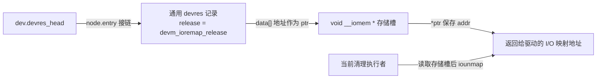

# 第1章\_devres映射包装与返回值实现

驱动拿到一段寄存器的物理资源描述后，要先取得区间使用权，再建立可访问的映射。如果区间已经申请成功、映射却失败，究竟该撤回哪一条记录？本篇并排阅读基础映射和 resource 包装，追踪每个失败点之前实际取得的责任，并解释同样是映射接口，为什么一种返回 `NULL`，另一种返回错误指针。

上游位置 `lib/devres.c`，NXP Linux 6.12.20，固定提交 `dfaf2136deb2af2e60b994421281ba42f1c087e0`；[完整原文](../../../linux/lib/devres.c)。前置状态模型见[资源族模块导读](../../navigation/P03_内存映射与中断资源导读.md#3.2_映射与区域占用是两条责任)。Doxygen 阅读说明及中文入口注释均为仓库补充，函数保留固定源码的完整控制流。

## 1.1\_基础映射失败保持NULL

参数type是映射选择枚举：DEVM_IOREMAP、DEVM_IOREMAP_UC、DEVM_IOREMAP_WC、DEVM_IOREMAP_NP分别选择ioremap、ioremap_uc、ioremap_wc、ioremap_np入口。下段只比较选择和失败传播，底层是否支持某种映射另受架构约束。GFP_KERNEL是此处普通内核分配标志，dev_to_node提供设备关联的内存节点；ptr指向将来保存I/O地址的记录数据区，addr才是准备返回给调用者的映射地址。

```c
/**
 * @brief 先分配记录，再尝试所选映射；任一步失败都保持NULL返回。
 * @note 成功时登记iounmap责任；不承担物理区域独占申请。
 */
```

```c
static void __iomem *__devm_ioremap(struct device *dev, resource_size_t offset,
				    resource_size_t size,
				    enum devm_ioremap_type type)
{
	/* 仓库阅读注释：记录失败与映射失败均返回NULL。 */
	void __iomem **ptr, *addr = NULL;

	ptr = devres_alloc_node(devm_ioremap_release, sizeof(*ptr), GFP_KERNEL,
				dev_to_node(dev));
	if (!ptr)
		return NULL;

	switch (type) {
	case DEVM_IOREMAP:
		addr = ioremap(offset, size);
		break;
	case DEVM_IOREMAP_UC:
		addr = ioremap_uc(offset, size);
		break;
	case DEVM_IOREMAP_WC:
		addr = ioremap_wc(offset, size);
		break;
	case DEVM_IOREMAP_NP:
		addr = ioremap_np(offset, size);
		break;
	}

	if (addr) {
		*ptr = addr;
		devres_add(dev, ptr);
	} else
		devres_free(ptr);

	return addr;
}
```

**实现原理。** 公开 `devm_ioremap` 传 `DEVM_IOREMAP` 进入这里。`ptr` 是记录数据区地址，`*ptr` 才是保存的 I/O 映射地址；两次间接关系不能混用。记录分配失败时还没尝试映射；映射失败时释放尚未登记的记录；成功时先保存地址，再登记将来的 `iounmap` 责任。返回值 `addr` 没有经过错误指针编码，调用者应判 `NULL`。



图中存储槽归管理记录所有，I/O 映射是另外建立的资源。清理时复用[核心清理时序](../drivers/base/devres.c.md#1.6_devres_release_all交出待清理记录)的 S3/S4：摘取这条记录后，`devm_ioremap_release` 在 release 那条箭头上读取地址并执行 `iounmap`；回调返回后核心再释放记录本身。

## 1.2\_资源包装将失败编码并撤回区域

res是资源描述，resource_type检查其是否为IORESOURCE_MEM内存区域；IORESOURCE_MEM_NONPOSTED是影响映射选择的标志。IOMEM_ERR_PTR把负错误值编码成带I/O地址类型注解的返回值，不能对该错误值执行寄存器访问。EINVAL、ENOMEM与EBUSY在这里分别承担无效资源、内存/映射失败及区间申请失败的错误分类。

```c
/**
 * @brief 检查资源，取得区间使用权后再建立映射，错误统一编码返回。
 * @note 映射失败撤回区间，但更早登记的名字分配仍由设备账本管理。
 */
```

```c
static void __iomem *
__devm_ioremap_resource(struct device *dev, const struct resource *res,
			enum devm_ioremap_type type)
{
	/* 仓库阅读注释：此包装的错误表示不同于基础映射。 */
	resource_size_t size;
	void __iomem *dest_ptr;
	char *pretty_name;
	int ret;

	BUG_ON(!dev);

	if (!res || resource_type(res) != IORESOURCE_MEM) {
		ret = dev_err_probe(dev, -EINVAL, "invalid resource %pR\n", res);
		return IOMEM_ERR_PTR(ret);
	}

	if (type == DEVM_IOREMAP && res->flags & IORESOURCE_MEM_NONPOSTED)
		type = DEVM_IOREMAP_NP;

	size = resource_size(res);

	if (res->name)
		pretty_name = devm_kasprintf(dev, GFP_KERNEL, "%s %s",
					     dev_name(dev), res->name);
	else
		pretty_name = devm_kstrdup(dev, dev_name(dev), GFP_KERNEL);
	if (!pretty_name) {
		ret = dev_err_probe(dev, -ENOMEM, "can't generate pretty name for resource %pR\n", res);
		return IOMEM_ERR_PTR(ret);
	}

	if (!devm_request_mem_region(dev, res->start, size, pretty_name)) {
		ret = dev_err_probe(dev, -EBUSY, "can't request region for resource %pR\n", res);
		return IOMEM_ERR_PTR(ret);
	}

	dest_ptr = __devm_ioremap(dev, res->start, size, type);
	if (!dest_ptr) {
		devm_release_mem_region(dev, res->start, size);
		ret = dev_err_probe(dev, -ENOMEM, "ioremap failed for resource %pR\n", res);
		return IOMEM_ERR_PTR(ret);
	}

	return dest_ptr;
}
```

**实现原理。** `BUG_ON(!dev)` 检查调用前提，不是可恢复的参数错误返回；资源描述无效则通过 `dev_err_probe` 记录诊断并返回相应负错误码的 I/O 错误指针。名字分配、区域申请和基础映射按先后建立责任，只有区域已取得而映射失败的分支调用 `devm_release_mem_region`，不能对从未取得的区域执行回滚。较早登记的名字存储此时仍由设备账本管理。

成功时，名字、区域、映射分别保留自己的托管记录；逆序清理使映射先撤销，再归还区域，最后释放名字。资源描述中的 `start` 和 `size` 决定申请与撤回的同一个区间，`pretty_name` 负责标识这项占用，不是另一个映射地址。

修改这组包装时，至少同时检查三项配对：基础映射的 `NULL` 要在 resource 包装边界转成错误指针；成功建立映射后才登记保存地址的记录；撤回区间必须使用匹配的托管释放接口，从账本与资源树中同时结束该责任。若只用非托管释放函数提前归还区域，旧管理记录还可能在最终清理时再次执行。名字、区域、映射三种失败点应分别验证，不能只测最终成功。

IORESOURCE_MEM_NONPOSTED改变所选映射变体；是否支持所需页表属性与底层架构相关，本函数的选择逻辑不是硬件能力证明。调用者如何检查返回值见[API参考](../../../../../knowledge/linux/object_lifetime/devres/devres_API说明.md#2.3_I/O_资源与寄存器映射)，11条宿主包装检查的替身边界见[模块验证说明](../../navigation/P03_内存映射与中断资源导读.md#3.5_已执行验证与未覆盖范围)。返回[总索引](../../navigation/P01_Linux_6.12_devres源码阅读索引.md#1.2_按问题进入实现)。
