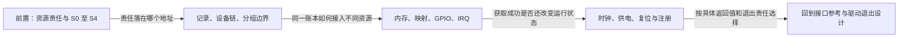

# 第1章\_devres固定源码阅读大纲

## 1.1\_从记录责任进入实现

教材已经解释了为什么把失败回滚和最终退出收进同一本账。源码阅读进一步要把“登记、选取、执行”落到实际地址：管理记录保存什么，设备链与本次待清理链怎样交接，资源包装又怎样改变成功和失败的责任。本路线先建立公共记录机制，再比较映射、IRQ 与句柄启停；每一步都用相同的登记和退出阶段追踪变化。

前置为[教材的资源账本](../../../knowledge/linux/object_lifetime/devres/P01_从失败回滚到设备资源账本.md#1.1_从两条退出路径提取同一份责任)，版本和全部模块入口由[固定索引](navigation/P01_Linux_6.12_devres源码阅读索引.md#1.2_按问题进入实现)组织。模块导读负责建立状态与协作关系，实现页负责函数体和修改边界，两者承担不同阅读任务。

| 文档 | 阅读任务 |
| --- | --- |
| [记录与分组清理导读](navigation/P02_记录与分组清理导读.md#2.1_从记录地址追踪S0到S4) | 将S0～S4映射到设备链、todo链和回调，比较分组范围 |
| [drivers/base/devres.c实现](source_explanations/drivers/base/devres.c.md#1.1_普通action登记成功才转交责任) | 登记、ID 查找、嵌套范围选择、整体摘取与逆序清理的函数体 |
| [include/linux/device.h包装](source_explanations/include/linux/device.h.md#1.1_reset包装失败直接执行) | 记录失败时action由谁执行 |
| [内存、映射、GPIO 与 IRQ 导读](navigation/P03_内存映射与中断资源导读.md#3.1_内存失败与零大小) | 依赖公共账本，比较返回表示、记录分配时点与资源退出义务 |
| [lib/devres.c 映射实现](source_explanations/lib/devres.c.md#1.1_基础映射失败保持NULL) | 基础映射和 resource 包装的返回值转换与区间回滚 |
| [句柄启停与注册导读](navigation/P04_句柄启停与注册契约导读.md#4.1_时钟把退出动作放进同一记录) | 依赖获取与登记的区分，继续拆开句柄、运行状态和注册责任 |
| [drivers/clk/clk-devres.c 时钟实现](source_explanations/drivers/clk/clk-devres.c.md#1.1_获取与初始化分支) | 普通与 enabled 获取共用什么记录，失败与退出怎样配对 |

读完可以依据具体包装判断资源取得、记录登记和状态启用是否分别成功，并追踪失败与退出时的动作顺序。错误值传播与驱动核心调用者由总索引连接既有专题；真实硬件、并发退出和各配置组合仍需各自验证，不能由账本核心的源码核对推出“所有 devm 接口都已通过运行测试”。
