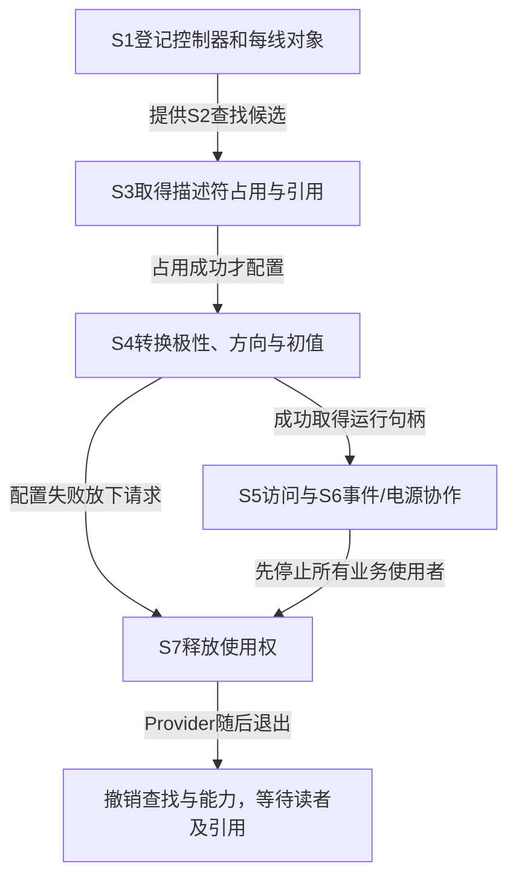

# 第1章\_Linux\_6.12\_GPIO源码阅读索引

GPIO 主线已经建立了线路所有权、逻辑值和硬件访问的区别。读源码时还有一个实际困难：同一个请求横跨固件解析、描述符、Provider 回调和设备资源管理，搜索到某个函数不代表已经找到状态的最终所有者。本索引按这些交接组织固定版本证据，不按文件名排列一串待读清单。

## 1.1\_版本身份与阅读路线

本专题只读核对 NXP 官方 `linux-imx` 仓库发布标签 `lf-6.12.20-2.0.0` 对应的提交 `dfaf2136deb2af2e60b994421281ba42f1c087e0`，Linux 6.12.20，顶层 Makefile 默认 `ARCH ?= arm`。来源为 [官方固定提交](https://github.com/nxp-imx/linux-imx/tree/dfaf2136deb2af2e60b994421281ba42f1c087e0)，身份与验证记录见 [Linux源码基线](../../linux/SOURCE_BASELINE.md)。本轮使用固定官方文件快照；标准外部工作树及目标配置没有完成运行时核验，因此不据此宣称某块板已启用全部分支。

阅读前先建立 [gpiolib对象与阶段模型](../../../../knowledge/driver_model/gpio/P04_Linux_gpiolib的对象与状态交接.md)。本目录的 `navigation` 解释函数如何协作、状态怎样交接；`source_explanations` 展开唯一的字段和函数实现。正文与源码导读承担不同阅读任务，不互相替代。

图中失败箭头只表示放下已经取得的请求，不承诺硬件恢复。先读 [线路对象怎样完成请求与退出](P02_线路对象怎样完成请求与退出.md)，再按当前问题进入下面的实现标题。要继续追踪回调以下的状态，读 [GPIO模拟器如何兑现控制器能力](P03_GPIO模拟器如何兑现控制器能力.md#3.1_从Consumer的三根线追到一个bank)：它以真实Provider串起位图、mutex、登记和释放。

| 当前问题 | 上游位置 | 唯一实现入口 |
| --- | --- | --- |
| `gpio_device`、`gpio_desc` 保存什么；保护哪种访问 | `drivers/gpio/gpiolib.h` | [字段与能力保护](../source_explanations/P01_控制器登记与能力撤销.md#1.1_框架对象怎样把描述符和硬件能力分开) |
| 注册建立哪些身份；失败如何撤销 | `drivers/gpio/gpiolib.c` | [登记及错误出口](../source_explanations/P01_控制器登记与能力撤销.md#1.2_登记怎样建立数组身份并处理阶段失败) |
| `gpiochip_remove()` 为什么不是直接 free | 同上 | [撤销的两次等待](../source_explanations/P01_控制器登记与能力撤销.md#1.3_撤销为何分两次等待和最后一次放引用) |
| 查到 line 后何时取得所有权 | 同上 | [查找向请求交接](../source_explanations/P02_描述符请求与托管释放.md#2.1_查找为何必须交接到请求后才能返回)、[排他占用](../source_explanations/P02_描述符请求与托管释放.md#2.2_原子占用怎样与Provider请求及对象引用配合) |
| devm 究竟增加哪条退出路径 | `drivers/gpio/gpiolib-devres.c` | [托管记录](../source_explanations/P02_描述符请求与托管释放.md#2.3_托管请求怎样补上设备退出动作) |
| put 后哪些状态消失，哪些不保证恢复 | `drivers/gpio/gpiolib.c` | [释放与硬件边界](../source_explanations/P02_描述符请求与托管释放.md#2.4_释放撤销占用而不是恢复寄存器快照) |
| 方向、active-low、开漏模拟如何组合 | 同上 | [输入失败边界](../source_explanations/P03_逻辑值怎样变成方向与电平.md#3.1_输入方向成功以后为什么仍可能返回失败)、[输出转换](../source_explanations/P03_逻辑值怎样变成方向与电平.md#3.2_逻辑输出怎样选择主动驱动或释放线路)、[raw提交](../source_explanations/P03_逻辑值怎样变成方向与电平.md#3.3_raw提交怎样交给Provider并记录结果) |
| 普通/可睡眠 setter 的差别与错误限制 | 同上及 `include/linux/gpio/driver.h` | [运行访问](../source_explanations/P03_逻辑值怎样变成方向与电平.md#3.4_运行时setter沿用逻辑语义却不返回写错误) |
| 模拟Provider怎样保存状态并兑现回调 | `drivers/gpio/gpio-sim.c` | [私有位图](../source_explanations/P04_模拟控制器的状态与回调.md#4.1_位图怎样承接每线状态)、[读写事务](../source_explanations/P04_模拟控制器的状态与回调.md#4.2_锁怎样保护读写方向与批量更新)、[pull与释放](../source_explanations/P04_模拟控制器的状态与回调.md#4.3_为什么释放后读到的值可能改变)、[bank登记](../source_explanations/P04_模拟控制器的状态与回调.md#4.4_怎样在发布回调前准备好它们依赖的状态) |

## 1.2\_已经核对的IRQ与字符设备边界

S6 会把线路交给新的状态载体。先读 [GPIO事件模块导读](P04_GPIO事件怎样从线路到达处理者.md#4.1_先分开配置路径与通知路径)，把配置、来源状态、域映射和处理者串起来。GPIO侧可通过 `gpio_chip.irq` 中的 `gpio_irq_chip` 关联irqdomain、父IRQ和irq_chip回调，具体拓扑取决于Provider。

`gpiod_to_irq()` 校验描述符、保护 `gdev->chip`、计算offset并调用to_irq，回调返回0时转为 `-ENXIO`。Provider撤销返回 `-ENODEV`；irqchip尚未就绪时可能返回 `-EPROBE_DEFER`。它不建立输入方向或handler，映射回调还可能创建映射。唯一实现已落在 [IRQ映射](../source_explanations/P05_GPIO映射与模拟事件怎样交接.md#5.1_取得IRQ为何仍需保护可撤销的Provider)；模拟事件怎样经pending与irq_work进入核心，见 [模拟事件交接](../source_explanations/P05_GPIO映射与模拟事件怎样交接.md#5.2_模拟中断把待处理状态放在哪里)。

字符设备 v2 的创建由 `gpiolib-cdev.c` 中 `linereq_create()` 承担：校验请求、分配 `linereq`、取得 gdev 引用、初始化每线 delayed work、配置 mutex、等待队列和 FIFO 元数据，再逐线请求与配置。真正的事件 FIFO 存储由需要边沿事件的设置路径分配，不能把 `INIT_KFIFO` 写成已经分配了事件容量。设备注销 notifier 和文件对象把后续事件读取、不可用通知与最后引用释放连接起来。

这条路径从 [用户请求模块导读](P05_用户请求怎样持有线路与事件.md#5.1_先从两个文件对象区分入口和持有者) 进入：先沿 [共享状态](../source_explanations/P06_用户请求的发布与回收.md#6.1_共享请求状态怎样连接多根线路)、[创建与错误出口](../source_explanations/P06_用户请求的发布与回收.md#6.2_为什么先配置线路再发布文件) 追踪持有，再沿 [边沿生成](../source_explanations/P07_事件缓冲与读取.md#7.2_时间与边沿怎样变成一条记录)、[FIFO入队](../source_explanations/P07_事件缓冲与读取.md#7.3_满队列怎样改变可观察的历史) 和 [poll/read](../source_explanations/P07_事件缓冲与读取.md#7.4_可读通知为何不能替代取出记录) 追踪事件。总索引组织模块，实现函数体只在对应页展开。

`line_fileops` 提供 `release/read/poll/unlocked_ioctl`。创建失败会释放已取得的请求资源，`linereq_free()` 按数组正序逐项清理；它不保证已发生的方向或电平变化逆转。成功后再配置多线也不提供全部线路的事务回滚。请求文件最后引用消失才调用 release，单独关闭一个被 dup 的 fd 并不释放线路。

沿这两条路径继续追踪时，应分别观察 IRQ 映射和请求文件，不能用“取得 GPIO”概括它们的生命周期。事件交接回到 [GPIO中断主线](../../../../knowledge/driver_model/gpio/P07_GPIO_中断桥接与事件传播.md) 和 [字符设备主线](../../../../knowledge/driver_model/gpio/P08_用户空间_ABI_迁移与方案选择.md)。原始核对位置为固定版本 [gpiolib.c](https://github.com/nxp-imx/linux-imx/blob/dfaf2136deb2af2e60b994421281ba42f1c087e0/drivers/gpio/gpiolib.c#L3690) 与 [gpiolib-cdev.c](https://github.com/nxp-imx/linux-imx/blob/dfaf2136deb2af2e60b994421281ba42f1c087e0/drivers/gpio/gpiolib-cdev.c#L1733)。

## 1.3\_配置和平台结论各自到哪里停止

`CONFIG_GPIOLIB` 决定真实 GPIO 核心是否存在，`CONFIG_GPIOLIB_IRQCHIP` 控制公共 IRQ 集成，`CONFIG_GPIO_CDEV` 控制字符设备；OF、ACPI、PINCTRL、OF_DYNAMIC 等还影响查找及字段分支。头文件桩实现与实际启用路径不能混作同一运行结果。`can_sleep` 是 Provider 的运行上下文契约，不是编译配置，更不是把调用搬到线程的调度器。

本目录证明的是公共 gpiolib 的固定版本实现。i.MX6ULL 寄存器、RK 系列 pinmux、某款扩展器的状态锁存，以及 PREEMPT_RT 下具体 IRQ 执行环境，都必须沿相应 Provider/平台继续核对。OF、ACPI、software node 的所有查找优先级也不从单条示例推出。本轮没有目标内核编译、模块装入或硬件电平实验；正文中的观察练习明确区分预测和实测。
