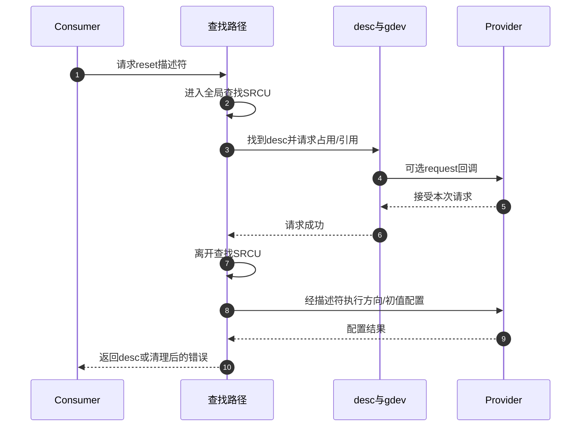

# 第2章\_线路对象怎样完成请求与退出

设一个传感器 probe 请求 reset，稍后可能失败，也可能成功工作后解绑。需要追踪的不是“哪个函数最长”，而是谁接住每一阶段已经建立的状态。这里复用主线的 S0～S7，先把调用链放回这个生命周期，再进入实现页。

## 2.1\_先找到哪些状态会跨过函数返回

S0 的功能连接在 firmware node 或平台 lookup 中；S1 由 Provider 登记控制器。S2 查找时得到的描述符已经存在于 `gdev->descs` 数组中，不是 Consumer 每请求一次就新分配一份。请求若成功，改变的是该描述符的共享状态，并增加让它安全跨越函数返回的引用。

Provider 能力和登记对象还各有一层生命周期。操作通过 `desc->gdev` 找到登记对象，再在 `gdev->srcu` 保护下读取能力指针。长引用让登记对象继续存在，短期受保护访问让本次回调与能力撤销协调，两者互不替代。字段的唯一展开位于 [框架对象与保护](../source_explanations/P01_控制器登记与能力撤销.md#1.1_框架对象怎样把描述符和硬件能力分开)。

| 阶段 | 本版本的主要进入路径 | 写入和后续读取的位置 | 退出条件 |
| --- | --- | --- | --- |
| S0连接 | firmware/平台描述 | 解析路径读取功能名对应的控制器与offset | 能解释板级连接，未持有线路 |
| S1登记 | `gpiochip_add_data_with_key()` | 核心建立gdev、descs和关联，查找路径使用 | 注册返回成功；不同子功能仍有自己的前提 |
| S2查找 | `gpiod_find_and_request()` | 全局SRCU保护查找；返回desc与lookup flags | 转入请求，或直接返回查找错误 |
| S3占用 | `gpiod_request()`及commit | 原子设置desc请求位，写label，建立module/gdev引用 | 普通请求取得占用或报busy/其他错误 |
| S4配置 | `gpiod_configure_flags()`及方向接口 | 更新desc语义并调用Provider改硬件 | 返回desc，或put本次请求后报错 |
| S5运行 | 普通/raw/可睡眠接口 | 读取desc语义，通过受保护能力调用Provider | 单次访问结束；业务仍持有请求 |
| S6协作 | IRQ、PM、字符设备等路径 | IRQ状态、Provider电源状态、请求缓冲各自保存 | 满足相应事件或电源协议 |
| S7结束 | put、devres动作或最后文件引用释放 | 撤销占用、标签与引用；Provider以后撤销登记 | 业务无后续访问；硬件最终状态由协议决定 |

## 2.2\_查找保护怎样交接给请求持有

只在查找结束后再想办法保护对象，会留下时间窗口：返回的裸地址可能先被注销路径撤销。这个版本把固件/平台查找和 `gpiod_request()` 放在同一个全局 SRCU 作用域里。请求成功建立长引用，随后离开查找保护，进入 S4 配置。阅读时沿 [查找交接实现](../source_explanations/P02_描述符请求与托管释放.md#2.1_查找为何必须交接到请求后才能返回) 核对作用域的结束位置，而不是把两个函数名相邻当成证明。

步骤 3～6 位于步骤 2 与 7 之间，建立跨作用域持有；步骤 8 则已经进入新的配置阶段。图固定成功占用的主线，若步骤 3 遇到 busy，本次不执行步骤 4～9，也不能释放别人已经取得的请求。S4 的失败才会清理本次已成功取得的请求。

## 2.3\_把失败位置和清理范围逐一对应

假设固件能找到 reset，但方向配置失败。外层知道自己已经取得普通请求，因此调用 put，然后把配置错误返回 Consumer。若失败发生在查找阶段，根本没有请求可 put。若 devm 包装在普通请求成功后分配托管记录失败，则它必须自己 put，因为尚未有记录供设备退出路径执行。

| 失败现场 | 哪些动作已经发生 | 谁接手清理 |
| --- | --- | --- |
| 查找返回错误 | 未取得本次占用 | 原错误返回；延迟重试交Driver Core |
| 原子占用发现busy | 线路由别的请求占用 | 本次直接退出，不动既有占用 |
| Provider request或标签阶段失败 | 本次请求位曾置位，回调可能执行 | commit错误分支清位；外层处理本次module引用，具体Provider副作用须按实现核对 |
| 方向/初值配置失败 | 普通请求已成功，配置可能部分生效 | find-and-request调用put，不保证硬件复原 |
| devres分配失败 | 普通get及配置已成功 | devm包装立即put；未登记自动释放 |

特别注意第三行：不能为了表格整齐，把实际源码的错误分支美化成完美事务。固定版本在 request 回调成功后若设置标签失败，commit 的错误出口只有清请求位，未调用 Provider free；这是本版本可见的边界，不能由教程补出不存在的反向调用。详见 [排他请求实现](../source_explanations/P02_描述符请求与托管释放.md#2.2_原子占用怎样与Provider请求及对象引用配合)。

## 2.4\_从方向配置走到运行和设备退出

配置一根 active-low 开漏 reset，至少有三个不同判断：逻辑 1 先变物理低；硬件是否支持开漏决定是否需要模拟；Provider 回调再决定怎样访问控制器。硬件被切成输入以释放开漏线路时，框架仍记为输出用途。这个反例迫使我们把 `FLAG_IS_OUT` 当作软件状态理解，不能用它直接解释寄存器的当前值。沿 [方向与逻辑值实现](../source_explanations/P03_逻辑值怎样变成方向与电平.md#3.2_逻辑输出怎样选择主动驱动或释放线路) 逐步核对。

进入运行后，普通 setter 与 `_cansleep` setter 共用逻辑转换路径，只在调用上下文检查上有所不同；它们的 `void` 返回值没有传回总线写错误的通道。业务需要知道设备是否接受命令时，应使用设备协议提供的状态确认，不能把 GPIO setter 当作确认应答。

正常解绑先停止会继续访问 GPIO 的业务和异步使用者，再执行释放。devm 记录会在相应设备资源清理时调用 put，但不知道哪一个私有工作项还会访问描述符。[托管与释放实现](../source_explanations/P02_描述符请求与托管释放.md#2.3_托管请求怎样补上设备退出动作) 说明记录保存什么，及为什么资源登记顺序不能取代业务停机设计。

## 2.5\_控制器退出时还有哪两类读者

Consumer 生命周期结束后，Provider 才应按协议退出。全局查找者可能正在寻找某个控制器；已进入单次操作的调用者则可能已经拿到 `gpio_chip`。前者由 `gpio_devices_srcu` 协调，后者由 `gdev->srcu` 协调。注销先从全局列表撤销并等待第一类读者，再清能力指针并等待第二类读者，最后撤销关联和登记方引用。

这套协议解决调用路径与对象销毁的交接，不负责停止 Provider 自己的全部硬件活动，也不把用户仍持有的元数据变成可访问设备。`gpiochip_remove()` 的契约仍要求不要正常移除被请求的线路。带着“谁还能找到、谁已经进入、谁还持引用”三个问题读 [撤销实现](../source_explanations/P01_控制器登记与能力撤销.md#1.3_撤销为何分两次等待和最后一次放引用)，就能判断某个等待到底在证明什么。

回到 [源码阅读索引](P01_Linux_6.12_GPIO源码阅读索引.md#1.1_版本身份与阅读路线) 可继续按当前问题选择实现标题；回到 [GPIO主线](../../../../knowledge/driver_model/gpio/大纲.md) 则继续 Consumer、Provider 与事件使用场景。本页不把源码核对当作目标板执行记录。
