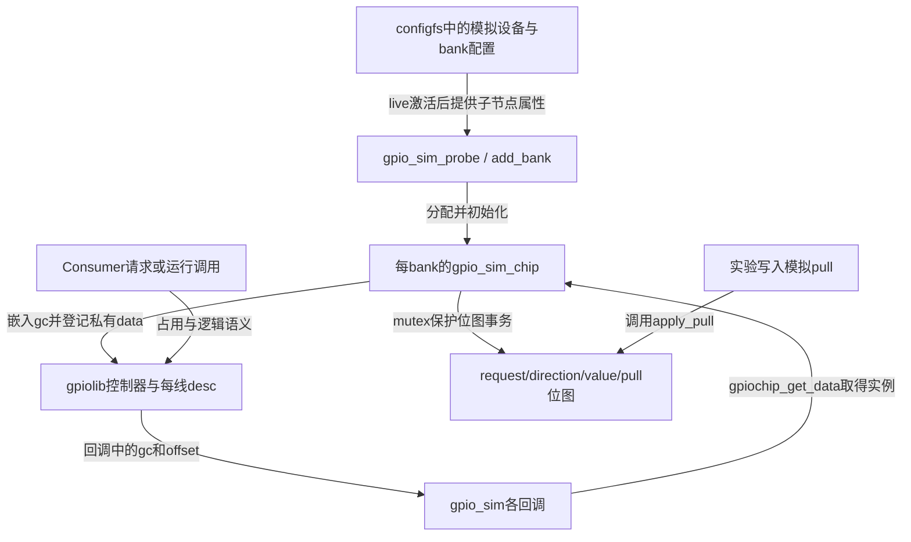
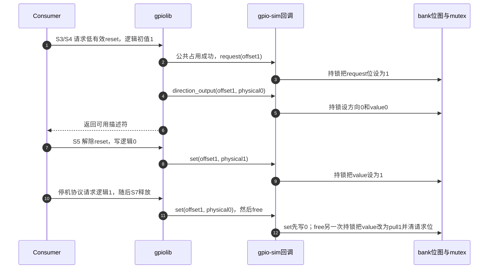

# 第3章\_GPIO模拟器如何兑现控制器能力

公共层已经解决描述符查找、占用和逻辑值转换，但回调之下仍需要一个能够保存状态、完成读写的Provider。本篇沿主线Consumer实验中的三根模拟线，观察Linux 6.12.20的gpio-sim怎样承担这个角色。版本与配置见 [阅读索引](P01_Linux_6.12_GPIO源码阅读索引.md#1.1_版本身份与阅读路线)，使用模型先读 [Provider正文](../../../../knowledge/driver_model/gpio/P06_GPIO_Provider_控制器实现.md)。这里组织协作关系，函数体只在唯一实现页展开。

## 3.1\_从Consumer的三根线追到一个bank

实验中的bank提供三个offset，分别连接enable、reset、alert。Consumer通过公共层取得描述符，模拟器则用一个 `struct gpio_sim_chip` 保存这三个offset对应的位图和锁。configfs中的bank配置在激活时参与创建模拟设备及其固件属性；`gpio_sim_probe()` 遍历设备的子节点，为每个bank调用 `gpio_sim_add_bank()`。多个bank可以拥有不同的位图实例，不能把全驱动的状态都当成一个全局寄存器。

图中两个写入来源必须相互协调：Consumer可以改输出，实验也可以改模拟输入环境。若不共用锁，观察路径可能读取到一部分新状态和一部分旧状态。位图与锁的具体字段见 [模拟器状态载体](../source_explanations/P04_模拟控制器的状态与回调.md#4.1_位图怎样承接每线状态)。这里的同步是内存访问协议，没有真实pad、电平传播或跨时钟电路。

## 3.2\_把模拟器动作对齐到公共周期

本篇继续使用主线的S0～S7，不另建一套只在模拟器内成立的阶段编号。下表中每个阶段都回到 [统一周期](../../../../knowledge/driver_model/gpio/P02_GPIO_角色_状态与完整操作周期.md#2.3_统一的_S0～S7_周期)，不同的是现在能指出实际写入者和状态地址。

| 公共阶段 | 模拟器中的触发和动作 | 状态归属及下一读取者 |
| --- | --- | --- |
| [S1](../../../../knowledge/driver_model/gpio/P02_GPIO_角色_状态与完整操作周期.md#2.3_统一的_S0～S7_周期) | add_bank准备位图、模拟IRQ域、mutex和gc，再登记 | 私有对象由Provider管理，公共层随后可调用gc回调 |
| [S3](../../../../knowledge/driver_model/gpio/P02_GPIO_角色_状态与完整操作周期.md#2.3_统一的_S0～S7_周期) | 公共占用成功后调用gpio_sim_request | request_map置位；apply_pull读取它区分输出是否仍被请求 |
| [S4](../../../../knowledge/driver_model/gpio/P02_GPIO_角色_状态与完整操作周期.md#2.3_统一的_S0～S7_周期) | 方向输出同时接收物理初值，或设为输入 | direction_map与value_map由方向回调写；get/query/pull路径读 |
| [S5](../../../../knowledge/driver_model/gpio/P02_GPIO_角色_状态与完整操作周期.md#2.3_统一的_S0～S7_周期) | Consumer读写值，实验改变pull | set/get与apply_pull通过同一mutex访问相关位图 |
| [S6](../../../../knowledge/driver_model/gpio/P02_GPIO_角色_状态与完整操作周期.md#2.3_统一的_S0～S7_周期) | 输入变化符合已配置触发条件时，向模拟IRQ域置pending | 事件机制继续处理；本篇只解释产生条件，不展开IRQ核心 |
| [S7](../../../../knowledge/driver_model/gpio/P02_GPIO_角色_状态与完整操作周期.md#2.3_统一的_S0～S7_周期) | 公共释放调用gpio_sim_free | value改为pull值，request_map清零；后续请求者重新配置 |

S3有两处状态不表示重复抢锁：公共desc负责所有请求者之间的排他判定，模拟器request_map只为模拟行为记录“当前是否被请求”。它不能单独替代公共层的引用、标签或所有权规则。

## 3.3\_沿reset的正常周期观察谁修改了什么

以低有效reset、offset1为例，Consumer最初请求逻辑1，公共层把它转换为物理0。下面固定模拟pull为1，便于区分“主动输出”和“释放后的模拟环境”。

步骤2、3完成模拟器自己的请求记录；步骤4、5才建立输出配置，不能把request位当作“输出已经准备好”。步骤11、12还显示set与free是两个操作：停机时确实请求过物理0，释放后观察到1也不矛盾。这里不保证两次操作之间的脉冲宽度，更不代表真实芯片的free必定有同样行为。

对应实现按 [读写与方向](../source_explanations/P04_模拟控制器的状态与回调.md#4.2_锁怎样保护读写方向与批量更新)、[pull与释放](../source_explanations/P04_模拟控制器的状态与回调.md#4.3_为什么释放后读到的值可能改变) 阅读。`guard(mutex)` 与 `scoped_guard` 将退出解锁绑定到作用域；它们没有把多个独立回调合成一次原子业务操作。

## 3.4\_登记失败时哪些资源已经出现

add_bank首先读取属性、分配位图；这些步骤失败时没有可调用的gpiochip。之后模拟IRQ域、映射清理动作和mutex相继就绪，gc才发布到gpiolib。最后建立观察接口，因此“sysfs准备失败”和“最初分配失败”对应的清理集合不同。

模拟器使用devres为这些资源登记退出动作。probe返回错误后，设备核心触发相应资源清理；正常退出也要先让Consumer停止使用，再撤销控制器。不能仅凭函数末尾的一个return推断此前没有发布过对象。具体步骤和错误出口见 [发布前准备](../source_explanations/P04_模拟控制器的状态与回调.md#4.4_怎样在发布回调前准备好它们依赖的状态)；公共gdev的撤销继续复用 [控制器能力撤销](../source_explanations/P01_控制器登记与能力撤销.md#1.3_撤销为何分两次等待和最后一次放引用)。

## 3.5\_修改实现前先预测观察会怎样变

若删除free中“value取pull”的赋值，主线卸载后的某些预期值会改变，但公共层仍可能正确释放占用。这个反例说明硬件/模拟值与公共所有权是两项独立证明。

若把所有位图保留，却去掉方向输出的锁，其他CPU的get或pull写入就可能与方向和值的更新交错；仅仅保留 `can_sleep = true` 不会恢复同步。相反，保留mutex却谎报 `can_sleep = false` 会破坏调用上下文契约。

若把批量回调改成逐位调用set，最后值可能相同，但原来一次锁内完成的多位更新变成多个独立区间。观察者可能看到中间组合；这就是“结果相同”和“过程保证相同”的区别。

本篇完成了从公共接口到一个具体Provider的映射。完整用户操作仍在 [Consumer实验](../../../../knowledge/driver_model/gpio/P05_GPIO_Consumer_请求与使用.md#5.6_用模拟Provider观察完整请求周期)，真实硬件布局和时序不能从模拟器推出。回到 [源码总索引](P01_Linux_6.12_GPIO源码阅读索引.md#1.1_版本身份与阅读路线)，或沿 [GPIO中断主线](../../../../knowledge/driver_model/gpio/P07_GPIO_中断桥接与事件传播.md) 继续追踪输入变化怎样传播。
