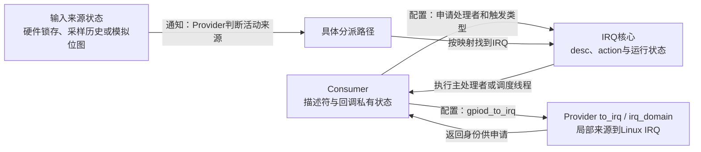
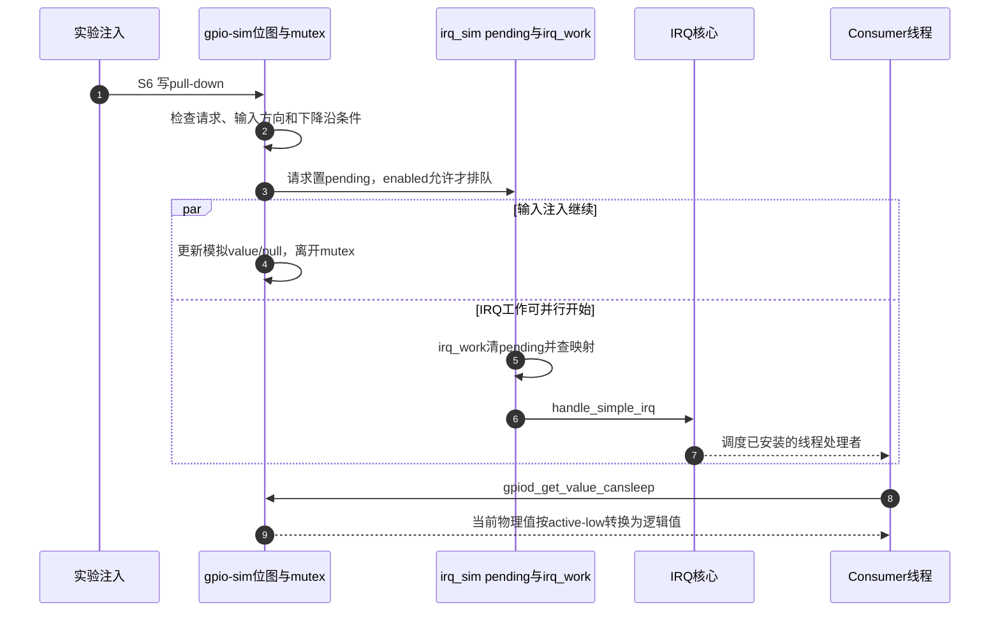

# 第4章\_GPIO事件怎样从线路到达处理者

Provider已经能提供当前输入值，但Consumer若想在变化时被调用，还要建立通知关系。配置从Consumer向下，通知从输入来源向上；它们通过映射、类型、使能和处理者状态相接，不是调用一次gpiod_to_irq就完成的单步动作。固定版本和配置入口见 [总索引](P01_Linux_6.12_GPIO源码阅读索引.md#1.1_版本身份与阅读路线)，先修主线为 [GPIO中断桥接](../../../../knowledge/driver_model/gpio/P07_GPIO_中断桥接与事件传播.md)。

## 4.1\_先分开配置路径与通知路径

Consumer先按设备协议请求输入描述符，再取得Linux IRQ，准备回调依赖的状态，最后申请IRQ。配置类型与安装action由IRQ接口和Provider协作完成。此后输入变化经Provider检测、IRQ分派才到达action；handler若继续投递work，业务完成又会晚于这次调用。

irq_domain是软件身份映射，不是电信号必须穿过的硬件模块。IRQ核心的action保存注册者及函数，Provider的mask/type状态决定哪些来源参与通知；两者都不能替代外设自身的“有数据待处理”状态。to_irq如何保护Provider以及返回错误，见 [映射实现](../source_explanations/P05_GPIO映射与模拟事件怎样交接.md#5.1_取得IRQ为何仍需保护可撤销的Provider)。

## 4.2\_同一公共阶段允许不同的Provider分派

继续使用 [S0～S7周期](../../../../knowledge/driver_model/gpio/P02_GPIO_角色_状态与完整操作周期.md#2.3_统一的_S0～S7_周期)。S4建立输入、IRQ身份和处理者，S6完成来源检测与通知，S7先停止并排空事件路径再归还线路。差异在S6内部，不需要把每一种Provider都改写成“读pending寄存器”。

| 实现 | 来源状态由谁保存 | S6在哪个上下文处理 | 具体交接 |
| --- | --- | --- | --- |
| 快速MMIO级联 | 控制器锁存/状态位及配置 | 硬中断chained路径 | 读取有效来源，按域与hwirq进入通用子IRQ分派 |
| 普通PCA9539所选分支 | 当前硬件输入与chip->irq_stat历史、mask/边沿位图 | 父IRQ线程，可进行I²C访问 | 算出pending，释放I²C访问锁，查映射后handle_nested_irq |
| gpio-sim与irq_sim | GPIO位图、IRQ pending位图、enabled | 输入注入后排irq_work，再进入IRQ核心；Consumer线程另行运行 | 模拟边沿条件、置位、按域查IRQ、simple流处理 |

快速MMIO行是实现类别，PCA9539和模拟器两行是固定版本的具体实例，不能把表当成全部硬件穷举。PCA已有独立权威实现：[比较输入并分派嵌套中断](../../peripheral_integration/source_explanations/P03_PCA953x怎样比较输入并分派嵌套中断.md#3.2_用新旧输入推导哪些局部线需要处理)。它的父线程释放i2c_lock后才进入子处理，防止子处理再次读取GPIO时形成不必要的锁依赖。

## 4.3\_模拟事件怎样完成通知闭环

教学模块安装的是可睡眠线程，因为gpio-sim使用mutex。以输入初值1、写pull-down为例，按正常、已使能且映射存在的路径观察：

步骤3触发异步工作，图中的并行区表示步骤5不必等到步骤4以后才开始。真正约束是步骤8的读取需要取得gpio-sim的mutex，不能在更新临界区中间观察；线程可以先开始调用再等待锁，图将这次读取展开在并行区以后。步骤9是读取时的当前状态，不是对步骤1物理边沿的时间旅行。

pending位图可以合并重复通知，enabled为false时该实现还会忽略置位请求；因此日志数量不保证等于快速注入次数。状态地址、置位和分派函数见 [模拟事件实现](../source_explanations/P05_GPIO映射与模拟事件怎样交接.md#5.2_模拟中断把待处理状态放在哪里)。

## 4.4\_申请失败与退出怎样保住回调依赖

主线示例按state、输入描述符、IRQ的顺序取得托管资源。映射失败时尚未安装action；IRQ申请失败时返回其错误；申请成功后故意使probe失败，则会先释放并等待IRQ处理结束，再放描述符，最后回收state。正常设备解绑走相同的资源依赖顺序。

这里的等待只覆盖IRQ处理者。本例线程不投递额外工作；真实驱动若有timer、work或读者线程，还必须停止新工作并等待它们结束。dev_id是回调私有状态的地址，不自动为它增加引用，不能在IRQ释放之前释放这块内存。通用托管规则复用 [IRQ资源导读](../../devres/navigation/P03_内存映射与中断资源导读.md#3.4_IRQ记录不替代使用者退出)。

## 4.5\_沿一项错误判断应该看哪一层

读GPIO成功但没有事件，先区分映射、输入方向、触发配置、使能、action与输入激励，不能直接认定IRQ域损坏。事件反复到来则继续检查外设原因是否解除，不能把IRQF_ONESHOT当成清设备中断状态。若只有快速变化丢失，要看检测硬件或采样算法是否保存足够历史，再考虑调度与缓冲；不能由一次未丢事件的实验推出无限事件容量。

这些问题对应不同状态和证据。返回 [GPIO中断主线](../../../../knowledge/driver_model/gpio/P07_GPIO_中断桥接与事件传播.md) 按完整实验验证请求与退出，用户空间如何保存并读取事件还需继续阅读 [字符设备主线](../../../../knowledge/driver_model/gpio/P08_用户空间_ABI_迁移与方案选择.md)。
