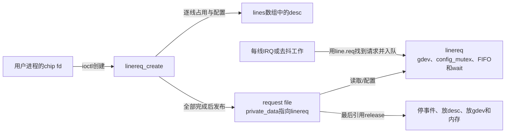
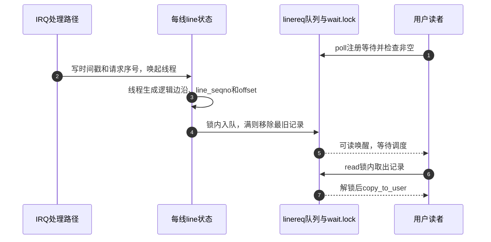

# 第5章\_用户请求怎样持有线路与事件

内核Consumer把线路持有期连到设备，用户空间则把它连到请求文件。源码阅读的难点不在ioctl名字，而在创建、事件回调、用户读取和最后释放分属不同执行路径，却共享同一组对象。先完成 [字符设备主线](../../../../knowledge/driver_model/gpio/P08_用户空间_ABI_迁移与方案选择.md)，固定版本和配置见 [总索引](P01_Linux_6.12_GPIO源码阅读索引.md#1.1_版本身份与阅读路线)。

## 5.1\_先从两个文件对象区分入口和持有者

chip文件提供查询与创建入口，request文件的private_data指向linereq。linereq持有gdev引用和每线desc，并保存运行事件。因此关闭chip文件不破坏已创建的请求；dup request fd增加同一file的引用，也不再申请一组desc。最后file引用结束才进入line_fileops.release。

箭头表示状态访问和持有关系，不是硬件布线。desc占用、gdev对象存活和chip能力可用仍是不同保证。字段的唯一展开在 [请求状态落点](../source_explanations/P06_用户请求的发布与回收.md#6.1_共享请求状态怎样连接多根线路)。

## 5.2\_沿统一阶段看创建与失败

复用 [S0～S7周期](../../../../knowledge/driver_model/gpio/P02_GPIO_角色_状态与完整操作周期.md#2.3_统一的_S0～S7_周期)。用户offset对应S2定位，gpiod_request_user推进S3占用，方向、初值和edge_detector_setup推进S4。之后建立file并安装fd，S5才有用户可用的句柄；S6事件回调可能已经具备运行条件，所以回调依赖的line.req、wait和队列必须在注册之前准备好。

| 阶段与状态 | 写入者及地址 | 后续使用者 | 失败后要处理什么 |
| --- | --- | --- | --- |
| 请求对象准备 | 创建路径写lr->gdev、lines、wait、config_mutex | 每线配置、IRQ线程、read/poll | 尚无desc时也要放gdev与内存 |
| S3线路占用 | 公共层取得desc，创建路径立即存入lr->lines[i].desc | 配置及统一清理 | 已取得的desc必须可被清理枚举 |
| S4事件建立 | edge设置写line.irq、edflags及FIFO存储 | IRQ线程、去抖工作、事件读取 | 停在途事件后才归还desc |
| 文件交付 | 创建路径建立file，复制fd结果，fd_install | 用户操作line_fileops | 文件已建后的复制失败由fput触发release，不能再手工重复free |
| S7请求退出 | release进入linereq_free | 后续请求者 | 逐线正向清理，再回收共享队列和引用；不恢复旧硬件值 |

创建的成功边界是整组请求被交付，并不承诺多线同时配置。已经取得的对象与硬件作用也不是同一张撤销清单：清理占用不会逆转已发出的电平。完整控制流见 [创建与错误出口](../source_explanations/P06_用户请求的发布与回收.md#6.2_为什么先配置线路再发布文件)。

## 5.3\_一条事件怎样从IRQ状态进入进程

输入检测与IRQ映射沿用 [事件模块导读](P04_GPIO事件怎样从线路到达处理者.md#4.1_先分开配置路径与通知路径)。本模块从IRQ通知继续：普通边沿路径在hardirq记录时间，线程构造事件，linereq_put_event在wait.lock下写共享FIFO；read在同一锁下取走，poll通过waitqueue等待可读性。

步骤2适用于有主处理函数的普通路径，nested线程可能没有这一步，其线程在步骤3补记时间和请求序号。步骤4与6共享队列锁，配置锁不能代替这把生产/消费锁。步骤5不附带事件内容，用户仍需read；共享fd的另一读者还可能在它运行前取走记录。每条记录的形成见 [时间与边沿](../source_explanations/P07_事件缓冲与读取.md#7.2_时间与边沿怎样变成一条记录)，缓冲与等待见 [入队](../source_explanations/P07_事件缓冲与读取.md#7.3_满队列怎样改变可观察的历史) 和 [读取](../source_explanations/P07_事件缓冲与读取.md#7.4_可读通知为何不能替代取出记录)。

## 5.4\_配置与退出分别在哪种保证上停止

SET_CONFIG的mutex防止本请求多步配置互相穿插，但每条线仍依次改变，错误不会把先前线路恢复。事件flags与正在执行的回调还按实现使用READ_ONCE/WRITE_ONCE等约束；不能把config_mutex解释成冻结全部IRQ生产者的总锁。独立实现见 [再配置失败边界](../source_explanations/P06_用户请求的发布与回收.md#6.4_配置互斥为什么不是多线事务回滚)。

最后file引用结束时，不再有这个文件的新读写调用进入，释放路径逐线停止IRQ与去抖工作，再放desc，最后才释放共享FIFO与lr。正在进行的文件操作本身也持有file引用，故不能简化成“另一个线程close后立刻free”。事件退出依赖见 [停止生产者](../source_explanations/P07_事件缓冲与读取.md#7.5_为什么必须先停止事件再回收请求)。

业务清理仍先于请求释放。例如程序需要先关闭enable，就在持有请求时执行并处理错误；崩溃路径只靠fd释放，不能假定实现替它恢复协议。Provider撤销也不是正常Consumer清理替代品；不要用对象引用存在推导硬件仍可访问。

## 5.5\_用实现解释两类常见误判

“read得到连续序号，所以没有丢物理边沿”混淆了IRQ以前的检测与FIFO以后的记录。先查来源是否锁存全部事件，再查线程采样、去抖和缓冲；序号主要帮助分析已经进入编号过程的记录。“close原fd后仍busy，所以驱动泄漏”则遗漏了dup、fork或其他file引用，先查谁仍持有请求。

可以按主线完整程序复现后者，再逐次注入验证逻辑边沿与offset。当前证据是固定源码与静态核对，未执行目标用户程序或模拟器运行；不把预期输出写成实测结果。返回 [总索引](P01_Linux_6.12_GPIO源码阅读索引.md#1.1_版本身份与阅读路线) 查看其他GPIO模块。
