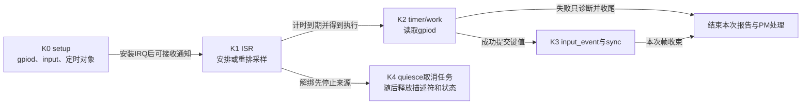

# 第6章\_标准功能驱动怎样承接GPIO状态

前面的源码模块已经追过请求、Provider、IRQ和用户文件。它们能证明“线路如何被持有和访问”，却不能仅凭GPIO值解释一枚按键或一条电源轨。本模块沿标准功能驱动检查它新增的领域状态和交接，公共gpiolib函数体继续复用原有实现页。

## 6.1\_从一根线路走到领域对象

**讲解层次：实现层，NXP Linux 6.12.20固定提交。** 身份和配置边界见 [总索引](P01_Linux_6.12_GPIO源码阅读索引.md#1.1_版本身份与阅读路线)，方案选择背景见 [为什么优先使用标准Consumer](../../../../knowledge/driver_model/gpio_consumers/P01_为什么优先使用标准_GPIO_Consumer.md#1.1_控制了一根线还没有定义一盏灯)。本模块关心的不是“调用几个GPIO API”，而是功能驱动在何处保存中间状态，谁有权推进或停止它。

GPIO描述符保存线路身份和逻辑属性，领域对象保存按键、灯、电源等语义。适配驱动把两者关联起来：从领域命令转成逻辑输出，或从线路采样形成领域报告。中间若有延时任务，还须保存任务的生命期，使线路释放不会跑到任务结束之前。

| 当前阅读入口 | 要跟踪的新增状态 | GPIO侧交接 |
| --- | --- | --- |
| [按键初始化](../source_explanations/P08_按键取样与输入报告.md#8.1_每键状态怎样决定采样路径) | 每键配置、输入对象、待采样任务 | 托管请求输入描述符并取得IRQ |
| [按键事件](../source_explanations/P08_按键取样与输入报告.md#8.2_ISR怎样安排采样并结束输入报告) | 延时后读取的值与输入报告 | 按上下文读取，不把IRQ计数当按键次数 |
| [按键退出](../source_explanations/P08_按键取样与输入报告.md#8.4_为何先停IRQ再取消延时报告) | 是否还可能新增或执行任务 | 先停来源和任务，再释放线路 |

这三行是一条周期的不同观察点。下面先用按键把周期连起来；其他功能驱动应沿自己的领域状态阅读，不能把按键的定时采样模型推广给所有Consumer。

## 6.2\_按键把采样时机与输入报告分开

按钮触点的多次边沿可能属于人的一次动作。`gpio_keys_setup_key()` 为每键建立 `gpio_button_data`，取得输入描述符，尝试硬件去抖，必要时保存软件等待时间，再安排IRQ与后续采样执行方式。它把物理连接转换成一个可上报特定输入代码的对象。

这里是几组正交状态一起协作：GPIO当前逻辑值、IRQ通知、待执行的采样任务、输入核心保存的按键状态，以及可选的PM唤醒状态。驱动没有一个“收到IRQ就必然按下”的单一状态位。

| 本地阶段 | 触发、写入者与状态交接 | 对应GPIO主线阶段 |
| --- | --- | --- |
| K0 准备 | probe/setup分配bdata与input，取得描述符并配置输入、去抖、IRQ | [S2～S4的对象与请求](../../../../knowledge/driver_model/gpio/P04_Linux_gpiolib的对象与状态交接.md#4.3_S2至S4把私有需求写成公共占用和配置) |
| K1 待采样 | gpio_keys_gpio_isr接收dev_id指向的bdata，start/mod延时任务 | [S6事件交接](P04_GPIO事件怎样从线路到达处理者.md#4.1_先分开配置路径与通知路径) |
| K2 读取 | timer/work用container_of回到bdata，读取gpiod；失败跳过值报告 | 同一S6中的Consumer取样 |
| K3 报告 | report_event提交类型、代码和值，debounce_event调用input_sync及可选pm_relax | S6向领域子系统交接 |
| K4 停止 | 先释放IRQ，再quiesce同步取消任务，最后释放早先请求与内存 | [S7托管释放](../source_explanations/P02_描述符请求与托管释放.md#2.3_托管请求怎样补上设备退出动作) |

K0失败时只回收已经取得的部分，不假设K1已经运行。K2读失败仍会经过本轮同步与PM收尾，但没有成功采样的键值；K4只允许在已停止新报告和在途报告之后归还其数据。

K1不是在IRQ里忙等去抖窗口，K2也不是读取IRQ发生瞬间保存的电平。先沿 [setup字段和分支](../source_explanations/P08_按键取样与输入报告.md#8.1_每键状态怎样决定采样路径) 对齐对象，再读 [ISR到报告](../source_explanations/P08_按键取样与输入报告.md#8.2_ISR怎样安排采样并结束输入报告)，最后检查 [取消顺序](../source_explanations/P08_按键取样与输入报告.md#8.4_为何先停IRQ再取消延时报告)。

无GPIO的IRQ-only分支改变了K2的证据来源：无法采样释放，只能用key_pressed和release_timer合成一个周期；见 [合成释放实现](../source_explanations/P08_按键取样与输入报告.md#8.3_缺少松开信号时怎样合成释放)。它不是为同一条正常GPIO路径额外增加一道更精确的去抖。

## 6.3\_灯与背光把期望值交给不同的状态管理者

按键把GPIO输入解释为领域报告，灯与背光则从领域请求走向GPIO输出。LED对象保存brightness、触发来源和设置work；背光对象额外把power与显示blank/suspend条件纳入有效值计算。适配驱动均只提供二值GPIO能力，但上层状态及使用者不同。

本地周期以L0～L3串起两个实现，公共阶段仍对应GPIO主线的配置、运行和退出。

| 本地阶段 | LED的状态交接 | 背光的状态交接 | 公共阶段 |
| --- | --- | --- | --- |
| L0 接管 | 取得gpiod，选择can_sleep回调和初值，登记cdev | 取得gpiod，登记backlight对象，计算初始power与有效值 | [S2～S4请求与配置](../../../../knowledge/driver_model/gpio/P04_Linux_gpiolib的对象与状态交接.md#4.3_S2至S4把私有需求写成公共占用和配置) |
| L1 接收 | LED核心保存brightness及待设置work_flags | 核心保存props.brightness、power、state | [S5访问](../../../../knowledge/driver_model/gpio/P04_Linux_gpiolib的对象与状态交接.md#4.4_S5的软件方向不总是当前输出驱动开关) |
| L2 输出 | 普通回调或设置work消费待执行状态，gpio_led_set提交逻辑值 | update_status用backlight_get_brightness计算后写GPIO | [S5与S6交互](../../../../knowledge/driver_model/gpio/P04_Linux_gpiolib的对象与状态交接.md#4.5_S6的事件和电源状态继续保存在各自的承载者中) |
| L3 撤销 | 解除触发器、停止闪烁与设置任务，再归还线路 | 撤销ops能力与类设备，再归还线路 | [S7结束使用](../../../../knowledge/driver_model/gpio/P04_Linux_gpiolib的对象与状态交接.md#4.6_S7先结束使用再撤销能力和对象) |

L1与L2不能合并成“写完即亮”：可睡眠LED可能经work延期，背光可能因blank条件把期望1压低为0，底层setter也不一定返回硬件错误。L3同样不等于恢复固件初值；backlight注销没有统一请求一次熄灭。

源码按这四个阶段阅读：[LED回调适配](../source_explanations/P09_指示灯与背光的GPIO适配.md#9.1_灯对象怎样选择可睡眠或普通回调) 与 [接管初值](../source_explanations/P09_指示灯与背光的GPIO适配.md#9.5_接管LED初值为什么先读再设置方向) 建立L0；[请求登记](../source_explanations/P09_指示灯与背光的GPIO适配.md#9.2_亮度请求如何经过工作队列与GPIO回调) 与 [work消费](../source_explanations/P09_指示灯与背光的GPIO适配.md#9.3_设置work怎样消费状态而不是重放所有写入) 连接L1～L2；[背光有效值](../source_explanations/P09_指示灯与背光的GPIO适配.md#9.4_背光怎样把亮度意图与显示状态合成) 解释不同状态模型；最后看 [注销边界](../source_explanations/P09_指示灯与背光的GPIO适配.md#9.7_接管初值与撤销入口怎样影响最后输出)。本节组织模块关系，函数体只在这些唯一标题展开。

背光L0还需单独核对 [phandle与default-on分支](../source_explanations/P09_指示灯与背光的GPIO适配.md#9.6_背光的default-on为何不是所有路径的最终答案)。相同属性文字不能代替实际分支；正文的 [离线描述练习](../../../../knowledge/driver_model/gpio_consumers/P04_GPIO指示与背光怎样接入亮度接口.md#4.6_用一份离线描述看出两种连接) 只验证引用与数据，不推断运行时电平。

## 6.4\_固定供电把多个使用关系汇总到一个使能出口

灯与背光接收输出意图，供电对象还要防止一个使用者退出时切断另一个使用者的电源。两个设备各持regulator句柄，句柄rdev指向同一regulator_dev；核心汇总需求，fixed驱动提供固定电压身份与可选GPIO使能。直接写线丢失的是消费关系，不是少执行了一次锁操作。

本地R0～R5限定普通可关闭供电、无额外引用、操作成功。嵌套enable在单句柄内另记次数，不因此增加新的活跃句柄；always-on等约束则需要按实现分支解释。

| 本地阶段 | 进入与状态交接 | GPIO公共阶段 |
| --- | --- | --- |
| R0 准备 | fixed取得非托管可选gpiod，经regulator注册交给共享ena_pin管理 | [S2～S4请求配置](../../../../knowledge/driver_model/gpio/P04_Linux_gpiolib的对象与状态交接.md#4.3_S2至S4把私有需求写成公共占用和配置) |
| R1 A开始 | A的enable_count由0到1，首次需求先处理上游、使能与稳定等待，use_count成为1 | [S5输出](../../../../knowledge/driver_model/gpio/P04_Linux_gpiolib的对象与状态交接.md#4.4_S5的软件方向不总是当前输出驱动开关) |
| R2 B开始 | B的enable_count由0到1，use_count成为2，维持已有供电 | 同一S5持有期 |
| R3 A结束 | A最后一次disable使该句柄退出，use_count成为1，B仍有需求 | 同一S5持有期 |
| R4 B结束 | B最后一次disable且允许关闭，撤销GPIO使能，再撤销相应上游需求 | [S6电源协作](../../../../knowledge/driver_model/gpio/P04_Linux_gpiolib的对象与状态交接.md#4.5_S6的事件和电源状态继续保存在各自的承载者中) |
| R5 提供者退出 | 消费者结束后撤销供电登记；共享记录最后request_count归零才put线路 | [S7退出](../../../../knowledge/driver_model/gpio/P04_Linux_gpiolib的对象与状态交接.md#4.6_S7先结束使用再撤销能力和对象) |

R1/R4在依赖锁下维护计数，setter执行和等待有自己的失败边界，不能让设备直接修改enable_count。上游供电、启动稳定时间与关闭后重启间隔是同一启停协议的不同时间点；成功计数不是实际电压回读。

沿 [消费句柄与供电对象](../source_explanations/P10_固定电源的使能计数与GPIO交接.md#10.1_消费句柄与电源对象分别记录什么)、[首末启停](../source_explanations/P10_固定电源的使能计数与GPIO交接.md#10.2_首次启用与最后释放怎样连接GPIO和上游供电) 阅读R1～R4；[共享使能记录](../source_explanations/P10_固定电源的使能计数与GPIO交接.md#10.3_共享使能线的登记计数与运行计数如何分开) 另解释多rdev共用同一引脚的特殊差量。登记计数request_count和运行enable_count不能合并，登记列表锁也不能被误写成运行控制函数已经持有的锁。

R0有重要失败分界：regulator_register接管前后的引用各有标志和释放路径，但外层devm记录分配失败尚未进入这套接管。固定版本的调用者该分支未见put，见 [描述符交接](../source_explanations/P10_固定电源的使能计数与GPIO交接.md#10.4_描述符交接成功前后怎样选择释放责任)。最后用 [配置与极性](../source_explanations/P10_固定电源的使能计数与GPIO交接.md#10.5_固定电压与OF极性怎样进入配置) 核对equal min/max、boot-on与always-on、enable-active-high例外；不把DTC解析成功当成驱动或硬件成功。

## 6.5\_选择器把占用从设置时延长到传输完成

供电管理者把多个需求合成为保持电源，mux管理者则让不同客户轮流独占同一通路。gpio-mux私有gpio_descs承载选择位，mux_control保存信号量、缓存、空闲策略和最近设置时间；客户端持有控制器引用，数据操作仍由客户端发起。

| 本地阶段 | 状态、参与者与退出条件 | GPIO公共阶段 |
| --- | --- | --- |
| M0 接管 | probe请求逻辑低数组，设置状态数和idle后登记 | S2～S4请求与配置 |
| M1 占用 | select取得同一mux_control的信号量，失败不进入使用期 | S5访问前的领域协议 |
| M2 选择 | core必要时调用set，gpio-mux编码逻辑位；成功更新缓存与last_change，等待剩余稳定时间 | S5输出 |
| M3 使用 | select返回但信号量仍占用，客户端执行并等待真实传输停止 | 领域使用期，不由gpiolib传输数据 |
| M4 释放 | deselect按idle策略恢复；无论恢复是否成功都释放占用 | 下一次S5可以开始 |
| M5 退出 | 客户结束事务和引用，再撤销提供者、归还数组及对象 | S7撤销能力 |

这些阶段对应 [GPIO公共状态周期](../../../../knowledge/driver_model/gpio/P04_Linux_gpiolib的对象与状态交接.md#4.3_S2至S4把私有需求写成公共占用和配置)，但M3是功能层新增的使用保证。只锁住M2的写线无法阻止另一个客户在M3切走通路。所有客户必须找到同一控制器并遵守select/deselect协议；绕过它直接写GPIO没有这份保证。

按 [控制器对象](../source_explanations/P11_选择器占用与GPIO编码.md#11.1_控制器状态由谁保存和修改)、[GPIO编码](../source_explanations/P11_选择器占用与GPIO编码.md#11.2_状态编号怎样成为GPIO数组的逻辑位)、[占用与稳定等待](../source_explanations/P11_选择器占用与GPIO编码.md#11.3_选择如何持有信号量并等待稳定)、[释放错误](../source_explanations/P11_选择器占用与GPIO编码.md#11.4_空闲恢复失败为何仍要释放占用)、[初始输出与退出](../source_explanations/P11_选择器占用与GPIO编码.md#11.5_初始输出与提供者退出怎样影响通路) 阅读唯一实现。select失败不能deselect，传输失败仍须在停止后配对，deselect报错也已释放，三个出口分别处理。

软件缓存不是外部通路回读，gpio-mux本版本还忽略数组setter返回。M1～M4阻止软件使用者交错，但无法消除同一次数组写的物理中间编码；若电路不允许中间连接，必须有真实的门控或锁存协议。本地完整描述和位序练习见 [选择线正文](../../../../knowledge/driver_model/gpio_consumers/P06_GPIO选择线怎样保护一段事务.md#6.5_用完整描述确认控制器身份与空闲策略)。

## 6.6\_从适配层继续追踪时保留边界

本页只核对固定驱动的状态交接。GPIO Provider是否会睡眠、是否有硬件去抖、IRQ能否唤醒目标系统，都需要沿真实平台核对。输入核心如何把报告分发给多个客户端、如何处理队列溢出，则继续进入 [Input源码入口](../../linux/drivers/input/README.md#1.4_关键调用链索引)。把这些问题拆开并不表示省略：适配层先给出何时交付什么状态，再由接收层解释下一段保证。

源码中的延时参数只表达请求，不能证明实际响应在指定毫秒内完成。要观察K1～K3，应同时保留IRQ、采样结果和输入事件，不能只看最终应用输出推断中间每次边沿；无目标执行时，本文结论属于固定版本静态核对。
