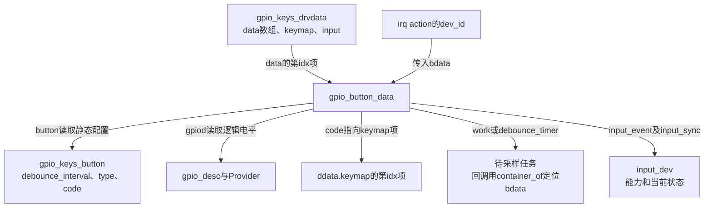
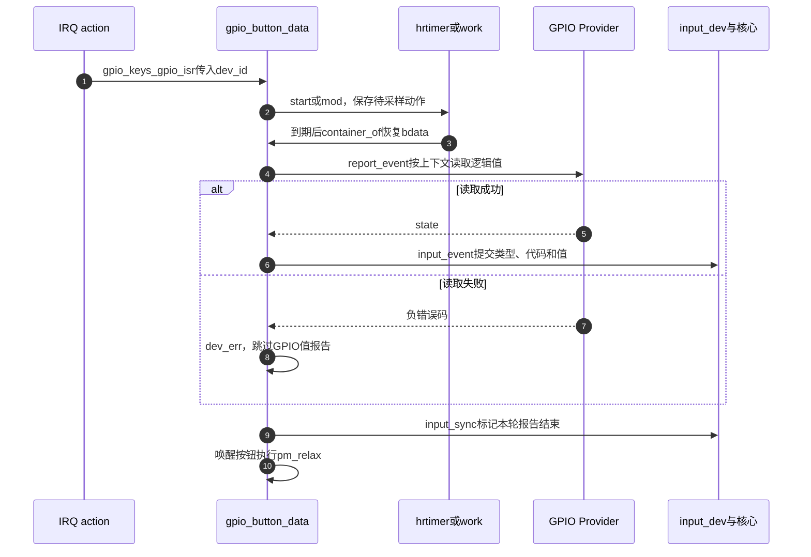
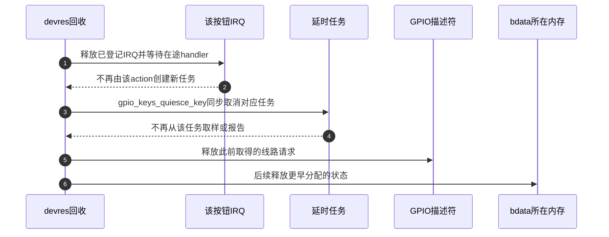

# 第8章\_按键取样与输入报告

GPIO IRQ只报告通知，按键驱动还要决定何时读取、报告哪个代码以及何时结束未完成的采样。本页沿 `gpio_button_data` 追踪这些状态。只展开 `gpio_keys.c` 的GPIO适配与IRQ-only差量，不复制GPIO核心、定时器或input核心的完整实现。

| 阅读任务 | 入口 |
| --- | --- |
| 确认固定版本和证据边界 | [GPIO源码总索引](../navigation/P01_Linux_6.12_GPIO源码阅读索引.md#1.1_版本身份与阅读路线) |
| 先建立功能对象与GPIO的关系 | [标准功能适配导读](../navigation/P06_标准功能驱动怎样承接GPIO状态.md#6.2_按键把采样时机与输入报告分开) |
| 按应用场景理解去抖 | [按键正文](../../../../knowledge/driver_model/gpio_consumers/P03_GPIO按键怎样接入输入事件.md#3.1_一次机械按下为何可能产生多次中断) |
| 继续追输入核心分发 | [Input源码导读](../../input/navigation/P01_Linux_6.12_Input源码阅读索引.md#1.4_关键调用链索引) |

**讲解层次：实现层，NXP Linux 6.12.20。** 固定提交 `dfaf2136deb2af2e60b994421281ba42f1c087e0`；主要原件 [drivers/input/keyboard/gpio_keys.c](https://github.com/nxp-imx/linux-imx/blob/dfaf2136deb2af2e60b994421281ba42f1c087e0/drivers/input/keyboard/gpio_keys.c)，Git blob `380fe8dab3b06379f9744e8190a4afcc0aee20b4`，沿用上游GPL-2.0-only许可。中文Doxygen及中文行内阅读说明均由仓库补充。本次核对固定官方快照，未进行目标内核编译和板级唤醒实验。

## 8.1\_每键状态怎样决定采样路径

`gpio_keys_probe()` 用零初始化分配的 `gpio_keys_drvdata.data[]` 容纳每个按钮的运行状态，另分配keymap和托管input设备。setup为每项填入按钮配置、input指针和描述符。零初始化有实际语义：软件去抖时间和hrtimer选择标志没有被设置时分别为0与false。

```c
/**
 * @brief 每键运行状态回指共享input设备；drvdata持有全部按钮和可修改键码表。
 * @note 仓库补充中文阅读说明，非上游注释；摘录不能独立编译。
 */
struct gpio_button_data {
	const struct gpio_keys_button *button;
	struct input_dev *input;
	struct gpio_desc *gpiod;

	unsigned short *code;

	struct hrtimer release_timer;
	unsigned int release_delay;	/* in msecs, for IRQ-only buttons */

	struct delayed_work work;
	struct hrtimer debounce_timer;
	unsigned int software_debounce;	/* in msecs, for GPIO-driven buttons */

	unsigned int irq;
	unsigned int wakeirq;
	unsigned int wakeup_trigger_type;

	spinlock_t lock;
	bool disabled;
	bool key_pressed;
	bool suspended;
	bool debounce_use_hrtimer;
};

struct gpio_keys_drvdata {
	const struct gpio_keys_platform_data *pdata;
	struct input_dev *input;
	struct mutex disable_lock;
	unsigned short *keymap;
	struct gpio_button_data data[];
};
```

`button` 指向解析好的配置，`input` 指向共享输入设备，`gpiod` 为取样线路。`code` 指向 `ddata->keymap[idx]`，让报告使用设备当前键码；不是把GPIO offset当键码。GPIO型使用work或debounce_timer；IRQ-only使用release_timer与key_pressed。`irq` 是主要通知身份，`wakeirq` 是可选独立唤醒通知；`wakeup_trigger_type` 记录唤醒时需要的物理触发类型，不能替代逻辑有效性。

`lock` 保护IRQ-only处理中的共享状态；`disabled` 记录显式禁用，驱动的disable_lock序列化禁用控制。`suspended` 供唤醒报告分支判定。`pdata` 为整个设备配置，input与keymap由drvdata关联，data柔性数组长度来自nbuttons。它们均是驱动实例内存，不是GPIO硬件寄存器。



下面摘录 `gpio_keys_setup_key()` 中GPIO已经取得之后的路径选择部分。固件取得描述符的分支使用 `devm_fwnode_gpiod_get(dev, child, NULL, GPIOD_IN, desc)`；只有 `-ENOENT` 被当成无GPIO继续尝试IRQ-only，其他错误包括依赖未就绪都向上传递。旧整数GPIO平台数据路径仍在这个版本存在，本文不把它作为新设备模板。

```c
/**
 * @brief setup的局部摘录：硬件去抖失败才保存软件等待，非零时间分支内选择回调上下文。
 * @note 仓库补充中文阅读说明，非上游注释；摘录不能独立编译。
 */
	if (bdata->gpiod) {
		bool active_low = gpiod_is_active_low(bdata->gpiod);

		if (button->debounce_interval) {
			error = gpiod_set_debounce(bdata->gpiod,
					button->debounce_interval * 1000);
			/* use timer if gpiolib doesn't provide debounce */
			if (error < 0)
				bdata->software_debounce =
						button->debounce_interval;

			/*
			 * If reading the GPIO won't sleep, we can use a
			 * hrtimer instead of a standard timer for the software
			 * debounce, to reduce the latency as much as possible.
			 */
			bdata->debounce_use_hrtimer =
					!gpiod_cansleep(bdata->gpiod);
		}
```

这是外层分支的开头，摘录在IRQ选择之前停止，故不是独立完整函数。`gpiod_set_debounce()` 接收微秒，配置的毫秒乘1000后传入；任意负返回在这个实现中触发软件回退，而不仅是某一个“不支持”错误。`!gpiod_cansleep()` 决定是否可在hrtimer回调普通读取。若 `debounce_interval==0`，这一赋值不会发生，false初值保留，之后走work。

后续setup有显式button IRQ时使用它，否则调用 `gpiod_to_irq()` 并检查负返回；GPIO仍承担取样。初始化work与debounce_timer后，运行期选择双边沿IRQ。有效/无效唤醒动作则按active-low换成相应物理边沿；未指定专门唤醒动作时不强制重配。无GPIO的分支要求IRQ存在且类型为EV_KEY，否则返回 `-EINVAL`。

属性依据见 [gpio-keys.yaml](https://github.com/nxp-imx/linux-imx/blob/dfaf2136deb2af2e60b994421281ba42f1c087e0/Documentation/devicetree/bindings/input/gpio-keys.yaml)：默认去抖5ms，linux,code必须给出，GPIO/interrupt描述至少一种。代码与事件编号见 [input-event-codes.h](https://github.com/nxp-imx/linux-imx/blob/dfaf2136deb2af2e60b994421281ba42f1c087e0/include/uapi/linux/input-event-codes.h)，`EV_KEY=1`、`KEY_ENTER=28`。这些是软件身份，不能当作硬件IRQ编号。

**可修改性说明。** 更改默认时间时要同时检查固件解析、硬件微秒参数、软件毫秒转换和IRQ-only release_delay；更改 `debounce_use_hrtimer` 初始化位置会改变零时间分支的执行上下文，必须检查读取是否可能睡眠。不能只改ISR中的计时器种类而遗漏report和quiesce对同一标志的使用。GPIO映射接口本身的保护与错误语义复用 [IRQ映射实现](P05_GPIO映射与模拟事件怎样交接.md#5.1_取得IRQ为何仍需保护可撤销的Provider)。

## 8.2\_ISR怎样安排采样并结束输入报告

setup完成后，IRQ action的dev_id指向对应bdata。ISR取得的不是临时按钮快照，而是后续任务要继续使用的同一对象。

```c
/**
 * @brief GPIO型ISR登记待采样动作；唤醒按键分支可能先合成一次按下。
 * @note 仓库补充中文阅读说明，非上游注释；摘录不能独立编译。
 */
static irqreturn_t gpio_keys_gpio_isr(int irq, void *dev_id)
{
	struct gpio_button_data *bdata = dev_id;

	BUG_ON(irq != bdata->irq);

	if (bdata->button->wakeup) {
		const struct gpio_keys_button *button = bdata->button;

		pm_stay_awake(bdata->input->dev.parent);
		if (bdata->suspended  &&
		    (button->type == 0 || button->type == EV_KEY)) {
			/*
			 * Simulate wakeup key press in case the key has
			 * already released by the time we got interrupt
			 * handler to run.
			 */
			input_report_key(bdata->input, button->code, 1);
		}
	}

	/* 新通知重新安排采样；这里没有等待整个去抖窗口。 */
	if (bdata->debounce_use_hrtimer) {
		hrtimer_start(&bdata->debounce_timer,
			      ms_to_ktime(bdata->software_debounce),
			      HRTIMER_MODE_REL);
	} else {
		mod_delayed_work(system_wq,
				 &bdata->work,
				 msecs_to_jiffies(bdata->software_debounce));
	}

	return IRQ_HANDLED;
}
```

`BUG_ON` 检查传入IRQ与主要IRQ身份是否一致，是诊断性断言，不负责建立有效映射或消除竞争。`button->wakeup` 开启时，`pm_stay_awake` 标记正在处理唤醒事件；若 `suspended` 且是默认/EV_KEY类型，先报告按下，防止短按已经消失。普通运行则没有这次合成报告。

`hrtimer_start` 使用相对时间；否则 `mod_delayed_work(system_wq, ...)` 在系统工作队列上新建或调整待执行时间。二者读取同一软件去抖长度，单位转换分别是ms_to_ktime和msecs_to_jiffies。`IRQ_HANDLED` 表示本handler已处理通知，不表示延时采样或应用读取完成。

到期回调分别用 `container_of` 从work.work或debounce_timer地址找回bdata，二者都调用 `gpio_keys_debounce_event()`；hrtimer回调返回 `HRTIMER_NORESTART`，本次回调不自行周期重启。回调包装没有额外的按钮状态算法，省略其函数体，关键消费过程如下。

```c
/**
 * @brief 采样失败不提交GPIO值，成功按类型报告；随后同步一帧并结束唤醒处理。
 * @note 仓库补充中文阅读说明，非上游注释；摘录不能独立编译。
 */
static void gpio_keys_gpio_report_event(struct gpio_button_data *bdata)
{
	const struct gpio_keys_button *button = bdata->button;
	struct input_dev *input = bdata->input;
	unsigned int type = button->type ?: EV_KEY;
	int state;

	state = bdata->debounce_use_hrtimer ?
			gpiod_get_value(bdata->gpiod) :
			gpiod_get_value_cansleep(bdata->gpiod);
	/* 负错误码不能按非零值解释成按下。 */
	if (state < 0) {
		dev_err(input->dev.parent,
			"failed to get gpio state: %d\n", state);
		return;
	}

	if (type == EV_ABS) {
		if (state)
			input_event(input, type, button->code, button->value);
	} else {
		input_event(input, type, *bdata->code, state);
	}
}

static void gpio_keys_debounce_event(struct gpio_button_data *bdata)
{
	gpio_keys_gpio_report_event(bdata);
	input_sync(bdata->input);

	if (bdata->button->wakeup)
		pm_relax(bdata->input->dev.parent);
}
```

**实现原理。** report沿相同的hrtimer选择标志决定读取API；sleeping Provider只能在work等允许睡眠的环境取样。`button->type ?: EV_KEY` 使类型0采用按键语义。对于当前主线的EV_KEY，使用可修改的 `*code` 和逻辑state；EV_ABS分支仅在state有效时报告配置value，并用button中的code。这两个分支不能概括成“所有输入类型都报告0/1”。

`gpio_keys_debounce_event()` 不接收report的成功返回值，因此读取失败后仍会调用 `input_sync()` 和可选 `pm_relax()`；这不补发失败的按键值，只结束本轮报告/唤醒处理。输入核心如何保存状态和分发属于另一层：固定版本 `drivers/input/input.c` 的 `input_get_disposition()` 对普通EV_KEY比较 `dev->key` 与布尔value，不变则不作为新状态变化传递；value2走重复事件分支。沿 [Input分发入口](../../input/navigation/P01_Linux_6.12_Input源码阅读索引.md#1.4_关键调用链索引) 继续追踪，不在这里复制其函数体。



第2步到第3步存在真实异步窗口，所以退出必须停止新生产者并取消任务。第4步的错误决定是否有第6步；第9步的报告收束不证明第6步一定发生。

**可修改性说明。** 若改变读取错误策略，要同时考虑是否需要重试、怎样停止重试、PM引用何时结束及unbind时如何取消。不能在读失败时直接写state=1，也不能把input_sync移进成功分支后忽略失败时的PM收尾。若追求更短延迟，应明确是否改变去抖语义，不能在IRQ中直接调用可能睡眠的Provider。

## 8.3\_缺少松开信号时怎样合成释放

无gpiod分支没有可用于恢复真实状态的采样入口，因此setup把配置时间存入 `release_delay`，初始化release_timer，选用下面两个函数。它们的状态证明域仅是软件合成的按键周期。

```c
/**
 * @brief IRQ-only分支用key_pressed与release_timer合成释放，不能测量物理按住时长。
 * @note 仓库补充中文阅读说明，非上游注释；摘录不能独立编译。
 */
static irqreturn_t gpio_keys_irq_isr(int irq, void *dev_id)
{
	struct gpio_button_data *bdata = dev_id;
	struct input_dev *input = bdata->input;

	BUG_ON(irq != bdata->irq);

	guard(spinlock_irqsave)(&bdata->lock);

	/* 尚未合成按下时才新报告；已有按下则可推迟释放。 */
	if (!bdata->key_pressed) {
		if (bdata->button->wakeup)
			pm_wakeup_event(bdata->input->dev.parent, 0);

		input_report_key(input, *bdata->code, 1);
		input_sync(input);

		if (!bdata->release_delay) {
			input_report_key(input, *bdata->code, 0);
			input_sync(input);
			goto out;
		}

		bdata->key_pressed = true;
	}

	if (bdata->release_delay)
		hrtimer_start(&bdata->release_timer,
			      ms_to_ktime(bdata->release_delay),
			      HRTIMER_MODE_REL_HARD);
out:
	return IRQ_HANDLED;
}

static enum hrtimer_restart gpio_keys_irq_timer(struct hrtimer *t)
{
	struct gpio_button_data *bdata = container_of(t,
						      struct gpio_button_data,
						      release_timer);
	struct input_dev *input = bdata->input;

	if (bdata->key_pressed) {
		input_report_key(input, *bdata->code, 0);
		input_sync(input);
		bdata->key_pressed = false;
	}

	return HRTIMER_NORESTART;
}
```

`guard(spinlock_irqsave)` 在作用域内持有bdata的锁并保存本地IRQ状态，使IRQ处理中的key_pressed检查与更新构成受保护片段。首次按下时，pm_wakeup_event报告唤醒事件，input_report_key提交值1，input_sync结束该报告。release_delay为0时立即提交0并结束，不把key_pressed置true；否则记录true。后续IRQ发现已有按下时不重复创建一次按下，但会重新安排非零延时释放。

release_timer使用 `HRTIMER_MODE_REL_HARD`；到期若key_pressed仍true，就报告0、同步并清false。函数本身没有读取GPIO，也没有测量外部释放。摘录中的timer回调没有显式取得上述spinlock，不能把源码改述成“两边均在同一把锁下更新”；分析或修改并发执行时应继续结合该版本hrtimer的执行/取消协议与实际IRQ拓扑，不能仅凭字段附近有锁作证明。

**可修改性说明。** 修改release_delay会同时改变零延时立即释放与非零定时器分支；若增加长按功能，必须先取得真实持续状态或明确定义合成语义。不能把release_timer换成GPIO debounce_timer，因为前者消费key_pressed，后者要读取gpiod。关闭或失败退出必须取消正确的一种timer。

## 8.4\_为何先停IRQ再取消延时报告

既然ISR能创建未来动作，只同步取消一次timer/work还不够：如果IRQ仍能到来，它可以在取消返回后再次排队。setup先登记quiesce动作、再申请IRQ，正是为了在托管回收时反向执行。

下面为setup中登记quiesce到申请主要IRQ的连续摘录；省略后面的可选wakeirq分配，它若成功登记也在更晚的devres位置，退出先被释放。

```c
/**
 * @brief 先记录取消任务的动作，再让IRQ有机会安排任务。
 * @note 仓库补充中文阅读说明，非上游注释；摘录不能独立编译。
 */
	error = devm_add_action(dev, gpio_keys_quiesce_key, bdata);
	if (error) {
		dev_err(dev, "failed to register quiesce action, error: %d\n",
			error);
		return error;
	}

	/*
	 * If platform has specified that the button can be disabled,
	 * we don't want it to share the interrupt line.
	 */
	if (!button->can_disable)
		irqflags |= IRQF_SHARED;

	error = devm_request_any_context_irq(dev, bdata->irq, isr, irqflags,
					     desc, bdata);
	if (error < 0) {
		dev_err(dev, "Unable to claim irq %d; error %d\n",
			bdata->irq, error);
		return error;
	}
```
```c
/**
 * @brief 按当前分支同步取消待执行对象；显式禁用先阻止IRQ再取消。
 * @note 仓库补充中文阅读说明，非上游注释；摘录不能独立编译。
 */
static void gpio_keys_quiesce_key(void *data)
{
	struct gpio_button_data *bdata = data;

	if (!bdata->gpiod)
		hrtimer_cancel(&bdata->release_timer);
	else if (bdata->debounce_use_hrtimer)
		hrtimer_cancel(&bdata->debounce_timer);
	else
		cancel_delayed_work_sync(&bdata->work);
}

static void gpio_keys_disable_button(struct gpio_button_data *bdata)
{
	if (!bdata->disabled) {
		/*
		 * Disable IRQ and associated timer/work structure.
		 */
		disable_irq(bdata->irq);
		gpio_keys_quiesce_key(bdata);
		bdata->disabled = true;
	}
}
```

`devm_add_action` 失败时setup返回；此时该按钮IRQ尚未申请，所以没有来自该handler的待采样动作需要取消。`can_disable` 为false时允许IRQ共享；可禁用按钮要求专用IRQ，避免 `disable_irq` 顺带停掉别人的来源。`devm_request_any_context_irq` 根据IRQ条件选择适合的请求方式，成功可能返回非负值，所以源码检查 `<0`，不能机械改成 `if (error)`。

**实现原理。** 解绑或probe后续失败时，先前成功申请的IRQ先被devres释放并等待在途处理结束，随后quiesce按gpiod是否存在与hrtimer选择标志取消release_timer、debounce_timer或delayed work。gpiod在更早阶段取得，随后才释放；bdata所在drvdata更早分配，生命期覆盖这些回收。input设备托管注销还会撤销对输入客户端的可见性，不能把这一取消动作当成整个input注销的替代。

显式禁用路径在disable_lock已由调用者持有的条件下，先disable_irq再quiesce，最后设disabled=true。disabled防止重复禁用；它不替代底层IRQ停止或同步取消。重新使能和设备PM策略仍由相应上层路径负责，不能用改一个bool模拟全部停机。



第2步建立“不再新增”，第4步建立“不再执行”，合起来才允许第5～6步。这个图只放大与GPIO适配相关的devres项，不省略input注销的事实，也不宣称硬件电平恢复到probe前值。

**可修改性说明。** 新增任务必须有相应取消动作，且登记顺序要确保先停所有能排队的来源，再同步取消，再释放其数据。若把quiesce登记移到IRQ申请之后，逆序退出会先取消再释放IRQ，产生重新排队窗口。若增加独立work而仍只取消现有三选一对象，生命周期证明同样失效。

## 8.5\_配置与验证能支持哪些结论

`CONFIG_KEYBOARD_GPIO` 控制本驱动构建，`CONFIG_KEYBOARD_GPIO_POLLED` 控制另一轮询驱动；源码存在不代表运行内核启用。evdev用户接口还依赖输入处理者配置与成功连接。OF描述、平台数据与Provider能力共同决定哪些setup分支可用，本页没有把一份教学DTS当作这些条件已成立。

| 核对对象 | 已得到的证据 | 仍需目标环境验证 |
| --- | --- | --- |
| 采样上下文 | 固定源码选择和错误路径 | Provider真实can_sleep、IRQ线程/RT条件 |
| 去抖时间 | 解析默认值、单位和回退 | 实际抖动波形、短按漏检与调度延迟 |
| 事件语义 | 类型、键码、逻辑值、同步位置 | 客户端实际收到的序列与丢失情况 |
| 退出 | IRQ与取消动作的登记顺序 | 并发解绑压力、特定平台资源故障 |
| 唤醒 | suspended分支合成按下、后续采样 | 电源域、唤醒路由、触发配置是否有效 |

源码中的BUG_ON/dev_err是检查与诊断；真正建立生命期保证的是资源顺序、IRQ停止和同步取消。没有日志不代表按钮无抖动，也不代表所有路径都执行过。正文的DTC练习只检查描述数据，行为观察应回到 [按键时间线练习](../../../../knowledge/driver_model/gpio_consumers/P03_GPIO按键怎样接入输入事件.md#3.7_从时间线预测结果)，在具备相应目标条件后再验证。
