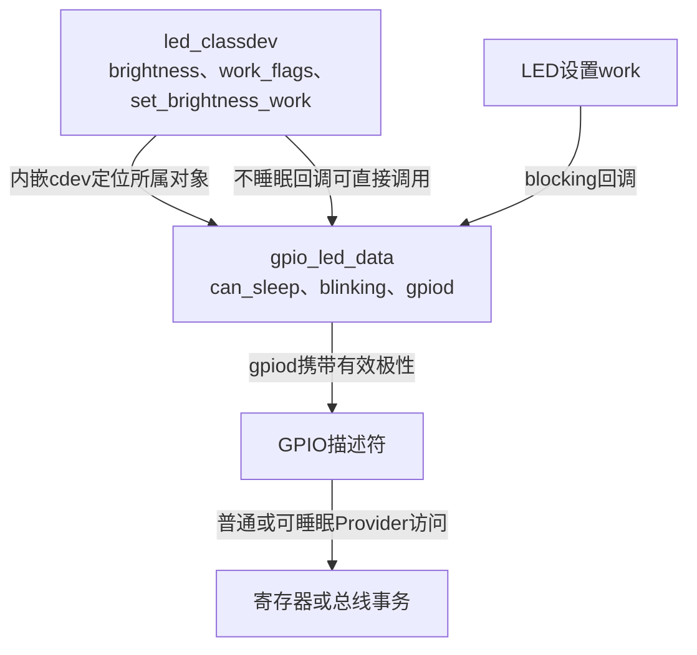
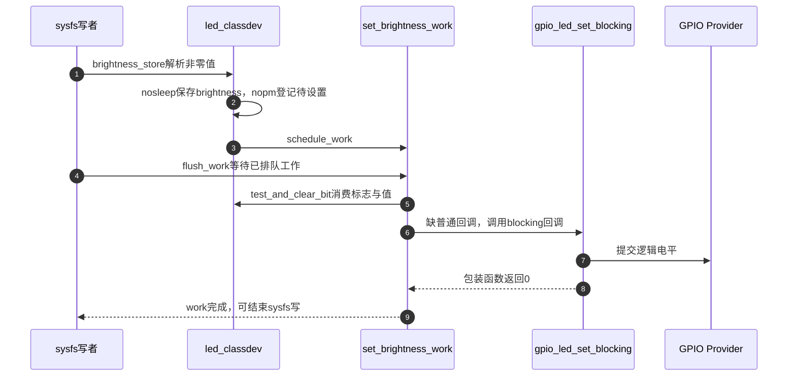
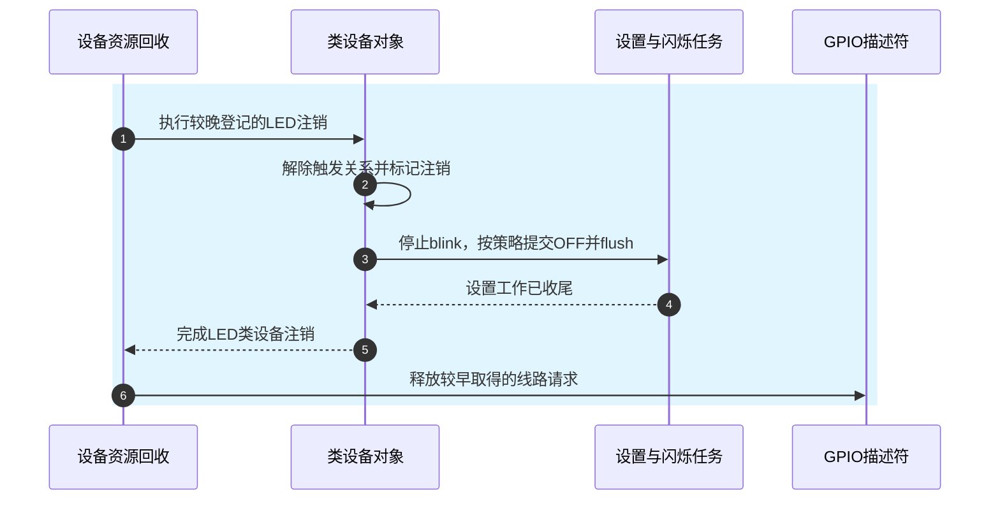
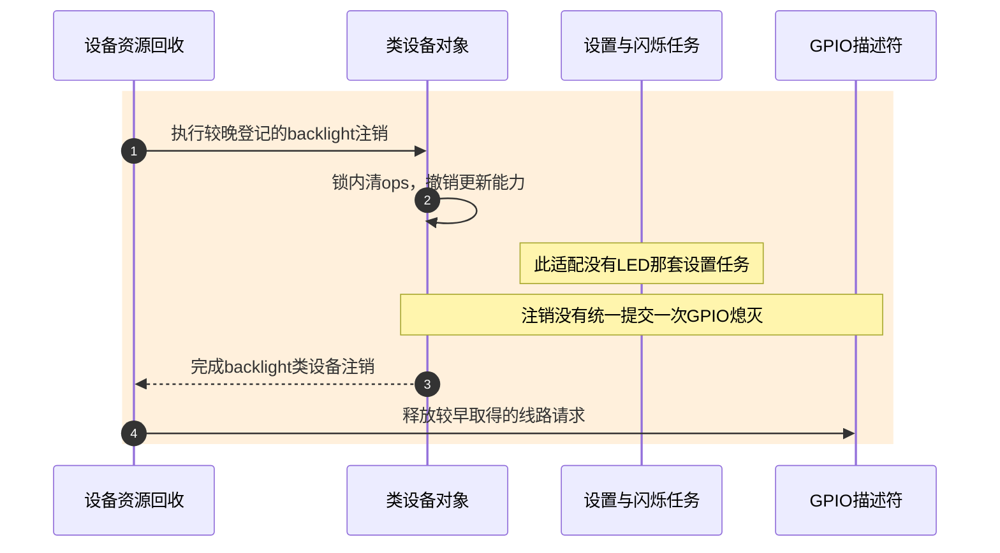

# 第9章\_指示灯与背光的GPIO适配

亮度请求最终要写GPIO，但“请求值保存在哪”“谁允许睡眠”“当前是否应该点亮”由上面的功能对象决定。本页把这三件事落到固定实现，比较LED与backlight适配；不把两者当成同一套属性换了名字。

| 阅读任务 | 入口 |
| --- | --- |
| 版本与GPIO公共实现 | [总索引](../navigation/P01_Linux_6.12_GPIO源码阅读索引.md#1.1_版本身份与阅读路线) |
| 功能适配的参与者与周期 | [灯与背光模块导读](../navigation/P06_标准功能驱动怎样承接GPIO状态.md#6.3_灯与背光把期望值交给不同的状态管理者) |
| 先从显示关闭的问题推导 | [指示与背光正文](../../../../knowledge/driver_model/gpio_consumers/P04_GPIO指示与背光怎样接入亮度接口.md#4.1_都是点亮为什么需要两种对象) |

**讲解层次：实现层，NXP Linux 6.12.20。** 以下文件均来自固定提交 `dfaf2136deb2af2e60b994421281ba42f1c087e0`；中文Doxygen是仓库补充，源码沿用上游许可。原件入口和blob身份如下，表用于定位前述实现问题。

| 上游位置 | Git blob |
| --- | --- |
| [drivers/leds/leds-gpio.c](https://github.com/nxp-imx/linux-imx/blob/dfaf2136deb2af2e60b994421281ba42f1c087e0/drivers/leds/leds-gpio.c) | `4d1612d557c841bd5f39bc0c9af0ad5ca17d6cc3` |
| [drivers/leds/led-core.c](https://github.com/nxp-imx/linux-imx/blob/dfaf2136deb2af2e60b994421281ba42f1c087e0/drivers/leds/led-core.c) | `001c290bc07b7d10fb6b2bb1c3abbeb23380e2a5` |
| [drivers/leds/led-class.c](https://github.com/nxp-imx/linux-imx/blob/dfaf2136deb2af2e60b994421281ba42f1c087e0/drivers/leds/led-class.c) | `f69f4e928d61435b58e56aa6748d2e66bcd160ba` |
| [drivers/video/backlight/gpio_backlight.c](https://github.com/nxp-imx/linux-imx/blob/dfaf2136deb2af2e60b994421281ba42f1c087e0/drivers/video/backlight/gpio_backlight.c) | `a1f808ccd3592c4b5b830ba86b9dde75375ef0cf` |
| [include/linux/backlight.h](https://github.com/nxp-imx/linux-imx/blob/dfaf2136deb2af2e60b994421281ba42f1c087e0/include/linux/backlight.h) | `85044b1432cb718d41f5498474bd8d40ec350099` |
| [drivers/video/backlight/backlight.c](https://github.com/nxp-imx/linux-imx/blob/dfaf2136deb2af2e60b994421281ba42f1c087e0/drivers/video/backlight/backlight.c) | `7425846e01d07c8ff0167efed235e0e08e3d2ba1` |

## 9.1\_灯对象怎样选择可睡眠或普通回调

`gpio_led_data` 内嵌 `led_classdev cdev`，另持有 `gpio_desc *gpiod`。`can_sleep` 记录Provider访问属性，`blinking` 与 `platform_gpio_blink_set` 只描述平台硬件闪烁适配。创建时据can_sleep二选一登记brightness_set或brightness_set_blocking；具体初始化函数在 [9.5](#9.5_接管LED初值为什么先读再设置方向) 唯一展开。

运行时两个设置入口复用下列二值转换。

```c
/**
 * @brief 普通与blocking入口共享二值映射，blocking返回0不证明物理输出成功。
 * @note 仓库补充中文阅读说明，非上游注释；摘录不能独立编译。
 */
static void gpio_led_set(struct led_classdev *led_cdev,
	enum led_brightness value)
{
	struct gpio_led_data *led_dat = cdev_to_gpio_led_data(led_cdev);
	int level;

	/* 这里只提供二值能力，亮度大小不变成PWM占空比。 */
	if (value == LED_OFF)
		level = 0;
	else
		level = 1;

	if (led_dat->blinking) {
		led_dat->platform_gpio_blink_set(led_dat->gpiod, level,
						 NULL, NULL);
		led_dat->blinking = 0;
	} else {
		if (led_dat->can_sleep)
			gpiod_set_value_cansleep(led_dat->gpiod, level);
		else
			gpiod_set_value(led_dat->gpiod, level);
	}
}

static int gpio_led_set_blocking(struct led_classdev *led_cdev,
	enum led_brightness value)
{
	gpio_led_set(led_cdev, value);
	return 0;
}
```

`cdev_to_gpio_led_data` 用container_of从内嵌cdev找回拥有者，`LED_OFF` 为熄灭值0，其余值映射为逻辑1。若已有平台硬件闪烁，使用平台回调以固定level停止/覆盖闪烁，随后清blinking；否则按can_sleep选择setter。这里的GPIO逻辑转换继续复用 [gpiolib运行访问](P03_逻辑值怎样变成方向与电平.md#3.4_运行时setter沿用逻辑语义却不返回写错误)。

`gpio_led_set_blocking` 在调用后直接返回0；GPIO setter本身无错误返回，平台blink回调返回值在这一固定设置路径也未传播。因此不能把blocking的int类型理解为已经检测外部灯是否亮。`gpio_blink_set` 是另一入口：置blinking=1，再以GPIO_LED_BLINK请求平台回调并返回其结果。普通固件创建路径传入blink_set=NULL，不会仅因该函数存在而具备硬件blink。



图中的work属于LED核心对象，不是GPIO描述符内部的任务。**可修改性说明：** 改变回调类型必须核对Provider约束与所有调用上下文；不能把can_sleep改成false来消除延迟。若要报告硬件失败，需要有真实可传回的硬件状态路径，不能只修改包装函数的返回常量。

## 9.2\_亮度请求如何经过工作队列与GPIO回调

先限定普通固定亮度场景，软件闪烁暂未启用。内核 `led_set_brightness()` 此时进入nosleep路径，更新期望亮度；若硬件设置可能睡眠，就保存工作状态。sysfs有额外的控制锁、触发器与等待步骤，不能与任意内核调用等同。

```c
/**
 * @brief sysfs解析亮度、处理零值触发器退出，并等待当前设置work。
 * @note 仓库补充中文阅读说明，非上游注释；摘录不能独立编译。
 */
static ssize_t brightness_store(struct device *dev,
		struct device_attribute *attr, const char *buf, size_t size)
{
	struct led_classdev *led_cdev = dev_get_drvdata(dev);
	unsigned long state;
	ssize_t ret;

	mutex_lock(&led_cdev->led_access);

	if (led_sysfs_is_disabled(led_cdev)) {
		ret = -EBUSY;
		goto unlock;
	}

	ret = kstrtoul(buf, 10, &state);
	if (ret)
		goto unlock;

	if (state == LED_OFF)
		led_trigger_remove(led_cdev);
	led_set_brightness(led_cdev, state);
	flush_work(&led_cdev->set_brightness_work);

	ret = size;
unlock:
	mutex_unlock(&led_cdev->led_access);
	return ret;
}
```

`led_access` 序列化这条sysfs操作；禁用sysfs时返回 `-EBUSY`，十进制解析失败则原样返回错误。只有state==LED_OFF时调用led_trigger_remove，非零写入不自动解除所有触发机制。`flush_work` 等待设置work，但不创造底层不存在的物理反馈；成功返回size是这次写接口的结果。

下面两个函数分别保存期望值和登记硬件设置动作，来自led-core.c。

```c
/**
 * @brief 期望亮度与待执行硬件动作分开；不能睡眠的入口用work交给blocking回调。
 * @note 仓库补充中文阅读说明，非上游注释；摘录不能独立编译。
 */
void led_set_brightness_nosleep(struct led_classdev *led_cdev, unsigned int value)
{
	/* 保存期望值；休眠中仍可先记录，而不立即驱动硬件。 */
	led_cdev->brightness = min(value, led_cdev->max_brightness);

	if (led_cdev->flags & LED_SUSPENDED)
		return;

	led_set_brightness_nopm(led_cdev, led_cdev->brightness);
}

void led_set_brightness_nopm(struct led_classdev *led_cdev, unsigned int value)
{
	/* Use brightness_set op if available, it is guaranteed not to sleep */
	if (!__led_set_brightness(led_cdev, value))
		return;

	/*
	 * Brightness setting can sleep, delegate it to a work queue task.
	 * value 0 / LED_OFF is special, since it also disables hw-blinking
	 * (sw-blink disable is handled in led_set_brightness()).
	 * To avoid a hw-blink-disable getting lost when a second brightness
	 * change is done immediately afterwards (before the work runs),
	 * it uses a separate work_flag.
	 */
	if (value) {
		led_cdev->delayed_set_value = value;
		set_bit(LED_SET_BRIGHTNESS, &led_cdev->work_flags);
	} else {
		clear_bit(LED_SET_BRIGHTNESS, &led_cdev->work_flags);
		clear_bit(LED_SET_BLINK, &led_cdev->work_flags);
		set_bit(LED_SET_BRIGHTNESS_OFF, &led_cdev->work_flags);
	}

	schedule_work(&led_cdev->set_brightness_work);
}
```

**实现原理。** nosleep把brightness限制在max_brightness内，若LED_SUSPENDED则只更新期望值；恢复时可以再提交该值。nopm不重新判定PM，先尝试 `__led_set_brightness`：有普通回调就同步调用并返回0，无普通回调返回 `-ENOTSUPP`，于是进入工作排队。它不是试写硬件失败后盲目重试另一接口。

非零请求保存delayed_set_value并置LED_SET_BRIGHTNESS；零值清普通设置及blink请求位，另置LED_SET_BRIGHTNESS_OFF。专门OFF标志让“先停闪烁，再马上点亮”的两个意图在work尚未运行时仍可被区分。schedule_work使后续工作消费这些字段；多个请求不是一条逐项保存全部电平变化的队列。

**可修改性说明。** 不要把OFF位合并成只有一个最新值，否则停止硬件闪烁的动作可能被覆盖。修改返回或同步行为时，分别核对sysfs的flush、普通内核调用及软件闪烁分支；从这个固定亮度路径不能推出每次调用都产生可测量脉冲。

## 9.3\_设置work怎样消费状态而不是重放所有写入

排队以后，work从内嵌工作项地址找回同一led_classdev，按标志执行必要动作。这里展开消费者，便于核对上一节保存的状态确实有读取者。

```c
/**
 * @brief 先消费关灯动作再消费非零亮度，缺普通回调时调用blocking回调。
 * @note 仓库补充中文阅读说明，非上游注释；摘录不能独立编译。
 */
static void set_brightness_delayed(struct work_struct *ws)
{
	struct led_classdev *led_cdev =
		container_of(ws, struct led_classdev, set_brightness_work);

	if (test_and_clear_bit(LED_BLINK_DISABLE, &led_cdev->work_flags)) {
		led_stop_software_blink(led_cdev);
		set_bit(LED_SET_BRIGHTNESS_OFF, &led_cdev->work_flags);
	}

	/*
	 * Triggers may call led_set_brightness(LED_OFF),
	 * led_set_brightness(LED_FULL) in quick succession to disable blinking
	 * and turn the LED on. Both actions may have been scheduled to run
	 * before this work item runs once. To make sure this works properly
	 * handle LED_SET_BRIGHTNESS_OFF first.
	 */
	if (test_and_clear_bit(LED_SET_BRIGHTNESS_OFF, &led_cdev->work_flags))
		set_brightness_delayed_set_brightness(led_cdev, LED_OFF);

	if (test_and_clear_bit(LED_SET_BRIGHTNESS, &led_cdev->work_flags))
		set_brightness_delayed_set_brightness(led_cdev, led_cdev->delayed_set_value);

	if (test_and_clear_bit(LED_SET_BLINK, &led_cdev->work_flags)) {
		unsigned long delay_on = led_cdev->delayed_delay_on;
		unsigned long delay_off = led_cdev->delayed_delay_off;

		led_blink_set(led_cdev, &delay_on, &delay_off);
	}
}

static void set_brightness_delayed_set_brightness(struct led_classdev *led_cdev,
						  unsigned int value)
{
	int ret;

	ret = __led_set_brightness(led_cdev, value);
	if (ret == -ENOTSUPP) {
		ret = __led_set_brightness_blocking(led_cdev, value);
		if (ret == -ENOTSUPP)
			/* No back-end support to set a fixed brightness value */
			return;
	}

	/* LED HW might have been unplugged, therefore don't warn */
	if (ret == -ENODEV && led_cdev->flags & LED_UNREGISTERING &&
	    led_cdev->flags & LED_HW_PLUGGABLE)
		return;

	if (ret < 0)
		dev_err(led_cdev->dev,
			"Setting an LED's brightness failed (%d)\n", ret);
}
```

LED_BLINK_DISABLE表示停止软件闪烁请求，work调用led_stop_software_blink同步删除blink_timer并清延时/软件闪烁状态，再置OFF位。随后先消费OFF，再消费普通设置，最后处理LED_SET_BLINK；后者把delayed_delay_on/off交给闪烁设置路径。这些标志由test_and_clear_bit消费，字段保存的是待处理意图，不是完整历史日志。

真正设置亮度的helper先尝试普通回调，缺失时再尝试blocking回调；两者都不存在就返回。`-ENODEV` 且对象正在注销、硬件可拔插时不警告，其他负值打印错误。LED_UNREGISTERING和LED_HW_PLUGGABLE限定诊断，不能创造成功状态。对本章GPIO驱动而言，blocking包装本身返回0，因此这一错误打印不能补上GPIO写的硬件反馈。



第4步与第5步表示等待方和执行方的关系，并非保证工作在flush调用之后才开始；工作也可能此前已执行。第9步完成的是软件动作，仍不能推出物理灯反馈。软件blink启用时，led_set_brightness对零值排队停止，对非零值更新下一轮闪烁亮度，随后返回；该差量不应套进上图的固定亮度前提。

**可修改性说明。** 改工作标志消费顺序时应测试“OFF后立即ON”、正在软件blink时关闭、注销时尚有work等交错。把工作字段当FIFO会得到错误的事件数量保证；若产品需要不可合并的精确波形，应采用适合的硬件或协议模型，而非改变注释来宣称现有路径支持。

## 9.4\_背光怎样把亮度意图与显示状态合成

`gpio_backlight` 只保存gpiod和可选关联显示设备dev；期望亮度、power和核心state由backlight_device.props拥有。update_status从注册时的私有指针取得gpio_backlight，再计算当前有效亮度。

```c
/**
 * @brief power与核心blank或suspend状态可以压低输出而不改写期望brightness。
 * @note 仓库补充中文阅读说明，非上游注释；摘录不能独立编译。
 */
static inline bool backlight_is_blank(const struct backlight_device *bd)
{
	return bd->props.power != BACKLIGHT_POWER_ON ||
	       bd->props.state & (BL_CORE_SUSPENDED | BL_CORE_FBBLANK);
}

static inline int backlight_get_brightness(const struct backlight_device *bd)
{
	/* 当前关闭条件只压低有效输出，不覆盖props.brightness。 */
	if (backlight_is_blank(bd))
		return 0;
	else
		return bd->props.brightness;
}
```
```c
/**
 * @brief 使用合成后的亮度访问GPIO；可选显示设备限定framebuffer匹配。
 * @note 仓库补充中文阅读说明，非上游注释；摘录不能独立编译。
 */
static int gpio_backlight_update_status(struct backlight_device *bl)
{
	struct gpio_backlight *gbl = bl_get_data(bl);

	gpiod_set_value_cansleep(gbl->gpiod, backlight_get_brightness(bl));

	return 0;
}

static int gpio_backlight_check_fb(struct backlight_device *bl,
				   struct fb_info *info)
{
	struct gpio_backlight *gbl = bl_get_data(bl);

	return !gbl->dev || gbl->dev == info->device;
}
```

**实现原理。** power不为BACKLIGHT_POWER_ON，或state包含BL_CORE_SUSPENDED/BL_CORE_FBBLANK，都会使有效亮度为0；否则返回props.brightness。状态由核心管理，GPIO适配不应绕过这一判断直接提交brightness。update_status的setter无错误返回，所以它的0同样不是物理结果证明。

`bl_get_data` 取登记时保存的私有对象。check_fb在没有关联dev时接受匹配，有关联时要求info->device相同；它不是亮度开关。backlight_ops声明BL_CORE_SUSPENDRESUME，使核心suspend设置SUSPENDED并更新，resume清除该位再更新；更新过程由核心update_lock串行化，ops_lock保护回调能力和相关属性操作，GPIO驱动不自行取得update_lock。

**可修改性说明。** 直接用props.brightness替代backlight_get_brightness，会让显示blank或系统suspend不再压低输出。不要通过把期望brightness改成0“修复”，那会丢失恢复意图。该驱动不实现get_brightness，核心actual_brightness_show会回退返回props.brightness；若增加真实回读，应明确读的是电平、调光寄存器还是亮度测量，不能混用。

## 9.5\_接管LED初值为什么先读再设置方向

固件子节点创建时先以GPIOD_ASIS取得描述符，然后把属性整理进gpio_led模板。这里完整保留create函数，观察回调选择、初值、PM标志和发布先后。

```c
/**
 * @brief keep先读取并检查错误，建立输出初值后登记类设备，再选择该类设备的默认pinctrl。
 * @note 仓库补充中文阅读说明，非上游注释；摘录不能独立编译。
 */
static int create_gpio_led(const struct gpio_led *template,
	struct gpio_led_data *led_dat, struct device *parent,
	struct fwnode_handle *fwnode, gpio_blink_set_t blink_set)
{
	struct led_init_data init_data = {};
	struct pinctrl *pinctrl;
	int ret, state;

	led_dat->cdev.default_trigger = template->default_trigger;
	led_dat->can_sleep = gpiod_cansleep(led_dat->gpiod);
	if (!led_dat->can_sleep)
		led_dat->cdev.brightness_set = gpio_led_set;
	else
		led_dat->cdev.brightness_set_blocking = gpio_led_set_blocking;
	led_dat->blinking = 0;
	if (blink_set) {
		led_dat->platform_gpio_blink_set = blink_set;
		led_dat->cdev.blink_set = gpio_blink_set;
	}
	if (template->default_state == LEDS_GPIO_DEFSTATE_KEEP) {
		state = gpiod_get_value_cansleep(led_dat->gpiod);
		if (state < 0)
			return state;
	} else {
		state = (template->default_state == LEDS_GPIO_DEFSTATE_ON);
	}
	led_dat->cdev.brightness = state;
	led_dat->cdev.max_brightness = 1;
	if (!template->retain_state_suspended)
		led_dat->cdev.flags |= LED_CORE_SUSPENDRESUME;
	if (template->panic_indicator)
		led_dat->cdev.flags |= LED_PANIC_INDICATOR;
	if (template->retain_state_shutdown)
		led_dat->cdev.flags |= LED_RETAIN_AT_SHUTDOWN;

	ret = gpiod_direction_output(led_dat->gpiod, state);
	if (ret < 0)
		return ret;

	if (template->name) {
		led_dat->cdev.name = template->name;
		ret = devm_led_classdev_register(parent, &led_dat->cdev);
	} else {
		init_data.fwnode = fwnode;
		ret = devm_led_classdev_register_ext(parent, &led_dat->cdev,
						     &init_data);
	}

	if (ret)
		return ret;

	pinctrl = devm_pinctrl_get_select_default(led_dat->cdev.dev);
	ret = PTR_ERR_OR_ZERO(pinctrl);
	/* pinctrl-%d not present, not an error */
	if (ret == -ENODEV)
		ret = 0;
	if (ret) {
		dev_warn(led_dat->cdev.dev, "Failed to select %pfw pinctrl: %d\n",
			 fwnode, ret);
	}

	return ret;
}
```

`template` 是本次灯配置；led_dat持有先前取得的gpiod；parent拥有托管资源；fwnode帮助类设备建立名称和属性；blink_set是可选平台能力。default_trigger为默认触发器名称，can_sleep决定回调登记，blinking初始清零。keep读取逻辑值并向上传递负错误，on为1、其余为0。brightness保存初值，max_brightness=1固定二值范围。

不保留休眠状态时置LED_CORE_SUSPENDRESUME；panic_indicator置LED_PANIC_INDICATOR；保留关机状态置LED_RETAIN_AT_SHUTDOWN。这些都是软件策略标志，不等于GPIO控制器永远有电。direction_output失败立即返回；成功后根据是否有template.name选择普通或带init_data的托管类设备登记。init_data.fwnode支持固件命名，不能从教学节点名保证某台机器上的最终sysfs名字。

最后对类设备选择默认pinctrl：缺少配置的 `-ENODEV` 视为非错误，其他失败打印警告并返回。它发生在类设备登记之后，说明“已登记”也不是probe整条路径成功的充分证据。后续失败由devres清理已登记对象，但已发生的方向/电平变化不自动恢复成固件旧值。

**可修改性说明。** 改keep为直接写固定值会改变接管语义；把类设备发布移到输出配置之前，会改变使用者何时可能触及未准备好的回调。新增属性应同时检查binding、模板解析、flag消费和退出路径，不要只在结构体添加字段。

## 9.6\_背光的default-on为何不是所有路径的最终答案

背光在登记时准备RAW类型与最大亮度1，再根据固件节点身份和当前读值决定初始power。RAW表示控制方式类别，不表示绕过gpiolib极性转换。

```c
/**
 * @brief 登记背光对象后选择初始power，以合成亮度配置输出方向。
 * @note 仓库补充中文阅读说明，非上游注释；摘录不能独立编译。
 */
static int gpio_backlight_probe(struct platform_device *pdev)
{
	struct device *dev = &pdev->dev;
	struct gpio_backlight_platform_data *pdata = dev_get_platdata(dev);
	struct device_node *of_node = dev->of_node;
	struct backlight_properties props;
	struct backlight_device *bl;
	struct gpio_backlight *gbl;
	int ret, init_brightness, def_value;

	gbl = devm_kzalloc(dev, sizeof(*gbl), GFP_KERNEL);
	if (gbl == NULL)
		return -ENOMEM;

	if (pdata)
		gbl->dev = pdata->dev;

	def_value = device_property_read_bool(dev, "default-on");

	gbl->gpiod = devm_gpiod_get(dev, NULL, GPIOD_ASIS);
	if (IS_ERR(gbl->gpiod))
		return dev_err_probe(dev, PTR_ERR(gbl->gpiod),
				     "The gpios parameter is missing or invalid\n");

	memset(&props, 0, sizeof(props));
	props.type = BACKLIGHT_RAW;
	props.max_brightness = 1;
	bl = devm_backlight_device_register(dev, dev_name(dev), dev, gbl,
					    &gpio_backlight_ops, &props);
	if (IS_ERR(bl)) {
		dev_err(dev, "failed to register backlight\n");
		return PTR_ERR(bl);
	}

	/* Set the initial power state */
	if (!of_node || !of_node->phandle)
		/* Not booted with device tree or no phandle link to the node */
		bl->props.power = def_value ? BACKLIGHT_POWER_ON
					    : BACKLIGHT_POWER_OFF;
	else if (gpiod_get_value_cansleep(gbl->gpiod) == 0)
		bl->props.power = BACKLIGHT_POWER_OFF;
	else
		bl->props.power = BACKLIGHT_POWER_ON;

	bl->props.brightness = 1;

	init_brightness = backlight_get_brightness(bl);
	ret = gpiod_direction_output(gbl->gpiod, init_brightness);
	if (ret) {
		dev_err(dev, "failed to set initial brightness\n");
		return ret;
	}

	platform_set_drvdata(pdev, bl);
	return 0;
}
```

`devm_kzalloc` 的私有对象生命期覆盖后续描述符与类设备，pdata存在时提供可选关联显示设备。default-on先读为def_value，但无OF节点或无phandle时才直接决定power；有phandle的分支按GPIO读值==0选择OFF，否则ON。负错误也进入else，源码没有为它独立返回错误。这里记录真实分支，不把未检查错误解释为硬件状态有效。

brightness随后设为1，再通过backlight_get_brightness合成初值。因此初始power为OFF时输出0，但保存的期望值仍为1。direction_output返回错误会导致probe失败并清理已登记资源；成功则把bl存入platform设备私有指针。整个函数不能证明最终面板已点亮，显示设备与电源路径仍有自己的初始化责任。

**可修改性说明。** 若要修复负读取处理，应单独保存返回值并区分错误与0/1，再检查是否影响既有板级启动策略；本文只说明当前版本，不改外部源码。改变phandle分支应同时检查显示端引用、default-on绑定说明与启动闪烁测试。不要把设备树存在label当成必有非零phandle，最终DTB和解析对象才是此分支实际读取的证据。

## 9.7\_接管初值与撤销入口怎样影响最后输出

接管之后可能休眠，也可能永久解绑。这是两种不同事件。LED核心suspend置LED_SUSPENDED，以nopm提交0并flush设置work；resume提交保存的brightness，再清SUSPENDED，通用核心还可调用flash_resume。GPIO适配只通过前述标志决定是否参与这套PM路径，不修改Provider的电源保持能力。

解绑则必须先停止类设备的后续控制，再归还早先取得的GPIO。下面保留LED注销中与本章相关的连续片段；省略其后亮度变化通知属性、device注销、全局列表移除和mutex销毁等注册簿收尾，这些仍由原函数执行。

```c
/**
 * @brief LED注销先解除触发来源、停止软件闪烁，并完成已提交的设置工作。
 * @note 仓库补充中文阅读说明，非上游注释；摘录不能独立编译。
 */
#ifdef CONFIG_LEDS_TRIGGERS
	down_write(&led_cdev->trigger_lock);
	if (led_cdev->trigger)
		led_trigger_set(led_cdev, NULL);
	up_write(&led_cdev->trigger_lock);
#endif

	led_cdev->flags |= LED_UNREGISTERING;

	/* Stop blinking */
	led_stop_software_blink(led_cdev);

	if (!(led_cdev->flags & LED_RETAIN_AT_SHUTDOWN))
		led_set_brightness(led_cdev, LED_OFF);

	flush_work(&led_cdev->set_brightness_work);
```

trigger_lock保护触发器关系，CONFIG_LEDS_TRIGGERS关闭时该条件代码不构建。LED_UNREGISTERING标识退出，led_stop_software_blink同步停止blink timer；未设置LED_RETAIN_AT_SHUTDOWN时还会请求熄灭。这里说明该标志也被注销函数读取，不能简单说它只在shutdown回调出现。flush_work完成设置工作后，余下注册簿清理继续执行；devm类设备登记晚于GPIO取得，所以相应注销早于GPIO释放。

gpio-leds的系统shutdown回调也检查LED_RETAIN_AT_SHUTDOWN，未保留的灯用gpio_led_set提交OFF。这与卸载、PM恢复是不同入口，均不能保证断电后电平不变。

backlight的注销则在核心ops_lock内把ops清NULL，使后续路径不能继续使用旧回调，再注销framebuffer关联和类设备。它的注销函数没有统一请求一次GPIO熄灭。gpiod释放也不承诺恢复旧电平，故不能从“设备卸载成功”推出“背光一定灭了”。

下面用相同参与者分别画两次独立注销，避免把LED的停止工作与关灯动作套到背光路径。



LED路径第3～4步处理异步动作，完成第5步后才能进入第6步。保持状态的策略可能跳过OFF提交，仍需处理任务生命期。



背光路径第2步撤销回调能力，第3步之后才归还线路；不能从LED图借来一项未执行的OFF。**可修改性说明：** 增加定时器、通知者或私有work时，必须把它们加入停止协议；仅依赖devm归还gpiod会留下异步访问窗口。若产品要求离开某状态后保证硬件灭灯，应定义可观察的输出协议和失败处理，不能从资源释放接口推导。

本页验证固定源码与教学DTS，未运行目标PM、热拔插或真实光输出测试。LEDS_GPIO、LEDS_CLASS、BACKLIGHT_GPIO及PM/trigger配置决定实际可用路径，不能由源码存在反推某台设备已启用。
