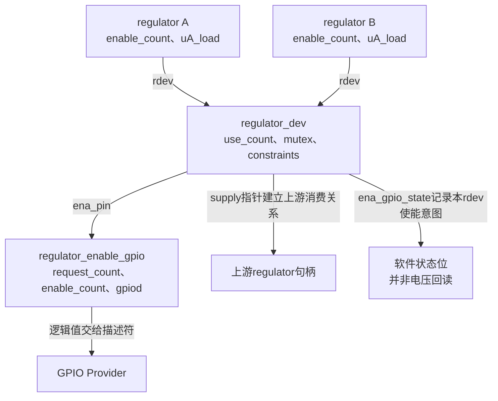
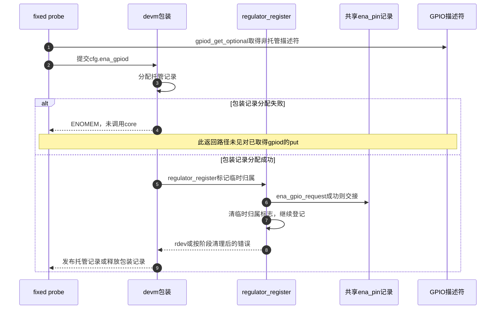

# 第10章\_固定电源的使能计数与GPIO交接

同一电源被两个设备使用时，GPIO只能承载最后的使能意图，不能自己保存两个消费者的责任。本页沿消费句柄、供电对象和共享使能记录追踪计数，再检查fixed驱动何时交出GPIO描述符。主场景是两个消费者共享一个rdev；两个rdev共用物理使能线作为独立差量处理。

| 阅读任务 | 入口 |
| --- | --- |
| 版本与GPIO公共实现 | [源码总索引](../navigation/P01_Linux_6.12_GPIO源码阅读索引.md#1.1_版本身份与阅读路线) |
| 先连接状态与操作周期 | [固定电源模块导读](../navigation/P06_标准功能驱动怎样承接GPIO状态.md#6.4_固定供电把多个使用关系汇总到一个使能出口) |
| 按实际共享问题进入 | [固定电源正文](../../../../knowledge/driver_model/gpio_consumers/P05_GPIO供电怎样进入电源依赖.md#5.1_最后一次写线不能代表最后一个使用者) |

**讲解层次：实现层，NXP Linux 6.12.20固定提交** `dfaf2136deb2af2e60b994421281ba42f1c087e0`。证据来自 [drivers/regulator/fixed.c](https://github.com/nxp-imx/linux-imx/blob/dfaf2136deb2af2e60b994421281ba42f1c087e0/drivers/regulator/fixed.c)、[core.c](https://github.com/nxp-imx/linux-imx/blob/dfaf2136deb2af2e60b994421281ba42f1c087e0/drivers/regulator/core.c)、[devres.c](https://github.com/nxp-imx/linux-imx/blob/dfaf2136deb2af2e60b994421281ba42f1c087e0/drivers/regulator/devres.c) 与 [gpiolib-of.c](https://github.com/nxp-imx/linux-imx/blob/dfaf2136deb2af2e60b994421281ba42f1c087e0/drivers/gpio/gpiolib-of.c)。对应blob依次为 `b6859229197edcd2d47fda0cb16519746b8ca2d5`、`37aaf997d4ee47fd214343251bbf44d382f5032b`、`1b893cdd1aad6115e1da8e2439a6772c47da602c`、`880f1efcaca5345af5b57eb18f11c538041ebcb9`。源码沿用原件许可，中文说明为仓库补充。

## 10.1\_消费句柄与电源对象分别记录什么

`drivers/regulator/internal.h` 的 `struct regulator` 包含消费者设备、自己的enable_count、负载uA_load和rdev指针；它是使用关系。`include/linux/regulator/driver.h` 的 `struct regulator_dev` 保存use_count、consumer_list、约束、依赖锁、supply和ena_pin，是供电提供者。固定驱动的desc描述电压和操作能力，cfg把描述符、初始化约束与私有数据交给注册路径。



两句柄的计数由core中的辅助函数维护，必须在rdev依赖锁已经取得时调用。

```c
/**
 * @brief 单消费句柄的嵌套次数与负载贡献配对；锁断言只检查调用前提。
 * @note 仓库补充中文说明；保留原始执行语句，省略原英文注释。
 */
static int _regulator_handle_consumer_enable(struct regulator *regulator)
{
	int ret;
	struct regulator_dev *rdev = regulator->rdev;

	lockdep_assert_held_once(&rdev->mutex.base);

	regulator->enable_count++;
	if (regulator->uA_load && regulator->enable_count == 1) {
		ret = drms_uA_update(rdev);
		if (ret)
			regulator->enable_count--;
		return ret;
	}

	return 0;
}

static int _regulator_handle_consumer_disable(struct regulator *regulator)
{
	struct regulator_dev *rdev = regulator->rdev;

	lockdep_assert_held_once(&rdev->mutex.base);

	if (!regulator->enable_count) {
		rdev_err(rdev, "Underflow of regulator enable count\n");
		return -EINVAL;
	}

	regulator->enable_count--;
	if (regulator->uA_load && regulator->enable_count == 0)
		return drms_uA_update(rdev);

	return 0;
}
```

**实现原理。** enable_count先增1；有非零uA_load且首次启用时，drms_uA_update重新汇总负载，失败则回退本次计数。disable要求计数非零，先减1，最后一次且存在负载时重新更新负载。负载更新失败与硬件电平恢复不是同义词，不能把这些返回路径当成完整事务回滚。

`lockdep_assert_held_once` 是诊断，不负责取得锁。公共regulator_enable/disable通过regulator_lock_dependent获取rdev与相关上游/耦合对象的锁，内部函数才在锁下修改状态；退出释放依赖锁。依赖锁使用ww mutex协调多对象获取，本文不复制该通用死锁避免算法，也不把普通字段加减解释成原子计数。

| 状态 | 写入点 | 后续消费与边界 |
| --- | --- | --- |
| regulator.enable_count | 上述consumer辅助函数 | 首次/末次判断，必须按成功请求配对 |
| rdev.use_count | _regulator_enable/disable | 决定首个有效消费关系与最后释放；约束路径可保留使用状态 |
| rdev.ena_gpio_state | _regulator_do_enable/disable | 避免同rdev重复改变共享pin需求；_regulator_is_enabled可直接返回它 |
| rdev.last_off | 关闭路径有off_on_delay时 | 下次enable计算还需等待多久 |

**可修改性说明。** 改consumer计数时须同时检查负载贡献首末转换与错误回退，不能把rdev.use_count无条件加到每次嵌套enable上。改状态查询时要保留“软件跟踪”和“硬件测量”的区别；ena_gpio_state为1并不证明电压达到标称值。

## 10.2\_首次启用与最后释放怎样连接GPIO和上游供电

下面保留内部enable与disable的执行语句，省略原英文注释。它们在同一个rdev生命周期内配对，不能只读计数增加而跳过失败出口。

```c
/**
 * @brief 先处理依赖与消费记录，首末关系决定是否操作硬件；失败按已到达阶段收尾。
 * @note 仓库补充中文说明；保留原始执行语句，省略原英文注释。
 */
static int _regulator_enable(struct regulator *regulator)
{
	struct regulator_dev *rdev = regulator->rdev;
	int ret;

	lockdep_assert_held_once(&rdev->mutex.base);

	if (rdev->use_count == 0 && rdev->supply) {
		ret = _regulator_enable(rdev->supply);
		if (ret < 0)
			return ret;
	}

	if (rdev->coupling_desc.n_coupled > 1) {
		ret = regulator_balance_voltage(rdev, PM_SUSPEND_ON);
		if (ret < 0)
			goto err_disable_supply;
	}

	ret = _regulator_handle_consumer_enable(regulator);
	if (ret < 0)
		goto err_disable_supply;

	if (rdev->use_count == 0) {

		ret = _regulator_is_enabled(rdev);
		if (ret == -EINVAL || ret == 0) {
			if (!regulator_ops_is_valid(rdev,
					REGULATOR_CHANGE_STATUS)) {
				ret = -EPERM;
				goto err_consumer_disable;
			}

			ret = _regulator_do_enable(rdev);
			if (ret < 0)
				goto err_consumer_disable;

			_notifier_call_chain(rdev, REGULATOR_EVENT_ENABLE,
					     NULL);
		} else if (ret < 0) {
			rdev_err(rdev, "is_enabled() failed: %pe\n", ERR_PTR(ret));
			goto err_consumer_disable;
		}

	}

	if (regulator->enable_count == 1)
		rdev->use_count++;

	return 0;

err_consumer_disable:
	_regulator_handle_consumer_disable(regulator);

err_disable_supply:
	if (rdev->use_count == 0 && rdev->supply)
		_regulator_disable(rdev->supply);

	return ret;
}

static int _regulator_disable(struct regulator *regulator)
{
	struct regulator_dev *rdev = regulator->rdev;
	int ret = 0;

	lockdep_assert_held_once(&rdev->mutex.base);

	if (WARN(regulator->enable_count == 0,
		 "unbalanced disables for %s\n", rdev_get_name(rdev)))
		return -EIO;

	if (regulator->enable_count == 1) {

		if (rdev->use_count == 1 &&
		    (rdev->constraints && !rdev->constraints->always_on)) {

			if (regulator_ops_is_valid(rdev, REGULATOR_CHANGE_STATUS)) {
				ret = _notifier_call_chain(rdev,
							   REGULATOR_EVENT_PRE_DISABLE,
							   NULL);
				if (ret & NOTIFY_STOP_MASK)
					return -EINVAL;

				ret = _regulator_do_disable(rdev);
				if (ret < 0) {
					rdev_err(rdev, "failed to disable: %pe\n", ERR_PTR(ret));
					_notifier_call_chain(rdev,
							REGULATOR_EVENT_ABORT_DISABLE,
							NULL);
					return ret;
				}
				_notifier_call_chain(rdev, REGULATOR_EVENT_DISABLE,
						NULL);
			}

			rdev->use_count = 0;
		} else if (rdev->use_count > 1) {
			rdev->use_count--;
		}
	}

	if (ret == 0)
		ret = _regulator_handle_consumer_disable(regulator);

	if (ret == 0 && rdev->coupling_desc.n_coupled > 1)
		ret = regulator_balance_voltage(rdev, PM_SUSPEND_ON);

	if (ret == 0 && rdev->use_count == 0 && rdev->supply)
		ret = _regulator_disable(rdev->supply);

	return ret;
}
```

**实现原理。** use_count为0且存在supply时，先递归启用上游。耦合电源需要regulator_balance_voltage协调，这里只解释其失败会跳到上游收尾，教学固定电源未引入耦合关系。consumer辅助函数成功后，首次使用还要查询启用状态；0或“不支持查询”的EINVAL分支需检查REGULATOR_CHANGE_STATUS权限，再执行do_enable。已启用的正返回不会重做硬件使能。只有此句柄enable_count变成1，use_count才增加。

失败分为两层：尚未成功登记consumer时只撤销本轮上游需求；已登记后发生权限、查询或do_enable失败时，先撤销consumer计数，再在原来use_count仍为0的条件下撤销上游。它们不承诺设备外部所有电气变化都回到旧状态。

disable先检查未配对释放并返回EIO；只有句柄即将从1到0才可能减少有效消费者数。最后使用者且有约束、非always_on时，允许改变状态才经过PRE_DISABLE通知、do_disable和完成通知；通知拒绝或操作失败不能当成功释放。其余消费者仍存在时仅减少use_count。之后再配对consumer、耦合调整和上游关闭。NOTIFY_STOP_MASK是通知拒绝判断，WARN是诊断，均不替代硬件动作。

do_enable在有ena_pin时只在ena_gpio_state为0时调用共享GPIO控制，成功后设为1；do_disable对称清0。没有GPIO时才尝试对应驱动ops。启用前按照last_off与off_on_delay等待剩余间隔，启用后按enable_time等待；支持poll_enabled_time的其他驱动还能检查状态，本章普通fixed未提供该反馈能力。_regulator_delay_helper按时长使用睡眠或短忙等，所以调用者应在允许这些操作的上下文中使用。

**可修改性说明。** 修改首次/末次判断必须覆盖嵌套消费、always-on、已有启用状态、通知拒绝及上游失败。若去掉启动等待，应先证明硬件已稳定；单纯看setter返回无法替代这个证明。不要把权限不允许关闭的路径计数行为推广成“use_count永远等于活跃设备数量”。

## 10.3\_共享使能线的登记计数与运行计数如何分开

另一个rdev若使用相同GPIO，需要共享最终使能出口，但它不是前述同一rdev的第二个consumer句柄。core用独立对象容纳这层关系。

```c
/**
 * @brief 共享GPIO记录分别保存登记数量和启用需求。
 * @note 仓库补充中文说明；保留原始执行语句，省略原英文注释。
 */
struct regulator_enable_gpio {
	struct list_head list;
	struct gpio_desc *gpiod;
	u32 enable_count;
	u32 request_count;
};
```
```c
/**
 * @brief 登记和最终释放决定描述符生命期，运行计数决定何时提交有效或无效电平。
 * @note 仓库补充中文说明；保留原始执行语句，省略原英文注释。
 */
static int regulator_ena_gpio_request(struct regulator_dev *rdev,
				const struct regulator_config *config)
{
	struct regulator_enable_gpio *pin, *new_pin;
	struct gpio_desc *gpiod;

	gpiod = config->ena_gpiod;
	new_pin = kzalloc(sizeof(*new_pin), GFP_KERNEL);

	mutex_lock(&regulator_list_mutex);

	list_for_each_entry(pin, &regulator_ena_gpio_list, list) {
		if (pin->gpiod == gpiod) {
			rdev_dbg(rdev, "GPIO is already used\n");
			goto update_ena_gpio_to_rdev;
		}
	}

	if (new_pin == NULL) {
		mutex_unlock(&regulator_list_mutex);
		return -ENOMEM;
	}

	pin = new_pin;
	new_pin = NULL;

	pin->gpiod = gpiod;
	list_add(&pin->list, &regulator_ena_gpio_list);

update_ena_gpio_to_rdev:
	pin->request_count++;
	rdev->ena_pin = pin;

	mutex_unlock(&regulator_list_mutex);
	kfree(new_pin);

	return 0;
}

static void regulator_ena_gpio_free(struct regulator_dev *rdev)
{
	struct regulator_enable_gpio *pin, *n;

	if (!rdev->ena_pin)
		return;

	list_for_each_entry_safe(pin, n, &regulator_ena_gpio_list, list) {
		if (pin != rdev->ena_pin)
			continue;

		if (--pin->request_count)
			break;

		gpiod_put(pin->gpiod);
		list_del(&pin->list);
		kfree(pin);
		break;
	}

	rdev->ena_pin = NULL;
}

static int regulator_ena_gpio_ctrl(struct regulator_dev *rdev, bool enable)
{
	struct regulator_enable_gpio *pin = rdev->ena_pin;

	if (!pin)
		return -EINVAL;

	if (enable) {

		if (pin->enable_count == 0)
			gpiod_set_value_cansleep(pin->gpiod, 1);

		pin->enable_count++;
	} else {
		if (pin->enable_count > 1) {
			pin->enable_count--;
			return 0;
		}

		if (pin->enable_count <= 1) {
			gpiod_set_value_cansleep(pin->gpiod, 0);
			pin->enable_count = 0;
		}
	}

	return 0;
}
```

request先尝试分配候选记录，再持有regulator_list_mutex搜索相同gpiod。找到已有记录就复用，即使候选分配失败也可成功；未找到且分配失败才返回ENOMEM。登记时request_count增1、rdev.ena_pin指向记录，锁外释放未用候选。

free由已经持有regulator_list_mutex的注册失败或注销路径调用，不能因函数体没锁就单独在任意位置调用。它降低request_count，最后一份登记才gpiod_put、移除列表并释放记录；无论是否最后一份，都清当前rdev的ena_pin。

ctrl的enable分支在共享enable_count为0时输出逻辑1，然后增加计数。disable在计数大于1时只减；计数小于等于1时输出0并归零。setter不返回硬件错误，所以此函数返回0只表明软件路径完成。rdev.ena_gpio_state使同一rdev的重复启用不重复推进这层计数。

**同步边界。** 全局列表锁明确保护request/free的共享登记，但ctrl没有取得这把锁。普通enable/disable保护的是依赖集合中的rdev；不能仅从这些局部函数推导“任意两个独立rdev共享GPIO的运行计数已全局串行化”。本章A、B共用同一rdev的场景受同一对象锁保护；跨rdev特殊集成需要继续核对实际锁集合，不能用NONEXCLUSIVE标志替代并发证明。

**可修改性说明。** request_count与enable_count不能合并：电源关闭时描述符仍可能被供电对象长期登记。改最后put条件会造成另一rdev还持有ena_pin时失去线路；改共享使能逻辑则要核对各rdev的ena_gpio_state配对及所有调用上下文。

## 10.4\_描述符交接成功前后怎样选择释放责任

fixed probe将enabled_at_boot转换为逻辑初值，加入NONEXCLUSIVE后用非托管获取，再调用托管regulator登记。摘录只覆盖这次交接；前面的电压描述、clock/domain变体选择和后面的可选欠压IRQ不在此块。

```c
/**
 * @brief 非托管gpiod交给regulator core，不能再额外登记一个独立devm GPIO释放者。
 * @note 仓库补充中文说明；保留原始执行语句，省略原英文注释。
 */
if (config->enabled_at_boot)
		gflags = GPIOD_OUT_HIGH;
	else
		gflags = GPIOD_OUT_LOW;

	gflags |= GPIOD_FLAGS_BIT_NONEXCLUSIVE;

	cfg.ena_gpiod = gpiod_get_optional(&pdev->dev, NULL, gflags);
	if (IS_ERR(cfg.ena_gpiod))
		return dev_err_probe(&pdev->dev, PTR_ERR(cfg.ena_gpiod),
				     "can't get GPIO\n");

	cfg.dev = &pdev->dev;
	cfg.init_data = config->init_data;
	cfg.driver_data = drvdata;
	cfg.of_node = pdev->dev.of_node;

	drvdata->dev = devm_regulator_register(&pdev->dev, &drvdata->desc,
					       &cfg);
	if (IS_ERR(drvdata->dev)) {
		ret = dev_err_probe(&pdev->dev, PTR_ERR(drvdata->dev),
				    "Failed to register regulator: %ld\n",
				    PTR_ERR(drvdata->dev));
		return ret;
	}
```
```c
/**
 * @brief 托管记录先分配，随后才进入真正的regulator_register接管。
 * @note 仓库补充中文说明；保留原始执行语句，省略原英文注释。
 */
struct regulator_dev *devm_regulator_register(struct device *dev,
				  const struct regulator_desc *regulator_desc,
				  const struct regulator_config *config)
{
	struct regulator_dev **ptr, *rdev;

	ptr = devres_alloc(devm_rdev_release, sizeof(*ptr),
			   GFP_KERNEL);
	if (!ptr)
		return ERR_PTR(-ENOMEM);

	rdev = regulator_register(dev, regulator_desc, config);
	if (!IS_ERR(rdev)) {
		*ptr = rdev;
		devres_add(dev, ptr);
	} else {
		devres_free(ptr);
	}

	return rdev;
}
```

gflags的HIGH/LOW表示逻辑初值，由描述符转换物理极性。NONEXCLUSIVE允许特殊共享使能取得同一描述符；只有首个请求初始化属性，后续配置必须一致。optional返回NULL表示没有GPIO，错误指针则通过dev_err_probe传播，不掩盖依赖延迟。

cfg.dev和of_node关联设备及固件，init_data提供约束，driver_data供core回到fixed私有状态；desc提供名称、电压和操作能力。devm_regulator_register先分配保存rdev指针的托管记录，core成功后才把记录加入devres；core失败则释放这份记录。

下面摘录core中的交接标志和失败出口。`cfg` 是调用者配置，`config` 是core复制并解析后的配置，两个dangling标志初值均为false；中间对象登记代码按注释省略。

```c
/**
 * @brief 仓库补充：regulator_register内描述符临时归属、接管和失败出口。
 * @note 裁剪源码；声明、验证、对象初始化和成功返回按正文说明省略，不是可独立编译函数。
 */
	if (cfg == NULL)
		return ERR_PTR(-EINVAL);
	if (cfg->ena_gpiod)
		dangling_cfg_gpiod = true;
	/* 省略配置验证、rdev分配及OF配置解析。 */
	if (!cfg->ena_gpiod && config->ena_gpiod)
		dangling_of_gpiod = true;
	/* 省略对象初始化与约束准备。 */
	if (config->ena_gpiod) {
		ret = regulator_ena_gpio_request(rdev, config);
		if (ret != 0) {
			rdev_err(rdev, "Failed to request enable GPIO: %pe\n",
				 ERR_PTR(ret));
			goto wash;
		}

		dangling_cfg_gpiod = false;
		dangling_of_gpiod = false;
	}

	/* 省略后续登记和成功返回；下面只保留失败出口。 */
wash:
	regulator_put(rdev->supply);
	kfree(rdev->coupling_desc.coupled_rdevs);
	mutex_lock(&regulator_list_mutex);
	regulator_ena_gpio_free(rdev);
	mutex_unlock(&regulator_list_mutex);
clean:
	if (dangling_of_gpiod)
		gpiod_put(config->ena_gpiod);
	kfree(config);
	put_device(&rdev->dev);
rinse:
	if (dangling_cfg_gpiod)
		gpiod_put(cfg->ena_gpiod);
	return ERR_PTR(ret);
```

**交接与失败原理。** regulator_register发现cfg.ena_gpiod后标记dangling_cfg_gpiod，若解析阶段新取得另一描述符则用dangling_of_gpiod跟踪。ena_gpio_request成功建立共享记录后，两标志清false；后续失败由wash路径在全局锁下调用ena_gpio_free。交接前的错误由clean/rinse根据标志gpiod_put，避免同一引用重复释放。正常注销同样先终止供电对象使用，再由共享记录决定最后put。

但是托管包装自己的devres_alloc若失败，会直接返回ENOMEM，尚未调用regulator_register。上述fixed probe收到错误立即返回，没有在这条分支显式归还先前非托管取得的描述符。这是本固定快照中的前置失败缺口，不能以“核心会接管”覆盖尚未到达核心的路径。本轮仅静态核对，未注入OOM，也未修补外部内核；不要为了让教学流程看起来完美而改写源代码结论。



第4步发生时没有第5～7步，必须独立检查其释放责任；进入core后也要区分第6步是否成功。图中成功交接后的错误出口按core阶段收尾，不能当作硬件状态自动回滚。

**可修改性说明。** 若修复前置失败缺口，应首先确定描述符是否已交给core，不能对所有ERR返回统一再put，否则core已经释放的路径可能重复归还。更稳妥的改法需要让包装与调用者拥有清晰一致的所有权契约，并逐个验证分配失败、注册失败、共享记录复用及正常注销。本文不提供未经验证的补丁。

## 10.5\_固定电压与OF极性怎样进入配置

fixed驱动从regulator约束读出电压和启动状态，再把两个时间参数及上游名字保存到配置对象。下面保留解析函数，先看它接受什么，再看GPIO历史极性规则。

```c
/**
 * @brief 固定电压要求最小与最大约束相等，boot-on、时间和vin供电分别记录。
 * @note 仓库补充中文说明；保留原始执行语句，省略原英文注释。
 */
static struct fixed_voltage_config *
of_get_fixed_voltage_config(struct device *dev,
			    const struct regulator_desc *desc)
{
	struct fixed_voltage_config *config;
	struct device_node *np = dev->of_node;
	struct regulator_init_data *init_data;

	config = devm_kzalloc(dev, sizeof(struct fixed_voltage_config),
								 GFP_KERNEL);
	if (!config)
		return ERR_PTR(-ENOMEM);

	config->init_data = of_get_regulator_init_data(dev, dev->of_node, desc);
	if (!config->init_data)
		return ERR_PTR(-EINVAL);

	init_data = config->init_data;
	init_data->constraints.apply_uV = 0;

	config->supply_name = init_data->constraints.name;
	if (init_data->constraints.min_uV == init_data->constraints.max_uV) {
		config->microvolts = init_data->constraints.min_uV;
	} else {
		dev_err(dev,
			 "Fixed regulator specified with variable voltages\n");
		return ERR_PTR(-EINVAL);
	}

	if (init_data->constraints.boot_on)
		config->enabled_at_boot = true;

	of_property_read_u32(np, "startup-delay-us", &config->startup_delay);
	of_property_read_u32(np, "off-on-delay-us", &config->off_on_delay);

	if (of_property_present(np, "vin-supply"))
		config->input_supply = "vin";

	return config;
}
```

config是托管分配；init_data由regulator OF公共解析取得，缺失返回EINVAL。apply_uV=0避免按可变电压应用该固定配置；supply_name来自约束名称，min_uV与max_uV相等才保存microvolts。boot_on设置enabled_at_boot；startup_delay、off_on_delay默认零初始化，属性存在时分别读取微秒值；vin-supply存在时input_supply设为字符串vin，供注册层解析上游引用。

固定绑定 [fixed-regulator.yaml](https://github.com/nxp-imx/linux-imx/blob/dfaf2136deb2af2e60b994421281ba42f1c087e0/Documentation/devicetree/bindings/regulator/fixed-regulator.yaml) 还区分regulator-fixed-clock和regulator-fixed-domain；它们使用不同使能能力，不能把所有fixed家族都称为GPIO驱动。本页只选普通regulator-fixed与可选GPIO。公共 [regulator.yaml](https://github.com/nxp-imx/linux-imx/blob/dfaf2136deb2af2e60b994421281ba42f1c087e0/Documentation/devicetree/bindings/regulator/regulator.yaml) 将boot-on与always-on分开：启动预期并不禁止后续关闭。

在gpiolib-of的 `of_gpio_set_polarity_by_property` 表中，CONFIG_REGULATOR_FIXED_VOLTAGE启用时，regulator-fixed与旧reg-fixed-voltage的gpio/gpios匹配enable-active-high属性。匹配后根据属性存在与否调用下面的极性修正函数。

```c
/**
 * @brief 固定绑定的有效极性规则通过清除或设置ACTIVE_LOW位兑现。
 * @note 仓库补充中文说明；保留原始执行语句，省略原英文注释。
 */
static void of_gpio_quirk_polarity(const struct device_node *np,
				   bool active_high,
				   enum of_gpio_flags *flags)
{
	if (active_high) {
		if (*flags & OF_GPIO_ACTIVE_LOW) {
			pr_warn("%s GPIO handle specifies active low - ignored\n",
				of_node_full_name(np));
			*flags &= ~OF_GPIO_ACTIVE_LOW;
		}
	} else {
		if (!(*flags & OF_GPIO_ACTIVE_LOW))
			pr_info("%s enforce active low on GPIO handle\n",
				of_node_full_name(np));
		*flags |= OF_GPIO_ACTIVE_LOW;
	}
}
```

active_high为true时清OF_GPIO_ACTIVE_LOW，否则置该位；如果原flags写了低有效但属性又声明高有效，会打印兼容性信息。它只改变相关极性位，不应把这条规则扩写成清空所有电气flags。该例外发生在固件解析层，之后gpiolib逻辑值转换仍正常工作。

**可修改性说明。** 改绑定或兼容规则必须同时核对compatible、属性名、Kconfig与旧DTS的实际语义，不可仅修改消费者传入的初值来补偿极性错误。改固定电压校验要先决定硬件是否支持调压；给fixed写一个范围而DTC成功，不证明该驱动会接受。

本页完整路径与局部摘录只支持固定版本静态结论；没有执行目标构建、共享使能竞态压力、分配失败注入或电压测量。可观察练习从 [完整DTS](../../../../knowledge/driver_model/gpio_consumers/P05_GPIO供电怎样进入电源依赖.md#5.6_用完整DTS检查电源关系和极性例外) 开始，解析、驱动配置接受与电气结果分别取证。
