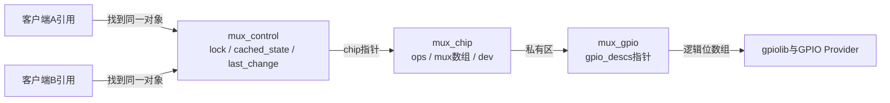
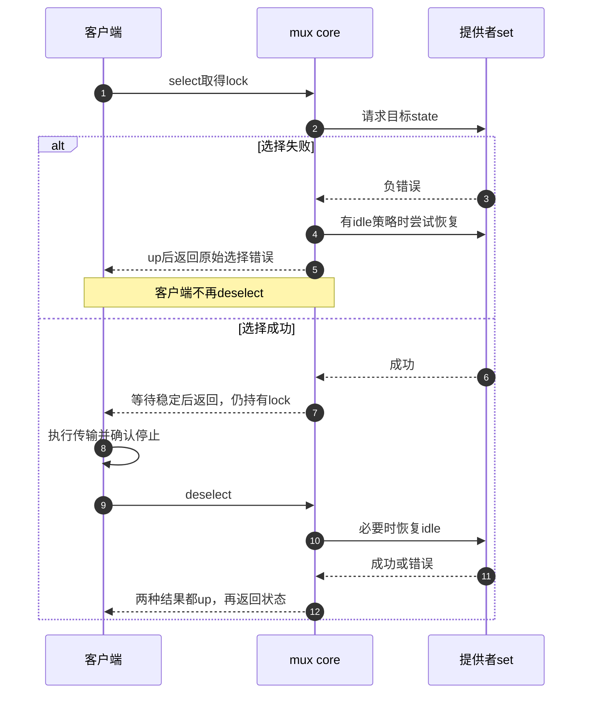

# 第11章\_选择器占用与GPIO编码

选择器的关键不是哪次写线先返回，而是谁在数据操作完成前仍拥有通道。本页先落下软件状态，再看gpio-mux的位图适配，以及core在成功、失败和空闲恢复时怎样处理占用。数据传输由客户端完成，不由这些函数代办。

| 阅读任务 | 入口 |
| --- | --- |
| 固定版本与公共GPIO实现 | [源码阅读索引](../navigation/P01_Linux_6.12_GPIO源码阅读索引.md#1.1_版本身份与阅读路线) |
| M0～M5操作周期 | [选择器模块导读](../navigation/P06_标准功能驱动怎样承接GPIO状态.md#6.5_选择器把占用从设置时延长到传输完成) |
| 为什么需要整个传输期的占用 | [选择器正文](../../../../knowledge/driver_model/gpio_consumers/P06_GPIO选择线怎样保护一段事务.md#6.1_选择以后为什么还需要保留通道) |

**讲解层次：实现层，NXP Linux 6.12.20，固定提交** `dfaf2136deb2af2e60b994421281ba42f1c087e0`。本页执行语句取自下列原件，保留原件许可，中文Doxygen及分析为仓库补充。

| 上游原件 | Git blob | 在此证明什么 |
| --- | --- | --- |
| [drivers/mux/gpio.c](https://github.com/nxp-imx/linux-imx/blob/dfaf2136deb2af2e60b994421281ba42f1c087e0/drivers/mux/gpio.c) | cc5f2c1861d4a22d984bcd37efb98dd3561ee765 | 状态编码、GPIO初值和idle范围 |
| [drivers/mux/core.c](https://github.com/nxp-imx/linux-imx/blob/dfaf2136deb2af2e60b994421281ba42f1c087e0/drivers/mux/core.c) | 78c0022697ec7c3428dcdf95a5cdd89bd6096ab8 | 缓存、信号量、延时、释放 |
| [include/linux/mux/driver.h](https://github.com/nxp-imx/linux-imx/blob/dfaf2136deb2af2e60b994421281ba42f1c087e0/include/linux/mux/driver.h) | 18824064f8c0814cda54228d13139f78aa5cc920 | 控制器字段与可写边界 |
| [include/linux/mux/consumer.h](https://github.com/nxp-imx/linux-imx/blob/dfaf2136deb2af2e60b994421281ba42f1c087e0/include/linux/mux/consumer.h) | 2e25c838f8312532040441ee618424b76378aad7 | 无延时包装、获取与归还接口 |
| [gpio-mux.yaml](https://github.com/nxp-imx/linux-imx/blob/dfaf2136deb2af2e60b994421281ba42f1c087e0/Documentation/devicetree/bindings/mux/gpio-mux.yaml) | b597c1f2c57723a3c106d3f3066a9f7ee40e16e9 | GPIO低位优先及引用格式 |

## 11.1\_控制器状态由谁保存和修改

`mux_chip_alloc` 一次分配chip、controllers个mux_control及私有区；mux_gpio保存在私有区，内部gpios指向gpio_descs。`mux_chip->mux` 指向紧随chip的控制器数组，`mux_chip_priv()` 返回数组之后的区域。它们是内核分配的内存对象，不是硬件寄存器窗口。

```c
/**
 * @brief 信号量保护一段使用期，缓存与时间供core维护。
 * @note 仓库补充中文说明；原件执行语句保留，省略原英文注释。
 */
struct mux_control {
	struct semaphore lock;

	struct mux_chip *chip;
	int cached_state;

	unsigned int states;
	int idle_state;

	ktime_t last_change;
};
```

| 字段 | 初始化与写入者 | 读取用途 |
| --- | --- | --- |
| lock | alloc初始化为1；select取得；失败或deselect释放 | 协调同一控制器使用期 |
| chip | alloc设置 | 找ops与提供者私有区 |
| states | gpio probe设为BIT(pins)，登记前确定 | select范围检查 |
| idle_state | alloc置AS_IS；probe可改有效编号 | 选择失败尝试恢复、释放时恢复 |
| cached_state | alloc置UNKNOWN；core set更新 | 避免重复设置，失败标未知 |
| last_change | alloc初始化；成功set更新时间 | 计算稳定等待剩余量 |

驱动只应在分配后、登记前配置states和idle_state；cached_state属于core。常量MUX_CACHE_UNKNOWN借用MUX_IDLE_AS_IS的-1表示未知，两者在不同字段承担不同意义，不是可供select选通的负号通道。



**调用上下文。** mux_get按mux-controls与#mux-control-cells查找提供者，没有登记的提供者返回EPROBE_DEFER；找到后保留chip设备引用。单控制器可用0个参数，多控制器须给索引并检查范围。mux-states另外解析固定state，不能把其参数规则套在mux-controls上。引用保持对象生命期，select的信号量才保持通路占用。

**可修改性说明。** 多个客户端若被错误绑定到不同mux_control，即使物理上控制同一开关也不会自动共享锁。修改控制器数量或引用格式时，必须从固件索引、分配对象到实际输出逐层对应；不要直接写cached_state伪造已经设置。

## 11.2\_状态编号怎样成为GPIO数组的逻辑位

gpio-mux只提供set回调。调用前，core已检查状态编号并取得对应控制器的占用；回调本身不重新取得这份占用。

```c
/**
 * @brief 把状态数值转为按低位编号的位图，再提交可睡眠GPIO数组访问。
 * @note 仓库补充中文说明；原件执行语句保留，省略原英文注释。
 */
static int mux_gpio_set(struct mux_control *mux, int state)
{
	struct mux_gpio *mux_gpio = mux_chip_priv(mux->chip);
	DECLARE_BITMAP(values, BITS_PER_TYPE(state));
	u32 value = state;

	bitmap_from_arr32(values, &value, BITS_PER_TYPE(value));

	gpiod_set_array_value_cansleep(mux_gpio->gpios->ndescs,
				       mux_gpio->gpios->desc,
				       mux_gpio->gpios->info, values);

	return 0;
}
```
```c
/**
 * @brief 根据提供者返回更新软件缓存与最近成功设置时间。
 * @note 仓库补充中文说明；原件执行语句保留，省略原英文注释。
 */
static int mux_control_set(struct mux_control *mux, int state)
{
	int ret = mux->chip->ops->set(mux, state);

	mux->cached_state = ret < 0 ? MUX_CACHE_UNKNOWN : state;
	if (ret >= 0)
		mux->last_change = ktime_get();

	return ret;
}
```

**实现原理。** bitmap_from_arr32把u32数值放入内核bitmap布局，GPIO数组按其位索引取逻辑值；这不是直接把int内存地址当所有机器上的位图。state的第0位对应gpios数组第0项，active-low转换由描述符访问层完成。

gpio_descs中的ndescs是项数，desc是描述符指针数组，info是数组批量访问的辅助信息。它可以帮助合并同一GPIO chip上的操作，不使不同chip同步锁存，也不证明外部电气变化没有先后。01到10的中间编码问题仍存在。

特别注意：gpiod_set_array_value_cansleep有返回值，但这个set回调没有接住它，直接返回0。core因此会缓存请求的state并更新时间。这里能证明的是软件路径按“成功”推进，不能证明下层没有报错，更不能证明外部数据通路已正确连通。

**可修改性说明。** 若修改错误传播，应重新检查select失败后的idle恢复与cached_state未知分支；若增加门控，需要真实硬件协议和匹配绑定，不能仅在此处插入固定延时便声称无毛刺。原件没有这类门控能力。

## 11.3\_选择如何持有信号量并等待稳定

公共select_delay先取得占用，再调用内部选择。它不是只把set调用包在临界区后立即释放；成功返回时，后续传输仍处于同一次占用中。

```c
/**
 * @brief 检查状态、必要时设置并计算剩余延时；只有失败路径在此释放占用。
 * @note 仓库补充中文说明；原件执行语句保留，省略原英文注释。
 */
static int __mux_control_select(struct mux_control *mux, int state)
{
	int ret;

	if (WARN_ON(state < 0 || state >= mux->states))
		return -EINVAL;

	if (mux->cached_state == state)
		return 0;

	ret = mux_control_set(mux, state);
	if (ret >= 0)
		return 0;

	if (mux->idle_state != MUX_IDLE_AS_IS)
		mux_control_set(mux, mux->idle_state);

	return ret;
}

static void mux_control_delay(struct mux_control *mux, unsigned int delay_us)
{
	ktime_t delayend;
	s64 remaining;

	if (!delay_us)
		return;

	delayend = ktime_add_us(mux->last_change, delay_us);
	remaining = ktime_us_delta(delayend, ktime_get());
	if (remaining > 0)
		fsleep(remaining);
}

int mux_control_select_delay(struct mux_control *mux, unsigned int state,
			     unsigned int delay_us)
{
	int ret;

	ret = down_killable(&mux->lock);
	if (ret < 0)
		return ret;

	ret = __mux_control_select(mux, state);
	if (ret >= 0)
		mux_control_delay(mux, delay_us);

	if (ret < 0)
		up(&mux->lock);

	return ret;
}
```

**实现原理。** down_killable失败直接返回，未取得占用；取得后，越界状态返回EINVAL，相同缓存直接成功。不同状态调用set，失败时可尝试idle恢复，但原始选择错误仍返回；恢复失败也不会替换原始错误。外层仅在成功时等待，在失败时up。

延时的截止时刻是last_change加delay_us，当前时刻尚未到达才fsleep剩余量。普通select包装传0，try_select_delay使用down_trylock，竞争时返回EBUSY；取得占用后仍走相同设置与可能睡眠的路径。“不等待别人释放锁”不等于整个函数原子上下文安全。

last_change由成功set更新，缓存命中不刷新。某个调用者请求更长的稳定时间时，仍需相对旧的last_change判断是否已经满足，不能把“没有重新切换”当作永远不需要等待。

**副作用与责任。** 成功select之后的客户端错误不会自动触发up；客户端必须结束或取消传输后deselect。若忘记，后续调用可一直等待；若同一流程在未释放时再次select，也不能把它当作递归锁使用。异常处理应先判断本次是否确实成功取得占用。

## 11.4\_空闲恢复失败为何仍要释放占用

客户端确认传输停止以后调用deselect。idle是释放时的目标选择，不是另一个使用者；core尝试恢复后，无论返回值如何都结束这次占用。

```c
/**
 * @brief 按空闲策略尝试设置，随后无条件释放本次占用。
 * @note 仓库补充中文说明；原件执行语句保留，省略原英文注释。
 */
int mux_control_deselect(struct mux_control *mux)
{
	int ret = 0;

	if (mux->idle_state != MUX_IDLE_AS_IS &&
	    mux->idle_state != mux->cached_state)
		ret = mux_control_set(mux, mux->idle_state);

	up(&mux->lock);

	return ret;
}
```

**实现原理。** AS_IS跳过设置；idle已经等于缓存也跳过。其他情况调用set，失败会由set把缓存标为UNKNOWN，然后这里仍up并返回错误。调用者可报告idle恢复失败，但不能再deselect一次“补救”，那会破坏信号量计数。



第5步已经释放失败选择的占用，客户端不能重复释放；成功分支第7步返回时仍持有占用，直到第12步才释放。图显示通用core允许的错误路径；本版本gpio-mux忽略数组setter错误，不能声称已经能从它触发所有负返回分支。通用接口语义与具体提供者实际报告能力要分别核对。

**可修改性说明。** 把up改成仅在idle成功时执行，会让恢复失败长期占住通道；是否需要阻止后续使用，应建立明确故障状态和恢复协议，而不能靠漏释放偷偷改变API契约。把AS_IS解释成断开也会使正常数据通道保持在错误的安全假设下。

## 11.5\_初始输出与提供者退出怎样影响通路

运行时协议成立以前，probe已经请求了GPIO。下面保留完整probe，观察OUT_LOW、idle配置与发布顺序；两个时间阶段不能倒过来理解。

```c
/**
 * @brief 先分配单控制器并请求逻辑低的选择数组，再检查idle并登记提供者。
 * @note 仓库补充中文说明；原件执行语句保留，省略原英文注释。
 */
static int mux_gpio_probe(struct platform_device *pdev)
{
	struct device *dev = &pdev->dev;
	struct mux_chip *mux_chip;
	struct mux_gpio *mux_gpio;
	int pins;
	s32 idle_state;
	int ret;

	pins = gpiod_count(dev, "mux");
	if (pins < 0)
		return pins;

	mux_chip = devm_mux_chip_alloc(dev, 1, sizeof(*mux_gpio));
	if (IS_ERR(mux_chip))
		return PTR_ERR(mux_chip);

	mux_gpio = mux_chip_priv(mux_chip);
	mux_chip->ops = &mux_gpio_ops;

	mux_gpio->gpios = devm_gpiod_get_array(dev, "mux", GPIOD_OUT_LOW);
	if (IS_ERR(mux_gpio->gpios))
		return dev_err_probe(dev, PTR_ERR(mux_gpio->gpios),
				     "failed to get gpios\n");
	WARN_ON(pins != mux_gpio->gpios->ndescs);
	mux_chip->mux->states = BIT(pins);

	ret = device_property_read_u32(dev, "idle-state", (u32 *)&idle_state);
	if (ret >= 0 && idle_state != MUX_IDLE_AS_IS) {
		if (idle_state < 0 || idle_state >= mux_chip->mux->states) {
			dev_err(dev, "invalid idle-state %u\n", idle_state);
			return -EINVAL;
		}

		mux_chip->mux->idle_state = idle_state;
	}

	ret = devm_mux_chip_register(dev, mux_chip);
	if (ret < 0)
		return ret;

	dev_info(dev, "%u-way mux-controller registered\n",
		 mux_chip->mux->states);

	return 0;
}
```

**实现原理。** gpiod_count读取mux连接项数，失败直接返回；分配一个mux_control后把gpio_mux_ops安装到chip。数组请求OUT_LOW表示逻辑零，物理高低仍取决于极性。states=BIT(pins)表达N位二进制编码；板级设计不能由此推断任意巨大位数都受实际整数宽度和硬件支持。

idle属性未读到或为AS_IS时保留分配器默认值；其他负值或大于等于states的值被拒绝，因此本驱动不支持MUX_IDLE_DISCONNECT。登记失败返回错误并由托管顺序回收已经取得的资源。gpio probe的WARN_ON只诊断count与实际数组项数不同，不是另一个错误返回。

注册时，core检查idle是否等于cached_state；两者初值都是-1时不调用set，所以省略idle的启动过程停在前面的逻辑零，而不是保留固件状态。若指定idle=3，先请求逻辑零，再在发布前设置3，中间电平同样要符合电路条件。

```c
/**
 * @brief 登记前按idle设置，注销只移除设备，不替客户端结束传输。
 * @note 仓库补充中文说明；原件执行语句保留，省略原英文注释。
 */
int mux_chip_register(struct mux_chip *mux_chip)
{
	int i;
	int ret;

	for (i = 0; i < mux_chip->controllers; ++i) {
		struct mux_control *mux = &mux_chip->mux[i];

		if (mux->idle_state == mux->cached_state)
			continue;

		ret = mux_control_set(mux, mux->idle_state);
		if (ret < 0) {
			dev_err(&mux_chip->dev, "unable to set idle state\n");
			return ret;
		}
	}

	ret = device_add(&mux_chip->dev);
	if (ret < 0)
		dev_err(&mux_chip->dev,
			"device_add failed in %s: %d\n", __func__, ret);
	return ret;
}

void mux_chip_unregister(struct mux_chip *mux_chip)
{
	device_del(&mux_chip->dev);
}
```

**退出边界。** devm_mux_chip_alloc最早登记对象释放，数组获取随后登记，devm_mux_chip_register最后登记注销；设备devres逆序执行时先注销、再归还GPIO数组、最后put chip对象。但注销本身只有device_del，没有自动等待外部DMA完成或把选择切到idle的动作。客户退出必须先停止新事务，结束已有使用并归还引用，不能把提供者卸载当作强制事务撤销。

**可修改性说明。** 默认值、请求初值与登记空闲值分别属于不同步骤，修改其中一个必须同时核对电路允许的上电过程。对象最后释放时刻也受客户端设备引用影响；仅看devres调用次序不能推断所有引用已经消失。本文没有目标解绑、物理选通或时序测量，完整离线输入见正文。
