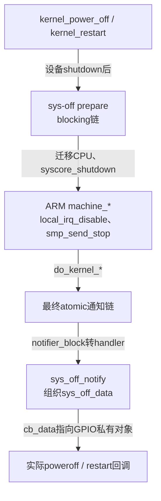
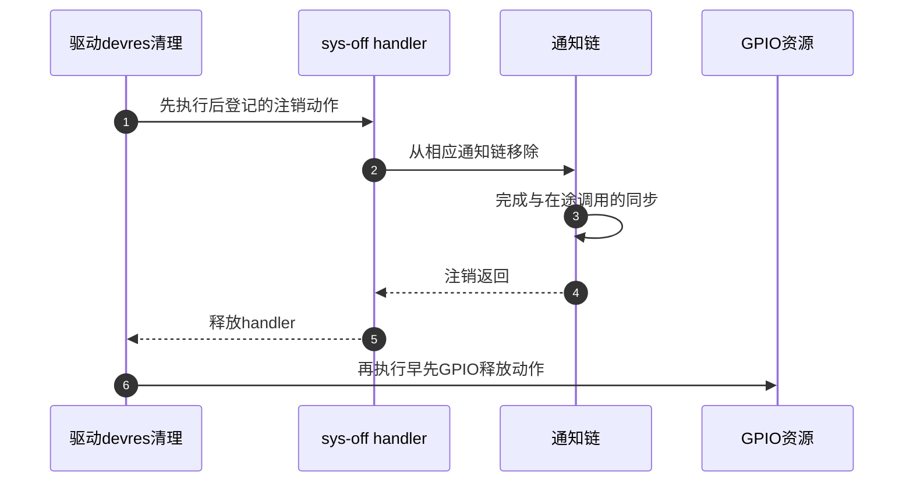

# 第12章\_系统末期GPIO回调与通知链

GPIO最终控制既依赖电平序列，也依赖执行阶段。本页先证明回调进入哪类通知链，再连接公共关闭流程和ARM32最后动作；之后分别展开两个驱动，避免从setter后缀倒推上下文。

| 阅读任务 | 入口 |
| --- | --- |
| 公共GPIO及固定源码身份 | [阅读总索引](../navigation/P01_Linux_6.12_GPIO源码阅读索引.md#1.1_版本身份与阅读路线) |
| F0～F5对象与阶段 | [系统末期模块导读](../navigation/P06_标准功能驱动怎样承接GPIO状态.md#6.6_系统末期控制先核对执行阶段再看电平) |
| 为什么运行期可用不代表末期可用 | [关机重启正文](../../../../knowledge/driver_model/gpio_consumers/P07_GPIO关机与重启为何要核对最后阶段.md#7.1_白天能写的GPIO为什么在关机末期可能失效) |

**讲解层次：实现层，NXP Linux 6.12.20固定提交** `dfaf2136deb2af2e60b994421281ba42f1c087e0`。架构路径只核对ARM32，未验证目标板配置、启动、关机或重启。执行语句沿用原件许可，中文注释和分析为仓库补充。

| 原件 | Git blob | 核对职责 |
| --- | --- | --- |
| [kernel/reboot.c](https://github.com/nxp-imx/linux-imx/blob/dfaf2136deb2af2e60b994421281ba42f1c087e0/kernel/reboot.c) | f05dbde2c93fe709ff01491e8a31e0b3c7b66744 | 模式、登记、调用与撤销 |
| [gpio-poweroff.c](https://github.com/nxp-imx/linux-imx/blob/dfaf2136deb2af2e60b994421281ba42f1c087e0/drivers/power/reset/gpio-poweroff.c) | 52cfeee2cb2844d88ab0b7d80dc38fb74ef581db | 关机GPIO与属性 |
| [gpio-restart.c](https://github.com/nxp-imx/linux-imx/blob/dfaf2136deb2af2e60b994421281ba42f1c087e0/drivers/power/reset/gpio-restart.c) | d1e177176fa1f157fae75f1804d5436f19a13c6d | 重启GPIO与属性 |
| [arch/arm/kernel/reboot.c](https://github.com/nxp-imx/linux-imx/blob/dfaf2136deb2af2e60b994421281ba42f1c087e0/arch/arm/kernel/reboot.c) | 3f0d5c3dae11b5a6649aa5faf22cd9e20c3466ec | ARM末期禁止IRQ和进入最终链 |
| [include/linux/notifier.h](https://github.com/nxp-imx/linux-imx/blob/dfaf2136deb2af2e60b994421281ba42f1c087e0/include/linux/notifier.h) | 45702bdcbceb4aa5e42ad7e0fafd71eaf74be9a5 | atomic与blocking回调契约 |
| [kernel/notifier.c](https://github.com/nxp-imx/linux-imx/blob/dfaf2136deb2af2e60b994421281ba42f1c087e0/kernel/notifier.c) | b3ce28f39eb654663eb934cb2d288632c5a56022 | 优先级排序、调用与注销同步 |

## 12.1\_注册模式怎样决定回调上下文

kernel/reboot.c的sys_off_handler包含notifier_block、回调指针、cb_data、mode、blocking、list与dev。probe提供私有对象指针，框架将其保存在handler里；通知时通过sys_off_notify组织临时sys_off_data，再调用实际GPIO回调。这里没有隐含的工作线程。

```c
/**
 * @brief 按模式选通知链并保存回调，默认优先级与非默认优先级采用不同登记规则。
 * @note 仓库补充中文说明；保留原件执行语句，省略原英文注释。
 */
struct sys_off_handler *
register_sys_off_handler(enum sys_off_mode mode,
			 int priority,
			 int (*callback)(struct sys_off_data *data),
			 void *cb_data)
{
	struct sys_off_handler *handler;
	int err;

	handler = alloc_sys_off_handler(priority);
	if (IS_ERR(handler))
		return handler;

	switch (mode) {
	case SYS_OFF_MODE_POWER_OFF_PREPARE:
		handler->list = &power_off_prep_handler_list;
		handler->blocking = true;
		break;

	case SYS_OFF_MODE_POWER_OFF:
		handler->list = &power_off_handler_list;
		break;

	case SYS_OFF_MODE_RESTART_PREPARE:
		handler->list = &restart_prep_handler_list;
		handler->blocking = true;
		break;

	case SYS_OFF_MODE_RESTART:
		handler->list = &restart_handler_list;
		break;

	default:
		free_sys_off_handler(handler);
		return ERR_PTR(-EINVAL);
	}

	handler->nb.notifier_call = sys_off_notify;
	handler->nb.priority = priority;
	handler->sys_off_cb = callback;
	handler->cb_data = cb_data;
	handler->mode = mode;

	if (handler->blocking) {
		if (priority == SYS_OFF_PRIO_DEFAULT)
			err = blocking_notifier_chain_register(handler->list,
							       &handler->nb);
		else
			err = blocking_notifier_chain_register_unique_prio(handler->list,
									   &handler->nb);
	} else {
		if (priority == SYS_OFF_PRIO_DEFAULT)
			err = atomic_notifier_chain_register(handler->list,
							     &handler->nb);
		else
			err = atomic_notifier_chain_register_unique_prio(handler->list,
									 &handler->nb);
	}

	if (err) {
		free_sys_off_handler(handler);
		return ERR_PTR(err);
	}

	return handler;
}
```

**实现原理。** alloc_sys_off_handler取得初始化的对象；prepare分支置blocking=true，最终POWER_OFF和RESTART分支保持false。前者进入blocking_notifier_chain_register，后者进入atomic_notifier_chain_register。非法模式释放handler返回EINVAL，链登记失败同样释放并传播错误。

| 字段 | 写入者 | 之后谁读取 |
| --- | --- | --- |
| nb.notifier_call | register设置sys_off_notify | 通知链遍历器调用包装 |
| nb.priority | register复制调用者优先级 | 登记排序，较大值在前 |
| sys_off_cb、cb_data | register保存函数和私有对象 | sys_off_notify组织参数后调用 |
| mode、blocking、list | 模式分支选择 | 登记及注销选择同一种链 |
| dev | devm包装在登记后设置 | 通知数据携带所属设备 |

默认优先级0允许多个处理者，非默认优先级通过unique_prio登记避免相同级别重复。通知链priority与GIC中断优先级无关。include/linux/notifier.h明确atomic回调不能阻塞、blocking回调可以阻塞，不能从GPIO函数名称重新解释这份契约。

**可修改性说明。** 若把末期操作拆为prepare与final，需要新增明确的跨阶段状态和保持条件；仅改变mode可能使电路过早断电，也可能让原来依赖的数据在final前失效。对象登记成功只证明回调可被找到，不证明硬件控制路径能完成。

## 12.2\_常规ARM路径在何时进入最终链

公共入口的设备shutdown和sys-off prepare是不同动作。下面保留两条正常入口，再给ARM实现；没有覆盖紧急重启、panic或其他架构。

```c
/**
 * @brief 设备准备和sys-off准备之后迁移CPU、关闭syscore，再交给架构末期入口。
 * @note 仓库补充中文说明；保留原件执行语句，省略原英文注释。
 */
void kernel_power_off(void)
{
	kernel_shutdown_prepare(SYSTEM_POWER_OFF);
	do_kernel_power_off_prepare();
	migrate_to_reboot_cpu();
	syscore_shutdown();
	pr_emerg("Power down\n");
	kmsg_dump(KMSG_DUMP_SHUTDOWN);
	machine_power_off();
}

void kernel_restart(char *cmd)
{
	kernel_restart_prepare(cmd);
	do_kernel_restart_prepare();
	migrate_to_reboot_cpu();
	syscore_shutdown();
	if (!cmd)
		pr_emerg("Restarting system\n");
	else
		pr_emerg("Restarting system with command '%s'\n", cmd);
	kmsg_dump(KMSG_DUMP_SHUTDOWN);
	machine_restart(cmd);
}
```

kernel_shutdown_prepare与kernel_restart_prepare会调用reboot_notifier_list、设置system_state、禁用usermodehelper并执行device_shutdown。之后do_kernel_power_off_prepare/restart_prepare才调用各自blocking链，因此这些prepare回调不能假定所有设备尚未shutdown。

```c
/**
 * @brief ARM32先禁止本地IRQ并停止其他CPU，再调用公共最终链。
 * @note 仓库补充中文说明；保留原件执行语句，省略原英文注释。
 */
void machine_power_off(void)
{
	local_irq_disable();
	smp_send_stop();
	do_kernel_power_off();
}

void machine_restart(char *cmd)
{
	local_irq_disable();
	smp_send_stop();

	do_kernel_restart(cmd);

	mdelay(1000);

	printk("Reboot failed -- System halted\n");
	while (1);
}
```

do_kernel_power_off调用atomic_notifier_call_chain遍历power_off_handler_list；本版本还可临时登记旧pm_power_off包装，调用后再注销。do_kernel_restart以reboot_mode和cmd遍历restart_handler_list。两条链均使用atomic notifier，并非POWER_OFF因为名字不同就可以睡眠。



ARM restart若最终链返回，会再忙等1000ms，打印失败信息并停住；这不是GPIO驱动wait-delay本身，不应把两个时间相加后写成驱动默认值。ARM power_off在此没有同样的1000ms失败尾部。

**可修改性说明。** 将驱动移植到ARM64或其他平台时，保留公共模式契约，但重新核对machine_*路径、固件接管和Provider可访问性。不能将此处的本地IRQ关闭顺序外推给未读过的架构。

## 12.3\_最终回调的逻辑序列与返回证明了什么

框架传来的cb_data分别指向gpio_poweroff或gpio_restart，包含描述符和三段等待时间。以下两个函数在对象和属性名称上不同，逻辑序列均为1、0、1。

```c
/**
 * @brief 关机回调按有效、无效、有效输出，仍继续执行才到超时告警。
 * @note 仓库补充中文说明；保留原件执行语句，省略原英文注释。
 */
static int gpio_poweroff_do_poweroff(struct sys_off_data *data)
{
	struct gpio_poweroff *gpio_poweroff = data->cb_data;

	gpiod_direction_output(gpio_poweroff->reset_gpio, 1);
	mdelay(gpio_poweroff->active_delay_ms);

	gpiod_set_value_cansleep(gpio_poweroff->reset_gpio, 0);
	mdelay(gpio_poweroff->inactive_delay_ms);

	gpiod_set_value_cansleep(gpio_poweroff->reset_gpio, 1);

	mdelay(gpio_poweroff->timeout_ms);

	WARN_ON(1);

	return NOTIFY_DONE;
}
```
```c
/**
 * @brief 重启回调执行同样逻辑序列，但使用普通setter与wait_delay_ms。
 * @note 仓库补充中文说明；保留原件执行语句，省略原英文注释。
 */
static int gpio_restart_notify(struct sys_off_data *data)
{
	struct gpio_restart *gpio_restart = data->cb_data;

	gpiod_direction_output(gpio_restart->reset_gpio, 1);
	mdelay(gpio_restart->active_delay_ms);

	gpiod_set_value(gpio_restart->reset_gpio, 0);
	mdelay(gpio_restart->inactive_delay_ms);

	gpiod_set_value(gpio_restart->reset_gpio, 1);

	mdelay(gpio_restart->wait_delay_ms);

	WARN_ON(1);

	return NOTIFY_DONE;
}
```

**实现原理。** 第一次direction_output既设置方向又提交逻辑1，返回值被忽略。active_low转换属于描述符路径，逻辑1不固定等于物理高。之后两个setter返回void，驱动无法从调用结果断言物理写入完成。mdelay忙等，不把执行交给工作队列。

如果系统已在某次输出后断电或复位，后面的C语句不再正常继续；若走到WARN_ON(1)，仅证明执行流仍在。NOTIFY_DONE允许链继续，不是断电成功码；若更早处理者已经成功，后面的GPIO回调甚至可能没有机会执行。

poweroff使用cansleep入口与最终atomic契约之间不能靠措辞消除矛盾。公共GPIO [访问上下文实现](P03_逻辑值怎样变成方向与电平.md#3.4_运行时setter沿用逻辑语义却不返回写错误) 展开了might_sleep和普通入口的检查，它们不创建线程。这里保留原代码，明确需要平台核对及可能的实现修正，未在外部内核提交任何补丁；不能凭这段代码批准睡眠型扩展器。

**可修改性说明。** 修改等待单位、极性或输出顺序会改变外部电路看到的请求；若要处理direction_output错误，还必须定义最终阶段失败后的后备动作。不能把WARN静默删掉后宣称问题已经解决，也不能把回调返回当作引脚采样结果。

## 12.4\_poweroff怎样取得线路并登记最终模式

poweroff在probe里先分配私有对象，再选择初始输入或无效输出。input只控制这次请求阶段，最终回调仍会切成输出。

```c
/**
 * @brief 解析毫秒属性与优先级，取得GPIO后登记POWER_OFF最终回调。
 * @note 仓库补充中文说明；保留原件执行语句，省略原英文注释。
 */
static int gpio_poweroff_probe(struct platform_device *pdev)
{
	struct gpio_poweroff *gpio_poweroff;
	bool input = false;
	enum gpiod_flags flags;
	int priority = SYS_OFF_PRIO_DEFAULT;
	int ret;

	gpio_poweroff = devm_kzalloc(&pdev->dev, sizeof(*gpio_poweroff), GFP_KERNEL);
	if (!gpio_poweroff)
		return -ENOMEM;

	input = device_property_read_bool(&pdev->dev, "input");
	if (input)
		flags = GPIOD_IN;
	else
		flags = GPIOD_OUT_LOW;

	gpio_poweroff->active_delay_ms = 100;
	gpio_poweroff->inactive_delay_ms = 100;
	gpio_poweroff->timeout_ms = DEFAULT_TIMEOUT_MS;

	device_property_read_u32(&pdev->dev, "active-delay-ms", &gpio_poweroff->active_delay_ms);
	device_property_read_u32(&pdev->dev, "inactive-delay-ms",
				 &gpio_poweroff->inactive_delay_ms);
	device_property_read_u32(&pdev->dev, "timeout-ms", &gpio_poweroff->timeout_ms);
	device_property_read_u32(&pdev->dev, "priority", &priority);
	if (priority > 255) {
		dev_err(&pdev->dev, "Invalid priority property: %u\n", priority);
		return -EINVAL;
	}

	gpio_poweroff->reset_gpio = devm_gpiod_get(&pdev->dev, NULL, flags);
	if (IS_ERR(gpio_poweroff->reset_gpio))
		return PTR_ERR(gpio_poweroff->reset_gpio);

	ret = devm_register_sys_off_handler(&pdev->dev, SYS_OFF_MODE_POWER_OFF,
					    priority, gpio_poweroff_do_poweroff, gpio_poweroff);
	if (ret)
		return dev_err_probe(&pdev->dev, ret, "Cannot register poweroff handler\n");

	return 0;
}
```

**实现原理。** active/inactive默认100ms，DEFAULT_TIMEOUT_MS在此文件定义为3000。属性读取失败不会覆盖已设置默认值。priority默认SYS_OFF_PRIO_DEFAULT即0；普通正值超过255返回EINVAL，取GPIO失败传播其错误指针，包括依赖延迟。最后登记明确传入SYS_OFF_MODE_POWER_OFF，不是PREPARE。

| 属性/对象 | 进入哪个字段 | 影响阶段 |
| --- | --- | --- |
| input | 本地flags选GPIOD_IN | F0请求GPIO |
| active-delay-ms | active_delay_ms | F4首次有效后忙等 |
| inactive-delay-ms | inactive_delay_ms | F4无效后忙等 |
| timeout-ms | timeout_ms | F4最后有效后等待 |
| priority | sys_off handler的nb.priority | F0登记和F3遍历顺序 |
| GPIO描述符 | reset_gpio | F4方向与值访问 |

绑定 [gpio-poweroff.yaml](https://github.com/nxp-imx/linux-imx/blob/dfaf2136deb2af2e60b994421281ba42f1c087e0/Documentation/devicetree/bindings/power/reset/gpio-poweroff.yaml)，blob `a4b437fce37cf439a18c980604c2d4cece92681f`，要求compatible和gpios；input存在时初始输入，否则初始无效输出。本版本配置入口为CONFIG_POWER_RESET_GPIO，仍需实际GPIO Provider及匹配固件。

**可修改性说明。** 若为了减少启动扰动采用input，必须核对外部上下拉保证无意触发；输入并不自动等于安全电平。priority合法也不保证唯一登记成功，还可能与同链现有处理者冲突。

## 12.5\_restart怎样处理初值优先级和默认时间

restart的open-source字段名称不能代替执行语句。此版本只据它选择初始GPIOD_IN或GPIOD_OUT_LOW，下面没有给该属性增加另一套电气配置调用。

```c
/**
 * @brief 初始输入选项、优先级回退与无ms后缀的毫秒属性按各自分支处理。
 * @note 仓库补充中文说明；保留原件执行语句，省略原英文注释。
 */
static int gpio_restart_probe(struct platform_device *pdev)
{
	struct gpio_restart *gpio_restart;
	bool open_source = false;
	int priority = 129;
	u32 property;
	int ret;

	gpio_restart = devm_kzalloc(&pdev->dev, sizeof(*gpio_restart),
			GFP_KERNEL);
	if (!gpio_restart)
		return -ENOMEM;

	open_source = of_property_read_bool(pdev->dev.of_node, "open-source");

	gpio_restart->reset_gpio = devm_gpiod_get(&pdev->dev, NULL,
			open_source ? GPIOD_IN : GPIOD_OUT_LOW);
	ret = PTR_ERR_OR_ZERO(gpio_restart->reset_gpio);
	if (ret) {
		if (ret != -EPROBE_DEFER)
			dev_err(&pdev->dev, "Could not get reset GPIO\n");
		return ret;
	}

	gpio_restart->active_delay_ms = 100;
	gpio_restart->inactive_delay_ms = 100;
	gpio_restart->wait_delay_ms = 3000;

	ret = of_property_read_u32(pdev->dev.of_node, "priority", &property);
	if (!ret) {
		if (property > 255)
			dev_err(&pdev->dev, "Invalid priority property: %u\n",
					property);
		else
			priority = property;
	}

	of_property_read_u32(pdev->dev.of_node, "active-delay",
			&gpio_restart->active_delay_ms);
	of_property_read_u32(pdev->dev.of_node, "inactive-delay",
			&gpio_restart->inactive_delay_ms);
	of_property_read_u32(pdev->dev.of_node, "wait-delay",
			&gpio_restart->wait_delay_ms);

	ret = devm_register_sys_off_handler(&pdev->dev,
					    SYS_OFF_MODE_RESTART,
					    priority,
					    gpio_restart_notify,
					    gpio_restart);
	if (ret) {
		dev_err(&pdev->dev, "%s: cannot register restart handler, %d\n",
				__func__, ret);
		return -ENODEV;
	}

	return 0;
}
```

**实现原理。** 获取GPIO先于设置时间默认值，失败时除了EPROBE_DEFER外会记录错误。priority用u32临时值读取，大于255只记录错误并继续保留129；poweroff相似输入直接失败，两者不能统一写成“非法优先级必定失败”。三个时间值均传给mdelay，单位毫秒。

注册使用SYS_OFF_MODE_RESTART；若框架登记失败，这个probe记录错误并返回ENODEV，而不是把ret原值直接交回。其配置入口是CONFIG_POWER_RESET_GPIO_RESTART。

| 同一版本的wait-delay证据 | 原件字段/值 | 本页结论 |
| --- | --- | --- |
| gpio-restart.yaml文字description | default 3000 | 文字说明 |
| 同一属性Schema default | 100 | 与文字不一致，保留差异 |
| probe初始化wait_delay_ms | 3000 | 缺失属性时未被读取覆盖的运行值 |
| 显式DTS wait-delay | 由输入指定 | 读取成功时替代初始化值 |

绑定 [gpio-restart.yaml](https://github.com/nxp-imx/linux-imx/blob/dfaf2136deb2af2e60b994421281ba42f1c087e0/Documentation/devicetree/bindings/power/reset/gpio-restart.yaml)，blob `53535de0d41ca4f9ccf8ab367eb8ef73d08f88da`。DTC不因Schema有default就插入该属性；正文显式设置3000并将“属性缺失”与“驱动缺省”分别验证，未替上游修改矛盾。

**可修改性说明。** 调整open-source行为应查明电路及通用GPIO单端标志，不因名称相同就把它解释为硬件open-source已经配置完成。更改默认值必须同步Schema、描述、C初始化和板级需求，不能只改其中一处。

## 12.6\_托管注销怎样先撤下回调再释放GPIO

最后回到对象生命期。驱动先取得托管GPIO，再登记托管handler，因此普通probe回滚或卸载会先注销handler，再释放GPIO。回调通过私有对象使用描述符，注销顺序正是为了不留下指向已归还线路的入口。

```c
/**
 * @brief 包装传递私有对象，托管登记失败立即撤销，正常注销按链类型移除并释放handler。
 * @note 仓库补充中文说明；保留原件执行语句，省略原英文注释。
 */
static int sys_off_notify(struct notifier_block *nb,
			  unsigned long mode, void *cmd)
{
	struct sys_off_handler *handler;
	struct sys_off_data data = {};

	handler = container_of(nb, struct sys_off_handler, nb);
	data.cb_data = handler->cb_data;
	data.mode = mode;
	data.cmd = cmd;
	data.dev = handler->dev;

	return handler->sys_off_cb(&data);
}

int devm_register_sys_off_handler(struct device *dev,
				  enum sys_off_mode mode,
				  int priority,
				  int (*callback)(struct sys_off_data *data),
				  void *cb_data)
{
	struct sys_off_handler *handler;

	handler = register_sys_off_handler(mode, priority, callback, cb_data);
	if (IS_ERR(handler))
		return PTR_ERR(handler);
	handler->dev = dev;

	return devm_add_action_or_reset(dev, devm_unregister_sys_off_handler,
					handler);
}

void unregister_sys_off_handler(struct sys_off_handler *handler)
{
	int err;

	if (IS_ERR_OR_NULL(handler))
		return;

	if (handler->blocking)
		err = blocking_notifier_chain_unregister(handler->list,
							 &handler->nb);
	else
		err = atomic_notifier_chain_unregister(handler->list,
						       &handler->nb);

	WARN_ON(err);

	free_sys_off_handler(handler);
}
```

**实现原理。** devm_register_sys_off_handler先注册，成功后设置dev；devm_add_action_or_reset若无法建立托管动作，就立即执行撤销，不能留下半登记状态。动作devm_unregister_sys_off_handler只调用unregister_sys_off_handler；后者容忍错误或空指针，按blocking选择注销接口，随后释放handler。

atomic_notifier_chain_unregister在锁下移除节点，锁外synchronize_rcu等待相应调用读侧结束；atomic_notifier_call_chain在RCU读侧中遍历。这里仅核对该链的生命期交接，不重复展开RCU算法。不能从回调内部注销自身：notifier接口对此有明确限制，也不能把注销等待理解为准许最终回调睡眠。



第3步只描述通知链规定的同步，不是清理者主动执行一遍关机序列。正常关机的device_shutdown也不等于本图的驱动卸载/devres回收。两种生命周期必须分开，否则会误以为最终回调使用的GPIO早已自动被释放。

**可修改性说明。** 新增异步回调或额外私有资源时，应重新检查它们是否可能在handler注销后仍访问GPIO；仅有devm前缀不能为新增通信路径提供完成协议。本文全部结论来自固定源码和离线描述，没有在目标板触发最终通知链。
