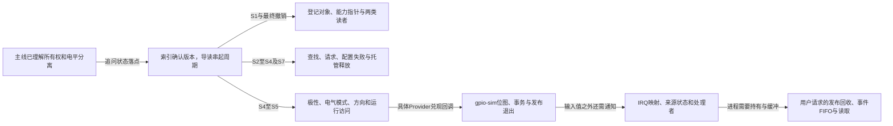

# 第1章\_gpiolib源码阅读大纲

GPIO 教材用线路占用、逻辑值和硬件状态建立使用模型。本目录进一步回答固定 Linux 6.12.20 中谁保存这些状态、函数如何交接、错误和注销在哪一步改变保证。它不替代 [GPIO主线](../../../knowledge/driver_model/gpio/大纲.md)，也不维护第二份 Consumer API 教程。

## 1.1\_沿一次请求进入固定实现

先用 [源码阅读索引](navigation/P01_Linux_6.12_GPIO源码阅读索引.md#1.1_版本身份与阅读路线) 确认版本与配置，再读 [线路对象怎样完成请求与退出](navigation/P02_线路对象怎样完成请求与退出.md)。导读把 S0～S7 接成完整周期，实现页才展开相应字段与函数体。公共层之下怎样真正完成操作，则由 [模拟器Provider导读](navigation/P03_GPIO模拟器如何兑现控制器能力.md#3.1_从Consumer的三根线追到一个bank) 接续。

三条公共层分支是同一操作周期的不同阅读问题，模拟器分支再进入具体Provider：不必从头逐个背字段，也不能在未理解请求持有时直接复制 setter。

| 文档 | 依赖的已有认识 | 本篇解决的问题 | 留给下一步的问题 |
| --- | --- | --- | --- |
| [控制器登记与能力撤销](source_explanations/P01_控制器登记与能力撤销.md) | Provider与每线状态不同 | 三层对象怎样建立，为什么要分开撤销查找、回调和引用 | 谁取得每线请求与长期引用 |
| [描述符请求与托管释放](source_explanations/P02_描述符请求与托管释放.md) | desc/gdev/chip关系 | 查找如何交接占用、配置、devres与put，失败清到哪里 | 方向和初值实际改变了什么 |
| [逻辑值怎样变成方向与电平](source_explanations/P03_逻辑值怎样变成方向与电平.md) | 请求持有期及逻辑/物理区分 | active-low与开漏如何组合，哪些错误能返回 | 具体Provider硬件、IRQ事件与PM怎样兑现 |
| [模拟控制器的状态与回调](source_explanations/P04_模拟控制器的状态与回调.md) | 公共层已把逻辑意图交给回调 | 一个bank的位图怎样同步，pull、方向和释放怎样交互，发布前需准备什么 | 真实硬件时序与IRQ后续传播 |
| [GPIO映射与模拟事件怎样交接](source_explanations/P05_GPIO映射与模拟事件怎样交接.md) | 从 [事件模块导读](navigation/P04_GPIO事件怎样从线路到达处理者.md#4.1_先分开配置路径与通知路径) 分开配置与通知 | to_irq保护什么，模拟pending和irq_work怎样到达处理者 | 用户请求如何缓冲事件及持有线路 |
| [用户请求的发布与回收](source_explanations/P06_用户请求的发布与回收.md) | 从 [用户请求导读](navigation/P05_用户请求怎样持有线路与事件.md#5.1_先从两个文件对象区分入口和持有者) 区分chip与request文件 | 多线创建何时交付，失败清到哪里，最后引用怎样结束持有 | 事件如何在进程运行之前保存 |
| [事件缓冲与读取](source_explanations/P07_事件缓冲与读取.md) | 每线事件状态回指共享linereq | 生成、入队、可读通知、取出与停止生产者怎样衔接 | 检测、容量和调度边界需要怎样的工程观察 |
| [按键取样与输入报告](source_explanations/P08_按键取样与输入报告.md) | 从 [标准功能适配导读](navigation/P06_标准功能驱动怎样承接GPIO状态.md#6.1_从一根线路走到领域对象) 区分线路与设备功能 | GPIO变化怎样经过延时采样成为输入报告，退出如何停止未来动作 | 输入核心的客户端分发及实际平台唤醒条件 |

## 1.2\_源码边界与工程入口

公共核心不能证明某个板的 pinmux、上拉、电源或中断锁存能力。IRQ 与字符设备已核对的事实入口保存在 [索引中的事件边界](navigation/P01_Linux_6.12_GPIO源码阅读索引.md#1.2_已经核对的IRQ与字符设备边界)，平台验证与故障定位回到 [GPIO工程页](../../../engineering/driver_development/gpio/GPIO_调试迁移与工程模板.md)。源码身份和本轮验证限制见 [Linux源码基线](../linux/SOURCE_BASELINE.md)。
