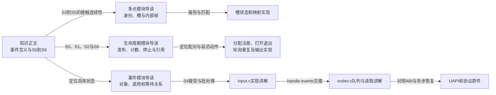

# 第1章\_Linux\_6.12\_Input源码阅读索引

本索引帮助读者把统一输入事件追到Linux对象和执行路径。知识正文负责解释为何需要当前状态、帧与独立观察者；这里按固定版本定位负责这些保证的文件，再由模块导读组织阅读，具体函数体只在实现讲解中展开。

## 1.1\_固定版本与阅读任务

| 项目 | 本专题证据身份 |
| --- | --- |
| 上游来源 | [NXP linux-imx官方仓库](https://github.com/nxp-imx/linux-imx) |
| 发布标签与来源分支 | lf-6.12.20-2.0.0；lf-6.12.y分支名不是不可变证据 |
| 不可变提交 | dfaf2136deb2af2e60b994421281ba42f1c087e0 |
| 内核版本 | Linux 6.12.20 |
| 配置边界 | 核心需CONFIG_INPUT；evdev需CONFIG_INPUT_EVDEV，设备驱动及总线另需对应配置 |
| 本次核对方式 | 固定提交官方原件与仓库保存副本对照，未以目标内核构建/运行代替静态核对 |
| 平台边界 | 公共Input实现；不包含某触摸芯片的寄存器、帧协议或板级电气保证 |

更完整的证据身份和环境边界见 [Linux源码基线](../../linux/SOURCE_BASELINE.md)。源码副本保留上游目录位置，导读和实现讲解移到input职责目录，不在多个目录重复维护同一函数说明。

先有 [Input知识专题](../../../../knowledge/driver_model/input/大纲.md) 的事件、状态和帧模型，再追源码，比较容易判断一个字段究竟保存设备事实还是某个读者的进度。若当前问题是“report之后应用为何还没读到”，直接从下节事件模块进入；若是硬件没有采样，先排查驱动和控制器，不把所有问题都归结为evdev。

## 1.2\_按当前问题进入模块与实现

| 当前阅读问题 | 模块概念导读 | 唯一实现讲解 |
| --- | --- | --- |
| 一次变化存到哪里，何时批量分发 | [事件状态与客户端](P02_事件状态怎样到达各客户端.md#2.1_沿同一次移动寻找状态落点) | [事件接受与批量分发](../source_explanations/P01_事件接受与批量分发.md#1.1_报告入口先接受状态再决定交付) |
| 队列有数据为何仍不可读，两个应用为何互不消费 | [从批次到可读条件](P02_事件状态怎样到达各客户端.md#2.2_从批量回调追到可读条件) | [evdev独立队列与读取边界](../source_explanations/P02_evdev独立队列与读取边界.md#2.1_批次怎样复制到每个客户端) |
| 设备什么时候公开，何时释放 | [生命周期状态层次](P03_设备怎样公开启停和退出.md#3.1_分开观察可见性使用关系与生产者) | [分配发布与两步撤销](../source_explanations/P03_分配发布与两步资源撤销.md#3.1_分配先建立内部不变量与设备引用) |
| 首个打开失败和最后关闭怎样配对 | [需求计数](P03_设备怎样公开启停和退出.md#3.2_首次使用与最后使用之间追哪些计数) | [打开、失败、断开和禁止](../source_explanations/P04_使用计数失败回滚与断开.md#4.1_首次evdev打开怎样进入core并回滚) |
| 周期和输出动作怎样停止 | [延迟动作与资源](P03_设备怎样公开启停和退出.md#3.3_把延迟动作接回资源退出) | [能力、轮询、重复与输出](../source_explanations/P05_能力轮询重复与输出的边界.md#5.1_声明能力与轴参数到底改了哪些字段) |
| 硬件点怎样关联到槽，静止点为什么还要标记 | [多点身份与帧](P04_接触身份怎样跨帧保留.md#4.1_先找三种身份和两份槽状态) | [槽状态与帧收尾](../source_explanations/P06_多点槽状态与帧收尾.md#6.2_报告活动状态怎样标记本帧并分配身份) |
| 满槽换人或没有硬件 ID 怎样处理 | [完整帧顺序](P04_接触身份怎样跨帧保留.md#4.2_把映射更新与帧收尾排成同一条路径) | [映射与位置匹配](../source_explanations/P07_槽位映射与位置匹配.md#7.1_按key找槽为何会在本帧释放后仍失败) |

这些是已落地的源码讲解入口。协议含义在知识章节本地解释，模块导读说明状态所有权与执行顺序，实现页展开唯一函数体。

## 1.3\_原件地图与各文件证明范围

| 保持上游位置的文件 | 当前核对任务 |
| --- | --- |
| [drivers/input/input.c](../../linux/drivers/input/input.c) | 设备/handler匹配、能力检查、状态更新、批次、打开关闭、inhibit和devres |
| [drivers/input/evdev.c](../../linux/drivers/input/evdev.c) | 连接、各client队列、read/poll、ioctl、失步和断开 |
| [drivers/input/input-mt.c](../../linux/drivers/input/input-mt.c) | slot初始化、接触状态、点匹配与帧辅助接口 |
| [include/linux/input.h](../../linux/include/linux/input.h) | input_dev、input_handler、input_handle及内核API声明 |
| [include/linux/input/mt.h](../../linux/include/linux/input/mt.h) | MT字段、标志和辅助接口 |
| [include/uapi/linux/input.h](../../linux/include/uapi/linux/input.h) | 用户事件、轴参数和ioctl ABI |
| [include/uapi/linux/input-event-codes.h](../../linux/include/uapi/linux/input-event-codes.h) | 类型、code、属性编号 |
| [input-programming.rst](../../linux/Documentation/input/input-programming.rst) | 驱动编程契约，结合实现检查版本差异 |
| [multi-touch-protocol.rst](../../linux/Documentation/input/multi-touch-protocol.rst) | A/B、slot、tracking ID和接触帧 |
| [event-codes.rst固定原件](https://github.com/nxp-imx/linux-imx/blob/dfaf2136deb2af2e60b994421281ba42f1c087e0/Documentation/input/event-codes.rst) | 事件语义和SYN_DROPPED恢复契约 |

各实现页列所用原件blob，避免仅凭本地目录名判断版本。先核对UAPI含义，再用具体实现解释锁、缓冲、字段和分支；源码当前怎样实现，不自动成为永不变化的ABI保证。

## 1.4\_关键调用链索引

调用链只用于定位入口，不能证明链中每个条件总会成立。例如input_register_device成功不强制每个handler连接成功，core报告也不强制所有client收到。

| 任务 | 方向与条件 |
| --- | --- |
| 设备上线 | input_register_device遍历handler，再由input_attach_handler匹配并connect |
| handler上线 | input_register_handler遍历已有device，走同一attach路径 |
| 状态接受 | input_event→input_handle_event→input_get_disposition；能力、重复状态和inhibit决定结果 |
| 批量交付 | input_event_dispose→input_pass_values→handle_events；正常同步或容量阈值触发 |
| evdev复制 | evdev_events→evdev_pass_values→__pass_event，受grab、mask、revoked约束 |
| 用户读取 | evdev_read→evdev_fetch_next_event→input_event_to_user；先检查设备和完整帧窗口 |
| 首个evdev使用者 | evdev_open→evdev_open_device→input_open_device；设备首次使用且未inhibit才启动 |
| 独占 | EVIOCGRAB→evdev_grab→input_grab_device；同时选择core handle和evdev client |
| 失步 | __pass_event中head追上tail，重排本client队列并插入SYN_DROPPED |
| MT帧结束 | input_mt_sync_frame可释放未见slot、做pointer emulation并推进frame；仍需外层同步协议 |
| 注销 | input_unregister_device→input_disconnect_device→handler.disconnect；evdev通知已有文件失效 |

如果从GPIO按键进入，应先在GPIO驱动中确认何时读值、报告什么键状态，再从本表状态接受路径继续；Input不会补救GPIO读取错误。回看 [按键适配导读](../../gpiolib/navigation/P06_标准功能驱动怎样承接GPIO状态.md#6.2_按键把采样时机与输入报告分开) 可定位两层责任。

## 1.5\_保留版本差异而不混成稳定保证

此版本按vals批量分发，容量保护也会插入同步；绝对轴fuzz采用多段区间而非单阈值；managed input device的注销与分配引用释放分开进行；evdev追尾是client级别，独立open的队列各自推进。这些结论都有具体状态和路径，不应简写成“Input全自动处理”。

迁移内核版本时，应首先对照这四处实现以及新旧UAPI，再决定正文哪些是稳定模型、哪些需要版本说明。目标设备的IRQ上下文、可睡总线、PM和帧协议仍由设备驱动及平台证据补齐，本索引没有替目标板完成这些验证。
