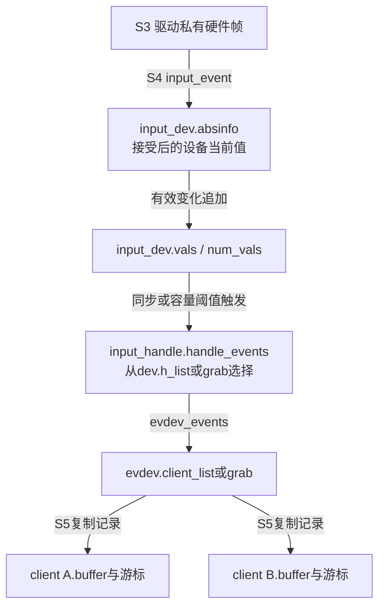
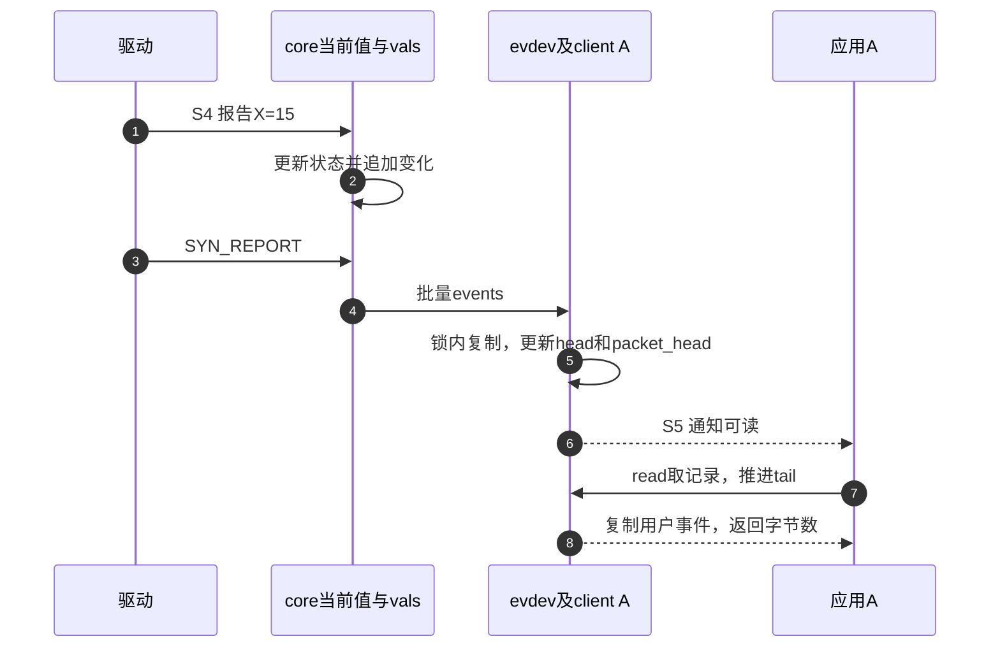

# 第2章\_事件状态怎样到达各客户端

知识正文已经从两个观察者推出独立队列。本页的任务是拿着Linux 6.12.20源码定位：同一次X变化先改了哪个地址，由谁复制到哪份存储，等待者又看哪个条件。函数体在唯一实现页展开，这里按一次操作组织阅读。

版本、配置及原件身份见 [总索引](P01_Linux_6.12_Input源码阅读索引.md#1.1_固定版本与阅读任务)；本页沿用 [体系结构正文](../../../../knowledge/driver_model/input/P02_体系结构与事件传递.md#2.2_先建立连接再决定是否启动采样) 的S0～S6，重点是S4接受与S5客户端交付。

## 2.1\_沿同一次移动寻找状态落点

设一个已注册触摸设备已有两个独立open的evdev client。S0～S2建立的对象继续存在，S3驱动读到X从10变15。先在input.h找到input_dev，再在input.c跟input_event：事件锁只保护一次报告，绝对轴当前值位于absinfo[ABS_X].value。接着跟dispose寻找vals中的待分发记录，暂存长度与设备当前值有不同用途。

| 沿本例要查的状态 | 写入路径 | 后续观察者 | 首个实现入口 |
| --- | --- | --- | --- |
| 当前轴值和过滤结果 | input_get_disposition进入abs处理 | 后续报告比较、快照接口 | [接受与轴状态](../source_explanations/P01_事件接受与批量分发.md#1.1_报告入口先接受状态再决定交付) |
| 一批待交付值 | input_event_dispose | input_pass_values与各handle | [两条flush路径](../source_explanations/P01_事件接受与批量分发.md#1.3_暂存容量与两条flush路径) |
| 谁能获得这批值 | dev.grab或h_list中open连接 | handle_events | [连接和过滤](../source_explanations/P01_事件接受与批量分发.md#1.4_连接选择与过滤怎样共同决定下一接收者) |
| 本client未读历史 | evdev_pass_values及__pass_event | evdev_read/poll | [独立队列](../source_explanations/P02_evdev独立队列与读取边界.md#2.1_批次怎样复制到每个客户端) |

先区别输入状态过滤与消费过滤：ABS重复值可能在core接受阶段就不形成新变化；handler filter则改变后续分发的批次；evdev mask只影响本client入队。相同的“没收到X”可能来自三层，应沿此表逐段找证据，不能只看驱动调用过report便断言用户一定收到。

## 2.2\_从批量回调追到可读条件

evdev.handle连接一个input_dev，evdev.client_list再连接多个文件实例。core调用events仍在event_lock和本地关中断的上下文中；evdev按RCU保护的client列表遍历，分别取得buffer_lock复制。两client共享事件来源，不共享消费游标。

head是下次写位置，tail是下次读位置，packet_head是已提交帧之后的位置。写完X不等于可读帧结束；只有接受了有效SYN_REPORT，packet_head才跟进。接收者等的是packet_head != tail，通知是client.wait唤醒，另有注册fasync的SIGIO通知。

步骤2、5、7分别改变设备事实、客户端历史、客户端进度。步骤6不会倒过来保证应用在下一硬件帧前完成步骤7。若设备速率高、消费者长期不运行，成本积累在自己的环形队列，最后可能溢出；增加缓冲只推迟这个边界，不消除持续供需不平衡。

继续跟 [追尾与同步](../source_explanations/P02_evdev独立队列与读取边界.md#2.2_写游标如何变成帧边界以及失步证据) 和 [读取与等待](../source_explanations/P02_evdev独立队列与读取边界.md#2.3_读取为何可能拆帧但不会主动暴露未完成帧)。read返回可以拆一帧，也可以含多帧；帧已经进入可读窗口，与一次系统调用返回完整帧，是两个不同保证。

## 2.3\_改变分发对象时重新核对哪条路径

EVIOCGRAB建立两级独占：input_dev.grab选择evdev handle，evdev.grab选择申请client。只查前者会漏掉同一event节点下的其他应用。独占不转移硬件资源所有权，也不自动清空其他client既有记录。

filter连接在普通连接前，压缩同一批次并把剩余count传下去；grab存在时直接走独占连接，所以不能假定所有过滤器仍在前面。evdev_events通常返回原count，是复制而不是消费core数组；应用read消费的是另一个地址中的client副本。

inhibit则跨到设备使用状态：有使用者时关闭采样、释放键与接触，再忽略后续事件，解除时尝试重新打开。这不是仅改变client列表。移除设备还需要going_away、handle断开、evdev.exist=false和唤醒已有reader。S6应回到 [生命周期正文](../../../../knowledge/driver_model/input/P03_设备注册能力与生命周期.md) 及input.c/evdev.c对应注册撤销路径继续，不从事件锁推导所有资源已经释放。

## 2.4\_用可观察结果反查证据层

第一种现象是ioctl当前X已改变，但read还没返回。先查SYN_REPORT是否完成、事件是否被filter或mask删除，再查client的完整帧窗口和等待调度；当前值更新不证明队列已经有完整帧。

第二种现象是测试程序读到事件，桌面没有。先确认是否独立open还是共享同一文件描述，再查两级grab、各client mask和各自SYN_DROPPED；不能归因于“Input只能供一个读者”。

第三种现象是设备拔出后read返回ENODEV。它表示接口已失效，不说明所有已排队事件都已被消费，也不意味着file引用立即归零。核对断开唤醒和引用释放，才能区分正常退出与悬空访问。

纸上预测：把“X变化→sync”拆成两次调用，中间先运行一次read，能否把未提交X作为正常可读帧取走？在本页无其他批次、无容量flush的条件下不能；packet_head还没前移。如果已经触发容量flush，前提就改变了，应按合成同步重新计算。能指出这个条件，才说明模型已经从箭头名称落实到具体状态。
